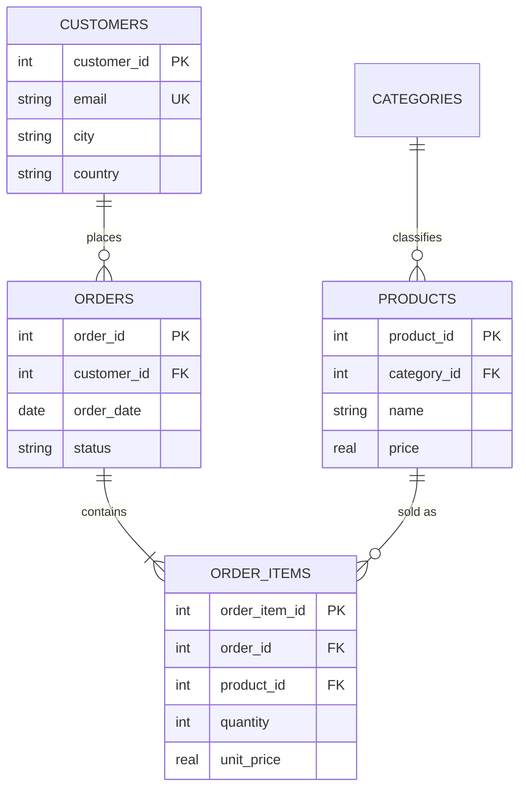
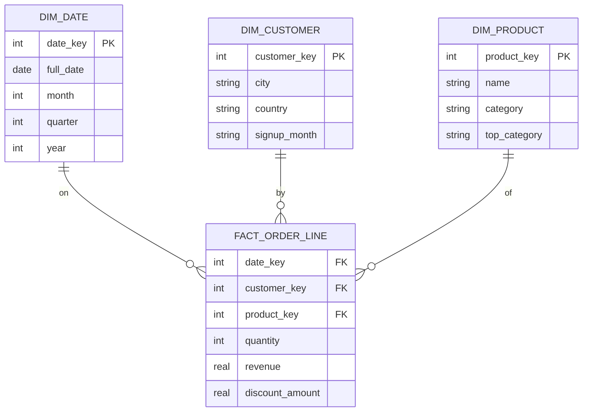

# Normal forms and denormalization

> **Before this lesson:** you should know what a primary key, a foreign key and a unique constraint are ([Databases and the relational model](#/lesson/sql/relational-model), [Constraints and cascading](#/lesson/sql/constraints)), be able to join tables and aggregate ([Inner joins](#/lesson/sql/inner-joins), [Aggregate functions and GROUP BY](#/lesson/sql/group-by)), and know the difference between a database behind an application (OLTP) and one for analysis (OLAP) ([Clustering, sharding and big data](#/lesson/sql/sharding)).

## In plain words

The first lesson of this track said that each fact should be stored in exactly one place. The process of arranging tables so that this is true is called **normalization**. This lesson makes the idea precise.

An everyday picture: your phone's contact list. Imagine there were no contact list, and that you typed a friend's phone number by hand into every message thread, every calendar invitation and every shared note. When the friend changes their number you would have to find and fix every copy, and you would miss some. From then on your phone would hold two different numbers for the same person and no way of knowing which is right. A contact list stores the number once; everything else *refers* to the contact. Normalization gives a database the same property.

The rules that describe how far a design has been tidied are called **normal forms**. They are numbered: first normal form (1NF), second (2NF), third (3NF), and a slightly stronger one named after its inventors, Boyce-Codd normal form (BCNF). Each removes one specific kind of repetition.

Sometimes repetition is introduced again on purpose, to make reports fast. That is **denormalization**, and the second half of the lesson covers when it is the right thing to do.

**Why it matters for a job.** Designing tables is a staple of backend and data-engineering interviews, usually phrased as "design the tables for X" or "what is wrong with this table?". In daily work, a badly structured table causes years of data that contradicts itself.

## The problem: one big table

Suppose a young company tracks its orders in one table shaped like a spreadsheet. The block below builds such a table from the shop data and shows one customer's rows.

```sql-run dataset=shop
CREATE TABLE order_sheet AS
SELECT o.order_id, o.order_date,
       c.customer_id, c.first_name || ' ' || c.last_name AS customer_name, c.email, c.city, c.country,
       group_concat(p.name || ' x' || oi.quantity, '; ') AS items,
       ROUND(SUM(oi.quantity * oi.unit_price), 2) AS order_total
FROM orders o
JOIN customers c    ON c.customer_id = o.customer_id
JOIN order_items oi ON oi.order_id = o.order_id
JOIN products p     ON p.product_id = oi.product_id
GROUP BY o.order_id;

SELECT * FROM order_sheet WHERE customer_id = 5;
```

Six rows, one for each order of customer 5. Every row repeats "James Okafor", his email, "Manchester" and "UK". The `items` column packs several things into one piece of text, such as `Office Chair x2; Espresso Machine x1`.

It is convenient to read, and it is full of trouble. The troubles have names; a problem caused by a table's structure is called an **anomaly**.

- **Update anomaly.** The customer's name, email and city are stored once per order. If he moves, every one of his rows must change. Miss one and the table says he lives in two cities.
- **Insertion anomaly.** A customer who has not ordered yet cannot be recorded, because there is no order row to put them on. Nor can a new product.
- **Deletion anomaly.** Delete a customer's only order and the fact that the customer exists is gone as well.
- **Values that cannot be queried.** "How many office chairs were sold?" means picking apart text.
- **Calculated values that can drift.** `order_total` can disagree with the items it was calculated from.

Normalization is a systematic way of removing these problems by splitting the table along the lines of what depends on what.

## Functional dependencies and keys

The central idea is the **functional dependency**. We say "X determines Y", written X → Y, when knowing the value of X tells you the value of Y: any two rows with the same X must have the same Y. In the sheet, `customer_id → customer_name, email, city, country`: one customer id always goes with one name, one email, one city. And `order_id → order_date, customer_id`.

A dependency is a statement about the *rules of the business*, not about whatever data happens to be loaded today. You can, though, check whether the current data *breaks* a supposed dependency. Does `customer_id → city` hold? A violation would be a customer with more than one city:

```sql-run dataset=shop
CREATE TABLE order_sheet AS
SELECT o.order_id, c.customer_id, c.city, c.country
FROM orders o JOIN customers c ON c.customer_id = o.customer_id;

SELECT customer_id, COUNT(DISTINCT city) AS cities
FROM order_sheet
GROUP BY customer_id
HAVING COUNT(DISTINCT city) > 1;
```

No rows come back, which is the good outcome: no customer id appears with two different cities. (`GROUP BY x HAVING COUNT(DISTINCT y) > 1` is a useful data-quality check in general.)

Some vocabulary about keys, which the definitions below use:

- A **superkey** is any set of columns that identifies a row uniquely.
- A **candidate key** is a superkey with nothing to spare: remove any column and it no longer identifies rows.
- The **primary key** is the candidate key you choose. The others are **alternate keys**, enforced with `UNIQUE`.
- A **composite key** is a key made of more than one column.
- A column that belongs to some candidate key is a **key column** (textbooks say "prime attribute"). The rest are **non-key columns**.

A normal form is a rule about which functional dependencies a table is allowed to contain.

## First normal form (1NF)

> Every column holds a **single value**; there are no repeating groups; each row can be identified.

A single, indivisible value is called **atomic**. Violations:

- a column holding several values: `items = 'Yoga Mat x1; Jump Rope x2'`, or `tags = 'red,large'`;
- repeating columns: `item1, qty1, item2, qty2, item3, qty3`;
- no key at all, so identical rows cannot be told apart.

The fix is one row per value. The sheet becomes one row per **order line** (one product within one order), with the composite key `(order_id, product_id)`:

`order_lines(order_id, product_id, order_date, customer_id, customer_name, email, city, country, product_name, category, unit_price, quantity)`

Now "how many yoga mats?" is `SUM(quantity) WHERE product_name = 'Yoga Mat'`.

What counts as atomic depends on use. A full address in one column is fine if you only ever print it, and a violation if you need to filter by city.

> [!NOTE]
> Modern databases have columns that hold lists or nested data (JSON). These are legitimate tools for data whose shape varies. But if you find yourself filtering or joining on values *inside* such a column, that data wants to be ordinary columns and rows.

## Second normal form (2NF)

> 1NF, and every non-key column depends on the **whole** of the key, never on only part of it.

A dependency on part of a key is a **partial dependency**. 2NF can only be violated in a table with a composite key. In `order_lines` the key is `(order_id, product_id)`, but:

- `order_id → order_date, customer_id, ...` depends on one half of the key;
- `product_id → product_name, category` depends on the other half.

Only `quantity` and the price charged depend on the whole key. The consequence: the order date is repeated on every line of an order, and a product's name on every line on which it was ever sold. Split the table, giving each "determiner" a table of its own:

- `orders(order_id, order_date, customer_id, customer_name, email, city, country)`
- `products(product_id, product_name, category)`
- `order_items(order_id, product_id, quantity, unit_price)`

`unit_price` stays on the order line on purpose. It is the price *at the time of the sale*, a fact about that line, not about the product as it is priced today.

## Third normal form (3NF)

> 2NF, and no non-key column depends on another non-key column.

A dependency that passes through a third column is a **transitive dependency**. In `orders`, `order_id → customer_id`, and `customer_id → customer_name, email, city, country`. The customer's details depend on the key only *by way of* `customer_id`. That is still repetition: a customer's email appears on every one of their orders. Move it out:

- `customers(customer_id, customer_name, email, city, country)`
- `orders(order_id, order_date, customer_id)`

A classic summary: every non-key column must state a fact about **the key, the whole key, and nothing but the key**. "The key" is 1NF's demand that there be one. "The whole key" is 2NF. "Nothing but the key" is 3NF.

After 3NF we have arrived at essentially the `shop` tables you have been querying all along:



Is the shop design *perfectly* in 3NF? Not quite, and it is instructive to see why. If a city belongs to exactly one country (`city → country`), then `customers.country` depends on the key by way of `city`. A purist would add a `cities` table. Whether that is worth doing depends on whether the repetition can actually cause harm in your application. Normal forms are a tool for reasoning, not a law.

## Boyce-Codd normal form (BCNF)

> For every dependency X → Y in the table, **X is a superkey**.

Put differently: the only things allowed to determine other columns are keys. BCNF is a slightly stricter 3NF. The difference shows only in tables that have **overlapping candidate keys**.

The textbook example is `enrollment(student, course, instructor)` with two rules:

- each instructor teaches exactly one course: `instructor → course`;
- a student has one instructor per course: `(student, course) → instructor`.

The candidate keys are `(student, course)` and `(student, instructor)`. Every column belongs to some key, so 3NF, which only restricts non-key columns, is satisfied. Yet `instructor → course` has a left side that is not a superkey, and the fact "Dr Lee teaches Databases" is repeated for every one of Dr Lee's students. The BCNF split is `instructor_course(instructor, course)` and `student_instructor(student, instructor)`.

There is a catch. After the split, the rule "one instructor per student and course" can no longer be enforced by a plain key, because its columns are now in different tables. For that reason 3NF is the usual practical target, with BCNF applied where it costs nothing.

**Higher forms** exist (4NF, 5NF, 6NF) and are rarely discussed outside specialised design work.

| Form | Requirement | What it removes |
|---|---|---|
| 1NF | single values, no repeating groups, a key | cells holding several values |
| 2NF | and no dependency on part of a composite key | facts about part of the key |
| 3NF | and no dependency by way of a non-key column | facts about other non-key columns |
| BCNF | every determiner is a superkey | the remaining repetition when keys overlap |

## Splitting without losing anything

Splitting a table is valid only if joining the pieces gives back exactly the original rows: none missing, none invented. Such a split is called **lossless**. It is guaranteed when the columns the two pieces share form a key of at least one of them. That is why you split along "determiner → what it determines" and keep the determiner in both tables, as a foreign key in one and the primary key in the other.

You can check that the shop's tables rebuild the order-line view:

```sql-run dataset=shop
SELECT COUNT(*) AS order_lines_rebuilt,
       (SELECT COUNT(*) FROM order_items) AS order_items_rows
FROM order_items oi
JOIN orders o    ON o.order_id = oi.order_id
JOIN customers c ON c.customer_id = o.customer_id
JOIN products p  ON p.product_id = oi.product_id;
```

462 and 462. Joining the four tables gives exactly one row per order item: nothing lost, nothing invented.

## The benefits, and the cost

A normalized design gives you:

- **integrity**: each fact is updated in one place, and constraints can enforce the rules;
- **smaller writes** and less storage;
- **flexibility**: a new question is answered with a new join, not by restructuring the data.

The cost is **joins**. Reading one complete order touches four tables. For a database behind an application (OLTP), with many small reads and writes, that is the right trade. For analysis over hundreds of millions of rows, large joins repeated in every query are expensive, and the balance shifts.

## Denormalization

**Denormalization** is the *deliberate* reintroduction of repetition, to make reading faster or simpler. Deliberate is the important word: you start from a normalized design, know exactly which fact you are copying, and take responsibility for keeping the copies in step.

| Technique | Example | Risk |
|---|---|---|
| Copying a parent's column onto the child | `orders.customer_country` | out of date after the customer moves |
| Storing a calculated value | `orders.order_total`, `customers.lifetime_value` | drifts away from the detail rows |
| A wide table joined in advance | one row per order line with customer and product details | large; must be rebuilt |
| A summary table | daily revenue per category | must be refreshed |
| Recording a value as it was at the time | the price at the time of sale, on the order line | none: this is often *correct*, not repetition |

The last row deserves emphasis. `order_items.unit_price` looks like a copy of `products.price`. It records a *different fact*: what the customer was charged. Keeping it is not denormalization, and removing it would be a bug, because old orders would change value whenever a price changed.

A denormalized table for reports is easily built from the normalized ones:

```sql-run dataset=shop
CREATE TABLE order_summary AS
SELECT o.order_id, o.order_date, o.status,
       c.customer_id, c.country,
       COUNT(*) AS line_count,
       SUM(oi.quantity) AS items,
       ROUND(SUM(oi.quantity * oi.unit_price * (1 - oi.discount)), 2) AS subtotal,
       ROUND(SUM(oi.quantity * oi.unit_price * (1 - oi.discount)) + o.shipping_fee, 2) AS total
FROM orders o
JOIN customers c    ON c.customer_id = o.customer_id
JOIN order_items oi ON oi.order_id = o.order_id
GROUP BY o.order_id;

SELECT country, COUNT(*) AS orders, ROUND(AVG(total), 2) AS avg_order_value
FROM order_summary
WHERE status = 'delivered'
GROUP BY country
ORDER BY orders DESC;
```

The first statement builds `order_summary`: one row per order, with the customer's country copied in and the totals calculated. The second is a report that needs no join at all: the USA has 62 delivered orders worth 589.04 on average.

The price: `order_summary` is a copy, correct only as of the moment it was last built. Keep such tables in step by rebuilding them on a schedule or with materialized views ([Views](#/lesson/sql/views)), and keep the normalized tables as the **source of truth**, the one place that is right by definition.

## Star schemas

Databases built for analysis use a standard, intentionally denormalized design called a **star schema**:

- in the centre, a **fact table** with one row per event or measurement (one order line, one prediction), holding numbers to be added up, called **measures**, and foreign keys;
- around it, **dimension tables** (customer, product, date) that describe the event. They are wide and deliberately repetitive: the product dimension contains its category name directly instead of pointing at a category table.

Drawn on paper, the fact table sits in the middle with the dimensions around it like the points of a star.



Every analytical query then has the same shape: join the fact table to a few dimensions, filter and group by columns of the dimensions, and add up measures.

```sql
-- Typical star-schema query: revenue per year and top-level category
SELECT d.year, p.top_category, SUM(f.revenue) AS revenue
FROM fact_order_line f
JOIN dim_date d    ON d.date_key = f.date_key
JOIN dim_product p ON p.product_key = f.product_key
WHERE d.year = 2024
GROUP BY d.year, p.top_category;
```

A **snowflake schema** normalizes the dimensions again (product, then category, then department, each in its own table), giving up simplicity for less repetition. Column stores often go the other way, to one very wide table, because columns a query does not use cost nothing to skip.

In machine-learning systems, the table of training features (one row per customer per date, with hundreds of columns) is a deliberately denormalized structure built from normalized sources, for the same reason: a training job wants one wide read, not twenty joins.

## Design guidelines

1. **Design in 3NF first.** Find the things being described, their keys, and what each column depends on.
2. **Declare the keys and constraints**: primary keys, `UNIQUE` on alternate keys, foreign keys, `NOT NULL`, `CHECK`.
3. **Denormalize only with evidence** (a measured slow query, a reporting need), and write down what the source of truth is and how the copy is refreshed.
4. **Keep the application's database and the analytics apart.** Normalized tables feed denormalized reporting tables that can be rebuilt at any time.
5. **Record history where history matters**: prices, statuses and addresses as they were at the time of an event.

> [!INTERVIEW]
> For "what is wrong with this table?", look for three things in order: a cell holding several values (1NF); a column that depends on part of a composite key (2NF); a column that depends on another non-key column (3NF). Name the anomaly each causes, then propose the split. For "design the tables for X", list the things involved, give each a key, connect them with foreign keys, and say where you would keep a value as it was at the time, such as the price on an order line.

## Pitfalls

- **Lists separated by commas** in one column, and repeating groups such as `col1, col2, col3`.
- **Copying a parent's columns onto the child** "for convenience" in an application database.
- **Stored totals** that are never recalculated.
- **Normalizing too far**: a lookup table for values that never change and are never queried separately.
- **Mistaking a value recorded at the time for repetition.**
- **Treating a denormalized table as the source of truth.**

## Summary

- Repetitive designs suffer **update, insertion and deletion anomalies**.
- A **functional dependency** X → Y means that X determines Y; a **candidate key** is a smallest set of columns that determines everything.
- **1NF**: single values. **2NF**: no dependency on part of a key. **3NF**: no dependency by way of a non-key column; "the key, the whole key, and nothing but the key". **BCNF**: every determiner is a superkey.
- Split along dependencies, so that joining the pieces loses nothing.
- **Denormalize on purpose** for fast reading: copied columns, stored calculations, wide tables, summary tables, **star schemas**, always with the normalized data as the source of truth.

## Glossary

- **Normalization** — arranging tables so that each fact is stored once.
- **Normal form** — one of the numbered rules (1NF, 2NF, 3NF, BCNF) that a table design may satisfy.
- **Anomaly** — a problem caused by a table's structure: on update, insertion or deletion.
- **Functional dependency (X → Y)** — the value of X determines the value of Y.
- **Determiner (determinant)** — the left side of a dependency: the column or columns that determine others.
- **Superkey** — any set of columns that identifies a row uniquely.
- **Candidate key** — a superkey from which no column can be removed.
- **Composite key** — a key made of several columns.
- **Key column / non-key column** — a column that belongs to some candidate key / one that does not.
- **Atomic value** — a single, indivisible value in a cell.
- **Partial dependency** — a non-key column depending on only part of a composite key.
- **Transitive dependency** — a non-key column depending on the key by way of another non-key column.
- **Lossless split** — a split whose pieces, joined, give back exactly the original rows.
- **Denormalization** — reintroducing repetition on purpose to speed up reading.
- **Source of truth** — the one copy of the data that is right by definition.
- **Star schema** — a fact table surrounded by denormalized dimension tables.
- **Fact table / dimension table** — a table of events with measures / a table describing the things involved.
- **Measure** — a number in a fact table that is meant to be added up or averaged.
- **Snowflake schema** — a star schema whose dimensions are themselves normalized.

```quiz
[
  {"q": "A customer's email is stored on every one of their order rows. Changing it in only some rows is a...", "options": ["Insertion anomaly", "Deletion anomaly", "Update anomaly", "Phantom read"], "answer": 2, "explain": "Repeated copies can be updated inconsistently, leaving the data contradicting itself."},
  {"q": "Which violates first normal form?", "options": ["A composite primary key", "A tags column holding 'red,large,cotton'", "A column that allows NULL", "A foreign key"], "answer": 1, "explain": "A cell holding several values is not atomic; use one row per value in a child table."},
  {"q": "In order_lines with key (order_id, product_id), product_name depends only on product_id. Which normal form is violated?", "options": ["1NF", "2NF", "3NF", "None"], "answer": 1, "explain": "A non-key column that depends on part of a composite key is a partial dependency."},
  {"q": "orders(order_id, customer_id, customer_email), where customer_id -> customer_email, violates...", "options": ["1NF", "2NF", "3NF", "Nothing"], "answer": 2, "explain": "customer_email depends on the key only by way of the non-key column customer_id: a transitive dependency."},
  {"q": "What does BCNF require?", "options": ["No NULLs", "For every dependency X -> Y in the table, X is a superkey", "Only meaningless numeric keys", "No composite keys"], "answer": 1, "explain": "Only keys may determine other columns; BCNF removes the exception that 3NF grants to key columns."},
  {"q": "Why is order_items.unit_price not a denormalized copy of products.price?", "options": ["It is, and should be removed", "It records the price charged at the time of the sale, a different fact that must not change when the list price changes", "Prices cannot be joined", "It is indexed"], "answer": 1, "explain": "A value recorded as it was at the time belongs to the event."},
  {"q": "In a star schema, what does the fact table contain?", "options": ["Descriptive details of customers", "One row per event, with measures and foreign keys to the dimensions", "Only totals", "The data dictionary"], "answer": 1, "explain": "Facts are measurements; the dimension tables describe the things involved and are deliberately repetitive."},
  {"q": "A team builds an order_summary table for dashboards by joining and totalling the normalized tables. What must they remember?", "options": ["It replaces the original tables", "It is a copy that is correct only as of its last rebuild; the normalized tables stay the source of truth", "It can never be queried with GROUP BY", "It is automatically kept up to date"], "answer": 1, "explain": "Denormalized reporting tables must be refreshed, and corrections are made in the normalized data."}
]
```

> **Source:** Beaulieu, *Learning SQL*, ch. 1 (the relational model and normalization) and ch. 2 (table design and refinement), restated in original wording with this guide's own datasets. Normal-form definitions follow Codd and the standard database literature; Kleppmann, *Designing Data-Intensive Applications*, ch. 2-3, for normalized versus denormalized designs and star schemas.
