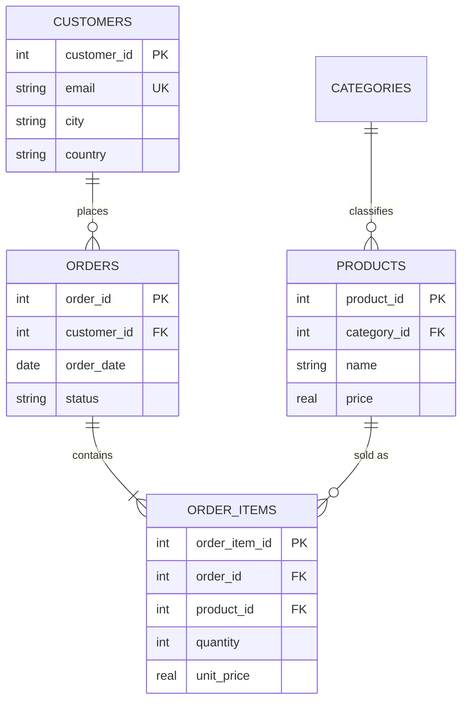
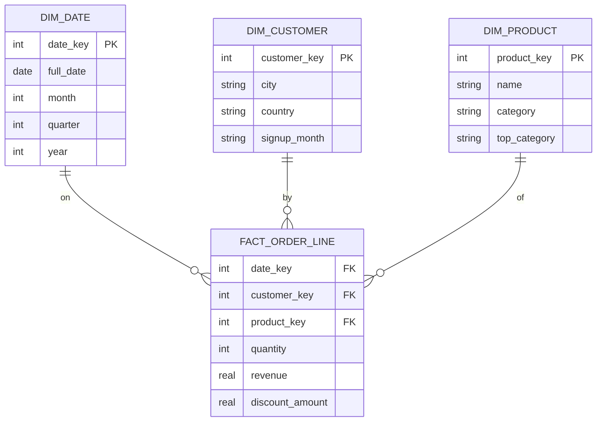

# Normal forms and denormalization

The very first lesson said that each independent fact should live in exactly one place, and called the process of achieving that **normalization**. This lesson makes the idea precise. You will see what goes wrong in a badly structured table (the *anomalies*), learn the vocabulary of **functional dependencies** and **keys**, walk a messy table through **1NF, 2NF, 3NF and BCNF**, and then look at the other side: when and how to **denormalize** deliberately for analytics, and what a **star schema** is. Schema-design questions are a staple of data-engineering and backend interviews, usually phrased as "design the tables for X" or "what's wrong with this table?".

## The problem: one big table

Suppose a startup tracks its orders in a single spreadsheet-like table:

```sql-run dataset=shop
CREATE TABLE order_sheet AS
SELECT o.order_id, o.order_date,
       c.customer_id, c.first_name || ' ' || c.last_name AS customer_name, c.email, c.city, c.country,
       group_concat(p.name || ' x' || oi.quantity, '; ') AS items,
       ROUND(SUM(oi.quantity * oi.unit_price), 2) AS order_total
FROM orders o
JOIN customers c    ON c.customer_id = o.customer_id
JOIN order_items oi ON oi.order_id = o.order_id
JOIN products p     ON p.product_id = oi.product_id
GROUP BY o.order_id;

SELECT * FROM order_sheet WHERE customer_id = 5;
```

It is convenient to read, and it is full of trouble:

- **Update anomaly.** Customer 5's name, email and city are stored once per order. If they move, every one of their rows must change; miss one and the data contradicts itself.
- **Insertion anomaly.** A customer who has not ordered yet cannot be recorded (there is no order row to put them on) — nor can a new product.
- **Deletion anomaly.** Delete a customer's only order and you lose the fact that the customer exists.
- **Unqueryable values.** `items` packs several facts into one string. "How many yoga mats were sold?" requires string parsing.
- **Derived data.** `order_total` can disagree with the items it was computed from.

Normalization is a systematic way to remove these problems by splitting the table along the lines of its dependencies.

## Functional dependencies and keys

A **functional dependency** `X → Y` ("X determines Y") holds when any two rows that agree on X must also agree on Y. In the sheet: `customer_id → customer_name, email, city, country`; `order_id → order_date, customer_id`.

Dependencies are statements about the *business rules*, not about whatever data happens to be loaded — but you can check whether current data *violates* a supposed dependency. Does `customer_id → city` hold in the sheet? A violation would be a customer with more than one city:

```sql-run dataset=shop
CREATE TABLE order_sheet AS
SELECT o.order_id, c.customer_id, c.city, c.country
FROM orders o JOIN customers c ON c.customer_id = o.customer_id;

SELECT customer_id, COUNT(DISTINCT city) AS cities
FROM order_sheet
GROUP BY customer_id
HAVING COUNT(DISTINCT city) > 1;
```

No rows: the dependency is not violated. (This `GROUP BY x HAVING COUNT(DISTINCT y) > 1` query is a useful data-quality check in its own right.)

Key vocabulary:

- A **superkey** is any set of columns that determines all the others (uniquely identifies a row).
- A **candidate key** is a *minimal* superkey — remove any column and it no longer identifies rows.
- The **primary key** is the candidate key you choose; the others are **alternate keys** (enforce them with UNIQUE).
- A **prime attribute** belongs to some candidate key; the rest are **non-prime**.

Normal forms are rules about which functional dependencies a table is allowed to contain.

## First normal form (1NF)

> Every column holds a **single, atomic value**; there are no repeating groups; each row is uniquely identifiable.

Violations:

- a multi-valued column: `items = 'Yoga Mat x1; Jump Rope x2'`, `tags = 'red,large'`;
- repeating columns: `item1, qty1, item2, qty2, item3, qty3`;
- no key at all (duplicate rows indistinguishable).

The fix is one row per value. Our sheet becomes one row per **order line**, with key `(order_id, product_id)`:

`order_lines(order_id, product_id, order_date, customer_id, customer_name, email, city, country, product_name, category, unit_price, quantity)`

Now "how many yoga mats?" is `SUM(quantity) WHERE product_name = 'Yoga Mat'`. What counts as *atomic* depends on use: a full address in one column is fine if you only ever print it, and a violation if you filter by city.

> [!NOTE]
> Modern databases support arrays and JSON columns (PostgreSQL `jsonb`, MySQL `JSON`, SQLite JSON functions). These are legitimate tools for genuinely semi-structured data, but if you find yourself filtering or joining on values *inside* them, that data wants to be columns and rows.

## Second normal form (2NF)

> 1NF, and every non-prime attribute depends on the **whole** of every candidate key — no **partial dependencies**.

2NF only matters for tables with a **composite** key. In `order_lines` the key is `(order_id, product_id)`, but:

- `order_id → order_date, customer_id, …` (depends on only part of the key),
- `product_id → product_name, category` (depends on the other part).

Only `quantity` and the price charged depend on the whole key. So the order date is repeated on every line of an order, and a product's name on every line it was ever sold. Split by determinant:

- `orders(order_id, order_date, customer_id, customer_name, email, city, country)`
- `products(product_id, product_name, category)`
- `order_items(order_id, product_id, quantity, unit_price)`

(`unit_price` stays on the line deliberately: it is the price *at the time of sale*, a fact about the line, not about the product today.)

## Third normal form (3NF)

> 2NF, and no non-prime attribute depends on another non-key attribute — no **transitive dependencies**.

In `orders`, `order_id → customer_id` and `customer_id → customer_name, email, city, country`. The customer details depend on the key only *through* `customer_id`. That is still redundancy: a customer's email repeats on each of their orders. Move it out:

- `customers(customer_id, customer_name, email, city, country)`
- `orders(order_id, order_date, customer_id)`

The classic summary, attributed to Bill Kent: every non-key attribute must provide a fact about **the key, the whole key, and nothing but the key**. ("The key" = 1NF's requirement of a key; "the whole key" = 2NF; "nothing but the key" = 3NF.)

After 3NF we have arrived at essentially the `shop` schema you have been querying all along:



Is the shop schema *perfectly* 3NF? Not quite, and it is instructive to see why. If `city → country` (a city belongs to one country), then `customers.country` is transitively dependent via `city`; a purist would add a `cities` table. Whether that is worth it depends on whether the redundancy can actually cause harm in your application. Normal forms are a tool for reasoning, not a religion.

## Boyce–Codd normal form (BCNF)

> For every non-trivial functional dependency `X → Y`, **X is a superkey**.

BCNF is a slightly stronger 3NF. 3NF tolerates a dependency whose right-hand side is a *prime* attribute; BCNF does not. The difference only shows up in tables with **overlapping candidate keys**.

The textbook example: `enrollment(student, course, instructor)` with the rules

- each instructor teaches exactly one course: `instructor → course`;
- a student has one instructor per course: `(student, course) → instructor`.

Candidate keys are `(student, course)` and `(student, instructor)`. Every attribute is prime, so the table is in 3NF — yet `instructor → course` has a determinant that is not a superkey, and the fact "Dr. Lee teaches Databases" is repeated for every student of Dr. Lee. The BCNF decomposition is `instructor_course(instructor, course)` and `student_instructor(student, instructor)`.

There is a catch: after the split, the rule `(student, course) → instructor` can no longer be enforced by a simple key constraint — the decomposition is not *dependency preserving*. That is why 3NF, which always allows a lossless, dependency-preserving decomposition, is the usual practical target, with BCNF applied where it is free.

**Higher forms** exist — 4NF (no independent multi-valued facts in one table, e.g. an employee's skills and languages), 5NF, 6NF — and are rarely discussed outside specialised design work.

| Form | Requirement | Removes |
|---|---|---|
| 1NF | atomic values, no repeating groups, a key | multi-valued cells |
| 2NF | + no partial dependency on a composite key | facts about part of the key |
| 3NF | + no transitive dependency via non-key attributes | facts about other non-key columns |
| BCNF | every determinant is a superkey | remaining redundancy with overlapping keys |

## Lossless decomposition

Splitting a table is only valid if joining the pieces gives back exactly the original rows — a **lossless join**. That is guaranteed when the columns shared by the two pieces form a key of at least one of them (which is why you split along `determinant → dependents`, keeping the determinant on both sides as a foreign key). You can verify the shop decomposition reproduces the order-line view:

```sql-run dataset=shop
SELECT COUNT(*) AS order_lines_rebuilt,
       (SELECT COUNT(*) FROM order_items) AS order_items_rows
FROM order_items oi
JOIN orders o    ON o.order_id = oi.order_id
JOIN customers c ON c.customer_id = o.customer_id
JOIN products p  ON p.product_id = oi.product_id;
```

Same count: nothing lost, nothing invented.

## The benefits — and the cost

Normalized schemas give you:

- **integrity** — one place to update each fact; constraints can enforce the rules;
- **smaller writes** and less storage;
- **flexibility** — new questions are answered by new joins, not by restructuring.

The cost is **joins**. Reading a complete order touches four tables. For transaction processing (OLTP) — many small reads and writes — that is the right trade. For analytics over hundreds of millions of rows, repeated large joins are expensive, and the balance shifts.

## Denormalization

**Denormalization** is the *deliberate* reintroduction of redundancy to make reads faster or simpler. Deliberate is the key word: you start from a normalized design, know exactly which dependency you are duplicating, and take responsibility for keeping the copies consistent.

Common techniques:

| Technique | Example | Risk |
|---|---|---|
| Duplicate a parent column on the child | `orders.customer_country` | stale after the customer moves |
| Stored derived values | `orders.order_total`, `customers.lifetime_value` | drift from the detail rows |
| Pre-joined wide tables | one row per order line with customer and product attributes | large, must be rebuilt |
| Summary (aggregate) tables | daily revenue per category | must be refreshed |
| Snapshots / history | price at time of sale on the line | — (often *correct*, not redundant) |

The last row deserves emphasis. `order_items.unit_price` looks like a copy of `products.price`, but it records a *different fact*: what the customer was charged. Keeping it is not denormalization; dropping it would be a bug.

A denormalized reporting table is easily built from the normalized one:

```sql-run dataset=shop
CREATE TABLE order_summary AS
SELECT o.order_id, o.order_date, o.status,
       c.customer_id, c.country,
       COUNT(*) AS line_count,
       SUM(oi.quantity) AS items,
       ROUND(SUM(oi.quantity * oi.unit_price * (1 - oi.discount)), 2) AS subtotal,
       ROUND(SUM(oi.quantity * oi.unit_price * (1 - oi.discount)) + o.shipping_fee, 2) AS total
FROM orders o
JOIN customers c    ON c.customer_id = o.customer_id
JOIN order_items oi ON oi.order_id = o.order_id
GROUP BY o.order_id;

SELECT country, COUNT(*) AS orders, ROUND(AVG(total), 2) AS avg_order_value
FROM order_summary
WHERE status = 'delivered'
GROUP BY country
ORDER BY orders DESC;
```

Dashboards now need no joins. The price: `order_summary` is a copy, correct only as of its last rebuild. Keep such tables consistent by rebuilding them on a schedule (the dbt/ELT approach), with materialized views, or with triggers — and keep the normalized tables as the **source of truth**.

## Star schemas

Analytical databases use a standard, intentionally denormalized design — the **dimensional model** or **star schema**:

- a central **fact table** with one row per event or measurement at a declared grain (one order line, one prediction), holding numeric **measures** and foreign keys;
- surrounding **dimension tables** — customer, product, date, model — that are wide and denormalized (the product dimension contains its category and top-level category names directly, flattening the hierarchy).



Every analytical query has the same shape: join the fact to a few dimensions, filter on dimension attributes, group by dimension attributes, aggregate measures. A **snowflake schema** normalizes the dimensions again (product → category → department), trading simplicity for less redundancy. Columnar warehouses often go further still, to a single very wide table, because unused columns cost nothing to scan.

In ML platforms, the **offline feature table** — one row per entity per timestamp with hundreds of feature columns — is a deliberately denormalized structure built from normalized sources, for the same reason: training jobs want one wide scan, not twenty joins.

## Design guidelines

1. **Model in 3NF first.** Find the entities, their keys, and what each column depends on.
2. **Declare the keys and constraints** — primary keys, UNIQUE on natural keys, foreign keys, NOT NULL, CHECK.
3. **Denormalize only with evidence** (a measured slow query, a reporting need), and document the source of truth and the refresh mechanism.
4. **Separate OLTP from analytics**: normalized transactional tables feed denormalized, rebuildable reporting models.
5. **Record history where history matters** (prices, statuses, addresses at the time of an event).

## Pitfalls

- **Comma-separated lists** and `col1, col2, col3` repeating groups.
- **Copying parent attributes onto children** "for convenience" in an OLTP schema.
- **Stored totals** that are never recomputed.
- **Over-normalizing**: lookup tables for values that never change or are never queried separately.
- **Confusing point-in-time facts with redundancy.**
- **Treating a denormalized table as the source of truth.**

## Summary

- Redundant designs suffer **update, insertion and deletion anomalies**.
- A **functional dependency** X → Y means X determines Y; **candidate keys** are minimal sets determining everything.
- **1NF**: atomic values. **2NF**: no partial dependencies. **3NF**: no transitive dependencies — "the key, the whole key, and nothing but the key". **BCNF**: every determinant is a superkey.
- Decompose along dependencies so that joins are lossless.
- **Denormalize deliberately** for read performance: duplicated columns, derived values, wide tables, summary tables, **star schemas** — with the normalized data as the source of truth.

```quiz
[
  {"q": "A customer's email is stored on every one of their order rows. Changing it in only some rows is a...", "options": ["Insertion anomaly", "Deletion anomaly", "Update anomaly", "Phantom read"], "answer": 2, "explain": "Redundant copies can be updated inconsistently."},
  {"q": "Which violates first normal form?", "options": ["A composite primary key", "A tags column holding 'red,large,cotton'", "A nullable column", "A foreign key"], "answer": 1, "explain": "A multi-valued cell is not atomic; use one row per value in a child table."},
  {"q": "In order_lines with key (order_id, product_id), product_name depends only on product_id. Which normal form is violated?", "options": ["1NF", "2NF", "3NF", "None"], "answer": 1, "explain": "A non-key attribute depending on part of a composite key is a partial dependency."},
  {"q": "orders(order_id, customer_id, customer_email) where customer_id -> customer_email violates...", "options": ["1NF", "2NF", "3NF", "Nothing"], "answer": 2, "explain": "customer_email depends on the key only transitively, through the non-key attribute customer_id."},
  {"q": "What does BCNF require?", "options": ["No NULLs", "For every non-trivial dependency X -> Y, X is a superkey", "Only surrogate keys", "No composite keys"], "answer": 1, "explain": "BCNF removes the exception 3NF grants to dependencies on prime attributes."},
  {"q": "Why is order_items.unit_price not a denormalization of products.price?", "options": ["It is, and should be removed", "It records the price charged at the time of sale - a different fact that must not change when the catalogue price changes", "Prices cannot be joined", "It is indexed"], "answer": 1, "explain": "Point-in-time facts belong to the event."},
  {"q": "In a star schema, what does the fact table contain?", "options": ["Descriptive attributes of customers", "One row per event at a declared grain, with measures and foreign keys to dimensions", "Only aggregated totals", "The data dictionary"], "answer": 1, "explain": "Facts are measurements; dimensions describe the context and are denormalized."}
]
```

> **Source:** Beaulieu, *Learning SQL*, ch. 1 (the relational model and normalization) and ch. 2 (table design and refinement). Normal-form definitions follow Codd and the standard database literature (e.g. Kleppmann, *Designing Data-Intensive Applications*, ch. 2-3 for normalized vs denormalized and star schemas).
