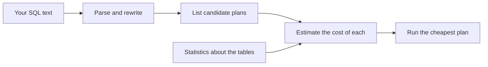
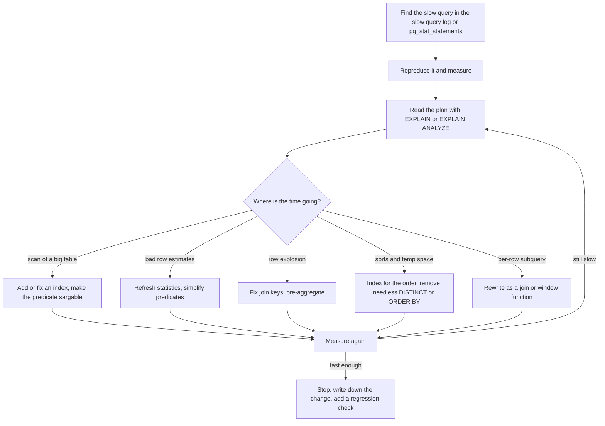

# Query performance tuning

> **Before this lesson:** you should be able to read the output of `EXPLAIN QUERY PLAN` and know what an index, a composite index, a covering index and a sargable condition are ([Indexes and query plans](#/lesson/sql/indexes)). You should be comfortable with joins and grouping ([Inner joins](#/lesson/sql/inner-joins), [Outer joins](#/lesson/sql/outer-joins), [Aggregate functions and GROUP BY](#/lesson/sql/group-by)), with subqueries and CTEs ([Correlated subqueries, EXISTS and subqueries as data sources](#/lesson/sql/correlated-exists), [Common table expressions](#/lesson/sql/ctes)) and with `EXCEPT` ([INTERSECT, EXCEPT and set operation rules](#/lesson/sql/intersect-except)). Window functions ([LAG, LEAD, running totals and frames](#/lesson/sql/lag-lead-frames)), locking ([Multiuser databases and locking](#/lesson/sql/locking)) and partitioning ([Partitioning](#/lesson/sql/partitioning)) come up briefly; those lessons help but are not required.

## In plain words

A query can return exactly the right answer and still be a problem. If it takes ten minutes, nobody can use it. If it takes a tenth of a second today on a small table, it may take a minute next year when the table is a hundred times bigger, and on that day it becomes an emergency. **Query performance tuning** is the work of making a correct query do less work, so that it returns the same answer faster and puts less load on the database.

An everyday picture: the navigation app in a car. You type a destination; you do not tell the app which streets to take. The app looks at its map and its traffic information, considers several routes, estimates how long each will take, and picks the quickest. A database treats a query the same way. You describe the result you want; a component called the **optimizer** picks the route, which is called the **query plan**. When the app's traffic information is out of date, it confidently sends you into a jam. When a road is missing from its map, it sends you the long way round. Tuning a query means checking which route was chosen and why, then giving the planner a better map (an index, a condition it can use) or fresher traffic information (up-to-date statistics).

Tuning is not guesswork. It is a loop you can repeat: **measure, read the plan, form a guess about the cause, change one thing, measure again**. This final lesson turns what the earlier lessons taught into that method: how the optimizer decides, how to read its plans, the usual causes of slow queries and their fixes, and a checklist for code reviews and interviews.

**Why it matters for a job.** "This query is slow; what would you do?" is one of the most common SQL interview questions for backend, data-engineering and analytics roles, and a methodical answer stands out. At work, slow queries cause application timeouts and dashboards that never load, and on cloud data warehouses that charge by the amount of data a query reads, they cost real money.

## Why a correct query can be slow

The time a query takes goes on a few kinds of work: reading rows from disk or memory, testing them against conditions, matching rows between tables, sorting, and sending the result back. How much of that work happens depends far more on *how* the database goes about it than on how the query is worded.

Reading every row of a table is called a **full table scan**. Its cost grows in step with the table: ten times the rows, ten times the work. Looking rows up through a B-tree index takes a few steps whatever the size of the table ([Indexes and query plans](#/lesson/sql/indexes)). On the 249 orders in this guide's shop data both finish in well under a millisecond, which is exactly why you cannot judge a plan by timing it on small data. On 249 million orders the difference is a fraction of a second against minutes.

So the questions to ask are always the same: how many rows does each step read, how many does it keep, and does any step repeat once for every row of another? The query plan answers all three.

## How the optimizer thinks

The **optimizer** is the part of the database that decides how to carry out a query. Its output, the **query plan** (also called the **execution plan**), is the list of steps the database will actually perform. For each query the optimizer goes through four stages.

1. **Parse and rewrite.** It checks the SQL and simplifies it. It may fold a view or a CTE into the main query, tidy up conditions, and turn an `IN (subquery)` into a **semi-join**: a join that stops looking as soon as it finds the first match.
2. **List candidate plans.** For each table it considers an **access path**, the way rows are fetched from that table: a full table scan; an **index search**, which goes down the B-tree to one value; an **index range scan**, which goes down to the start of a range and reads along the sorted entries to its end; or a covering-index read that never touches the table. For queries over several tables it also considers the **join order** (which table is read first) and the **join algorithm**.
3. **Estimate the cost** of each candidate. **Cost** is the optimizer's own score for how much work a plan will take, mostly a prediction of how many rows and **pages** (the fixed-size blocks in which a database stores rows on disk) it will read. To make the prediction it uses **statistics**: facts it has stored about each table, such as its number of rows, how many different values each indexed column holds and, in some databases, how those values are spread. Predicting how many rows a step will produce is called **cardinality estimation**. (Lesson 25 used *cardinality* for the number of different values in a column; in optimizer talk the same word means the number of rows a step returns. The context tells you which is meant.)
4. **Pick the cheapest plan** and run it.



The three join algorithms, each in one sentence:

- **Nested loop join**: for each row of the first table, look up the matching rows in the second. Fast when the first side is small and the second has an index on the join column.
- **Hash join**: build an in-memory lookup table from the join column of the smaller input, then pass over the larger input once and look each of its rows up. Good for large inputs with no useful index.
- **Merge join**: sort both inputs on the join column, then walk through them side by side, the way the two halves of a zip close together. Good when both inputs already arrive sorted.

SQLite, the database behind every runnable example in this guide, carries out all joins as nested loops, helped by indexes it can build on the fly. PostgreSQL, SQL Server and Oracle choose among all three algorithms; MySQL has offered hash joins since version 8.0.18.

Nearly every bad plan comes from a **bad cardinality estimate**. If the optimizer believes a filter will keep 40 rows and it actually keeps 96,000, it will choose a nested loop that performs 96,000 separate lookups where one hash join would have been far cheaper. Estimates go wrong for three main reasons:

- the statistics are **stale**, meaning they describe the table as it was before a large load or delete;
- a condition wraps a column in a function, so the optimizer cannot apply what it knows about that column;
- two columns are related in a way the optimizer does not know. It may treat `city = 'Paris'` and `country = 'France'` as independent and expect far fewer rows than there are.

That leaves two things in your hands. Give the optimizer **good options**: suitable indexes, conditions it can use them for, a sensible table design. And give it **good information**: fresh statistics and plain, direct conditions.

## Reading query plans

Every database can show its plan. Some can also run the query and report what actually happened at each step, which is the only way to see whether the estimates were right.

| Database | Show the plan | Run the query and show what actually happened |
|---|---|---|
| SQLite | `EXPLAIN QUERY PLAN <query>` | `.timer on` in the `sqlite3` shell (and `.scanstats on` where the shell was built with it) |
| PostgreSQL | `EXPLAIN <query>` | `EXPLAIN (ANALYZE, BUFFERS) <query>` |
| MySQL | `EXPLAIN <query>` | `EXPLAIN ANALYZE <query>` (version 8.0.18 and later) |
| SQL Server | "Display Estimated Execution Plan" in Management Studio | "Include Actual Execution Plan" in Management Studio |

### The simplest plan: one table, no index

Start with one table and one condition.

```sql-run dataset=shop
EXPLAIN QUERY PLAN
SELECT order_id, order_date
FROM orders
WHERE status = 'pending';
```

The first line, `EXPLAIN QUERY PLAN`, changes what the statement does: instead of running the query and returning orders, SQLite returns its plan. The rest is an ordinary query: from `orders`, keep the rows whose `status` is `'pending'` and show two of their columns.

The result has four columns. `id` and `parent` number the steps and show which step sits inside which; `notused` can be ignored. The column to read is `detail`, and here it says `SCAN orders`. In SQLite's plans, **SCAN** means a full table scan: all 249 orders are read and the condition is tested on each one. There is no index on `status`, so there is no other way to be sure of finding every pending order. Delete the first line and run the block again to see the 24 pending orders themselves.

### A lookup by primary key

```sql-run dataset=shop
EXPLAIN QUERY PLAN
SELECT order_id, order_date, status
FROM orders
WHERE order_id = 42;
```

Now `detail` says `SEARCH orders USING INTEGER PRIMARY KEY (rowid=?)`. **SEARCH** means the database goes directly to the matching rows instead of reading them all. `order_id` is declared `INTEGER PRIMARY KEY`, and in SQLite that column is the key the table's own rows are stored by (SQLite calls it the **rowid**), so finding order 42 takes a handful of steps. The `?` stands for the value being looked up. Without the `EXPLAIN QUERY PLAN` line the query returns one row: order 42, placed on 2024-03-03, status delivered.

### A join with grouping and sorting

Next, a realistic report: the number of delivered orders from December 2024, per customer country.

```sql-run dataset=shop
SELECT c.country, COUNT(*) AS orders
FROM orders o
JOIN customers c ON c.customer_id = o.customer_id
WHERE o.order_date >= '2024-12-01' AND o.status = 'delivered'
GROUP BY c.country
ORDER BY orders DESC;
```

Clause by clause: `FROM orders o JOIN customers c ON ...` pairs each order with the customer who placed it; `WHERE` keeps delivered orders dated 1 December 2024 or later; `GROUP BY c.country` makes one group per country; `COUNT(*)` counts the orders in each group; `ORDER BY orders DESC` puts the largest group first. The answer has two rows: Japan with 3 orders and the USA with 1. Of the 20 December orders, only 4 were delivered.

Here is the plan for the same query:

```sql-run dataset=shop
EXPLAIN QUERY PLAN
SELECT c.country, COUNT(*) AS orders
FROM orders o
JOIN customers c ON c.customer_id = o.customer_id
WHERE o.order_date >= '2024-12-01' AND o.status = 'delivered'
GROUP BY c.country
ORDER BY orders DESC;
```

Read it from top to bottom; each line is one step.

- `SCAN o`: every row of `orders` is read and both filters are tested on each. 249 rows are read to keep 4.
- `SEARCH c USING INTEGER PRIMARY KEY (rowid=?)`: for each order that survives, one lookup in `customers` by primary key. A `SEARCH` line under a `SCAN` line is a nested loop join: the outer loop runs over `orders`, the inner lookup goes into `customers`.
- `USE TEMP B-TREE FOR GROUP BY`: SQLite builds a temporary sorted structure to bring the rows of each country together. A **temporary B-tree** is how SQLite sorts; each one is extra work and memory.
- `USE TEMP B-TREE FOR ORDER BY`: a second sort, this time of the grouped result by its count.

The join order is sensible: `orders` drives, because the filters are on it, and `customers` is looked up by key. The weak point is the first line: the filters have no index to work with.

### What to look for in any plan

1. **Full scans of large tables** where you expected a search. A scan of a 14-row lookup table is harmless; a scan of a 500-million-row table inside a dashboard query is the problem.
2. **The join order and algorithm.** Usually the table with the most selective filter should come first, so that later steps handle few rows.
3. **Sorts and temporary structures** for `ORDER BY`, `GROUP BY`, `DISTINCT` and window functions.
4. **Estimated against actual row counts**, in databases that report both (PostgreSQL and MySQL `EXPLAIN ANALYZE`, SQL Server's actual plan). A step where the two differ a hundredfold is where the plan went wrong.
5. **Steps that repeat**, such as a subquery executed once for every row of an outer table.

SQLite does not print estimated row counts, so here is what point 4 looks like in PostgreSQL. It is illustrative output for a much larger shop database; the numbers are invented for the example.

```text
-- PostgreSQL: EXPLAIN ANALYZE output (illustrative)
Nested Loop  (cost=0.86..352.10 rows=40 width=12) (actual time=0.05..1904.33 rows=96512 loops=1)
  ->  Index Scan using orders_status_idx on orders o  (cost=0.43..85.20 rows=40 width=8) (actual time=0.03..402.18 rows=96512 loops=1)
        Index Cond: (status = 'pending'::text)
  ->  Index Scan using customers_pkey on customers c  (cost=0.43..6.67 rows=1 width=12) (actual time=0.01..0.01 rows=1 loops=96512)
        Index Cond: (customer_id = o.customer_id)
Planning Time: 0.31 ms
Execution Time: 1911.02 ms
```

Lines marked `->` are steps that feed the line above them. In each line, the first pair of brackets holds the **estimates** (`cost` in the optimizer's own units, and `rows`) and the second pair holds what **actually** happened. The index scan on `orders` expected 40 pending orders and found 96,512. Believing there would be 40, the optimizer chose a nested loop, so the lookup into `customers` ran 96,512 times (`loops=96512`; for a step that loops, the time and rows shown are per loop). With a correct estimate it would most likely have chosen a hash join. The cure is not a change to the query: it is fresh statistics, covered under suspect 7 below.

### Giving the optimizer a better option

Add an index and ask for the plan again. Each Run starts from a fresh copy of the data, so the index is created in the same block.

```sql-run dataset=shop
CREATE INDEX orders_date_status ON orders (order_date, status, customer_id);

EXPLAIN QUERY PLAN
SELECT c.country, COUNT(*) AS orders
FROM orders o
JOIN customers c ON c.customer_id = o.customer_id
WHERE o.order_date >= '2024-12-01' AND o.status = 'delivered'
GROUP BY c.country
ORDER BY orders DESC;
```

The first step is now `SEARCH o USING COVERING INDEX orders_date_status (order_date>?)`. (SQLite writes `>` in plans for both `>` and `>=`.) Only December's entries in the index are read. Because the index also holds `status` and `customer_id`, everything the query needs from `orders` is in the index, so the table itself is never touched: the index **covers** the query.

Look closely at the brackets, though: `(order_date>?)`. Only the date was used to jump into the index. The index is sorted by date first, so the 20 December entries sit together, but the delivered ones are scattered among them and all 20 must be checked. Lesson 25's rule for composite indexes puts the columns tested with `=` first and the range column after them. Change one thing, the column order, and compare:

```sql-run dataset=shop
CREATE INDEX orders_status_date ON orders (status, order_date, customer_id);

EXPLAIN QUERY PLAN
SELECT c.country, COUNT(*) AS orders
FROM orders o
JOIN customers c ON c.customer_id = o.customer_id
WHERE o.order_date >= '2024-12-01' AND o.status = 'delivered'
GROUP BY c.country
ORDER BY orders DESC;
```

Now the brackets read `(status=? AND order_date>?)`: the database jumps straight to the delivered entries dated 1 December or later and reads exactly the 4 it needs. On 249 rows the gain cannot be measured. On a large table the first index reads every order in the date range and the second reads only the delivered ones in it.

The two sorts remain, but they now handle 4 rows and two country groups, so they cost almost nothing. Removing every temporary B-tree is not the goal; removing the ones that sort millions of rows is.

## The usual suspects

Most slow queries have one of a short list of causes. Each subsection gives the symptom, the fix and, where possible, a plan to try.

### 1. Missing or unusable indexes

This is the most common cause by far. Symptoms: a `SCAN` of a big table under a condition that keeps few rows, or a join whose inner table is scanned once for every row of the outer one.

A condition that keeps a small share of a table's rows is called **selective**, and the share it keeps is its **selectivity**. Indexes pay off for selective conditions; a condition that keeps 70% of a table is better served by reading the table straight through.

Join columns need indexes too. Here is a query for one customer's order lines, with no index on the foreign key `order_items.order_id`:

```sql-run dataset=shop
EXPLAIN QUERY PLAN
SELECT o.order_id, oi.product_id, oi.quantity
FROM orders o
JOIN order_items oi ON oi.order_id = o.order_id
WHERE o.customer_id = 51;
```

The plan is `SCAN oi`, then `SEARCH o USING INTEGER PRIMARY KEY`. With no fast way to find a given order's lines, SQLite turned the join around: it reads all 462 order lines and, for each one, looks up its order to test whether the customer is 51. Now index the two columns the query searches on:

```sql-run dataset=shop
CREATE INDEX order_items_order ON order_items (order_id);
CREATE INDEX orders_customer ON orders (customer_id);

EXPLAIN QUERY PLAN
SELECT o.order_id, oi.product_id, oi.quantity
FROM orders o
JOIN order_items oi ON oi.order_id = o.order_id
WHERE o.customer_id = 51;
```

`SEARCH o USING COVERING INDEX orders_customer (customer_id=?)` finds customer 51's orders, and `SEARCH oi USING INDEX order_items_order (order_id=?)` fetches the lines of each one. Only the 21 order lines that belong to customer 51 are read, not all 462.

The fixes, from the indexes lesson:

- Index columns used in selective `WHERE` conditions and in **join conditions**. Foreign keys matter most, because most databases do not index them for you.
- In a composite index, put **equality columns first, then the range or sort column**.
- Make the index **covering** for frequent queries by including the columns they select.
- Use a **partial index**, which covers only the rows meeting a condition, for queries that always filter on the same constant, such as `WHERE status = 'pending'`.

### 2. Non-sargable predicates

A **predicate** is a condition, in `WHERE`, `ON` or `HAVING`, that is true or false for each row. A predicate is **sargable** when an index can be used to answer it, which in practice means the bare column is compared with a value. An index can exist and still go unused when the column is hidden inside a function or a calculation.

| Slow | Fast |
|---|---|
| `WHERE strftime('%Y', order_date) = '2024'` | `WHERE order_date >= '2024-01-01' AND order_date < '2025-01-01'` |
| `WHERE lower(email) = 'a@x.com'` | store the email already lower-cased, or index `lower(email)` |
| `WHERE price * 1.2 > 100` | `WHERE price > 100 / 1.2` |
| `WHERE name LIKE '%book%'` | a full-text index; or a prefix search `LIKE 'book%'` |
| `WHERE CAST(order_id AS TEXT) = '42'` | `WHERE order_id = 42` |
| `WHERE COALESCE(city, '') = 'Austin'` | `WHERE city = 'Austin'` |

Both blocks below count the orders of June 2024.

```sql-run dataset=shop
CREATE INDEX orders_date ON orders (order_date);

EXPLAIN QUERY PLAN SELECT COUNT(*) FROM orders WHERE strftime('%Y-%m', order_date) = '2024-06';
```

```sql-run dataset=shop
CREATE INDEX orders_date ON orders (order_date);

EXPLAIN QUERY PLAN SELECT COUNT(*) FROM orders WHERE order_date >= '2024-06-01' AND order_date < '2024-07-01';
```

The first plan is `SCAN orders USING COVERING INDEX orders_date`: SQLite reads every entry of the index (it prefers the index to the table only because the index is smaller) and computes `strftime` on each date. It cannot jump anywhere, because the index is sorted by date, not by formatted month. The second plan is a `SEARCH` with `(order_date>? AND order_date<?)`: the database jumps to 1 June and stops at 1 July. The second condition is a **half-open range**: it includes its start and excludes its end, so it works for dates and timestamps alike. An order at 14:00 on 30 June is included, and nothing from 1 July is.

Also watch for **implicit type conversion**, a conversion the database inserts by itself when two values of different types are compared. Comparing a text column with a number, or joining an integer key to a text key, forces a conversion on every row and defeats the index in many databases. Keep the types of join columns identical.

### 3. Fetching more than you need

- **`SELECT *`** means more reading, more data sent over the network, and no chance of a covering index. On a column store, where each column is stored separately, it reads every column. Name the columns you need.
- **No `LIMIT`** on exploratory queries; no time range in `WHERE` on a table that grows every day.
- **Unneeded `DISTINCT` or `ORDER BY`**: each is a sort. An `ORDER BY` inside a subquery or a view usually has no effect on the final result and can go.
- **`UNION` where `UNION ALL` would do**: `UNION` must remove duplicates, which is another sort.

The first point in action. With an index on `(customer_id, order_date)`, compare all columns against one:

```sql-run dataset=shop
CREATE INDEX orders_cust_date ON orders (customer_id, order_date);

EXPLAIN QUERY PLAN SELECT * FROM orders WHERE customer_id = 7;
EXPLAIN QUERY PLAN SELECT order_date FROM orders WHERE customer_id = 7;
```

The first plan is `SEARCH orders USING INDEX ...`: after finding each entry, SQLite must go back to the table for `status` and `shipping_fee`. The second is `SEARCH orders USING COVERING INDEX ...`: the index holds everything, and the table is never read.

And the last point:

```sql-run dataset=shop
EXPLAIN QUERY PLAN SELECT customer_id FROM orders UNION SELECT customer_id FROM web_events;
EXPLAIN QUERY PLAN SELECT customer_id FROM orders UNION ALL SELECT customer_id FROM web_events;
```

The `UNION` plan contains `UNION USING TEMP B-TREE`, a structure for discarding duplicates; the `UNION ALL` plan has no such step. Use `UNION` when duplicates must go, and `UNION ALL` when they cannot occur or are wanted ([Set theory and UNION](#/lesson/sql/union)).

### 4. Row explosion in joins

The **grain** of a result is what one of its rows stands for: one customer, one order, one order line. Joining a table to another that has *several* matching rows per key multiplies the rows; this is called **fan-out**. Fan-out from one join is expected. Fan-out from two unrelated "many" tables joined to the same parent is a bug, and an expensive one.

```sql-run dataset=shop
-- Wrong: two independent "many" tables joined to the same customer
SELECT c.customer_id,
       COUNT(*) AS joined_rows,
       ROUND(SUM(oi.quantity * oi.unit_price * (1 - oi.discount)), 2) AS revenue,
       COUNT(e.event_id) AS events
FROM customers c
JOIN orders o          ON o.customer_id = c.customer_id
JOIN order_items oi    ON oi.order_id = o.order_id
LEFT JOIN web_events e ON e.customer_id = c.customer_id
WHERE c.customer_id = 51
GROUP BY c.customer_id;
```

The result says 336 joined rows, revenue 197,232.77 and 336 events. Customer 51 has 21 order lines and 16 web events. Nothing links a particular event to a particular order line, so the join pairs every line with every event: 21 × 16 = 336 rows. Each order line is counted 16 times, so the revenue is 16 times too high, and each event is counted 21 times. The query is wrong *and* it handled 336 rows where 37 would have done. Writing `COUNT(DISTINCT e.event_id)` would repair the event count and hide the problem while the revenue stayed wrong; reaching for `DISTINCT` to clean up a join is a warning sign.

The fix is to bring each "many" table down to one row per customer *before* joining, which is called **pre-aggregation**:

```sql-run dataset=shop
-- Right: aggregate each child table separately, then join one-to-one
WITH item_totals AS (
  SELECT o.customer_id, SUM(oi.quantity * oi.unit_price * (1 - oi.discount)) AS revenue
  FROM orders o JOIN order_items oi ON oi.order_id = o.order_id
  GROUP BY o.customer_id
),
event_totals AS (
  SELECT customer_id, COUNT(*) AS events FROM web_events GROUP BY customer_id
)
SELECT c.customer_id, ROUND(COALESCE(i.revenue, 0), 2) AS revenue, COALESCE(e.events, 0) AS events
FROM customers c
LEFT JOIN item_totals i  ON i.customer_id = c.customer_id
LEFT JOIN event_totals e ON e.customer_id = c.customer_id
ORDER BY revenue DESC
LIMIT 5;
```

`item_totals` has one row per customer with their revenue; `event_totals` has one row per customer with their event count. Each join is now one-to-one, so nothing multiplies. Customer 51 tops the list with 12,327.05 and 16 events, the true figures (197,232.77 ÷ 16 = 12,327.05). `LEFT JOIN` and `COALESCE` keep customers with no events and show 0 for them. Check the row count after every join when you build a query like this; it should never grow unless you meant it to.

### 5. Row-by-row thinking

SQL is built to process whole sets of rows at once. Code that handles one row at a time throws that advantage away.

- **Correlated subqueries evaluated once per row** on large tables. A **correlated subquery** refers to a column of the outer query, so it is run again for each outer row. Rewrite it as a join to a pre-aggregated derived table or as a window function.
- **Self joins for running totals or previous-row comparisons.** Joining a table to itself on "all earlier rows" does work that grows with the square of the row count: double the rows, four times the work. `SUM(...) OVER (ORDER BY ...)` and `LAG` do the same in one pass.
- **The N+1 problem** in application code: one query fetches a list, then the program sends one more query for each item in it. Many applications talk to the database through an **ORM** (object-relational mapper), a library that turns rows into objects, and ORMs make this mistake easy. Learn your ORM's **eager loading** option, which fetches the related rows in one query up front.
- **Loops of single-row INSERTs**, each in its own transaction. Put them in one transaction, or send many rows in one `INSERT`.

What N+1 looks like, and the set-based replacement. The `?` is a **placeholder**, a value the application fills in each time it sends the query:

```sql
-- N+1 (any database): one query for the list...
SELECT customer_id FROM customers WHERE country = 'Japan';
-- ...then the application loops and sends this once per customer found
SELECT order_id, order_date FROM orders WHERE customer_id = ?;

-- Batched insert (SQLite, PostgreSQL, MySQL): many rows in one statement
INSERT INTO logins (customer_id, login_date) VALUES (1, '2025-01-02'), (2, '2025-01-02'), (3, '2025-01-02');
```

```sql-run dataset=shop
-- One set-based query instead of 1 + N
SELECT c.customer_id, o.order_id, o.order_date
FROM customers c
JOIN orders o ON o.customer_id = c.customer_id
WHERE c.country = 'Japan'
ORDER BY c.customer_id, o.order_date;
```

One round trip to the database returns every Japanese customer's orders: 23 rows for 4 customers here, and still one query if there were 4,000 customers.

Now compare two ways of finding each customer's latest order date:

```sql-run dataset=shop
EXPLAIN QUERY PLAN
SELECT c.customer_id,
       (SELECT MAX(o.order_date) FROM orders o WHERE o.customer_id = c.customer_id) AS last_order
FROM customers c;
```

```sql-run dataset=shop
EXPLAIN QUERY PLAN
SELECT c.customer_id, t.last_order
FROM customers c
LEFT JOIN (SELECT customer_id, MAX(order_date) AS last_order
           FROM orders GROUP BY customer_id) t ON t.customer_id = c.customer_id;
```

The first plan contains `CORRELATED SCALAR SUBQUERY`: a subquery returning one value (**scalar**) that is re-run for each customer (**correlated**), 80 times here. The line beneath it shows how each run reads `orders`. With no index on `orders.customer_id`, each run must either scan `orders` or rely on a temporary index; depending on the SQLite version the line reads `SCAN o` or a `SEARCH` with no named index. (The first line, `SCAN c USING COVERING INDEX ...`, only means SQLite reads the customer ids from the small index on `email`, since every SQLite index entry carries the row's id.)

The second plan reads `orders` once (`SCAN orders`), groups it, and stores the result: `MATERIALIZE t` means the subquery is computed once and kept as a temporary table. To join to that table quickly, SQLite builds an **automatic index**, an index created for this query only and thrown away afterwards, and may add a **Bloom filter**, a compact pre-check that quickly rules out keys that cannot match.

Which is better? Give the first form a real index and look again:

```sql-run dataset=shop
CREATE INDEX orders_cust_date ON orders (customer_id, order_date);

EXPLAIN QUERY PLAN
SELECT c.customer_id,
       (SELECT MAX(o.order_date) FROM orders o WHERE o.customer_id = c.customer_id) AS last_order
FROM customers c;
```

Each of the 80 runs is now `SEARCH o USING COVERING INDEX orders_cust_date (customer_id=?)`: a short trip down the B-tree to the last date for that customer. With an index like this and few outer rows, the correlated form is excellent; without it, on a large table, the derived table wins. Neither is always best, which is why you read the plan instead of following slogans.

Whichever you choose, confirm that the rewrite returns the same rows. `EXCEPT` ([INTERSECT, EXCEPT and set operation rules](#/lesson/sql/intersect-except)) does it in both directions:

```sql-run dataset=shop
WITH v1 AS (
  SELECT c.customer_id,
         (SELECT MAX(o.order_date) FROM orders o WHERE o.customer_id = c.customer_id) AS last_order
  FROM customers c
),
v2 AS (
  SELECT c.customer_id, t.last_order
  FROM customers c
  LEFT JOIN (SELECT customer_id, MAX(order_date) AS last_order
             FROM orders GROUP BY customer_id) t ON t.customer_id = c.customer_id
)
SELECT (SELECT COUNT(*) FROM (SELECT * FROM v1 EXCEPT SELECT * FROM v2)) AS only_in_v1,
       (SELECT COUNT(*) FROM (SELECT * FROM v2 EXCEPT SELECT * FROM v1)) AS only_in_v2,
       (SELECT COUNT(*) FROM v1) AS rows_v1,
       (SELECT COUNT(*) FROM v2) AS rows_v2;
```

`only_in_v1` counts rows the first version returns and the second does not; `only_in_v2` the reverse. Both are 0, and both versions return 80 rows. The row counts are part of the check because `EXCEPT` removes duplicates, so two results that differ only in how often a row repeats would otherwise look identical.

### 6. OR conditions, NOT IN and friends

- `WHERE a = 1 OR b = 2` across two different columns can prevent the use of either index. A `UNION` of two indexed queries can be faster, and some databases, SQLite and PostgreSQL among them, do that split themselves.
- `NOT IN (subquery)` returns no rows at all if the subquery produces a single NULL ([NULL: the four-letter word](#/lesson/sql/null-logic)), and it is often planned poorly. Prefer `NOT EXISTS`.
- Very long `IN (...)` lists of thousands of values: load the values into a temporary table and join to it.

```sql-run dataset=shop
CREATE INDEX orders_customer ON orders (customer_id);
CREATE INDEX orders_date ON orders (order_date);

EXPLAIN QUERY PLAN
SELECT order_id FROM orders WHERE customer_id = 5 OR order_date = '2024-06-15';
```

`MULTI-INDEX OR` with two `SEARCH` steps beneath it: SQLite uses one index for each side of the `OR` and combines the results. Without one of the two indexes, the whole query falls back to a scan.

### 7. Stale statistics

After a **bulk load** (inserting a large batch of rows at once) or a large delete, refresh the statistics: `ANALYZE` in SQLite and PostgreSQL, `ANALYZE TABLE t` in MySQL, `UPDATE STATISTICS` in SQL Server. Many databases refresh them automatically from time to time, but not always soon enough after a big change. A plan that was fine yesterday and terrible today, with no change to the code, is very often a statistics problem.

```sql-run dataset=bank
ANALYZE;
SELECT tbl, idx, stat FROM sqlite_stat1 ORDER BY tbl LIMIT 8;
```

`ANALYZE` gathers the statistics and stores them in a table called `sqlite_stat1`. For a table with no index, `stat` holds only its row count: `account` has 84 rows. For an index, it holds the row count followed by the average number of rows per distinct value: `customer` has 40 rows and its unique index on `fed_id` finds 1 row per value.

Averages can mislead. Index the order status and look:

```sql-run dataset=shop
CREATE INDEX orders_status ON orders (status);
ANALYZE;

SELECT tbl, idx, stat FROM sqlite_stat1 WHERE tbl = 'orders';
SELECT status, COUNT(*) AS n FROM orders GROUP BY status ORDER BY n DESC;
```

The statistic reads `249 50`: 249 rows and about 50 per status, since there are five statuses. The real counts are 171 delivered and 17 cancelled. Values that are spread unevenly like this are called **skewed**, and an average hides the skew. Databases such as PostgreSQL also keep a list of the most common values and a histogram of the rest for each column, which lets them estimate `'delivered'` and `'cancelled'` separately. (SQLite can do something similar when it is built with its optional `sqlite_stat4` feature.)

A related cause is a **cached plan**. Many applications prepare a query once, with placeholders, and the database reuses the plan it made the first time. If that plan was made for a rare value, it can be poor for a common one; this is called a **parameter-sensitive plan**.

### 8. Pagination with a large OFFSET

**Pagination** is showing a long result one page at a time. The usual first attempt at fetching page 1,001 of a list, 20 rows per page, is `LIMIT 20 OFFSET 20000`, but `OFFSET` does not skip rows for free: the database produces the first 20,000 rows in order and throws them away. Deep pages get slower and slower.

**Keyset pagination** remembers where the previous page ended and continues from there. Below, both methods fetch the same page of 5 orders, the one after the order with id 125 dated 2024-06-03:

```sql-run dataset=shop
-- OFFSET: produce 125 rows, discard them, return the next 5
SELECT order_id, order_date
FROM orders
ORDER BY order_date, order_id
LIMIT 5 OFFSET 125;

-- Keyset: continue after the last row of the previous page
SELECT order_id, order_date
FROM orders
WHERE (order_date, order_id) > ('2024-06-03', 125)
ORDER BY order_date, order_id
LIMIT 5;
```

Both return orders 126 to 130. `(order_date, order_id) > ('2024-06-03', 125)` compares the pairs the way a dictionary compares words: first by date, and by id only when the dates are equal. The id is there as a **tiebreaker**, so that orders sharing a date are never skipped or shown twice. With an index on `(order_date, order_id)`, the keyset query becomes a search that starts at the right place:

```sql-run dataset=shop
CREATE INDEX orders_date_id ON orders (order_date, order_id);

EXPLAIN QUERY PLAN
SELECT order_id, order_date FROM orders
WHERE (order_date, order_id) > ('2024-06-03', 125)
ORDER BY order_date, order_id LIMIT 5;

EXPLAIN QUERY PLAN
SELECT order_id, order_date FROM orders
ORDER BY order_date, order_id LIMIT 5 OFFSET 125;
```

The keyset plan is a `SEARCH` that jumps into the index; the `OFFSET` plan is a `SCAN` that walks the index from the beginning. However deep the page, the keyset version reads about 5 entries. The trade-off: users can move to the next or previous page, but not jump straight to page 1,001.

### 9. Locks and waiting

A query can be slow because it is **waiting**, not working. A **lock** is a mark a transaction places on rows or tables so that others cannot change them at the same moment; a query that needs a locked row waits until the lock is released ([Multiuser databases and locking](#/lesson/sql/locking)). Keep transactions short; index the columns used in the `WHERE` of `UPDATE` and `DELETE`, so that fewer rows are read and locked; and run heavy reports on a **replica**, a read-only copy of the database kept up to date from the main one ([Transactions, ACID and isolation levels](#/lesson/sql/acid-isolation)).

### 10. Too much data in one place

When a table is huge, the fixes move beyond the query. **Partition** it, splitting it into pieces by a column such as month, and make sure queries filter on that column so the database can skip the pieces it does not need, which is called **partition pruning** ([Partitioning](#/lesson/sql/partitioning)). **Archive** old rows to cheaper storage. Build **summary tables** or **materialized views** (stored query results, refreshed on a schedule) for dashboards ([Views](#/lesson/sql/views)). Move analysis to a **columnar** warehouse, which stores each column separately so that a query reads only the columns it uses ([Clustering, sharding and big data](#/lesson/sql/sharding)).

## Schema-level decisions that affect performance

- **Right-sized types.** Narrow keys (`INT` or `BIGINT` rather than long strings) make every index and every join smaller. A **UUID** is a random 128-bit identifier; random UUID primary keys scatter new rows all over the B-tree, while time-ordered identifiers (UUIDv7, ULID) are inserted at its end.
- **Normalization against denormalization.** Normalize the tables behind an application for cheap, safe writes; denormalize or pre-aggregate reporting tables for cheap reads ([Normal forms and denormalization](#/lesson/sql/normalization)).
- **Constraints help the optimizer.** `NOT NULL`, `UNIQUE` and foreign keys let it estimate better and even remove a join whose result cannot change the answer (**join elimination**).
- **Avoid over-indexing.** Every extra index slows writes. Find and drop unused ones: PostgreSQL's `pg_stat_user_indexes` view and MySQL's `sys.schema_unused_indexes` show which indexes are never read.

## A tuning workflow



The first box names two tools for finding slow queries. A **slow query log** (MySQL, PostgreSQL and others) records every statement that ran longer than a threshold you set. `pg_stat_statements` is a PostgreSQL extension that keeps running totals of calls and time for every distinct query. The last box mentions a **regression check**: an automated test that fails if the query becomes slow again or returns a different result.

Principles:

1. **Measure; do not guess.** Find the queries that consume the most *total* time, which is how often they run multiplied by how long each run takes, not only the single slowest one. A 50-millisecond query run a million times a day matters more than a 10-second report run once.
2. **Change one thing at a time**, and compare plans and timings after each change.
3. **Test with realistic data volumes.** A plan on 400 rows says little about 400 million; the optimizer's choices change with size.
4. **Check that the result did not change.** Compare old and new outputs with `EXCEPT` in both directions, plus the row counts.
5. **Stop when it is good enough.** Each further improvement costs more effort and gains less.

> [!INTERVIEW]
> "This query is slow; what do you do?" A strong answer follows the loop: confirm and measure; look at the execution plan; check for full scans, missing or unusable indexes, non-sargable predicates, join fan-out and bad estimates; consider rewriting (pre-aggregation, `EXISTS` instead of `IN` or `DISTINCT`, window functions instead of self joins); then consider changes to the design (a covering index, partitioning, a summary table); check that the result is unchanged and measure again. Mention the trade-off: every index speeds up reads and slows down writes.

> [!INTERVIEW]
> "How do you read a query plan?" Name the access path for each table (scan, index search, covering index), the join order and algorithm, and any sorts. If the database reports actual figures, compare estimated with actual rows at each step and point at the deepest step where they first diverge: every step that uses its output was planned on a wrong assumption.

## Pitfalls

- **Tuning on toy data.** Everything is fast on a few hundred rows. Test on production-sized data, or at least read the plan rather than the stopwatch.
- **Trusting a single timing.** The second run of a query is often faster because the data is already in memory, held in the database's **cache**. Run it several times and compare like with like.
- **Changing several things at once.** You will not know which change helped, or which one hurt.
- **Adding an index for every slow query.** Each one slows every write and takes space; check whether an existing index can be extended instead, and drop duplicates.
- **Hiding fan-out with `DISTINCT`.** The row count looks right while sums and averages stay wrong.
- **Assuming production uses the plan you saw in development.** Different data, statistics and database versions produce different plans. Check the plan where the problem is.
- **Reaching first for optimizer hints.** A **hint** is an instruction written into a query that forces one of the optimizer's choices, such as which index to use. It freezes a decision that may become wrong as the data changes; fix the statistics, the indexes or the query first.
- **Forgetting correctness.** A fast query that returns a different answer is a new bug, not an improvement.

## Checklist

**Before writing**
- What is the grain of the result? Which table drives the query?
- Can I filter early on an indexed, selective column (usually a time column)?

**In the query**
- Only the needed columns; no `SELECT *`.
- Predicates on bare columns; half-open date ranges.
- Join columns indexed and of the same type; every join has its condition.
- Pre-aggregate before joining to avoid fan-out; `COUNT(DISTINCT ...)` only when it is truly required.
- `EXISTS` and `NOT EXISTS` for existence tests; `UNION ALL` unless duplicates must go.
- Window functions instead of self joins and correlated per-row subqueries.
- No unneeded `DISTINCT` or `ORDER BY`; `LIMIT` with a deterministic order; keyset pagination for deep pages.

**After writing**
- `EXPLAIN`: any unexpected `SCAN`, temporary B-tree or repeated subquery?
- Are the row counts at each stage what you expected?
- Are the statistics fresh?
- Is the result identical to the previous version?

## Summary

- The optimizer chooses access paths, the join order and join algorithms by estimated cost; the estimates come from statistics, and bad estimates produce bad plans.
- Read plans from top to bottom for full scans, the join strategy, sorts, repeated subqueries and, where available, gaps between estimated and actual rows.
- Most slow queries come from missing or unusable indexes, non-sargable predicates, fetching too much, join fan-out, row-by-row logic, stale or skewed statistics, deep `OFFSET`s, or waiting for locks.
- Tune in a loop: measure, explain, change one thing, check correctness, measure again.
- Beyond the query: data types, constraints, normalization choices, partitioning and summary tables.

## Glossary

Terms already in earlier lessons' glossaries are not repeated: optimizer, query plan, table scan, nested loop join, semi-join, selectivity, sargable, statistics, half-open range, implicit conversion, grain, fan-out, pre-aggregation, correlated subquery, materialize, materialized view, lock and partition pruning. New in this lesson:

- **Query performance tuning** — making a correct query do less work, so it runs faster and loads the database less.
- **Execution plan** — another name for the query plan.
- **Access path** — the way rows are fetched from one table: a full scan, an index search, an index range scan or a covering-index read.
- **Index search / index range scan** — going down a B-tree to one value / to the start of a range and reading along to its end; both show as `SEARCH` in SQLite plans.
- **Join order** — which table the database reads first and which it looks rows up in.
- **Hash join** — build a lookup table from one input's join column, then probe it with each row of the other.
- **Merge join** — walk two inputs sorted on the join column side by side.
- **Cost** — the optimizer's own estimate of the work a plan will take.
- **Cardinality estimation** — predicting how many rows each step of a plan will produce.
- **Stale statistics** — statistics that describe a table as it was before large changes.
- **Skew (in a column)** — values spread unevenly, so an average number of rows per value misleads.
- **Temporary B-tree** — a structure SQLite builds to sort or to remove duplicates.
- **`EXPLAIN ANALYZE`** — runs the query and reports actual rows and time for each step beside the estimates.
- **Predicate** — a condition that is true or false for each row.
- **Automatic index** — an index SQLite builds for one query and discards afterwards.
- **Bloom filter** — a compact pre-check that quickly rules out values that cannot match.
- **N+1 problem** — one query for a list followed by one more query per item.
- **ORM (object-relational mapper)** — a library that turns rows into objects in application code.
- **Eager loading** — telling an ORM to fetch related rows up front in one query.
- **Placeholder** — a `?` in a query that the application fills with a value each time.
- **Bulk load** — inserting a large batch of rows at once.
- **Cached plan / parameter-sensitive plan** — a plan reused for every run of a prepared query / one that suits some placeholder values and not others.
- **Pagination / keyset pagination** — showing results a page at a time / continuing from the last row seen instead of using `OFFSET`.
- **Tiebreaker** — an extra sort column, such as a unique id, that gives rows with equal values a fixed order.
- **Replica** — a read-only copy of a database kept up to date from the main one.
- **Summary table** — a table of results computed in advance, such as daily totals, refreshed on a schedule.
- **Columnar storage** — storing each column separately, so a query reads only the columns it uses.
- **Join elimination** — the optimizer dropping a join whose result cannot change the answer.
- **Slow query log** — a log of the statements that ran longer than a set threshold.
- **Regression check** — an automated test that fails if a query becomes slow again or changes its result.
- **Optimizer hint** — an instruction written into a query that forces one of the optimizer's choices.
- **Cache** — memory holding recently read data, which makes repeated runs faster.

```quiz
[
  {"q": "What most often causes the optimizer to choose a bad plan?", "options": ["Too many columns in the SELECT list", "Inaccurate row-count (cardinality) estimates", "Writing keywords in upper case", "Using table aliases"], "answer": 1, "explain": "Costs are computed from estimated row counts. When an estimate is wrong by a large factor, the optimizer picks the wrong access path, join order or join algorithm."},
  {"q": "Which rewrite makes WHERE strftime('%Y', order_date) = '2024' index-friendly?", "options": ["WHERE order_date LIKE '%2024%'", "WHERE order_date >= '2024-01-01' AND order_date < '2025-01-01'", "WHERE CAST(order_date AS INTEGER) = 2024", "WHERE substr(order_date, 1, 4) = '2024'"], "answer": 1, "explain": "A half-open range on the bare column is sargable: the database jumps to the start of 2024 and stops at the start of 2025. The other options still hide the column inside a function or a leading wildcard."},
  {"q": "A report joins customers to order_items and to web_events, and the revenue is far too high. What is the likely cause?", "options": ["A missing index", "Join fan-out: each order line is repeated once per web event of the same customer", "Stale statistics", "Integer division"], "answer": 1, "explain": "Two independent child tables joined to one parent multiply rows (21 lines x 16 events = 336 rows for customer 51). Pre-aggregate each child to one row per customer, then join."},
  {"q": "What is the N+1 problem?", "options": ["An index with N+1 columns", "One query for a list followed by one query per item, instead of a single set-based query", "A join of N+1 tables", "An off-by-one error in LIMIT"], "answer": 1, "explain": "Each extra query costs a round trip to the database. Replace them with one join or IN query, or use the ORM's eager-loading option."},
  {"q": "Why is LIMIT 20 OFFSET 100000 slow?", "options": ["LIMIT disables indexes", "The database must produce and discard the first 100,000 rows", "OFFSET sorts the table twice", "It locks the table"], "answer": 1, "explain": "OFFSET skips rows only by producing them first. Keyset pagination continues from the last key seen and reads only the rows it returns."},
  {"q": "After a large bulk load, queries become slow with odd plans and no code has changed. What should you try first?", "options": ["Drop all indexes", "Refresh the optimizer statistics (ANALYZE)", "Add DISTINCT to the queries", "Restart the application"], "answer": 1, "explain": "Statistics gathered before the load describe a different table, so the cardinality estimates, and with them the plans, are wrong."},
  {"q": "What should you do after rewriting a query for speed?", "options": ["Deploy it immediately", "Check that it returns the same result and measure again", "Remove its indexes", "Change it to SELECT *"], "answer": 1, "explain": "Correctness first: compare outputs with EXCEPT in both directions plus row counts, then confirm the improvement with a fresh measurement."},
  {"q": "After ANALYZE, sqlite_stat1 shows '249 50' for an index on orders(status), yet status = 'delivered' matches 171 rows. What does this illustrate?", "options": ["The index is corrupt", "The statistic is an average per value, so it hides that the values are unevenly spread (skew)", "ANALYZE counted the rows wrongly", "Text columns cannot be analyzed"], "answer": 1, "explain": "249 rows over five statuses averages about 50 per value, but 'delivered' is far more common and 'cancelled' far rarer. Databases that keep most-common-value lists or histograms can estimate each value separately."}
]
```

> **Source:** Beaulieu, *Learning SQL*, ch. 3 (query mechanics and the role of the optimizer) and ch. 13 "Indexes and Constraints" (how indexes are used, query tuning with execution plans, the downside of indexes), restated in original wording with this guide's own datasets. SQLite documentation, "EXPLAIN QUERY PLAN" and "The SQLite Query Optimizer Overview"; PostgreSQL manual, "Using EXPLAIN" and "Performance Tips".
