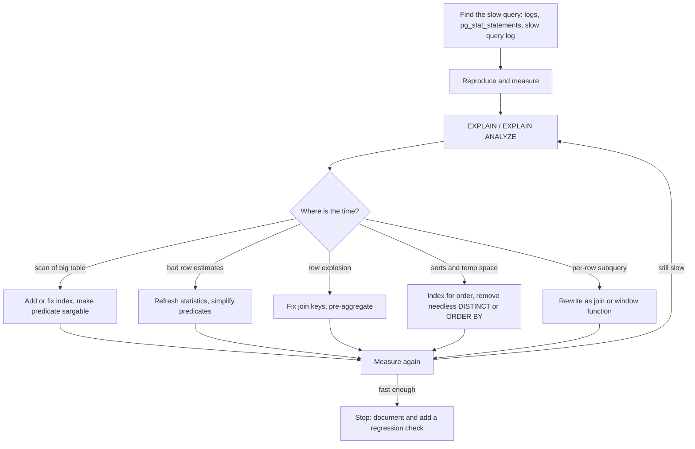

# Query performance tuning

A query can be correct and still be useless if it takes ten minutes, or fine today and a production incident when the table is a hundred times larger. Performance tuning is not black magic: it is a repeatable loop of **measure → read the plan → form a hypothesis → change one thing → measure again**. This final lesson pulls together everything from the indexes, joins, subqueries and window-function modules into a practical method: how the optimizer works, how to read plans, the most common causes of slow queries with their fixes, and a checklist you can use in a code review or an interview.

## How the optimizer thinks

For each query the optimizer:

1. **Parses and rewrites** it — flattening views and CTEs, simplifying predicates, turning `IN` subqueries into semi-joins.
2. **Enumerates candidate plans**: which **access path** for each table (full scan, index seek, index range scan, covering index), which **join order**, which **join algorithm** (nested loop, hash, merge).
3. **Estimates the cost** of each plan using **statistics** — table sizes, number of distinct values per column, value histograms — to predict how many rows each step produces (**cardinality estimation**).
4. Picks the cheapest and executes it.

Nearly all bad plans come from **bad cardinality estimates**: the optimizer believed a filter would return 10 rows and it returned a million, so it chose a nested loop where a hash join was needed. Estimates go wrong when statistics are stale, when predicates use functions the optimizer cannot see through, or when columns are correlated in ways it does not know.

So two things are in your hands: give the optimizer **good options** (indexes, sargable predicates, sensible schema) and **good information** (fresh statistics, simple predicates).

## Reading query plans

| Engine | Show the plan | Show the plan with actual run time |
|---|---|---|
| SQLite | `EXPLAIN QUERY PLAN <query>` | `.timer on`, `.scanstats on` in the shell |
| PostgreSQL | `EXPLAIN <query>` | `EXPLAIN (ANALYZE, BUFFERS) <query>` |
| MySQL | `EXPLAIN <query>` | `EXPLAIN ANALYZE <query>` (8.0.18+) |
| SQL Server | estimated execution plan | actual execution plan |

Start with a query on the shop data and no helpful indexes:

```sql-run dataset=shop
EXPLAIN QUERY PLAN
SELECT c.country, COUNT(*) AS orders
FROM orders o
JOIN customers c ON c.customer_id = o.customer_id
WHERE o.order_date >= '2024-12-01' AND o.status = 'delivered'
GROUP BY c.country
ORDER BY orders DESC;
```

Read it line by line:

- `SCAN o` — the whole `orders` table is read; the date and status filters are applied to every row.
- `SEARCH c USING INTEGER PRIMARY KEY (rowid=?)` — for each surviving order, one primary-key lookup in `customers` (a nested loop join).
- `USE TEMP B-TREE FOR GROUP BY` and `… FOR ORDER BY` — two sorts.

What to look for in any plan:

1. **Full scans of large tables** where you expected a seek.
2. **The join order and algorithm** — is the small/filtered table driving?
3. **Sorts and temporary structures** for ORDER BY, GROUP BY, DISTINCT, window functions.
4. **Estimated versus actual row counts** (PostgreSQL/MySQL `EXPLAIN ANALYZE`). A step where they differ by orders of magnitude is where the plan went wrong.
5. **Repeated subplans** — a correlated subquery executed once per row.

Now give the optimizer a better option and compare:

```sql-run dataset=shop
CREATE INDEX orders_date_status ON orders (order_date, status, customer_id);

EXPLAIN QUERY PLAN
SELECT c.country, COUNT(*) AS orders
FROM orders o
JOIN customers c ON c.customer_id = o.customer_id
WHERE o.order_date >= '2024-12-01' AND o.status = 'delivered'
GROUP BY c.country
ORDER BY orders DESC;
```

`SEARCH o USING COVERING INDEX orders_date_status (order_date>?)`: only December's index entries are read, and since the index also contains `status` and `customer_id`, the table itself is never touched.

## The usual suspects

### 1. Missing or unusable indexes

The most common cause by far. Symptoms: a `SCAN` on a big table with a selective filter; a join whose inner side is scanned for every outer row.

Fixes, from the indexes module:

- Index columns used in selective `WHERE` conditions and in **join conditions** (foreign keys!).
- Composite index column order: **equality columns first, then the range or sort column**.
- Make it **covering** for hot queries by including the selected columns.
- Use **partial indexes** for queries that always filter on a constant (`WHERE status = 'pending'`).

### 2. Non-sargable predicates

An index exists but cannot be used because the column is hidden inside an expression.

| Slow | Fast |
|---|---|
| `WHERE strftime('%Y', order_date) = '2024'` | `WHERE order_date >= '2024-01-01' AND order_date < '2025-01-01'` |
| `WHERE lower(email) = 'a@x.com'` | store normalised email, or index `lower(email)` |
| `WHERE price * 1.2 > 100` | `WHERE price > 100 / 1.2` |
| `WHERE name LIKE '%book%'` | full-text index; or prefix search `LIKE 'book%'` |
| `WHERE CAST(order_id AS TEXT) = '42'` | `WHERE order_id = 42` |
| `WHERE COALESCE(city, '') = 'Austin'` | `WHERE city = 'Austin'` |

```sql-run dataset=shop
CREATE INDEX orders_date ON orders (order_date);

EXPLAIN QUERY PLAN SELECT COUNT(*) FROM orders WHERE strftime('%Y-%m', order_date) = '2024-06';
```

```sql-run dataset=shop
CREATE INDEX orders_date ON orders (order_date);

EXPLAIN QUERY PLAN SELECT COUNT(*) FROM orders WHERE order_date >= '2024-06-01' AND order_date < '2024-07-01';
```

Also watch **implicit type conversion**: comparing a text column with a number (or joining an INT key to a VARCHAR key) forces a conversion on every row and defeats the index. Keep the types of join columns identical.

### 3. Fetching more than you need

- **`SELECT *`** — more I/O, more network, no covering index, and on a column store it reads every column. Name the columns.
- **Missing LIMIT** on exploratory queries; missing WHERE on a time range.
- **Unnecessary DISTINCT / ORDER BY** — each is a sort. Remove ORDER BY from subqueries and views where it has no effect.
- **`UNION` instead of `UNION ALL`** when duplicates are impossible.

### 4. Row explosion in joins

A join on a non-unique key multiplies rows; later steps then drown, and a DISTINCT is added to hide the damage. Check row counts at each join. Aggregate the "many" side **before** joining:

```sql-run dataset=shop
-- Risky: orders x items x events fans out, then DISTINCT cleans up
-- Better: aggregate each child table separately, then join one-to-one
WITH item_totals AS (
  SELECT o.customer_id, SUM(oi.quantity * oi.unit_price * (1 - oi.discount)) AS revenue
  FROM orders o JOIN order_items oi ON oi.order_id = o.order_id
  GROUP BY o.customer_id
),
event_totals AS (
  SELECT customer_id, COUNT(*) AS events FROM web_events GROUP BY customer_id
)
SELECT c.customer_id, ROUND(COALESCE(i.revenue, 0), 2) AS revenue, COALESCE(e.events, 0) AS events
FROM customers c
LEFT JOIN item_totals i  ON i.customer_id = c.customer_id
LEFT JOIN event_totals e ON e.customer_id = c.customer_id
ORDER BY revenue DESC
LIMIT 5;
```

Joining `customers` to both `order_items` and `web_events` directly would produce (items × events) rows per customer and wrong totals; pre-aggregation keeps every join one-to-one.

### 5. Row-by-row thinking

- **Correlated subqueries evaluated per row** on large tables — rewrite as a join to a pre-aggregated derived table or as a window function.
- **Self joins for running totals or previous rows** (O(n²)) — use `SUM() OVER` and `LAG`.
- **The N+1 problem** in application code: one query for a list, then one query per item. Replace with a single join or `IN (…)` query. ORMs make this mistake easy; learn your ORM's eager-loading options.
- **Loops of single-row INSERTs** each in its own transaction — batch them in one transaction or a multi-row insert.

Compare two ways of getting each customer's latest order date:

```sql-run dataset=shop
EXPLAIN QUERY PLAN
SELECT c.customer_id,
       (SELECT MAX(o.order_date) FROM orders o WHERE o.customer_id = c.customer_id) AS last_order
FROM customers c;
```

```sql-run dataset=shop
EXPLAIN QUERY PLAN
SELECT c.customer_id, t.last_order
FROM customers c
LEFT JOIN (SELECT customer_id, MAX(order_date) AS last_order
           FROM orders GROUP BY customer_id) t ON t.customer_id = c.customer_id;
```

The first contains a `CORRELATED SCALAR SUBQUERY` that scans `orders` once per customer (80 scans here; with an index on `orders(customer_id, order_date)` each would become a cheap seek). The second scans `orders` once. Neither is always best — with the index and few outer rows, the correlated form wins — which is why you read the plan instead of following slogans.

### 6. OR conditions, NOT IN and friends

- `WHERE a = 1 OR b = 2` across different columns may prevent index use; a `UNION` of two indexed queries can be faster (SQLite and PostgreSQL can sometimes do this themselves).
- `NOT IN (subquery)` is both NULL-unsafe and often planned poorly; prefer `NOT EXISTS`.
- Very long `IN (…)` lists: load the values into a temporary table and join.

### 7. Stale statistics

After bulk loads or large deletes, refresh statistics: `ANALYZE` (SQLite, PostgreSQL), `ANALYZE TABLE t` (MySQL), `UPDATE STATISTICS` (SQL Server). A plan that was fine yesterday and terrible today, with no code change, is very often a statistics problem (or a parameter-sensitive cached plan).

```sql-run dataset=bank
ANALYZE;
SELECT tbl, idx, stat FROM sqlite_stat1 ORDER BY tbl LIMIT 8;
```

`sqlite_stat1` shows what SQLite now knows: row counts and average rows per distinct index value.

### 8. Pagination with large OFFSET

`LIMIT 20 OFFSET 100000` generates and discards 100,000 rows. Use **keyset pagination**: remember the last key and continue from it.

```sql-run dataset=shop
SELECT order_id, order_date
FROM orders
WHERE (order_date, order_id) > ('2024-06-15', 120)     -- last row of the previous page
ORDER BY order_date, order_id
LIMIT 5;
```

With an index on `(order_date, order_id)` each page is a short index range, however deep.

### 9. Locks and waiting

A query can be slow because it is **waiting**, not working: blocked by another transaction's lock. Keep transactions short, index the columns used by UPDATE/DELETE predicates (so fewer rows are locked), and run heavy reads on replicas (transactions module).

### 10. Too much data in one place

When a table is simply huge: **partition** it and make sure queries prune (large-databases module); **archive** old rows; build **summary tables** or materialized views for dashboards; move analytics to a **columnar** warehouse.

## Schema-level decisions that affect performance

- **Right-sized types.** Narrow keys (INT/BIGINT rather than long strings or random UUIDs) make every index and join smaller. Random UUID primary keys scatter inserts across the B-tree; time-ordered ids (UUIDv7, ULID) avoid that.
- **Normalization vs denormalization.** Normalize OLTP for cheap, safe writes; denormalize or pre-aggregate reporting models for cheap reads (previous lesson).
- **Constraints help the optimizer.** NOT NULL, UNIQUE and foreign keys allow join elimination and better estimates.
- **Avoid over-indexing.** Each extra index slows writes; drop unused ones (`pg_stat_user_indexes`, MySQL `sys.schema_unused_indexes`).

## A tuning workflow



Principles:

1. **Measure, don't guess.** Find the queries that consume the most *total* time (frequency × duration), not just the single slowest.
2. **Change one thing at a time** and compare plans and timings.
3. **Test with realistic data volumes.** A plan on 400 rows says little about 400 million; the optimizer's choices change with size.
4. **Verify the result did not change.** Compare old and new outputs with `EXCEPT` both ways.
5. **Stop when it is good enough.** Tuning has diminishing returns.

> [!INTERVIEW]
> "This query is slow — what do you do?" A strong answer follows the loop: confirm and measure; look at the execution plan; check for full scans, missing or unusable indexes, non-sargable predicates, join fan-out and bad estimates; consider rewriting (pre-aggregation, EXISTS instead of IN/DISTINCT, window functions instead of self joins); then consider schema-level options (covering index, partitioning, summary table); verify correctness and re-measure. Mention the trade-off: every index speeds reads and slows writes.

## Checklist

**Before writing**
- What is the grain of the result? Which table drives?
- Can I filter early on an indexed, selective column (usually time)?

**In the query**
- Only needed columns; no `SELECT *`.
- Predicates on bare columns; half-open date ranges.
- Join columns indexed and of the same type; every join has its condition.
- Pre-aggregate before joining to avoid fan-out; `COUNT(DISTINCT …)` only when required.
- `EXISTS` / `NOT EXISTS` for existence tests; `UNION ALL` unless duplicates must go.
- Window functions instead of self joins and correlated per-row subqueries.
- No unnecessary DISTINCT or ORDER BY; LIMIT with a deterministic order; keyset pagination.

**After writing**
- `EXPLAIN`: any unexpected SCAN, temp B-tree, or repeated subquery?
- Row counts at each stage as expected?
- Statistics fresh?
- Result identical to the previous version?

## Summary

- The optimizer chooses access paths, join order and algorithms by estimated cost; bad estimates produce bad plans.
- Read plans for full scans, join strategy, sorts, repeated subplans, and estimate-versus-actual gaps.
- Most slow queries come from missing/unusable indexes, non-sargable predicates, fetching too much, join fan-out, row-by-row logic, stale statistics, deep OFFSETs, or lock waits.
- Tune in a loop: measure, explain, change one thing, verify correctness, re-measure.
- Beyond the query: types, constraints, normalization choices, partitioning and summary tables.

```quiz
[
  {"q": "What most often causes the optimizer to choose a bad plan?", "options": ["Too many columns", "Inaccurate row-count (cardinality) estimates", "Uppercase keywords", "Using aliases"], "answer": 1, "explain": "Costs are computed from estimated row counts; when those are wrong, so is the plan."},
  {"q": "Which rewrite makes WHERE strftime('%Y', order_date) = '2024' index-friendly?", "options": ["WHERE order_date LIKE '%2024%'", "WHERE order_date >= '2024-01-01' AND order_date < '2025-01-01'", "WHERE CAST(order_date AS INTEGER) = 2024", "WHERE substr(order_date,1,4) = '2024'"], "answer": 1, "explain": "A range on the bare column is sargable."},
  {"q": "A report joins customers to order_items and to web_events and the revenue is far too high. Likely cause?", "options": ["Missing index", "Join fan-out: items multiplied by events per customer", "Stale statistics", "Integer division"], "answer": 1, "explain": "Two independent child tables joined to one parent multiply rows; pre-aggregate each child."},
  {"q": "What is the N+1 problem?", "options": ["An index with N+1 columns", "One query for a list followed by one query per item instead of a single set-based query", "A join of N+1 tables", "An off-by-one error in LIMIT"], "answer": 1, "explain": "Replace the per-item queries with one join or IN query."},
  {"q": "Why is LIMIT 20 OFFSET 100000 slow?", "options": ["LIMIT disables indexes", "The engine must produce and discard the first 100,000 rows", "OFFSET sorts twice", "It locks the table"], "answer": 1, "explain": "Keyset pagination continues from the last seen key instead."},
  {"q": "After a large bulk load, queries become slow with odd plans. First thing to try?", "options": ["Drop all indexes", "Refresh optimizer statistics (ANALYZE)", "Add DISTINCT", "Restart the application"], "answer": 1, "explain": "Stale statistics mislead cardinality estimates."},
  {"q": "What should you do after rewriting a query for speed?", "options": ["Deploy immediately", "Verify it returns the same result and measure again", "Remove its indexes", "Add SELECT *"], "answer": 1, "explain": "Correctness first: compare outputs (e.g. EXCEPT both ways), then confirm the improvement."}
]
```

> **Source:** Beaulieu, *Learning SQL*, ch. 13 "Indexes and Constraints" (how indexes are used; the downside of indexes) and ch. 3 (query mechanics, the role of the optimizer). SQLite documentation, "EXPLAIN QUERY PLAN" and "Query Planning"; PostgreSQL manual, "Using EXPLAIN" and "Performance Tips".
