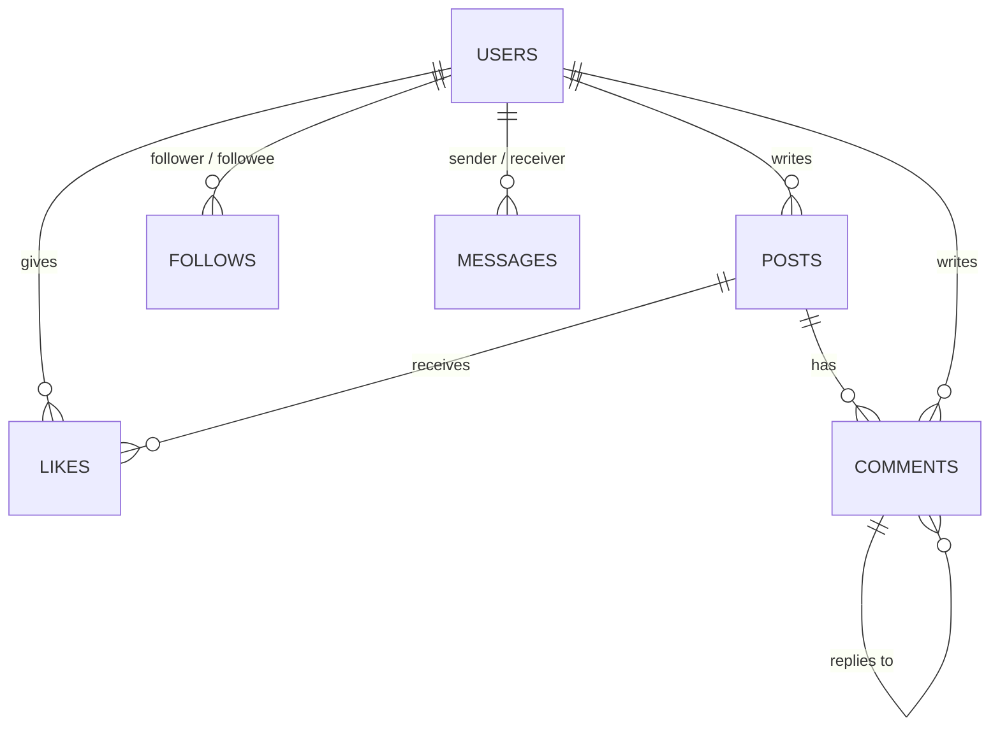
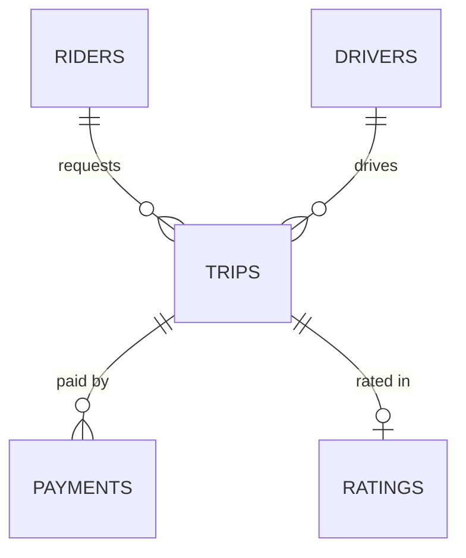
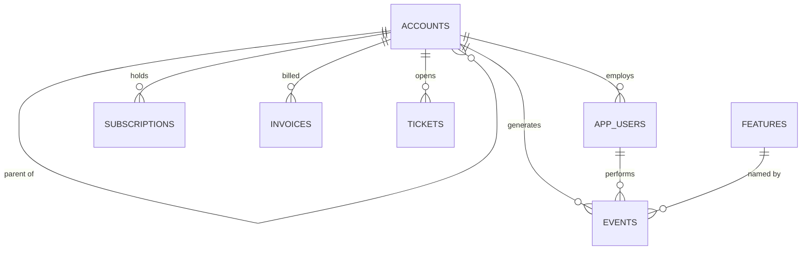

# The interview set: datasets, method and pattern map

The earlier modules taught SQL one feature at a time. Real work — and real interviews — do not arrive labelled by feature. Someone asks a business question in ordinary language, hands you a few tables you have never seen, and expects a correct query. This module is practice for exactly that: **53 analytics questions on three new databases**, in the style used by company interview loops and practice sites. This lesson introduces the three databases, gives you a repeatable method for attacking an unfamiliar question, and maps each kind of question to the technique that solves it.

## Before this lesson

You should have worked through the track up to window functions and common table expressions (CTEs) — at least [Aggregate functions and GROUP BY](#/lesson/sql/group-by), [Outer joins](#/lesson/sql/outer-joins), [The CASE expression](#/lesson/sql/case-expressions) and [Window basics and ranking](#/lesson/sql/ranking). The two pattern lessons, [Top-N, deduplication, pivoting and medians](#/lesson/sql/patterns-1) and [Gaps and islands, sessions and cohort retention](#/lesson/sql/patterns-2), explain the harder techniques in depth; this lesson refers back to them.

## In plain words

An **analytics question** asks you to turn rows of recorded activity — posts, trips, invoices — into a number or a small table that a person can act on: "what share of trips are cancelled in each city?", "which customers stopped using the product?".

An everyday picture: a shoebox full of till receipts. Each receipt is one recorded event. Nobody wants to read the receipts; they want to know how much was spent per month, which shop gets most of the money, and whether spending is going up. Answering means *sorting the receipts into piles* (grouping), *adding up each pile* (aggregating), and *comparing piles* (ratios, rankings, trends). Every question in this module is some combination of those three moves.

**Why it matters for a job.** Data analyst, analytics engineer, data scientist and many machine-learning roles include a live SQL exercise in the interview, and the day-to-day work is the same kind of question. Being fluent in a few dozen recurring question shapes — and careful about their traps — is what "good at SQL" means in practice.

A few terms used throughout, each defined once here:

- A **metric** is a number that summarises behaviour, such as *daily active users* (how many different people did something on a day).
- The **grain** of a table or result is what one row stands for: one trip, one user per day, one account per month.
- An **event table** has one row per thing that happened, with a timestamp (the date and time it happened).
- A **dimension** is something you group by — city, plan, month.

## The three datasets

Each dataset is a small, invented company. The data is **seeded**, meaning it was generated once with fixed random numbers, so everyone sees identical rows and the judge can compare your result with a reference answer. All dates fall in 2023-2024.

### `social` — a small social network

Sixty people post, like, comment, follow each other and send messages.



Start every new dataset the same way: look at a few rows of each table and count them.

```sql-run dataset=social
SELECT 'users' AS table_name, COUNT(*) AS row_count FROM users
UNION ALL SELECT 'posts', COUNT(*) FROM posts
UNION ALL SELECT 'likes', COUNT(*) FROM likes
UNION ALL SELECT 'follows', COUNT(*) FROM follows
UNION ALL SELECT 'messages', COUNT(*) FROM messages
UNION ALL SELECT 'comments', COUNT(*) FROM comments;
```

What each line does: every `SELECT` produces one row holding a label and a count; `UNION ALL` stacks those rows into one result. Six tables, six rows.

```sql-run dataset=social
SELECT * FROM posts ORDER BY created_at LIMIT 5;
```

One row per post: who wrote it (`user_id`), when (`created_at`), its format (`post_type`) and subject (`topic`). Things to notice before writing any query:

- `follows` has **two** columns that both point at `users`: `follower_id` follows `followee_id`. Questions about followers must join on the right one.
- `comments.parent_comment_id` points at another comment — a reply. It is empty (NULL) for a top-level comment. That is a hierarchy.
- `messages.read_at` is NULL while a message is unread.
- Some users have never posted. Any question about "all users" must not lose them.

### `rides` — a ride-hailing service

Riders request trips, drivers carry them out, payments and star ratings follow.



```sql-run dataset=rides
SELECT status, COUNT(*) AS trips,
       COUNT(fare) AS trips_with_fare,
       ROUND(AVG(fare), 2) AS avg_fare
FROM trips
GROUP BY status;
```

Reading the result: `COUNT(*)` counts rows in each status group; `COUNT(fare)` counts only rows where `fare` has a value. For every status except `completed` the second number is 0 — cancelled trips have **no fare, distance or pickup time**. That single fact drives half the traps in the rides problems: forget to filter on `status = 'completed'` and cancelled trips silently fall into the wrong bucket or vanish from an average.

Other things to notice:

- A trip can have **several payment rows** (a failed attempt followed by a successful one), and a few completed trips have none.
- `ratings.driver_stars` is the score the rider gave the driver; it is often NULL because many riders do not rate.
- Trips span two full years, so year-over-year comparisons are possible.

### `saas` — a business software subscription product

"SaaS" stands for *software as a service*: companies pay a monthly fee to use a product online. Here, customer companies (`accounts`) have people (`app_users`), a history of `subscriptions`, monthly `invoices`, product usage `events` and support `tickets`.



```sql-run dataset=saas
SELECT subscription_id, plan, mrr, started_on, ended_on
FROM subscriptions
WHERE account_id = 25
ORDER BY started_on;
```

One account, several rows: an account's subscription *history*. Each row is valid from `started_on` until `ended_on`; the current one has `ended_on` NULL. `mrr` means **monthly recurring revenue** — what the customer pays per month on that plan. Two consequences:

- "What is revenue *now*?" means rows with `ended_on IS NULL`. "What was revenue on 31 March?" means rows whose interval contains that date — a *point-in-time* question.
- An account that stopped paying is said to have **churned**. An account with a gap and then a new subscription has been **reactivated**.

Also worth knowing: `app_users.email` was typed by hand (mixed capitals, stray spaces); the `events` table contains some accidental **duplicate rows**; `accounts.parent_account_id` links subsidiaries to parent companies.

## A method for unfamiliar questions

When the question is new and the clock is running, follow the same five steps every time. They are slow for the first few problems and then become automatic.

### Step 1 — say what one row of the answer is

Before thinking about SQL, finish the sentence *"each row of my result is one ___"*. One city? One driver per city? One month? This is the grain of the answer, and it tells you what the final `GROUP BY` will be.

### Step 2 — find the tables and check their grain

Which tables hold the facts you need, and what is one row of each? If the answer's grain is coarser than a table's grain, you will aggregate. If you must combine two tables with different grains, plan where the aggregation happens so that rows are not multiplied.

### Step 3 — decide the rules for edges

Three questions catch most wrong answers:

- **Missing values:** which columns can be NULL, and should those rows count?
- **Ties:** if two rows tie for first place, do you want both or one?
- **Absences:** should things with *zero* activity appear (a user with no posts, a day with no trips)?

### Step 4 — build in small, checkable steps

Write the innermost piece first, run it, and look at the rows. Then wrap it. CTEs (`WITH name AS (...)`) are ideal: each step gets a name and can be inspected alone.

### Step 5 — test against something you know

Compare a total with a count you can obtain another way, or check one case by hand.

### The method on a real question

*"For each city, what percentage of riders who signed up there have completed at least one trip?"*

**Step 1.** One row per city.

**Step 2.** `riders` (one row per rider, has `city`) and `trips` (one row per trip). The answer's grain is coarser than both.

**Step 3.** Absences matter: riders with **no** completed trips must stay in the denominator. That rules out a plain inner join.

**Step 4.** Start with the smallest piece — one row per rider with a yes/no flag:

```sql-run dataset=rides
SELECT r.rider_id, r.city,
       EXISTS (SELECT 1 FROM trips t
               WHERE t.rider_id = r.rider_id AND t.status = 'completed') AS has_completed_trip
FROM riders r
ORDER BY r.rider_id
LIMIT 8;
```

Line by line: the outer query lists riders. For each one, the `EXISTS (...)` part asks "is there at least one completed trip by this rider?" and returns 1 for yes or 0 for no. The result still has one row per rider — nothing was multiplied and nobody was dropped.

Now aggregate that to the city grain:

```sql-run dataset=rides
WITH flags AS (
  SELECT r.rider_id, r.city,
         EXISTS (SELECT 1 FROM trips t
                 WHERE t.rider_id = r.rider_id AND t.status = 'completed') AS has_completed_trip
  FROM riders r
)
SELECT city,
       COUNT(*) AS riders,
       SUM(has_completed_trip) AS riders_with_a_trip,
       ROUND(100.0 * SUM(has_completed_trip) / COUNT(*), 1) AS activated_pct
FROM flags
GROUP BY city
ORDER BY activated_pct DESC;
```

`COUNT(*)` counts riders per city; `SUM(has_completed_trip)` adds up the ones and zeros, giving the number of riders with a trip; multiplying by `100.0` (with the decimal point) before dividing avoids whole-number division.

**Step 5.** Check: the `riders` column should add up to the number of rows in `riders`.

```sql-run dataset=rides
SELECT COUNT(*) AS all_riders FROM riders;
```

It does. Had we written `riders JOIN trips`, riders without trips would have disappeared and every percentage would have been 100.

## Pattern map

Most analytics questions are one of the shapes below. The left column is how the question sounds; the middle is the technique; the right lists practice problems from this module.

| The question sounds like... | Technique | Practice problems |
|---|---|---|
| "Count of X **by type**, side by side" | conditional aggregation: `SUM(CASE WHEN ... THEN 1 ELSE 0 END)` | Monthly Post Mix; Tipping by Payment Method |
| "What **share / percentage** of ..." | divide by a total: subquery or `SUM(...) OVER ()` | Trip Outcomes by City; Current MRR by Plan; Riders Who Keep Getting the Same Driver |
| "**Running** total", "year to date" | `SUM(...) OVER (ORDER BY ... ROWS UNBOUNDED PRECEDING)` | Year-to-Date Revenue by City; Revenue Concentration; Support Backlog by Week |
| "**Rolling / moving** average" | window frame `ROWS BETWEEN n PRECEDING AND CURRENT ROW` | Rolling Three-Month Revenue |
| "Compared with **last month / last year**" | `LAG`, or pivot the two periods into columns | Year-over-Year Trips by Month; Month-End MRR and Growth |
| "**Top N** per group" | `ROW_NUMBER` / `RANK` / `DENSE_RANK` in a CTE, filter outside | Top Posts in Each Topic; Top Earning Drivers per City; Busiest Weekday in Each City |
| "**Rank** ... with ties" | `RANK` (gaps) or `DENSE_RANK` (no gaps) | Follower Leaderboard; Driver Rating Ranks |
| "**First / latest** event per user" | `ROW_NUMBER` both directions, or `MIN`/`MAX` | Time to First Post; First and Latest Trip per Rider |
| "Users who **never** ...", "with **no** ..." | anti-join: `NOT EXISTS` | Lurkers; Active Drivers With No Q4 Trips; Churned Accounts; Paying Customers Who Stopped Using the Product |
| "Users who did **A and B but not C**" | set operators `INTERSECT` / `EXCEPT`, or `HAVING` | Tech and Travel, but Never Memes |
| "Users who did **every** ..." | relational division: `HAVING COUNT(DISTINCT x) = (SELECT COUNT(*) ...)` | Accounts That Use Every Core Feature |
| "**Pairs** of users", "mutual" | self-join; canonical pair (smaller id first) | Mutual Follows; Busiest Conversations; Who to Follow |
| "**Daily / weekly / monthly active** users", "stickiness" | `COUNT(DISTINCT user)` per period | Daily Active Users; Weekly Active Accounts; Stickiness: DAU / MAU |
| "**Funnel**", "conversion rate" | first time per step with `MIN(CASE ...)`, compare in order | Onboarding Funnel |
| "**Retention**", "cohort" | cohort per user, month-index difference, `LEFT JOIN` | Account Retention by Signup Cohort |
| "**Churned / reactivated / new**" | `LAG`/`LEAD` over each user's active months | Rider Lifecycle; New versus Returning Posters; Plan Upgrade and Downgrade Paths |
| "**Consecutive** days", "streak", "in a row" | gaps and islands: date minus row number, or difference of two row numbers | Longest Posting Streak; Drivers Cancelling Several Trips in a Row |
| "**Duplicate** rows" | group by the business key, `HAVING COUNT(*) > 1`; `ROW_NUMBER` to keep one | Duplicate Events |
| "**Median**", "90th percentile" | `ROW_NUMBER` + `COUNT(*) OVER`, pick positions | Median Fare by City; Pickup Wait Percentiles |
| "**Distribution**", "histogram", "buckets" | `CASE` labels, group by label, sort by a number | Histogram of Likes per Post; Fare per Kilometre by Distance Band; Open Invoice Aging |
| "Whole **hierarchy / tree**" | recursive CTE | Deepest Comment Threads; MRR Rolled Up to Parent Companies |
| "**How long** between ...", "by hour / weekday" | `julianday` differences, `strftime` parts | Slow-Paying Accounts; Cancellations by Time of Day; Ticket Resolution by Priority |
| Anything with **optional** data | NULL-aware counting, `LEFT JOIN`, `COALESCE` | Unread Message Rate; Completed Trips Without a Successful Payment; Survey Scores by Ticket Category |
| "**Messy text**" | `lower`, `trim`, `substr`, `instr` | Company versus Personal Emails |

## The traps that cost the most marks

Experienced interviewers plant the same handful of traps. Each has a one-line defence.

**1. Whole-number division.** In SQLite, PostgreSQL and SQL Server, dividing two whole numbers discards the fraction.

```sql-run dataset=rides
SELECT 2 / 3 AS wrong, 100 * 2 / 3 AS still_truncated, 100.0 * 2 / 3 AS right;
```

Defence: write `100.0 *` (or `1.0 *`) first.

**2. Counting the wrong thing after a join.** A join to a table with several matching rows repeats the first table's rows.

```sql-run dataset=social
SELECT COUNT(*) AS rows_after_join,
       COUNT(DISTINCT p.post_id) AS posts
FROM posts p
JOIN likes l ON l.post_id = p.post_id;
```

The first number is the number of *likes*; the second the number of posts that have at least one like. Defence: know the grain after every join; use `COUNT(DISTINCT ...)` or aggregate before joining.

**3. Losing the zeros.** An inner join keeps only rows with a match, so users with no activity disappear and averages look better than reality. Defence: start `FROM` the table that must be complete and `LEFT JOIN` the activity; count a column of the joined table, never `*`.

**4. Filtering in the wrong place.** With a `LEFT JOIN`, a condition on the joined table written in `WHERE` removes the unmatched rows again. Defence: put that condition in the `ON` clause.

**5. NULL in comparisons.** `x = NULL`, `x <> 'a'` and `NOT IN (list containing NULL)` do not behave as everyday logic suggests. Defence: `IS NULL`, an explicit `OR x IS NULL`, and `NOT EXISTS`.

**6. Timestamps at the end of a period.** `<= '2024-12-31'` misses everything that happened during 31 December, because `'2024-12-31 09:00:00'` is later than `'2024-12-31'`. Defence: half-open ranges — `>= '2024-12-01' AND < '2025-01-01'`.

**7. Ties.** `LIMIT 1` or `ROW_NUMBER() = 1` returns one row even when several share first place. Defence: decide, then choose `ROW_NUMBER` with a tie-breaker, or `RANK` / `DENSE_RANK`.

**8. Functions that are not there.** The database in this page is SQLite built without the optional mathematics functions: there is no `ceil`, `floor`, `power`, `sqrt` or `ln`. Use whole-number arithmetic — for example `(9 * n + 9) / 10` for "nine tenths of n, rounded up" — as the percentile problems show.

## How to use this module

- The problems are grouped by dataset — social, then rides, then SaaS — and within each run from Easy to Hard. Doing one dataset at a time lets you get to know its tables.
- Read the **Columns** line of each problem carefully. The judge compares column names and order, and row order when the problem states one.
- Try each problem before opening the hints. If you are stuck for more than ten minutes, take one hint, not all three.
- After solving, read the guide's *pitfalls* even if you passed: several problems have plausible wrong answers that happen to differ from the right one only on edge cases.
- For interview practice, talk through the five-step method aloud. Explaining the grain and the edge cases before writing is what interviewers are listening for.

## Summary

- Analytics questions combine grouping, aggregating and comparing over event tables.
- The three practice databases are `social` (posts, likes, follows, messages, comments), `rides` (riders, drivers, trips, payments, ratings) and `saas` (accounts, users, subscriptions, invoices, events, tickets).
- Method: state the grain of the answer; check each table's grain; decide rules for NULLs, ties and absences; build in small steps; test against a known number.
- Recognise the question's shape and reach for its technique (pattern map above).
- Guard against the recurring traps: whole-number division, fan-out, lost zeros, misplaced filters, NULL logic, period boundaries, ties, and missing functions.

## Glossary

| Term | Meaning in one sentence |
|---|---|
| **Analytics question** | A business question answered by summarising recorded activity into a number or small table. |
| **Metric** | A number that summarises behaviour, such as revenue per month. |
| **Grain** | What one row of a table or result represents. |
| **Event table** | A table with one row per thing that happened, each with a timestamp. |
| **Timestamp** | A value recording a date and a time of day. |
| **Dimension** | A property you group by, such as city or plan. |
| **Seeded data** | Invented data generated with fixed random numbers so that everyone gets identical rows. |
| **DAU / WAU / MAU** | Daily, weekly and monthly active users: how many different users did something in the period. |
| **Stickiness** | Average daily active users divided by monthly active users. |
| **Funnel** | A sequence of steps users are expected to pass through, measured by how many reach each one. |
| **Conversion rate** | The fraction of users at one step who reach the next. |
| **Cohort** | A group of users who started in the same period, followed over time. |
| **Retention** | The fraction of a cohort still active after a given time. |
| **Churn** | A customer stopping use or payment. |
| **Reactivation** | A churned customer becoming active again. |
| **MRR** | Monthly recurring revenue: what subscribers pay per month. |
| **SaaS** | Software as a service: software paid for by subscription and used online. |
| **Point-in-time question** | A question about the state of things on a particular past date. |
| **Anti-join** | A query that keeps rows which have *no* match in another table. |
| **Relational division** | Finding the things that are related to *every* member of a given set. |
| **Gaps and islands** | The task of finding runs of consecutive values (islands) and the breaks between them (gaps). |
| **Percentile** | The value below which a given percentage of the data falls; the median is the 50th. |
| **Fan-out** | Rows being repeated because a join matched several rows. |

```quiz
[
  {"q": "What is the first thing to decide when you read a new analytics question?", "options": ["Which window function to use", "What one row of the answer represents", "Which index exists", "How to format the output"], "answer": 1, "explain": "The grain of the answer determines the final grouping and which joins are safe."},
  {"q": "In the rides dataset, why must most queries filter on status = 'completed'?", "options": ["Other trips are duplicates", "Cancelled trips have NULL fare, distance and pickup time", "Completed trips are indexed", "The judge requires it"], "answer": 1, "explain": "Without the filter, NULL values fall into the wrong bucket or silently drop out of averages."},
  {"q": "You need the percentage of riders who have completed a trip. Why is riders JOIN trips the wrong start?", "options": ["Joins are slow", "Riders with no trips disappear, so every percentage becomes 100", "trips has no rider_id", "It returns too few columns"], "answer": 1, "explain": "An inner join drops unmatched rows; the denominator must include riders with zero trips."},
  {"q": "Which technique answers 'users who have used EVERY core feature'?", "options": ["LAG", "GROUP BY with HAVING COUNT(DISTINCT feature) = (number of core features)", "UNION ALL", "ORDER BY ... LIMIT"], "answer": 1, "explain": "This is relational division by counting distinct matches against the size of the required set."},
  {"q": "What does 100 * 2 / 3 return in SQLite?", "options": ["66.67", "66", "0", "67"], "answer": 1, "explain": "All operands are whole numbers, so 200 / 3 is cut down to 66. Write 100.0 * 2 / 3 to get 66.67."},
  {"q": "A question says 'the longest run of consecutive days'. Which pattern is it?", "options": ["Top-N per group", "Gaps and islands", "Relational division", "Funnel"], "answer": 1, "explain": "Consecutive runs are islands; the date-minus-row-number trick labels each run."},
  {"q": "Why is 'occurred_at <= 2024-12-31' risky for a timestamp column?", "options": ["December has 30 days", "Times during 31 December are later than the plain date and are excluded", "Timestamps cannot be compared", "It is not risky"], "answer": 1, "explain": "Use a half-open range ending before the first day of the next period."},
  {"q": "How do you compute 'nine tenths of n, rounded up' without a ceiling function?", "options": ["n * 0.9", "(9 * n + 9) / 10 with whole-number division", "round(n * 0.9)", "n / 10 * 9"], "answer": 1, "explain": "Adding 9 before dividing by 10 rounds up; plain round() rounds to nearest and whole-number division rounds down."}
]
```

> **Source:** Question shapes follow common analytics-interview categories (DataLemur-style company questions and the LeetCode database set); all wording, tables and data are original to this guide. Techniques are those taught in Beaulieu, *Learning SQL* (grouping, subqueries, conditional logic, analytic functions) and the SQLite documentation.
