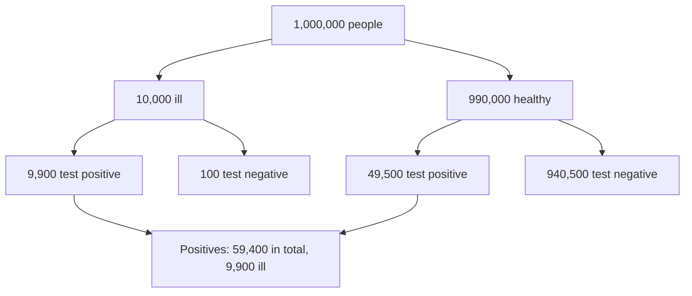

# Probability, conditional probability and Bayes' rule

> **Before this lesson:** nothing beyond school arithmetic (fractions and percentages). You will read short Python programs; each new construct is explained as it appears. If you have never used NumPy, the [Python track](#/track/python) is a gentle start, but it is not required.

## In plain words

**Probability** is a number between 0 and 1 that says how likely something is: 0 means "never", 1 means "certain", 0.5 means "as likely as not". Statistics is built on top of probability, so every later lesson in this track leans on the handful of rules you meet here.

An everyday picture: a weather forecast that says "30% chance of rain" is a probability. It does not promise anything about tomorrow; it says that on many days that look like tomorrow, about three in ten turned wet. Probability is a way of being precise about uncertainty.

Why it matters for a job: data science and product analytics interviews almost always include a few probability questions. "A test is 99% accurate and the disease is rare: if you test positive, how likely are you to be ill?" "What is the expected number of rolls until a six?" They test whether you can reason clearly when outcomes are random, which is exactly what you do when you interpret an A/B test or a model's predictions. The single most important idea here is **conditional probability**, and the most famous tool built on it is **Bayes' rule**.

## 1. Outcomes, events and the basic rules

Start with a fair six-sided die. A single roll is an **experiment**: a process with an uncertain result. Each possible result (1, 2, 3, 4, 5 or 6) is an **outcome**, and the set of all outcomes is the **sample space**. An **event** is any collection of outcomes we care about, such as "the roll is even" = {2, 4, 6}.

When every outcome is equally likely, the probability of an event is a simple count:

$$P(\text{event}) = \frac{\text{number of outcomes in the event}}{\text{number of outcomes in the sample space}}$$

So $P(\text{even}) = 3/6 = 0.5$. Three rules then cover a remarkable amount of ground.

1. **Complement rule.** The event "A does not happen" is written $A^c$ (read "A complement"). Since one of the two must happen, $P(A^c) = 1 - P(A)$. The chance of *not* rolling a six is $1 - 1/6 = 5/6$.
2. **Addition rule.** "A or B" (at least one happens) has probability $P(A \cup B) = P(A) + P(B) - P(A \cap B)$. The symbol $\cup$ means "or" and $\cap$ means "and". We subtract the overlap because outcomes in both events would otherwise be counted twice. For "even or greater than 4": $3/6 + 2/6 - 1/6 = 4/6$ (the 6 is in both).
3. **Multiplication rule for independent events.** Two events are **independent** when knowing whether one happened tells you nothing about the other. Then $P(A \cap B) = P(A)\,P(B)$. Two separate dice are independent, so the chance both show six is $1/6 \times 1/6 = 1/36$.

Two events are **mutually exclusive** (also called disjoint) when they cannot happen together, such as "roll a 1" and "roll a 6" on one die. Then the overlap is zero and the addition rule becomes plain addition. A frequent beginner mix-up is to think mutually exclusive means independent. It is the opposite: if A and B cannot both happen, learning that A happened tells you B certainly did not, which is strong dependence.

> [!TIP]
> The complement rule is the interviewer's favourite shortcut. "Probability of at least one six in four rolls" is awkward to count directly but easy as $1 - (5/6)^4 \approx 0.518$: one minus the chance of no sixes at all.

## 2. Conditional probability

Often we learn something partway through and want to update. **Conditional probability** is the probability of A once we know that B has happened, written $P(A \mid B)$ and read "the probability of A given B". The definition is:

$$P(A \mid B) = \frac{P(A \cap B)}{P(B)}$$

In words: restrict attention to the world where B happened, and ask what share of that world also has A. With two dice, let A = "the total is at least 10" and B = "the first die shows 6". Before we know anything, 6 of the 36 equally likely pairs have a total of 10 or more, so $P(A) = 6/36 \approx 0.167$. Once we know the first die is a 6, only the second die is uncertain, and the total reaches 10 when it shows 4, 5 or 6: $P(A \mid B) = 3/6 = 0.5$. The new information tripled the probability.

Simulation is a good way to check such reasoning. The idea is to let the computer repeat the experiment many times and count.

```python-run
import numpy as np
rng = np.random.default_rng(0)
n = 100_000
d1 = rng.integers(1, 7, n)
d2 = rng.integers(1, 7, n)
total = d1 + d2
print("P(sum = 7)            ~", round(np.mean(total == 7), 4), " exact", round(6/36, 4))
first_is_6 = d1 == 6
print("P(sum >= 10)          ~", round(np.mean(total >= 10), 4), " exact", round(6/36, 4))
print("P(sum >= 10 | d1 = 6) ~", round(np.mean(total[first_is_6] >= 10), 4), " exact", round(3/6, 4))
```

**Reading this code line by line**

- `np.random.default_rng(0)` creates a random number generator. The `0` is a **seed**: a starting value that makes the "random" numbers the same every time you run the program, so your output matches the text.
- `rng.integers(1, 7, n)` draws `n` whole numbers from 1 up to (but not including) 7, so each is a fair die roll. We do it twice to get two independent dice.
- `total == 7` produces an array of `True`/`False` values, one per simulated pair. `np.mean` of such an array treats `True` as 1 and `False` as 0, so the mean is the share of `True`: an estimated probability.
- `total[first_is_6]` keeps only the simulated rolls where the first die was a 6. Taking the mean inside that subset is exactly the definition of conditioning: restrict to B, then measure A.

The output shows $P(\text{sum}=7) \approx 0.1667$ and $P(\text{sum} \ge 10) \approx 0.1665$, both close to the exact $1/6$, and the conditional probability comes out at 0.5. Simulated answers wobble a little around the truth; that wobble shrinks as `n` grows, a fact we will make precise in the lesson on sampling distributions.

Rearranging the definition gives the **general multiplication rule**, which works whether or not events are independent:

$$P(A \cap B) = P(A \mid B)\,P(B) = P(B \mid A)\,P(A)$$

Independence is then the special case $P(A \mid B) = P(A)$: learning B does not change the chance of A.

## 3. The law of total probability

Sometimes the easiest way to find $P(A)$ is to split the world into cases. If the events $B_1, B_2, \dots, B_k$ are mutually exclusive and together cover every possibility (we say they **partition** the sample space), then

$$P(A) = \sum_{i} P(A \mid B_i)\,P(B_i)$$

The symbol $\sum$ means "add up over all values of $i$". Example: 60% of an app's users are on Android and 40% on iOS. Of Android users 5% churn (stop using the app) in a month; of iOS users 3% churn. The overall churn rate is $0.05 \times 0.6 + 0.03 \times 0.4 = 0.042$, or 4.2%. Product analysts use this decomposition constantly: when an overall metric moves, the first question is whether a segment's rate changed or the mix of segments changed.

## 4. Bayes' rule

**Bayes' rule** (also called Bayes' theorem) turns a conditional probability around. We often know $P(\text{evidence} \mid \text{cause})$, for example how often a test is positive when someone is ill, but we want $P(\text{cause} \mid \text{evidence})$: how likely someone is ill given a positive test. Combining the two forms of the multiplication rule gives

$$P(B \mid A) = \frac{P(A \mid B)\,P(B)}{P(A)}$$

and the denominator usually comes from the law of total probability. Each piece has a name:

- $P(B)$ is the **prior**: what we believed before seeing the evidence.
- $P(A \mid B)$ is the **likelihood**: how probable the evidence is if B is true.
- $P(B \mid A)$ is the **posterior**: the updated belief after seeing the evidence.

### The classic medical-test question

A disease affects 1% of people. A test detects it 99% of the time when it is present; this is the test's **sensitivity**, $P(+ \mid \text{ill})$. When the disease is absent the test correctly says negative 95% of the time; this is its **specificity**, $P(- \mid \text{healthy})$, so it gives a **false positive** (a positive result for a healthy person) 5% of the time. You test positive. How worried should you be?

```python-run
prevalence = 0.01
sensitivity = 0.99
specificity = 0.95
p_pos = sensitivity * prevalence + (1 - specificity) * (1 - prevalence)
posterior = sensitivity * prevalence / p_pos
print(f"P(positive)           = {p_pos:.4f}")
print(f"P(disease | positive) = {posterior:.4f}")
for prev in [0.001, 0.01, 0.1, 0.5]:
    pp = sensitivity * prev + (1 - specificity) * (1 - prev)
    print(f"prevalence {prev:>5}: P(disease | +) = {sensitivity * prev / pp:.3f}")
```

**Reading this code line by line**

- `p_pos` is the law of total probability: positives come from ill people who test positive ($0.99 \times 0.01$) plus healthy people who test positive by mistake ($0.05 \times 0.99$).
- `posterior` is Bayes' rule: the ill-and-positive share divided by all positives.
- The `f"...{p_pos:.4f}"` strings are **f-strings**: Python fills in the value inside the braces, and `:.4f` means "show four digits after the decimal point".
- The loop repeats the calculation for several **prevalences** (the share of the population that has the disease).

The answer, about 0.167, surprises most people: a positive result from a "99% accurate" test means only a one-in-six chance of disease. The reason is the **base rate**, the prior share of ill people. Healthy people vastly outnumber ill ones, so even a small false-positive rate produces more false alarms than true detections. The loop shows how strongly the posterior depends on prevalence: 0.019 when the disease is very rare, 0.952 when half the population has it. Ignoring the prior is called the **base-rate fallacy**.

A second way to see it, often clearer in an interview, is to imagine a concrete crowd. Out of 1,000,000 people, 10,000 are ill and 9,900 of them test positive. Of the 990,000 healthy people, 5% (49,500) test positive. So about 59,400 positives, of whom 9,900 are ill: $9{,}900 / 59{,}400 \approx 0.167$. The simulation below does exactly this with random draws.

```python-run
import numpy as np
rng = np.random.default_rng(1)
people = 1_000_000
sick = rng.random(people) < 0.01
test_pos = np.where(sick, rng.random(people) < 0.99, rng.random(people) < 0.05)
print("people testing positive:", test_pos.sum())
print("of those, really sick:  ", (test_pos & sick).sum())
print("share sick among positives:", round((test_pos & sick).sum() / test_pos.sum(), 4))
```

**Reading this code line by line**

- `rng.random(people)` gives a million numbers spread evenly between 0 and 1; comparing with `< 0.01` marks about 1% of people as sick.
- `np.where(condition, a, b)` picks from `a` where the condition is true and from `b` where it is false. Sick people test positive with probability 0.99, healthy people with probability 0.05.
- `test_pos & sick` is "and" applied element by element: positive and sick.

The simulation gives 59,370 positives, 9,936 of them sick, a share of 0.1674, agreeing with the formula.



> [!INTERVIEW]
> When you meet a Bayes question, draw the tree or use a crowd of 1,000 or 1,000,000 people. Saying the counts out loud ("10,000 ill, 9,900 of them flagged; 990,000 healthy, 49,500 flagged") makes the arithmetic hard to get wrong and shows the interviewer your reasoning.

### Bayes' rule beyond medicine

The same structure appears everywhere in data work:

- **Spam filtering.** Prior: the share of email that is spam. Likelihood: how often a word such as "winner" appears in spam versus normal mail. Posterior: the probability this message is spam. The naive Bayes classifier in a later lesson is exactly this, applied to many words at once.
- **Fraud alerts.** A rule that flags 2% of normal transactions sounds precise, but if fraud is 1 in 10,000, nearly every alert is a false alarm.
- **A/B tests.** A "significant" result is more believable when the change was likely to work in the first place. Lesson [p-values and their misconceptions](#/lesson/statistics/p-values) returns to this.

## 5. Random variables, expected value and variance

A **random variable** is a number whose value depends on a random outcome: the face of a die, the number of clicks on an ad today, a customer's spend. A random variable that can take only separate, countable values (like 0, 1, 2, ...) is **discrete**; one that can take any value in a range (like a waiting time of 3.27 seconds) is **continuous**.

The **probability distribution** of a discrete random variable lists each possible value with its probability. Two summaries matter most.

The **expected value** (also called the mean or expectation), written $E[X]$, is the probability-weighted average of the values:

$$E[X] = \sum_x x \, P(X = x)$$

It is the long-run average you would see if the experiment were repeated many times. The **variance** measures spread, the expected squared distance from the mean:

$$\operatorname{Var}(X) = E\big[(X - E[X])^2\big] = \sum_x (x - E[X])^2\, P(X=x)$$

and the **standard deviation** is its square root, which puts spread back into the original units.

```python-run
import numpy as np
faces = np.arange(1, 7)
probs = np.full(6, 1/6)
ev = np.sum(faces * probs)
var = np.sum((faces - ev) ** 2 * probs)
print("E[X] =", ev, " Var[X] =", round(var, 4), " SD =", round(var ** 0.5, 4))
rng = np.random.default_rng(2)
for n in [10, 100, 10_000, 1_000_000]:
    rolls = rng.integers(1, 7, n)
    print(f"n = {n:>9,}: average of rolls = {rolls.mean():.4f}")
```

**Reading this code line by line**

- `np.arange(1, 7)` builds the array `[1, 2, 3, 4, 5, 6]`; `np.full(6, 1/6)` builds six copies of $1/6$.
- `faces * probs` multiplies element by element, and `np.sum` adds them, which is the expected-value formula.
- The loop rolls a die `n` times for growing `n` and prints the average.

The expected value is 3.5, a value the die can never show, which is fine: it is a long-run average, not a prediction of a single roll. The variance is 2.9167 and the standard deviation 1.7078. The averages of real rolls (3.0, 3.69, 3.497, 3.5017) settle towards 3.5 as `n` grows. That settling is the **law of large numbers**: the average of many independent repetitions gets closer and closer to the expected value.

Four rules about expectation and variance are used constantly. For random variables $X$ and $Y$ and fixed numbers $a$ and $b$:

- $E[aX + b] = a\,E[X] + b$. Scaling and shifting a variable scale and shift its mean.
- $E[X + Y] = E[X] + E[Y]$, **always**, even when $X$ and $Y$ are dependent. This "linearity of expectation" solves many puzzles.
- $\operatorname{Var}(aX + b) = a^2 \operatorname{Var}(X)$. Shifting does not change spread; scaling by $a$ multiplies the variance by $a^2$.
- $\operatorname{Var}(X + Y) = \operatorname{Var}(X) + \operatorname{Var}(Y)$ **only when** $X$ and $Y$ are independent (more precisely, uncorrelated). In general you must add $2\operatorname{Cov}(X, Y)$, where the **covariance** measures how the two move together.

A consequence you will meet again: the average of $n$ independent copies of $X$ has variance $\operatorname{Var}(X)/n$, so its standard deviation is $\sigma/\sqrt{n}$ (with $\sigma$, the Greek letter sigma, the standard deviation of one copy). Averages are less noisy than single observations, and the noise falls with the square root of the sample size. That one fact drives confidence intervals, sample-size calculations and the central limit theorem.

> [!NOTE]
> Expected value in product work: if a promotion costs \$2 per user and raises the chance of a \$50 purchase from 10% to 13%, the expected gain per user is $0.03 \times 50 - 2 = -0.5$ dollars. Comparing expected values is the cleanest way to decide whether an intervention pays off on average.

## 6. Counting and a classic puzzle

When outcomes are equally likely, probability is counting, and two counting tools cover most interview puzzles. The number of ways to arrange $n$ distinct items in order is $n! = n \times (n-1) \times \dots \times 1$ ("n factorial"). The number of ways to choose $k$ items from $n$ when order does not matter is the **binomial coefficient**

$$\binom{n}{k} = \frac{n!}{k!\,(n-k)!}$$

read "n choose k". The number of 5-card poker hands from a 52-card deck is $\binom{52}{5} = 2{,}598{,}960$.

The **birthday problem** combines counting with the complement rule. How many people must be in a room for a better-than-even chance that two share a birthday (ignoring leap years)? It is easier to compute the chance that *all* birthdays differ: the second person must avoid 1 day, the third must avoid 2 days, and so on.

```python-run
import numpy as np
from math import prod
def p_shared(k, days=365):
    return 1 - prod((days - i) / days for i in range(k))
for k in [10, 23, 40, 60]:
    print(f"{k} people: P(some shared birthday) = {p_shared(k):.3f}")
rng = np.random.default_rng(3)
trials = 20_000
bdays = rng.integers(0, 365, size=(trials, 23))
shared = np.array([len(set(row)) < 23 for row in bdays])
print("simulated for 23 people:", round(shared.mean(), 3))
```

**Reading this code line by line**

- `prod(...)` from the `math` module multiplies a sequence of numbers. The expression inside is the chance that person `i` avoids the `i` birthdays already taken, for each `i` from 0 to `k - 1`.
- The simulation draws 20,000 rooms of 23 people (a 20,000 by 23 table of birthdays). `set(row)` removes duplicates, so a room has a shared birthday when the set is smaller than 23.

With only 23 people the chance is 0.507; the simulation gives 0.512. Intuition fails because the number of *pairs* grows quickly: 23 people form $\binom{23}{2} = 253$ pairs. The same effect explains why running many A/B test comparisons makes a false "win" likely somewhere, the subject of the [multiple testing](#/lesson/statistics/multiple-testing) lesson.

## 7. Common mistakes

- **Confusing $P(A \mid B)$ with $P(B \mid A)$.** "Most people with the disease test positive" is not "most people who test positive have the disease". Swapping them is called the **prosecutor's fallacy** when it happens in court.
- **Assuming independence without checking.** Two users from the same household, two page views in the same session, or daily sales on consecutive days are usually dependent. Multiplying their probabilities gives nonsense.
- **Treating mutually exclusive as independent.** They are close to opposites.
- **Forgetting the overlap** in the addition rule, which double-counts.
- **Reading an expected value as a typical value.** A lottery ticket with expected value \$0.50 almost always pays \$0.

## Summary

- A probability is a number in [0, 1]. Complement: $1 - P(A)$. Addition: $P(A) + P(B) - P(A \cap B)$. Independent "and": $P(A)P(B)$.
- Conditional probability $P(A \mid B) = P(A \cap B)/P(B)$ restricts attention to the world where B happened.
- The law of total probability splits a probability into cases; Bayes' rule reverses a conditional: posterior is likelihood times prior, divided by the evidence.
- Base rates dominate: a sensitive test for a rare condition still produces mostly false positives.
- Expected value is the long-run average; variance is the expected squared distance from it. Expectations always add; variances add only for independent variables.
- The average of $n$ independent draws has standard deviation $\sigma/\sqrt{n}$.

## Glossary

- **Probability**: a number from 0 to 1 measuring how likely an event is.
- **Experiment / outcome / sample space**: a random process / one possible result / the set of all results.
- **Event**: a set of outcomes.
- **Complement ($A^c$)**: the event that A does not happen.
- **Independent events**: events where knowing one happened does not change the probability of the other.
- **Mutually exclusive (disjoint)**: events that cannot happen together.
- **Conditional probability $P(A \mid B)$**: the probability of A once B is known to have happened.
- **Law of total probability**: computing $P(A)$ by adding $P(A \mid B_i)P(B_i)$ over a partition.
- **Partition**: events that do not overlap and together cover every outcome.
- **Bayes' rule**: $P(B \mid A) = P(A \mid B)P(B)/P(A)$.
- **Prior / likelihood / posterior**: belief before evidence / probability of the evidence under a hypothesis / belief after evidence.
- **Sensitivity / specificity**: probability a test is positive for a true case / negative for a non-case.
- **Base rate (prevalence)**: how common the condition is in the population.
- **Seed**: a starting value that makes a random number generator repeatable.
- **Random variable**: a number determined by a random outcome; discrete or continuous.
- **Expected value $E[X]$**: the probability-weighted average of a random variable.
- **Variance / standard deviation**: expected squared distance from the mean / its square root.
- **Covariance**: a measure of how two random variables move together.
- **Law of large numbers**: averages of many independent repetitions approach the expected value.
- **Binomial coefficient $\binom{n}{k}$**: the number of ways to choose k items from n.

## Check yourself

```quiz
[
  {"q": "What is the probability of at least one six in four rolls of a fair die?", "options": ["$1 - (5/6)^4 \\approx 0.518$", "$4/6 \\approx 0.667$", "$(1/6)^4$", "$4 \\times (1/6)^4$"], "answer": 0,
   "explain": "Use the complement: the chance of no six in four independent rolls is $(5/6)^4$, so at least one six is one minus that."},
  {"q": "Events A and B are mutually exclusive and each has probability 0.3. Are they independent?", "options": ["No: if A happens, B cannot, so knowing A changes the chance of B", "Yes, mutually exclusive events are always independent", "Yes, because their probabilities are equal", "It cannot be decided"], "answer": 0,
   "explain": "Independence would need $P(A \\cap B) = 0.09$, but mutually exclusive events have $P(A \\cap B) = 0$."},
  {"q": "A disease has prevalence 1%. A test has sensitivity 99% and specificity 95%. Roughly what is P(disease | positive)?", "options": ["About 17%", "About 99%", "About 95%", "About 50%"], "answer": 0,
   "explain": "Of 1,000,000 people, 9,900 true positives and 49,500 false positives: 9,900 / 59,400 is about 0.167."},
  {"q": "In Bayes' rule, the prior is…", "options": ["the probability of the hypothesis before seeing the evidence", "the probability of the evidence given the hypothesis", "the updated probability after the evidence", "the false-positive rate"], "answer": 0,
   "explain": "Prior = before the evidence; likelihood = P(evidence | hypothesis); posterior = after the evidence."},
  {"q": "60% of users are on Android with 5% monthly churn; 40% on iOS with 3% churn. Overall churn is…", "options": ["4.2%", "4.0%", "8%", "3.8%"], "answer": 0,
   "explain": "Law of total probability: $0.6 \\times 0.05 + 0.4 \\times 0.03 = 0.042$."},
  {"q": "X and Y are dependent random variables. Which statement is always true?", "options": ["$E[X+Y] = E[X] + E[Y]$", "$Var(X+Y) = Var(X) + Var(Y)$", "$E[XY] = E[X]E[Y]$", "$P(X=1, Y=1) = P(X=1)P(Y=1)$"], "answer": 0,
   "explain": "Linearity of expectation needs no independence. The other three require independence (or zero covariance)."},
  {"q": "The standard deviation of the average of 100 independent draws, each with standard deviation 10, is…", "options": ["1", "10", "0.1", "100"], "answer": 0,
   "explain": "The variance of the average is $\\sigma^2/n = 100/100 = 1$, so the standard deviation is $\\sigma/\\sqrt{n} = 10/10 = 1$."}
]
```

> **Source:** Background for Bruce & Bruce, *Practical Statistics for Data Scientists* (O'Reilly, 2017), which assumes these ideas in ch. 2 ("Data and Sampling Distributions") and ch. 5 ("Naive Bayes"); the medical-test and birthday examples are standard probability exercises worked here in original form.
