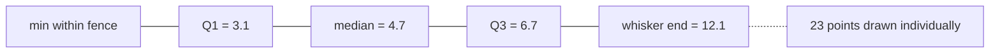

# Exploring distributions and categorical data

> **Before this lesson:** [Estimates of variability](#/lesson/statistics/variability), especially percentiles, quartiles and the interquartile range (IQR). Expected value comes from [Probability, conditional probability and Bayes' rule](#/lesson/statistics/probability-bayes).

## In plain words

A mean and a standard deviation compress a whole column into two numbers. That is useful, but it can hide the shape of the data: is it symmetric or lopsided, one hump or two, are there a few giant values far out to the right? The **distribution** of a variable is the full picture of which values occur and how often. This lesson shows the standard tools for looking at it (percentile tables, boxplots, frequency tables, histograms and density estimates) and then the equivalent tools for categorical data (counts, proportions, the mode and expected value).

An everyday picture: a class's exam results. "Average 65" could mean everyone scored around 65, or that half the class scored 90 and half scored 40. A histogram of scores tells you immediately which world you are in, and the teacher's response should be very different in each.

Why it matters for a job: almost every product metric (session length, revenue per user, time to first purchase, latency) is skewed, with a long right tail. If you do not look at the distribution first you will choose the wrong summary, the wrong test and the wrong model. Interviewers expect you to say "I would first plot the distribution" and to know what a boxplot's whiskers mean.

## 1. Percentile tables

The quickest numerical view of a distribution is a table of percentiles. pandas' `describe` prints the count, mean, standard deviation, minimum, quartiles and maximum in one call. We will use 500 simulated app session lengths in minutes, generated from a **lognormal** distribution, a common shape for durations and money: values are positive and a few are much larger than the rest.

```python-run
import numpy as np
import pandas as pd
rng = np.random.default_rng(7)
session = pd.Series(np.round(rng.lognormal(mean=1.6, sigma=0.6, size=500), 1), name="minutes")
print(session.describe().round(2))
print(session.quantile([0.05, 0.25, 0.5, 0.75, 0.95]).round(2))
```

**Reading this code line by line**

- `rng.lognormal(mean=1.6, sigma=0.6, size=500)` draws 500 values whose logarithm is normally distributed with mean 1.6 and standard deviation 0.6. You do not need the details now; the point is that it produces realistic skewed durations. `np.round(..., 1)` keeps one decimal.
- `pd.Series(..., name="minutes")` wraps the array in a pandas Series, a single labelled column.
- `.describe()` prints the standard summary; `.round(2)` tidies the decimals.
- `.quantile([...])` returns the requested percentiles, written as fractions.

The median is 4.7 minutes but the mean is 5.37: the mean is pulled right by the long tail. The gap between the 75th percentile (6.7) and the maximum (22.7) is far larger than between the minimum (0.7) and the 25th percentile (3.1). The 95th percentile is 11.9. Even without a chart, these numbers say "skewed to the right".

## 2. Boxplots

A **boxplot** (box-and-whisker plot) draws the percentile summary as a picture, which makes it easy to compare several groups side by side.

- The **box** spans from $Q_1$ to $Q_3$, so its height is the IQR; a line inside marks the median.
- The **whiskers** extend from the box to the most extreme data points that lie within 1.5 × IQR of the box.
- Points beyond the whiskers are drawn individually as potential **outliers**.

```python-run
import numpy as np
import pandas as pd
rng = np.random.default_rng(7)
session = pd.Series(np.round(rng.lognormal(mean=1.6, sigma=0.6, size=500), 1))
q1, q3 = session.quantile([0.25, 0.75])
iqr = q3 - q1
upper = q3 + 1.5 * iqr
inside = session[session <= upper]
print(f"Q1={q1:.2f} median={session.median():.2f} Q3={q3:.2f} IQR={iqr:.2f}")
print(f"upper fence={upper:.2f}  top whisker ends at {inside.max():.2f}")
print("points beyond the fence:", (session > upper).sum())
```

**Reading this code line by line**

- `q1, q3 = session.quantile([0.25, 0.75])` unpacks the two returned values into two variables.
- `upper` is the **fence**: the cut-off beyond which points are drawn individually.
- `session[session <= upper]` is **boolean indexing**: keep only the rows where the condition is true. Its maximum is where the top whisker stops.

The box runs from 3.1 to 6.7 with the median at 4.7; the upper fence is $6.7 + 1.5 \times 3.6 = 12.1$; 23 sessions lie beyond it. In a right-skewed distribution many points beyond the upper fence are normal, not errors. The 1.5 × IQR rule flags points to inspect, not points to delete.



## 3. Frequency tables and histograms

A **frequency table** divides the range of a numeric variable into equal-width intervals called **bins** and counts how many values fall into each. A **histogram** draws that table as bars: the x-axis shows the bins and the bar heights show the counts. Unlike a bar chart for categories, histogram bars touch each other because the bins are adjacent ranges of one continuous variable. Empty bins are shown as gaps, not removed.

```python-run
import numpy as np
import pandas as pd
rng = np.random.default_rng(7)
session = pd.Series(np.round(rng.lognormal(mean=1.6, sigma=0.6, size=500), 1))
bins = pd.cut(session, bins=range(0, 24, 3), right=False)
table = bins.value_counts(sort=False)
for interval, count in table.items():
    print(f"{str(interval):>10} {count:4d} " + "#" * (count // 5))
print("21 minutes or more:", (session >= 21).sum())
```

**Reading this code line by line**

- `range(0, 24, 3)` produces the bin edges 0, 3, 6, ..., 21.
- `pd.cut(..., right=False)` assigns each value to the interval it falls in. With `right=False` each interval includes its left edge and excludes its right edge, written `[3, 6)`.
- `value_counts(sort=False)` counts values per interval, keeping the intervals in order instead of sorting by count.
- The loop prints a text histogram: one `#` for every 5 sessions.

The text histogram shows the shape at once: a peak in the 3 to 6 minute bin (234 sessions), a quick fall and a long thin tail out past 18 minutes, with one session of 21 minutes or more.

Bin width matters. Too few bins hide structure (everything lands in one or two bars); too many make a noisy comb in which every bar is a handful of points. Try a few widths. Rules of thumb exist (Sturges' rule, the Freedman-Diaconis rule, which uses the IQR), and `np.histogram_bin_edges(x, bins="fd")` applies the latter.

Now draw the two pictures for real. The demo uses **matplotlib**, Python's standard plotting library, and puts a histogram of the same 500 sessions above a boxplot that shares its horizontal axis, so you can see how the box and whiskers summarise the shape above them. The first run downloads the plotting library, which takes a few seconds.

```python-run
import numpy as np
import pandas as pd
import matplotlib.pyplot as plt
rng = np.random.default_rng(7)
session = pd.Series(np.round(rng.lognormal(mean=1.6, sigma=0.6, size=500), 1))

fig, (top, bottom) = plt.subplots(2, 1, sharex=True, figsize=(7, 4.5),
                                  gridspec_kw={"height_ratios": [3, 1]})
top.hist(session, bins=range(0, 27, 3), color="#1f5f8b", edgecolor="white")
top.axvline(session.median(), color="#d1412b", linestyle="--", label=f"median {session.median():.1f}")
top.axvline(session.mean(), color="#a16207", linestyle=":", label=f"mean {session.mean():.2f}")
top.set_ylabel("number of sessions")
top.legend()
bottom.boxplot(session, vert=False, widths=0.6)
bottom.set_yticks([])
bottom.set_xlabel("session length (minutes)")
fig.tight_layout()
plt.show()
```

**Reading this code line by line**

- `plt.subplots(2, 1, sharex=True, ...)` creates a **figure** (the whole image) holding two **axes** (individual plots) stacked in 2 rows and 1 column, sharing one horizontal scale. `figsize` is the size in inches; `height_ratios` makes the top plot three times as tall as the bottom one.
- `top.hist(session, bins=range(0, 27, 3))` draws the histogram with the same 3-minute bins as the table (the last edge is 24, so the one session above 21 minutes is included).
- `axvline` draws a vertical line across the plot: dashed for the median, dotted for the mean. `label=` gives the text that `legend()` shows in the key.
- `bottom.boxplot(session, vert=False)` draws a horizontal boxplot with the default 1.5 × IQR whiskers; `set_yticks([])` removes the meaningless vertical tick marks.
- `fig.tight_layout()` stops labels from overlapping, and `plt.show()` displays the figure below the output.

Compare the two plots. The tallest bar is the 3 to 6 minute bin, which holds the box. The median line sits left of the mean line, the signature of right skew. The right whisker ends near 12, and the small circles beyond it are the 23 sessions past the upper fence, spread thinly along the tail the histogram shows. Change the bin step from 3 to 1 or to 6 and run again to see the bin-width trade-off described above.

## 4. Density estimates

A **density plot** is a smoothed histogram: a continuous curve whose area underneath equals 1. It is computed by **kernel density estimation** (KDE): place a small bump (the **kernel**, usually a normal curve) on every data point and add up the bumps. The width of each bump is the **bandwidth**, which plays the same role as bin width: small bandwidths give a wiggly curve, large ones over-smooth.

```python-run
import numpy as np
from scipy import stats
rng = np.random.default_rng(7)
x = np.round(rng.lognormal(mean=1.6, sigma=0.6, size=500), 1)
grid = np.array([2, 4, 6, 8, 12, 20])
for bw in [0.1, "scott", 1.0]:
    kde = stats.gaussian_kde(x, bw_method=bw)
    print(f"bandwidth {str(bw):>5}: density at {grid.tolist()} =", np.round(kde(grid), 3))
print("skewness:", round(stats.skew(x), 2))
```

**Reading this code line by line**

- `stats.gaussian_kde(x, bw_method=bw)` builds a density estimate from the data. `bw_method` sets the bandwidth: a number is a scale factor, and `"scott"` is a standard automatic rule (Scott's rule), which is also the default.
- `kde(grid)` evaluates the estimated density at the listed session lengths.
- `stats.skew` computes the **skewness**, a number describing lopsidedness: 0 for symmetric data, positive when the long tail is on the right.

With the narrow bandwidth 0.1 the curve is spiky and drops to 0.0 at 20 minutes; with 1.0 the peak at 4 minutes is flattened from 0.162 to 0.095. Scott's rule sits in between. The skewness of 1.61 confirms a strong right tail.

The density's y-axis is not a count or a share. It is a density: the share of data per unit on the x-axis. To get the share of sessions between 4 and 6 minutes you would take the area under the curve over that interval.

Skewness is the third **moment** of a distribution. The first moment is the mean (location), the second the variance (spread), the third skewness (asymmetry) and the fourth **kurtosis**, which describes how heavy the tails are. In practice, plots tell you more about shape than these numbers do.

> [!TIP]
> For right-skewed positive data, try plotting the logarithm. The log of lognormal data is bell-shaped, and log scales are standard for revenue, latency and counts that span several orders of magnitude.

## 5. Categorical data: counts, proportions and the mode

For categorical data the basic summary is how often each category occurs, as a count or a **proportion** (share of the total). Bar charts show these: one bar per category, with gaps between bars because the categories are separate. A pie chart shows the same thing but is harder to read accurately; most analysts avoid it.

The **mode** is the most frequent category, the natural "typical value" for categorical data. For numeric data the mode is rarely useful, except for a distribution with distinct peaks.

```python-run
import pandas as pd
plans = pd.Series(["free"] * 620 + ["basic"] * 250 + ["pro"] * 110 + ["team"] * 20)
counts = plans.value_counts()
shares = plans.value_counts(normalize=True)
print(pd.DataFrame({"count": counts, "share": shares}))
print("mode:", plans.mode()[0])
price = {"free": 0, "basic": 5, "pro": 15, "team": 60}
ev = sum(shares[p] * price[p] for p in price)
print(f"expected monthly revenue per user: ${ev:.2f}")
```

**Reading this code line by line**

- `["free"] * 620` makes a list of 620 copies of `"free"`; adding lists joins them, giving 1,000 users.
- `value_counts()` counts each category, most common first; `normalize=True` divides by the total to give shares.
- `.mode()` returns the most frequent value(s) as a Series, since there may be ties; `[0]` takes the first.
- `price` is a dictionary mapping each plan to its monthly price, and the `sum(...)` line computes the expected value.

62% of users are on the free plan, which is the mode.

## 6. Expected value for categorical outcomes

When each category has a numeric value attached, the **expected value** is the share-weighted average of those values, the same formula as in the probability lesson:

$$E[\text{revenue}] = \sum_{\text{plan}} P(\text{plan}) \times \text{price(plan)}$$

Here $0.62 \times 0 + 0.25 \times 5 + 0.11 \times 15 + 0.02 \times 60 = 4.10$, so a new user is worth \$4.10 a month on average. Note how the tiny team segment (2% of users) contributes \$1.20 of that, nearly 30%. Expected value is the backbone of business cases: customer lifetime value, the value of a marketing campaign, and the expected profit of a pricing change are all probability-weighted sums of outcomes.

> [!INTERVIEW]
> "Would you rather move 1% of free users to basic or 1% of basic users to team?" Use expected value: the first adds $0.01 \times 620 \times 5 = 31$ dollars per 1,000 users a month; the second adds $0.01 \times 250 \times (60 - 5) = 137.5$. Then mention what expected value leaves out, such as how realistic each shift is and the cost to achieve it.

## 7. A checklist for exploring a distribution

1. Count the records and missing values.
2. Print a percentile table; compare mean and median to sense skew.
3. Plot a histogram (try two or three bin widths) or a density curve; consider a log scale.
4. Draw boxplots by important groups (platform, country, new versus returning users).
5. Investigate points beyond the fences: errors, bots, test accounts or real extremes?
6. For categorical columns, check counts, rare categories and unexpected labels ("Android", "android", "ANDROID").

## Common mistakes

- Reading histogram bar heights as probabilities when the bins have unequal widths.
- Treating every point beyond a boxplot whisker as an error to remove.
- Drawing a density curve over a hard boundary (durations cannot be negative, but a KDE can put probability there).
- Using pie charts or 3D charts that distort comparisons.
- Ignoring rare categories that dominate value, as the team plan does here.

## Summary

- A distribution shows which values occur and how often; look at it before choosing summaries or tests.
- Percentile tables and boxplots summarise shape compactly; whiskers end at the last points within 1.5 × IQR of the box.
- Histograms count values in bins; density plots smooth them with a kernel and a bandwidth.
- Skewness measures asymmetry; most product metrics are right-skewed.
- For categorical data use counts, proportions and the mode; attach values and compute the expected value for business decisions.

## Glossary

- **Distribution**: the pattern of which values occur and how often.
- **Lognormal distribution**: a distribution whose logarithm is normal; right-skewed and positive.
- **Boxplot**: a chart of the quartiles, whiskers and outlying points.
- **Whisker / fence**: the line from the box to the last point within 1.5 × IQR / the 1.5 × IQR cut-off.
- **Boolean indexing**: selecting rows with a true/false condition.
- **Frequency table / bins**: counts of values in intervals / the intervals.
- **Histogram**: a bar chart of a frequency table for a numeric variable.
- **Density plot / kernel density estimation (KDE)**: a smoothed histogram / building it by adding a small bump per point.
- **Bandwidth**: the width of each bump in a KDE.
- **Skewness / kurtosis**: asymmetry of a distribution / heaviness of its tails.
- **Moment**: one of the summaries mean, variance, skewness and kurtosis.
- **Proportion**: a count divided by the total.
- **Mode**: the most frequent value.
- **Expected value**: a probability-weighted average of outcomes.

## Check yourself

```quiz
[
  {"q": "In a boxplot, the top whisker ends at…", "options": ["the largest data point within 1.5 × IQR above Q3", "the maximum value", "Q3 + 1.5 × IQR exactly, whether or not data are there", "the 95th percentile"], "answer": 0,
   "explain": "The whisker reaches the most extreme actual data point inside the fence; points beyond are drawn individually."},
  {"q": "A metric's mean is 5.4 and its median 4.7. The distribution is most likely…", "options": ["skewed to the right", "skewed to the left", "symmetric", "bimodal"], "answer": 0,
   "explain": "A long right tail pulls the mean above the median."},
  {"q": "What happens to a kernel density estimate when you make the bandwidth very large?", "options": ["It becomes over-smoothed and hides features like peaks", "It becomes spiky", "Its area exceeds 1", "Nothing; bandwidth only affects speed"], "answer": 0,
   "explain": "Wide bumps blur the shape; narrow bumps make a noisy curve."},
  {"q": "Why do histogram bars touch while bar-chart bars do not?", "options": ["Histogram bins are adjacent ranges of one numeric variable; bar-chart categories are separate", "It is only a style choice", "Histograms show proportions", "Bar charts are for numeric data"], "answer": 0,
   "explain": "Gaps signal separate categories; touching bars signal a continuous axis."},
  {"q": "62% of users are free (\\$0), 25% basic (\\$5), 11% pro (\\$15) and 2% team (\\$60). Expected monthly revenue per user is…", "options": ["\\$4.10", "\\$20.00", "\\$5.00", "\\$0"], "answer": 0,
   "explain": "$0.25 \\times 5 + 0.11 \\times 15 + 0.02 \\times 60 = 1.25 + 1.65 + 1.20 = 4.10$."},
  {"q": "The mode is most useful as a summary of…", "options": ["categorical data", "continuous measurements with many distinct values", "the spread of data", "skewness"], "answer": 0,
   "explain": "With continuous data almost every value is unique, so the mode says little."}
]
```

> **Source:** Bruce & Bruce, *Practical Statistics for Data Scientists* (O'Reilly, 2017), ch. 1, "Exploring the Data Distribution" (percentiles and boxplots, frequency tables and histograms, density estimates) and "Exploring Binary and Categorical Data" (mode, expected value); SciPy documentation for `gaussian_kde`.
