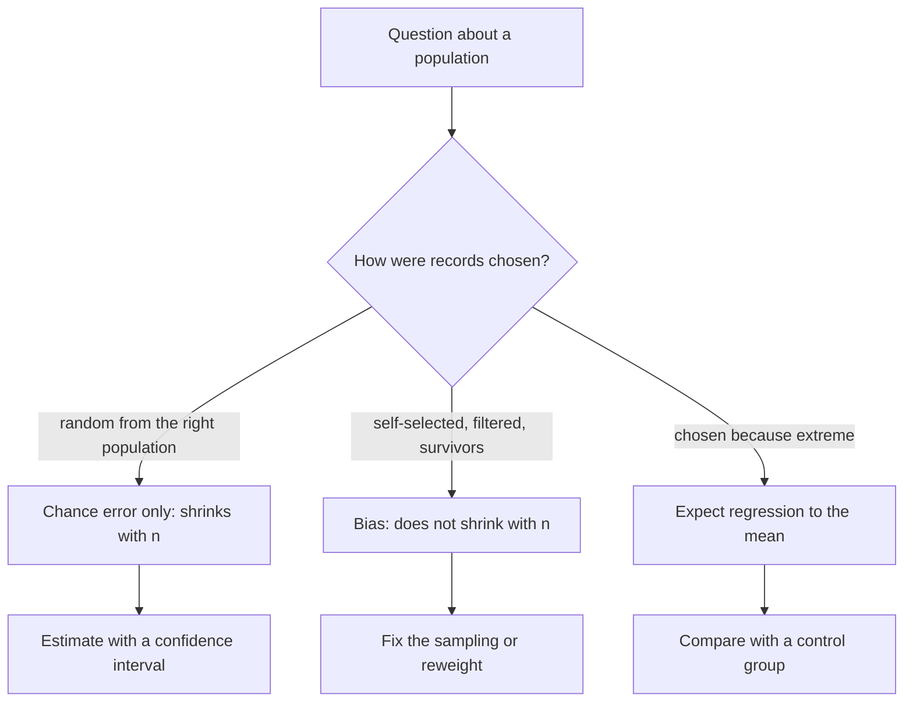

# Random sampling and the many faces of bias

> **Before this lesson:** [Data types and estimates of location](#/lesson/statistics/data-and-location) (population versus sample, mean) and [Estimates of variability](#/lesson/statistics/variability) (standard deviation). Correlation from [Correlation and exploring two or more variables](#/lesson/statistics/correlation-bivariate) appears in one demo.

## In plain words

We almost never measure everyone. We measure a **sample** and use it to learn about the **population**, the full group we care about. That only works if the sample resembles the population. This lesson is about how to draw samples that do, and about the many ways data can mislead you when it does not: sample bias, selection bias, data snooping, survivorship bias and regression to the mean.

An everyday picture: to judge a pot of soup you taste one spoonful. If you stirred the pot first, one spoonful tells you about the whole pot. If you skim only the top, where the oil floats, you will be confidently wrong, and tasting more spoonfuls from the top will not help.

Why it matters for a job: in the era of big data it is tempting to think size fixes everything. It does not. A biased sample of ten million users gives a precise answer to the wrong question. Interviewers love these traps: "Users who adopted feature X retain better, so should we push X on everyone?", "Our survey says customers love the product", "The best-performing sales region this quarter fell back next quarter: what happened?" Recognising bias is often worth more than any formula.

## 1. Random sampling

A **random sample** is drawn so that every member of the population has a known chance of selection. In a **simple random sample** every member has the same chance, and every possible sample of size $n$ is equally likely. Sampling can be done **with replacement** (a chosen member is put back and could be chosen again) or **without replacement** (each member at most once); for samples much smaller than the population the difference is negligible.

Randomness is what makes a sample trustworthy. It does not guarantee that a sample matches the population exactly, but it guarantees that the differences are due to chance, and chance errors can be measured and shrink as the sample grows. Errors from a non-random process do not shrink at all.

Defining the population carefully comes first. "Customers" could mean everyone who ever signed up, everyone active in the last 30 days, or everyone who bought this year. A sample of active users says nothing about churned ones.

## 2. Bias

**Bias** is a systematic error: a tendency for an estimate to miss the truth in the same direction, sample after sample. Random error scatters estimates around the truth; bias shifts their centre. **Sample bias** (or a non-representative sample) means the sample differs from the population in a way that matters for the question.

The classic historical example is a 1936 US magazine poll that surveyed over two million people, drawn largely from telephone and car-owner lists, and confidently predicted the wrong winner of the presidential election, while a far smaller but more carefully drawn poll got it right. People with phones and cars in 1936 were wealthier than average and voted differently.

A modern version is the voluntary survey or review: the people who choose to answer differ from those who do not. This is called **self-selection bias** (or non-response bias).

```python-run
import numpy as np
rng = np.random.default_rng(0)
N = 200_000
spend = rng.lognormal(3, 1, N)
print("population mean spend:", round(spend.mean(), 2))
srs = rng.choice(spend, 1000, replace=False)
print("simple random sample of 1,000:", round(srs.mean(), 2))
p_reply = np.clip(spend / spend.max() * 40, 0.01, 1)
replied = rng.random(N) < p_reply
print("survey replies:", replied.sum(), " mean spend of repliers:", round(spend[replied].mean(), 2))
```

**Reading this code line by line**

- `spend` is the monthly spend of 200,000 customers: the whole population.
- `rng.choice(spend, 1000, replace=False)` draws a simple random sample of 1,000 without replacement.
- `p_reply` gives each customer a probability of answering a survey that grows with their spend, as engaged customers are more likely to reply. `np.clip(values, 0.01, 1)` keeps every probability between 0.01 and 1.
- `replied` marks who answered.

The population mean is 33.15. The random sample of only 1,000 gives 31.16, off by chance alone. The survey gets 89,605 replies, almost 90 times as many, yet its mean is 55.5, wildly wrong. More data from a biased process gives a more precise wrong answer.

> [!INTERVIEW]
> "Our in-app survey says 80% of users are satisfied." Ask: who saw the survey (only active users?), who answered (engaged or angry users?), and when (after a success screen?). Then propose fixing the sampling: survey a random sample of all users, including recently inactive ones, and follow up with non-responders.

## 3. Stratified sampling

Sometimes we want to guarantee that important subgroups are represented. In **stratified sampling** the population is split into groups called **strata** (singular stratum), such as platform or country, and a random sample is drawn within each. If the strata differ a lot from each other but are fairly uniform inside, stratifying gives a more precise estimate than a simple random sample of the same size. It also lets you **oversample** a small but important group (enterprise customers, a new market) and then reweight to the population mix using the weighted mean.

```python-run
import numpy as np
rng = np.random.default_rng(1)
sizes = {"mobile": 140_000, "desktop": 60_000}
pop = {"mobile": rng.normal(20, 5, sizes["mobile"]), "desktop": rng.normal(45, 8, sizes["desktop"])}
everyone = np.concatenate(list(pop.values()))
N = len(everyone)
srs_means, strat_means = [], []
for _ in range(2000):
    srs_means.append(rng.choice(everyone, 500, replace=False).mean())
    est = 0
    for k, vals in pop.items():
        n_k = int(500 * sizes[k] / N)
        est += sizes[k] / N * rng.choice(vals, n_k, replace=False).mean()
    strat_means.append(est)
print("true mean:", round(everyone.mean(), 3))
print("simple random: mean of estimates", round(np.mean(srs_means), 3), " spread (SD)", round(np.std(srs_means), 3))
print("stratified   : mean of estimates", round(np.mean(strat_means), 3), " spread (SD)", round(np.std(strat_means), 3))
```

**Reading this code line by line**

- The population has two strata: 140,000 mobile users averaging 20 minutes and 60,000 desktop users averaging 45.
- The loop repeats the whole sampling process 2,000 times so we can see how much each method's estimate varies.
- Simple random sampling draws 500 users from everyone.
- Stratified sampling draws 350 mobile and 150 desktop users (500 split in proportion to stratum size), and combines the two stratum means weighted by stratum size.

Both methods are unbiased (their average estimates, 27.476, match the true 27.485 closely). But the stratified estimates vary much less: a standard deviation of 0.271 versus 0.586. Removing the luck of how many desktop users happen to fall in the sample halves the error. A smaller spread for the same cost is exactly what experiment designers want, and the same idea underlies stratified randomisation and variance-reduction methods in A/B tests.

## 4. Selection bias and data snooping

**Selection bias** is a broader term: any distortion caused by how records were chosen, consciously or not. It includes picking data that support a conclusion, and choosing *which analysis to report* after seeing many.

If you search through enough variables, some will look related to your outcome by chance. This is called **data snooping** or data dredging, and the resulting false discoveries are a form of selection bias sometimes called the **vast search effect**.

```python-run
import numpy as np
rng = np.random.default_rng(2)
n_users, n_features = 200, 500
X = rng.normal(size=(n_users, n_features))
y = rng.normal(size=n_users)
r = np.array([np.corrcoef(X[:, j], y)[0, 1] for j in range(n_features)])
best = np.argmax(np.abs(r))
print("strongest |r| among 500 pure-noise features:", round(abs(r[best]), 3))
print("features with |r| > 0.15:", np.sum(np.abs(r) > 0.15))
y_new = rng.normal(size=n_users)
X_new = rng.normal(size=(n_users, n_features))
print("same feature on fresh data:", round(np.corrcoef(X_new[:, best], y_new)[0, 1], 3))
```

**Reading this code line by line**

- `X` is a table of 500 random "features" for 200 users and `y` a random "outcome". By construction nothing is related to anything.
- The list comprehension `[... for j in range(n_features)]` computes the correlation of each feature with the outcome.
- `np.argmax(np.abs(r))` finds the position of the strongest correlation, positive or negative.
- The last lines generate fresh data and check the "winning" feature again.

The best of 500 noise features reaches $|r| = 0.27$, and 12 features exceed 0.15, numbers that would look interesting in a report. On fresh data the winner's correlation is $-0.103$: it was luck. The defences are to state hypotheses before looking, to correct for multiple comparisons (see [Multiple testing](#/lesson/statistics/multiple-testing)), and above all to validate on **holdout data** that played no part in the search.

> [!WARNING]
> Every time you slice a dashboard by another dimension (country, device, week, cohort), you run another implicit comparison. With enough slices something always looks dramatic. Treat surprising segment results as hypotheses for a new test, not as findings.

## 5. Survivorship bias

**Survivorship bias** happens when only the "survivors" of some process are visible. Studying successful start-ups to find the secrets of success ignores the many failed ones that did the same things. Measuring the satisfaction of current customers ignores those who already left because they were unhappy. Looking at the average tenure of current employees ignores those who quit early. Whenever a dataset is defined by "still here", ask who is missing.

## 6. Regression to the mean

**Regression to the mean** is the tendency for extreme measurements to be followed by less extreme ones. It happens whenever a measurement combines a stable part (skill, true quality) and a random part (luck, noise). The people at the top of one measurement are disproportionately those who were both good *and* lucky; the luck does not repeat, so next time they fall back towards the average.

```python-run
import numpy as np
rng = np.random.default_rng(3)
n = 10_000
skill = rng.normal(100, 10, n)
week1 = skill + rng.normal(0, 10, n)
week2 = skill + rng.normal(0, 10, n)
top = week1 >= np.quantile(week1, 0.95)
bottom = week1 <= np.quantile(week1, 0.05)
print(f"top 5% in week 1:    week1 avg {week1[top].mean():.1f} -> week2 avg {week2[top].mean():.1f}")
print(f"bottom 5% in week 1: week1 avg {week1[bottom].mean():.1f} -> week2 avg {week2[bottom].mean():.1f}")
print(f"everyone:            week1 avg {week1.mean():.1f} -> week2 avg {week2.mean():.1f}")
```

**Reading this code line by line**

- Each of 10,000 salespeople has a fixed `skill` (average 100). Each week's result is skill plus independent luck.
- `np.quantile(week1, 0.95)` is the 95th percentile of week 1; `top` marks everyone at or above it.
- We compare each group's average in week 1 with the same people's average in week 2.

The week-1 top 5% averaged 129.2 and fell to 114.7 in week 2; the bottom 5% rose from 71.5 to 85.8. Nobody's skill changed, and the overall average did not move (100.1 both weeks). The term goes back to Francis Galton, who noticed in the 1880s that very tall parents tended to have children shorter than themselves, though still taller than average.

This effect causes many false conclusions in business:

- A "sophomore slump": a rookie of the year often has a weaker second season.
- Stores selected for an intervention *because* they had a terrible month will improve next month anyway, making the intervention look effective.
- Users targeted with a win-back campaign *because* their activity dropped will often recover partly by themselves.

The cure is a **control group**: compare the treated units with similar untreated units selected the same way. Both groups regress to the mean equally, so the difference between them isolates the effect of the treatment. This is the motivation for randomised experiments, the subject of module 3.

## 7. Size versus quality

When is more data worth it, and when is a small, carefully drawn sample better? A sample can be both cheaper and more accurate when the large dataset is collected through a biased process, when its records are messy and need expensive cleaning, or when the question is about a narrow sub-population. Big data shines when you need to find rare cases or patterns among many combinations of features (for example, rare search queries) where only massive data contain enough examples. The rule of thumb: first ask whether the data-generating process answers your question, then ask whether you have enough of it.



## Summary

- A random sample gives every population member a known chance of selection; its errors are due to chance, measurable, and shrink with sample size.
- Bias is systematic error; it does not shrink as data grow. Self-selection and non-response are common sources.
- Stratified sampling guarantees subgroup representation and often reduces variance.
- Searching many variables or slices produces chance "discoveries" (data snooping); validate on holdout data.
- Survivorship bias hides the units that dropped out.
- Extreme results regress towards the mean; control groups protect you from mistaking this for an effect.

## Glossary

- **Population / sample**: the whole group of interest / the part observed.
- **Random sample / simple random sample**: each member has a known chance / an equal chance of selection.
- **With / without replacement**: chosen members can / cannot be chosen again.
- **Bias**: systematic error in one direction.
- **Sample bias**: a sample that differs from the population in a way that matters.
- **Self-selection (non-response) bias**: distortion because people choose whether to take part.
- **Stratified sampling / strata**: sampling separately within groups / the groups.
- **Oversampling**: deliberately sampling a group at a higher rate than its population share.
- **Selection bias**: distortion from how data or analyses were chosen.
- **Data snooping (vast search effect)**: finding chance patterns by searching many possibilities.
- **Holdout data**: data kept aside to check findings.
- **Survivorship bias**: analysing only units that survived a process.
- **Regression to the mean**: extreme results tend to be followed by less extreme ones.
- **Control group**: comparable units that do not get the treatment.

## Check yourself

```quiz
[
  {"q": "A survey gets 90,000 responses from customers who chose to answer. Compared with a random sample of 1,000, it is…", "options": ["more precise but possibly biased, and the bias does not shrink with more responses", "always more accurate because it is bigger", "unbiased because it is large", "useless in every case"], "answer": 0,
   "explain": "Size reduces random error, not systematic error from self-selection."},
  {"q": "Why can stratified sampling beat simple random sampling of the same size?", "options": ["It removes the chance variation in how many members of each very different group are included", "It removes all bias from measurement", "It needs no randomness", "It always uses a bigger sample"], "answer": 0,
   "explain": "When strata differ a lot, fixing their shares in the sample reduces the variance of the estimate."},
  {"q": "You test 500 random features and report the one most correlated with churn. The main danger is…", "options": ["data snooping: the best of many noise features looks strong by chance", "survivorship bias", "too little data", "regression to the mean in the outcome"], "answer": 0,
   "explain": "Searching many options guarantees impressive-looking chance results; check on holdout data."},
  {"q": "The 20 worst-performing stores last month get a new manager training and improve this month. The most important missing piece is…", "options": ["a comparable control group of poor performers without training", "a larger sample of good stores", "a correlation matrix", "a pie chart"], "answer": 0,
   "explain": "Stores chosen for being extreme improve on average anyway (regression to the mean)."},
  {"q": "Studying only companies that are still in business to find what makes companies succeed is an example of…", "options": ["survivorship bias", "stratified sampling", "regression to the mean", "random error"], "answer": 0,
   "explain": "Failed companies that did the same things are invisible."},
  {"q": "What does regression to the mean require?", "options": ["Measurements that combine a stable component with random noise", "A linear regression model", "A biased sample", "A very small population"], "answer": 0,
   "explain": "Extreme scores are partly luck, which does not repeat."}
]
```

> **Source:** Bruce & Bruce, *Practical Statistics for Data Scientists* (O'Reilly, 2017), ch. 2, "Random Sampling and Sample Bias" (bias, random selection, size versus quality, sample mean versus population mean) and "Selection Bias" (data snooping, vast search effect, regression to the mean); simulations here are original.
