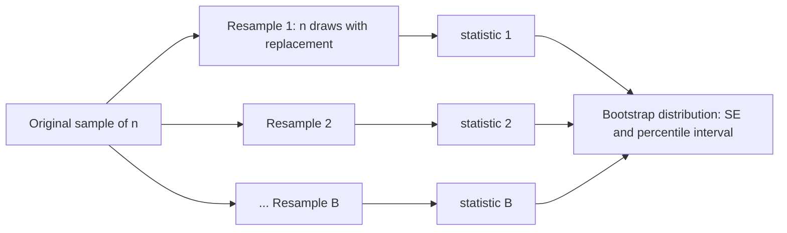

# The bootstrap

> **Before this lesson:** [Sampling distributions, standard error and the central limit theorem](#/lesson/statistics/sampling-distribution-clt). You need the idea of a sampling distribution and a standard error; percentiles from [Estimates of variability](#/lesson/statistics/variability) are used to build intervals.

## In plain words

To find the standard error of a statistic we imagined drawing thousands of samples from the population. In real life you have one sample and no way to draw more. The **bootstrap** is a clever workaround: treat your sample as a stand-in for the population and draw many new samples *from it*, with replacement. The spread of the statistic across these **resamples** approximates its sampling distribution, for almost any statistic, with no formula required.

An everyday picture: you want to know how much a pollster's estimate would jump around if the poll were repeated, but you only have the 600 answers already collected. Put the 600 answer cards in a hat. Draw a card, note it, put it back, and repeat 600 times: that is one bootstrap sample. Do it thousands of times and watch how much the result moves.

Why it matters for a job: data scientists use the bootstrap daily for confidence intervals around medians, percentiles, ratios (revenue per session), model metrics (AUC on a test set) and anything else without a textbook formula. In interviews, "How would you put a confidence interval on the median?" or "on a ratio metric?" has the bootstrap as its expected answer, and you should also know why resampling must be done at the user level.

## 1. The idea

The name comes from the phrase "pulling yourself up by your own bootstraps": the sample is used to learn about its own reliability. The logic runs like this:

1. The ideal is to sample repeatedly from the population and see how the statistic varies.
2. We do not have the population, but our sample is our best picture of it.
3. So sample repeatedly from the sample, with replacement, using the same sample size $n$.

Sampling **with replacement** is essential. Without replacement, every resample of size $n$ would be the original sample in a different order, and the statistic would never change. With replacement, some records appear twice or more and others not at all, mimicking the variation between real samples. On average a resample contains about 63% of the distinct original records (the chance that a given record is never picked is $(1 - 1/n)^n \approx e^{-1} \approx 0.37$).

The algorithm, for a statistic such as the median:

1. Draw $n$ values from the sample with replacement.
2. Compute the statistic on this resample and record it.
3. Repeat steps 1 and 2 $B$ times ($B$ is typically 1,000 to 10,000).
4. Use the $B$ recorded values: their standard deviation estimates the standard error; their percentiles give a confidence interval.



## 2. Bootstrapping the median

The median of skewed data has a messy theoretical standard error, so it is a natural first use. Here 60 order values follow a skewed lognormal distribution.

```python-run
import numpy as np
rng = np.random.default_rng(21)
sample = np.round(rng.lognormal(mean=3.4, sigma=0.8, size=60), 2)
print("sample median:", np.median(sample))
B = 5000
boot_medians = np.empty(B)
for b in range(B):
    resample = rng.choice(sample, size=len(sample), replace=True)
    boot_medians[b] = np.median(resample)
print("bootstrap SE of the median:", round(boot_medians.std(ddof=1), 2))
print("bootstrap estimate of bias:", round(boot_medians.mean() - np.median(sample), 2))
lo, hi = np.percentile(boot_medians, [2.5, 97.5])
print(f"95% percentile interval: ({lo:.2f}, {hi:.2f})")
```

**Reading this code line by line**

- `sample` is our one observed dataset of 60 order values.
- `np.empty(B)` creates an array of 5,000 slots to fill.
- Inside the loop, `rng.choice(sample, size=len(sample), replace=True)` draws 60 values from the sample with replacement; we store its median.
- `boot_medians.std(ddof=1)` is the bootstrap standard error.
- The **bootstrap bias** estimate compares the average bootstrap median with the original median; a value far from zero warns that the statistic is systematically off.
- `np.percentile(boot_medians, [2.5, 97.5])` cuts off the lowest and highest 2.5% of bootstrap medians, leaving the middle 95%.

The sample median is 30.97, with a bootstrap standard error of 4.21 and a negligible bias of 0.16. The **percentile interval** from 25.06 to 41.08 is a 95% bootstrap confidence interval for the population median. Notice it is not symmetric around 30.97: it stretches further to the right, as it should for right-skewed data. A formula of the form "estimate ± 2 SE" would force symmetry.

## 3. A sanity check: the mean

For the mean we do have a formula, $s/\sqrt{n}$, so we can check that the bootstrap agrees. This demo also shows a faster, loop-free way to resample: draw all the random positions at once.

```python-run
import numpy as np
rng = np.random.default_rng(21)
sample = np.round(rng.lognormal(mean=3.4, sigma=0.8, size=60), 2)
print("distinct values in one resample:", len(np.unique(rng.choice(sample, 60))), "of 60")
idx = rng.integers(0, len(sample), size=(5000, len(sample)))
boot_means = sample[idx].mean(axis=1)
print("bootstrap SE of the mean:", round(boot_means.std(ddof=1), 2))
print("formula s/sqrt(n)       :", round(sample.std(ddof=1) / np.sqrt(len(sample)), 2))
```

**Reading this code line by line**

- `np.unique(...)` lists the distinct values; one resample here contains 42 of the 60 original records, close to the expected 63%.
- `rng.integers(0, 60, size=(5000, 60))` creates a 5,000 × 60 table of random positions. Indexing `sample[idx]` turns it into 5,000 resamples in one step (this is called **vectorised** code: NumPy does the loop internally, much faster than Python).
- `.mean(axis=1)` gives one mean per resample.

The bootstrap standard error, 4.23, is very close to the formula's 4.28. When a formula exists the two agree; when it does not, the bootstrap still works.

## 4. Better intervals: SciPy's `bootstrap` and BCa

The percentile interval is simple but can be a little off when the statistic is biased or its spread changes with its value. The **bias-corrected and accelerated** (BCa) interval adjusts the percentile cut-offs for both effects and is SciPy's default.

```python-run
import numpy as np
from scipy import stats
rng = np.random.default_rng(21)
sample = np.round(rng.lognormal(mean=3.4, sigma=0.8, size=60), 2)
for method in ["percentile", "BCa"]:
    res = stats.bootstrap((sample,), np.median, n_resamples=5000, method=method, random_state=1)
    ci = res.confidence_interval
    print(f"{method:10s}: ({ci.low:.2f}, {ci.high:.2f})  SE {res.standard_error:.2f}")
```

**Reading this code line by line**

- `stats.bootstrap` takes the data as a tuple (`(sample,)`, note the trailing comma that makes a one-element tuple), the statistic function (`np.median`), the number of resamples and the method.
- `random_state=1` fixes SciPy's random draws so the run is repeatable.
- The result object holds `confidence_interval` (with `.low` and `.high`) and `standard_error`.

Both methods give intervals close to the hand-made one; the BCa interval is usually slightly shifted relative to the plain percentile interval to correct for skew. (Exact digits can differ a little between SciPy versions because the random-number machinery changed over time.) For important reporting, BCa is a good default.

## 5. Bootstrapping product metrics: resample the right unit

Many product metrics are **ratio metrics**: total revenue divided by total sessions, clicks divided by impressions. The numerator and denominator are both random and correlated, so the simple formulas do not apply. The bootstrap handles them, but there is a critical rule: **resample the independent unit**. Sessions from the same user are not independent (a heavy spender has many expensive sessions), so resample *users*, carrying all of each user's sessions along.

```python-run
import numpy as np
import pandas as pd
rng = np.random.default_rng(8)
n_users = 400
sessions = rng.poisson(5, n_users) + 1
heavy = rng.random(n_users) < 0.1
revenue = np.where(heavy, rng.gamma(2, 30, n_users), rng.gamma(2, 3, n_users)) * sessions / 5
users = pd.DataFrame({"sessions": sessions, "revenue": revenue})
ratio = users.revenue.sum() / users.sessions.sum()
boot = []
for _ in range(3000):
    r = users.sample(frac=1, replace=True, random_state=int(rng.integers(1e9)))
    boot.append(r.revenue.sum() / r.sessions.sum())
lo, hi = np.percentile(boot, [2.5, 97.5])
print(f"revenue per session: {ratio:.3f}, bootstrap 95% interval ({lo:.3f}, {hi:.3f})")
```

**Reading this code line by line**

- Each of 400 users has a session count (at least 1) and a total revenue; 10% are "heavy" users who spend about ten times as much. `rng.gamma` draws from the gamma distribution, a flexible skewed shape for positive amounts.
- `users.sample(frac=1, replace=True, ...)` is pandas' way to draw a resample of rows: `frac=1` means as many rows as the original, `replace=True` means with replacement. Each row is a user, so a user's sessions and revenue travel together.
- The statistic is computed exactly as on the original data: total revenue over total sessions.

Revenue per session is 2.585 with a 95% interval from 2.004 to 3.287, quite wide because a few heavy users dominate. If you instead treated every session as an independent record, the interval would come out falsely narrow, and an A/B test on this metric would declare far too many false "wins". The same principle is called the **cluster bootstrap** (resampling whole clusters of correlated records).

> [!INTERVIEW]
> "How do you get a confidence interval for click-through rate per user when you randomised by user but log impressions?" Answer: bootstrap users (or use the delta method, a formula-based approximation for ratios), never individual impressions, because impressions within a user are correlated.

## 6. Bootstrap for models

The bootstrap also measures model uncertainty. Resample the training rows, refit the model, and record a coefficient or a prediction; the spread across refits is its bootstrap standard error. Averaging the predictions of models fit on bootstrap samples is **bagging** (bootstrap aggregating), the idea behind random forests, covered in [Statistical machine learning](#/lesson/statistics/statistical-ml). You can also bootstrap a test set to get an interval for accuracy or AUC.

## 7. What the bootstrap cannot do

- **It does not create information.** It cannot fix a small sample or a biased one; it only reports how much your estimate would vary under repeated sampling *like the one you did*.
- **It struggles with extremes.** The maximum, minimum and extreme percentiles (like p99.9 with few data) are poorly estimated because the resamples can never exceed the observed maximum.
- **It assumes independent units.** Time series and clustered data need block or cluster versions.
- **Very small samples** (under about 20) give rough intervals.

## 8. Bootstrap versus permutation

Both are **resampling** methods, but they answer different questions. The bootstrap samples *with* replacement from one dataset to estimate uncertainty (standard errors and confidence intervals). A **permutation test** shuffles group labels *without* replacement to test whether two groups differ more than chance would allow. You will meet permutation tests in [A/B tests, hypotheses and permutation tests](#/lesson/statistics/ab-tests-permutation).

## Common mistakes

- **Resampling a different size than the original.** The resample size must equal $n$, because the standard error depends on $n$. Bootstrapping 100 rows out of 10,000 answers a question about samples of 100.
- **Too few resamples.** 200 resamples give a jumpy 95% interval because only 5 values fall in each tail. Use thousands; it is cheap.
- **Forgetting the seed.** Without a fixed seed, every rerun gives slightly different intervals, which confuses reviewers. Set one and report $B$.
- **Reading the bootstrap distribution as the data distribution.** The histogram of bootstrap medians describes the uncertainty of the median, not the spread of order values.
- **Ignoring clustering** (sessions inside users, students inside schools), which produces intervals that are much too narrow.

## Summary

- The bootstrap estimates a statistic's sampling distribution by resampling the observed data with replacement, $B$ times, at the original sample size.
- The standard deviation of the bootstrap statistics estimates the standard error; their 2.5th and 97.5th percentiles give a 95% percentile interval; BCa improves it.
- It works for statistics without formulas: medians, percentiles, ratios, model metrics and coefficients.
- Resample the independent unit (users, not page views) to get honest intervals.
- It cannot fix bias or tiny samples and is poor for extreme statistics.

## Glossary

- **Bootstrap**: estimating sampling variability by resampling the data with replacement.
- **Resample (bootstrap sample)**: a sample of size $n$ drawn with replacement from the original data.
- **$B$**: the number of bootstrap resamples.
- **Bootstrap standard error**: the standard deviation of the bootstrap statistics.
- **Bootstrap bias**: average bootstrap statistic minus the original statistic.
- **Percentile interval**: a confidence interval from the percentiles of the bootstrap statistics.
- **BCa (bias-corrected and accelerated) interval**: a percentile interval adjusted for bias and skew.
- **Vectorised code**: array operations that replace explicit Python loops.
- **Ratio metric**: a metric that is one total divided by another, such as revenue per session.
- **Cluster bootstrap**: resampling whole groups of correlated records together.
- **Bagging**: averaging models fit on bootstrap samples.
- **Resampling**: any method that reuses the observed data by sampling from it.

## Check yourself

```quiz
[
  {"q": "Why must bootstrap resampling be done with replacement?", "options": ["Without replacement every resample of size n is the original data reordered, so the statistic never varies", "It is faster", "It removes bias from the sample", "It makes the data normal"], "answer": 0,
   "explain": "Replacement lets some records repeat and others drop out, imitating the variation between real samples."},
  {"q": "You have 5,000 bootstrap medians. How do you get a 90% percentile interval?", "options": ["Take their 5th and 95th percentiles", "Take their 2.5th and 97.5th percentiles", "Mean ± 1.645 × sample SD of the data", "Take the min and max"], "answer": 0,
   "explain": "A 90% interval leaves 5% in each tail."},
  {"q": "About what share of distinct original records appears in a typical bootstrap resample of a large dataset?", "options": ["63%", "100%", "50%", "37%"], "answer": 0,
   "explain": "Each record is missed with probability $(1-1/n)^n \\approx e^{-1} \\approx 0.37$."},
  {"q": "You bootstrap revenue per session. Which unit should you resample?", "options": ["Users, keeping each user's sessions together", "Individual sessions", "Individual dollars", "Days"], "answer": 0,
   "explain": "Sessions of one user are correlated; resampling them independently understates the uncertainty."},
  {"q": "A sample of 40 users is drawn only from your most engaged segment. Can the bootstrap correct this?", "options": ["No; it measures sampling variability but cannot remove bias", "Yes, with enough resamples", "Yes, if you use BCa", "Yes, if you resample without replacement"], "answer": 0,
   "explain": "Resampling a biased sample reproduces its bias."},
  {"q": "For which statistic is the plain bootstrap least reliable?", "options": ["The sample maximum", "The mean", "The median", "A regression slope"], "answer": 0,
   "explain": "Resamples can never exceed the observed maximum, so its sampling distribution is badly estimated."}
]
```

> **Source:** Bruce & Bruce, *Practical Statistics for Data Scientists* (O'Reilly, 2017), ch. 2, "The Bootstrap" (resampling versus bootstrapping) and "Confidence Intervals"; SciPy documentation for `scipy.stats.bootstrap`; the ratio-metric example is original.
