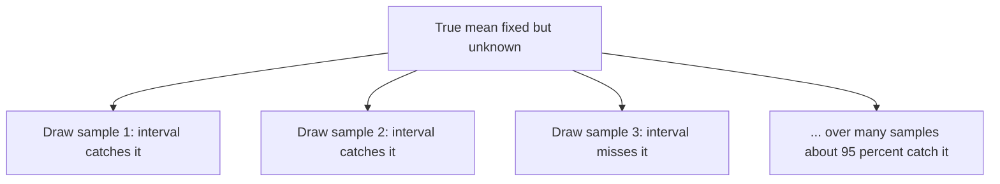

# Confidence intervals done right

> **Before this lesson:** [Sampling distributions, standard error and the central limit theorem](#/lesson/statistics/sampling-distribution-clt) (standard error, normal approximation) and [The bootstrap](#/lesson/statistics/bootstrap) (percentile intervals). The t-distribution is introduced here briefly and covered fully in [Normal, t and long-tailed distributions](#/lesson/statistics/normal-t-long-tails).

## In plain words

A single number such as "average order value is S\$44.25" hides how uncertain it is. A **confidence interval** reports a range instead, such as "between S\$39.81 and S\$48.69, with 95% confidence". The width tells the reader how much to trust the estimate. This lesson shows how to compute intervals for means, proportions and differences in Python, checks by simulation that they work, and spells out what "95% confidence" really means, because most people, including many working analysts, get it wrong.

An everyday picture: a fishing net. A point estimate is a spear: one exact throw that almost always misses the fish by a little. A confidence interval is a net cast around the spot. A 95% net is built so that, if you cast it again and again in new samples, it catches the fish 95% of the time. Any particular cast either caught it or did not; the 95% describes the method.

Why it matters for a job: every A/B test result should come with an interval for the lift ("+0.45 points, 95% CI +0.01 to +0.89"), every dashboard estimate from a sample should come with an error margin, and interviewers routinely ask "what does a 95% confidence interval mean?" as a trap for the wrong interpretation. Knowing which interval to use for small samples and rare events is a mark of real experience.

## 1. The recipe

Most intervals have the same structure:

$$\text{estimate} \pm \text{critical value} \times \text{standard error}$$

- The **estimate** is the sample statistic: a mean, a proportion, a difference.
- The **standard error** measures its sampling variability.
- The **critical value** sets the confidence level. For a normal sampling distribution, 95% of the area lies within 1.96 standard errors of the centre, so 1.96 gives 95% confidence; 1.645 gives 90% and 2.576 gives 99%.
- The product, critical value × SE, is called the **margin of error**.

The **confidence level** (90%, 95%, 99%) is the long-run share of intervals built this way that contain the true parameter. Higher confidence needs a wider interval: certainty costs precision.

## 2. An interval for a mean: the t-interval

When we estimate the standard error with the sample standard deviation $s$, the extra uncertainty in $s$ matters for small samples. William Gosset, a chemist at the Guinness brewery publishing under the pen name "Student", worked out the right distribution in 1908: **Student's t-distribution**. It looks like the normal but has heavier tails, and its shape depends on the **degrees of freedom**, here $n - 1$. For large $n$ it becomes the normal.

The 95% **t-interval** for a mean is

$$\bar{x} \pm t_{0.975,\,n-1}\,\frac{s}{\sqrt{n}}$$

where $t_{0.975,\,n-1}$ is the value with 97.5% of the t-distribution below it (leaving 2.5% in each tail).

```python-run
import numpy as np
from scipy import stats
x = np.array([41, 35, 52, 48, 39, 44, 58, 36, 47, 50, 43, 38])
n, mean, s = len(x), x.mean(), x.std(ddof=1)
se = s / np.sqrt(n)
t_crit = stats.t.ppf(0.975, df=n - 1)
print(f"mean {mean:.2f}, s {s:.2f}, SE {se:.2f}, t critical {t_crit:.3f}")
print(f"95% CI by hand : ({mean - t_crit * se:.2f}, {mean + t_crit * se:.2f})")
lo, hi = stats.t.interval(0.95, df=n - 1, loc=mean, scale=se)
print(f"scipy t.interval: ({lo:.2f}, {hi:.2f})")
print(f"z-based (1.96)  : ({mean - 1.96 * se:.2f}, {mean + 1.96 * se:.2f})")
```

**Reading this code line by line**

- `x` holds 12 order values. We compute $n$, the mean, the sample standard deviation (with `ddof=1`) and the standard error.
- `stats.t.ppf(0.975, df=n - 1)` is the **percent point function** (the inverse of the cumulative distribution): it returns the value below which 97.5% of the t-distribution with 11 degrees of freedom lies.
- `stats.t.interval(0.95, df=..., loc=mean, scale=se)` does the whole calculation in one call.
- The last line uses 1.96, the normal critical value, for comparison.

The t critical value is 2.201 rather than 1.96, so the t-interval (39.81, 48.69) is wider than the z-based one (40.30, 48.20). That extra width is not pessimism; it is exactly what is needed to make the interval honest, as the next demo shows.

## 3. Checking coverage by simulation

The definition of a 95% interval is a promise about repeated use: 95% of intervals should contain the truth. We can test that promise directly: invent a population with a known mean, draw thousands of samples, build an interval from each, and count how many capture the true mean. That share is the **coverage**.

```python-run
import numpy as np
from scipy import stats
rng = np.random.default_rng(0)
mu, sigma, reps = 50, 8, 10_000
for n in [5, 12, 50]:
    data = rng.normal(mu, sigma, size=(reps, n))
    m = data.mean(axis=1)
    se = data.std(axis=1, ddof=1) / np.sqrt(n)
    t_crit = stats.t.ppf(0.975, n - 1)
    cover_t = np.mean((m - t_crit * se <= mu) & (mu <= m + t_crit * se))
    cover_z = np.mean((m - 1.96 * se <= mu) & (mu <= m + 1.96 * se))
    print(f"n={n:>2}: coverage with t {cover_t:.3f}, with 1.96 {cover_z:.3f}")
```

**Reading this code line by line**

- For each sample size, `data` holds 10,000 samples (rows) from a normal population with true mean 50.
- `m` and `se` are each sample's mean and estimated standard error.
- `(low <= mu) & (mu <= high)` is `True` when an interval contains the true mean; the mean of those `True`/`False` values is the coverage.

With the t critical value, coverage is 0.947, 0.949 and 0.952: on target at every sample size. With 1.96, coverage is only 0.878 for $n = 5$ and 0.924 for $n = 12$; the "95%" interval is lying. By $n = 50$ the two agree (0.947). Rule: always use the t critical value for means; it costs nothing for large samples and protects small ones.



## 4. What a confidence interval does and does not mean

Suppose we report a 95% CI of (39.81, 48.69) for the mean order value.

**Correct:** "This interval was produced by a method that captures the true mean in 95% of samples." Or, loosely, "we are 95% confident the true mean is between 39.81 and 48.69."

**Incorrect:**

- "There is a 95% probability that the true mean lies between 39.81 and 48.69." In the classical (frequentist) view the true mean is a fixed number, not random; this particular interval either contains it or not. The 95% belongs to the procedure. (A Bayesian **credible interval** does support a probability statement like this, but it requires a prior and is computed differently.)
- "95% of orders are between 39.81 and 48.69." No: the interval is about the *mean*, not individual values. Individual orders vary far more. A range that should contain a new individual value is a **prediction interval**, which is much wider; you will meet it in [Simple linear regression](#/lesson/statistics/simple-regression).
- "If we repeat the study, there is a 95% chance the new estimate falls in this interval." Also wrong; the new estimate has its own variability and the true mean is not necessarily at our interval's centre.

> [!INTERVIEW]
> A safe one-sentence answer: "If we repeated the sampling many times and built an interval each time, about 95% of those intervals would contain the true value. For this one interval, it either does or does not; the 95% describes the method's reliability."

## 5. Intervals for proportions: Wald versus Wilson

For a proportion $\hat{p} = x/n$ (for example 3 conversions out of 100 visitors), the textbook **Wald interval** is

$$\hat{p} \pm 1.96\sqrt{\frac{\hat{p}(1-\hat{p})}{n}}$$

It is easy but behaves badly when $n$ is small or $\hat{p}$ is near 0 or 1, both of which are common: conversion rates are usually a few percent. The **Wilson score interval** solves the same normal-approximation equation more carefully and stays well behaved. Statsmodels provides both through `proportion_confint`.

```python-run
import numpy as np
from statsmodels.stats.proportion import proportion_confint
for count, n in [(3, 100), (0, 50), (480, 10000)]:
    w = proportion_confint(count, n, alpha=0.05, method="normal")
    wi = proportion_confint(count, n, alpha=0.05, method="wilson")
    print(f"{count:>4}/{n:<6} Wald ({w[0]:.4f}, {w[1]:.4f})   Wilson ({wi[0]:.4f}, {wi[1]:.4f})")
```

**Reading this code line by line**

- `proportion_confint(count, nobs, alpha=0.05, method=...)` returns the lower and upper bounds. `alpha=0.05` means 95% confidence ($1 - \alpha$); `method="normal"` is the Wald interval.

For 3 out of 100, the Wald lower bound would be negative (statsmodels clips it to 0), while Wilson gives a sensible (0.0103, 0.0845). For 0 out of 50, Wald gives the absurd interval (0, 0), claiming certainty that the rate is exactly zero; Wilson says it could be up to 7.1%. For 480 out of 10,000, the two agree closely. A handy rule for zero events: the 95% upper bound is about $3/n$ (the "rule of three"), here $3/50 = 0.06$.

Coverage tells the real story:

```python-run
import numpy as np
from statsmodels.stats.proportion import proportion_confint
rng = np.random.default_rng(1)
p, n, reps = 0.02, 100, 20_000
counts = rng.binomial(n, p, reps)
for method in ["normal", "wilson"]:
    lo, hi = proportion_confint(counts, n, alpha=0.05, method=method)
    print(f"{method:7s} coverage at p=0.02, n=100: {np.mean((lo <= p) & (p <= hi)):.3f}")
```

**Reading this code line by line**

- We simulate 20,000 experiments with a true rate of 2% and 100 visitors each; `proportion_confint` accepts the whole array of counts at once.

The Wald "95%" interval covers the truth only 86.3% of the time; Wilson covers 94.9%. Use Wilson (or the bootstrap) for proportions, especially small ones.

## 6. An interval for a difference: the A/B test lift

The most important interval in product analytics is for the difference between a treatment and a control. With conversion rates $\hat{p}_A$ and $\hat{p}_B$ from independent groups:

$$(\hat{p}_B - \hat{p}_A) \pm 1.96\sqrt{\frac{\hat{p}_A(1-\hat{p}_A)}{n_A} + \frac{\hat{p}_B(1-\hat{p}_B)}{n_B}}$$

```python-run
import numpy as np
conv_a, n_a = 1_000, 20_000
conv_b, n_b = 1_090, 20_000
pa, pb = conv_a / n_a, conv_b / n_b
diff = pb - pa
se = np.sqrt(pa * (1 - pa) / n_a + pb * (1 - pb) / n_b)
print(f"A {pa:.4f}  B {pb:.4f}  lift {diff:.4f} ({diff / pa:.1%} relative)")
print(f"95% CI for the difference: ({diff - 1.96 * se:.4f}, {diff + 1.96 * se:.4f})")
```

**Reading this code line by line**

- Each arm has 20,000 users; A converts 1,000 and B 1,090.
- `se` is the standard error of the difference: the two variances add because the groups are independent.
- `{x:.1%}` formats a number as a percentage with one decimal.

B's rate is 5.45% versus A's 5.00%: an absolute lift of 0.45 percentage points, or 9.0% relative. The 95% CI runs from 0.0001 to 0.0089, barely excluding zero. The interval tells a richer story than "significant": the true lift could be almost nothing or almost 0.9 points, and a decision should weigh that whole range against the cost of shipping.

Intervals and tests are two views of the same calculation: a 95% CI for a difference excludes 0 exactly when a two-sided test at the 5% level rejects "no difference" (for the same standard error). Many experienced analysts prefer to lead with the interval because it shows both significance and size.

## 7. Choosing an interval

| Quantity | Recommended interval | Python |
|---|---|---|
| Mean | t-interval | `stats.t.interval` |
| Proportion | Wilson (or Agresti-Coull, Clopper-Pearson) | `proportion_confint(..., method="wilson")` |
| Difference of means | Welch t-interval | `stats.ttest_ind(..., equal_var=False).confidence_interval()` |
| Difference of proportions | normal (large samples) or bootstrap | formula above |
| Median, percentile, ratio, AUC | bootstrap (BCa) | `stats.bootstrap` |

The width of any interval shrinks like $1/\sqrt{n}$: quadruple the sample to halve the width.

## Common mistakes

- Saying "95% probability the parameter is in this interval".
- Using 1.96 with tiny samples instead of the t critical value.
- Using the Wald interval for rare events or zero counts.
- Confusing a confidence interval for the mean with the range of individual values.
- Reporting only whether an A/B interval excludes zero and ignoring its width.
- Building intervals on biased samples: an interval measures random error only.

## Summary

- Interval = estimate ± critical value × standard error; the confidence level is the long-run capture rate of the method.
- For means use the t critical value with $n-1$ degrees of freedom; simulation shows 1.96 under-covers small samples.
- For proportions prefer Wilson; Wald fails near 0 or 1 and with small $n$.
- The interval for an A/B difference shows both significance and plausible effect sizes.
- A confidence interval is about a parameter, not individual values, and says nothing about bias.

## Glossary

- **Confidence interval (CI)**: a range built by a method that captures the true parameter in a stated share of repeated samples.
- **Confidence level**: that share, such as 95%.
- **Critical value**: the multiplier of the standard error that sets the confidence level (1.96 for 95% normal).
- **Margin of error**: critical value × standard error.
- **Student's t-distribution**: a bell-shaped distribution with heavier tails than the normal, indexed by degrees of freedom.
- **t-interval**: a CI for a mean using the t critical value.
- **Percent point function (ppf)**: the inverse cumulative distribution; returns the value with a given share below it.
- **Coverage**: the actual share of intervals that contain the truth.
- **Credible interval**: a Bayesian interval with a direct probability interpretation.
- **Prediction interval**: a range for a new individual value.
- **Wald interval / Wilson interval**: the simple and the improved normal-based intervals for a proportion.
- **Rule of three**: with zero events in $n$ trials, the 95% upper bound is about $3/n$.
- **Absolute / relative lift**: the difference in rates / the difference divided by the control rate.

## Check yourself

```quiz
[
  {"q": "Which statement about a computed 95% confidence interval (39.8, 48.7) for a mean is correct?", "options": ["It came from a method that captures the true mean in 95% of repeated samples", "There is a 95% probability the true mean is in (39.8, 48.7)", "95% of individual values lie in (39.8, 48.7)", "A repeated study has a 95% chance of a mean inside it"], "answer": 0,
   "explain": "In the frequentist view the 95% describes the procedure; the fixed parameter is either inside this interval or not."},
  {"q": "With n = 5, a 'mean ± 1.96 SE' interval using the sample SD actually covers the true mean about…", "options": ["88% of the time", "95% of the time", "99% of the time", "50% of the time"], "answer": 0,
   "explain": "The simulation gave 0.878; the t critical value (2.776 for 4 df) is needed."},
  {"q": "0 conversions in 50 visitors. A sensible 95% upper bound for the conversion rate is about…", "options": ["6% (rule of three)", "0%", "50%", "2%"], "answer": 0,
   "explain": "$3/n = 3/50 = 0.06$; Wilson gives about 7.1%. Wald's (0, 0) is absurd."},
  {"q": "How does the width of a confidence interval change if you quadruple the sample size?", "options": ["It roughly halves", "It quarters", "It doubles", "It stays the same"], "answer": 0,
   "explain": "Width is proportional to the standard error, which falls like $1/\\sqrt{n}$."},
  {"q": "An A/B lift has 95% CI (0.0001, 0.0089). The best summary is…", "options": ["Significant at 5%, but the true lift could be anywhere from almost zero to about 0.9 points", "B is definitely 0.45 points better", "Not significant", "B is better with 99% probability"], "answer": 0,
   "explain": "The interval excludes 0 barely; its width shows how uncertain the size of the effect is."},
  {"q": "Which interval is preferred for a conversion rate near 2% with n = 100?", "options": ["Wilson", "Wald", "t-interval on the 0/1 values with 1.96", "No interval is possible"], "answer": 0,
   "explain": "Wald covered only 86% in the simulation; Wilson about 95%."},
  {"q": "Raising the confidence level from 95% to 99% (same data) makes the interval…", "options": ["wider", "narrower", "unchanged", "centred elsewhere"], "answer": 0,
   "explain": "The critical value grows from 1.96 to 2.576."}
]
```

> **Source:** Bruce & Bruce, *Practical Statistics for Data Scientists* (O'Reilly, 2017), ch. 2, "Confidence Intervals" and "Student's t-Distribution"; statsmodels documentation for `proportion_confint`; the coverage simulations and A/B example are original.
