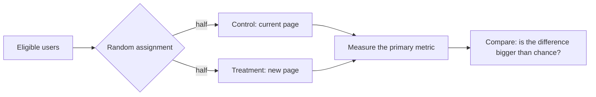

# A/B tests, hypotheses and permutation tests

> **Before this lesson:** [Random sampling and the many faces of bias](#/lesson/statistics/sampling-bias) (why control groups matter), [Sampling distributions, standard error and the central limit theorem](#/lesson/statistics/sampling-distribution-clt) and [The bootstrap](#/lesson/statistics/bootstrap) (resampling).

## In plain words

An **A/B test** is an experiment with two groups: one sees the current version of something (A), the other a new version (B), and everything else is kept the same. If B's users behave differently, we want to know whether the difference is real or could easily be luck. A **hypothesis test** answers that question by asking how often chance alone would produce a difference as large as the one we saw. The **permutation test** answers it in the most direct way possible: shuffle the group labels many times and see.

An everyday picture: a friend claims a new recipe makes their bread rise higher. They bake 4 loaves each way and the new ones are 2 cm taller on average. Before you believe them, you should ask: if the recipe made no difference at all, how often would random variation between loaves alone produce a 2 cm gap? If the answer is "very often", the evidence is weak.

Why it matters for a job: at large tech companies, A/B tests decide which features ship, and product data scientists design and analyse them daily. In interviews you will be asked to set up a test (unit, metric, hypotheses), explain what the result means, and spot flaws. The permutation test is also the clearest way to understand what any test is really doing, so it is the right first test to learn.

## 1. The anatomy of an A/B test

- **Treatment**: the thing being tested: a new button colour, ranking algorithm, price or onboarding flow.
- **Treatment group**: the subjects exposed to the treatment. **Control group**: subjects who get the standard experience (no change).
- **Subjects** (also called units): what is randomised, usually users, sometimes sessions, devices, stores or cities.
- **Randomisation**: each subject is assigned to A or B by chance (for example by hashing the user ID). This is the crucial ingredient. Because assignment ignores everything about the subject, the groups are alike on average in every respect, measured or not, so a difference in outcomes can be attributed to the treatment or to chance, and nothing else.
- **Test statistic** (or metric): the number used to compare groups, such as conversion rate, revenue per user, or average session time. Choose it **before** the test, with one **primary metric** that decides the outcome, to avoid fishing for a winner afterwards.

Why a control group, and not "compare with last week"? Because everything else changes between weeks (seasonality, marketing, news, other launches), and the regression-to-the-mean effect from an earlier lesson lurks whenever groups were chosen for being extreme. A concurrent, randomised control experiences all of that too, so the comparison isolates the treatment.

In medicine, experiments are often **blind** (subjects do not know their group) or double-blind (nor do the researchers who measure the outcome), to stop expectations from biasing results. Web users rarely know they are in a test, so they are effectively blind.



## 2. Hypotheses

A hypothesis test sets up two competing statements:

- The **null hypothesis** $H_0$: there is no real difference; any observed difference is due to chance. For example, $H_0: \mu_B = \mu_A$.
- The **alternative hypothesis** $H_A$ (or $H_1$): the claim we hope to support, the opposite of the null. For example, $H_A: \mu_B \ne \mu_A$.

The logic is a kind of proof by contradiction. We assume the null is true, work out how surprising our data would be in that world, and if they would be very surprising we **reject the null** in favour of the alternative. We never "prove" the alternative, and failing to reject the null does not prove it either.

The alternative can be:

- **Two-sided** (two-way): $\mu_B \ne \mu_A$. We care about a difference in either direction. This is the default in most A/B platforms, because a new feature can also hurt.
- **One-sided** (one-way): $\mu_B > \mu_A$. Used when only one direction matters, for example when B is the default unless A is clearly better. A one-sided test counts only extreme results in one direction, so it reaches significance more easily, which is why reviewers distrust one-sided tests chosen after seeing the data.

Why go to all this trouble? Because humans are terrible at judging randomness. We see streaks, patterns and "obvious" winners in pure noise. A hypothesis test is a guard against being fooled by chance.

## 3. A worked example: does a new page keep users longer?

A team redesigns a help page and measures how many seconds each visitor spends on it, a rough measure of engagement sometimes called **stickiness**. Visitors are randomly shown version A or B.

```python-run
import numpy as np
rng = np.random.default_rng(30)
a = np.round(rng.gamma(2.0, 60, 21), 0)
b = np.round(rng.gamma(2.0, 72, 15), 0)
print("page A: n =", len(a), " mean seconds =", round(a.mean(), 1))
print("page B: n =", len(b), " mean seconds =", round(b.mean(), 1))
print("observed difference B - A:", round(b.mean() - a.mean(), 1))
```

**Reading this code line by line**

- `rng.gamma(2.0, 60, 21)` simulates 21 skewed session times (in seconds) for page A; page B gets 15 with a slightly larger scale. In real life these would be logged data.
- We print each group's size and mean, then the difference.

Page B's visitors stayed 45.9 seconds longer on average (167.5 versus 121.7). That sounds substantial. But the samples are small and session times vary enormously from person to person. Is 45.9 seconds bigger than chance would produce?

## 4. The permutation test

The **permutation test** builds the null world directly. If the page made no difference ($H_0$), the labels "A" and "B" are meaningless: each of the 36 session times would have been the same whichever page its visitor saw. So we can shuffle the labels and see what differences arise purely from how visitors happen to be split.

The procedure:

1. Combine (pool) the results of both groups into one list.
2. Shuffle the list and deal the first 21 to a fake "A" group and the remaining 15 to a fake "B" (the same sizes as the real groups). Doing this without replacement makes it a **permutation** (a reordering).
3. Compute the test statistic (difference in means) for the fake groups.
4. Repeat steps 2 and 3 thousands of times ($R$ times) to build the **permutation distribution**: the differences chance alone produces.
5. Compare the observed difference with this distribution. The share of shuffles at least as extreme as the observed difference is the **p-value**.

```python-run
import numpy as np
rng = np.random.default_rng(30)
a = np.round(rng.gamma(2.0, 60, 21), 0)
b = np.round(rng.gamma(2.0, 72, 15), 0)
observed = b.mean() - a.mean()
pooled = np.concatenate([a, b])
R = 10_000
diffs = np.empty(R)
for i in range(R):
    shuffled = rng.permutation(pooled)
    diffs[i] = shuffled[len(a):].mean() - shuffled[:len(a)].mean()
p_one = np.mean(diffs >= observed)
p_two = np.mean(np.abs(diffs) >= abs(observed))
print(f"observed {observed:.1f}; one-sided p = {p_one:.4f}; two-sided p = {p_two:.4f}")
counts, edges = np.histogram(diffs, bins=np.arange(-100, 101, 20))
for c, lo in zip(counts, edges):
    mark = "  <- observed" if lo <= observed < lo + 20 else ""
    print(f"{lo:5.0f} | " + "#" * int(c / 100) + mark)
```

**Reading this code line by line**

- `np.concatenate([a, b])` pools all 36 values.
- `rng.permutation(pooled)` returns a shuffled copy. The first 21 values become the fake A group (`shuffled[:len(a)]`) and the rest the fake B group (`shuffled[len(a):]`).
- After 10,000 shuffles, `np.mean(diffs >= observed)` is the share of shuffled differences at least as large as the real one: the one-sided p-value. For the two-sided version we compare absolute values, counting extreme differences in either direction.
- The text histogram shows the permutation distribution, marking the bin that contains the observed difference.

Chance alone produces a difference of 45.9 seconds or more about 10.7% of the time (one-sided), and a difference that large in either direction about 21.4% of the time. The observed value sits well inside the bulk of the permutation distribution. Conclusion: this experiment does **not** provide convincing evidence that page B is stickier. That is not proof that B is no better; with 36 visitors and such variable times, the test cannot distinguish a moderate improvement from luck. The fix is a larger sample, which we will plan properly in [Power and sample size](#/lesson/statistics/power-sample-size).

Notice what the permutation test did *not* need: no assumption that session times are normal, no formula for the standard error, no t-table. It needed only the random assignment, which justifies treating labels as exchangeable under the null. Statisticians call this a **nonparametric** or distribution-free method.

> [!NOTE]
> The p-value is defined in the next lesson in full. For now: it is the probability, computed assuming the null hypothesis is true, of a result at least as extreme as the one observed. Small p-values mean "chance rarely does this".

## 5. Permutation test for conversion rates

The same recipe works for a 0/1 outcome. Here control converts 200 of 2,000 users (10.00%) and treatment 245 of 2,000 (12.25%).

```python-run
import numpy as np
from scipy import stats
rng = np.random.default_rng(1)
conv = np.array([1] * 200 + [0] * 1800)
treat = np.array([1] * 245 + [0] * 1755)
obs = treat.mean() - conv.mean()
pooled = np.concatenate([conv, treat])
diffs = np.empty(5000)
for i in range(5000):
    s = rng.permutation(pooled)
    diffs[i] = s[2000:].mean() - s[:2000].mean()
print(f"rates {conv.mean():.4f} vs {treat.mean():.4f}, diff {obs:.4f}")
print("permutation two-sided p:", np.mean(np.abs(diffs) >= abs(obs) - 1e-12))
p = pooled.mean()
z = obs / np.sqrt(p * (1 - p) * (1 / 2000 + 1 / 2000))
print("z-test two-sided p     :", round(2 * stats.norm.sf(abs(z)), 4))
```

**Reading this code line by line**

- Each group is a list of 1s (converted) and 0s (did not), so its mean is its conversion rate.
- The shuffle loop is the same as before. The tiny `- 1e-12` guards against rounding: a shuffled difference exactly equal to the observed one should count as "at least as extreme", but floating-point arithmetic can make two equal numbers differ in the last digit.
- The last three lines compute the classic two-proportion z-test (explained in [t-tests, z-tests and degrees of freedom](#/lesson/statistics/t-tests)) for comparison.

The permutation p-value is 0.027 and the z-test gives 0.0236: the same conclusion. A 2.25-point lift on 2,000 users per arm is unlikely to be pure chance. With large samples, formula-based tests and permutation tests agree; permutation tests shine when samples are small, metrics are odd (medians, ratios, trimmed means) or formulas are doubtful.

## 6. Permutation tests in SciPy

SciPy wraps the procedure in `stats.permutation_test`, which accepts any statistic you can write as a function.

```python-run
import numpy as np
from scipy import stats
rng = np.random.default_rng(30)
a = np.round(rng.gamma(2.0, 60, 21), 0)
b = np.round(rng.gamma(2.0, 72, 15), 0)
def diff_means(x, y):
    return np.mean(x) - np.mean(y)
res = stats.permutation_test((b, a), diff_means, n_resamples=10_000,
                             alternative="greater", random_state=0)
print("scipy one-sided p:", round(res.pvalue, 4))
```

**Reading this code line by line**

- `diff_means(x, y)` is our test statistic: the first group's mean minus the second's.
- `(b, a)` passes the samples in the order the statistic expects; `alternative="greater"` asks for the one-sided test of "B's mean is larger"; `n_resamples` is the number of shuffles.
- `res.pvalue` holds the result.

The answer is close to our hand-made 0.107. (The exact digits depend on the random shuffles and can differ slightly across SciPy versions.)

## 7. Exhaustive permutation tests

With very small samples you can list *every* possible split instead of sampling shuffles at random. This **exhaustive** (or exact) permutation test gives an exact p-value. With 4 values per group there are $\binom{8}{4} = 70$ ways to choose which 4 of the 8 values form group A.

```python-run
import numpy as np
from itertools import combinations
a = np.array([12, 15, 11, 14])
b = np.array([16, 18, 13, 19])
pooled = np.concatenate([a, b])
observed = b.mean() - a.mean()
count = total = 0
for idx in combinations(range(8), 4):
    mask = np.zeros(8, bool); mask[list(idx)] = True
    d = pooled[mask].mean() - pooled[~mask].mean()
    total += 1
    count += d >= observed
print(f"observed {observed}, splits {total}, as extreme {count}, exact one-sided p = {count/total:.4f}")
```

**Reading this code line by line**

- `combinations(range(8), 4)` from `itertools` lists every set of 4 positions out of 8.
- `mask` is a true/false array marking the chosen positions; `~mask` flips it to select the others.
- We count the splits whose difference is at least the observed 3.5.

Only 4 of the 70 possible splits give a difference of 3.5 or more, so the exact one-sided p-value is $4/70 = 0.0571$. Even a fairly clean-looking separation cannot reach $p < 0.05$ with 4 subjects per group, a reminder of how little small samples can tell you. The shuffling version used earlier is sometimes called a **randomisation test** or Monte Carlo permutation test; with enough shuffles it approximates the exact answer. A **bootstrap permutation test** draws the fake groups *with* replacement instead; it is rarely needed in practice.

## 8. Interpreting the result well

- Report the observed effect size, the p-value and, ideally, a confidence interval (from the bootstrap or a formula).
- "Not significant" means "not enough evidence", never "no effect".
- Decide the metric, the test (one- or two-sided) and the sample size before looking at results.
- Check that randomisation worked: groups should have similar sizes and similar pre-experiment behaviour. A mismatch in sizes is a serious warning sign covered in [A/B testing pitfalls](#/lesson/statistics/ab-pitfalls).

## Summary

- An A/B test randomly assigns subjects to control and treatment; randomisation makes chance the only alternative explanation.
- The null hypothesis says there is no difference; the alternative is one-sided or two-sided, chosen in advance.
- A permutation test pools the data, reshuffles labels many times, and asks how often chance produces a difference as extreme as the observed one.
- It needs no distributional assumptions and works for any statistic; exhaustive versions give exact p-values for tiny samples.
- Failing to reject the null is not evidence of no effect, especially in small samples.

## Glossary

- **A/B test**: a randomised experiment comparing two versions.
- **Treatment / treatment group / control group**: the change tested / those who get it / those who do not.
- **Subject (unit)**: the entity randomised, usually a user.
- **Randomisation**: assigning subjects to groups by chance.
- **Blinding**: keeping subjects (and possibly researchers) unaware of group assignment.
- **Test statistic / primary metric**: the number used to compare groups / the one chosen in advance to decide the test.
- **Null hypothesis ($H_0$)**: the claim that any difference is due to chance.
- **Alternative hypothesis ($H_A$)**: the competing claim, one- or two-sided.
- **Permutation**: a reordering of values.
- **Permutation test**: a test that shuffles group labels to build the null distribution.
- **Permutation distribution**: the test statistic's values across shuffles.
- **p-value**: the probability under the null of a result at least as extreme as observed.
- **Nonparametric (distribution-free)**: not assuming a particular distribution for the data.
- **Exhaustive (exact) permutation test**: one that enumerates every possible split.
- **Stickiness**: how long or how often users stay engaged.

## Check yourself

```quiz
[
  {"q": "Why is random assignment the key ingredient of an A/B test?", "options": ["It makes the groups alike on average in everything, so only the treatment or chance can explain a difference", "It guarantees a significant result", "It makes the metric normally distributed", "It makes the groups exactly equal in size"], "answer": 0,
   "explain": "Randomisation balances measured and unmeasured factors in expectation."},
  {"q": "In a permutation test, the shuffling of labels represents…", "options": ["the world where the null hypothesis is true and labels do not matter", "the alternative hypothesis", "bootstrap sampling with replacement", "a way to increase the sample size"], "answer": 0,
   "explain": "Under $H_0$ each outcome would be the same whatever group its subject was in, so labels are exchangeable."},
  {"q": "2,140 of 10,000 shuffled differences are at least as large as the observed difference in either direction. The two-sided p-value is about…", "options": ["0.214", "0.107", "0.0214", "0.786"], "answer": 0,
   "explain": "The p-value is the share of shuffles at least as extreme: 2,140/10,000."},
  {"q": "A test of 36 users gives p = 0.21. Which conclusion is right?", "options": ["The data do not provide convincing evidence of a difference; a real effect may still exist", "The pages perform identically", "Page B is 21% better", "The test proves the null hypothesis"], "answer": 0,
   "explain": "Failing to reject is absence of evidence, not evidence of absence, especially with small samples."},
  {"q": "Two groups of 4 values each. How many distinct splits does an exhaustive permutation test examine?", "options": ["70", "16", "8", "40,320"], "answer": 0,
   "explain": "$\\binom{8}{4} = 70$."},
  {"q": "When is a one-sided alternative most defensible?", "options": ["When only one direction matters and this was decided before seeing the data", "Whenever the two-sided p-value is slightly above 0.05", "Always, because it is more powerful", "Never"], "answer": 0,
   "explain": "Switching to one-sided after looking at the data halves the p-value dishonestly."}
]
```

> **Source:** Bruce & Bruce, *Practical Statistics for Data Scientists* (O'Reilly, 2017), ch. 3, "A/B Testing" (control groups, why test only two versions), "Hypothesis Tests" (null and alternative hypotheses, one-way and two-way tests) and "Resampling" (permutation test, web stickiness example, exhaustive and bootstrap permutation tests); SciPy documentation for `permutation_test`.
