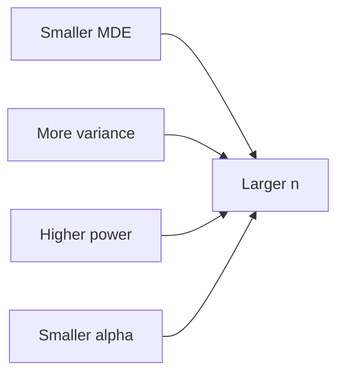

# Power and sample size for A/B tests

> **Before this lesson:** [Statistical significance, p-values and their misconceptions](#/lesson/statistics/p-values) (type I and II errors, power) and [t-tests, z-tests and degrees of freedom](#/lesson/statistics/t-tests) (the two-proportion z-test). The square-root law from [Sampling distributions, standard error and the central limit theorem](#/lesson/statistics/sampling-distribution-clt) drives every formula here.

## In plain words

Before running an experiment you must decide how many users it needs. Too few, and a real improvement will probably be missed (the test is **underpowered**), wasting the experiment and possibly killing a good idea. Too many, and you waste traffic and time that other experiments could use. **Power analysis** is the calculation that connects four quantities: the smallest effect you care about, the noise in the metric, the false-positive rate you accept, and the chance of detecting the effect if it is real. Fix three and it tells you the fourth, usually the sample size.

An everyday picture: you want to hear a friend whisper across a noisy room. How close you must stand (sample size) depends on how quietly they whisper (effect size), how noisy the room is (variance), and how sure you want to be that you heard correctly (power and significance level). A whisper in a nightclub needs you to stand very close.

Why it matters for a job: "How long should we run this test?" is the most common practical question in experimentation. In interviews you are expected to know the formula's ingredients, compute a rough sample size by hand, explain the minimum detectable effect, and discuss what to do when traffic is too small.

## 1. The four ingredients

1. **Significance level** $\alpha$: the false-positive rate, usually 0.05 (two-sided).
2. **Power** $1 - \beta$: the probability of detecting the effect if it is real, usually 0.80 (sometimes 0.90). $\beta$ is the false-negative rate.
3. **Minimum detectable effect** (MDE): the smallest effect worth detecting, set by the business, not by statistics. "We need at least a 1-point lift in conversion to justify the engineering cost." It can be stated as an absolute difference (10% to 11%, 1 percentage point) or a relative one (10% relative lift).
4. **Variance of the metric**: for a conversion rate $p$, the variance of one user's 0/1 outcome is $p(1-p)$; for a continuous metric, estimate the standard deviation $\sigma$ from historical data.

## 2. The sample-size formula

For comparing two proportions $p_1$ (control) and $p_2$ (treatment) with equal group sizes, the number of users needed **per arm** is approximately

$$n = \frac{(z_{1-\alpha/2} + z_{1-\beta})^2\,\big[p_1(1-p_1) + p_2(1-p_2)\big]}{(p_2 - p_1)^2}$$

For a continuous metric with standard deviation $\sigma$ in each group and a difference in means $\delta$ (delta):

$$n = \frac{2\,(z_{1-\alpha/2} + z_{1-\beta})^2\,\sigma^2}{\delta^2}$$

where $z_q$ is the standard normal value with a share $q$ below it. Where does this come from? We need the observed difference to clear the significance cut-off ($z_{1-\alpha/2}$ standard errors from zero) with probability $1-\beta$ when the true difference is $\delta$. That requires the true difference to be $z_{1-\alpha/2} + z_{1-\beta}$ standard errors away from zero. Since the standard error is $\sigma\sqrt{2/n}$, solving $\delta = (z_{1-\alpha/2} + z_{1-\beta})\,\sigma\sqrt{2/n}$ for $n$ gives the formula.



### A rule of thumb worth memorising

With $\alpha = 0.05$ and power 0.80, $(1.96 + 0.84)^2 \approx 7.85$, so $2 \times 7.85 \approx 16$:

$$n \approx \frac{16\,\sigma^2}{\delta^2} \quad \text{per arm}$$

For a conversion rate, $\sigma^2 \approx p(1-p)$. Baseline 10%, MDE 1 point: $16 \times 0.09 / 0.0001 = 14{,}400$ per arm. Close to the exact answer below and easy to do in your head.

## 3. Computing sample sizes in Python

```python-run
import numpy as np
from scipy import stats
def n_per_arm(p1, p2, alpha=0.05, power=0.80):
    z_a = stats.norm.ppf(1 - alpha / 2)
    z_b = stats.norm.ppf(power)
    var = p1 * (1 - p1) + p2 * (1 - p2)
    return int(np.ceil((z_a + z_b) ** 2 * var / (p2 - p1) ** 2))
print("z values:", round(stats.norm.ppf(0.975), 3), round(stats.norm.ppf(0.80), 3))
print("10% -> 11% :", n_per_arm(0.10, 0.11), "users per arm")
print("10% -> 10.5%:", n_per_arm(0.10, 0.105), "users per arm")
print("10% -> 12% :", n_per_arm(0.10, 0.12), "users per arm")
print("90% power, 10% -> 11%:", n_per_arm(0.10, 0.11, power=0.90))
```

**Reading this code line by line**

- `stats.norm.ppf(1 - alpha / 2)` is 1.96 for a two-sided 5% test; `stats.norm.ppf(power)` is 0.842 for 80% power.
- `np.ceil` rounds up, because you cannot recruit a fraction of a user and rounding down would leave you slightly underpowered.

Detecting a lift from 10% to 11% needs 14,749 users per arm. Halving the MDE to 0.5 points needs 57,760, almost four times as many: the square-root law in reverse. Doubling the MDE to 2 points needs only 3,839. Raising power from 80% to 90% raises the requirement to 19,744.

Statsmodels offers the same calculations through **effect sizes**: standardised measures that put the difference in units of noise. For means, **Cohen's d** is $\delta/\sigma$. For proportions, **Cohen's h** is $2\arcsin\sqrt{p_2} - 2\arcsin\sqrt{p_1}$, a transformation that makes the variance roughly constant.

```python-run
import numpy as np
from statsmodels.stats.power import NormalIndPower, TTestIndPower
from statsmodels.stats.proportion import proportion_effectsize
h = proportion_effectsize(0.11, 0.10)
n_prop = NormalIndPower().solve_power(effect_size=h, alpha=0.05, power=0.8, ratio=1)
print(f"Cohen's h = {h:.4f}; users per arm = {np.ceil(n_prop):.0f}")
d = 2.0 / 12.0
n_mean = TTestIndPower().solve_power(effect_size=d, alpha=0.05, power=0.8)
print(f"means: d = {d:.3f}; users per arm = {np.ceil(n_mean):.0f}; rule of thumb 16/d^2 = {16 / d**2:.0f}")
achieved = TTestIndPower().power(effect_size=d, nobs1=300, alpha=0.05)
print(f"power with only 300 per arm: {achieved:.3f}")
```

**Reading this code line by line**

- `proportion_effectsize(0.11, 0.10)` computes Cohen's h.
- `NormalIndPower().solve_power(...)` solves for whichever argument is left out (here the sample size `nobs1`); `ratio=1` means equal group sizes.
- For a continuous metric, a 2-minute difference with a standard deviation of 12 minutes gives $d = 0.167$; `TTestIndPower` handles t-tests.
- `.power(...)` goes the other way: given $n$, it returns the power.

The proportion answer, 14,745, agrees with our formula (the tiny difference comes from the arcsine transformation). For the continuous metric, 567 users per arm are needed; the rule of thumb gives 576. With only 300 per arm the power would be 0.531: a coin flip whether a real 2-minute improvement is detected.

## 4. Checking power by simulation

Power is a probability about repeated experiments, so we can verify it directly.

```python-run
import numpy as np
from scipy import stats
rng = np.random.default_rng(35)
n, sims = 14_749, 4000
a = rng.binomial(n, 0.10, sims) / n
b = rng.binomial(n, 0.11, sims) / n
pool = (a + b) / 2
z = (b - a) / np.sqrt(pool * (1 - pool) * 2 / n)
print("simulated power at n = 14,749 per arm:", round(np.mean(2 * stats.norm.sf(np.abs(z)) < 0.05), 3))
```

**Reading this code line by line**

- We simulate 4,000 experiments at the planned size with a true lift from 10% to 11%, run the two-proportion z-test on each and count how often $p < 0.05$.

80.1% of the simulated experiments detect the effect, exactly the 80% we planned for. Simulation is also how you compute power when no formula fits: ratio metrics, skewed revenue, clustered designs or sequential rules.

## 5. Power curves and test duration

```python-run
import numpy as np
from statsmodels.stats.power import NormalIndPower
from statsmodels.stats.proportion import proportion_effectsize
power = NormalIndPower()
h = proportion_effectsize(0.11, 0.10)
for n in [2_000, 5_000, 10_000, 15_000, 25_000]:
    print(f"n per arm {n:>6,}: power {power.power(effect_size=h, nobs1=n, alpha=0.05):.3f}")
daily = 6_000
n_total = 2 * 14_749
print(f"with {daily:,} eligible users a day: {n_total / daily:.1f} days -> run 7 days (full weeks)")
```

**Reading this code line by line**

- The loop prints power at several sample sizes for the same 1-point lift: points on a **power curve**.
- The last lines turn the required total sample into a duration given daily traffic.

Power rises from 0.178 at 2,000 per arm to 0.807 at 15,000 and 0.954 at 25,000. With 6,000 eligible users a day, the test needs about 4.9 days; in practice you would run a full week, because user behaviour differs by weekday and a test that covers Monday to Friday only would be biased towards weekday users. Many teams also insist on at least one or two full weeks to dampen novelty effects (see the next lesson).

> [!INTERVIEW]
> "Baseline conversion is 5%, we want to detect a 10% relative lift, and we get 20,000 users a day. How long?" MDE = 0.5 points. Rule of thumb: $16 \times 0.05 \times 0.95 / 0.005^2 = 30{,}400$ per arm, about 61,000 in total, so about 3 days of traffic; run a full week. Then mention assumptions: 50/50 split, user-level randomisation, one primary metric, no peeking.

## 6. What to do when the numbers are too big

Small effects on rare outcomes need enormous samples. Options:

- **Pick a more sensitive metric.** A proxy closer to the change (add-to-cart instead of purchase, clicks instead of revenue) often has a higher baseline and lower variance. Make sure it really moves with the business goal.
- **Reduce variance.** Cap extreme values (winsorise revenue); use pre-experiment data as a covariate (CUPED), which can cut variance by half or more for metrics that are stable per user; stratify.
- **Increase the effect.** Test bolder changes; small tweaks need huge tests.
- **Allocate more traffic** to the experiment (and keep the split balanced: a 50/50 split minimises the total sample for a given power).
- **Accept a larger MDE or lower power**, explicitly, with stakeholders.
- **Use a one-sided test** only if the decision rule genuinely ignores the other direction.

### Unequal splits and several variants

Sometimes a team wants only 10% of users exposed to a risky change. The standard error of the difference is $\sigma\sqrt{1/n_A + 1/n_B}$, which for a fixed total is smallest when the arms are equal. With a 90/10 split, the total sample must grow by a factor of $\frac{1}{4 \times 0.9 \times 0.1} \approx 2.8$ to keep the same power: the small arm is the bottleneck. In statsmodels, pass `ratio=n_B/n_A` to `solve_power`.

With several treatments against one control (an A/B/C/D test), each comparison needs its own power, and a correction for multiple comparisons (for example Bonferroni with $\alpha/3$ for three treatments) raises $z_{1-\alpha/2}$ from 1.96 to about 2.39, increasing $n$ per arm by roughly a third ($((2.39 + 0.84)/(1.96 + 0.84))^2 \approx 1.33$). Adding arms is not free: each extra variant takes traffic and makes every comparison need more of it.

## 7. Power is decided before the test

Two traps:

- **Post-hoc power** ("observed power") computed from the effect you happened to observe is a mathematical restatement of the p-value and adds nothing. Use the confidence interval to describe what the data can and cannot rule out.
- **Moving the goalposts**: lowering the MDE after seeing a small effect, or extending a test until it becomes significant, invalidates the error rates. Fix $n$ (or a proper sequential design) in advance.

## Common mistakes

- Planning with a relative MDE but plugging it into the formula as an absolute difference.
- Computing $n$ for the total instead of per arm, or vice versa.
- Ignoring that randomising users while measuring sessions inflates variance (clustered data need larger samples).
- Forgetting multiple variants: three treatments against one control need a multiple-testing correction, which raises $n$.
- Running tests for a fraction of a week.

## Summary

- Sample size depends on $\alpha$, power, the minimum detectable effect and the metric's variance.
- Per arm, $n = (z_{1-\alpha/2} + z_{1-\beta})^2 \times \text{(sum of variances)} / \delta^2$; with 5% and 80%, $n \approx 16\sigma^2/\delta^2$.
- Halving the MDE quadruples the sample size.
- Verify power by simulation when formulas do not fit.
- Convert sample size into duration, round up to full weeks, and plan variance reduction when traffic is short.

## Glossary

- **Power ($1-\beta$)**: the probability of detecting an effect of a given size if it exists.
- **Underpowered test**: one with a low chance of detecting the effect of interest.
- **Power analysis**: computing sample size (or power) from effect size, variance, $\alpha$ and power.
- **Minimum detectable effect (MDE)**: the smallest effect the test is designed to detect.
- **Absolute / relative effect**: a difference in percentage points / as a share of the baseline.
- **Effect size**: a standardised difference, such as Cohen's d or h.
- **Cohen's d**: difference in means divided by the standard deviation.
- **Cohen's h**: a difference of arcsine-transformed proportions.
- **Power curve**: power as a function of sample size or effect size.
- **Post-hoc (observed) power**: power computed from the observed effect; not informative.
- **CUPED**: variance reduction using pre-experiment data.

## Check yourself

```quiz
[
  {"q": "You halve the minimum detectable effect. The required sample size roughly…", "options": ["quadruples", "doubles", "halves", "stays the same"], "answer": 0,
   "explain": "n is proportional to $1/\\delta^2$."},
  {"q": "With α = 0.05 (two-sided) and 80% power, the rule of thumb for users per arm is…", "options": ["$16\\sigma^2/\\delta^2$", "$4\\sigma^2/\\delta^2$", "$\\sigma/\\delta$", "$100/\\delta$"], "answer": 0,
   "explain": "$2(1.96 + 0.84)^2 \\approx 16$."},
  {"q": "Baseline 10%, MDE 1 point, α = 0.05, power 80%. Approximately how many users per arm?", "options": ["About 15,000", "About 1,500", "About 150,000", "About 400"], "answer": 0,
   "explain": "The formula gave 14,749; the rule of thumb gives 14,400."},
  {"q": "Which change reduces the required sample size?", "options": ["Reducing the metric's variance, for example with CUPED or capping", "Raising power from 80% to 90%", "Lowering α from 0.05 to 0.01", "Testing a smaller change"], "answer": 0,
   "explain": "Less noise means the same effect is easier to see; the others all increase n."},
  {"q": "A test needs 4.9 days of traffic. How long should it run?", "options": ["7 days, to cover a full weekly cycle", "4.9 days exactly", "Until it becomes significant", "1 day"], "answer": 0,
   "explain": "Weekday and weekend users behave differently; whole weeks avoid that bias."},
  {"q": "After a non-significant test, a colleague computes 'observed power' of 30% from the observed effect. This number…", "options": ["adds nothing beyond the p-value; use the confidence interval instead", "proves the test was badly designed", "means the effect is 30%", "should be used to plan the next test's MDE"], "answer": 0,
   "explain": "Post-hoc power is a function of the p-value; planning must use a pre-specified MDE."}
]
```

> **Source:** Bruce & Bruce, *Practical Statistics for Data Scientists* (O'Reilly, 2017), ch. 3, "Power and Sample Size" (effect size, power, sample size, significance level); statsmodels documentation for `NormalIndPower`, `TTestIndPower` and `proportion_effectsize`; the formulas are standard and the examples original.
