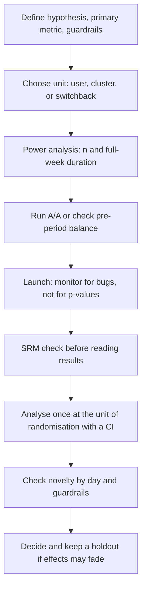

# A/B testing pitfalls: peeking, novelty, SRM and network effects

> **Before this lesson:** [Power and sample size for A/B tests](#/lesson/statistics/power-sample-size), [ANOVA and the chi-square test](#/lesson/statistics/anova-chi-square) (goodness-of-fit for sample ratio mismatch), [Multiple testing](#/lesson/statistics/multiple-testing) and [The bootstrap](#/lesson/statistics/bootstrap) (resampling the right unit).

## In plain words

The statistics of an A/B test are the easy part. Most experiments that go wrong in industry go wrong because of how they were run or read: someone stopped the test the first day it looked good, users clicked the new button because it was new, the traffic split was silently broken, or treated users affected control users. This lesson is a field guide to the traps that experienced experimenters watch for, each with a simulation that shows the damage.

An everyday picture: a fair race needs more than a stopwatch. You must not stop the clock when your favourite runner happens to be ahead, the runners must start from the same line, and one runner must not be allowed to trip another. A/B tests fail in exactly those ways.

Why it matters for a job: product data science interviews at large tech companies nearly always include an experimentation case, and the follow-up questions are about pitfalls: "The test was significant on day 2; can we stop?", "Treatment has 1% more users than control; does it matter?", "How would you test a change to a ride-sharing marketplace?" These questions separate people who have run real experiments from people who have read about them.

## 1. Peeking and optional stopping

**Peeking** means checking the p-value repeatedly while the test runs and stopping as soon as it dips below 0.05. Each look is another chance for a false positive, so the overall false-positive rate climbs far above the nominal 5%.

```python-run
import numpy as np
from scipy import stats
rng = np.random.default_rng(36)
experiments, days, per_day = 2000, 20, 500
false_stop = 0
fixed_false = 0
for _ in range(experiments):
    a = rng.binomial(1, 0.10, size=(days, per_day)).sum(axis=1).cumsum()
    b = rng.binomial(1, 0.10, size=(days, per_day)).sum(axis=1).cumsum()
    n = per_day * np.arange(1, days + 1)
    pool = (a + b) / (2 * n)
    z = (b / n - a / n) / np.sqrt(pool * (1 - pool) * 2 / n)
    p = 2 * stats.norm.sf(np.abs(z))
    false_stop += (p < 0.05).any()
    fixed_false += p[-1] < 0.05
print(f"A/A tests, check once at day 20: false-positive rate {fixed_false / experiments:.3f}")
print(f"A/A tests, check daily and stop at first p<0.05: {false_stop / experiments:.3f}")
```

**Reading this code line by line**

- Each of 2,000 A/A experiments runs 20 days with 500 new users per arm per day, all converting at 10%.
- `.sum(axis=1)` counts each day's conversions and `.cumsum()` turns them into running totals, so `a[d]` is the total by day `d`; `n` is the running number of users.
- The z-test is computed after every day, giving 20 p-values per experiment.
- `(p < 0.05).any()` is true if any daily look was significant: what a peeker would stop on. `p[-1]` is the p-value at the planned end.

Analysing once at the planned end gives a false-positive rate of 4.2%, close to 5%. Stopping at the first significant daily look gives 24.8%: one in four do-nothing changes would be declared winners. Early in a test, estimates swing widely, and a random swing past the threshold is very likely at some point.

How to avoid it:

- **Fix the sample size in advance** (from a power analysis) and analyse once. Looking at dashboards for bugs is fine; *deciding* on interim p-values is not.
- **Use a sequential design** if you must be able to stop early: group-sequential tests with alpha-spending boundaries (for example O'Brien-Fleming, which requires very small p-values at early looks), or always-valid p-values from sequential probability ratio methods. Many experimentation platforms offer these.
- **Bayesian monitoring** is sometimes proposed as immune to peeking; it changes the question rather than removing the problem, and stopping rules still affect its error rates.

## 2. Novelty and primacy effects

When a change is visible, users react to it being new. A **novelty effect** is a temporary boost because users explore something unfamiliar; a **primacy effect** (or change aversion) is a temporary dip because users must relearn a familiar interface. Both fade, so a short test measures the wrong long-run effect.

```python-run
import numpy as np
rng = np.random.default_rng(37)
days = np.arange(1, 29)
true_lift = 0.004 + 0.016 * np.exp(-days / 4)
n = 20_000
control = rng.binomial(n, 0.10, days.size) / n
treat = rng.binomial(n, 0.10 + true_lift) / n
for week in range(4):
    sl = slice(7 * week, 7 * week + 7)
    print(f"week {week + 1}: measured lift {np.mean(treat[sl] - control[sl]) * 100:+.2f} points")
```

**Reading this code line by line**

- `true_lift` is the treatment's real effect on each day: a lasting 0.4 points plus a novelty bump of 1.6 points that decays exponentially (`np.exp(-days / 4)`).
- Each day, 20,000 users per arm convert at 10% (control) or 10% plus that day's lift (treatment). `rng.binomial(n, array)` draws one count per day using each day's probability.
- `slice(start, stop)` selects one week of days.

The first week shows a lift of 0.92 points; by week 4 it is 0.33, close to the lasting 0.4. A one-week test would overstate the long-run benefit more than twofold. Defences: run longer; plot the effect by day since exposure; compare new users (who have no old habit to break or novelty to enjoy) with existing users; and keep a long-term **holdout** group that never gets the feature, to measure its effect months later.

## 3. Sample ratio mismatch

If a test is designed as 50/50, the arms should receive nearly equal numbers of users. A **sample ratio mismatch** (SRM) is an imbalance too large to be chance. It almost always means a bug: the treatment crashes for some users before they are logged, a redirect drops users, bots are filtered differently in one arm, or users are assigned at a different time in each arm. Because the missing users are not random, the remaining groups are no longer comparable, and the experiment's results are untrustworthy however significant they look.

The check is a chi-square goodness-of-fit test.

```python-run
from scipy import stats
def srm_check(n_control, n_treatment, expected_share=0.5):
    total = n_control + n_treatment
    exp = [total * (1 - expected_share), total * expected_share]
    return stats.chisquare([n_control, n_treatment], f_exp=exp).pvalue
for counts in [(50_210, 49_790), (50_550, 49_450), (100_400, 99_600)]:
    print(counts, f"SRM p-value = {srm_check(*counts):.4f}")
```

**Reading this code line by line**

- `stats.chisquare(observed, f_exp=expected)` compares observed counts with expected counts; `expected_share` is the planned treatment share.
- `*counts` unpacks the tuple into the two arguments.

A 50,210 / 49,790 split is consistent with chance ($p = 0.18$). A 50,550 / 49,450 split ($p = 0.0005$) is a red flag, even though the imbalance is only 1.1%. With large samples, small percentage imbalances are highly significant, which is exactly why the check is valuable. Teams typically alert when the SRM p-value is below 0.001 and refuse to read results until the cause is found.

## 4. The wrong unit of analysis

The unit you randomise is the unit you must analyse. If users are randomised but the analysis treats every page view as an independent observation, the standard error is far too small, because page views from the same user are correlated (a heavy clicker clicks on many views).

```python-run
import numpy as np
from scipy import stats
rng = np.random.default_rng(38)
sims, users = 2000, 400
naive_false = 0
user_false = 0
for _ in range(sims):
    rate = rng.beta(2, 18, 2 * users)
    views = rng.integers(5, 40, 2 * users)
    clicks = rng.binomial(views, rate)
    group = np.repeat([0, 1], users)
    va, vb = views[group == 0].sum(), views[group == 1].sum()
    ca, cb = clicks[group == 0].sum(), clicks[group == 1].sum()
    pool = (ca + cb) / (va + vb)
    z = (cb / vb - ca / va) / np.sqrt(pool * (1 - pool) * (1 / va + 1 / vb))
    naive_false += 2 * stats.norm.sf(abs(z)) < 0.05
    ctr = clicks / views
    user_false += stats.ttest_ind(ctr[group == 1], ctr[group == 0]).pvalue < 0.05
print(f"A/A, page views treated as independent: false-positive rate {naive_false / sims:.3f}")
print(f"A/A, analysed per user               : false-positive rate {user_false / sims:.3f}")
```

**Reading this code line by line**

- Each user has a personal click-through rate drawn from a beta distribution (a distribution for probabilities; here averaging 10%) and a number of page views. There is no treatment effect.
- The naive analysis pools all views per arm and runs a two-proportion z-test as if every view were independent.
- The user-level analysis computes each user's click-through rate and compares users with a t-test.

The naive analysis declares 19.4% of A/A tests significant; the user-level analysis 5.3%. For ratio metrics such as click-through rate, either analyse per user, use the **delta method** (a formula for the variance of a ratio of totals), or bootstrap users.

## 5. Interference and network effects

Standard A/B analysis assumes that one user's treatment does not affect another user's outcome. This is called **SUTVA** (the stable unit treatment value assumption). It fails whenever users interact:

- **Social networks**: a new sharing feature in treatment sends content to control users.
- **Marketplaces**: treated riders who request more rides take drivers away from control riders; treated sellers who cut prices steal sales from control sellers.
- **Shared budgets**: an ad-ranking change that spends advertisers' budgets faster leaves less budget for the control arm.

```python-run
import numpy as np
rng = np.random.default_rng(39)
drivers = 1000
def completed_rides(share_treated, boost=1.3, base_requests=1200):
    treated = int(base_requests * share_treated)
    control = base_requests - treated
    demand_t = rng.poisson(treated * boost)
    demand_c = rng.poisson(control)
    total = demand_t + demand_c
    served = min(total, drivers)
    return served * demand_t / total / max(treated, 1), served * demand_c / total / max(control, 1)
t, c = completed_rides(0.5)
print(f"50/50 user-level test: rides per user treated {t:.3f}, control {c:.3f}, measured lift {t / c - 1:+.1%}")
all_t, _ = completed_rides(1.0)
_, all_c = completed_rides(0.0)
print(f"launch to everyone vs nobody: {all_t:.3f} vs {all_c:.3f}, real lift {all_t / all_c - 1:+.1%}")
```

**Reading this code line by line**

- A city has 1,000 drivers and 1,200 riders who would each like a ride. The treatment (say, a discount) makes treated riders request 30% more rides.
- Rides are capped by the number of drivers, and available drivers are shared between arms in proportion to demand.
- The function returns rides completed per rider in each arm. We run it once as a 50/50 test and then for "everyone treated" versus "nobody treated".

The user-level test shows a 37.1% lift: treated riders get far more rides. But with every rider treated, supply is the bottleneck and rides per rider are 0.833 either way: a real lift of 0%. The treatment did not create rides; it took them from the control group. The A/B test measured a transfer, not a gain.

Remedies:

- **Cluster randomisation**: randomise groups that interact mostly within themselves (friend clusters, cities, regions). Analysis must then be at the cluster level, so you need many clusters.
- **Switchback experiments**: alternate the whole market between treatment and control in time slots (for example every hour), common in ride-hailing and delivery.
- **Two-sided or budget-split designs** in marketplaces and ads.

## 6. More traps, briefly

- **Multiple metrics and segments** (see [Multiple testing](#/lesson/statistics/multiple-testing)): decide one primary metric; treat segment wins as hypotheses.
- **Twyman's law**: "any figure that looks interesting or different is usually wrong." A surprisingly large lift is more often a bug than a breakthrough. Check logging, SRM and metric definitions before celebrating.
- **Simpson's paradox in ramp-ups**: if the treatment share changes over time (1% on Monday, 50% on Friday) and conversion differs by day, pooling across days can reverse the true effect. Analyse each ramp phase separately or weight properly. More in [Correlation, causation and Simpson's paradox](#/lesson/statistics/causation-simpson).
- **Triggering and dilution**: if only 5% of users ever see the changed page, analysing all users dilutes the effect twentyfold. Analyse **triggered** users (those who could have experienced the difference) in both arms, defined identically.
- **Carryover**: users who were in a previous test's treatment may behave differently; re-randomise or wait between tests.
- **Guardrail metrics**: always monitor metrics that must not get worse (latency, crash rate, revenue, unsubscribe rate), even when the primary metric wins.
- **Seasonality and external events**: a holiday or outage during the test can make results unrepresentative of normal weeks.

> [!INTERVIEW]
> A strong answer to "Walk me through how you would run this experiment" names: the hypothesis and primary metric; guardrails; the randomisation unit and why; the power analysis and duration in full weeks; an SRM check and A/A sanity checks; no peeking (or a sequential method); analysis at the randomisation unit with a confidence interval; segment checks as hypotheses; and novelty and network-effect concerns where relevant.

## 7. A pre-launch and post-launch checklist



## Summary

- Peeking and stopping at the first significant look inflates false positives from 5% to about 25%; fix $n$ or use a sequential design.
- Novelty and primacy effects fade; run long enough, plot effects over time, and use holdouts.
- A sample ratio mismatch signals a broken experiment; check it with a chi-square test before reading results.
- Analyse at the unit of randomisation; page-level analysis of user-randomised tests produces false positives.
- Interference (network and marketplace effects) can make an A/B test measure a transfer instead of a gain; use cluster or switchback designs.
- Watch Twyman's law, dilution, carryover, guardrails and Simpson's paradox in ramp-ups.

## Glossary

- **Peeking (optional stopping)**: stopping a test when interim results look significant.
- **Sequential design**: a test planned for repeated looks with adjusted thresholds.
- **Alpha spending**: dividing the overall false-positive budget across interim looks.
- **Novelty effect / primacy effect**: a temporary boost / dip caused by a change being new.
- **Holdout group**: users kept without the feature long-term to measure lasting effects.
- **Sample ratio mismatch (SRM)**: arm sizes differing from the plan by more than chance.
- **Unit of analysis / randomisation**: the entity analysed / assigned to arms; they should match.
- **Delta method**: an approximation for the variance of a function of estimates, such as a ratio.
- **SUTVA**: the assumption that one unit's treatment does not affect others' outcomes.
- **Interference (network effects)**: outcomes of one unit affected by others' treatment.
- **Cluster randomisation**: assigning whole groups (cities, friend clusters) to arms.
- **Switchback experiment**: alternating a whole market between arms over time.
- **Twyman's law**: surprising numbers are usually wrong.
- **Triggering / dilution**: restricting analysis to users who could see the change / weakening of the effect by including users who could not.
- **Guardrail metric**: a metric that must not worsen.
- **Carryover**: lingering effects of a previous experiment.

## Check yourself

```quiz
[
  {"q": "An analyst checks an A/A test daily for 20 days and stops at the first $p < 0.05$. The false-positive rate is closest to…", "options": ["25%", "5%", "1%", "50%"], "answer": 0,
   "explain": "The simulation gave 24.8%; each look is another chance for a random swing past the threshold."},
  {"q": "A 50/50 test has 50,550 users in control and 49,450 in treatment. You should…", "options": ["investigate a likely sample ratio mismatch before trusting any result", "ignore it; 1% is small", "reweight the arms and proceed", "stop the test and declare treatment the winner"], "answer": 0,
   "explain": "The chi-square p-value is about 0.0005; such imbalances usually come from bugs that also bias the outcome."},
  {"q": "The measured lift is large in week 1 and shrinks steadily over four weeks. The likely cause is…", "options": ["a novelty effect", "a sample ratio mismatch", "a network effect", "low power"], "answer": 0,
   "explain": "Users react to newness; the effect decays to its lasting level."},
  {"q": "Users were randomised, but click-through rate was tested treating each page view as independent. The main problem is…", "options": ["the standard error is too small, inflating false positives", "the test has too little power", "the metric is biased upward", "there is no problem"], "answer": 0,
   "explain": "Page views within a user are correlated; analyse per user, use the delta method or bootstrap users."},
  {"q": "A ride-hailing discount is A/B tested at the rider level and shows +37% rides for treated riders. Why might launching it add nothing?", "options": ["Treated riders take drivers from control riders; with fixed supply the total does not change", "The test was underpowered", "Novelty effects", "Multiple testing"], "answer": 0,
   "explain": "Interference violates SUTVA; use switchback or city-level randomisation."},
  {"q": "Only 5% of users reach the redesigned settings page. Analysing all users in both arms will…", "options": ["dilute the measured effect and reduce power", "bias the effect upward", "cause a sample ratio mismatch", "have no effect"], "answer": 0,
   "explain": "Users who never saw the change add noise and no signal; analyse triggered users in both arms."},
  {"q": "Twyman's law suggests that a surprisingly huge lift should first be…", "options": ["checked for bugs in logging, assignment and metric definitions", "celebrated and launched", "re-run with fewer users", "reported as a one-sided test"], "answer": 0,
   "explain": "Interesting-looking numbers are more often errors than breakthroughs."}
]
```

> **Source:** Bruce & Bruce, *Practical Statistics for Data Scientists* (O'Reilly, 2017), ch. 3 ("A/B Testing", "Multiple Testing", "Power and Sample Size") for the foundations; the pitfalls (peeking, novelty, sample ratio mismatch, interference) go beyond the book and follow common industry practice, as described for example in Kohavi, Tang & Xu, *Trustworthy Online Controlled Experiments* (2020). All simulations are original.
