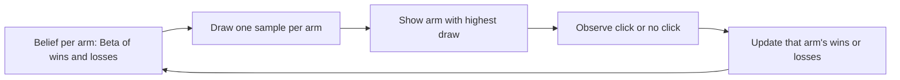

# Multi-arm bandits: learning while earning

> **Before this lesson:** [Power and sample size for A/B tests](#/lesson/statistics/power-sample-size) (the fixed-horizon design bandits relax) and Bayes' rule from [Probability, conditional probability and Bayes' rule](#/lesson/statistics/probability-bayes). Expected value is used throughout.

## In plain words

A classic A/B test splits traffic evenly until the end, even after one version is clearly losing. Every user sent to a bad version is a lost opportunity, a cost called **regret**. A **multi-arm bandit** algorithm shifts traffic towards the better-performing versions *while* the test runs, balancing two goals: **exploration** (trying each option enough to learn how good it is) and **exploitation** (using the option that currently looks best).

An everyday picture: you are new in town and choosing lunch spots. If you always return to the first decent place (pure exploitation) you may miss a great one. If you try a new place every day forever (pure exploration) you eat a lot of mediocre lunches. Sensible people mostly go to their favourite and occasionally try somewhere new, trying new places more often when they have little experience. That is a bandit strategy.

The name comes from slot machines, nicknamed "one-armed bandits". Imagine a machine with several arms, each paying out at a different unknown rate: which arm should you pull, and how often?

Why it matters for a job: bandits are used for headline and thumbnail testing, ad creative selection, recommendation exploration and promotions, especially when an option's lifetime is short (a news headline matters for hours) or the cost of showing a bad option is high. Interviewers ask about the explore-exploit trade-off, how epsilon-greedy and Thompson sampling work, and when a bandit is better or worse than an A/B test.

## 1. The trade-off and regret

Suppose three email subject lines have true open rates of 4%, 5% and 6%. We do not know these rates. Over $n$ sends, the best possible strategy (with perfect knowledge) would always use the 6% line. **Regret** is the expected number of opens lost compared with that ideal:

$$\text{regret} = n\,\mu^* - \sum_{\text{arms } k} n_k\,\mu_k$$

where $\mu^*$ is the best arm's rate, $n_k$ the number of pulls of arm $k$ and $\mu_k$ its true rate. An equal split wastes two thirds of traffic on worse arms; a good bandit drives regret down by learning quickly.

## 2. Epsilon-greedy

The simplest bandit algorithm:

1. With probability $\varepsilon$ (epsilon, for example 0.1), **explore**: pick an arm at random.
2. Otherwise **exploit**: pick the arm with the highest observed success rate so far.

With $\varepsilon = 1$ it is an equal-split A/B test; with $\varepsilon = 0$ it is greedy and may lock onto a mediocre arm forever after a lucky start. Its weaknesses: it explores at the same rate forever, even after the answer is clear, and when it explores it wastes pulls on arms already known to be bad. Variants reduce $\varepsilon$ over time.

## 3. Thompson sampling

**Thompson sampling** is a Bayesian approach that explores in proportion to uncertainty. For each arm, keep a probability distribution describing our belief about its success rate. For 0/1 rewards the natural choice is the **beta distribution**, $\text{Beta}(a, b)$, a distribution on values between 0 and 1. Starting from $\text{Beta}(1, 1)$ (uniform: every rate equally plausible), after $w$ successes and $\ell$ failures the belief becomes $\text{Beta}(1 + w, 1 + \ell)$. This updating rule is Bayes' rule in a convenient closed form; the beta is called the **conjugate prior** for binomial data.

```python-run
from scipy import stats
for wins, losses in [(0, 0), (3, 7), (30, 70), (300, 700)]:
    post = stats.beta(1 + wins, 1 + losses)
    lo, hi = post.ppf([0.025, 0.975])
    print(f"{wins:>3} conversions, {losses:>3} non-conversions: posterior mean {post.mean():.3f}, 95% interval ({lo:.3f}, {hi:.3f})")
```

**Reading this code line by line**

- `stats.beta(a, b)` is the beta distribution; `.mean()` is its average and `.ppf([0.025, 0.975])` gives the middle 95% range.
- We show how the belief about one arm narrows as data arrive at a constant 30% observed rate.

With no data, every rate is plausible (interval 0.025 to 0.975). After 10 pulls the interval is still wide (0.109 to 0.610); after 100 it is (0.219, 0.396); after 1,000 it is (0.272, 0.329). These are Bayesian credible intervals: given the prior and the data, the rate lies in the interval with 95% probability.

The Thompson rule for each new user:

1. Draw one random value from each arm's beta distribution.
2. Show the arm whose draw is highest.
3. Observe the reward and update that arm's counts.

An arm with a wide distribution sometimes produces a high draw, so uncertain arms get explored; an arm that is confidently bad almost never wins the draw. As evidence accumulates, traffic flows to the best arm automatically. In effect, each arm is chosen with the probability that it is the best.



## 4. Comparing strategies by simulation

```python-run
import numpy as np
true_rates = np.array([0.04, 0.05, 0.06])
def run(policy, n=30_000, eps=0.1, seed=0):
    rng = np.random.default_rng(seed)
    wins = np.zeros(3); pulls = np.zeros(3)
    for t in range(n):
        if policy == "equal":
            arm = t % 3
        elif policy == "epsilon":
            if rng.random() < eps or pulls.min() == 0:
                arm = rng.integers(3)
            else:
                arm = np.argmax(wins / pulls)
        else:
            arm = np.argmax(rng.beta(1 + wins, 1 + pulls - wins))
        reward = rng.random() < true_rates[arm]
        wins[arm] += reward; pulls[arm] += 1
    regret = n * true_rates.max() - (pulls * true_rates).sum()
    return wins.sum(), pulls.astype(int), regret
for policy in ["equal", "epsilon", "thompson"]:
    total, pulls, regret = run(policy)
    print(f"{policy:9s} conversions {int(total):5d}  pulls per arm {pulls}  expected regret {regret:6.1f}")
```

**Reading this code line by line**

- `wins` and `pulls` keep running counts per arm.
- `"equal"` cycles through arms in turn (`t % 3` is the remainder after dividing by 3): a classic three-way test.
- `"epsilon"` explores at random with probability 0.1 (and until every arm has been tried once) and otherwise picks the best observed rate.
- The Thompson branch draws from each arm's beta belief, `rng.beta(1 + wins, 1 + losses)`, and takes the largest draw with `np.argmax`.
- A reward occurs with the chosen arm's true probability. Expected regret uses the true rates, so it measures the policy rather than luck.

Over 30,000 users, the equal split earns 1,511 conversions with a regret of 300 (it gave 10,000 users each to the two worse arms). Epsilon-greedy gives 26,338 users to the best arm and cuts regret to 46.8. Thompson sampling gives the best arm 28,508 users, earns 1,765 conversions and has regret of only 18.8. When the goal is to earn during the test, bandits win clearly.

## 5. The catch: bandits make inference harder

Bandits optimise reward, not knowledge. The price:

```python-run
import numpy as np
true_rates = np.array([0.04, 0.05, 0.06])
def thompson(n, seed):
    rng = np.random.default_rng(seed)
    wins = np.zeros(3); pulls = np.zeros(3)
    for t in range(n):
        arm = np.argmax(rng.beta(1 + wins, 1 + pulls - wins))
        wins[arm] += rng.random() < true_rates[arm]; pulls[arm] += 1
    return pulls
best_share = [thompson(5_000, s)[2] / 5_000 for s in range(20)]
print("share of traffic Thompson gave the best arm, 20 runs:")
print(np.round(best_share, 2))
```

**Reading this code line by line**

- We repeat a shorter Thompson run of 5,000 users with 20 different seeds and record the share of traffic the best arm received.

In most runs the best arm receives the bulk of the traffic (often 0.8 or more), but a few runs give it under a quarter, spending long stretches favouring the second-best arm after an unlucky start. The arms differ by only one percentage point, and 5,000 users is not much data for such a small gap. With close arms and limited traffic, a bandit can be slow or temporarily wrong. More fundamentally:

- **Losing arms get little data**, so you cannot say precisely *how much* worse they are. A fixed A/B test gives clean, equal-precision estimates of every arm and a valid p-value; a bandit's adaptive allocation makes standard confidence intervals and tests invalid without special methods.
- **Delayed rewards** (purchases days after a click) slow the feedback loop and confuse naive bandits.
- **Changing conditions**: if the best arm on weekdays differs from weekends, an early shift of traffic bakes in a time bias. Rates that drift over time need discounting of old data.
- **Long-term metrics** (retention, satisfaction) are hard to optimise with fast-feedback bandits.

So the choice depends on the goal:

| Goal | Use |
|---|---|
| Learn the effect size precisely, make a durable product decision | A/B test with fixed sample size |
| Maximise reward during a short-lived choice (headlines, promotions) | Bandit |
| Many options, cheap to switch, fast feedback | Bandit |
| Effects on long-term metrics or the whole system | A/B test, often with holdouts |

## 6. Other bandit algorithms

- **Upper confidence bound (UCB)**: pick the arm with the highest optimistic estimate, $\hat{\mu}_k + c\sqrt{\ln t / n_k}$, where $t$ is the total number of pulls so far. The bonus is large for rarely tried arms ("optimism in the face of uncertainty") and shrinks as they are tried.
- **Contextual bandits**: the best arm depends on the user (device, country, history); a model predicts each arm's reward from features. This is the bridge between bandits and recommender systems.
- **Decaying epsilon**: explore heavily at first and less over time.

> [!INTERVIEW]
> "When would you use a bandit instead of an A/B test?" A strong answer: when the opportunity cost of showing bad variants is high and the decision is short-lived or repeated (headlines, ad creatives, promotions), feedback is fast, and you care more about cumulative reward than about a precise effect estimate. Prefer A/B tests for strategic product changes, long-term metrics, or when you need a trustworthy estimate of the size of the effect.

## Common mistakes

- **Reading a bandit's final traffic shares as effect sizes.** A 90% share for one arm does not mean it is 90% likely to be best by a large margin; arms may be nearly tied.
- **Running a standard t-test on bandit data.** Because allocation depended on earlier outcomes, the arms' samples are not independent random samples; naive p-values and intervals are biased. Use methods designed for adaptive data, or a fixed-split confirmation test.
- **Forgetting the prior.** A Beta(1, 1) prior is harmless with plenty of data, but with very low rates (0.1% click-through) and few pulls, an informative prior centred on historical rates stabilises early decisions.
- **Optimising the wrong reward.** Bandits chase whatever reward they are given. Optimising clicks on headlines can reward clickbait that hurts long-term trust; guardrails still apply.
- **Never stopping exploration in a changing world, or stopping too early in a stable one.** Match the exploration schedule to how quickly the arms' true rates drift.

## Summary

- Bandits allocate traffic adaptively to reduce regret, trading exploration against exploitation.
- Epsilon-greedy explores at random with probability $\varepsilon$ and otherwise exploits the best observed arm.
- Thompson sampling keeps a beta belief per arm, samples from each, and plays the highest draw; it explores in proportion to uncertainty and usually has very low regret.
- Bandits earn more during the test but give weaker inference about losing arms and struggle with delayed or drifting rewards.
- Use A/B tests to learn and decide durably; use bandits to optimise short-lived, repeated choices.

## Glossary

- **Multi-arm bandit**: a problem (and family of algorithms) of choosing among options with unknown payoffs while learning.
- **Arm**: one option, such as a headline variant.
- **Exploration / exploitation**: trying options to learn / using the best-known option.
- **Regret**: reward lost compared with always playing the best arm.
- **Epsilon-greedy**: explore at random with probability $\varepsilon$, else exploit.
- **Beta distribution**: a distribution on [0, 1], used for beliefs about rates.
- **Conjugate prior**: a prior that stays in the same family after updating with data.
- **Thompson sampling**: choosing the arm with the highest random draw from each arm's posterior.
- **Credible interval**: a Bayesian interval containing the parameter with a stated probability given the data.
- **Upper confidence bound (UCB)**: choosing the arm with the highest optimistic estimate.
- **Contextual bandit**: a bandit whose best arm depends on features of the user or situation.

## Check yourself

```quiz
[
  {"q": "What does regret measure in a bandit problem?", "options": ["Reward lost compared with always choosing the best arm", "The p-value of the best arm", "The number of arms", "The variance of the rewards"], "answer": 0,
   "explain": "Regret = n × best rate − expected reward actually earned."},
  {"q": "With ε = 1, epsilon-greedy is equivalent to…", "options": ["an equal-split A/B test", "always choosing the best arm", "Thompson sampling", "UCB"], "answer": 0,
   "explain": "Every choice is random, so each arm gets an equal share."},
  {"q": "An arm has 12 conversions and 88 non-conversions with a Beta(1, 1) prior. Its posterior is…", "options": ["Beta(13, 89)", "Beta(12, 88)", "Beta(1, 1)", "Beta(100, 12)"], "answer": 0,
   "explain": "Add successes to a and failures to b."},
  {"q": "Why does Thompson sampling still explore arms that currently look worse?", "options": ["Their wide posterior sometimes produces the highest random draw", "It explores at a fixed rate ε", "It ignores data", "It always picks the least-tried arm"], "answer": 0,
   "explain": "Exploration happens in proportion to the probability that an arm is actually the best."},
  {"q": "Which situation favours a classic A/B test over a bandit?", "options": ["You need a precise estimate of a feature's effect on 90-day retention", "Choosing among 10 headlines for a story that matters for 6 hours", "Rotating ad creatives with instant click feedback", "A flash sale lasting one day"], "answer": 0,
   "explain": "Long-term outcomes and the need for clean inference favour fixed designs."},
  {"q": "A drawback of bandits for decision-making is…", "options": ["losing arms get little data, so their effect sizes are poorly estimated and standard tests are invalid", "they always earn less than an A/B test", "they cannot handle more than two arms", "they require normal data"], "answer": 0,
   "explain": "Adaptive allocation trades inference quality for reward."}
]
```

> **Source:** Bruce & Bruce, *Practical Statistics for Data Scientists* (O'Reilly, 2017), ch. 3, "Multi-Arm Bandit Algorithm" (epsilon-greedy, Thompson's sampling with a beta prior); the simulations and comparison with A/B tests are original.
