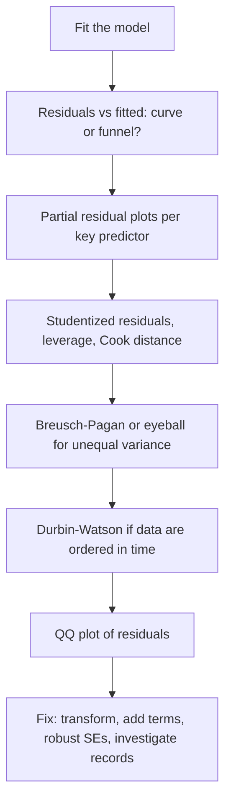

# Regression diagnostics: outliers, influence and assumptions

> **Before this lesson:** [Multiple regression: assessment, cross-validation and model selection](#/lesson/statistics/multiple-regression) and [Factor variables and interpreting regression](#/lesson/statistics/factors-interpretation). QQ plots and z-scores from [Normal, t and long-tailed distributions](#/lesson/statistics/normal-t-long-tails) help read the residual checks.

## In plain words

Fitting a regression always produces numbers, even when the model is badly wrong for the data. **Regression diagnostics** are the checks you run afterwards to find out whether you can trust those numbers: are a few strange records driving the result? Is the noise the same everywhere? Are the errors independent? Is a straight line the right shape? Most of the checks look at the **residuals**, the leftovers the model could not explain, because a good model leaves residuals that look like structureless noise.

An everyday picture: after a car service, a good mechanic does not only check that the engine starts. They listen for odd noises, check for leaks and test the brakes. A model that "runs" still needs that inspection before you rely on it.

Why it matters for a job: diagnostics separate a defensible analysis from a misleading one. One mis-keyed record can flip a business conclusion; ignoring unequal noise makes confidence intervals wrong; missing curvature makes predictions systematically off. Interviewers ask about the assumptions of linear regression, what leverage and Cook's distance are, how to detect heteroskedasticity, and what to do about each problem.

## 1. The assumptions, and which ones matter when

Linear regression's classical assumptions:

1. **Linearity**: the expected response is a linear function of the predictors (after any transformations you chose).
2. **Independence**: errors are independent of each other.
3. **Constant variance (homoskedasticity)**: errors have the same spread for all fitted values.
4. **Normality**: errors are normally distributed.

Not all matter equally. For *prediction*, what matters is out-of-sample accuracy; violations matter only if they hurt it. For *inference* (standard errors, p-values, intervals), independence and constant variance matter a great deal, and normality matters mainly in small samples (the central limit theorem rescues coefficient estimates in large ones). Linearity matters for both: if the shape is wrong, predictions are biased.

## 2. Outliers: standardized residuals

An **outlier** in regression is a record whose response is far from what the model predicts, i.e. with a large residual. To judge "large", divide each residual by its standard error to get a **standardized residual**; the **studentized** version (`resid_studentized_external` in statsmodels) does so with the record itself left out of the variance estimate, so an outlier cannot hide by inflating the noise estimate. Values beyond about $\pm 3$ deserve a look.

## 3. Leverage and influence

An outlier in $Y$ is not necessarily dangerous. What matters is whether a record changes the fitted model. Two ideas:

- **Leverage** measures how unusual a record's predictor values are; records far from the centre of the $X$ values have high leverage, like a person sitting at the very end of a seesaw. It is given by the diagonal of the "hat matrix"; the average leverage is $(p + 1)/n$, and values above two or three times that are high.
- **Influence** combines leverage with a large residual. **Cook's distance** measures how much all fitted values change when the record is deleted. A common rough rule flags Cook's distance above $4/(n - p - 1)$, and values near or above 1 are very influential.

```python-run
import numpy as np
import statsmodels.api as sm
rng = np.random.default_rng(43)
n = 60
x = rng.uniform(0, 10, n)
y = 5 + 2 * x + rng.normal(0, 1.5, n)
x = np.append(x, [5.0, 25.0]); y = np.append(y, [30.0, 20.0])
X = sm.add_constant(x)
fit = sm.OLS(y, X).fit()
infl = fit.get_influence()
stud = infl.resid_studentized_external
lev = infl.hat_matrix_diag
cooks = infl.cooks_distance[0]
for i in [0, 1, n, n + 1]:
    print(f"row {i:>2}: x={x[i]:5.1f} y={y[i]:5.1f}  studentized resid {stud[i]:6.2f}  leverage {lev[i]:.3f}  Cook's D {cooks[i]:.3f}")
print("average leverage (p+1)/n =", round(2 / len(x), 3))
clean = sm.OLS(y[:n], X[:n]).fit()
print(f"slope with all rows {fit.params[1]:.3f}; without the two odd rows {clean.params[1]:.3f}")
```

**Reading this code line by line**

- 60 clean points follow $y = 5 + 2x$ plus noise, with $x$ between 0 and 10. We append two odd records: (5, 30), an outlier in the middle of the $x$ range, and (25, 20), far to the right *and* far below the line.
- `sm.OLS(y, X).fit()` is statsmodels' array interface; `sm.add_constant` adds the intercept column.
- `fit.get_influence()` returns an object with the diagnostics: externally studentized residuals, leverage (`hat_matrix_diag`) and Cook's distance (`cooks_distance[0]`; the second element holds p-values we do not need).

Two ordinary rows have small studentized residuals, low leverage and tiny Cook's distances. The mid-range outlier has a studentized residual of 4.33, clearly an outlier, but low leverage (0.016) and a modest Cook's distance (0.119): it shifts the line up a little but barely tilts it. The far-right record has leverage 0.459 (fourteen times the average 0.032), a studentized residual of $-9.68$ and a Cook's distance of 15.6. It single-handedly drags the slope from 1.937 to 1.201. That is an **influential observation**.

What to do: investigate before acting. Is it a data-entry error (fix or drop it)? A different population (a commercial property in a homes dataset: exclude and say so)? A genuine extreme (keep it, but perhaps use a robust method)? Report results with and without it if it changes conclusions. With big data, single points rarely matter, but clusters of odd records (bots, test accounts, duplicated imports) can.

> [!NOTE]
> Outlier detection is also a goal in itself: records with huge residuals from a good model can reveal fraud, sensor faults or mislabelled data. The book's housing example found sales recorded with partial ownership shares, far below market value.

## 4. Heteroskedasticity

**Heteroskedasticity** (unequal error variance) means the spread of residuals changes with the fitted value or with a predictor, typically growing with size. The coefficients remain unbiased, but the usual standard errors are wrong, so p-values and intervals are unreliable.

```python-run
import numpy as np
import matplotlib.pyplot as plt
import statsmodels.api as sm
from statsmodels.stats.diagnostic import het_breuschpagan
rng = np.random.default_rng(44)
n = 400
x = rng.uniform(1, 10, n)
y = 3 + 2 * x + rng.normal(0, 0.4 * x, n)
X = sm.add_constant(x)
fit = sm.OLS(y, X).fit()
resid = fit.resid
for lo, hi in [(1, 4), (4, 7), (7, 10)]:
    m = (x >= lo) & (x < hi)
    print(f"x in [{lo},{hi}): residual SD {resid[m].std():.2f}")
lm_stat, lm_p, _, _ = het_breuschpagan(resid, X)
print(f"Breusch-Pagan p-value {lm_p:.2e}")
robust = fit.get_robustcov_results(cov_type="HC3")
print(f"slope SE: ordinary {fit.bse[1]:.4f}, robust HC3 {robust.bse[1]:.4f}")

plt.scatter(fit.fittedvalues, resid, s=10, alpha=0.6, color="#1f5f8b")
plt.axhline(0, color="#d1412b")
plt.xlabel("fitted value")
plt.ylabel("residual")
plt.title("Residuals against fitted values")
plt.show()
```

**Reading this code line by line**

- The noise standard deviation is `0.4 * x`, so it grows with $x$ by construction.
- The loop prints the residual standard deviation in three ranges of $x$: the numerical version of looking at a plot of residuals against fitted values for a "funnel" shape.
- `het_breuschpagan(resid, X)` is the **Breusch-Pagan test**: it regresses squared residuals on the predictors; a small p-value indicates heteroskedasticity. It returns four numbers; we keep the second (the p-value).
- `get_robustcov_results(cov_type="HC3")` recomputes standard errors that remain valid under heteroskedasticity.
- The last block draws that plot with **matplotlib**, Python's plotting library: `plt.scatter` puts one dot per observation at (fitted value, residual), `alpha=0.6` makes the dots slightly see-through so that overlaps show, `plt.axhline(0)` draws the zero line a good model's residuals should scatter evenly around, and `plt.show()` displays the chart. The first run downloads the plotting library, which takes a few seconds.

The chart shows the classic **funnel**: a narrow band of residuals on the left that widens steadily to the right. The residual spread triples across the range (1.12, 2.12, 3.12), and the Breusch-Pagan p-value is $1.34 \times 10^{-17}$. Remedies: use **heteroskedasticity-robust standard errors** (also called sandwich or HC errors: here they are somewhat larger, 0.0483 versus 0.0442), transform the response (logs often stabilise variance for positive, multiplicative data), or use weighted least squares with weights matching the variance. In practice many analysts use robust standard errors by default.

Heteroskedasticity can also be a clue: if errors are much larger for expensive homes, the model may be missing a variable that matters at the top of the market.

## 5. Correlated errors and non-normal residuals

**Correlated errors** occur when records are linked in time or space: daily sales, sensor readings, repeated measurements of one user. Positive correlation (yesterday's surprise predicts today's) makes standard errors too small. The **Durbin-Watson statistic** checks for correlation between consecutive residuals: about 2 means none, below 2 means positive correlation, toward 0 strong positive correlation.

**Non-normal residuals** (skewed or heavy-tailed) mostly matter for small-sample inference and for prediction intervals, which assume a normal error shape. The **Jarque-Bera test** checks skewness and kurtosis; a QQ plot of residuals is more informative.

```python-run
import numpy as np
import statsmodels.api as sm
from statsmodels.stats.stattools import durbin_watson, jarque_bera
rng = np.random.default_rng(45)
t = np.arange(200)
e = np.zeros(200)
for i in range(1, 200):
    e[i] = 0.8 * e[i - 1] + rng.normal(0, 1)
y_ts = 10 + 0.05 * t + e
fit_ts = sm.OLS(y_ts, sm.add_constant(t)).fit()
print(f"time series: Durbin-Watson {durbin_watson(fit_ts.resid):.2f}")
y_iid = 10 + 0.05 * t + rng.normal(0, 1, 200)
print(f"independent errors: Durbin-Watson {durbin_watson(sm.OLS(y_iid, sm.add_constant(t)).fit().resid):.2f}")
skewed = 10 + 0.05 * t + rng.exponential(2, 200)
jb_stat, jb_p, skew, kurt = jarque_bera(sm.OLS(skewed, sm.add_constant(t)).fit().resid)
print(f"skewed errors: Jarque-Bera p {jb_p:.2e}, residual skew {skew:.2f}")
```

**Reading this code line by line**

- The loop builds **autocorrelated** errors: each error is 0.8 times the previous one plus fresh noise, typical of time series.
- `durbin_watson(residuals)` computes the statistic; `jarque_bera(residuals)` returns the statistic, p-value, skewness and kurtosis.

With autocorrelated errors Durbin-Watson is 0.57, far below 2; with independent errors it is 2.11. Skewed (exponential) errors give a Jarque-Bera p-value of essentially zero and a residual skewness of 2.17. Remedies for correlated errors: add lagged variables or trend and seasonal terms, use time-series models (ARIMA and relatives), or compute standard errors that allow correlation (Newey-West, or clustered standard errors by user). For skewed errors: transform the response, or use the bootstrap for intervals.

## 6. Nonlinearity and partial residual plots

The linearity assumption is checked with residual plots. With several predictors, a **partial residual plot** isolates one predictor: for predictor $X_j$, plot

$$\text{partial residual} = \text{residual} + \hat{b}_j X_j$$

against $X_j$. The partial residuals show how $Y$ relates to $X_j$ after removing the other predictors' fitted effects; if the relationship is linear, they scatter around the straight line $\hat{b}_j X_j$. Systematic bending reveals the shape the model missed.

```python-run
import numpy as np
import pandas as pd
import statsmodels.formula.api as smf
rng = np.random.default_rng(46)
n = 500
sqft = rng.uniform(500, 4000, n)
age = rng.uniform(0, 60, n)
price = 100_000 + 60 * sqft + 0.03 * sqft**2 - 800 * age + rng.normal(0, 30_000, n)
df = pd.DataFrame(dict(price=price, sqft=sqft, age=age))
fit = smf.ols("price ~ sqft + age", data=df).fit()
partial = fit.resid + fit.params["sqft"] * df["sqft"]
bins = pd.cut(df["sqft"], [500, 1000, 1500, 2000, 2500, 3000, 3500, 4000])
summary = pd.DataFrame({"partial_resid": partial, "linear_part": fit.params["sqft"] * df["sqft"]}).groupby(bins, observed=True).mean()
summary["gap"] = summary["partial_resid"] - summary["linear_part"]
print(summary.round(0))
```

**Reading this code line by line**

- The true price grows with the *square* of floor area (bigger homes are worth more per square foot), but we fit a straight line in sqft.
- `partial` is the partial residual for sqft.
- Instead of drawing the plot, we cut sqft into bins and compare the average partial residual with the average of the fitted linear part in each bin; `observed=True` keeps only bins that occur.

The gap is positive for small homes (38,507), negative in the middle (around $-30{,}000$) and positive again for large homes (42,144): a U-shape. The straight line overpredicts mid-sized homes and underpredicts both ends, the signature of missing curvature. On a plot you would see the partial residuals bending around the line. The fix is to model the shape, with polynomial or spline terms, the subject of [Polynomial regression, splines and GAMs](#/lesson/statistics/nonlinear-regression).

## 7. A diagnostics checklist



> [!INTERVIEW]
> "What are the assumptions of linear regression and what happens when each fails?" Linearity (biased predictions; add terms or transform), independence (standard errors too small; cluster or model the correlation), constant variance (wrong standard errors; robust SEs, log transform, WLS), normal errors (matters for small-sample inference and prediction intervals; bootstrap or transform). Mention that coefficient estimates stay unbiased under heteroskedasticity, and that multicollinearity is not an assumption violation but a precision problem.

## Summary

- Diagnostics check whether a fitted model can be trusted; most inspect residuals.
- Studentized residuals flag outliers; leverage flags unusual predictor values; Cook's distance flags records that change the fit.
- Heteroskedasticity leaves coefficients unbiased but breaks standard errors; detect with residual plots or Breusch-Pagan; fix with robust SEs, transforms or WLS.
- Correlated errors (Durbin-Watson well below 2) make standard errors too small; non-normal errors matter for small samples and prediction intervals.
- Partial residual plots reveal nonlinearity for one predictor at a time.

## Glossary

- **Regression diagnostics**: checks of a fitted model's assumptions and of unusual records.
- **Standardized / studentized residual**: residual divided by its standard error / with the record left out of the variance estimate.
- **Leverage (hat value)**: how unusual a record's predictor values are.
- **Influential observation**: a record whose removal noticeably changes the fit.
- **Cook's distance**: a measure of a record's influence on all fitted values.
- **Homoskedasticity / heteroskedasticity**: constant / changing error variance.
- **Breusch-Pagan test**: a test for heteroskedasticity.
- **Robust (sandwich, HC) standard errors**: standard errors valid under heteroskedasticity.
- **Autocorrelation**: correlation of errors with earlier errors.
- **Durbin-Watson statistic**: a measure of lag-1 autocorrelation in residuals; about 2 means none.
- **Jarque-Bera test**: a test of residual normality using skewness and kurtosis.
- **Partial residual**: residual plus one predictor's fitted contribution.
- **Partial residual plot**: partial residuals plotted against that predictor to reveal its true shape.

## Check yourself

```quiz
[
  {"q": "A record has an enormous residual but its x value is near the centre of the data. Most likely it…", "options": ["is an outlier with low leverage, shifting the line a little but not tilting it much", "has high leverage and controls the slope", "has Cook's distance above 10", "cannot be detected"], "answer": 0,
   "explain": "Leverage depends on unusual predictor values; a central x has little power to tilt the line."},
  {"q": "Cook's distance measures…", "options": ["how much the fitted values change when a record is deleted", "how far a record's x is from the mean", "the correlation of consecutive residuals", "the variance inflation of a coefficient"], "answer": 0,
   "explain": "It combines leverage and residual size into one influence measure."},
  {"q": "Under heteroskedasticity, the OLS coefficient estimates are…", "options": ["still unbiased, but the usual standard errors are wrong", "biased and useless", "always too large", "exactly the same as WLS"], "answer": 0,
   "explain": "Unequal variance affects precision and inference, not the centre of the estimates."},
  {"q": "A Durbin-Watson statistic of 0.6 on daily data suggests…", "options": ["strong positive autocorrelation of residuals", "no autocorrelation", "heteroskedasticity", "an influential point"], "answer": 0,
   "explain": "About 2 means none; values toward 0 mean consecutive residuals move together."},
  {"q": "Partial residuals for floor area form a U-shape around the fitted straight line. You should…", "options": ["add curvature for floor area, such as a squared term or spline", "drop floor area", "use robust standard errors", "remove the largest homes"], "answer": 0,
   "explain": "The systematic pattern shows the linear form is wrong for that predictor."},
  {"q": "For a model used purely for prediction with large n, which assumption is least important?", "options": ["Normality of errors", "Linearity of the relationship", "That training and future data come from the same process", "That there is no data leakage"], "answer": 0,
   "explain": "Normality mainly affects small-sample inference and prediction-interval shape; the others affect accuracy directly."}
]
```

> **Source:** Bruce & Bruce, *Practical Statistics for Data Scientists* (O'Reilly, 2017), ch. 4, "Testing the Assumptions: Regression Diagnostics" (outliers, influential values, heteroskedasticity, non-normality and correlated errors, partial residual plots and nonlinearity); statsmodels documentation for `get_influence`, `het_breuschpagan`, `durbin_watson` and `jarque_bera`.
