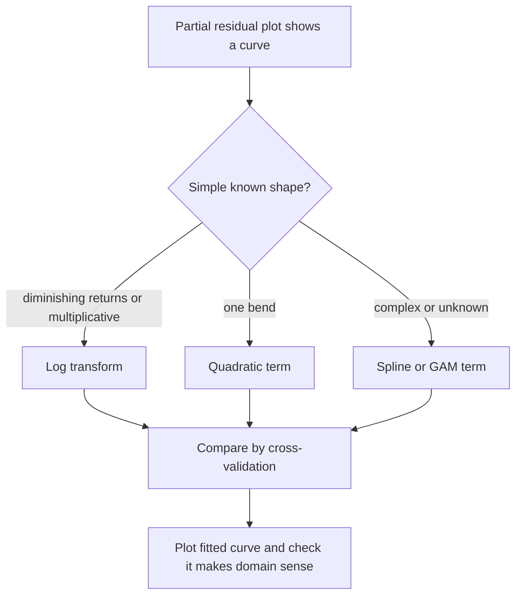

# Polynomial regression, splines and GAMs

> **Before this lesson:** [Regression diagnostics: outliers, influence and assumptions](#/lesson/statistics/regression-diagnostics) (partial residual plots revealed curvature) and [Multiple regression: assessment, cross-validation and model selection](#/lesson/statistics/multiple-regression) (cross-validation, adjusted $R^2$). Scikit-learn pipelines are explained in the [ML track's pipelines lesson](#/lesson/ml/pipelines), but each line here is explained too.

## In plain words

Real relationships are rarely straight lines. Sales rise with advertising but flatten out; house value per square foot rises for luxury homes; energy use dips and rises with temperature. Linear regression can still model these curves if we feed it transformed versions of a predictor. **Polynomial regression** adds powers ($x^2$, $x^3$); **splines** join several short polynomial pieces smoothly; **generalised additive models** (GAMs) fit a flexible curve for each predictor and add them up. All three remain "linear" in the sense that matters for fitting: the model is a weighted sum of columns, solved by least squares.

An everyday picture: draw a road on a map. A single straight ruler cannot follow it. A single bendy curve (a high-degree polynomial) can follow it for a while but tends to fly off wildly at the ends. A flexible strip of plastic pinned down at a few points (the original meaning of "spline", a draughtsman's tool) follows the road smoothly and behaves sensibly everywhere.

Why it matters for a job: capturing curvature improves both predictions and explanations ("returns to ad spend diminish beyond 5,000 dollars a week"). Interviewers ask how to model a nonlinear relationship within linear regression, why high-degree polynomials are risky, what knots are, and how to choose flexibility without overfitting.

## 1. Polynomial regression

To model a curve in $x$, include powers of $x$ as extra predictors:

$$Y = b_0 + b_1 x + b_2 x^2 + b_3 x^3 + e$$

The model is still linear *in the coefficients*, so ordinary least squares fits it. In a statsmodels formula, wrap arithmetic in `I(...)` so it is computed rather than interpreted as formula syntax.

```python-run
import numpy as np
import pandas as pd
import statsmodels.formula.api as smf
rng = np.random.default_rng(44)
n = 300
x = rng.uniform(0, 10, n)
y = 20 + 15 * np.sin(x / 1.6) + 2 * x + rng.normal(0, 3, n)
df = pd.DataFrame({"x": x, "y": y})
lin = smf.ols("y ~ x", data=df).fit()
quad = smf.ols("y ~ x + I(x**2)", data=df).fit()
cub = smf.ols("y ~ x + I(x**2) + I(x**3)", data=df).fit()
for name, m in [("linear", lin), ("quadratic", quad), ("cubic", cub)]:
    print(f"{name:9s} adj R^2 {m.rsquared_adj:.4f}  RSE {np.sqrt(m.scale):.2f}")
print(cub.params.round(4))
```

**Reading this code line by line**

- The true curve is a wave plus an upward trend, $20 + 15\sin(x/1.6) + 2x$, with noise. In practice you would not know the shape.
- `I(x**2)` adds the square of `x` as a predictor; `I(x**3)` the cube.
- We compare adjusted $R^2$ and the residual standard error.

The straight line explains little (adjusted $R^2$ 0.1607, typical error 7.45). Adding a square barely helps, because this curve rises, falls and rises again. The cubic captures it: adjusted $R^2$ 0.8595 and typical error 3.05, close to the true noise of 3. The individual polynomial coefficients (21.36, $-5.50$, 0.365) are hard to interpret on their own; the fitted *curve* is what you read, usually as a plot of predictions across the range of $x$.

### The trouble with high degrees

Higher degrees can fit any wiggle, but they come with problems:

- **Overfitting**: the curve chases noise.
- **Wild edges**: polynomials swing sharply near the ends of the data and explode outside it (a symptom called Runge's phenomenon).
- **Global influence**: every point affects the whole curve, so a change in one region distorts another.
- **Numerical instability**: columns like $x^{15}$ are enormous and highly correlated with each other.

Cross-validation shows the cost:

```python-run
import numpy as np
from sklearn.pipeline import make_pipeline
from sklearn.preprocessing import PolynomialFeatures, SplineTransformer
from sklearn.linear_model import LinearRegression
from sklearn.model_selection import cross_val_score, KFold
rng = np.random.default_rng(44)
n = 300
x = rng.uniform(0, 10, n)
y = 20 + 15 * np.sin(x / 1.6) + 2 * x + rng.normal(0, 3, n)
X = x.reshape(-1, 1)
cv = KFold(5, shuffle=True, random_state=1)
def cv_rmse(model):
    return -cross_val_score(model, X, y, cv=cv, scoring="neg_root_mean_squared_error").mean()
for d in [1, 2, 3, 5, 8, 15]:
    print(f"polynomial degree {d:>2}: CV RMSE {cv_rmse(make_pipeline(PolynomialFeatures(d), LinearRegression())):.3f}")
for k in [4, 6, 10, 30]:
    print(f"cubic spline, {k:>2} knots: CV RMSE {cv_rmse(make_pipeline(SplineTransformer(n_knots=k, degree=3), LinearRegression())):.3f}")
```

**Reading this code line by line**

- `x.reshape(-1, 1)` turns the 1-D array into a one-column table, the shape scikit-learn expects for features (`-1` means "as many rows as needed").
- `make_pipeline(A, B)` chains steps: `PolynomialFeatures(d)` creates the columns $1, x, x^2, \dots, x^d$, then `LinearRegression` fits them. Inside cross-validation, the whole pipeline is refit on each training fold.
- `SplineTransformer(n_knots=k, degree=3)` creates cubic spline columns with `k` knots (explained next).
- `cv_rmse` returns the average 5-fold cross-validated RMSE.

Polynomials improve sharply at degree 3 (3.049) and slightly at 5 (2.933), then get *worse*: 4.954 at degree 8 and 6.412 at degree 15, as the edges go wild on held-out points. Cubic splines are good and stable across a wide range of knots (2.944 with 4 knots, 3.263 with 30): their flexibility is local and well behaved.

## 2. Splines

A **spline** divides the range of $x$ at points called **knots** and fits a separate low-degree polynomial (usually cubic) in each interval, with constraints that make the pieces join smoothly: at each knot the curve, its slope and its curvature match. The result is flexible where the data need it but cannot oscillate wildly, because each piece is only cubic and only affects its own neighbourhood.

In practice, splines are implemented by creating a set of **basis functions** (columns derived from $x$) and fitting a linear model on them, exactly like polynomial columns. Choices:

- **Number and position of knots**: more knots means more flexibility. Knots are usually placed at quantiles of $x$ (so each interval has a similar amount of data) or evenly. Choose the number by cross-validation or with a smoothing penalty.
- **Degree**: cubic is standard.
- **Natural splines** add the constraint of being linear beyond the outer knots, which makes extrapolation tamer.

In statsmodels formulas, `bs(x, df=6)` creates a B-spline basis (B-splines are a numerically stable way to build spline columns) and `cr(x, df=6)` a natural cubic regression spline: `smf.ols("y ~ bs(x, df=6)", data=df)`. In scikit-learn, `SplineTransformer` does the same job inside pipelines.

## 3. Generalised additive models

With several predictors, each possibly nonlinear, a **generalised additive model** (GAM) fits

$$Y = b_0 + f_1(X_1) + f_2(X_2) + \dots + f_p(X_p) + e$$

where each $f_j$ is a smooth function learned from data, usually a penalised spline. "Additive" means the effects add up: no interactions unless you include them explicitly. A **smoothing penalty** discourages wiggly functions, and its strength is tuned automatically (for example by generalised cross-validation), so you do not have to pick the number of knots by hand. GAMs keep much of linear regression's interpretability: you can plot each $f_j$ and say "price rises steeply with size above 2,500 square feet; the age effect drops quickly in the first 10 years then flattens".

In Python, `statsmodels.gam.api.GLMGam` with `BSplines` fits penalised GAMs, and the `pygam` package is popular. The core idea is also easy to build from scikit-learn parts: spline columns for each predictor, fed to a ridge regression whose penalty controls smoothness.

```python-run
import numpy as np
from sklearn.compose import ColumnTransformer
from sklearn.pipeline import make_pipeline
from sklearn.preprocessing import SplineTransformer
from sklearn.linear_model import Ridge, LinearRegression
from sklearn.model_selection import cross_val_score, KFold
rng = np.random.default_rng(45)
n = 600
age = rng.uniform(0, 80, n)
sqft = rng.uniform(500, 4000, n)
price = 100_000 + 90 * sqft + 0.02 * sqft**2 + 40_000 * np.exp(-age / 10) - 500 * age + rng.normal(0, 25_000, n)
X = np.column_stack([age, sqft])
splines = ColumnTransformer([("age", SplineTransformer(n_knots=6), [0]), ("sqft", SplineTransformer(n_knots=6), [1])])
gam_like = make_pipeline(splines, Ridge(alpha=1.0))
cv = KFold(5, shuffle=True, random_state=0)
for name, model in [("linear", LinearRegression()), ("additive splines", gam_like)]:
    rmse = -cross_val_score(model, X, price, cv=cv, scoring="neg_root_mean_squared_error").mean()
    print(f"{name:16s} CV RMSE {rmse:,.0f}")
```

**Reading this code line by line**

- The simulated price has a curved effect of size (a squared term) and a curved effect of age (a "new build premium" that fades over the first decade, `np.exp(-age / 10)`), plus a gentle linear decline with age.
- `np.column_stack` puts age and sqft side by side as a two-column feature table.
- `ColumnTransformer` applies a separate `SplineTransformer` to each column (by position, `[0]` and `[1]`), producing an additive set of spline columns.
- `Ridge(alpha=1.0)` is linear regression with a penalty on large coefficients, which keeps the fitted curves smooth.

The additive spline model cuts cross-validated RMSE from 31,293 to 26,454, close to the true noise level of 25,000. A straight line in each predictor cannot represent the new-build premium or the accelerating size effect.

## 4. Transformations: the simplest nonlinearity

Before reaching for splines, consider a transformation:

- **Log of the response**: for positive, right-skewed outcomes (prices, revenue) where effects are multiplicative. A coefficient $b$ on $x$ then means roughly a $100 \times b$ percent change in $Y$ per unit of $x$ (for small $b$).
- **Log of a predictor**: for diminishing returns, where doubling the input adds a constant amount (each doubling of ad spend adds the same number of sales).
- **Log-log**: coefficients become **elasticities**: the percent change in $Y$ for a one percent change in $X$, standard in pricing.

Transformations often fix nonlinearity and heteroskedasticity at once and keep coefficients easy to explain.

## 5. Choosing flexibility



Guidelines:

- Prefer the simplest form that cross-validation supports and domain knowledge finds plausible.
- Avoid polynomial degrees above 3 or 4; use splines instead.
- Never trust any flexible fit outside the range of the data.
- Plot the fitted curves; a curve that wiggles in ways no expert can explain is probably fitting noise.

> [!INTERVIEW]
> "Your linear model of delivery time on distance underpredicts long trips. How would you fix it within a regression framework?" Check the partial residual plot; try a log or quadratic term in distance, or a spline with a few knots; compare with cross-validation; consider an interaction with time of day if traffic matters. Mention that trees and boosting capture such shapes automatically, at the cost of interpretability.

## Common mistakes

- **Reading polynomial coefficients one by one.** In a cubic, the coefficient of $x$ is the slope only at $x = 0$; the slope elsewhere depends on all three terms. Read the fitted curve instead.
- **Choosing knots or degree by in-sample fit.** More flexibility always lowers training error; only held-out error tells you when to stop.
- **Forgetting to apply the same transformation at prediction time.** If the model was fit on $\log(\text{price})$, predictions come out in log units and must be converted back (and simple exponentiation slightly underestimates the mean).
- **Using splines with very few records per interval.** Each piece needs data; with sparse regions, fewer knots or a stronger penalty are safer.
- **Adding curvature to fix a problem that is really a missing variable.** A bend in a partial residual plot can come from an omitted confounder; think about the mechanism before adding flexibility.

## Summary

- Nonlinear relationships can be modelled inside linear regression by adding transformed columns.
- Polynomial terms capture simple curves but overfit and swing wildly at high degrees and at the edges.
- Splines join low-degree polynomials at knots; their flexibility is local and stable.
- GAMs fit a smooth function per predictor and add them; penalties control smoothness and keep them interpretable.
- Log transforms are the simplest fix for multiplicative effects and diminishing returns.
- Choose flexibility with cross-validation and common sense; do not extrapolate.

## Glossary

- **Polynomial regression**: regression with powers of a predictor as extra columns.
- **`I(...)`**: statsmodels formula syntax for computing an expression as a predictor.
- **Runge's phenomenon**: large oscillations of high-degree polynomials near the edges of the data.
- **Spline**: a piecewise polynomial joined smoothly at knots.
- **Knot**: a point where spline pieces join.
- **Basis functions**: columns derived from a predictor that a linear model combines into a curve.
- **B-spline**: a numerically stable basis for splines.
- **Natural spline**: a spline constrained to be linear beyond its outer knots.
- **Generalised additive model (GAM)**: a sum of smooth functions, one per predictor.
- **Smoothing penalty**: a cost on wiggliness that controls a spline's flexibility.
- **Pipeline**: a chain of preprocessing and modelling steps fit together.
- **Elasticity**: percent change in $Y$ per one percent change in $X$.

## Check yourself

```quiz
[
  {"q": "Why can polynomial regression be fit with ordinary least squares?", "options": ["The model is linear in its coefficients; powers of x are just extra columns", "Because x² is linear in x", "It cannot; it needs gradient descent", "Because the residuals are normal"], "answer": 0,
   "explain": "Linearity refers to the coefficients, not the shape of the curve in x."},
  {"q": "Cross-validated error of polynomials gets worse beyond degree 5. The main reason is…", "options": ["overfitting and wild behaviour near the edges of the data", "too few parameters", "multicollinearity always improves fit", "a bug in scikit-learn"], "answer": 0,
   "explain": "High-degree polynomials chase noise and oscillate near the boundaries."},
  {"q": "What is a knot in a spline?", "options": ["A point where two polynomial pieces join smoothly", "An outlier", "The intercept", "The highest power of x"], "answer": 0,
   "explain": "Knots divide the x range into intervals, each with its own cubic piece."},
  {"q": "A GAM differs from multiple linear regression in that…", "options": ["each predictor's effect can be a smooth curve, and the curves are added", "it ignores some predictors", "it cannot be interpreted", "it requires categorical predictors"], "answer": 0,
   "explain": "Additive smooth functions replace straight-line terms."},
  {"q": "Sales show diminishing returns to ad spend: each doubling adds about the same sales. A natural model is…", "options": ["sales ~ log(spend)", "sales ~ spend + spend⁵", "log(sales) ~ spend²", "sales ~ 1"], "answer": 0,
   "explain": "A constant gain per doubling is linear in log(spend)."},
  {"q": "Which statement about flexible fits outside the data range is right?", "options": ["They should not be trusted; any shape is possible where there is no data", "Splines extrapolate perfectly", "Polynomials extrapolate better than splines", "More knots make extrapolation safe"], "answer": 0,
   "explain": "Extrapolation is unsafe for any model; polynomials are especially wild."}
]
```

> **Source:** Bruce & Bruce, *Practical Statistics for Data Scientists* (O'Reilly, 2017), ch. 4, "Polynomial and Spline Regression" (polynomial, splines, generalized additive models); scikit-learn documentation for `PolynomialFeatures` and `SplineTransformer`; statsmodels documentation for spline formulas and `GLMGam`.
