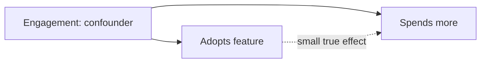
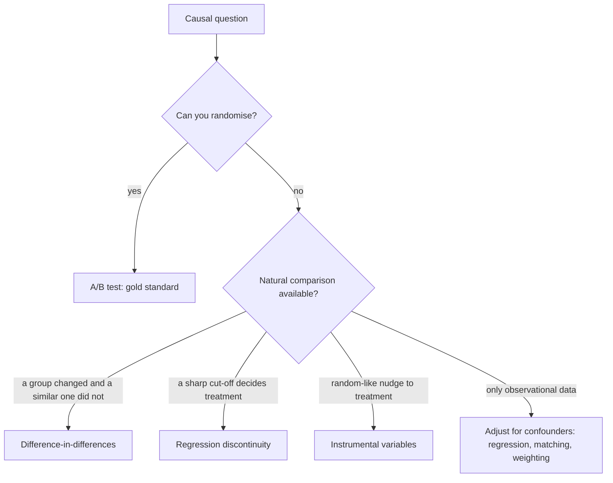

# Correlation, causation and Simpson's paradox

> **Before this lesson:** [Correlation and exploring two or more variables](#/lesson/statistics/correlation-bivariate), [A/B tests, hypotheses and permutation tests](#/lesson/statistics/ab-tests-permutation) (why randomisation works) and [Factor variables and interpreting regression](#/lesson/statistics/factors-interpretation) (confounding and omitted variable bias).

## In plain words

Two things moving together does not mean one causes the other. **Causation** means that changing one thing would change the other; **correlation** only means they tend to occur together in the data you happened to collect. The gap between them is filled by confounders, reverse causation, selection effects and chance. A striking symptom is **Simpson's paradox**: a trend that holds inside every group can reverse when the groups are combined.

An everyday picture: towns with more fire engines at a fire have more damage. Fire engines do not cause damage; big fires cause both more engines and more damage. Send fewer engines and the damage would get worse, the opposite of what the correlation naively suggests.

Why it matters for a job: product teams constantly ask causal questions ("did the new feature increase retention?", "do users who join groups spend more because of the groups?") using observational data that cannot answer them directly. Interviewers love this topic because it reveals judgement: "Users who use feature X retain 30% better; should we push X to everyone?" A strong answer explains why the comparison is confounded and how to get a causal estimate.

## 1. Four reasons for correlation without causation

When $X$ and $Y$ are correlated, possible explanations include:

1. **$X$ causes $Y$.** The interesting one.
2. **Reverse causation: $Y$ causes $X$.** Engaged users open notifications, rather than notifications creating engagement. Healthy people exercise more, partly because they are healthy.
3. **Confounding: a third variable $Z$ causes both.** User engagement drives both adoption of a feature and spending.
4. **Selection (collider) bias**: the data were filtered on something that depends on both variables, creating a correlation that does not exist in the population.
5. **Chance**, especially after searching many variables (data snooping).



## 2. Confounding in action

We simulate an app where engaged users are more likely to adopt a new feature *and* spend more for that reason alone. The feature itself adds a modest 2 dollars of spend.

```python-run
import numpy as np
import pandas as pd
import statsmodels.formula.api as smf
rng = np.random.default_rng(45)
n = 20_000
engagement = rng.normal(0, 1, n)
adopted = rng.random(n) < 1 / (1 + np.exp(-(engagement * 1.5 - 0.5)))
spend = 50 + 20 * engagement + 2 * adopted + rng.normal(0, 10, n)
df = pd.DataFrame({"spend": spend, "adopted": adopted.astype(int), "engagement": engagement})
naive = df.groupby("adopted")["spend"].mean()
print(f"naive: adopters spend {naive[1] - naive[0]:.2f} more")
adj = smf.ols("spend ~ adopted + engagement", data=df).fit()
print(f"adjusted for engagement: {adj.params['adopted']:.2f} (95% CI {adj.conf_int().loc['adopted', 0]:.2f} to {adj.conf_int().loc['adopted', 1]:.2f})")
rng2 = np.random.default_rng(1)
e2 = rng2.normal(0, 1, n)
assigned = rng2.random(n) < 0.5
spend_rct = 50 + 20 * e2 + 2 * assigned + rng2.normal(0, 10, n)
diff = spend_rct[assigned].mean() - spend_rct[~assigned].mean()
se = np.sqrt(spend_rct[assigned].var() / assigned.sum() + spend_rct[~assigned].var() / (~assigned).sum())
print(f"randomised experiment: {diff:.2f} (95% CI {diff - 1.96 * se:.2f} to {diff + 1.96 * se:.2f})")
```

**Reading this code line by line**

- `engagement` is a hidden trait. The adoption probability rises with engagement through the logistic function $1/(1 + e^{-z})$, which turns any number into a probability (it is the heart of logistic regression, covered in [Logistic regression](#/lesson/statistics/logistic-regression)).
- Spend depends strongly on engagement (20 per unit) and weakly on adoption (2).
- The naive comparison is the difference in average spend between adopters and non-adopters.
- The adjusted estimate is the `adopted` coefficient in a regression that also includes engagement.
- Finally we simulate a randomised experiment on a fresh population: adoption is assigned by a coin flip, so it is unrelated to engagement.

The naive comparison says adopters spend 23.44 dollars more, more than ten times the true effect. Adjusting for engagement gives 1.87 (CI 1.54 to 2.21), close to the truth. The randomised experiment gives 2.05 (CI 1.43 to 2.67) without needing to know or measure engagement at all.

That last point is the crucial one. Regression adjustment works only if you measured all the confounders, and you rarely know that you have. Randomisation balances confounders you did not even think of. That is why experiments are the gold standard for causal questions.

## 3. Simpson's paradox

**Simpson's paradox** occurs when an association within every subgroup reverses (or vanishes) when the subgroups are combined. It happens when a confounder affects both which group a record falls in and the outcome.

A support team compares two channels, chat and phone, on the share of tickets resolved.

```python-run
import pandas as pd
rows = [("chat", "easy", 810, 900), ("chat", "hard", 120, 200),
        ("phone", "easy", 190, 200), ("phone", "hard", 630, 900)]
df = pd.DataFrame(rows, columns=["channel", "difficulty", "resolved", "tickets"])
by_group = df.assign(rate=df.resolved / df.tickets).pivot(index="difficulty", columns="channel", values="rate")
print(by_group.round(3))
total = df.groupby("channel")[["resolved", "tickets"]].sum()
print((total.resolved / total.tickets).round(3).rename("overall rate"))
```

**Reading this code line by line**

- Each row gives a channel, a ticket difficulty, the number resolved and the number of tickets.
- `df.assign(rate=...)` adds a column of resolution rates; `.pivot(index, columns, values)` reshapes the table so difficulty is in rows and channel in columns.
- The second part adds up resolved and total tickets per channel, ignoring difficulty, and computes overall rates. `.rename` gives the resulting Series a readable name.

Within easy tickets, phone resolves 95% versus chat's 90%. Within hard tickets, phone resolves 70% versus chat's 60%. Phone is better in *both* groups. Yet overall, chat resolves 84.5% and phone only 74.5%. The reason: chat handles mostly easy tickets (900 easy, 200 hard), while phone handles mostly hard ones (200 easy, 900 hard). Difficulty is a confounder: it affects which channel a ticket goes to and how likely it is to be resolved. The overall comparison mixes a channel effect with a case-mix effect.

Which answer is right? For "which channel resolves a given ticket better?", the stratified comparison (phone, in both groups). The aggregate is the right answer only to "what share of chat's actual tickets got resolved?", a descriptive question.

> [!WARNING]
> Simpson's paradox appears in A/B tests when the traffic split changes over time (1% treatment on day 1, 50% on day 5) and the outcome also changes over time. Pooling all days weights the treatment arm towards later days, and the aggregate can even reverse the daily results. Analyse ramp phases separately or use weights.

## 4. Selection bias and colliders

A **collider** is a variable caused by two others. Filtering or conditioning on a collider creates a spurious correlation between its causes. A classic hiring example:

```python-run
import numpy as np
rng = np.random.default_rng(46)
n = 50_000
test = rng.normal(0, 1, n)
interview = rng.normal(0, 1, n)
hired = test + interview > 1.5
print(f"all candidates: corr(test, interview) = {np.corrcoef(test, interview)[0, 1]:+.3f}")
print(f"hired only    : corr(test, interview) = {np.corrcoef(test[hired], interview[hired])[0, 1]:+.3f}  (n = {hired.sum()})")
```

**Reading this code line by line**

- Test score and interview score are independent among all candidates.
- A candidate is hired when the sum of the two scores is high enough; hiring is the collider.
- We compute the correlation among all candidates and among the hired only.

Among all candidates the correlation is $-0.002$ (none). Among hired employees it is $-0.687$: strongly negative. Someone hired with a weak test score must have interviewed brilliantly, and vice versa. An analyst looking only at employees might conclude "people who test well interview badly". The same trap appears with app reviews (only very happy or very angry users write them), with "users who reached checkout" funnels, and with any dataset filtered on an outcome.

## 5. Getting causal answers



- **Randomised experiments** remove confounding by design.
- **Difference-in-differences** (DiD): compare the change over time in a treated group with the change in a similar untreated group. The control's change estimates what would have happened anyway (trend, seasonality); the extra change in the treated group estimates the effect. It assumes the two groups would have followed **parallel trends** without treatment.

```python-run
import pandas as pd
data = pd.DataFrame({
    "city": ["SG", "SG", "KL", "KL"],
    "period": ["before", "after", "before", "after"],
    "orders_per_user": [3.10, 3.65, 2.80, 3.05],
})
t = data.pivot(index="city", columns="period", values="orders_per_user")
change = t["after"] - t["before"]
print(t[["before", "after"]])
print(f"change in SG (treated) {change['SG']:.2f}, in KL (control) {change['KL']:.2f}")
print(f"difference-in-differences estimate: {change['SG'] - change['KL']:.2f} orders per user")
```

**Reading this code line by line**

- A delivery app launched a loyalty programme in Singapore (SG) but not Kuala Lumpur (KL). We have average monthly orders per user before and after.
- `pivot` arranges the table with cities as rows and periods as columns; `t[["before", "after"]]` orders the columns.
- The DiD estimate subtracts the control city's change from the treated city's change.

Orders rose by 0.55 in Singapore, but also by 0.25 in Kuala Lumpur without the programme (seasonal growth, perhaps). The DiD estimate of the programme's effect is 0.30 orders per user, not 0.55. A naive before-after comparison would have credited the programme with the whole seasonal rise.

- **Regression discontinuity**: when treatment is assigned by a threshold (a discount for orders above \$50), compare units narrowly above and narrowly below the threshold.
- **Instrumental variables**: use a source of variation that affects the treatment but not the outcome directly (for example, random variation in wait times).
- **Adjustment** (regression, matching, propensity-score weighting): compares like with like on measured confounders; only as good as the confounders you measured.

## 6. Questions to ask about any causal claim

- Was the treatment randomised? If not, why did some units get it?
- What could cause both the treatment and the outcome?
- Could the outcome cause the treatment?
- Was the data filtered on something affected by the outcome?
- Does the effect hold within important segments, or only in aggregate?
- How many comparisons were made before this one was reported?

> [!INTERVIEW]
> "Users who join a community group retain 30% better. Should we push everyone into groups?" Answer: the comparison is confounded by engagement (engaged users join groups and also retain), may include reverse causation (users who plan to stay bother to join), and may suffer survivorship bias (group membership requires being active). To estimate the causal effect, run an experiment that randomly promotes group-joining to some users (an "encouragement design") and compare retention between the encouraged and non-encouraged arms; if that is impossible, use difference-in-differences around a launch or match on pre-period engagement.

## Summary

- Correlation can come from causation, reverse causation, confounding, selection on a collider, or chance.
- Confounders make naive comparisons misleading; regression adjustment helps only for measured confounders; randomisation handles all of them.
- Simpson's paradox: a relationship within every group can reverse in the aggregate when group sizes differ by a confounder.
- Conditioning on a collider (filtering hired candidates, reviewers, survivors) creates spurious correlations.
- Without experiments, use designs such as difference-in-differences, regression discontinuity and instrumental variables, and state their assumptions.

## Glossary

- **Causation**: changing one variable would change another.
- **Reverse causation**: the outcome causes the supposed cause.
- **Confounder**: a variable that causes both the treatment and the outcome.
- **Logistic function**: $1/(1 + e^{-z})$, mapping any number to a probability.
- **Regression adjustment**: including confounders as predictors to estimate a treatment effect.
- **Simpson's paradox**: an association that reverses when groups are combined.
- **Case mix**: the composition of records across subgroups.
- **Collider / collider bias**: a variable caused by two others / spurious correlation from conditioning on it.
- **Difference-in-differences (DiD)**: treated group's change minus control group's change.
- **Parallel trends**: DiD's assumption that groups would have changed alike without treatment.
- **Regression discontinuity**: comparing units immediately either side of a treatment threshold.
- **Instrumental variable**: a source of variation that shifts treatment but affects the outcome only through it.
- **Propensity score**: the probability of receiving treatment given covariates, used for matching or weighting.

## Check yourself

```quiz
[
  {"q": "Users who adopt a feature spend 23 dollars more. The best first concern is…", "options": ["confounding: more engaged users both adopt and spend more", "the feature definitely causes the extra spend", "sample size is too large", "the metric is normally distributed"], "answer": 0,
   "explain": "Without randomisation, adopters differ from non-adopters in many ways."},
  {"q": "Phone resolves more tickets than chat for easy and for hard tickets, yet chat has the higher overall rate. This is…", "options": ["Simpson's paradox, caused by different case mixes", "a calculation error", "regression to the mean", "a sample ratio mismatch"], "answer": 0,
   "explain": "Chat handles mostly easy tickets; difficulty confounds the aggregate comparison."},
  {"q": "Among hired employees, test and interview scores are negatively correlated, though they are independent among applicants. The cause is…", "options": ["conditioning on a collider (being hired)", "reverse causation", "multicollinearity", "a confounder causing both scores"], "answer": 0,
   "explain": "Selection on a variable that both scores influence induces a spurious correlation."},
  {"q": "A city launches a programme; orders rise 0.55 there and 0.25 in a similar city without it. The difference-in-differences estimate is…", "options": ["0.30", "0.55", "0.80", "0.25"], "answer": 0,
   "explain": "0.55 − 0.25; the control city's change estimates what would have happened anyway."},
  {"q": "Why do randomised experiments beat regression adjustment for causal questions?", "options": ["Randomisation balances unmeasured confounders too; adjustment handles only measured ones", "Regression cannot include more than one variable", "Experiments need less data", "Adjustment is always biased upward"], "answer": 0,
   "explain": "You can only adjust for confounders you measured and modelled correctly."},
  {"q": "Which key assumption does difference-in-differences rely on?", "options": ["Parallel trends: without treatment, both groups would have changed by the same amount", "Normally distributed outcomes", "Equal group sizes", "No seasonality at all"], "answer": 0,
   "explain": "The control group's change must be a valid stand-in for the treated group's counterfactual change."}
]
```

> **Source:** Background for Bruce & Bruce, *Practical Statistics for Data Scientists* (O'Reilly, 2017), ch. 1 ("Correlation"), ch. 3 ("A/B Testing": why randomise) and ch. 4 ("Confounding Variables"); Simpson's paradox, collider bias and difference-in-differences are standard topics beyond the book's coverage. All examples are original.
