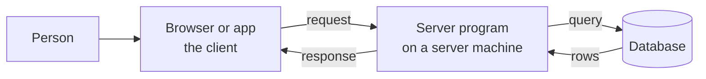
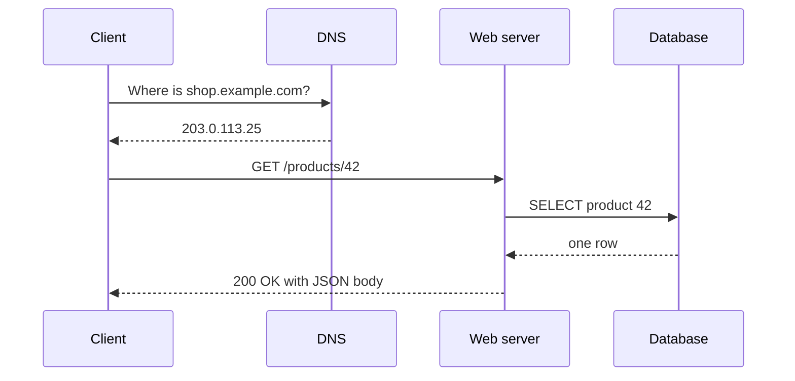
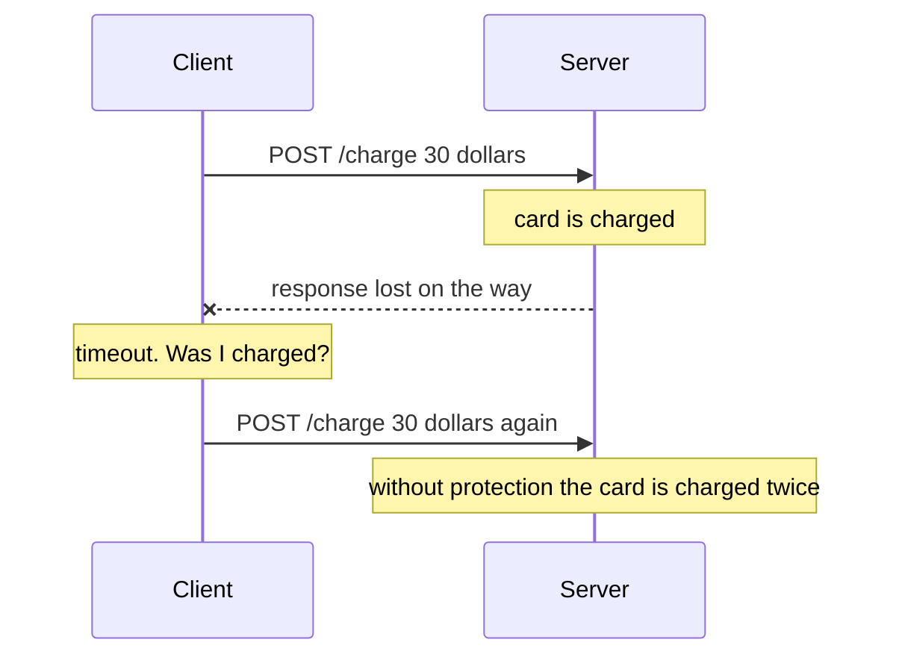
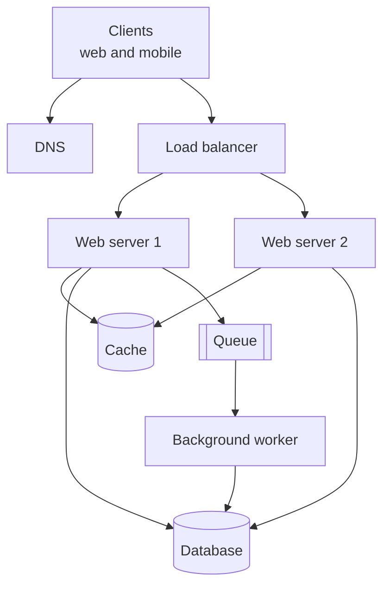

# Clients, servers and requests: what a "system" is

## Before this lesson

You need no background in distributed systems. It helps if you can read a few lines of Python (variables, functions, dictionaries); the [Python track](#/track/python) covers that. If words such as "IP address" or "HTTP" are new, this lesson defines them from zero, and the [Networking track](#/lesson/networking/url-walkthrough) goes deeper when you want more.

## In plain words

A **system**, in the sense used in a system design interview, is a group of computer programs that work together to give users one service: a chat app, a video site, a shop.

Think of a busy restaurant. A guest sits down and asks for a meal. A waiter carries the order to the kitchen. The kitchen cooks, perhaps fetching ingredients from the pantry, and the waiter brings the plate back. The guest never walks into the kitchen and never needs to know how many cooks work there.

- The guest is the **client**: the program that asks for something (your phone app, your web browser).
- The order slip is the **request**: a small message that says what is wanted.
- The kitchen is the **server**: the program that does the work.
- The pantry is the **database**: the place where things are kept for a long time.
- The plate that comes back is the **response**.

System design is the craft of arranging kitchens, pantries, waiters and delivery routes so that the restaurant still works when one guest becomes ten million guests, and still works when a cook is ill.

Why does this matter for a job? Mid-level and senior engineering interviews almost always contain a round where you are asked to "design X" on a whiteboard. On the job, the same skill decides whether the feature you build survives its first busy day.

## 1. A server is a program first, and a machine second

The word **server** is used for two different things, and beginners are often confused by this.

1. A **server program** (also called a *service* or a *process*) is a running program that waits for requests and answers them. A web server such as Nginx is a program. The code you write with Django or FastAPI becomes a server program when you start it.
2. A **server machine** (also called a *host*, a *node*, an *instance* or a *box*) is a computer that runs server programs. It is an ordinary computer without a screen: it has a **CPU** (the chip that executes instructions), **RAM** (fast, temporary working memory that is erased when the power goes off), a **disk** (slow, permanent storage) and a **network card** (the part that sends and receives data over cables).

When an interviewer says "add another server", they mean another machine running another copy of your server program. When they say "the server crashes", they could mean either the program stopped or the whole machine died. Ask if it matters.

A **client** is any program that starts the conversation. Your browser is a client. A mobile app is a client. Importantly, a server can also be a client: when your web server asks the database for a row, the web server is the client of the database. "Client" and "server" are roles in one conversation, not permanent labels.



## 2. How a client finds a server: addresses, ports and names

To send a letter you need an address. Computers on the internet have an **IP address** (Internet Protocol address), a number such as `203.0.113.25` that identifies one network connection.

One machine can run many server programs at once, so an address alone is not enough. Each program listens on a **port**, a number from 0 to 65,535 that works like a flat number inside an apartment building. Web servers conventionally listen on port 443 for encrypted traffic and port 80 for unencrypted traffic.

People do not remember numbers, so we use names such as `shop.example.com`. The **Domain Name System (DNS)** is the internet's phone book: a client asks DNS "what is the IP address for this name?" and gets a number back. That lookup happens before the first request and the answer is remembered for a while (that remembering is a first example of *caching*, which we meet properly in the next lesson).

So the journey of one page load starts like this:

1. The browser asks DNS for the IP address of `shop.example.com`.
2. The browser opens a **connection** to that IP address on port 443. A connection is an agreed, two-way channel between two programs. It is made with **TCP** (Transmission Control Protocol), the set of rules that makes sure bytes arrive complete and in order.
3. The browser and server set up encryption using **TLS** (Transport Layer Security), so nobody in between can read the traffic.
4. The browser sends a request, and the server sends a response.

Each of those steps is a round trip across the network, and each round trip takes time. You will see later that a large part of system design is avoiding round trips.

## 3. The request and the response

Most web systems speak **HTTP** (HyperText Transfer Protocol). A **protocol** is an agreed format for messages, in the way that a postal address has an agreed format. An HTTP request has four parts:

| Part | Example | Meaning |
|---|---|---|
| Method | `GET` | What kind of action. `GET` reads, `POST` creates, `PUT` replaces, `PATCH` changes part, `DELETE` removes. |
| Path | `/products/42` | Which thing. |
| Headers | `Authorization: Bearer abc` | Extra labelled facts: who is asking, what format they accept. |
| Body | `{"quantity": 2}` | The data being sent, if any. Usually **JSON** (JavaScript Object Notation), a text format of keys and values. |

The response has a **status code** (a three-digit number), headers and a body. You need only five families of status code for interviews:

| Code | Family | Everyday meaning |
|---|---|---|
| 200, 201 | 2xx success | "Here you go." |
| 301, 302 | 3xx redirect | "It moved; look over there." |
| 400, 401, 403, 404 | 4xx client error | "Your request is wrong, or you are not allowed, or it does not exist." |
| 429 | 4xx client error | "You are asking too often." |
| 500, 503 | 5xx server error | "I broke" or "I am too busy right now." |

The set of requests that a server accepts is its **API** (Application Programming Interface). An API is the menu of the restaurant: it lists what can be ordered and what you get back. In every design in this track you will write the API early, because it forces you to say exactly what the system does.



## 4. A whole "system" in forty lines

Before drawing big architectures, it helps to see that the idea is small. The runnable code below fakes a server, a database and a client inside one Python program. Nothing is sent over a real network; each "machine" is a function. Press Run, then read the notes underneath.

```python-run
# A pretend database: a dictionary that maps a product id to its data.
DATABASE = {
    42: {"name": "Tea kettle", "price": 30},
    43: {"name": "Mug", "price": 8},
}

def database_get(product_id):
    """The database's job: find one stored thing by its key."""
    return DATABASE.get(product_id)          # returns None when the key is missing

def server_handle(request):
    """The server's job: read a request, do the work, build a response."""
    method, path = request["method"], request["path"]
    if method != "GET":
        return {"status": 405, "body": "method not allowed"}
    parts = path.strip("/").split("/")       # "/products/42" -> ["products", "42"]
    if len(parts) != 2 or parts[0] != "products" or not parts[1].isdigit():
        return {"status": 400, "body": "bad request"}
    row = database_get(int(parts[1]))
    if row is None:
        return {"status": 404, "body": "not found"}
    return {"status": 200, "body": row}

def client(path, method="GET"):
    """The client's job: send a request and show what came back."""
    response = server_handle({"method": method, "path": path})
    print(f"{method:6s} {path:15s} -> {response['status']} {response['body']}")

client("/products/42")
client("/products/99")
client("/baskets/1")
client("/products/42", method="DELETE")
```

What each piece does:

- `DATABASE` is a dictionary. A real database also keeps data on disk so it survives a restart, but the idea of "look something up by its key" is the same.
- `server_handle` receives a request (a dictionary with a method and a path), checks that it makes sense, asks the database, and returns a response with a status code.
- `client` calls the server. In real life this call would cross a network and could take a long time, or never return at all.

The output shows a `200` for a product that exists, a `404` for one that does not, a `400` for a path the server does not understand and a `405` for a method it does not allow. Every real system is this picture with more boxes, and with the function calls replaced by network messages.

## 5. What changes when the calls cross a network

Inside one program, calling a function either works or raises an error, and you find out immediately. Between two machines, three new things can happen.

1. **Delay.** The message takes time to travel. The time between sending a request and receiving the response is called **latency**. A call inside one machine takes well under a microsecond. A call to another machine in the same building takes around half a millisecond. A call across an ocean takes around 150 milliseconds, which is 300 times more.
2. **Loss.** The message may never arrive, or the response may never come back. The client cannot tell which of the two happened. Did the server charge the customer's card and then lose the reply, or did it never see the request?
3. **Partial failure.** One machine can be broken while the others are fine. In a single program everything fails together; in a distributed system some parts fail while others carry on.

A **distributed system** is any system whose parts run on more than one machine and talk over a network. The three facts above are the reason it is harder to build than a single program, and they are the root of nearly every question an interviewer will ask you: "what happens if this box dies?", "what if this call is slow?", "what if the message is delivered twice?".

Because a lost reply looks the same as a lost request, clients usually **retry**: they send the request again. That is safe for reading a product. It is dangerous for "charge 30 dollars" unless the server can recognise the second attempt as a repeat. An operation that has the same effect whether it is performed once or many times is called **idempotent**. Remember the word; it comes back in the payments lesson and in many others.



> [!WARNING]
> A **timeout** (giving up after waiting a fixed time) does not tell you the request failed. It tells you only that you did not hear back. Treat "unknown" as its own outcome when you reason about failures.

## 6. Stateless and stateful: who remembers what

**State** is anything a program must remember between one request and the next: who is logged in, what is in a shopping basket, how many likes a post has.

- A **stateful** server keeps that memory inside itself, in its RAM or on its own disk. If it dies, the memory dies with it, and a different server cannot continue the conversation.
- A **stateless** server keeps nothing between requests. Everything it needs arrives with the request (for example a login token in a header) or is fetched from a shared store such as a database.

An analogy: a stateful server is a hairdresser who remembers how you like your hair, so you must always go to the same person. A stateless server is a pharmacy counter that reads your prescription from a central computer; any pharmacist can serve you.

Stateless servers are much easier to multiply, replace and restart, so a standard move in system design is "push the state out of the web servers and into a database or cache". You will meet that move again in the module on scaling.

```python-run
# Two copies of the same server. The STATEFUL version keeps baskets in its own memory.
class StatefulServer:
    def __init__(self, name):
        self.name, self.baskets = name, {}
    def add(self, user, item):
        self.baskets.setdefault(user, []).append(item)
        return f"{self.name}: basket of {user} = {self.baskets[user]}"

a, b = StatefulServer("server-A"), StatefulServer("server-B")
print(a.add("mina", "kettle"))
print(b.add("mina", "mug"), "  <- server-B never saw the kettle")

# The STATELESS version keeps baskets in one shared store that both servers use.
SHARED_STORE = {}
class StatelessServer:
    def __init__(self, name):
        self.name = name
    def add(self, user, item):
        SHARED_STORE.setdefault(user, []).append(item)
        return f"{self.name}: basket of {user} = {SHARED_STORE[user]}"

c, d = StatelessServer("server-C"), StatelessServer("server-D")
print(c.add("mina", "kettle"))
print(d.add("mina", "mug"), "  <- any server gives the right answer")
```

The first two lines of output show the problem: the second request landed on a different machine and the basket lost an item. The last two lines show the fix: both servers read and write one shared store, so it no longer matters which of them answers.

## 7. Functional and non-functional requirements

When someone asks you to design a system, the first thing to pin down is what it must do and how well.

- **Functional requirements** are the features: "a user can post a message", "a user can see their feed". They become your API.
- **Non-functional requirements** are the qualities: how fast, how many users, how often it may be down, how fresh the data must be, how much it may cost. They decide your architecture.

Two systems with identical features can need completely different designs. A notes app for one office and a notes app for a hundred million people share an API and share almost nothing else.

The non-functional words you will hear most, each defined properly in the third lesson of this module:

| Word | One-sentence meaning |
|---|---|
| Scalability | The system can handle more load by adding resources. |
| Latency | How long one request takes. |
| Throughput | How many requests are handled per second. |
| Availability | The fraction of time the system answers correctly. |
| Durability | Stored data is not lost, even when machines die. |
| Consistency | Everyone who reads sees the same, up-to-date data. |

> [!INTERVIEW]
> The opening minutes of a design interview are a test of exactly this section. Strong candidates ask "which features are in scope?" and "how many users, how fast, how reliable?" before they draw a single box. Candidates who start drawing immediately are marked down even when the drawing is good, because they designed for requirements they invented.

## 8. Reading an architecture diagram

System design is communicated with boxes and arrows. There is no official notation, but these conventions are widely understood and are the ones this track uses:

- A rectangle is a server program or a group of identical copies of one.
- A cylinder is something that stores data permanently.
- An arrow points from the one who starts the conversation to the one who answers. A label on the arrow says what is sent.
- A stack of rectangles, or a note such as "x N", means many identical copies.



You have met the client, DNS, web servers and the database. The other three boxes (load balancer, cache, queue) are the subject of the next lesson. For now, read the picture as a sentence: "clients find the service through DNS, their requests are spread across two web servers, the web servers read and write a database, keep popular answers in a cache, and hand slow work to a background worker through a queue."

If you can say a diagram aloud as one sentence, you understand it. If you cannot, the diagram has too many boxes for the stage of the conversation you are in.

> [!TIP]
> Draw the request path first, left to right, and narrate it: "the client calls X, X asks Y". Add storage second. Add everything else only when a requirement forces it. A diagram that grows in response to stated problems is far more convincing than one that appears fully formed.

## Common mistakes

- **Treating a network call like a function call.** A function call cannot be lost; a network call can be lost, delayed or delivered twice. Every arrow in your diagram is a place where that can happen.
- **Mixing up the two meanings of "server".** Be clear whether you mean a program or a machine, especially when you talk about failure.
- **Storing state in the web server.** It works with one machine and breaks the moment a second one is added, as the basket example showed.
- **Skipping requirements.** Designing before you know the scale and the features produces a design for a problem nobody asked about.
- **Assuming a timeout means failure.** The work may have been done. Retrying is only safe for idempotent operations.

## Summary

- A client asks, a server answers; both are roles played by programs. A server machine is a computer that runs server programs.
- Clients find servers through DNS (name to IP address), connect on a port, and exchange requests and responses, usually over HTTP.
- An API is the list of requests a service accepts. Writing it down is an early step in every design.
- A distributed system has parts on several machines. Network calls add delay, can be lost, and allow partial failure.
- Stateless servers remember nothing between requests, which makes them easy to copy and replace; state lives in shared stores.
- Functional requirements say what the system does; non-functional requirements (scale, speed, availability, consistency) decide how it must be built.

## Glossary

- **Client**: the program that starts a conversation by sending a request.
- **Server**: a program that waits for requests and answers them; also the machine it runs on.
- **Request / response**: the message asking for something, and the message that answers it.
- **IP address**: a number that identifies a network connection on the internet.
- **Port**: a number that identifies one program on a machine.
- **DNS**: the service that turns a name into an IP address.
- **HTTP**: the message format used by the web.
- **API**: the set of requests a service accepts and the responses it gives.
- **Latency**: the time one request takes.
- **Distributed system**: a system whose parts run on several machines connected by a network.
- **Partial failure**: some parts broken while others still work.
- **Timeout**: giving up waiting after a fixed time.
- **Idempotent**: having the same effect whether done once or several times.
- **State**: what a program must remember between requests.
- **Stateless / stateful**: keeping no memory between requests, or keeping some.
- **Functional / non-functional requirement**: a feature, or a quality such as speed or reliability.

## Check yourself

```quiz
[
  {"q": "Your web server sends a query to the database. In that conversation, which role does the web server play?",
   "options": ["Server, because it is a server program", "Client, because it started the conversation", "Neither; only browsers are clients", "Both at the same moment"],
   "answer": 1,
   "explain": "Client and server are roles in one conversation. The web server is a server towards the browser and a client towards the database."},
  {"q": "A client sends a payment request and gets a timeout. What does the client know for certain?",
   "options": ["The payment failed", "The payment succeeded", "Only that no response arrived in time", "The server machine has crashed"],
   "answer": 2,
   "explain": "A lost request and a lost response look identical from the client. The outcome is unknown, which is why retries need idempotent operations."},
  {"q": "Why does one machine need ports as well as an IP address?",
   "options": ["Ports encrypt the traffic", "Ports make the connection faster", "Several programs on the same machine each need their own mailbox", "Ports replace DNS"],
   "answer": 2,
   "explain": "The IP address finds the machine; the port finds the program on it, like a flat number inside a building."},
  {"q": "A shopping basket is kept in the memory of each web server. A second web server is added and users start losing items. What is the standard fix?",
   "options": ["Give each server more RAM", "Move the basket into a shared store so the web servers are stateless", "Use a faster network", "Return status 404 for baskets"],
   "answer": 1,
   "explain": "State inside one server is invisible to the others. Moving it to a shared database or cache lets any server answer any request."},
  {"q": "Which of these is a non-functional requirement?",
   "options": ["Users can upload a photo", "Users can follow each other", "The feed must load in under 200 milliseconds for most requests", "Users can delete their account"],
   "answer": 2,
   "explain": "Features are functional requirements. A speed target describes a quality of the system, so it is non-functional."},
  {"q": "Which status code family tells the client that the server itself had a problem?",
   "options": ["2xx", "3xx", "4xx", "5xx"],
   "answer": 3,
   "explain": "5xx codes such as 500 and 503 mean the server failed or is overloaded. 4xx codes mean the request was at fault."},
  {"q": "Which operation is idempotent as stated?",
   "options": ["Add 10 dollars to the balance", "Set the delivery address to 5 High Street", "Append a line to the log", "Send another reminder email"],
   "answer": 1,
   "explain": "Setting a value to a fixed result leaves the same state however many times it runs. The other three change something more with every repeat."}
]
```

> **Source:** Xu, *System Design Interview: An Insider's Guide*, ch. 1 (single-server setup) as a topic guide; System Design Primer, "System design topics: start here", https://github.com/donnemartin/system-design-primer
