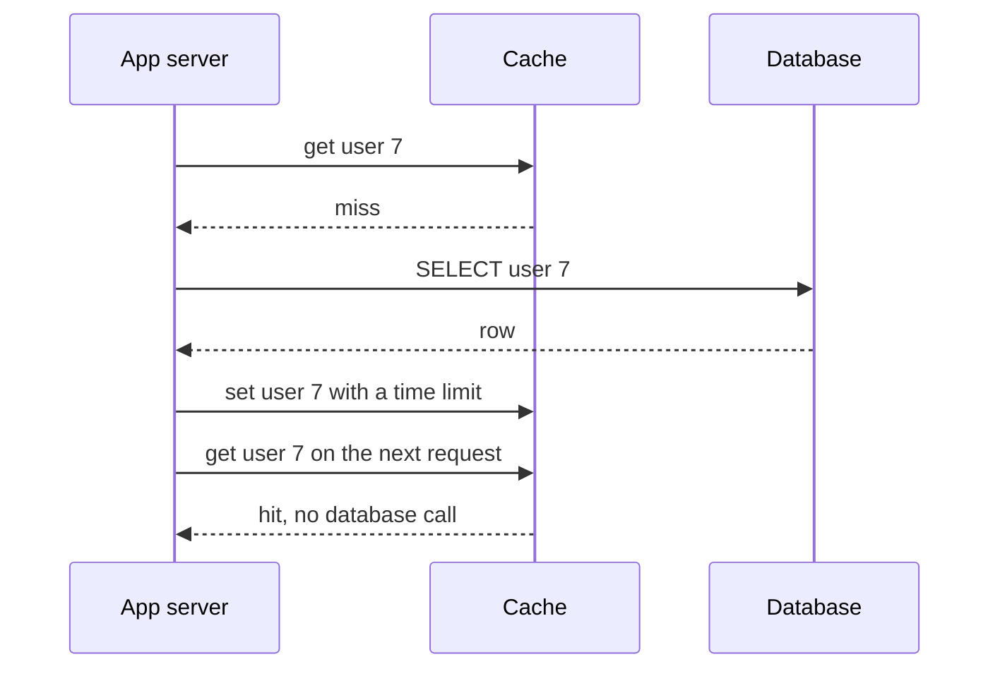
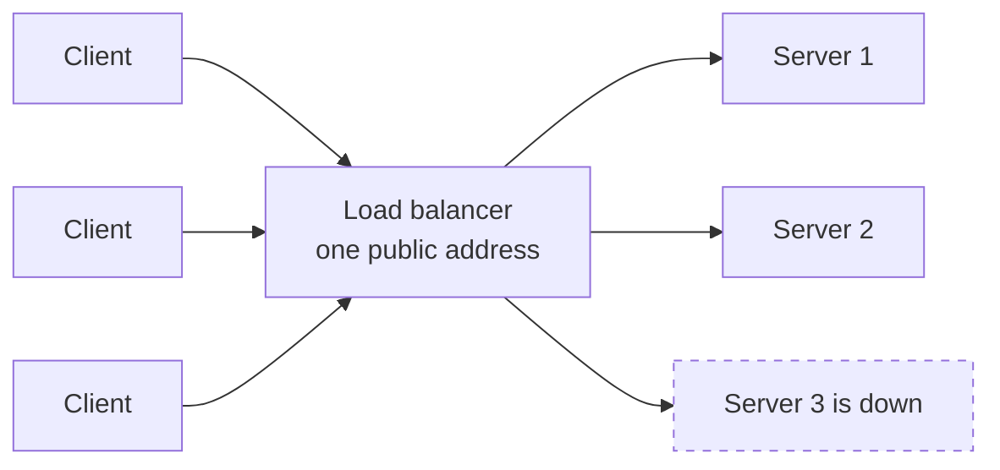
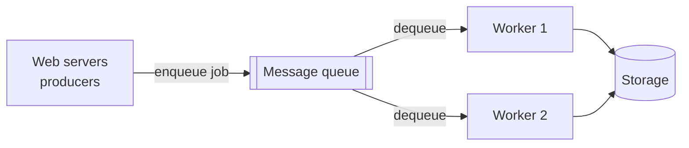
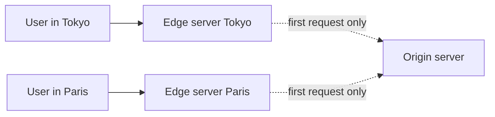
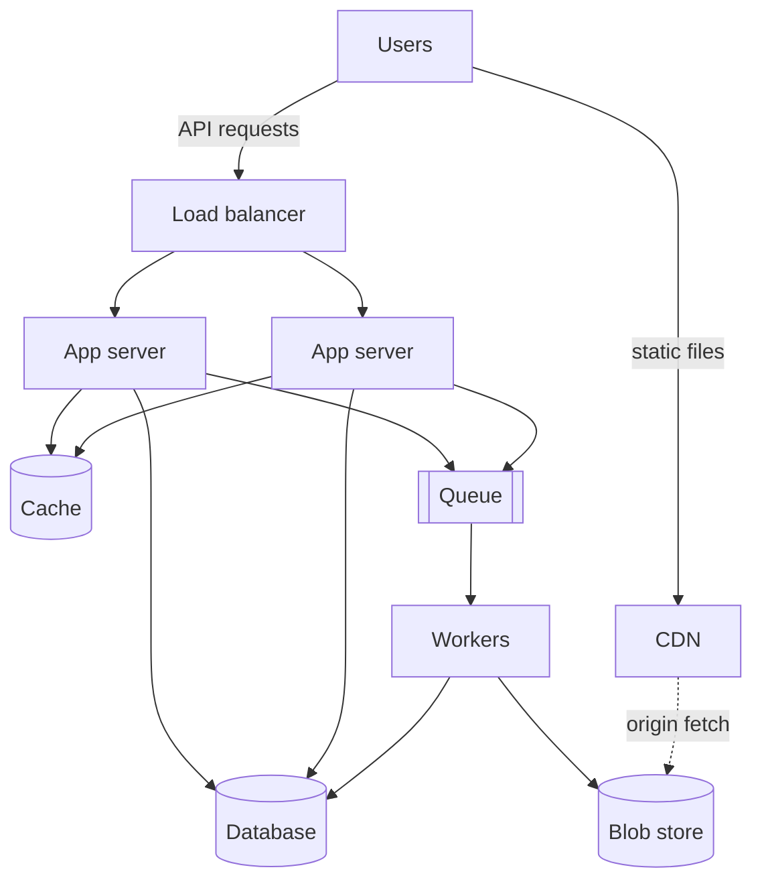

# The five building blocks: database, cache, load balancer, queue and CDN

## Before this lesson

Read [Clients, servers and requests](#/lesson/system-design/clients-servers-requests) first. You should know what a client, a server, a request and "state" are. No other background is needed.

## In plain words

Almost every large system is assembled from the same handful of parts, in the way that almost every house is assembled from walls, doors, pipes and wires. If you know what each part is for, most architecture diagrams stop looking mysterious.

Keep the restaurant from the last lesson in mind:

| Part | In the restaurant | What it does in a system |
|---|---|---|
| **Database** | The pantry and the order book | Keeps data safely for a long time |
| **Cache** | The shelf of ready-made sauces next to the stove | Keeps a small amount of popular data very close, so it is fast to get |
| **Load balancer** | The host at the door who sends each guest to a free table | Spreads requests across many servers |
| **Queue** | The rail of order slips above the kitchen pass | Holds work until someone is free to do it |
| **CDN** | Branch kitchens in other towns | Serves copies of files from a place near the user |

For a job, the value is practical: when a site is slow or falls over, the fix is nearly always one of "add a cache", "add a replica", "put it behind a load balancer" or "move it to a queue". Knowing when each applies, and what it costs, is most of what a design interview tests.

## 1. The database: where data lives

A **database** is a program whose job is to store data on disk and find it again quickly. Disk storage is **durable**, meaning the data survives a power cut or a restart, unlike RAM.

Why not write to files yourself? Because a database gives you four things that are hard to build:

1. **Fast lookup.** It maintains an **index**, an extra structure that works like the index at the back of a book: instead of reading every page to find "giraffe", you look the word up and jump to the page.
2. **Safe concurrent access.** Thousands of requests can read and write at once without corrupting each other.
3. **Transactions.** A **transaction** is a group of changes that either all happen or none happen. Moving money needs "take from A" and "add to B" to succeed or fail together.
4. **Recovery.** After a crash it restores itself to a correct state.

There are two broad families.

**Relational databases** (also called **SQL** databases, after Structured Query Language, the language used to ask them questions) store data in tables of rows and columns, like spreadsheets that can refer to each other. Examples: PostgreSQL, MySQL. They are strong at transactions and at **joins**, which combine rows from several tables in one question ("all orders together with the customer's name").

**Non-relational databases** (often called **NoSQL**) give up some of that in exchange for a simpler shape that spreads across many machines more easily. The main kinds:

| Kind | Shape of the data | Example products | Typical use |
|---|---|---|---|
| Key-value | A giant dictionary: key to value | Redis, DynamoDB | Sessions, baskets, counters |
| Document | Key to a JSON-like document | MongoDB | Product catalogues, profiles |
| Wide-column | Rows with huge, flexible sets of columns, sorted by key | Cassandra, HBase | Chat history, time series |
| Graph | Nodes and edges | Neo4j | Friend-of-friend questions |

A reasonable default in an interview is: start with a relational database, because it is flexible and well understood, and move a specific piece of data to another kind only when you can say what forces the move (huge volume, a very simple access pattern, a need for very low latency). The [Databases track](#/lesson/databases/relational-vs-document) covers the models in depth.

Large binary files such as photos and videos do not belong in a database row. They go in a **blob store** (also called *object storage*), a service that keeps files of any size under a key, for example Amazon S3. The database then stores only the key and facts about the file (owner, size, upload time), which are called **metadata**, meaning data about data.

## 2. The cache: a small, fast copy

Reading from a database usually means reading from disk and often crossing the network, which costs milliseconds. Many reads ask for the same popular things over and over. A **cache** keeps recent or popular answers in RAM so the next identical question is answered in a fraction of a millisecond.

The everyday version: you keep salt on the table instead of walking to the cellar each time. The table is small, so only the most-used things earn a place there.

The most common way to use a cache is called **cache-aside** (or *lazy loading*):

1. Look in the cache.
2. If the answer is there (a **cache hit**), return it.
3. If not (a **cache miss**), read the database, put the answer in the cache, then return it.



Three words describe every cache:

- **Hit rate**: the fraction of lookups answered by the cache. A cache with a 95% hit rate removes 95% of the database reads.
- **TTL (time to live)**: how long an entry may stay before it is thrown away, so that stale answers do not live for ever.
- **Eviction**: what gets removed when the cache is full. The usual rule is **LRU** (least recently used): throw out whatever has gone longest without being asked for.

The runnable example shows the effect on speed. The "database" sleeps for a short time to imitate a slow disk read.

```python-run
import time

SLOW_DB = {i: f"profile-{i}" for i in range(1000)}
db_reads = 0

def db_get(key):
    global db_reads
    db_reads += 1
    time.sleep(0.002)                 # pretend the database takes 2 milliseconds
    return SLOW_DB[key]

cache = {}

def get_with_cache(key):
    if key in cache:                  # cache hit: answer from memory
        return cache[key]
    value = db_get(key)               # cache miss: do the slow read...
    cache[key] = value                # ...and remember the answer
    return value

# 300 requests, but only 20 different popular profiles.
requests = [i % 20 for i in range(300)]

start = time.perf_counter()
for k in requests:
    db_get(k)
no_cache = time.perf_counter() - start

db_reads = 0
start = time.perf_counter()
for k in requests:
    get_with_cache(k)
with_cache = time.perf_counter() - start

print(f"without cache: {no_cache*1000:6.0f} ms for 300 requests")
print(f"with cache   : {with_cache*1000:6.0f} ms, database reads = {db_reads}")
print(f"hit rate     : {(300 - db_reads) / 300:.0%}")
```

Only the first request for each of the 20 profiles reaches the database; the other 280 are hits. The total time drops by roughly the hit rate.

A cache is a copy, and copies go out of date. If a user changes their name in the database, the cache still holds the old name until the entry expires or is deleted. Keeping the copy correct is called **cache invalidation** and it is the hard part of caching. The lesson [Load balancing and caching in depth](#/lesson/system-design/bb-load-balancing-caching) is devoted to it, and the [Redis track](#/track/redis) shows a real cache server in use.

> [!WARNING]
> A cache holds data in RAM. If the cache server restarts, everything in it is gone. Never make a cache the only place a piece of important data lives.

## 3. The load balancer: one front door, many servers

One server machine can handle only so many requests per second. When that is not enough, you run several identical copies. But clients know only one address. A **load balancer** is a server that sits in front, receives every request and forwards each one to one of the copies.

The host at a restaurant door does the same job: guests arrive at one entrance and the host sends each party to a waiter who is not overloaded.



A load balancer gives you three things:

1. **More capacity.** Three servers handle roughly three times the traffic.
2. **Survival of failures.** The load balancer sends a small test request, a **health check**, to every server every few seconds. A server that stops answering is taken out of rotation, and users do not notice.
3. **Painless changes.** You can add servers, remove them or replace them with a new version without changing the address clients use.

How does it choose a server? The basic policy is **round robin**: first request to server 1, second to server 2, third to server 3, then back to server 1. Another is **least connections**: pick the server currently handling the fewest requests. The in-depth lesson compares them.

```python-run
import itertools

servers = ["web-1", "web-2", "web-3"]
healthy = {"web-1": True, "web-2": True, "web-3": True}
handled = {s: 0 for s in servers}
ring = itertools.cycle(servers)          # endless web-1, web-2, web-3, web-1, ...

def route():
    """Round robin that skips servers whose health check failed."""
    for _ in range(len(servers)):
        s = next(ring)
        if healthy[s]:
            handled[s] += 1
            return s
    raise RuntimeError("no healthy server")

for _ in range(6):
    route()
print("all healthy     :", handled)

healthy["web-2"] = False                 # the health check for web-2 starts failing
for _ in range(6):
    route()
print("web-2 is down   :", handled)
```

In the first six requests each server receives two. After `web-2` is marked unhealthy, the next six are shared between the remaining two servers and no request is lost.

Notice the precondition: this only works if any server can answer any request. That is the stateless idea from the previous lesson. If server 1 held your basket in its memory, being sent to server 3 would lose it.

A load balancer is itself a machine that can fail, so in production there are at least two, with one ready to take over. Any part whose failure brings down the whole system is called a **single point of failure (SPOF)**. Hunting for single points of failure in your own diagram is a habit interviewers look for.

## 4. The queue: do it later, but do not lose it

Some work is slow: sending an email, resizing a photo, producing a monthly report. If the web server does that work while the user waits, the request takes seconds and the server cannot serve anyone else in the meantime.

A **message queue** is a durable waiting line for work. The web server writes a small **message** describing the job ("resize photo 812") into the queue and answers the user at once. Separate programs called **workers** (or *consumers*) take messages off the queue and do the work in the background. The side that adds messages is called the **producer**.

The order rail in a kitchen is a queue. Waiters clip slips to it and return to the dining room immediately. Cooks take slips when they are free. If twenty orders arrive in one minute, the rail gets longer; nothing is dropped, and nobody has to stand and wait at the pass.



A queue buys three properties:

1. **Fast responses.** The user gets "accepted" in milliseconds.
2. **Buffering.** A burst of traffic lengthens the queue instead of knocking the workers over. The workers drain it at their own pace.
3. **Decoupling.** The producer and the consumer do not need to be running at the same time, or be the same size. You can add workers when the queue is long and remove them when it is short, without touching the web servers.

The cost is that the work is now **asynchronous**: it happens at some later time, not during the request. The user's photo is "processing" for a few seconds. Your design has to say how the user learns that the job is done.

The simulation compares doing slow work inside the request with handing it to a queue. Time is counted in simulated milliseconds, so it runs instantly.

```python-run
from collections import deque

JOB_MS = 400            # resizing one photo takes 400 ms
ACCEPT_MS = 5           # writing a message to the queue takes 5 ms
uploads = 10            # ten users upload at the same moment

# Design A: the web server resizes the photo before it answers.
waits_a = [(i + 1) * JOB_MS for i in range(uploads)]       # each user waits behind the previous ones

# Design B: the web server enqueues the job and answers at once. Two workers drain the queue.
queue = deque(range(uploads))
waits_b = [ACCEPT_MS] * uploads
workers, clock, done_at = [0, 0], 0, []
while queue:
    job = queue.popleft()
    w = min(range(len(workers)), key=lambda i: workers[i])   # the worker that is free soonest
    workers[w] += JOB_MS
    done_at.append(workers[w])

print("A: user waits (ms)      :", waits_a)
print("B: user waits (ms)      :", waits_b)
print("B: photo ready at (ms)  :", done_at)
print("B: queue fully drained after", max(done_at), "ms with 2 workers")
```

In design A the tenth user waits four seconds for a response. In design B every user gets a response in 5 milliseconds and the photos become ready over the next two seconds. Adding a third worker would shorten that, and the web servers would not need to change.

> [!TIP]
> A useful rule when you look at any step in a request: "does the user need the result of this step before they can continue?" If no, it is a candidate for a queue.

Queues come with their own questions: what if a worker crashes halfway through a job, and can a message be delivered twice? Most queues promise **at-least-once delivery**: a message is never lost, but may occasionally arrive more than once, so workers need to be idempotent. The lesson [CAP, queues and idempotency](#/lesson/system-design/bb-cap-queues-idempotency) covers this.

## 5. The CDN: copies near the user

Some content is the same for everyone and rarely changes: images, videos, style sheets, the JavaScript files of a web app. These are called **static assets**. Sending them from one data centre to a user on another continent is slow because of distance alone.

A **content delivery network (CDN)** is a company's fleet of servers spread across the world, called **edge servers**. The first time someone near Tokyo asks for your logo, the Tokyo edge server fetches it from your server (the **origin**), keeps a copy and returns it. Everyone near Tokyo after that gets the copy from a few milliseconds away. A CDN is a cache, placed geographically.

The restaurant version: a chain opens branch kitchens in other towns that stock the standard menu, so nobody has to drive to the original restaurant for a common dish.



What a CDN changes in a design: static files stop consuming your own servers' capacity, pages load faster everywhere, and you pay the CDN per gigabyte delivered. What you must manage: when a file changes, old copies sit at the edges until their TTL runs out. The common trick is to put a version in the file name (`app.3f9a.js`), so a changed file has a new name and the old copies do not matter.

## 6. Putting the blocks together

Here are the five parts in one picture, with the reason each one was added.



| Problem you observe | Block that addresses it | What it costs you |
|---|---|---|
| Data must survive restarts and be searched | Database | Operating it; it becomes the hardest part to scale |
| The same reads are repeated and the database is busy | Cache | Stale data; one more thing that can fail |
| One server is not enough, or must not be a single point of failure | Load balancer plus more servers | Servers must be stateless |
| A step is slow and the user does not need its result immediately | Queue plus workers | Asynchrony; duplicates; monitoring queue length |
| Static files are slow for distant users | CDN | Money per gigabyte; stale copies |
| Files are large | Blob store | A second system to keep in step with the database |

> [!INTERVIEW]
> Never add a block because "big systems have one". Say the problem first, then the block: "reads outnumber writes about a hundred to one and the same profiles are requested repeatedly, so I will put a cache in front of the database with a five-minute TTL." An interviewer hears the reasoning, and that is what earns the mark.

## Common mistakes

- **Caching everything.** Data that changes on every read, or is rarely requested twice, gains nothing from a cache and adds a source of bugs.
- **Forgetting the cache can be empty.** After a restart every request is a miss, and the database receives the full load at once. Check that the database survives that moment.
- **Treating a queue as free speed.** The work still has to be done; a queue only moves it out of the request. If workers are slower than producers for long enough, the queue grows without limit.
- **Leaving a single load balancer, database or cache in the diagram.** Each is a single point of failure until you say how it is duplicated.
- **Putting large files in the database.** Store the bytes in a blob store and the metadata in the database.
- **Reaching for NoSQL by reflex.** Name the access pattern and the volume that justify it.

## Summary

- A database keeps data durably and finds it fast using indexes; relational databases add joins and transactions, non-relational ones trade those for simpler scaling.
- A cache is a small in-memory copy of popular answers. It is judged by its hit rate and controlled by TTL and eviction. It can be stale and it can vanish.
- A load balancer gives many identical servers one address, spreads requests, and removes unhealthy servers using health checks.
- A queue holds slow work so the user gets an immediate answer; workers process it asynchronously and can be scaled independently.
- A CDN serves static files from edge servers near users; a blob store holds the large files themselves.
- Every block solves a named problem and introduces a named cost. State both.

## Glossary

- **Database**: a program that stores data durably and retrieves it quickly.
- **Durable**: surviving power loss and restarts.
- **Index**: an extra structure that lets a database find rows without scanning them all.
- **Transaction**: a group of changes that all succeed or all fail.
- **SQL / relational database**: a database of tables with rows and columns, queried with SQL.
- **NoSQL**: non-relational databases such as key-value, document, wide-column and graph stores.
- **Join**: a query that combines rows from several tables.
- **Blob store / object storage**: a service that keeps large files under keys.
- **Metadata**: data that describes other data.
- **Cache**: a fast, small, temporary copy of data.
- **Cache hit / miss**: finding, or not finding, the answer in the cache.
- **Hit rate**: the fraction of lookups that are hits.
- **TTL**: how long an entry may live before it expires.
- **Eviction / LRU**: removing entries when full; least recently used goes first.
- **Cache invalidation**: removing or updating cache entries when the real data changes.
- **Load balancer**: a server that spreads incoming requests over several servers.
- **Health check**: a periodic test request that tells whether a server is alive.
- **Round robin**: giving requests to servers in turn.
- **Single point of failure**: a part whose failure stops the whole system.
- **Message queue**: a durable waiting line of jobs.
- **Producer / consumer (worker)**: the program that adds messages, and the one that processes them.
- **Asynchronous**: done later, outside the request that asked for it.
- **At-least-once delivery**: a message is never lost but may arrive more than once.
- **CDN**: a worldwide network of edge servers that cache static files near users.
- **Origin**: your own server, from which the CDN fetches the original file.
- **Static asset**: a file that is the same for every user.

## Check yourself

```quiz
[
  {"q": "A page makes 1,000 database reads per second and the cache in front of it has a 90% hit rate. Roughly how many reads per second reach the database?",
   "options": ["900", "100", "1,000", "10"],
   "answer": 1,
   "explain": "Hits are answered from memory. Only the 10% that miss, 100 per second, go to the database."},
  {"q": "What must be true of your web servers before a load balancer can send any request to any of them?",
   "options": ["They must each have a different API", "They must be stateless, or share their state in a common store", "They must be in different countries", "They must each have their own database"],
   "answer": 1,
   "explain": "If a server keeps user state in its own memory, a request routed elsewhere cannot see it. Shared state makes the copies interchangeable."},
  {"q": "A user uploads a video that takes two minutes to convert. Which block lets the upload request return in under a second?",
   "options": ["A cache", "A CDN", "A message queue with background workers", "A database index"],
   "answer": 2,
   "explain": "The conversion is slow and the user does not need its result before continuing, so it is queued and done asynchronously by workers."},
  {"q": "Why is a cache a poor place to keep the only copy of an order?",
   "options": ["Caches are slower than databases", "Caches cannot store text", "Cache contents live in RAM and may be evicted or lost on restart", "Caches refuse writes"],
   "answer": 2,
   "explain": "A cache is a temporary copy. Eviction, expiry or a restart can remove any entry, so durable data must live in a database."},
  {"q": "What does a health check let a load balancer do?",
   "options": ["Encrypt requests", "Stop sending traffic to a server that has stopped responding", "Compress responses", "Choose the cheapest server"],
   "answer": 1,
   "explain": "The balancer probes each server regularly and removes those that fail, so users are routed only to working copies."},
  {"q": "Which content is the best fit for a CDN?",
   "options": ["A user's private account balance", "The product images shown to every visitor", "The result of a card payment", "A search query typed a moment ago"],
   "answer": 1,
   "explain": "CDNs cache static assets that are identical for everyone. Personal, rapidly changing data is not shared and should not be cached at the edge this way."},
  {"q": "Most queues promise at-least-once delivery. What does that require of a worker?",
   "options": ["It must process each message twice", "It must be idempotent, so a repeated message does no extra harm", "It must never crash", "It must read messages in reverse order"],
   "answer": 1,
   "explain": "A message may arrive more than once. If handling it twice has the same effect as once, duplicates are harmless."}
]
```

> **Source:** Xu, *System Design Interview: An Insider's Guide*, ch. 1 (database, load balancer, cache, CDN, message queue) as a topic guide; System Design Primer sections "Load balancer", "Cache", "Asynchronism", "Content delivery network", https://github.com/donnemartin/system-design-primer
