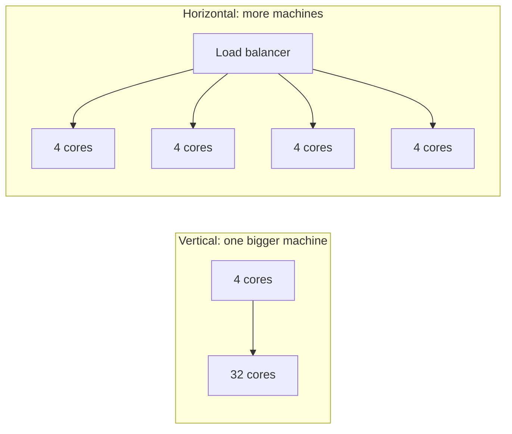
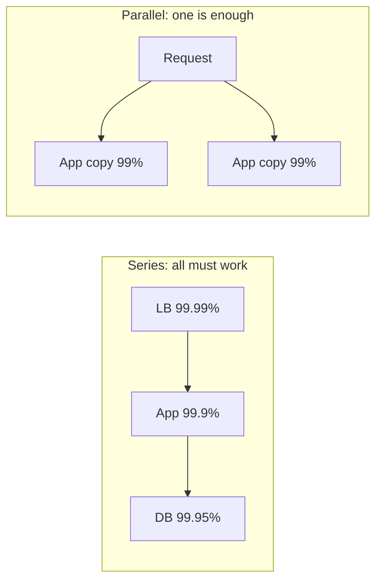
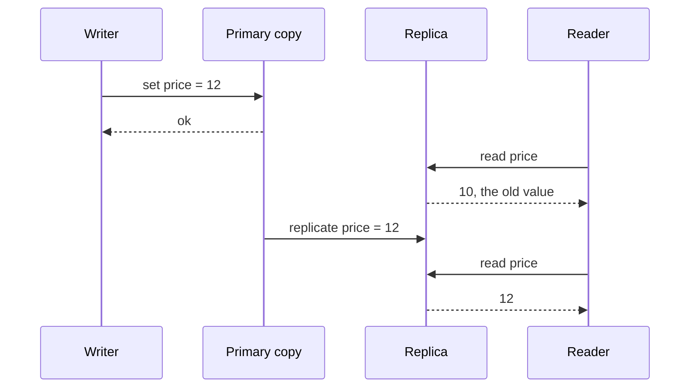
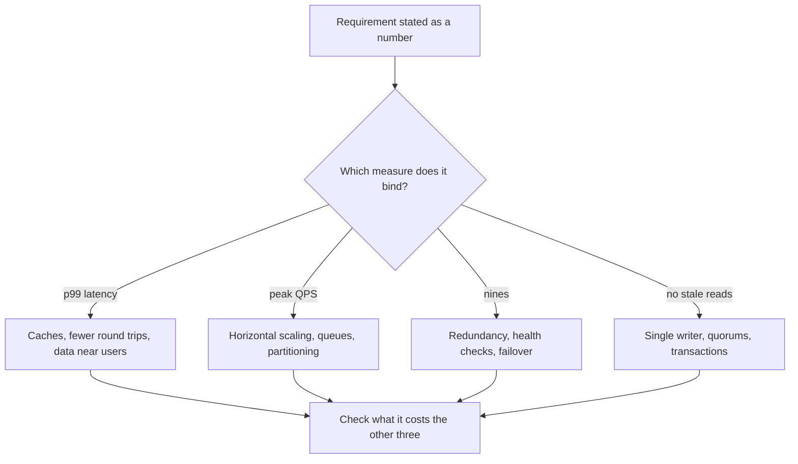

# The vocabulary of scale: scaling, latency, throughput, availability and consistency

## Before this lesson

You should have read [Clients, servers and requests](#/lesson/system-design/clients-servers-requests) and [The five building blocks](#/lesson/system-design/core-components). You need to know what a server, a database, a cache and a load balancer are. Some arithmetic with percentages is used; nothing beyond multiplying.

## In plain words

When engineers argue about a design they use five measuring words again and again. This lesson gives each of them a plain meaning and a number you can calculate.

Picture a motorway toll plaza.

- **Scaling** is what you do when queues build up: you either make one booth faster (vertical) or open more booths (horizontal).
- **Latency** is how long one car takes to get through.
- **Throughput** is how many cars get through per minute.
- **Availability** is the fraction of the year the plaza is open.
- **Consistency** is whether every booth charges the same, current price, or whether some booths are still using yesterday's price list.

In an interview these words are how you state requirements ("99.9% available, 200 millisecond latency for most requests") and how you defend choices ("I accept slightly stale data here in exchange for staying available"). On the job they are the numbers on the dashboards you will be paged about.

## 1. Vertical and horizontal scaling

**Load** is the amount of work arriving at a system, usually counted in requests per second. **Scalability** is the ability to handle more load by adding resources. There are two ways to add resources.

**Vertical scaling** (*scaling up*) means replacing a machine with a bigger one: more CPU cores, more RAM, faster disks. Nothing about your software changes.

**Horizontal scaling** (*scaling out*) means adding more machines of the same size and sharing the work between them.



| | Vertical | Horizontal |
|---|---|---|
| Effort | None in the software | Needs a load balancer and stateless servers, or a way to split data |
| Limit | The biggest machine you can buy | In principle none |
| Failure | One machine: if it dies, everything is down | Losing one of many costs a fraction of capacity |
| Cost curve | Price rises faster than power at the top end | Roughly proportional |
| Good for | Early stages, and databases for a long time | Web and application servers, and everything at large scale |

A sensible position for an interview: scale vertically while it is cheap and easy, and move a tier to horizontal scaling when you hit one of two walls, either the largest machine is not enough or you cannot accept a single point of failure. Stateless web servers are scaled horizontally almost from the start because it is easy. Databases are scaled vertically for much longer because splitting data across machines is hard.

## 2. Latency and throughput

**Latency** is the time taken to serve one request, measured from the moment the client sends it to the moment the response arrives. It is measured in milliseconds (ms); a millisecond is one thousandth of a second.

**Throughput** is the number of requests completed per unit of time. The usual unit is **QPS** (queries per second) or **RPS** (requests per second); the two are used interchangeably.

They are different things. A ferry carries 400 cars per crossing but takes an hour: high throughput, high latency. A motorbike courier is fast for one parcel but carries one parcel: low latency, low throughput. Systems are tuned for one, the other, or a stated balance.

They are also connected. If one server works on one request at a time and each takes 20 ms, it can complete at most $1000 / 20 = 50$ requests per second. If it can work on 8 at once (8 **concurrent** requests, meaning in progress at the same moment), it can complete about $8 \times 50 = 400$ per second. In general:

$$\text{throughput} \approx \frac{\text{concurrency}}{\text{latency}}$$

When requests arrive faster than that, they wait in line, and latency climbs steeply. A system pushed close to its maximum throughput becomes slow well before it fails outright.

### Averages hide the pain: percentiles

Suppose 99 requests take 10 ms and one takes 2,000 ms. The **average** (the total divided by the count) is about 30 ms, a number that describes none of the 100 requests. For this reason latency is reported in **percentiles**.

The **p50** (50th percentile, also called the **median**) is the value that half of requests are faster than. The **p99** is the value that 99% of requests are faster than; one request in a hundred is slower. The slow end of the distribution is called the **tail**, and p99 or p99.9 is the **tail latency**.

```python-run
import random, statistics
random.seed(7)

# 10,000 request times: most are quick, a few hit a slow path.
latencies = []
for _ in range(10_000):
    r = random.random()
    if r < 0.97:
        latencies.append(random.uniform(8, 25))       # normal request
    elif r < 0.995:
        latencies.append(random.uniform(80, 200))     # cache miss
    else:
        latencies.append(random.uniform(900, 3000))   # timeout and retry

def percentile(values, p):
    """Value below which p percent of the sorted values fall."""
    s = sorted(values)
    index = min(len(s) - 1, int(len(s) * p / 100))
    return s[index]

print(f"average : {statistics.mean(latencies):7.1f} ms")
for p in (50, 90, 99, 99.9):
    print(f"p{p:<6} : {percentile(latencies, p):7.1f} ms")
```

The average sits far above what a typical user sees (the p50) and far below what the unluckiest users see (the p99.9). Neither group is described by it.

Why care about one request in a hundred? Because one page load often makes dozens of requests behind the scenes. If a page needs 30 backend calls and each has a 1% chance of being slow, the chance that at least one is slow is $1 - 0.99^{30} \approx 26\%$. The tail of each service becomes the everyday experience of the page. This effect is called **tail latency amplification**.

> [!INTERVIEW]
> Say requirements as percentiles: "p99 under 300 ms", not "fast" or "average 100 ms". It signals that you know averages mislead, and it gives you something concrete to design against.

## 3. Availability and "the nines"

**Availability** is the fraction of time a system is working and answering correctly.

$$\text{availability} = \frac{\text{time it was up}}{\text{total time}}$$

It is quoted as a percentage, and because the interesting values are all close to 100%, engineers count the nines: 99.9% is "three nines". The agreed target between a provider and its customers is a **service level agreement (SLA)**; the internal target a team sets itself is a **service level objective (SLO)**.

The percentages look almost identical. The downtime they allow is very different.

```python-run
MIN_PER_YEAR = 365 * 24 * 60

print(f"{'availability':>13} {'per year':>16} {'per day':>12}")
for nines, pct in [(1, 90.0), (2, 99.0), (3, 99.9), (4, 99.99), (5, 99.999)]:
    down_min = MIN_PER_YEAR * (1 - pct / 100)
    if down_min >= 1440:
        per_year = f"{down_min / 1440:.1f} days"
    elif down_min >= 60:
        per_year = f"{down_min / 60:.1f} hours"
    else:
        per_year = f"{down_min:.1f} minutes"
    per_day = 86_400 * (1 - pct / 100)
    print(f"{pct:>12}% {per_year:>16} {per_day:>10.1f} s")
```

Each extra nine cuts the allowed downtime by ten. Three nines allows almost nine hours a year, which a team can meet with careful manual work. Five nines allows about five minutes a year, less than the time it takes a person to wake up and open a laptop, so it can only be met with automatic failover and no risky manual steps.

### Components in series and in parallel

A request usually passes through several components. If it needs all of them (a chain, or components **in series**), the availabilities multiply:

$$A_{\text{series}} = A_1 \times A_2 \times \dots \times A_n$$

Three components at 99.9% each give $0.999^3 \approx 99.7\%$. Chains are weaker than their weakest link.

If the request needs only one of several identical components (duplicates, or components **in parallel**), the system is down only when all of them are down at once:

$$A_{\text{parallel}} = 1 - (1 - A_1)(1 - A_2)\dots(1 - A_n)$$

Two servers at 99% each give $1 - 0.01 \times 0.01 = 99.99\%$. Duplication, called **redundancy**, is how ordinary parts are combined into a reliable whole.



```python-run
from functools import reduce

def series(*parts):
    return reduce(lambda a, b: a * b, parts, 1.0)

def parallel(*parts):
    return 1 - reduce(lambda a, b: a * b, [1 - p for p in parts], 1.0)

one_app, db, lb = 0.99, 0.9995, 0.9999

single = series(lb, one_app, db)
redundant_app = series(lb, parallel(one_app, one_app, one_app), db)
redundant_all = series(parallel(lb, lb), parallel(one_app, one_app, one_app), parallel(db, db))

for name, a in [("one of each", single), ("three app servers", redundant_app), ("everything doubled", redundant_all)]:
    print(f"{name:20s} {a * 100:9.5f}%   about {(1 - a) * 365 * 24:7.2f} hours down per year")
```

With one of each, the weak application server drags the whole chain to about 99%. Tripling the application server moves the limit to the database. Doubling the database and the load balancer as well pushes the whole path past four nines. The lesson: improve the weakest link first, and expect the bottleneck to move.

The parallel formula assumes the copies fail independently. Two servers in the same rack that share one power supply fail together, and so do two copies running the same faulty release. Real redundancy puts copies in different racks, different **availability zones** (separate buildings within one cloud region) or different regions.

> [!WARNING]
> Availability is not the same as **durability**. Durability is the chance that stored data is not lost. A service can be unavailable for an hour and lose nothing (durable but not available), or answer every request while having silently lost last week's uploads (available but not durable). State both when storage is involved.

## 4. Consistency in plain words

As soon as data is copied to more than one machine, a new question appears: do all the copies say the same thing?

A copy of a database kept on another machine is called a **replica**. We keep replicas so that the system survives the loss of a machine and so that reads can be shared out. A write goes to one machine first and takes a little time, the **replication lag**, to reach the others.

Imagine a shop with a price board at each of three entrances. A manager changes the price at entrance 1 and then walks to the other two. For a few minutes, a customer at entrance 3 sees the old price.

- **Strong consistency** means every reader sees the newest value as soon as the write is confirmed. In the shop: the manager locks all three doors, changes all three boards, then reopens. Nobody ever sees an old price, but the shop was closed for a moment, and if the manager cannot reach entrance 3, it stays closed.
- **Eventual consistency** means that if the writes stop, all copies will agree after a short while, but in the meantime readers may see old values. In the shop: the doors stay open while the manager walks. Nobody is locked out; some customers briefly see yesterday's price.



The simulation below shows the stale window. Time moves in ticks; a write reaches the replica three ticks after it reaches the primary.

```python-run
LAG = 3                                  # ticks for a write to travel to the replica
primary, replica = {"price": 10}, {"price": 10}
in_flight = []                           # (arrival_tick, key, value)

def write(tick, key, value):
    primary[key] = value
    in_flight.append((tick + LAG, key, value))

def deliver(tick):
    for item in [x for x in in_flight if x[0] <= tick]:
        replica[item[1]] = item[2]
        in_flight.remove(item)

for tick in range(8):
    deliver(tick)
    if tick == 2:
        write(tick, "price", 12)
    stale = "  <- stale read" if replica["price"] != primary["price"] else ""
    print(f"tick {tick}: primary={primary['price']}  replica={replica['price']}{stale}")
```

For ticks 2, 3 and 4 a reader of the replica gets the old price. From tick 5 the copies agree again. That gap is what "eventual" means.

Which should you choose? It depends on what a stale read costs.

| Data | Cost of a stale read | Usual choice |
|---|---|---|
| Like count on a post | Nobody notices 4,812 versus 4,815 | Eventual |
| A friend's new profile photo | Mild confusion for a second | Eventual |
| Account balance before a withdrawal | Money is lost | Strong |
| Last seat on a flight | Two people buy the same seat | Strong |
| Your own comment right after you post it | You think the post failed | Eventual, plus **read-your-own-writes**: send the author's reads to the primary for a short while |

Why not make everything strongly consistent? Because it has a price. Strong consistency needs the copies to coordinate before answering, which adds latency, and when the network between copies is broken the system must either refuse requests (staying consistent, losing availability) or answer with possibly old data (staying available, losing consistency). That forced choice is the heart of the **CAP theorem**, which the lesson [CAP, queues and idempotency](#/lesson/system-design/bb-cap-queues-idempotency) treats in full, and which the [Databases track](#/lesson/databases/linearizability) defines rigorously.

> [!TIP]
> The word "consistency" is overloaded. In databases' ACID it means "the data obeys its rules", such as a balance never being negative. In distributed systems it means "the copies agree". If an interviewer uses the word, check which meaning is intended.

## 5. How the five words pull against each other

No design maximises everything. A change that helps one measure usually costs another, and saying so aloud is what a trade-off discussion is.

| You want more of | A common way to get it | What it tends to cost |
|---|---|---|
| Throughput | More servers, batching work together | Batching raises latency; more servers raise cost |
| Lower latency | Caches, replicas near users | Staler data, so weaker consistency |
| Availability | Redundant copies in several places | Copies must be kept in agreement, so consistency or latency suffers |
| Consistency | Coordinate copies on every write | Higher latency; lower availability during network faults |
| Lower cost | Fewer, busier machines | Less headroom, so worse tail latency and availability |



## Common mistakes

- **Quoting an average latency.** It hides the tail. Use p50 and p99.
- **Multiplying availability the wrong way.** A chain of dependencies is less available than its worst member, not as available as its best.
- **Counting copies that fail together as redundancy.** Two servers behind one power cable are one failure.
- **Saying "we will scale horizontally" about a database without saying how the data is split.** For stateless servers the sentence is enough; for data it is the start of a long conversation.
- **Demanding strong consistency everywhere.** It costs latency and availability. Ask where a stale read does real harm and confine strong consistency to those places.
- **Confusing availability with durability.** One is about answering, the other about not losing data.

## Summary

- Vertical scaling buys a bigger machine; horizontal scaling adds machines. Stateless tiers scale out early; databases scale up for as long as practical.
- Latency is the time for one request; throughput is requests per second. Throughput is roughly concurrency divided by latency, and latency climbs as load nears capacity.
- Report latency as percentiles. The tail matters because one user action fans out into many calls.
- Availability is uptime divided by total time. Each extra nine allows ten times less downtime: 99.9% is about 8.8 hours a year, 99.99% about 53 minutes.
- Availabilities multiply in series and combine as "one minus the product of failures" in parallel, provided failures are independent.
- Strong consistency means readers always see the latest write; eventual consistency means copies agree after a delay. Choose by the cost of a stale read.

## Glossary

- **Load**: the amount of work arriving, usually in requests per second.
- **Scalability**: the ability to handle more load by adding resources.
- **Vertical / horizontal scaling**: a bigger machine, or more machines.
- **Latency**: time to serve one request.
- **Throughput, QPS, RPS**: requests completed per second.
- **Concurrency**: the number of requests in progress at the same moment.
- **Percentile (p50, p99)**: the value below which that percentage of measurements fall.
- **Median**: the p50.
- **Tail latency**: latency at the slow end, such as p99.
- **Availability**: the fraction of time a system answers correctly.
- **SLA / SLO**: an availability or latency target promised to customers, or set internally.
- **Redundancy**: extra copies of a component so that one failure is survivable.
- **Availability zone**: an isolated data-centre building within a cloud region.
- **Durability**: the likelihood that stored data is not lost.
- **Replica**: a copy of data on another machine.
- **Replication lag**: the delay before a write reaches a replica.
- **Strong consistency**: every read returns the most recent confirmed write.
- **Eventual consistency**: copies converge to the same value some time after writes stop.
- **Read-your-own-writes**: a guarantee that a user always sees their own latest change.

## Check yourself

```quiz
[
  {"q": "A request must pass through a load balancer (99.99%), an app server (99.9%) and a database (99.9%). What is the availability of the path, approximately?",
   "options": ["99.99%", "99.9%", "99.79%", "99.999%"],
   "answer": 2,
   "explain": "Components in series multiply: 0.9999 x 0.999 x 0.999 is about 0.9979. A chain is weaker than its weakest link."},
  {"q": "Two independent servers are each up 99% of the time and either one can serve the request. What is the combined availability?",
   "options": ["98.01%", "99%", "99.5%", "99.99%"],
   "answer": 3,
   "explain": "Parallel: 1 - (0.01 x 0.01) = 0.9999. The system is down only when both are down together."},
  {"q": "Roughly how much downtime per year does 99.9% availability allow?",
   "options": ["About 5 minutes", "About 53 minutes", "About 8.8 hours", "About 3.7 days"],
   "answer": 2,
   "explain": "0.1% of 8,760 hours is 8.76 hours. Four nines is about 53 minutes and five nines about 5 minutes."},
  {"q": "A service reports an average latency of 40 ms, yet users complain. Which number should you ask for?",
   "options": ["The minimum latency", "The p99 latency", "The number of servers", "The CPU model"],
   "answer": 1,
   "explain": "An average can hide a slow tail. The p99 shows what the slowest 1% of requests experience, and page loads that fan out hit that tail often."},
  {"q": "A server handles 10 requests at the same time and each takes 50 ms. About what throughput can it sustain?",
   "options": ["20 requests per second", "200 requests per second", "500 requests per second", "5,000 requests per second"],
   "answer": 1,
   "explain": "Throughput is roughly concurrency divided by latency: 10 / 0.05 s = 200 per second."},
  {"q": "Which data most needs strong consistency?",
   "options": ["The number of views on a video", "The remaining stock of the last concert ticket", "A list of trending topics", "A user's profile banner"],
   "answer": 1,
   "explain": "A stale read of the last ticket lets two buyers purchase it. The other three tolerate being briefly out of date."},
  {"q": "What does eventual consistency promise?",
   "options": ["Every read returns the latest write", "Writes are never lost", "If writes stop, all copies will agree after some time", "Reads are always faster than writes"],
   "answer": 2,
   "explain": "Copies converge given time. Until then a reader of a lagging replica may see an older value."},
  {"q": "Why might doubling a server not double its availability benefit in practice?",
   "options": ["Parallel availability is the product of the parts", "The two copies may share a cause of failure such as power, a rack or a faulty release", "Load balancers cannot route to two servers", "Availability cannot exceed 99%"],
   "answer": 1,
   "explain": "The parallel formula assumes independent failures. Shared power, network or software means the copies fail together."}
]
```

> **Source:** Xu, *System Design Interview: An Insider's Guide*, ch. 1 (vertical vs horizontal scaling) and ch. 2 (availability numbers) as a topic guide; System Design Primer sections "Performance vs scalability", "Latency vs throughput", "Availability vs consistency", "Availability patterns", https://github.com/donnemartin/system-design-primer
