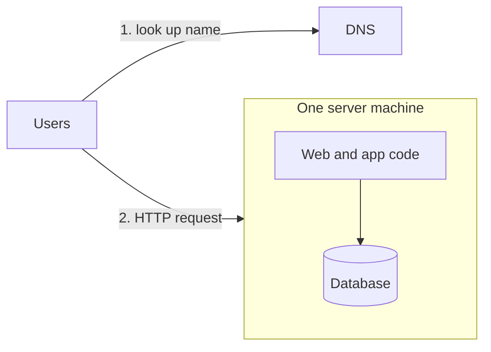
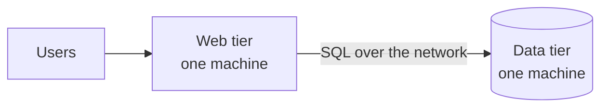
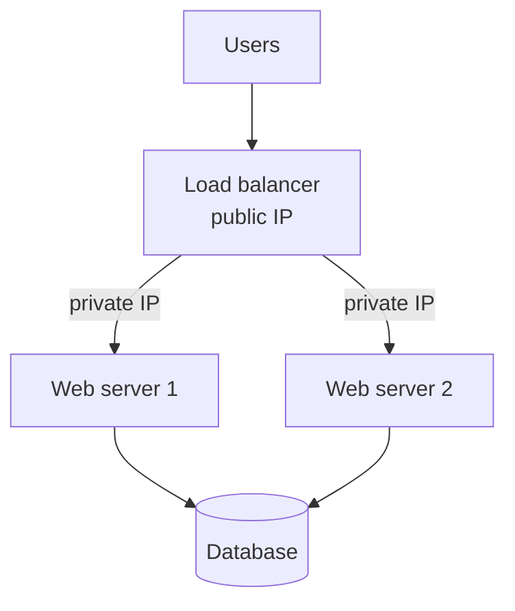
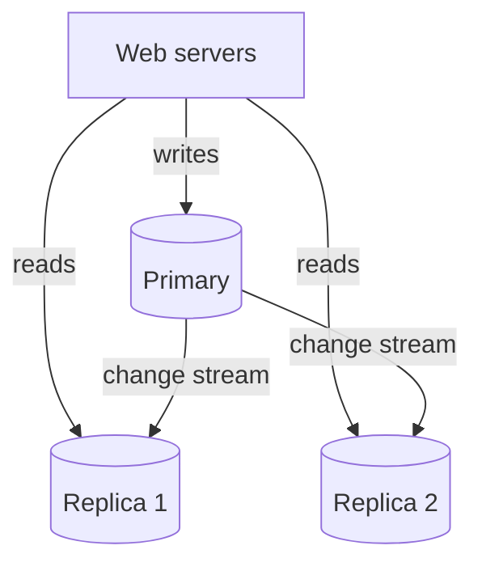
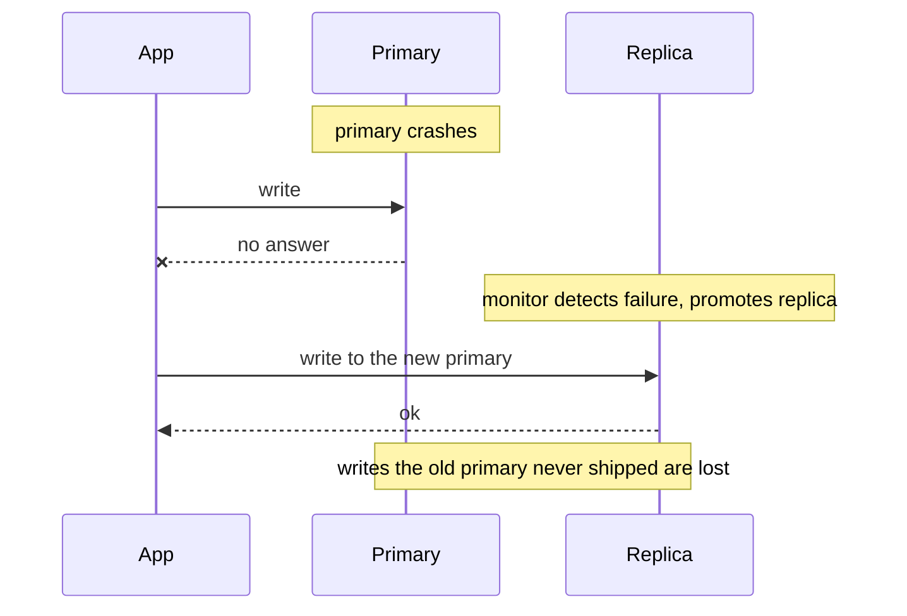
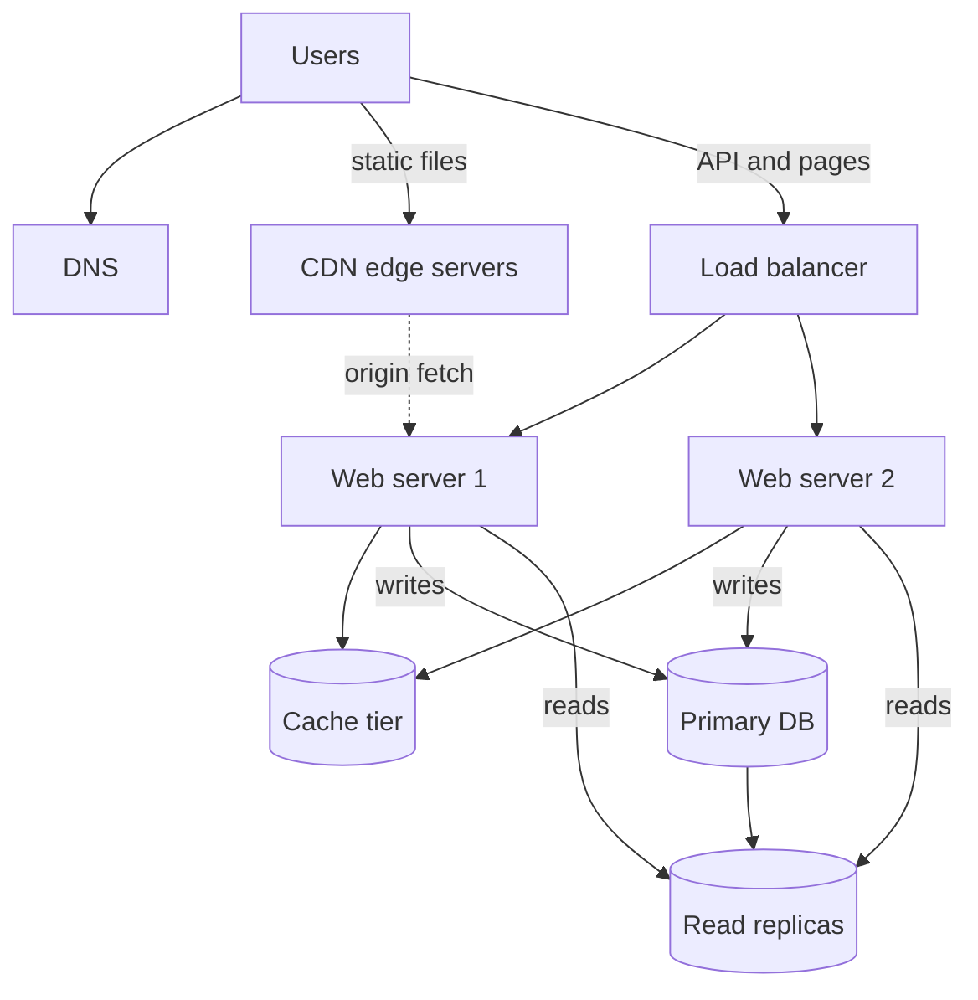

# Scaling from zero I: from one server to a replicated, cached system

## Before this lesson

Read the three lessons of [System design from zero](#/lesson/system-design/clients-servers-requests). You should be comfortable with these words: server, database, cache, load balancer, CDN, replica, single point of failure, vertical and horizontal scaling, availability.

## In plain words

Nobody designs a system for a hundred million users on day one. Real systems grow in steps, and each step is a response to a specific pain: "the machine is out of memory", "the site was down for an hour when the disk died", "pages are slow in Australia".

Think of a food stall that becomes a restaurant chain. At first one person takes orders, cooks and handles money at one counter. When the queue grows, the cooking moves to a back kitchen. Then a second cashier is hired. Then a second kitchen, in case the first floods. Then ready-made items go on a shelf at the front. Then branches open in other cities. No step is clever on its own; the skill is knowing which step answers which problem.

This lesson walks the first half of that journey: one machine, then a separate database, then several web servers behind a load balancer, then database replicas, a cache and a CDN. The next lesson covers the second half. Interviewers love this progression because it lets them stop you at any stage and ask "why did you add that, and what did it cost?".

## 1. Stage 0: everything on one machine

The first version of almost any product runs on a single server machine. The web server program, the application code and the database all run on it. One DNS record points the domain name at the machine's IP address.



This is not a toy. A single modern machine with 16 cores and 64 gigabytes of RAM can serve a few thousand simple requests per second, which is enough for a product with tens of thousands of daily users. Its virtues are real: it is cheap, there is nothing to coordinate, and when something breaks there is one place to look.

It has three weaknesses, and each drives one of the next stages:

1. The application and the database compete for the same CPU and memory.
2. It is a single point of failure: if the machine dies, the product is down and, without backups, the data is gone.
3. It can only grow vertically, and the largest machine is a hard ceiling.

> [!TIP]
> When an interviewer says "start small", begin exactly here and say why it is enough for now. Then scale in response to the numbers. Jumping straight to twenty boxes suggests you memorised a diagram.

## 2. Stage 1: give the database its own machine

The first split is to move the database to a second machine. The two halves are now called **tiers** (a tier is a layer of the system with one job): the **web tier** runs your code and the **data tier** stores data.



What this buys you: each tier can be sized for what it needs. Web servers want CPU. Databases want RAM (to keep indexes and hot data in memory) and fast disks. You can now upgrade one without touching the other, and a runaway query no longer starves the web code of CPU.

What it costs: every database query is now a network round trip of perhaps half a millisecond instead of a call inside one machine. A page that runs 200 small queries one after another has gained 100 ms. This is the first time the design punishes "chatty" code, and it stays true for ever after.

Which database? For most products at this stage a relational database is the right default: the data has relationships (users, orders, items), you want transactions, and the tools are mature. The moment to consider a non-relational store is when a specific pressure appears: you need very low latency for simple lookups, the data has no fixed shape, or one table grows so large that a single machine cannot hold it.

## 3. Stage 2: more than one web server

Traffic grows and the web machine's CPU is pinned at 100%. You can buy a bigger one (vertical), which also does nothing about it being a single point of failure. Or you add a second web server and a load balancer (horizontal).



Three details are worth saying aloud in an interview.

**Public and private addresses.** Only the load balancer has a **public IP address** (one reachable from the internet). The web servers have **private IP addresses**, reachable only from inside your own network. Users cannot contact a web server directly, which is good for security and means you can change the servers freely.

**Failover.** If web server 1 fails its health checks, the load balancer sends all traffic to web server 2. Automatically switching to a working copy is called **failover**. When you add web server 3, the load balancer starts using it. Users see none of this.

**Statelessness.** This stage only works if any web server can serve any user. If login sessions are stored in the memory of one server, a user bounced to the other server appears logged out. A stopgap is **sticky sessions**, where the load balancer always sends a given user to the same server, but that defeats failover (the server dies, its users are logged out) and makes load uneven. The proper fix, moving session data to a shared store, is the first topic of the next lesson.

The web tier is now redundant. The database is not: it is the remaining single point of failure and the next bottleneck.

## 4. Stage 3: database replication

**Replication** means keeping copies of the same data on several database machines. The most common arrangement has one **primary** (also called *leader* or *master*) and several **replicas** (also called *followers*, *secondaries* or *standbys*).

- All **writes** (insert, update, delete) go to the primary.
- The primary sends a continuous stream of its changes to the replicas, which apply them in the same order.
- **Reads** can be served by any replica.



Why this shape fits most products: reads greatly outnumber writes. People view far more pages than they post. A ratio of 10 reads to 1 write is conservative; 100 to 1 is common. One primary handles the writes, and you add replicas until the reads fit.

Replication gives three benefits at once:

1. **Read capacity.** Each replica adds read throughput.
2. **Availability.** If a replica dies, reads go to the others. If the primary dies, a replica is **promoted** to become the new primary.
3. **Durability.** The data exists on several disks, ideally in several places, so a fire in one room does not destroy it.

The simulation shows why replicas help reads and do nothing for writes. Each machine can do 1,000 operations per second.

```python-run
CAPACITY = 1000                       # operations per second one database machine can do

def max_traffic(replicas, read_fraction):
    """Largest total QPS before either the primary or the replicas are full.
    Writes all hit the primary. Reads are shared by the replicas
    (or served by the primary when there are no replicas)."""
    write_fraction = 1 - read_fraction
    if replicas == 0:
        return CAPACITY                              # one machine does everything
    by_writes = CAPACITY / write_fraction if write_fraction else float("inf")
    by_reads = replicas * CAPACITY / read_fraction if read_fraction else float("inf")
    return min(by_writes, by_reads)

print(f"{'replicas':>8} | {'95% reads':>10} | {'50% reads':>10}")
for n in (0, 1, 2, 4, 8, 20):
    print(f"{n:>8} | {max_traffic(n, 0.95):>10.0f} | {max_traffic(n, 0.50):>10.0f}")
```

With a read-heavy workload (95% reads), capacity grows with each replica until 20 replicas, when the single primary's writes become the limit at 20,000 requests per second. With a balanced workload (50% reads), the primary is the limit almost immediately and extra replicas are wasted. Replication scales reads. Scaling writes needs a different tool, sharding, which closes the next lesson.

### What replication costs

**Replication lag.** In the usual **asynchronous** mode the primary confirms a write without waiting for replicas, so a replica may be a fraction of a second behind. A user who posts a comment and is then served by a lagging replica does not see their own comment. The standard remedy is to read from the primary for a short time after a user writes, the read-your-own-writes guarantee from the previous lesson.

**Failover is delicate.** When the primary dies, something must notice, choose the most up-to-date replica, promote it and redirect writes. If the old primary had confirmed writes that had not reached any replica, those writes are lost. If the old primary was only cut off from the network and comes back still believing it is the primary, two machines accept writes at once, a dangerous situation called **split brain**. Managed database services automate promotion; in an interview, say that failover exists, that it takes seconds to a minute, and that asynchronous replication can lose the last few writes.

**Synchronous replication** closes that window: the primary waits for at least one replica to confirm before answering. Nothing confirmed is lost, at the price of slower writes and of writes blocking if that replica is unreachable. A common compromise keeps one replica synchronous and the rest asynchronous.



The [Databases track](#/lesson/databases/leader-follower) covers replication logs, lag anomalies and failover in detail.

> [!INTERVIEW]
> A favourite follow-up: "The primary goes down. Walk me through what happens." A complete answer names detection (missed heartbeats), promotion (the replica with the most recent data), redirection of writes (clients or a proxy learn the new primary), the risk of lost writes under asynchronous replication, and prevention of split brain (the old primary must be stopped from accepting writes).

## 5. Stage 4: a cache tier

Even with replicas, the database does work for every read: parse the query, walk an index, fetch rows. Many reads ask for the same things. A **cache tier**, usually a server such as Redis or Memcached that holds data in RAM, answers repeated reads without touching the database.

The read path is cache-aside, as in the earlier lesson: check the cache, on a miss read the database and store the result with a TTL.

Questions to answer before you draw the cache:

- **Is the data read often and changed rarely?** A product page, yes. A stock-trading order book, no.
- **How stale may it be?** That sets the TTL. Too short, and most reads miss. Too long, and users see old data.
- **What happens on a write?** The usual rule is: update the database, then delete the cache entry, so the next read reloads it.
- **What if the cache is down or empty?** All reads fall through to the database. Make sure the database can survive that, or bring traffic back gradually.
- **Is there one cache server?** Then it is a single point of failure. Use several, and be ready for one to vanish.
- **What is evicted when memory is full?** Usually the least recently used entries.

```python-run
import random
random.seed(1)

DB_COST_MS, CACHE_COST_MS = 5.0, 0.3
PRODUCTS = 10_000
CACHE_SIZE = 500                         # the cache holds 5% of the products

def simulate(skew):
    """skew is the share of traffic that goes to the 500 most popular products."""
    cache, db_reads, total_ms = set(), 0, 0.0
    for _ in range(50_000):
        if random.random() < skew:
            key = random.randrange(CACHE_SIZE)             # a popular product
        else:
            key = random.randrange(CACHE_SIZE, PRODUCTS)   # a rare product
        if key in cache:
            total_ms += CACHE_COST_MS
        else:
            total_ms += CACHE_COST_MS + DB_COST_MS
            db_reads += 1
            if key < CACHE_SIZE:                           # keep only popular items cached
                cache.add(key)
    return 1 - db_reads / 50_000, total_ms / 50_000

for skew in (0.2, 0.5, 0.8, 0.95):
    hit, avg = simulate(skew)
    print(f"{skew:>4.0%} of traffic on hot items -> hit rate {hit:5.1%}, average read {avg:4.2f} ms")
```

A cache that holds only 5% of the items removes most of the database reads when traffic is concentrated on popular items, and removes little when traffic is spread evenly. Real traffic is usually very concentrated, which is why caching works so well. Always ask how skewed the access pattern is before promising a hit rate.

## 6. Stage 5: a CDN for static content

Measure where the time goes for a user far from your servers and a large part is spent downloading images, style sheets and scripts that are identical for everyone. A CDN moves those bytes close to the user.

The flow for one image:

1. The page refers to the image by a CDN address, for example `https://cdn.example.com/img/kettle.9c1f.jpg`.
2. The user's request goes to the nearest edge server.
3. If the edge has the file and it has not expired, it returns it. The request never reaches your servers.
4. If not, the edge fetches it from your origin (your web tier or a blob store), stores it for the TTL given in the response headers, and returns it.

Things to consider:

- **Cost.** CDNs charge for data transferred. Put on the CDN what is requested often; rarely requested files gain little.
- **Expiry.** A TTL that is too long serves stale files; too short and the edges keep going back to the origin.
- **Invalidation.** To replace a file before it expires, either ask the CDN to purge it or, better, change its name by embedding a version or a hash of the contents.
- **CDN outage.** Clients should be able to fall back to the origin if the CDN is unreachable.

With the CDN and the cache in place, your own web servers handle only the requests that need fresh computation.

## 7. The system so far



| Stage | Pain that triggered it | What was added | New cost or risk |
|---|---|---|---|
| 0 | none yet | One machine | Single point of failure, hard ceiling |
| 1 | App and database fight for resources | Separate data tier | Network hop per query |
| 2 | Web CPU full; one web server is a single point of failure | Load balancer and more web servers | Servers must be stateless |
| 3 | Database reads saturated; database is a single point of failure | Primary and read replicas | Replication lag; failover complexity |
| 4 | Repeated reads still hit the database | Cache tier | Staleness; invalidation; cold start |
| 5 | Static files slow for distant users | CDN | Cost; stale copies |

What remains unsolved: the web servers still hold session state, there is one data centre, slow work happens inside requests, nobody can see what the system is doing, and there is still exactly one machine accepting writes. Those are the five subjects of the next lesson.

## Common mistakes

- **Skipping straight to the final diagram.** The interviewer wants to hear the reason for each addition.
- **Claiming replicas scale writes.** They scale reads and improve availability. Every write still goes through one primary.
- **Ignoring replication lag.** If your design reads from replicas, say which reads can tolerate staleness and which must go to the primary.
- **Treating failover as instant and lossless.** It takes time, and asynchronous replication can drop the latest writes.
- **Adding a cache without an invalidation rule.** "We will cache it" is half a sentence. The other half is when the entry is removed.
- **Relying on sticky sessions.** They hide the state problem and reappear as a failure-handling problem.

## Summary

- Start with one machine and say why it is enough; scale in response to a measured pain.
- Separating the data tier lets each tier be sized independently, at the cost of a network hop per query.
- A load balancer with several stateless web servers removes the web tier as a bottleneck and as a single point of failure.
- Primary-replica replication scales reads and protects against machine loss; it brings replication lag and the complexities of failover, and does not scale writes.
- A cache tier removes repeated reads from the database; its benefit depends on how concentrated the traffic is, and it needs TTL, invalidation and a plan for cache loss.
- A CDN serves static assets from near the user and takes that load off your servers.

## Glossary

- **Tier**: a layer of the system that has one job, such as the web tier or the data tier.
- **Public / private IP address**: reachable from the internet, or only from inside your own network.
- **Failover**: automatically switching to a working copy when one fails.
- **Sticky session**: a load balancer rule that keeps sending a user to the same server.
- **Replication**: keeping copies of the same data on several machines.
- **Primary (leader, master)**: the database copy that accepts writes.
- **Replica (follower, secondary, standby)**: a copy that receives the primary's changes and serves reads.
- **Promotion**: turning a replica into the new primary.
- **Asynchronous / synchronous replication**: confirming a write before, or only after, replicas have it.
- **Split brain**: two machines both acting as primary at once.
- **Cache tier**: a set of in-memory servers that store results of frequent reads.
- **Cold start**: the period after a cache starts empty and every read is a miss.
- **Edge server / origin**: a CDN server near users, and your own server it copies from.
- **Purge**: asking a CDN to delete its copy of a file.

## Check yourself

```quiz
[
  {"q": "Your site is 90% reads and the single database is saturated. Which change helps most with the least redesign?",
   "options": ["Add read replicas and send reads to them", "Add a second primary that also accepts writes", "Move the database onto the web server machine", "Add sticky sessions"],
   "answer": 0,
   "explain": "Read replicas multiply read capacity while one primary keeps handling the small share of writes. A second writer brings conflict problems."},
  {"q": "With asynchronous replication, the primary crashes immediately after confirming a write. What can happen?",
   "options": ["Nothing; replicas always have every confirmed write", "The write may be lost because it had not yet reached a replica", "All replicas are deleted", "Reads become strongly consistent"],
   "answer": 1,
   "explain": "Asynchronous replication confirms before replicas have the data. A crash in that window loses the write when a replica is promoted."},
  {"q": "A user posts a comment, refreshes and does not see it, then sees it a second later. What is the most likely cause?",
   "options": ["The CDN purged the page", "The read was served by a replica that had not yet received the write", "The load balancer dropped the request", "The cache was full"],
   "answer": 1,
   "explain": "This is replication lag. Routing a user's reads to the primary for a short time after they write gives read-your-own-writes."},
  {"q": "Why do only the load balancers have public IP addresses in the staged design?",
   "options": ["Public addresses are faster", "So users cannot reach web servers directly and servers can be added or replaced freely", "Private addresses cannot use HTTP", "DNS requires exactly one address"],
   "answer": 1,
   "explain": "Keeping servers on private addresses reduces the attack surface and hides changes in the server fleet behind one stable entry point."},
  {"q": "A cache holds 5% of all items. When does it give a high hit rate?",
   "options": ["When every item is requested equally often", "When most requests go to a small set of popular items", "When items change on every request", "When the TTL is zero"],
   "answer": 1,
   "explain": "Caches exploit skew. If a few items receive most of the traffic, a small cache answers most reads."},
  {"q": "What is the cleanest way to make browsers and CDN edges pick up a changed JavaScript file immediately?",
   "options": ["Wait for the TTL to expire", "Give the new file a new name containing a version or content hash", "Restart the load balancer", "Disable caching for everything"],
   "answer": 1,
   "explain": "A new name is a new cache key, so stale copies of the old name are irrelevant, and long TTLs remain safe."},
  {"q": "What does split brain mean?",
   "options": ["A cache with two keys for one value", "Two database machines both believe they are the primary and accept writes", "A load balancer with two IP addresses", "A query that joins two tables"],
   "answer": 1,
   "explain": "If an isolated old primary keeps accepting writes after a replica is promoted, the data diverges. Failover procedures must fence off the old primary."}
]
```

> **Source:** Xu, *System Design Interview: An Insider's Guide*, ch. 1 (single server, database, load balancer, database replication, cache, CDN) as a topic guide; System Design Primer sections "Load balancer", "Database: master-slave replication", "Cache", "Content delivery network", https://github.com/donnemartin/system-design-primer
