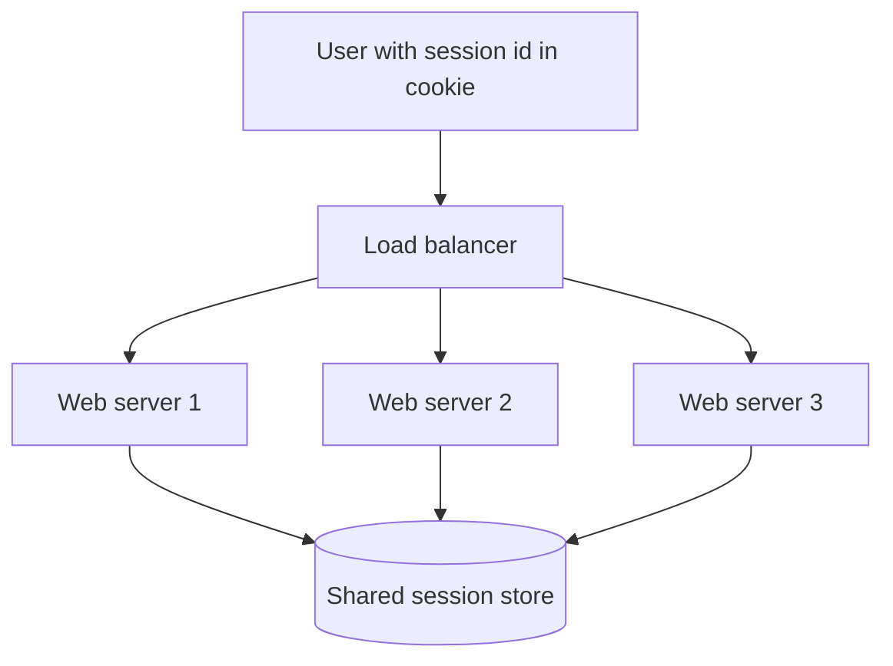
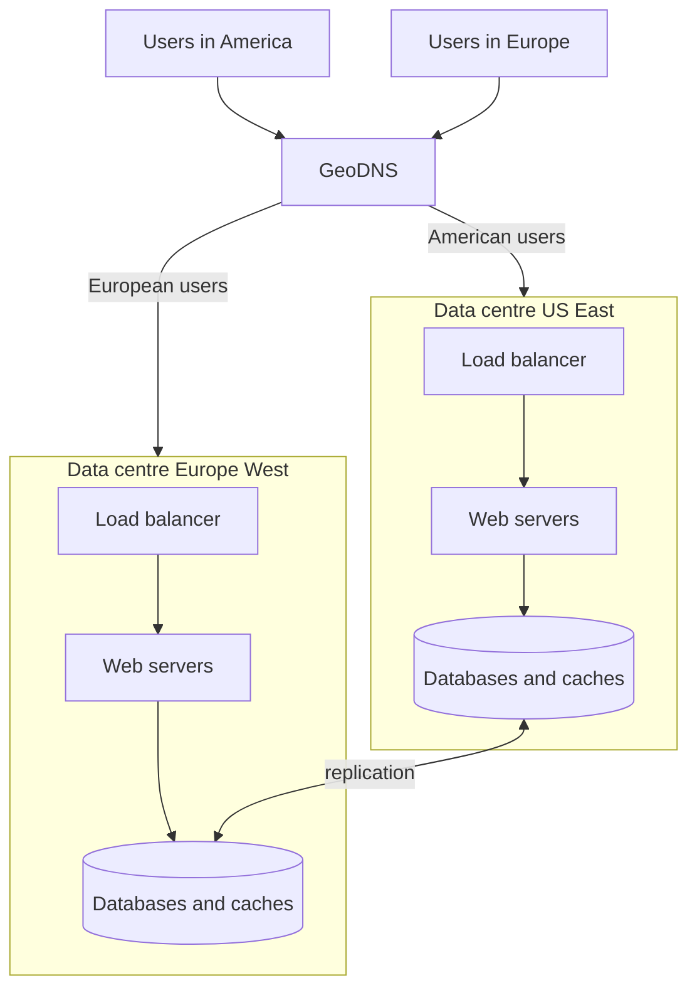
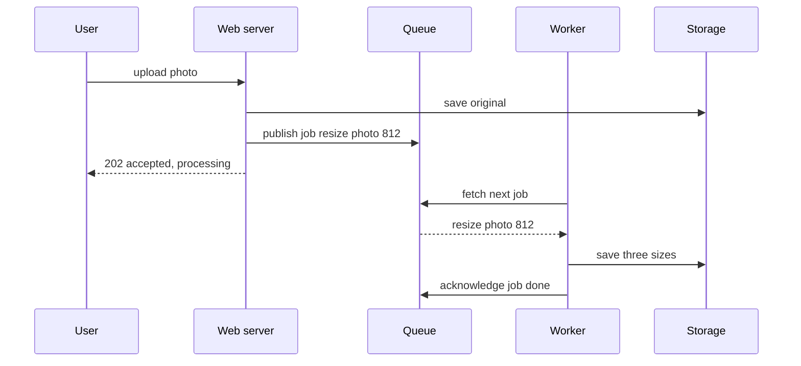
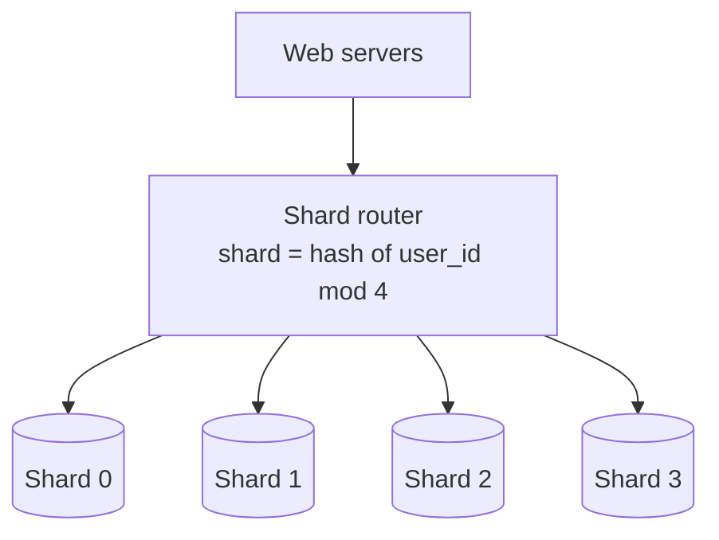
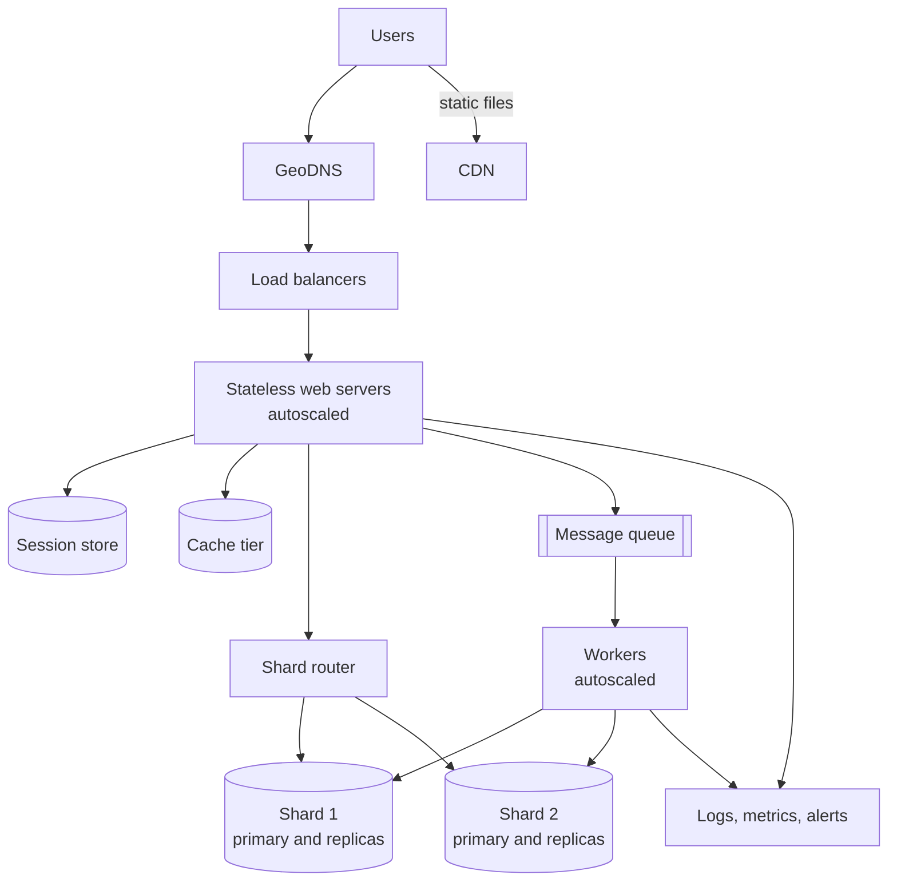

# Scaling from zero II: stateless servers, data centres, queues, observability and sharding

## Before this lesson

Read [Scaling from zero I](#/lesson/system-design/scale-single-to-replicated). You should know what a load balancer, a primary and a replica, replication lag, a cache tier and a CDN are, and why replicas scale reads but not writes.

## In plain words

The system from the previous lesson has several web servers, a replicated database, a cache and a CDN. It still has five problems. This lesson fixes them one by one.

Continue the restaurant-chain picture:

| Problem | In the restaurant chain | The fix |
|---|---|---|
| Waiters keep customers' tabs in their own heads | If a waiter goes home, the tab is lost | A shared till: **stateless web tier** |
| One building | A flood closes the whole business | A second site in another city: **multiple data centres** |
| Cooks do slow dishes while the customer stands at the counter | The queue stops moving | An order rail: **message queue** |
| Nobody knows which branch is struggling | Problems are found by angry customers | Dashboards and alarms: **logging, metrics, automation** |
| One order book for the whole chain | It cannot be written in fast enough | One order book per region: **sharding** |

By the end you will have the reference architecture that most large web systems resemble, and you will be able to explain the reason for every box in it.

## 1. A stateless web tier

A **session** is the small record a site keeps about a logged-in visitor: who they are, when they logged in, perhaps their basket. In the simplest setup each web server keeps sessions in its own memory. That makes the server **stateful**, and it creates three problems once there are several servers.

1. A request that lands on another server finds no session, so the user appears logged out.
2. Sticky sessions (always routing a user to "their" server) hide that, but when a server dies or is replaced, all its users lose their sessions.
3. You cannot freely add or remove servers, because users are tied to particular ones.

The fix is to move the session out of the web server into a **shared session store**, a fast key-value store such as Redis that every web server can reach. The browser sends a session identifier in a cookie with each request; whichever web server receives the request looks the session up in the store.



An alternative is to keep no session on the server side at all: the server gives the client a signed **token** that contains the user's identity, and the client presents it with every request. The server checks the signature and needs no lookup. The trade-off is that a token cannot easily be cancelled before it expires, whereas a session in a store can be deleted at once.

Once the web tier is stateless you gain **autoscaling**: a control program watches a measure such as CPU use and adds servers when it is high and removes them when it is low. Removing a server loses nothing, because the server held nothing.

```python-run
# Autoscaling a stateless tier: keep each server at or below 60% of its capacity.
import math

PER_SERVER_QPS = 500
TARGET_UTILISATION = 0.6
MIN_SERVERS = 2                       # never fewer than two, so one failure is survivable

traffic_by_hour = [300, 250, 200, 400, 900, 1800, 3200, 4100, 3900, 2600, 1500, 700]

print("hour  traffic  servers  utilisation")
for hour, qps in enumerate(traffic_by_hour):
    needed = math.ceil(qps / (PER_SERVER_QPS * TARGET_UTILISATION))
    servers = max(MIN_SERVERS, needed)
    utilisation = qps / (servers * PER_SERVER_QPS)
    print(f"{hour:>4}  {qps:>7}  {servers:>7}  {utilisation:>10.0%}")
```

The server count follows the traffic curve from 2 at night to 14 at the peak. The 60% target leaves headroom: if one server fails, or traffic jumps before new servers have started, the others can absorb it. The floor of two keeps the tier redundant even when one server could carry the load.

## 2. Multiple data centres

A **data centre** is a building full of server machines. Everything so far lives in one. A power failure, a cut fibre cable, a flood or a bad configuration change can take the whole building offline, and users on the other side of the world suffer high latency every day.

The answer is to run the whole stack in two or more data centres in different **regions** (geographic areas such as "US East" and "Europe West").

**Routing users.** **GeoDNS** is a DNS service that gives different answers depending on where the question comes from, so a user in Paris is given the address of the European data centre. If a data centre fails its health checks, DNS stops handing out its address and all users are directed to the surviving one.



Running in several regions raises hard questions, and naming them is what earns credit in an interview.

**Data replication between regions.** A round trip between continents takes 80 to 150 ms. If every write had to be confirmed by the other region before answering, every write would be slow. So cross-region replication is normally asynchronous, which means the regions can briefly disagree. There are two common arrangements:

- **Active-passive.** One region accepts writes; the other holds a continuously updated copy and takes over if the first fails. Simple, but users far from the active region pay latency on writes, and the standby is paid for while mostly idle.
- **Active-active.** Both regions accept writes and replicate to each other. Latency is low for everyone, but two regions can change the same record at the same moment, creating a **write conflict** that must be resolved by a rule (for example "the later timestamp wins") or avoided by assigning each user a home region.

**Capacity during failover.** If two regions each run at 70% of their capacity and one fails, the survivor receives 140%. To survive the loss of one of two regions, each must normally run below 50%. With three regions the limit is about 66%. This is why extra regions make redundancy cheaper.

**Testing.** A failover path that has never been exercised usually does not work. Mature teams deliberately switch traffic between regions on a schedule.

> [!WARNING]
> Changing DNS is not instant. Resolvers and devices remember old answers for the record's TTL and sometimes longer, so some users keep hitting a dead data centre for minutes. Low TTLs on the records, and network-level techniques such as anycast described in the [Networking track](#/lesson/networking/dns-caching-failures), shorten that window.

## 3. A message queue to decouple slow work

With the request path healthy, the next source of slowness is work that does not need to happen while the user waits: sending a confirmation email, resizing an uploaded photo, updating search results, recalculating recommendations.

A **message queue** sits between the web tier, which **produces** messages, and a pool of **workers**, which **consume** them.



The important property is that the two sides are **decoupled**: they do not need to be available at the same moment or have the same capacity.

- If the workers are all down, the web tier keeps accepting uploads; jobs wait.
- If a burst arrives, the queue grows and the workers catch up afterwards.
- Each side scales by its own measure. Web servers scale on request rate. Workers scale on **queue depth**, the number of messages waiting.

The **acknowledgement** in the last step matters. The queue hands a job to a worker but keeps it until the worker confirms it is finished. If the worker crashes halfway, no acknowledgement arrives, and after a timeout the queue hands the job to another worker. That is how nothing is lost, and it is also why a job can run twice: a worker might finish the job and crash before acknowledging. Workers must therefore be idempotent.

```python-run
from collections import deque

def simulate(arrivals, workers, per_worker=20):
    """arrivals: jobs arriving each minute. Each worker finishes per_worker jobs a minute.
    Returns the queue depth after each minute."""
    queue_depth, history = 0, []
    for arriving in arrivals:
        queue_depth += arriving
        queue_depth -= min(queue_depth, workers * per_worker)
        history.append(queue_depth)
    return history

# A quiet period, a 5-minute burst, then quiet again.
arrivals = [50] * 3 + [400] * 5 + [50] * 12

for workers in (3, 5, 10):
    depth = simulate(arrivals, workers)
    drained = next((i for i, d in enumerate(depth) if i > 7 and d == 0), None)
    print(f"{workers:>2} workers: peak backlog {max(depth):>5}, "
          f"empty again at minute {drained if drained is not None else 'never in this window'}")
    print("   depth per minute:", depth)
```

Three workers handle the quiet period (60 jobs a minute against 50 arriving) but take the rest of the window to work through the burst, and beyond. Five recover within the window. Ten keep the backlog small. In each case no upload was rejected. The queue converted a traffic spike into a delay, which is usually the better failure.

## 4. Logging, metrics and automation

With two machines you can log in and look around. With two hundred you cannot. A system at scale needs to report on itself, a property called **observability**.

**Logs** are timestamped lines of text that programs write about individual events: "user 9 logged in", "payment 31 failed: card declined". At scale, logs from every machine are shipped to one central service where they can be searched, because the machine that wrote a line may no longer exist.

**Metrics** are numbers measured over time. They come in three levels:

| Level | Examples | Question it answers |
|---|---|---|
| Host | CPU, memory, disk space, network traffic | Is this machine healthy? |
| Aggregate | Requests per second and error rate of the whole web tier, cache hit rate, replication lag, queue depth | Is this tier healthy? |
| Business | Sign-ups, orders, daily active users | Is the product healthy? |

**Alerts** are rules on metrics that page a person: "error rate above 1% for five minutes". Good alerts are about symptoms users feel, not about every twitch of a CPU graph.

**Automation** is the other half. With many services, manual deployment is slow and error-prone. **Continuous integration** runs the tests on every change; automated deployment rolls a new version out to a few servers first, watches the metrics, and continues or rolls back. Chapters of the [CI/CD track](#/track/cicd) cover this in detail.

In a design interview you rarely draw these boxes in detail, but a sentence about them is expected: "each service emits request rate, error rate and latency percentiles; I would alert on error rate and on queue depth." The lesson [API styles and observability](#/lesson/system-design/bb-apis-observability) goes further.

## 5. Sharding the database

Every write still goes to one primary. When the data no longer fits on one machine, or writes arrive faster than one machine can apply them, vertical scaling runs out. The remaining move is **sharding** (also called **horizontal partitioning**): splitting one logical database into several smaller databases called **shards**, each on its own machine, each holding a different subset of the rows and each with its own primary and replicas.



The deciding choice is the **shard key** (or *partition key*): the column whose value determines which shard a row lives on. With `user_id` as the key and four shards, a common rule is "shard number = hash of user_id, modulo 4". A **hash** is a function that turns any value into a seemingly random number, always the same for the same input; **modulo** is the remainder after division.

A good shard key has two properties:

1. **It spreads data and traffic evenly.** If one shard receives far more than the others, it becomes the bottleneck and the others sit idle.
2. **Most queries include it.** A query that names the shard key goes to one shard. A query that does not must ask every shard and combine the answers (a **scatter-gather** query), which is slow and gets slower with every shard added.

```python-run
import hashlib
from collections import Counter

def shard_for(key, shards):
    """A stable hash, then modulo. (Python's built-in hash() changes between runs.)"""
    digest = hashlib.md5(str(key).encode()).hexdigest()
    return int(digest, 16) % shards

users = range(100_000)

# 1. Is the data spread evenly?
spread = Counter(shard_for(u, 4) for u in users)
print("rows per shard with 4 shards:", dict(sorted(spread.items())))

# 2. What happens when a fifth shard is added?
moved = sum(1 for u in users if shard_for(u, 4) != shard_for(u, 5))
print(f"going from 4 to 5 shards moves {moved / len(users):.0%} of all rows")

# 3. One very active user breaks the even spread of TRAFFIC, not of rows.
traffic = Counter()
for u in range(1000):
    traffic[shard_for(u, 4)] += 10            # ordinary users: 10 requests each
traffic[shard_for("celebrity", 4)] += 50_000  # one account with a huge audience
print("requests per shard:", dict(sorted(traffic.items())))
```

The three outputs are the three classic sharding problems.

**Resharding.** Rows spread evenly over four shards. But changing the number of shards changes the result of the modulo for about 80% of the keys, so almost all the data would have to move. That is the motivation for **consistent hashing**, a technique that moves only about one-fifth of the data in that situation; it has its own module later in this track, starting with [Consistent hashing: the ring](#/lesson/system-design/consistent-hashing-ring).

**Hot keys.** One account with an enormous audience (the "celebrity problem") overloads its shard even though the rows are evenly distributed. Remedies include a dedicated shard for such accounts, splitting the hot key's data further, or a cache in front.

**Joins and transactions across shards.** A join between rows on different shards cannot be done by the database, and a transaction that touches two shards needs a slow, complex protocol. The usual response is **denormalisation**: storing data redundantly so that everything a query needs is in one place, for example copying the author's name into each post so that reading a post needs no join. You pay with extra storage and with the job of keeping the copies in step.

Because sharding makes almost everything harder, it comes last. Exhaust the cheaper steps first: a bigger machine, read replicas, a cache, moving large or append-only tables to a store that partitions itself. The [Databases track](#/lesson/databases/partitioning-keys) explains partitioning strategies and rebalancing in depth.

> [!INTERVIEW]
> When you propose sharding, immediately say three things: the shard key and why it distributes evenly, which queries become scatter-gather, and how you would add shards later. Leaving any of the three unsaid invites the obvious follow-up.

## 6. The reference architecture



A checklist of the ideas in this module, in the order to reach for them:

1. Keep the web tier stateless.
2. Build redundancy into every tier.
3. Cache as much as the staleness budget allows.
4. Serve static assets from a CDN.
5. Scale reads with replicas.
6. Move slow work to queues and workers.
7. Run in more than one data centre.
8. Measure everything and automate deployment.
9. Shard the data tier when nothing cheaper remains.

## Common mistakes

- **Sharding first.** It is the most expensive step and the hardest to undo. Reach for it last and say what you tried before it.
- **Choosing a shard key that queries do not include.** Every such query touches every shard.
- **Forgetting capacity for failover.** Two regions at 70% cannot survive losing one.
- **Assuming cross-region writes are consistent.** Asynchronous replication means conflicts or lost writes are possible; say how you handle them.
- **Queue workers that are not idempotent.** Redelivery after a crash will run the job again.
- **No queue-depth alert.** A queue silently growing for hours is an outage in waiting.
- **Describing monitoring as an afterthought.** At scale you cannot operate what you cannot see.

## Summary

- Moving sessions to a shared store makes web servers interchangeable, which enables autoscaling and painless failover.
- Multiple data centres protect against losing a building and bring the service closer to users; they require a routing layer, cross-region replication, spare capacity and a conflict strategy.
- A message queue decouples producers from workers, absorbs bursts and lets each side scale independently; acknowledgements prevent loss and make duplicates possible.
- Logs, metrics at host, aggregate and business level, alerts and automated deployment are what make a large system operable.
- Sharding splits data across machines by a shard key to scale writes and storage; it complicates resharding, hot keys, joins and transactions, so it comes last.

## Glossary

- **Session**: the server-side record of a logged-in visitor.
- **Session store**: a shared fast store holding sessions for all web servers.
- **Token**: a signed piece of data the client presents to prove who it is.
- **Autoscaling**: automatically adding and removing servers as load changes.
- **Data centre / region**: a building of servers, and the geographic area it is in.
- **GeoDNS**: DNS that answers according to the asker's location.
- **Active-passive / active-active**: one region takes writes and another stands by, or both take writes.
- **Write conflict**: two copies changed the same record at the same time.
- **Decoupled**: able to run, fail and scale independently.
- **Queue depth**: the number of messages waiting in a queue.
- **Acknowledgement**: a worker's confirmation that a message has been fully processed.
- **Observability**: the ability to understand a system's state from what it reports.
- **Log / metric / alert**: a record of an event, a number tracked over time, and a rule that notifies people.
- **Sharding (horizontal partitioning)**: splitting a database into several, each holding part of the rows.
- **Shard key (partition key)**: the column that decides which shard holds a row.
- **Hash**: a function that maps a value to a fixed, random-looking number.
- **Scatter-gather**: sending a query to every shard and merging the answers.
- **Resharding**: moving data when the number of shards changes.
- **Hot key**: a key that receives a disproportionate share of traffic.
- **Denormalisation**: storing redundant copies of data to avoid joins.

## Check yourself

```quiz
[
  {"q": "Why does moving session data to a shared store enable autoscaling of the web tier?",
   "options": ["The store makes each request faster", "Servers hold nothing unique, so they can be added or removed without losing user state", "It removes the need for a load balancer", "It makes the database strongly consistent"],
   "answer": 1,
   "explain": "A stateless server is interchangeable. Removing one loses nothing, and a new one can serve any user at once."},
  {"q": "Two regions each run at 75% of capacity. One region fails and all users move to the other. What happens?",
   "options": ["The survivor runs at 75%", "The survivor is asked for 150% of its capacity and is overloaded", "Traffic halves automatically", "Nothing, because DNS absorbs the load"],
   "answer": 1,
   "explain": "Failover capacity must be planned. With two regions each must stay under about 50% for one to carry everything."},
  {"q": "A worker finishes a job but crashes before acknowledging it. What does a typical queue do?",
   "options": ["Deletes the job", "Delivers the job again to another worker", "Stops the whole queue", "Marks the job as failed for ever"],
   "answer": 1,
   "explain": "Without an acknowledgement the queue assumes the job was not done and redelivers it. That is why workers must be idempotent."},
  {"q": "A table is sharded by user_id. Which query is a scatter-gather query?",
   "options": ["Get the orders of user 42", "Get the profile of user 42", "Find all orders placed yesterday across all users", "Update the email of user 42"],
   "answer": 2,
   "explain": "A query that does not include the shard key cannot be routed to one shard, so every shard must be asked and the results merged."},
  {"q": "With the rule shard = hash(key) mod N, what happens when N changes from 4 to 5?",
   "options": ["No rows move", "About one fifth of the rows move", "Most rows map to a different shard and must move", "Only new rows are affected"],
   "answer": 2,
   "explain": "Changing the modulus changes the result for roughly 80% of keys. Consistent hashing is the technique that limits movement to about one fifth."},
  {"q": "What should workers autoscale on?",
   "options": ["The number of web servers", "Queue depth, meaning how many messages are waiting", "The number of database shards", "The CDN hit rate"],
   "answer": 1,
   "explain": "A growing backlog means consumers are slower than producers. Queue depth is the direct signal for adding workers."},
  {"q": "Which is an aggregate-level metric?",
   "options": ["CPU use of web server 14", "Error rate of the whole web tier", "Number of new sign-ups today", "Free disk on database machine 3"],
   "answer": 1,
   "explain": "Aggregate metrics describe a tier as a whole. CPU and disk of one machine are host metrics; sign-ups are a business metric."}
]
```

> **Source:** Xu, *System Design Interview: An Insider's Guide*, ch. 1 (stateless web tier, data centres, message queue, logging and metrics, database scaling) as a topic guide; System Design Primer sections "Application layer", "Asynchronism", "Database: sharding, denormalization", https://github.com/donnemartin/system-design-primer
