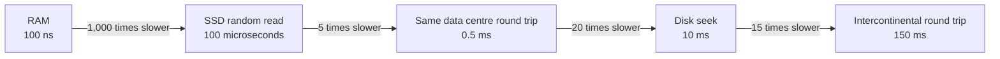
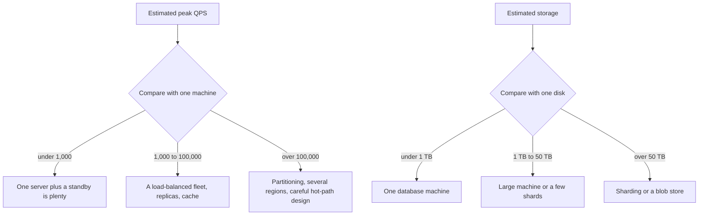

# Back-of-the-envelope estimation I: the numbers worth memorising

## Before this lesson

You should know the vocabulary from [The vocabulary of scale](#/lesson/system-design/core-vocabulary): latency, throughput, QPS and availability. You need multiplication, division and powers of ten. No programming is required to follow the ideas; the examples use a few lines of Python.

## In plain words

A **back-of-the-envelope estimate** is a rough calculation you can do in a minute on a scrap of paper to find out the *size* of a problem. The aim is not the exact answer. The aim is to know whether the answer is nearer a thousand, a million or a billion.

A builder asked "how much paint for this house?" does not measure every wall to the millimetre. They pace out the rooms, round up, multiply, and say "about forty litres". If the truth is 36 or 44 they are fine. If they had guessed four litres or four hundred they would have a real problem. Estimation protects you from being wrong by a factor of ten or more, which in engineering is called being off by an **order of magnitude**.

In a design interview, estimates decide the architecture. A system with 50 writes per second fits on one database. A system with 50,000 writes per second needs sharding. You cannot choose between those designs until you have done the arithmetic, and the interviewer wants to watch you do it. On the job, the same arithmetic tells you whether a feature will cost a hundred dollars a month or a hundred thousand.

This lesson gives you the small set of facts to memorise. The next lesson uses them in complete worked estimates.

## 1. Powers of ten: the language of rough numbers

Estimation uses rounded numbers written as powers of ten, because multiplying them only needs adding the exponents: $10^3 \times 10^6 = 10^9$.

| Name | Number | Power of ten | Prefix |
|---|---|---|---|
| Thousand | 1,000 | $10^3$ | kilo (k) |
| Million | 1,000,000 | $10^6$ | mega (M) |
| Billion | 1,000,000,000 | $10^9$ | giga (G) |
| Trillion | 1,000,000,000,000 | $10^{12}$ | tera (T) |
| Quadrillion | $10^{15}$ | $10^{15}$ | peta (P) |

Two habits make mental arithmetic safe:

1. **Round to one significant figure before multiplying.** 86,400 becomes $10^5$ (it is really $0.864 \times 10^5$; the error is 14%, which is fine). 3.2 million becomes $3 \times 10^6$.
2. **Keep the units written next to the number.** "300 million users times 2 posts per user per day" gives "600 million posts per day". Most estimation mistakes are unit mistakes, not arithmetic mistakes.

## 2. Powers of two: the language of computer storage

Computers store everything as **bits**; a bit is one binary digit, a 0 or a 1. Eight bits make a **byte**, which is enough for one plain English character. Storage sizes are powers of two because of how memory is addressed, and conveniently $2^{10} = 1{,}024$, which is close to a thousand.

| Power of two | Approximate value | Name | Shorthand |
|---|---|---|---|
| $2^{10}$ | 1 thousand | kilobyte | KB |
| $2^{20}$ | 1 million | megabyte | MB |
| $2^{30}$ | 1 billion | gigabyte | GB |
| $2^{40}$ | 1 trillion | terabyte | TB |
| $2^{50}$ | 1 quadrillion | petabyte | PB |

Each row is 1,024 times the row above; for estimation, treat that as 1,000.

Other powers of two worth recognising, because they appear when you choose the size of an identifier:

| Bits | Distinct values | Where you meet it |
|---|---|---|
| 8 | 256 | One byte |
| 16 | 65,536 | Port numbers |
| 32 | about 4.3 billion | IPv4 addresses, classic integer ids |
| 64 | about $1.8 \times 10^{19}$ | Modern ids and timestamps |
| 128 | about $3.4 \times 10^{38}$ | UUIDs, IPv6 addresses |

A 32-bit id runs out after about 4 billion rows, which large products exceed. That is why the unique-ID module uses 64 bits.

### Sizes of everyday things

To estimate storage you need a feel for how big typical objects are. These are round, defensible figures, not standards.

| Object | Rough size |
|---|---|
| A character of plain text | 1 byte (up to 4 for some scripts and emoji) |
| An integer or a timestamp | 8 bytes |
| A UUID | 16 bytes |
| A short text post or chat message | 100 to 300 bytes |
| A database row with a few columns of metadata | 500 bytes to 1 KB |
| A web page of HTML | 100 KB |
| A compressed photo from a phone | 2 to 3 MB; a thumbnail is 20 to 50 KB |
| One minute of compressed HD video | 50 to 100 MB |
| One minute of compressed audio | 1 MB |

```python-run
KB, MB, GB, TB, PB = 2**10, 2**20, 2**30, 2**40, 2**50

def human(n_bytes):
    """Turn a byte count into a readable string."""
    for unit, size in (("PB", PB), ("TB", TB), ("GB", GB), ("MB", MB), ("KB", KB)):
        if n_bytes >= size:
            return f"{n_bytes / size:,.1f} {unit}"
    return f"{n_bytes} bytes"

print("1 billion 8-byte ids       :", human(1_000_000_000 * 8))
print("1 million 200-byte messages:", human(1_000_000 * 200))
print("10 million 2.5 MB photos   :", human(10_000_000 * int(2.5 * MB)))
print("1 hour of HD video at 80 MB a minute:", human(60 * 80 * MB))
print()
print("A 32-bit id allows", f"{2**32:,}", "values")
print("A 64-bit id allows", f"{2**64:,}", "values")
```

The first line is worth remembering as a shape: a billion small things is "a few gigabytes", which fits in the memory of one machine. Ten million photos is tens of terabytes, which does not fit on one machine's disk and needs a blob store.

## 3. Time: turning "per day" into "per second"

Product people talk about usage per day or per month. Machines are sized per second. The bridge between them is one number:

$$1 \text{ day} = 24 \times 60 \times 60 = 86{,}400 \text{ seconds} \approx 10^5 \text{ seconds}$$

So **one million events per day is about 12 per second** ($10^6 / 86{,}400 \approx 11.6$), and rounding the day to $10^5$ seconds gives 10 per second, which is close enough.

| Per day | Per second (exact) | Mental shortcut |
|---|---|---|
| 1 million | 11.6 | about 10 |
| 10 million | 116 | about 100 |
| 100 million | 1,157 | about 1,000 |
| 1 billion | 11,574 | about 10,000 |

Other time facts:

| Period | Seconds | Rounded |
|---|---|---|
| 1 hour | 3,600 | $4 \times 10^3$ |
| 1 day | 86,400 | $10^5$ |
| 1 month | 2.6 million | $2.5 \times 10^6$ |
| 1 year | 31.5 million | $3 \times 10^7$ |

A handy coincidence: a year is close to $\pi \times 10^7$ seconds.

Traffic is not flat across the day. People are awake at similar times, so the busiest moment is higher than the average. The ratio of the **peak** rate to the average rate is commonly assumed to be 2 for a global product and up to 10 for one with sharp events (a ticket sale opening, a goal in a football final). State your assumption: "I will take peak as twice the average."

## 4. Latency numbers: what is fast and what is slow

Every design decision about caching, batching and placement rests on how long basic operations take. The exact values change as hardware improves, but the *ratios* between them have been stable for years, and the ratios are what you need.

A **nanosecond** (ns) is a billionth of a second. A **microsecond** (µs) is a millionth: 1,000 ns. A **millisecond** (ms) is a thousandth: 1,000 µs.

| Operation | Typical time | In words |
|---|---|---|
| Read a value already in the CPU's own cache | about 1 ns | Instant |
| Read from main memory (RAM) | about 100 ns | Very fast |
| Compress 1 KB of data | a few µs | Fast |
| Read 1 MB sequentially from RAM | tens of µs | Fast |
| Read a random location on a solid-state drive (SSD) | about 100 µs | A thousand times slower than RAM |
| Round trip inside one data centre | about 0.5 ms | The cost of every arrow in your diagram |
| Read 1 MB sequentially from an SSD | under 1 ms | |
| Move a hard-disk head to a random location (a "seek") | about 10 ms | A hundred thousand times slower than RAM |
| Read 1 MB sequentially from a hard disk | a few ms | Disks are acceptable for sequential reads |
| Round trip between continents | about 150 ms | Noticeable to a person |



Numbers this small are hard to feel. Stretch them so that one nanosecond becomes one second, and they become human.

```python-run
operations = [
    ("CPU cache reference",                1),
    ("Main memory reference",              100),
    ("SSD random read",                    100_000),
    ("Round trip in one data centre",      500_000),
    ("Hard disk seek",                     10_000_000),
    ("Round trip between continents",      150_000_000),
]

def stretched(ns):
    """If 1 nanosecond lasted 1 second, how long would this take?"""
    s = ns
    for unit, size in (("years", 31_536_000), ("days", 86_400), ("hours", 3_600), ("minutes", 60)):
        if s >= size:
            return f"{s / size:.1f} {unit}"
    return f"{s} seconds"

print(f"{'operation':34s} {'real time':>12s}   if 1 ns were 1 second")
for name, ns in operations:
    real = f"{ns} ns" if ns < 1000 else (f"{ns / 1000:g} us" if ns < 1_000_000 else f"{ns / 1_000_000:g} ms")
    print(f"{name:34s} {real:>12s}   {stretched(ns)}")
```

On that scale, reading memory takes under two minutes, a network hop in the building takes almost six days, a disk seek takes four months and a transatlantic round trip takes nearly five years. The table explains most performance advice in one view.

What the numbers tell you to do:

1. **Memory is fast, disk is slow.** Keep hot data in RAM. This is the whole case for caches.
2. **Avoid disk seeks.** Reading sequentially is far cheaper than jumping around, which is why log-structured storage and append-only files are popular.
3. **Network hops inside a data centre are cheap but not free.** A request that makes 100 sequential calls spends 50 ms on travel alone. Batch calls together or make them in parallel.
4. **Crossing regions is expensive.** Do it as rarely as possible and never several times within one user request. Put data near the users who read it.
5. **Compression is cheap compared with the network.** Compressing data before sending it across the internet nearly always wins.

> [!TIP]
> You do not need the exact figures. Memorise the ladder: nanoseconds for memory, about a hundred microseconds for SSD, half a millisecond for a hop in the data centre, ten milliseconds for a disk seek, a hundred and fifty for another continent.

## 5. Availability numbers

The previous lesson derived these; they belong on the same memory card.

| Availability | Nines | Downtime per year | Downtime per day |
|---|---|---|---|
| 99% | two | 3.65 days | 14.4 minutes |
| 99.9% | three | 8.77 hours | 1.44 minutes |
| 99.99% | four | 52.6 minutes | 8.6 seconds |
| 99.999% | five | 5.26 minutes | 0.86 seconds |

A shortcut: 1% of a year is about 3.65 days, and each extra nine divides by ten. Cloud providers commonly promise 99.9% or 99.95% for a single service in their service level agreements; anything you build on top of one such service cannot do better than that unless you add redundancy across zones or regions.

Remember the two combination rules: dependencies in series multiply their availabilities, and redundant copies in parallel multiply their *un*availabilities.

## 6. Capacity of one machine: reference points

To turn "QPS" into "number of servers" you need a rough figure for what one machine can do. These depend heavily on the work per request, so present them as assumptions and offer to revise them.

| Component | A defensible round number |
|---|---|
| Web or application server doing light work | 1,000 requests per second |
| Application server doing heavy work (templates, encryption, several backend calls) | 100 to 300 requests per second |
| Relational database, simple indexed reads | 5,000 to 10,000 per second |
| Relational database, writes | 1,000 to 5,000 per second |
| In-memory cache such as Redis | 100,000 operations per second |
| One machine's RAM | 64 to 256 GB |
| One machine's disk | 1 to 10 TB |
| Network link of one server | 1 to 10 gigabits per second |

Note that network links are quoted in **bits** per second while storage is quoted in **bytes**. A 1 gigabit per second link carries about 125 megabytes per second, because a byte is 8 bits. Confusing the two gives an error of eight times.



## 7. Rules of rounding that keep you out of trouble

- **Round early and say so.** "I will call 86,400 a hundred thousand." The interviewer sees that you know the real number and are choosing speed.
- **Carry at most two significant figures.** 11.6 per second is 12, or 10. Nobody needs 11.574.
- **Label every number with a unit and a period.** "posts per day", "bytes per post", "GB per year".
- **Write the assumptions down in a list as you go.** If one is challenged, you change one line and redo the product.
- **Sanity-check the result against something known.** If you estimate that a chat app needs 40 exabytes a year, compare with the fact that very large companies store on the order of exabytes in total, and look for the slipped factor.
- **Finish with a consequence.** A number matters only for what it implies: "about 2 TB a year, so one database with replicas is enough for years" or "about 3 PB a year, so this must go to a blob store".

> [!INTERVIEW]
> Interviewers are not checking your arithmetic to the digit. They are checking three things: that your assumptions are stated and reasonable, that your units are consistent, and that you draw a design conclusion from the result. An estimate that ends with a number and no "therefore" is unfinished.

> [!WARNING]
> Do not spend more than about five minutes on estimation unless asked to go deeper. It is a tool for choosing the design, not the design itself.

## Common mistakes

- **Mixing bits and bytes.** Network speed is in bits per second; divide by 8 to compare with storage sizes.
- **Mixing per day and per second.** Always convert using roughly $10^5$ seconds per day before comparing with machine capacity.
- **Using the average where the peak matters.** Servers must survive the busiest minute, so size for the peak rate.
- **False precision.** Reporting 11,574.07 QPS suggests you believe the inputs were exact.
- **Forgetting replication and overhead in storage.** Three copies triple the raw figure, and indexes add more.
- **Unlabelled numbers.** A bare "600 million" halfway down the page is a unit error waiting to happen.

## Summary

- Estimation finds the order of magnitude so that you can choose a design; state assumptions, round boldly, label units.
- $2^{10}$ is about a thousand: KB, MB, GB, TB, PB step up by a thousand each. A 32-bit id gives about 4 billion values; a 64-bit id is effectively unlimited.
- A day is about $10^5$ seconds, so a million events a day is about 10 per second. Size for peak, often twice the average.
- The latency ladder: memory in nanoseconds, SSD around 100 µs, a data-centre hop 0.5 ms, a disk seek 10 ms, another continent 150 ms.
- Each nine of availability divides allowed downtime by ten: three nines is under 9 hours a year, four nines under an hour.
- Know rough per-machine capacities so that QPS and storage figures become counts of servers and shards.

## Glossary

- **Back-of-the-envelope estimate**: a quick, rough calculation to find the scale of something.
- **Order of magnitude**: a factor of ten.
- **Significant figure**: a digit that carries meaning; 3,200,000 rounded to one significant figure is 3,000,000.
- **Bit / byte**: a single 0 or 1; eight bits.
- **KB, MB, GB, TB, PB**: about a thousand, million, billion, trillion and quadrillion bytes.
- **Nanosecond, microsecond, millisecond**: a billionth, a millionth and a thousandth of a second.
- **SSD**: solid-state drive, storage with no moving parts.
- **Disk seek**: moving a hard disk's head to a new position before reading.
- **Sequential / random read**: reading data in order, or jumping to arbitrary positions.
- **Peak**: the highest rate of traffic, as opposed to the average.
- **Peak factor**: the ratio of peak rate to average rate.
- **Round trip**: a message there and the reply back.

## Check yourself

```quiz
[
  {"q": "A service receives 50 million requests per day. Roughly how many per second is that on average?",
   "options": ["About 6", "About 60", "About 600", "About 6,000"],
   "answer": 2,
   "explain": "A day is about 86,400 seconds. 50,000,000 / 86,400 is about 580, so roughly 600 per second."},
  {"q": "Approximately how many bytes is 2 to the power 40?",
   "options": ["One million", "One billion", "One trillion, a terabyte", "One quadrillion"],
   "answer": 2,
   "explain": "Every 10 powers of two is about a thousand: 2^10 KB, 2^20 MB, 2^30 GB, 2^40 TB."},
  {"q": "Which operation is slowest?",
   "options": ["Reading from main memory", "A random read from an SSD", "A round trip inside one data centre", "A round trip between continents"],
   "answer": 3,
   "explain": "An intercontinental round trip is around 150 ms, hundreds of times slower than a hop inside a data centre and over a million times slower than a memory read."},
  {"q": "A server has a 1 gigabit per second network link. About how many megabytes per second can it send?",
   "options": ["1,000", "125", "8,000", "12.5"],
   "answer": 1,
   "explain": "Network speeds are in bits. 1,000 megabits divided by 8 bits per byte is 125 megabytes per second."},
  {"q": "You estimate 2 billion rows that each need a unique integer id. Why is a 32-bit id risky?",
   "options": ["32-bit integers cannot be indexed", "It allows only about 4.3 billion values, so growth soon exhausts it", "It is slower than a string", "It cannot be sorted"],
   "answer": 1,
   "explain": "2 billion rows already uses half the range of a 32-bit unsigned id. A 64-bit id removes the limit for practical purposes."},
  {"q": "Which statement about estimation in an interview is best?",
   "options": ["Compute to four decimal places to show rigour", "State assumptions, round to simple numbers, and end with what the result means for the design", "Skip it; interviewers only care about diagrams", "Always assume one billion users"],
   "answer": 1,
   "explain": "The purpose is to choose a design. Clear assumptions, consistent units and a conclusion matter far more than precise arithmetic."},
  {"q": "The average rate is 2,000 QPS and you assume a peak factor of 3. What rate should the servers be sized for?",
   "options": ["667 QPS", "2,000 QPS", "6,000 QPS", "2,003 QPS"],
   "answer": 2,
   "explain": "Peak equals average times the peak factor. Capacity must cover the busiest period, so plan for 6,000 QPS plus headroom."}
]
```

> **Source:** Xu, *System Design Interview: An Insider's Guide*, ch. 2 (power of two, latency numbers, availability numbers) as a topic guide; System Design Primer, appendix "Powers of two table" and "Latency numbers every programmer should know", https://github.com/donnemartin/system-design-primer
