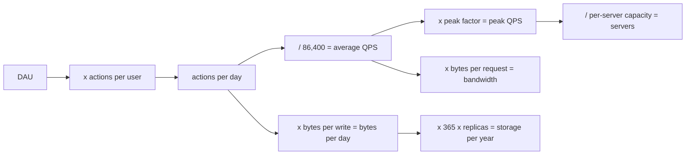
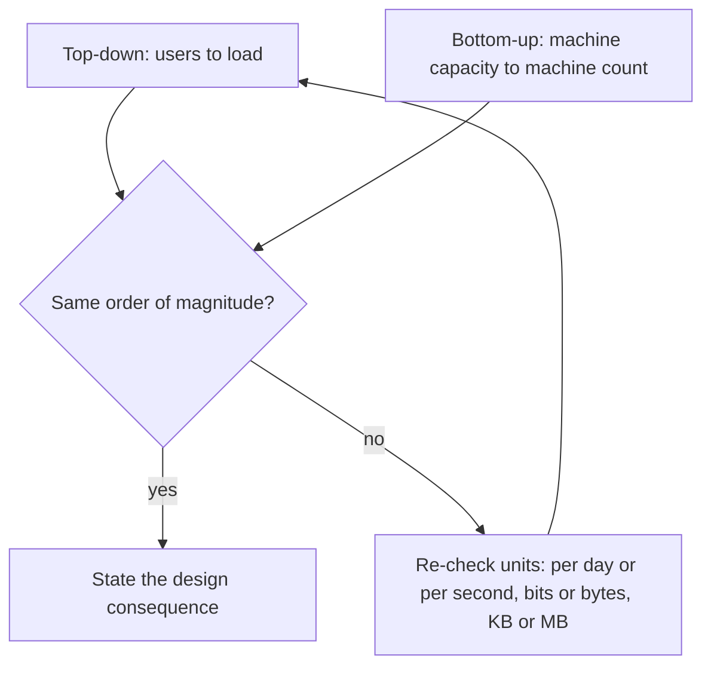

# Back-of-the-envelope estimation II: QPS, storage and bandwidth worked step by step

## Before this lesson

Read [Estimation I: the numbers worth memorising](#/lesson/system-design/estimation-numbers). You should know that a day is about $10^5$ seconds, the byte units from KB to PB, and the rough capacity of one server.

## In plain words

The previous lesson gave you the ingredients. This one is the recipe. Every capacity estimate, whatever the product, follows the same five moves:

1. Count the **users** who are active.
2. Multiply by what each one **does** to get actions per day.
3. Divide by the seconds in a day to get a **rate per second**, then multiply by a peak factor.
4. Multiply actions by the **size** of what each one stores to get storage, and by the size of what each one transfers to get bandwidth.
5. Divide by what **one machine** can do to get a count of machines.

Planning a wedding buffet works the same way. Guests, times plates per guest, gives plates. Plates, times grams per plate, gives kilograms of food. Kilograms, divided by what one oven produces per hour, gives ovens. You round up at every step because running out is worse than having leftovers.

For a job this matters because capacity requests, cloud budgets and "will this design survive launch day?" are all answered with exactly this arithmetic.

## 1. The five quantities and their formulas

**Daily active users (DAU)** is the number of distinct people who use the product on a given day. It is the usual starting point because actions scale with it. If you are given monthly active users (MAU) instead, a common assumption is that between a fifth and a half of them are active on any one day.

**Average QPS** for an action:

$$\text{QPS}_{\text{avg}} = \frac{\text{DAU} \times \text{actions per user per day}}{86{,}400}$$

**Peak QPS**:

$$\text{QPS}_{\text{peak}} = \text{QPS}_{\text{avg}} \times \text{peak factor}$$

**Storage per year**:

$$\text{storage} = \text{writes per day} \times \text{bytes per write} \times 365 \times \text{replication factor}$$

The **replication factor** is the number of copies kept, commonly 3.

**Bandwidth** is the amount of data moving through the network per second. Data arriving at your servers is **ingress**; data leaving is **egress**.

$$\text{bandwidth} = \text{QPS} \times \text{bytes per request}$$

**Servers**:

$$\text{servers} = \left\lceil \frac{\text{QPS}_{\text{peak}}}{\text{per-server capacity} \times \text{target utilisation}} \right\rceil$$

The brackets mean "round up". **Target utilisation** is the fraction of a server's capacity you plan to use, commonly 0.5 to 0.7, leaving headroom for failures and surprises.



## 2. A reusable capacity estimator

The code below turns those formulas into one function. Read the comments, run it, then change the assumptions and run it again. It is the same calculation you would do aloud in an interview.

```python-run
import math

SECONDS_PER_DAY = 86_400

def human_bytes(n):
    for unit in ("B", "KB", "MB", "GB", "TB", "PB", "EB"):
        if n < 1024:
            return f"{n:,.1f} {unit}"
        n /= 1024
    return f"{n:,.1f} ZB"

def estimate(name, dau, writes_per_user, reads_per_user, bytes_per_write,
             bytes_per_read, peak_factor=2, replication=3, years=5,
             server_qps=1000, utilisation=0.6):
    writes_day = dau * writes_per_user
    reads_day = dau * reads_per_user
    write_qps = writes_day / SECONDS_PER_DAY
    read_qps = reads_day / SECONDS_PER_DAY
    peak_qps = (write_qps + read_qps) * peak_factor
    storage_year = writes_day * bytes_per_write * 365 * replication
    ingress = write_qps * bytes_per_write            # bytes per second arriving
    egress = read_qps * bytes_per_read               # bytes per second leaving
    servers = math.ceil(peak_qps / (server_qps * utilisation))

    print(f"== {name} ==")
    print(f"writes  : {writes_day:>16,.0f} per day  = {write_qps:>10,.0f} per second")
    print(f"reads   : {reads_day:>16,.0f} per day  = {read_qps:>10,.0f} per second")
    print(f"read to write ratio  : {reads_day / writes_day:,.0f} to 1")
    print(f"peak QPS (x{peak_factor})        : {peak_qps:,.0f}")
    print(f"storage per year     : {human_bytes(storage_year)}  ({replication} copies)")
    print(f"storage in {years} years   : {human_bytes(storage_year * years)}")
    print(f"ingress              : {human_bytes(ingress)}/s = {ingress * 8 / 1e6:,.1f} Mbit/s")
    print(f"egress               : {human_bytes(egress)}/s = {egress * 8 / 1e6:,.1f} Mbit/s")
    print(f"app servers at peak  : {servers}  (each {server_qps} QPS, used to {utilisation:.0%})")
    print()

# A text-only micro-blog: 20 million daily users, 1 post a day, 50 timeline views a day.
estimate("micro-blog, text only", dau=20_000_000, writes_per_user=1, reads_per_user=50,
         bytes_per_write=300, bytes_per_read=20_000)

# The same product where 1 post in 10 carries a 500 KB photo: the average write is 50 KB.
estimate("micro-blog with photos", dau=20_000_000, writes_per_user=1, reads_per_user=50,
         bytes_per_write=300 + 50_000, bytes_per_read=200_000)
```

Compare the two outputs. The request rates are identical. The storage grows from a few terabytes a year to over a petabyte, and egress grows by ten. Adding photos did not change the web tier at all; it changed the storage design completely, from "a database" to "a blob store with a CDN in front". That is the kind of conclusion an estimate exists to produce.

## 3. Worked example one: a photo-sharing service, done by hand

Do this one slowly, the way you would on a whiteboard, saying every assumption.

**Assumptions** (written as a list so any one can be changed):

- 300 million monthly active users, and a third are active daily: **100 million DAU**.
- Each active user uploads **0.2 photos per day** on average (one photo every five days).
- Each active user views **100 photos per day**.
- A stored photo is **2 MB** after compression, and we also store a **50 KB** thumbnail. Feeds show thumbnails; a tenth of views open the full photo.
- Metadata is **500 bytes** per photo.
- Peak factor **2**; replication factor **3**.

**Step 1: actions per day.**

- Uploads: $100\text{M} \times 0.2 = 20\text{M}$ per day.
- Views: $100\text{M} \times 100 = 10\text{B}$ per day.

**Step 2: rates.**

- Upload QPS: $20\text{M} / 10^5 = 200$ per second (exact: 231).
- View QPS: $10\text{B} / 10^5 = 100{,}000$ per second (exact: 115,700).
- Read to write ratio: 500 to 1. This is a very read-heavy system.
- Peak: about 400 uploads and 200,000 views per second.

**Step 3: storage.**

- Photo bytes per day: $20\text{M} \times 2.05\text{ MB} \approx 41\text{ TB}$.
- Per year: $41 \times 365 \approx 15{,}000\text{ TB} = 15\text{ PB}$.
- With three copies: about **45 PB per year**.
- Metadata per year: $20\text{M} \times 365 \times 500\text{ B} \approx 3.7\text{ TB}$, or about 11 TB with three copies.

**Step 4: bandwidth.**

- Ingress: $231 \times 2.05\text{ MB} \approx 470\text{ MB/s} \approx 3.8\text{ Gbit/s}$.
- Egress: 90% of views are thumbnails and 10% are full photos, so the average view is $0.9 \times 50\text{ KB} + 0.1 \times 2\text{ MB} \approx 245\text{ KB}$. Then $115{,}700 \times 245\text{ KB} \approx 28\text{ GB/s} \approx 227\text{ Gbit/s}$.

**Step 5: conclusions.** This is the part that earns the marks.

1. Photo bytes (petabytes) and metadata (terabytes) differ by a factor of thousands, so they go to different stores: a blob store for bytes, a database for metadata.
2. Hundreds of gigabits per second of egress cannot sensibly come from your own data centre: a CDN must serve the images.
3. 200,000 view requests per second at peak means the feed's metadata reads must be cached; the database should see a small fraction of that.
4. Only a few hundred uploads per second: writes are easy, and the upload path can go through a queue for thumbnail generation.
5. Eleven terabytes of metadata a year will outgrow a single database machine within a few years, so plan for sharding by user id but do not build it on day one.

> [!INTERVIEW]
> Notice the shape of the answer: assumptions, arithmetic, then a numbered list of design consequences. If you run out of time, shorten the arithmetic, never the consequences.

## 4. Worked example two: a chat service

**Assumptions:** 50 million DAU. Each sends 40 messages a day. A message is 100 bytes of text plus 100 bytes of metadata (sender, channel, time, id): 200 bytes. One message in 20 has a 200 KB image attached. Each user keeps one long-lived connection open while active, and a fifth of daily users are online at the busiest moment.

- Messages per day: $50\text{M} \times 40 = 2\text{B}$.
- Message QPS: $2\text{B} / 86{,}400 \approx 23{,}000$ per second; peak about 46,000.
- Text storage per year: $2\text{B} \times 200 \times 365 \approx 146\text{ TB}$; about 440 TB with three copies.
- Image storage per year: $2\text{B} / 20 \times 200\text{ KB} \times 365 \approx 7.3\text{ PB}$; about 22 PB with three copies.
- Concurrent connections at peak: $50\text{M} / 5 = 10\text{M}$.

**Conclusions:**

1. Tens of thousands of writes per second and hundreds of terabytes a year of small records, read mostly by recency, point to a wide-column or key-value store partitioned by channel, not a single relational database.
2. Ten million open connections is its own problem. If one machine holds 100,000 connections, that is 100 connection servers, and something must record which user is connected to which machine.
3. Images dominate storage again and go to a blob store.

Here the estimate surfaced a quantity, concurrent connections, that the QPS figure alone would not have shown. Always ask what the scarce resource is. It is not always requests per second.

## 5. Worked example three: how much memory for a cache?

A widely used starting assumption is the **80/20 rule**: about 20% of the items receive about 80% of the requests. So caching the hottest 20% of a day's reads catches most of the traffic.

Suppose a URL shortener serves 100 million redirects per day and each cached entry (short code, long URL and overhead) is 500 bytes.

- Entries read per day: 100 million, but many are repeats. Assume 20 million distinct URLs are read in a day.
- Cache the hottest 20%: 4 million entries.
- Memory: $4\text{M} \times 500\text{ B} = 2\text{ GB}$.

Two gigabytes fits in a single modest cache machine. You would still run at least two for redundancy. The conclusion: the cache is cheap, so there is no reason not to have one.

```python-run
def cache_memory_gb(distinct_items_per_day, bytes_per_item, hot_fraction=0.2, overhead=1.3):
    """Memory for caching the hottest items. overhead covers the cache's own bookkeeping."""
    return distinct_items_per_day * hot_fraction * bytes_per_item * overhead / 2**30

print(f"URL shortener  : {cache_memory_gb(20_000_000, 500):6.1f} GB")
print(f"User profiles  : {cache_memory_gb(100_000_000, 2_000):6.1f} GB")
print(f"Feed pages     : {cache_memory_gb(100_000_000, 20_000):6.1f} GB")
```

The three results span three orders of magnitude: about 2.4 GB (one machine), about 48 GB (one large machine or a few small ones) and nearly 500 GB (a cluster of cache machines, which then needs a way to decide which key lives on which machine). The size of an item, not the number of users, made the difference.

## 6. Checking an estimate from two directions

A good habit is to verify a number by a second route.

**Top-down** starts from users and works down, as above. **Bottom-up** starts from what machines can do and works up: "one database handles 5,000 writes per second; I estimated 23,000; so I need at least five shards, and ten for headroom."

A third check is to compare with a number you trust. If you computed that a text chat needs more storage than a video site, something slipped. Common slips are: multiplying by DAU twice, forgetting to divide by 86,400, and using megabytes where kilobytes were meant.



## 7. What to do with the numbers

Estimates are only useful when attached to decisions. This table maps the common results to their consequences.

| Result | Design consequence |
|---|---|
| Read to write ratio above 10 to 1 | Read replicas and caching will pay off |
| Read to write ratio near 1 to 1, high volume | Replicas do not help; think about partitioning writes |
| Peak QPS under 1,000 | Two servers behind a load balancer; do not over-engineer |
| Peak QPS in the tens of thousands or more | Stateless fleet, caches, and partitioned data |
| Storage under 1 TB in five years | One database with replicas |
| Storage of many terabytes of structured rows | Sharding, or a database that partitions itself |
| Storage in petabytes | Blob store; tiered storage for old data |
| Egress above a few gigabits per second | CDN |
| Millions of concurrent connections | Dedicated connection servers and a routing registry |
| Cache size under 100 GB | One or two cache machines |
| Cache size in the hundreds of gigabytes | A cache cluster with consistent hashing |

> [!TIP]
> Before calculating anything, ask the interviewer whether they want numbers at all: "Would you like me to estimate the scale, or should I assume something like 10 million daily users?" Some interviewers give you the figures; others want to see the derivation. Either way you have shown you know scale drives the design.

> [!WARNING]
> Do not let a large number push you to a complex design when the *rate that matters* is small. A service may have a billion registered users and still receive 50 writes per second on the path you are designing. Estimate the path, not the brand.

## Common mistakes

- **Starting from total registered users instead of daily active users.** Most registered accounts are idle on any given day.
- **One QPS number for everything.** Separate reads from writes; they lead to different design choices.
- **Forgetting the peak.** Sizing for the average fails every evening.
- **Forgetting replication in storage, and retention.** Three copies and five years turn one number into fifteen times as much.
- **Ignoring media.** A small fraction of messages with images usually outweighs all the text.
- **Stopping at the number.** Always end with "therefore".
- **Arguing about inputs.** If the interviewer suggests a different assumption, adopt it and recompute; the method is what is being assessed.

## Summary

- Every estimate runs the same chain: users, actions per day, rate per second, peak, bytes, machines.
- Separate reads from writes and report their ratio; it tells you whether replicas and caches will help.
- Storage per year is writes per day times bytes per write times 365 times the number of copies. Media dominates text by orders of magnitude.
- Bandwidth is QPS times bytes per request; convert to bits per second when comparing with network links.
- Size a cache from the distinct items read per day, the hot fraction and the bytes per item.
- Check by a second route, then turn each number into a design consequence.

## Glossary

- **DAU / MAU**: daily and monthly active users, the people who use the product in a day or month.
- **Average QPS / peak QPS**: the mean request rate over a day, and the rate at the busiest time.
- **Read to write ratio**: reads divided by writes for the same period.
- **Replication factor**: the number of copies of each piece of data.
- **Retention**: how long data is kept.
- **Bandwidth**: data transferred per second.
- **Ingress / egress**: data flowing into, and out of, your system.
- **Target utilisation**: the planned fraction of a machine's capacity to use.
- **Headroom**: spare capacity kept for failures and bursts.
- **80/20 rule**: the observation that a small share of items usually receives most of the requests.
- **Concurrent connections**: connections open at the same moment.
- **Top-down / bottom-up estimate**: working from users to load, or from machine capacity to machine count.

## Check yourself

```quiz
[
  {"q": "A product has 10 million DAU and each user makes 20 requests per day. What is the average QPS, approximately?",
   "options": ["About 23", "About 230", "About 2,300", "About 23,000"],
   "answer": 2,
   "explain": "10M x 20 = 200M requests a day. 200,000,000 / 86,400 is about 2,315 per second."},
  {"q": "A service stores 5 million new records per day at 1 KB each with a replication factor of 3. Roughly how much storage per year?",
   "options": ["About 5.5 GB", "About 55 GB", "About 5.5 TB", "About 550 TB"],
   "answer": 2,
   "explain": "5M x 1 KB = 5 GB a day, x 365 = about 1.8 TB a year, x 3 copies = about 5.5 TB."},
  {"q": "The average rate is 1,500 QPS, the peak factor is 2, each server handles 500 QPS and you target 60% utilisation. How many servers?",
   "options": ["3", "6", "10", "12"],
   "answer": 2,
   "explain": "Peak is 3,000 QPS. Each server is planned for 500 x 0.6 = 300 QPS. 3,000 / 300 = 10."},
  {"q": "Reads are 400 per second with a 250 KB average response. What is the egress in megabits per second?",
   "options": ["100 Mbit/s", "800 Mbit/s", "12.5 Mbit/s", "8,000 Mbit/s"],
   "answer": 1,
   "explain": "400 x 250 KB = 100 MB per second. Multiply by 8 to convert bytes to bits: 800 Mbit/s."},
  {"q": "In the photo-sharing example, which finding most strongly forces the use of a CDN?",
   "options": ["Uploads of a few hundred per second", "Metadata of a few terabytes a year", "Egress of hundreds of gigabits per second", "A replication factor of 3"],
   "answer": 2,
   "explain": "Serving that volume of image bytes from your own servers is impractical. A CDN delivers them from the edge and takes the load off the origin."},
  {"q": "The read to write ratio of a workload is about 1 to 1 at high volume. Which statement is right?",
   "options": ["Read replicas will solve the scaling problem", "A CDN will solve the scaling problem", "Replicas help little; the write path must be partitioned", "No scaling is needed"],
   "answer": 2,
   "explain": "Replicas scale reads only. When writes are half the load, the single primary is the limit and the data must be partitioned."},
  {"q": "Why estimate from daily active users instead of registered users?",
   "options": ["Registered users are always fewer", "Only active users generate load on a given day", "Registered users cannot be counted", "DAU is always exactly 10% of registered users"],
   "answer": 1,
   "explain": "Load comes from people using the product. Most registered accounts are idle on any one day, so DAU is the right multiplier."},
  {"q": "You estimate that a text-only chat needs more storage per year than a video platform of the same user count. What should you do?",
   "options": ["Report it; estimates are never wrong", "Re-check units, such as KB versus MB or a missing division by 86,400", "Add more servers", "Switch to a graph database"],
   "answer": 1,
   "explain": "A result that contradicts common sense signals a slipped factor. Verify units and compare with a second route before drawing conclusions."}
]
```

> **Source:** Xu, *System Design Interview: An Insider's Guide*, ch. 2 (estimating QPS and storage requirements) as a topic guide; System Design Primer, "Back-of-the-envelope calculations" references in the appendix, https://github.com/donnemartin/system-design-primer
