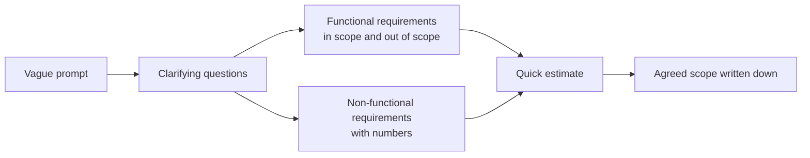
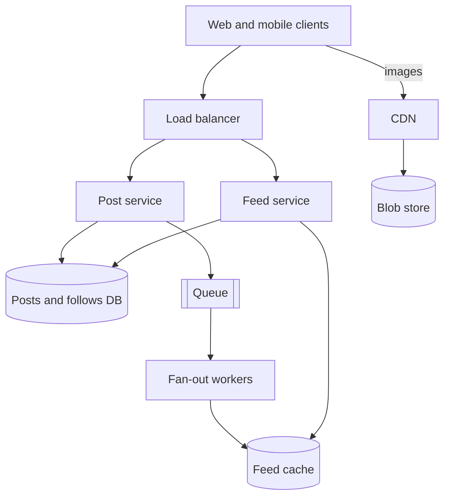
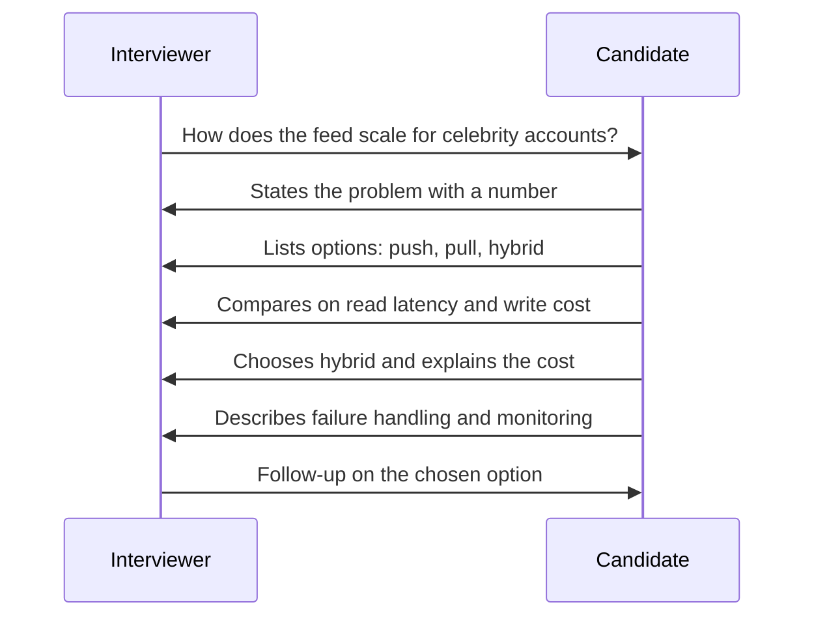

# A framework for the interview I: the four steps

## Before this lesson

You should have read the modules [System design from zero](#/lesson/system-design/clients-servers-requests), [Scaling from zero to millions](#/lesson/system-design/scale-single-to-replicated) and [Estimation](#/lesson/system-design/estimation-worked). You need to know the building blocks (database, cache, load balancer, queue, CDN) and how to estimate QPS and storage.

## In plain words

A system design interview is a 45 to 60 minute conversation in which you are given a vague one-line problem, such as "design a chat app", and asked to propose how to build it. There is no single correct answer. The interviewer is watching *how you work*: whether you find out what is wanted, whether you can structure a large problem, and whether you can weigh options.

An architect meeting a client behaves the same way. A client says "I want a house." A poor architect starts drawing a mansion. A good architect asks: how many people, what budget, which plot, any stairs to avoid? Then they sketch the floor plan, get agreement, and only afterwards discuss the plumbing in the bathroom the client cares most about. Last, they summarise and mention what could be extended later.

That sequence is the framework:

1. **Understand the problem and set the scope.**
2. **Propose a high-level design and get agreement.**
3. **Dive deep into the parts that matter.**
4. **Wrap up.**

Following it does not guarantee a good design, but it reliably prevents the most common ways of failing: solving the wrong problem, running out of time, and having nothing to say about trade-offs.

## 1. What the interviewer is measuring

It helps to know the marking scheme before the method. Interviewers typically write notes under headings like these:

| Signal | What it looks like when present | What it looks like when absent |
|---|---|---|
| Problem exploration | Asks about users, features, scale and constraints | Starts drawing at once |
| Structure | Works top-down, states where the conversation is going | Jumps between details |
| Technical breadth | Chooses appropriate building blocks and can name alternatives | Uses one tool for everything |
| Technical depth | Can explain how at least one component works inside | Every box is a black box |
| Trade-off reasoning | "I choose X because of A, at the cost of B" | "X is best" |
| Handling failure and scale | Brings up bottlenecks and failure modes unprompted | Describes only the happy path |
| Collaboration | Checks in, takes hints, changes course gracefully | Monologues or argues |

No row is about arriving at a particular architecture. Two candidates with different diagrams can both receive the top grade.

Interviewers also look for warning signs, often called **red flags**: over-engineering (adding complexity the requirements do not justify), stubbornness, ignoring hints, and narrow fixation on one component while the rest of the system stays undefined.

## 2. Step 1: understand the problem and set the scope

**Goal:** turn the one-line prompt into a short written list of requirements that you and the interviewer both agree on.

The prompt is deliberately vague. "Design a news feed" could mean a personal project or a product for two billion people. Answering without asking is the single most damaging mistake, because everything after it rests on guesses.

Ask in four groups.

**Who and what (functional requirements).**
- Who are the users, and what are the two or three most important things they do?
- Which features are in scope today, and which can be left out?
- Which clients: web, mobile, both?

**How much (scale).**
- How many daily active users?
- How much does each do? Reads versus writes?
- How large is each item? Is there media?
- How fast is it expected to grow?

**How well (non-functional requirements).**
- What latency is expected, and for which operation?
- How available must it be?
- May readers see slightly stale data, or must they always see the latest?
- How long is data kept? Must anything never be lost?

**Constraints and context.**
- Is there an existing system or technology stack to fit in with?
- Any security, privacy or legal requirements, such as storing data in a particular country?
- Is cost a concern?

You will not ask all of these. Pick the six to eight that most affect the design of the given problem. When the interviewer answers "you decide", make an explicit assumption and write it down: "I will assume 10 million daily users and that feeds may be a few seconds stale."

Finish the step by writing the agreed list where both of you can see it:

```
Functional
  1. Post a text update (up to 500 characters) with optional photo
  2. Follow and unfollow users
  3. View a feed of posts from people I follow, newest first
Out of scope: search, ads, direct messages

Non-functional
  - 10M DAU, read-heavy
  - Feed loads with p99 under 500 ms
  - 99.9% available; feed may be a few seconds stale
  - Posts are never lost
```

Then do a short estimate if scale matters (it usually does), following the previous lesson: QPS for reads and writes, storage per year, and one sentence of consequence.



> [!INTERVIEW]
> Aim to spend about five to eight minutes here in a 45-minute interview. Less, and you are guessing. More, and you will not finish. A clean way to close the step: "Here is what I plan to design. Does that match what you had in mind, or would you like to change the focus?"

## 3. Step 2: propose a high-level design and get agreement

**Goal:** a simple end-to-end design that satisfies the functional requirements, drawn as boxes and arrows, which the interviewer agrees is a reasonable base.

Work in this order.

**1. API.** Write the handful of calls the clients make. This pins down exactly what the system does and gives names to things.

```
POST /v1/posts            body: {text, media_id?}      -> 201 {post_id}
POST /v1/follows          body: {followee_id}          -> 204
GET  /v1/feed?cursor=X&limit=20                        -> 200 {posts[], next_cursor}
```

**2. Data model.** List the main entities, their key fields, and which store each lives in. You do not need every column; you need the keys and the access patterns.

```
users(user_id PK, name, created_at)
posts(post_id PK, author_id, text, media_url, created_at)   index on (author_id, created_at)
follows(follower_id, followee_id)                           PK (follower_id, followee_id)
```

**3. The diagram.** Draw the path of each main request from client to storage. Start with the simplest thing that works: clients, a load balancer, stateless application servers, a database. Add a cache, a queue, a blob store or a CDN only where a requirement or the estimate calls for it, and say why as you add it.



**4. Walk through the use cases.** Trace each functional requirement along the diagram aloud: "To post, the client calls the post service, which writes the row and enqueues a fan-out job. To read the feed, the client calls the feed service, which reads the precomputed list from the feed cache." This catches missing arrows and proves the design does what was asked.

**5. Check in.** "This is the overall shape. Before I go deeper, does anything look off, and is there an area you would like me to focus on?"

At this stage every box may be a black box. Resist the pull to explain the internals of the first thing you draw; you will lose the big picture and the clock. Breadth first, then depth.

> [!TIP]
> Treat the interviewer as a teammate at a whiteboard. Think aloud, propose two options where a real choice exists, and pick one with a reason. Silence gives the interviewer nothing to assess, and a design delivered without discussion looks memorised.

## 4. Step 3: design deep dive

**Goal:** show depth on two or three components that carry the most risk or interest.

Which components? In order of priority:

1. **Whatever the interviewer asks for.** Their hints tell you where the marks are. A question such as "how would the feed work for someone with fifty million followers?" is an instruction.
2. **The hardest part of this particular problem.** Every classic problem has one or two: the fan-out strategy in a news feed, message delivery and ordering in a chat system, collision-free short codes in a URL shortener, chunking and deduplication in file sync.
3. **The bottleneck your estimate predicted.** If writes are 50,000 per second, talk about partitioning. If the feed must load in 200 ms, talk about precomputation and caching.

For each deep dive, a dependable pattern is:

- **State the problem precisely.** "A user with 50 million followers posts. Writing to 50 million feed lists takes minutes and creates a huge burst."
- **Offer two or three options.** "Fan out on write, fan out on read, or a hybrid."
- **Compare them on the requirements that matter.** A small table on the whiteboard works well.
- **Choose and justify.** "Hybrid: push for ordinary accounts, pull for the few very large ones, because it keeps reads fast for almost everyone and bounds the write burst."
- **Say how it fails and what you do about it.** "If the fan-out workers fall behind, feeds are delayed, not lost; I alert on queue depth."



Avoid diving into details that show no design judgement. Explaining the internals of a hashing algorithm or the exact syntax of a query spends minutes without demonstrating that you can design systems. A good test: "would a senior engineer reviewing this design ask about it?"

## 5. Step 4: wrap up

**Goal:** leave a clear final impression in the last three to five minutes. Useful things to do, roughly in order of value:

- **Recap.** One or two sentences per component, tracing a request through the final design. This helps an interviewer who must write up notes afterwards.
- **Name the bottlenecks and what you would improve.** No design is finished. "The feed cache is the most critical dependency; next I would add a second region and a fallback that builds the feed on read."
- **Failure cases.** What happens when a server, a data centre or a network link fails.
- **Operations.** Which metrics and alerts you would add, and how you would roll out changes safely.
- **The next order of magnitude.** "At ten times the scale, the follows table would need sharding by follower id."
- **Refinements you skipped.** Features placed out of scope that you could add.

Do not claim the design is perfect, and do not introduce a brand-new component in the last minute that you have no time to justify.

## 6. Managing the clock

The four steps need a time budget, or step 3 will swallow everything. For a 45-minute session with a few minutes of introductions and questions at the end:

| Step | Minutes | Output |
|---|---|---|
| 1. Scope and estimates | 5 to 8 | Written requirements, two or three numbers |
| 2. High-level design | 10 to 15 | API, data model, diagram, walk-through |
| 3. Deep dive | 15 to 20 | Two or three components examined, with trade-offs |
| 4. Wrap-up | 3 to 5 | Recap, bottlenecks, next steps |

The small planner below scales the budget to any interview length and prints the clock times at which you should be moving on. Use it when you practise with a timer.

```python-run
def plan(total_minutes, intro=3, questions_at_end=4):
    """Split the working time of an interview across the four steps."""
    working = total_minutes - intro - questions_at_end
    shares = [("1. Scope and estimates", 0.16),
              ("2. High-level design", 0.30),
              ("3. Deep dive", 0.44),
              ("4. Wrap-up", 0.10)]
    clock = intro
    print(f"-- {total_minutes}-minute interview ({working} working minutes) --")
    for name, share in shares:
        minutes = round(working * share)
        print(f"{name:24s} {minutes:>3} min   from minute {clock:>2} to {clock + minutes:>2}")
        clock += minutes
    print(f"{'Your questions':24s} {total_minutes - clock:>3} min   from minute {clock:>2} to {total_minutes:>2}\n")

plan(45)
plan(60)
plan(35)
```

In a 45-minute interview you should have requirements written by about minute 9 and a complete high-level diagram by about minute 20. If you notice you are behind, say so and compress: "I am aware of the time, so I will sketch the write path quickly and spend the remaining time on the feed generation."

## 7. Adapting the framework to different prompts

Prompts come in a few families. The steps stay the same; the emphasis moves.

| Family | Example prompts | Where the weight goes |
|---|---|---|
| Product design | News feed, chat, video platform, file sync | Requirements and scoping; data model; the one or two hard flows |
| Infrastructure component | Rate limiter, key-value store, unique ID generator | Algorithms and data structures; consistency and failure handling |
| Data-heavy pipeline | Web crawler, metrics system, search autocomplete | Throughput, storage layout, batch versus streaming |
| Transactional system | Payments, ticket booking | Correctness, idempotency, consistency over raw scale |

A quick way to tell which family you are in is to ask yourself what would be most embarrassing to get wrong. For a feed it is being slow. For payments it is charging twice. For a crawler it is being banned for hammering a website. Let that answer steer step 3.

> [!WARNING]
> The framework is a guide, not a script. If the interviewer cuts in with a question, answer it right away, even if it belongs to a later step. Returning to your plan afterwards ("coming back to the data model") shows control; ignoring the question to stay on plan shows the opposite.

## Common mistakes

- **Designing before clarifying.** The most frequent failure. Ask first.
- **Asking twenty questions.** Scope with purpose; choose the questions that change the design.
- **No written requirements.** Without them neither of you can check the design against anything.
- **Depth before breadth.** Ten minutes on database indexes with no end-to-end diagram.
- **No trade-offs.** Stating choices without alternatives or costs.
- **Ignoring hints.** A question from the interviewer is a signpost to where the marks are.
- **Running out of time before the deep dive.** The deep dive is where seniority is judged.

## Summary

- The interview measures how you work: exploring the problem, structuring it, choosing building blocks, reasoning about trade-offs and collaborating.
- Step 1 turns a vague prompt into agreed functional and non-functional requirements plus a brief estimate.
- Step 2 produces an API, a data model and a simple end-to-end diagram, then a walk-through of each use case and a check-in.
- Step 3 examines two or three components in depth using the pattern: problem, options, comparison, choice, failure handling.
- Step 4 recaps, names bottlenecks and failure cases, and says what you would do next.
- Budget the time and keep to it, with the largest share for the deep dive.

## Glossary

- **Scope**: the agreed boundary of what will and will not be designed.
- **Functional requirement**: a feature the system must provide.
- **Non-functional requirement**: a quality the system must have, such as latency or availability.
- **High-level design**: the end-to-end arrangement of components, without their internals.
- **Deep dive**: detailed examination of one component.
- **Trade-off**: a choice that gains one quality at the cost of another.
- **Red flag**: behaviour an interviewer treats as a warning sign.
- **Over-engineering**: adding complexity that the requirements do not justify.
- **Happy path**: the flow when nothing goes wrong.
- **Bottleneck**: the component that limits the capacity of the whole.
- **Use case walk-through**: tracing one requirement step by step through the diagram.
- **Cursor**: a marker a client sends to ask for the next page of results.

## Check yourself

```quiz
[
  {"q": "You are asked to design a ride-sharing service. What should you do first?",
   "options": ["Draw the database schema", "Ask which features, how many users and what quality targets are in scope", "Explain how GPS works", "Choose between SQL and NoSQL"],
   "answer": 1,
   "explain": "The prompt is deliberately vague. Clarifying features, scale and non-functional targets comes before any design."},
  {"q": "The interviewer answers a scope question with: you decide. What is the best response?",
   "options": ["Ask the same question again", "State an explicit assumption, write it down and continue", "Design for the largest possible scale to be safe", "Skip the topic"],
   "answer": 1,
   "explain": "Make a reasonable assumption visible so it can be corrected later. Designing for maximal scale by default is over-engineering."},
  {"q": "In step 2, how detailed should each component be?",
   "options": ["Fully specified down to configuration", "A black box is acceptable; the goal is an agreed end-to-end shape", "Only the database should be drawn", "Components should not be named yet"],
   "answer": 1,
   "explain": "Breadth first. The high-level design shows the whole path; depth is saved for the components chosen in step 3."},
  {"q": "Which is the strongest way to present a design choice in the deep dive?",
   "options": ["X is the industry standard", "I pick X because it gives low read latency, at the cost of slower writes, which is acceptable here because reads dominate", "I have always used X", "X and Y are both fine"],
   "answer": 1,
   "explain": "A choice tied to a requirement, with its cost named and justified, demonstrates trade-off reasoning."},
  {"q": "During your explanation of the data model, the interviewer asks how you would handle a celebrity with millions of followers. What do you do?",
   "options": ["Say you will get to that later and continue", "Answer the question now, then return to your plan", "Change the subject to caching", "Restart from the requirements"],
   "answer": 1,
   "explain": "An interviewer's question shows where they want depth. Answer it, then pick up where you were."},
  {"q": "In a 45-minute interview, about when should the high-level diagram be complete?",
   "options": ["By minute 5", "By about minute 20", "By minute 40", "It does not matter"],
   "answer": 1,
   "explain": "Scope takes roughly the first 8 minutes after introductions and the high-level design 10 to 15 more, leaving the largest share for the deep dive."},
  {"q": "Which of these belongs in the wrap-up?",
   "options": ["Introducing a new component with no time to justify it", "A recap, the main bottlenecks and what you would improve next", "Re-asking the scope questions", "Claiming the design has no weaknesses"],
   "answer": 1,
   "explain": "The wrap-up consolidates: summary, known weaknesses, failure cases and next steps. Every real design has weaknesses, and naming them shows judgement."}
]
```

> **Source:** Xu, *System Design Interview: An Insider's Guide*, ch. 3 (a four-step process for effective system design interviews) as a topic guide; System Design Primer, "How to approach a system design interview question", https://github.com/donnemartin/system-design-primer
