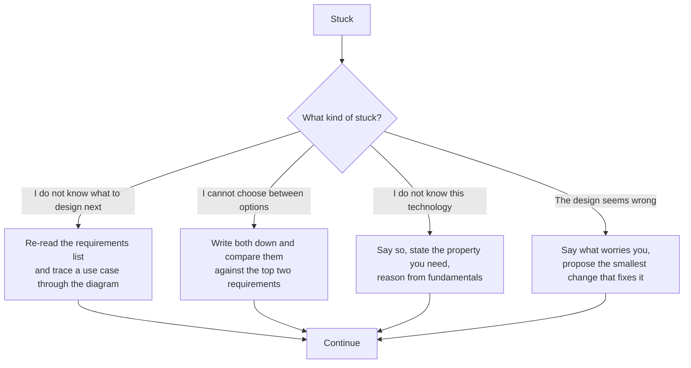
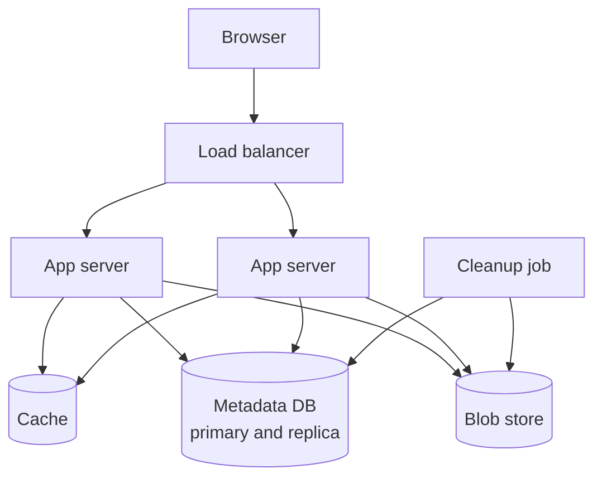
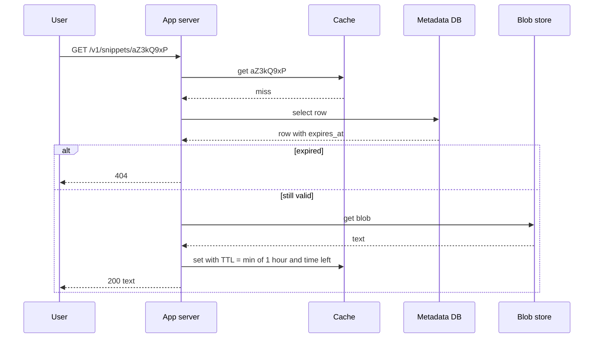

# A framework for the interview II: dos, don'ts and a complete worked session

## Before this lesson

Read [A framework for the interview I](#/lesson/system-design/framework-four-steps). You should know the four steps (scope, high-level design, deep dive, wrap-up), the time budget, and how to estimate QPS and storage from [Estimation II](#/lesson/system-design/estimation-worked).

## In plain words

Knowing the four steps is like knowing the rules of chess. This lesson is about playing a game. It lists the habits that separate strong sessions from weak ones, then runs one small problem from the first minute to the last so you can see the framework in motion, including what to say when you are stuck.

A driving test is a fair comparison. The examiner is not checking whether you can reach the destination; nearly everyone can. They are checking whether you look in the mirror, signal, keep to the speed limit and react sensibly when something unexpected happens. In a design interview the "mirror checks" are asking before assuming, saying your reasoning aloud, and naming what could go wrong.

On the job, the same habits make design reviews go well: colleagues trust proposals that state their assumptions and their weak points.

## 1. Dos

**Ask before you assume.** Every unstated assumption is a chance to design the wrong thing. If you must assume, say it: "I am assuming users are spread worldwide."

**Write the requirements down.** A visible list keeps both of you honest and gives you something to point at when you justify a choice.

**Think aloud.** The interviewer can only assess what they hear. Narrate options you reject as well as the one you pick.

**Offer more than one approach.** For any real decision, give two options and compare them. It shows you chose, not that you knew only one thing.

**Start simple and grow the design.** Draw the smallest design that works, then improve it in response to a requirement or a number.

**Design the critical parts first.** If the system's whole purpose is the feed, do not spend ten minutes on user registration.

**Use numbers.** "About 2,000 writes per second, so one primary is enough" is far stronger than "it should be fine".

**Talk about failure without being asked.** For each important component: what if it is slow, down, or returns duplicates?

**Check in at the transitions.** A sentence at the end of each step, asking whether to go deeper or move on, keeps you aligned.

**Take hints.** If the interviewer says "are you sure about that?", stop and reconsider aloud. They are helping.

**Stay flexible.** Requirements may change mid-session ("now make it global"). Treat it as a new input, not an attack.

## 2. Don'ts

**Do not start drawing in the first minute.** It tells the interviewer you solve problems before understanding them.

**Do not go silent.** A long quiet stretch looks like being stuck even when you are thinking well. If you need a moment, say "let me think about this for thirty seconds".

**Do not over-engineer.** Sharding, three regions and an event-streaming platform for a system with 50 requests per second is a red flag. Complexity must be earned by a requirement.

**Do not recite a memorised architecture.** Interviewers change a requirement specifically to see whether you can adapt.

**Do not get lost in one component early.** Depth before breadth leaves the design unfinished.

**Do not name-drop technologies you cannot explain.** If you say "Kafka", expect "why not a plain queue?". Describing the property you need ("a durable, replayable log") is safer than a brand name you cannot defend.

**Do not hide uncertainty.** "I am not sure how that database handles this; here is how I would reason about it" is much better than a confident wrong claim.

**Do not argue.** If you disagree with a hint, explain your reasoning once, then follow the interviewer's direction.

**Do not declare the design finished.** There is always something to improve; saying what it is counts in your favour.

| Situation | Weak response | Strong response |
|---|---|---|
| Vague prompt | Starts drawing | Asks six targeted questions and writes the scope |
| A choice between two stores | "I will use MongoDB" | "A relational store fits because of X; I would reconsider if Y" |
| Interviewer asks about failure | "We would add monitoring" | "If the primary fails, a replica is promoted in about 30 seconds; writes in flight may be lost, so the client retries with an idempotency key" |
| Unknown topic | Bluffs | States what they know, reasons from first principles, flags uncertainty |
| Running short on time | Keeps going on the current detail | Announces the time and prioritises the remaining items |

## 3. What to do when you are stuck

Everyone gets stuck. What matters is having moves to make.



Three sentences that buy time honestly:

- "Let me restate where we are." Then summarise the design so far; the gap often becomes visible as you speak.
- "There are two ways I can see to do this." Listing options is progress even before you can choose.
- "What would break first if traffic doubled?" Asking yourself this aloud usually reveals the next thing to design.

## 4. A complete worked session: design a text-snippet sharing service

The rest of this lesson is one session, start to finish, for a small problem: a service where a user pastes text and receives a link that anyone can open to read it. It is deliberately modest so that the framework stays visible. The later design modules apply the same structure to harder problems.

### Step 1: scope (about 6 minutes)

Questions asked, with the answers given:

| Question | Answer |
|---|---|
| What can users do? | Create a snippet from text; read a snippet by its link |
| Can snippets be edited or deleted? | No editing. They expire after a time chosen at creation, at most one year |
| Is login required? | No; anonymous use |
| How big can a snippet be? | Up to 1 MB of text; most are a few kilobytes |
| How many users? | 5 million snippets created per month; each is read about 20 times on average |
| Latency and availability? | Reads should feel instant; 99.9% availability |
| May links be guessable? | They should be hard to guess |

**Requirements written down:**

```
Functional
  1. Create a snippet (text up to 1 MB, expiry up to 1 year) -> short link
  2. Read a snippet by its link
  3. Snippets disappear after expiry
Out of scope: accounts, editing, search, syntax highlighting

Non-functional
  - 5M creates per month, 100M reads per month (20 to 1 read-heavy)
  - Read p99 under 200 ms; 99.9% available
  - Links hard to guess; stored snippets not lost before expiry
```

**Estimate, said aloud:** "Five million a month is about 170,000 a day, so about 2 writes per second. Reads are twenty times that, about 40 per second, perhaps 100 at peak. If the average snippet is 10 KB, a year of snippets is 60 million times 10 KB, which is 600 GB, or about 2 TB with three copies. So the traffic is small; the storage is moderate; this does not need sharding or anything exotic. The interesting parts will be the link generation and expiry."

```python-run
SECONDS_PER_DAY = 86_400
creates_per_month, reads_per_create = 5_000_000, 20
avg_bytes, copies = 10_000, 3

write_qps = creates_per_month / 30 / SECONDS_PER_DAY
read_qps = write_qps * reads_per_create
year_bytes = creates_per_month * 12 * avg_bytes

print(f"write QPS            : {write_qps:5.1f}")
print(f"read QPS             : {read_qps:5.1f}  (peak about {read_qps * 3:.0f} with a factor of 3)")
print(f"snippets per year    : {creates_per_month * 12:,}")
print(f"text per year        : {year_bytes / 1e9:,.0f} GB, {year_bytes * copies / 1e12:.1f} TB with {copies} copies")

# How long must a random base-62 link be so that guessing is hopeless?
alphabet = 62
stored = creates_per_month * 12
for length in (6, 7, 8):
    space = alphabet ** length
    print(f"{length} characters: {space:,} possible links, "
          f"a random guess hits a real snippet 1 time in {space // stored:,}")
```

The output confirms the spoken estimate: a few writes and tens of reads per second, and under 2 TB a year. It also answers the "hard to guess" requirement with numbers: with 8 characters, a random guess finds a live snippet about once in 3.6 million attempts, so 8 characters combined with a rate limit on reads is reasonable.

### Step 2: high-level design (about 12 minutes)

**API:**

```
POST /v1/snippets     body: {text, expires_in_seconds}   -> 201 {id, url, expires_at}
GET  /v1/snippets/{id}                                   -> 200 {text, created_at, expires_at}
                                                            404 if unknown or expired
```

**Data model:**

```
snippets(id CHAR(8) PK, blob_key, size_bytes, created_at, expires_at)
blob store: key = blob_key, value = the text
```

Small metadata rows go in a database; the text itself, which can be up to 1 MB, goes in a blob store so the database stays small and fast.

**Diagram:**



**Walk-through, said aloud:** "To create, the app server generates an id, writes the text to the blob store, then writes the metadata row, and returns the link. To read, it checks the cache; on a miss it reads the metadata row, checks the expiry, fetches the text from the blob store, caches it with a TTL no longer than the time left until expiry, and returns it. A cleanup job deletes expired rows and blobs. Two app servers and a database replica are there for availability, not capacity."

**Check-in:** "That is the overall design. I would like to go deeper on id generation and on expiry. Is that the right focus?"

### Step 3: deep dive (about 17 minutes)

**Deep dive A: generating the id.**

*Problem:* ids must be short, unique and hard to guess.

| Option | How | For | Against |
|---|---|---|---|
| Counter encoded in base 62 | A database sequence, converted to letters and digits | Unique by construction; short | Predictable: add 1 to see the next person's snippet |
| Hash of the content | Take the first 8 characters of a hash of the text | Same text gives the same link | Collisions between different texts must be handled; identical text shares one expiry |
| Random 8 characters | Pick 8 random characters from 62 | Hard to guess; no coordination between servers | A collision is possible; must check and retry |

*Choice:* random 8 characters, with the database's primary key enforcing uniqueness. On the rare conflict, generate another and retry. With 60 million stored ids out of $62^8 \approx 2.2 \times 10^{14}$, the chance that one new id collides is under one in three million, so retries are almost never needed.

*Order of writes:* write the blob first, then the metadata row. If the server crashes between the two, there is an orphan blob that nobody can reach, which the cleanup job removes later. The opposite order could leave a row that points at nothing, so a user would receive a link that fails.

**Deep dive B: expiry.**

*Problem:* a snippet must stop being readable at its expiry time, and its storage must eventually be freed.

Two separate mechanisms, because the two requirements differ:

- **Correctness at read time (lazy expiry).** Every read compares `expires_at` with the current time and returns 404 if it has passed. This is exact, and costs nothing extra.
- **Freeing storage (background cleanup).** A scheduled job selects rows with `expires_at` in the past in batches, deletes the blob and then the row. If it runs late, no user sees expired data, because reads already check.

The cache needs care: an entry's TTL is set to the smaller of a fixed maximum (say one hour) and the time remaining until expiry, so the cache can never serve a snippet past its expiry.



**Deep dive C, prompted by the interviewer:** "What if one snippet goes viral?" A single snippet receiving thousands of reads per second is served from the cache after the first read. To protect the moment when the cache entry expires and many requests miss at once, only one request should rebuild the entry while the others wait briefly or are served the previous value. Very large popular snippets could also be served through a CDN, with the cache lifetime again bounded by the expiry time.

### Step 4: wrap-up (about 4 minutes)

"To summarise: clients go through a load balancer to stateless app servers. Creating a snippet writes the text to a blob store and a small row to a replicated database, keyed by a random 8-character id. Reads are served mostly from a cache, with expiry enforced on every read and storage reclaimed by a background job.

The main risks are the single-region deployment and the database primary. With more time I would add a second region with the blob store replicated across both, rate limiting on creation to stop abuse, and scanning for harmful content. I would monitor read latency percentiles, cache hit rate, error rates, and the backlog of the cleanup job. At ten times the traffic nothing structural changes; at a thousand times, the metadata table would need partitioning by id."

### What made that session work

- Six questions produced a scope that fitted in ten lines.
- The estimate took under a minute and produced a conclusion: "small traffic, the interesting parts are ids and expiry".
- The design stayed as small as the numbers allowed. No sharding, no queue.
- Each deep dive followed problem, options, choice, failure.
- The wrap-up named weaknesses without being asked.

## 5. A self-review rubric

After each practice session, score yourself. The tool below adds up a rubric and tells you which area to work on next. Change the scores to match your last attempt.

```python-run
RUBRIC = {
    "Clarified features and scope":          (2, 10),   # (your score 0-3, weight)
    "Stated non-functional targets as numbers": (1, 10),
    "Did a quick estimate with a conclusion": (2, 10),
    "API and data model written":             (3, 10),
    "End-to-end diagram, walked through":     (2, 15),
    "Deep dive: options compared, choice justified": (1, 20),
    "Failure modes raised unprompted":        (1, 10),
    "Checked in and used hints":              (2, 5),
    "Wrap-up with bottlenecks and next steps": (0, 5),
    "Finished inside the time budget":        (1, 5),
}

total = sum(score / 3 * weight for score, weight in RUBRIC.values())
print(f"overall: {total:.0f} / 100\n")
print("work on these first (largest lost marks):")
lost = sorted(RUBRIC.items(), key=lambda kv: -(3 - kv[1][0]) / 3 * kv[1][1])
for name, (score, weight) in lost[:3]:
    print(f"  - {name}: {score}/3, costs you {(3 - score) / 3 * weight:.0f} marks")
```

With the sample scores the largest loss is in the deep dive, which carries the most weight. That is typical: people rehearse the opening and run out of time or depth in the middle.

> [!INTERVIEW]
> Seniority is judged mostly in step 3 and step 4. A junior candidate is expected to produce a working high-level design with guidance. A senior candidate is expected to drive the conversation, find the hard parts themselves, compare alternatives with numbers, and discuss operations and failure without prompting. The lesson [Checklist, levels and practice](#/lesson/system-design/essentials-checklist-levels) expands on this.

> [!TIP]
> Practise aloud with a timer, and record yourself if no partner is available. Reading solutions feels productive but does not train the skill being tested, which is structured speaking under time pressure.

> [!WARNING]
> Do not memorise this session's design for reuse. Change one requirement, for example "snippets can be edited" or "snippets are private to a team", and see how much of the design must change. That exercise is closer to the real interview than any recital.

## Common mistakes

- **A scope with no "out of scope" line.** Without it the problem keeps growing.
- **An estimate with no conclusion.** Numbers must change or confirm a design decision.
- **Building for scale that the numbers do not show.** Two writes per second do not need a queue.
- **Skipping the write order.** In any flow that writes to two stores, say what happens if the process dies between the two writes.
- **Treating expiry, deletion or cleanup as trivial.** Lifecycle questions are a favourite source of follow-ups.
- **Ending without a recap.** The interviewer's last memory of the session should be a clear summary.

## Summary

- Strong habits: ask, write requirements, think aloud, compare options, start simple, use numbers, raise failures, check in, take hints.
- Weak habits: drawing first, silence, over-engineering, recited architectures, premature depth, unexplained brand names, bluffing.
- When stuck, restate the design, list options, or ask what breaks first under more load.
- The worked session showed the four steps on a small problem: a tight scope, a one-minute estimate with a conclusion, a minimal design, three deep dives using the problem-options-choice-failure pattern, and an honest wrap-up.
- Review each practice session against a weighted rubric; most marks are lost in the deep dive.

## Glossary

- **Think aloud**: narrating your reasoning as you work.
- **Check-in**: a short question to confirm direction with the interviewer.
- **Hint**: a question or remark from the interviewer that points to something to reconsider.
- **Lazy expiry**: treating data as gone at read time once its expiry has passed, without deleting it immediately.
- **Background cleanup**: a scheduled job that deletes expired or orphaned data.
- **Orphan**: stored data that nothing refers to any more.
- **Base 62**: writing a number using the 62 characters 0-9, a-z and A-Z.
- **Collision**: two different items receiving the same identifier.
- **Rubric**: a list of criteria with weights used for scoring.
- **Lifecycle**: the stages data passes through from creation to deletion.

## Check yourself

```quiz
[
  {"q": "A candidate proposes sharding and three regions for a service that receives 2 writes per second. What is the interviewer likely to note?",
   "options": ["Excellent foresight", "Over-engineering: complexity not justified by the requirements", "A good default for all systems", "Nothing; scale never matters"],
   "answer": 1,
   "explain": "Complexity has to be earned by a requirement or a number. Unjustified complexity is a recognised red flag."},
  {"q": "In the snippet service, why is the blob written before the metadata row?",
   "options": ["Blob stores are faster", "A crash between the writes then leaves an unreachable orphan blob instead of a link that fails", "Databases reject rows without blobs", "It reduces latency"],
   "answer": 1,
   "explain": "Choose the order whose partial failure is harmless. An orphan blob is invisible to users and can be cleaned up later; a dangling row gives a user a broken link."},
  {"q": "Why does the design use both a read-time expiry check and a background cleanup job?",
   "options": ["One of them is a backup in case the other has a bug", "The check gives exact correctness for users; the job reclaims storage on its own schedule", "The cleanup job is what users see", "Databases require two mechanisms"],
   "answer": 1,
   "explain": "Correctness and storage reclamation are different requirements. Checking on read is exact, so the cleanup can be late without any user-visible effect."},
  {"q": "You need to cache a snippet that expires in 10 minutes and the default cache TTL is 1 hour. What TTL should the entry get?",
   "options": ["1 hour", "10 minutes, the smaller of the default and the time left", "No TTL", "70 minutes"],
   "answer": 1,
   "explain": "The cache must never outlive the data's expiry, so the TTL is the minimum of the default and the remaining lifetime."},
  {"q": "You do not know how a particular database handles a feature the interviewer asks about. What is the best move?",
   "options": ["Give a confident answer anyway", "Say you are unsure, state the property you need, and reason about how it could be achieved", "Change the subject", "Say the question is out of scope"],
   "answer": 1,
   "explain": "Honest uncertainty with sound reasoning is valued. Bluffing is usually detected and damages trust in everything else you said."},
  {"q": "Why were sequential counter ids rejected for the snippet links?",
   "options": ["They are too long", "They cannot be stored in a database", "They are predictable, so anyone can enumerate other people's snippets", "They collide frequently"],
   "answer": 2,
   "explain": "The requirement was that links be hard to guess. Counters are unique and short but trivially enumerable."},
  {"q": "According to the rubric, where are most marks usually lost?",
   "options": ["In writing the API", "In the deep dive, where options must be compared and justified", "In drawing the load balancer", "In the introduction"],
   "answer": 1,
   "explain": "The deep dive carries the largest weight and is where depth and trade-off reasoning are judged. Many candidates reach it with too little time."}
]
```

> **Source:** Xu, *System Design Interview: An Insider's Guide*, ch. 3 (dos and don'ts, time allocation) as a topic guide; System Design Primer, "How to approach a system design interview question" and the Pastebin exercise as a topic reference, https://github.com/donnemartin/system-design-primer
