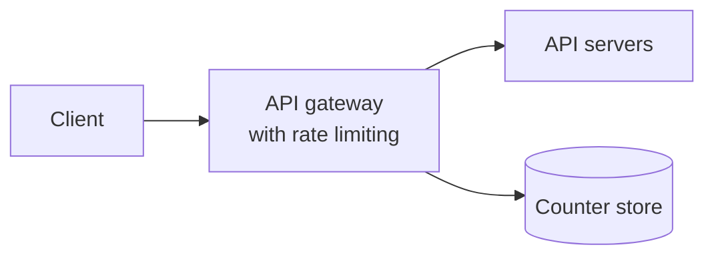
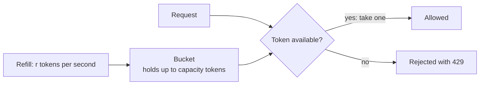
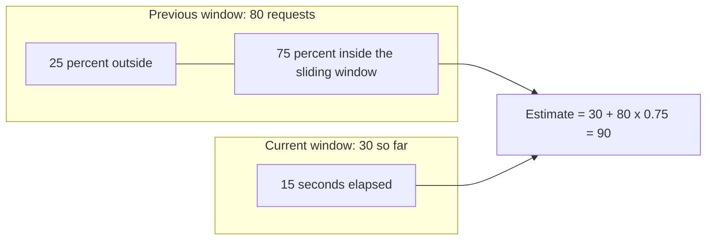
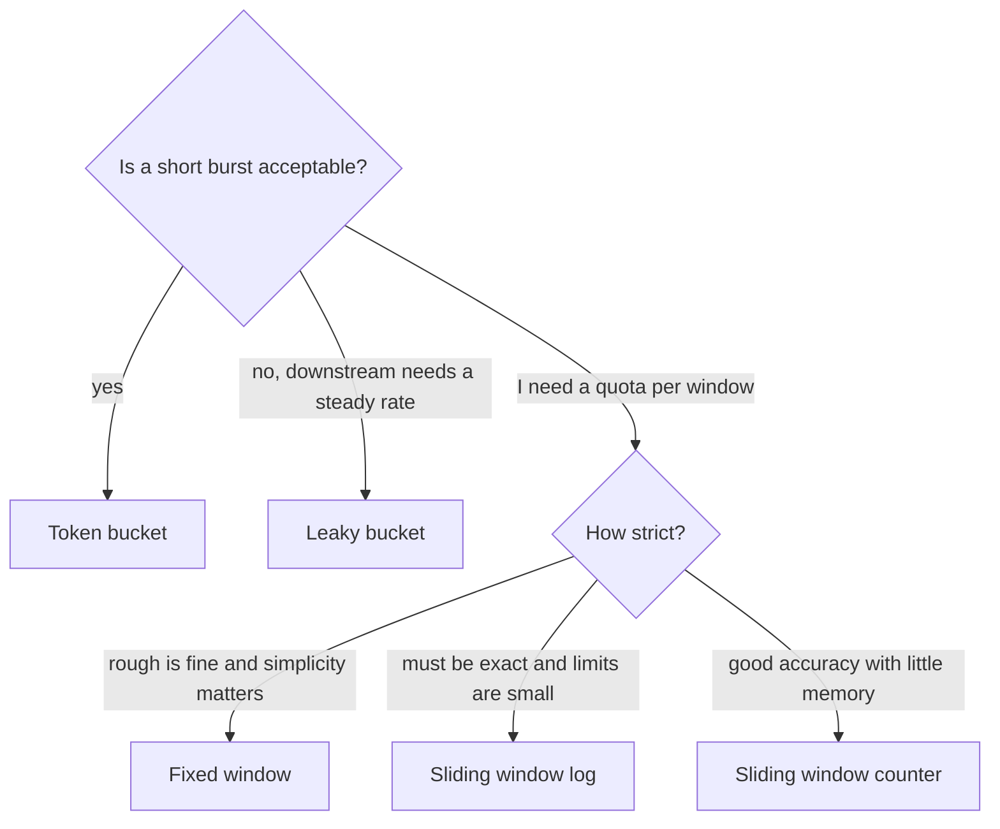

# Design a rate limiter I: requirements and the five algorithms

## Before this lesson

You should know what a client, a server, an API and a status code are ([Clients, servers and requests](#/lesson/system-design/clients-servers-requests)), what a cache such as Redis is ([The five building blocks](#/lesson/system-design/core-components)), and the four-step interview framework ([Framework I](#/lesson/system-design/framework-four-steps)). You should be able to read a small Python class.

## In plain words

A **rate limiter** is a gatekeeper that counts how many requests each caller has made recently and refuses the ones that go over an agreed limit.

A nightclub doorman with a clicker is a rate limiter. The club holds a fixed number of people. When it is full, the next person waits outside, however politely they ask. A turnstile at a metro station that lets one person through per ticket is another.

Services need this for four reasons:

1. **Protection from overload.** One buggy script in a loop, or a deliberate flood of traffic called a **denial-of-service (DoS) attack**, must not take the service down for everyone.
2. **Fairness.** One heavy customer should not use the capacity that others are paying for.
3. **Cost control.** If each request calls a paid third-party service, uncontrolled traffic is an uncontrolled bill.
4. **Security.** Limiting login attempts slows down password guessing.

This is a favourite interview question because it is small enough to finish and still touches algorithms, data stores, race conditions and distributed systems. This lesson covers the scoping questions and the five standard algorithms. The next lesson builds the distributed design.

Every design lesson in this track follows the same order: requirements, estimates, API, data model, high-level design, deep dives, bottlenecks and failures, trade-offs, a sample dialogue, and common mistakes. For this problem, the first lesson covers requirements and the algorithms, and the second covers the rest.

## 1. Requirements and the scope questions to ask

| Question | Why it matters | Assumed answer for this design |
|---|---|---|
| Is the limiter on the client or the server side? | Client-side limits can be bypassed, so they are a courtesy only | Server side |
| What do we limit by: user id, API key, IP address, endpoint? | Decides the key used for counting | Flexible: any of these, set by rules |
| What scale? | One machine or a fleet changes everything | Millions of users, many servers |
| Is the system distributed? | Counters must be shared between servers | Yes |
| A separate service or part of the application code? | Decides where it sits | A shared component usable by all services |
| Should throttled callers be told? | Affects the response format | Yes, with a clear error and timing information |
| Hard or soft limit? | A hard limit never lets a request over; a soft one may allow a small overshoot | Small overshoot acceptable |

**Functional requirements**

1. Decide, for each request, whether it is allowed or rejected according to configurable rules such as "100 requests per minute per API key".
2. Tell rejected callers that they were limited and when they may retry.

**Non-functional requirements**

1. **Low latency.** The check runs on every request, so it should add no more than a few milliseconds.
2. **Memory efficient.** State is kept per caller, and there may be millions of callers.
3. **Accurate enough.** It should not let far too many requests through, nor reject callers who are within their limit.
4. **Fault tolerant.** If the limiter's own store fails, the main service should not go down with it.
5. **Works across many servers and data centres.**

To **throttle** a caller means to limit the rate at which their requests are accepted. The words "rate limiting" and "throttling" are used interchangeably.

## 2. Where the limiter lives

There are three places to put it.



- **In the client.** Unreliable as an enforcement point: you do not control the client, and requests can be forged.
- **In the server application.** The check is a function call at the start of each request handler. Full control, but each service must include it.
- **In a middleware layer in front of the servers.** Most often this is the **API gateway**, a service that sits between clients and the internal services and handles shared duties such as authentication, encryption and rate limiting.

The usual interview answer is the gateway or a middleware, because it protects every service with one implementation and rejects excess traffic before it uses application resources. If the organisation already runs a gateway, enabling its rate limiting is cheaper than building one. Build your own when you need rules or algorithms the gateway does not offer.

When a request is rejected, the standard response is HTTP status **429 Too Many Requests**.

## 3. The five algorithms

Each algorithm answers the same question: "given the times of this caller's previous requests, is this one allowed?" They differ in how much they remember, how exact they are, and how they treat bursts. A **burst** is many requests arriving close together.

All the runnable examples take the current time as an explicit argument instead of reading a clock. That makes them repeatable, and it is also how you should write such code so that it can be tested.

### 3.1 Token bucket

Imagine a bucket that holds at most **capacity** tokens. Tokens are added at a steady **refill rate**. Each request must take one token. If the bucket is empty, the request is rejected. If tokens arrive when the bucket is full, they are discarded.



The two parameters mean different things. The refill rate sets the long-run average. The capacity sets how big a burst is permitted. A bucket of capacity 10 refilled at 2 per second lets a quiet caller suddenly make 10 requests at once, then settles to 2 per second.

There is no need for a timer that drips tokens in. It is enough to store two numbers per caller, the token count and the time of the last update, and compute how many tokens would have arrived since then whenever a request comes in. This is called **lazy refill**.

```python-run
class TokenBucket:
    def __init__(self, capacity, refill_per_second):
        self.capacity = capacity
        self.rate = refill_per_second
        self.tokens = capacity          # start full
        self.last = 0.0                 # time of the last update, in seconds

    def allow(self, now):
        # 1. Add the tokens that arrived since the last call, but never exceed capacity.
        self.tokens = min(self.capacity, self.tokens + (now - self.last) * self.rate)
        self.last = now
        # 2. Spend one token if there is one.
        if self.tokens >= 1:
            self.tokens -= 1
            return True
        return False

bucket = TokenBucket(capacity=4, refill_per_second=1)
times = [0.0, 0.1, 0.2, 0.3, 0.4, 0.5, 1.5, 1.6, 6.0, 6.1, 6.2, 6.3, 6.4]
for t in times:
    ok = bucket.allow(t)
    print(f"t={t:4.1f}s  {'allowed ' if ok else 'REJECTED'}  tokens left = {bucket.tokens:.1f}")
```

Read the output from the top. The first four requests drain the full bucket. The fifth and sixth, at 0.4 and 0.5 seconds, are rejected because less than one token has arrived. At 1.5 seconds roughly one token has been refilled, so one request passes and the next does not. After the quiet gap until 6.0 seconds the bucket has refilled to its capacity of 4, never higher, so a burst of four passes and the fifth is rejected.

**For:** small state (two numbers per caller), allows short bursts, easy to explain. It is widely used; Stripe's engineering blog describes using token buckets kept in Redis for its API limits.
**Against:** two parameters to tune, and "burst then steady" is not always what the protected service wants.

### 3.2 Leaky bucket

Picture a bucket with a hole in the bottom. Requests pour in at any speed; they drain out at a fixed rate. If the bucket is full, new requests overflow and are dropped.

In its common form the bucket is a queue of fixed size. Requests join the queue if there is room and are processed at a constant rate.

```python-run
class LeakyBucket:
    """Meter form: tracks the water level instead of holding real requests."""
    def __init__(self, capacity, leak_per_second):
        self.capacity = capacity
        self.rate = leak_per_second
        self.level = 0.0
        self.last = 0.0

    def allow(self, now):
        # Water that leaked out since the last call.
        self.level = max(0.0, self.level - (now - self.last) * self.rate)
        self.last = now
        if self.level + 1 <= self.capacity:
            self.level += 1
            return True
        return False

lb = LeakyBucket(capacity=3, leak_per_second=1)
for t in [0.0, 0.1, 0.2, 0.3, 1.3, 1.4, 5.0, 5.1, 5.2, 5.3]:
    ok = lb.allow(t)
    print(f"t={t:4.1f}s  {'accepted' if ok else 'DROPPED '}  level = {lb.level:.1f} of {lb.capacity}")
```

Three requests fill the bucket and the fourth is dropped. One second later one unit has leaked, making room for one more. After a long pause the bucket is empty and again accepts three.

**For:** the downstream service receives work at a smooth, predictable rate; memory is bounded by the queue size.
**Against:** a burst fills the queue with older requests, and newer ones are dropped or wait behind them. A legitimate burst is delayed even when the system has spare capacity.

Token bucket and leaky bucket are mirror images. The token bucket limits the *average* while letting bursts through. The leaky bucket *smooths* the output. Choose by asking whether the system behind the limiter can absorb a burst.

### 3.3 Fixed window counter

Divide time into windows of fixed length, such as each clock minute, and keep one counter per caller per window. Each request adds one. If the counter is already at the limit, reject. When a new window starts, the count starts from zero.

```python-run
class FixedWindow:
    def __init__(self, limit, window_seconds):
        self.limit, self.window = limit, window_seconds
        self.current_window, self.count = None, 0

    def allow(self, now):
        window_id = int(now // self.window)       # which window does this moment fall in?
        if window_id != self.current_window:      # a new window: reset the counter
            self.current_window, self.count = window_id, 0
        if self.count < self.limit:
            self.count += 1
            return True
        return False

fw = FixedWindow(limit=5, window_seconds=60)
# Five requests at the very end of one minute and five at the very start of the next.
times = [58.0, 58.5, 59.0, 59.5, 59.9, 60.0, 60.1, 60.5, 61.0, 61.5, 62.0]
allowed = [t for t in times if fw.allow(t)]
print("allowed at:", allowed)
print(f"{len(allowed)} requests passed between t=58 and t=62, although the limit is 5 per minute")
```

All ten requests around the minute boundary are allowed, because five fall in one window and five in the next. In a four-second stretch the caller got twice the limit. This is the **boundary problem** of fixed windows: a burst that straddles the edge of two windows can reach double the intended rate.

**For:** the smallest and simplest state (one integer per caller); maps directly onto an atomic "add one" operation in a store such as Redis.
**Against:** the boundary problem.

### 3.4 Sliding window log

To remove the boundary problem, look at the last 60 seconds counted back from *now*, not at clock minutes. Keep a list, the log, of the timestamps of the caller's recent requests. On each request, delete timestamps older than the window, then count what remains.

```python-run
from collections import deque

class SlidingWindowLog:
    def __init__(self, limit, window_seconds):
        self.limit, self.window = limit, window_seconds
        self.log = deque()                         # timestamps of accepted requests, oldest first

    def allow(self, now):
        # Forget everything that is no longer inside the window (now - window, now].
        while self.log and self.log[0] <= now - self.window:
            self.log.popleft()
        if len(self.log) < self.limit:
            self.log.append(now)
            return True
        return False

sw = SlidingWindowLog(limit=5, window_seconds=60)
times = [58.0, 58.5, 59.0, 59.5, 59.9, 60.0, 60.1, 60.5, 118.0, 118.4, 118.6]
for t in times:
    print(f"t={t:6.1f}s  {'allowed ' if sw.allow(t) else 'REJECTED'}  log size = {len(sw.log)}")
```

The same boundary burst is now handled correctly: the five requests before the minute boundary fill the window and those at 60.0, 60.1 and 60.5 are rejected. At 118.0 the request from 58.0 has aged out (it is exactly 60 seconds old), so one is allowed; at 118.4 nothing new has aged out yet, so it is rejected; at 118.6 the one from 58.5 has aged out and one more passes.

A design decision is hidden here: this version records only *accepted* requests. Some implementations record every attempt, including rejected ones. With that variant a caller who keeps hammering the service never gets back in, because their own rejected attempts keep the window full. State which behaviour you want.

**For:** exact; no boundary problem.
**Against:** memory. It stores one timestamp per request in the window. A limit of 10,000 per hour for a million callers could mean billions of stored timestamps.

### 3.5 Sliding window counter

This is a compromise between the previous two: nearly the accuracy of the log with nearly the memory of the fixed window. Keep the counter for the current fixed window and the counter for the previous one. Estimate the number of requests in the sliding window by assuming the previous window's requests were spread evenly:

$$\text{estimate} = \text{current count} + \text{previous count} \times \frac{\text{window} - \text{time into current window}}{\text{window}}$$

If the limit is 100 per minute, the previous minute saw 80 requests, the current minute has 30 so far, and we are 15 seconds into it, then 75% of the previous window still overlaps the sliding window: $30 + 80 \times 0.75 = 90$. The request is allowed because 90 is below 100.



```python-run
class SlidingWindowCounter:
    def __init__(self, limit, window_seconds):
        self.limit, self.window = limit, window_seconds
        self.window_id, self.current, self.previous = 0, 0, 0

    def allow(self, now):
        wid = int(now // self.window)
        if wid != self.window_id:
            # Moved on by one window: current becomes previous. By more: both are empty.
            self.previous = self.current if wid == self.window_id + 1 else 0
            self.current, self.window_id = 0, wid
        elapsed = now - wid * self.window
        weight = (self.window - elapsed) / self.window
        estimate = self.current + self.previous * weight
        if estimate + 1 <= self.limit:
            self.current += 1
            return True
        return False

sc = SlidingWindowCounter(limit=5, window_seconds=60)
times = [58.0, 58.5, 59.0, 59.5, 59.9, 60.0, 60.1, 75.0, 90.0, 105.0, 119.0]
for t in times:
    ok = sc.allow(t)
    print(f"t={t:6.1f}s  {'allowed ' if ok else 'REJECTED'}  current={sc.current} previous={sc.previous}")
```

The boundary burst is rejected at 60.0 and 60.1, because the previous window's five requests still carry almost full weight. As the new window progresses the weight falls, and requests are admitted gradually: one at 75.0 (weight 0.75), one at 90.0, and so on.

**For:** two integers per caller; smooths the boundary spike; cheap.
**Against:** it is an approximation that assumes the earlier requests were evenly spread. For most rate limiting that small error is acceptable; for strict quotas it may not be.

## 4. Comparing the algorithms

| Algorithm | State per caller | Allows bursts | Exact | Weak point |
|---|---|---|---|---|
| Token bucket | 2 numbers | Yes, up to capacity | Yes, for its own definition | Two parameters to tune |
| Leaky bucket | 2 numbers or a bounded queue | No, output is smoothed | Yes | Delays legitimate bursts |
| Fixed window | 1 counter | Up to double at a boundary | No | Boundary problem |
| Sliding window log | 1 timestamp per request | No | Yes | Memory |
| Sliding window counter | 2 counters | Slight | Approximate | Assumes even spread |



> [!INTERVIEW]
> Do not list all five from memory and stop. Pick one for the problem at hand and defend it: "I will use a token bucket per API key because our clients legitimately send short bursts and the state is two numbers, which matters at millions of keys. If the product needs strict per-minute quotas for billing, I would switch to a sliding window counter." Then mention the fixed-window boundary problem to show you know why the simplest option was not chosen.

> [!TIP]
> Remember the pair: capacity controls the burst, refill rate controls the average. A limit written as "100 per minute" does not say which burst is allowed, so ask. A bucket of capacity 100 refilled at 100 per minute permits 100 at once; a capacity of 10 with the same refill rate spreads them out.

> [!WARNING]
> In real code, never read the clock inside the algorithm in a way that tests cannot control, and beware of clocks that jump backwards. If `now` is earlier than the last update, a naive lazy refill computes a negative number of tokens. Clamp the elapsed time at zero.

## Common mistakes

- **Confusing capacity with rate** in the token bucket.
- **Forgetting the boundary problem** when proposing fixed windows.
- **Proposing the sliding window log for large limits** without noticing the memory cost.
- **Counting rejected requests in the log** without meaning to, which locks out a retrying caller indefinitely.
- **Enforcing limits only in the client.**
- **Stopping at the algorithm.** With many servers the hard part is sharing the counters, which is the subject of the next lesson.

## Summary

- A rate limiter caps how many requests a caller may make in a period, to protect capacity, keep usage fair, control cost and slow down attacks.
- It normally sits server-side in a gateway or middleware and answers rejected requests with status 429.
- Token bucket: tokens refill at a steady rate up to a capacity; allows bursts; two numbers of state.
- Leaky bucket: requests drain at a fixed rate; smooths output; bursts wait or are dropped.
- Fixed window: one counter per clock window; simplest; allows up to double the limit across a boundary.
- Sliding window log: stores timestamps; exact; memory-hungry.
- Sliding window counter: weights the previous window's count; a good balance of accuracy and memory.

## Glossary

- **Rate limiter**: a component that restricts how many requests a caller may make in a period.
- **Throttle**: to limit the rate at which requests are accepted.
- **Denial-of-service attack**: a flood of traffic intended to make a service unavailable.
- **API gateway**: a service in front of internal services that handles shared concerns such as authentication and rate limiting.
- **Middleware**: code that runs before the main request handler.
- **429 Too Many Requests**: the HTTP status for a rate-limited request.
- **Burst**: many requests in a very short time.
- **Token bucket**: an algorithm in which requests spend tokens that refill steadily.
- **Capacity / refill rate**: the bucket's maximum tokens, and how fast they are added.
- **Lazy refill**: computing accumulated tokens when a request arrives, with no background timer.
- **Leaky bucket**: an algorithm in which requests drain at a constant rate from a bounded bucket.
- **Fixed window**: counting requests in consecutive, non-overlapping time intervals.
- **Boundary problem**: a burst across two fixed windows that exceeds the intended rate.
- **Sliding window**: an interval measured backwards from the current moment.
- **Hard / soft limit**: a limit that is never exceeded, or one that tolerates small overshoot.

## Check yourself

```quiz
[
  {"q": "A token bucket has capacity 20 and refills at 5 tokens per second. A caller who has been idle for an hour sends 30 requests at the same instant. How many are allowed?",
   "options": ["5", "20", "25", "30"],
   "answer": 1,
   "explain": "The bucket never holds more than its capacity however long the caller was idle, so 20 pass and 10 are rejected."},
  {"q": "With a fixed window of 100 requests per minute, what is the largest number of requests a caller can get through in a short span around a window boundary?",
   "options": ["100", "150", "200", "Unlimited"],
   "answer": 2,
   "explain": "100 at the end of one window and 100 at the start of the next are all allowed, doubling the intended rate for that short span."},
  {"q": "Which algorithm stores one timestamp per request?",
   "options": ["Fixed window counter", "Token bucket", "Sliding window log", "Sliding window counter"],
   "answer": 2,
   "explain": "The log keeps every timestamp inside the window. That makes it exact and also memory-hungry."},
  {"q": "Sliding window counter: limit 10 per minute, previous window count 8, current count 3, and 30 seconds of the current window have passed. What is the estimate before the new request?",
   "options": ["11", "7", "3", "8"],
   "answer": 1,
   "explain": "Half of the previous window overlaps: 3 + 8 x 0.5 = 7. Adding the new request gives 8, which is within 10, so it is allowed."},
  {"q": "The service behind the limiter can only process work at a constant 50 jobs per second and must never receive a burst. Which algorithm fits best?",
   "options": ["Token bucket with a large capacity", "Leaky bucket", "Fixed window", "No limiter"],
   "answer": 1,
   "explain": "The leaky bucket releases work at a fixed rate, smoothing bursts. A token bucket would pass a burst up to its capacity."},
  {"q": "Why is a rate limiter usually enforced on the server side?",
   "options": ["Clients cannot count", "Client code is outside your control and can be bypassed or forged", "Servers have more memory", "HTTP forbids client-side limits"],
   "answer": 1,
   "explain": "Anything running on the caller's machine can be modified. Enforcement must happen where you control the code."},
  {"q": "In a lazy-refill token bucket, what is stored per caller?",
   "options": ["A list of all request timestamps", "The current token count and the time of the last update", "One counter per second", "Nothing"],
   "answer": 1,
   "explain": "Tokens gained since the last update are computed from the elapsed time, so two numbers are enough and no background timer is needed."}
]
```

> **Source:** Xu, *System Design Interview: An Insider's Guide*, ch. 4 (rate limiter: placement and algorithms) as a topic guide; Stripe engineering blog, "Scaling your API with rate limiters", https://stripe.com/blog/rate-limiters ; System Design Primer, https://github.com/donnemartin/system-design-primer
