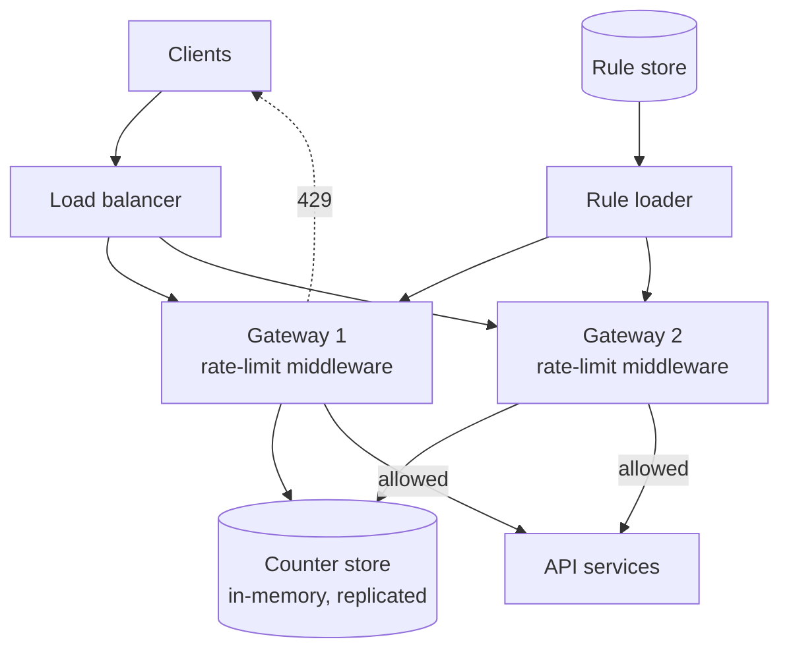
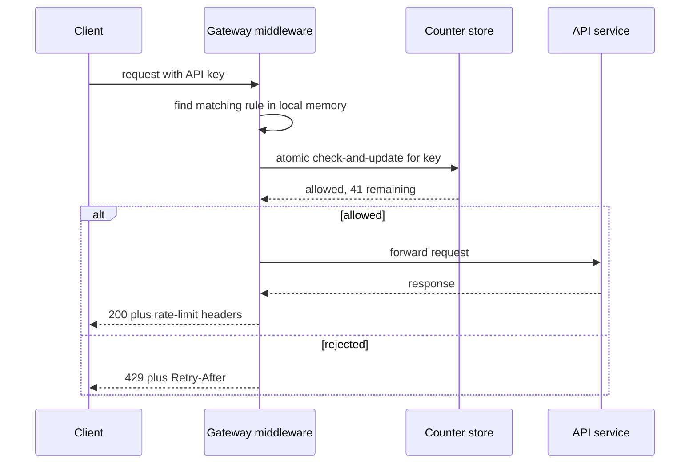
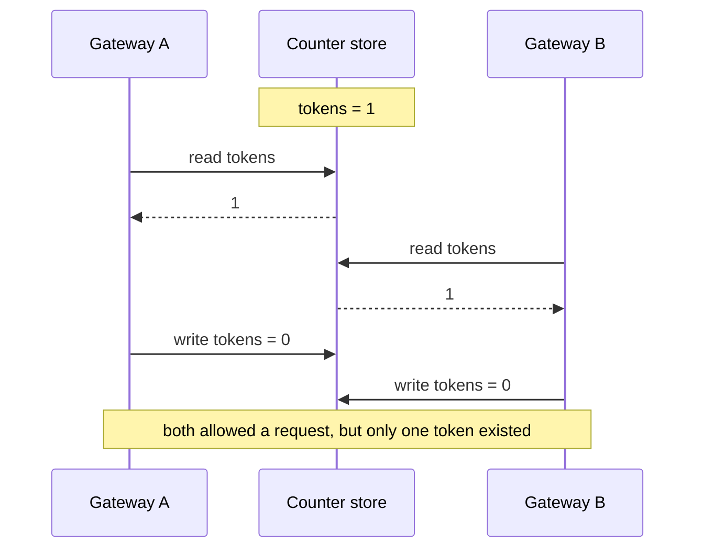
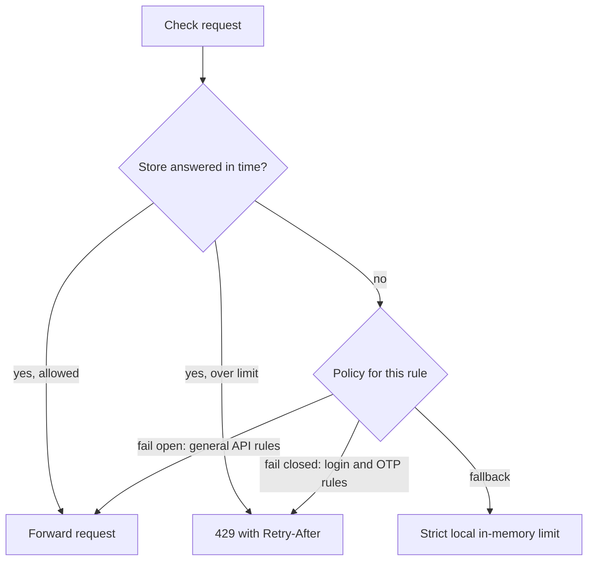

# Design a rate limiter II: the distributed design

## Before this lesson

Read [Design a rate limiter I](#/lesson/system-design/rate-limiter-algorithms). You should know the token bucket, fixed window and sliding window counter algorithms, what an API gateway is, and what a key-value store such as Redis does. The [Redis track](#/track/redis) is useful background but not required.

## In plain words

One rate limiter on one machine is a counter in memory. The difficulty starts when there are fifty servers and a caller's requests are spread across all of them. Each server sees only a fiftieth of the traffic, so none of them can tell on its own that the caller is over the limit.

Think of a library that lets each member borrow five books. If the library has one desk, the librarian checks the member's card. If it has ten desks and each keeps its own notebook, a member can borrow five books at every desk. The fix is one shared ledger that all desks consult, and the new problems are that the ledger must be fast, two desks must not update the same line at the same instant, and the library must decide what to do when the ledger is unavailable.

This lesson builds that shared ledger: the estimates, the response format, the rules, the store, the race conditions and the failure handling.

## 1. Estimates

Assume 10 million active API keys, an average of 20,000 requests per second across the platform and 50,000 at peak, and rules per key per endpoint group.

- **Checks per second:** every request is checked once, so 50,000 checks per second at peak.
- **State:** with a token bucket, each key needs a token count and a timestamp. With the key's name and the store's overhead, allow about 100 bytes. If 2 million keys are active within any hour: $2\text{M} \times 100\text{ B} = 200\text{ MB}$.
- **Latency budget:** the check should add at most 1 to 2 ms. A network round trip inside a data centre is about 0.5 ms, so the budget allows one round trip to the store and no more.

Conclusions: the state is small enough for memory, so an in-memory store is the natural choice. A disk-based database is ruled out by the latency budget. The throughput of 50,000 operations per second is within reach of one in-memory store node, but one node is a single point of failure, so plan for several.

```python-run
keys_active = 2_000_000
bytes_per_key = {"token bucket": 100, "sliding window counter": 110, "sliding window log (limit 1000/h, half used)": 100 + 500 * 16}
peak_qps = 50_000
node_ops = 100_000                      # operations per second one in-memory node can do

for name, b in bytes_per_key.items():
    print(f"{name:48s} {keys_active * b / 2**30:8.2f} GB")
print(f"\nstore nodes for throughput at 50% utilisation: {max(1, round(peak_qps / (node_ops * 0.5)))}")
print("plus replicas for availability, so a small cluster")
```

The first two algorithms need a fraction of a gigabyte. The log needs tens of gigabytes for the same callers, which is the memory argument from the previous lesson expressed as a number.

## 2. API: what the caller sees

A rate limiter has no API of its own in the usual sense; it changes the responses of the APIs it protects. The important part is how it communicates.

When a request is rejected:

```
HTTP/1.1 429 Too Many Requests
Retry-After: 12
X-RateLimit-Limit: 100
X-RateLimit-Remaining: 0
X-RateLimit-Reset: 1767225660

{"error": "rate_limited", "message": "Limit of 100 requests per minute exceeded. Retry in 12 seconds."}
```

- `Retry-After` tells the client how many seconds to wait. Well-behaved clients obey it, which reduces pointless retries.
- The `X-RateLimit-*` headers are a common convention (the exact names vary by provider). Sending `Limit` and `Remaining` on *successful* responses as well lets clients slow down before they hit the wall.

Internally the limiter exposes one operation to the gateway:

```
check(key, rule) -> {allowed: bool, remaining: int, retry_after_seconds: float}
```

## 3. Data model: rules and counters

Two kinds of data, with very different lifetimes.

**Rules** are configuration: they change rarely and are read constantly. Engineers write them in files or an admin tool; they are stored durably and pushed to every gateway, which keeps them in local memory.

```
- name: default-api
  match: {path_prefix: /v1/}
  key: api_key
  algorithm: token_bucket
  capacity: 100
  refill_per_second: 2

- name: login-attempts
  match: {path: /v1/login, method: POST}
  key: ip_address
  algorithm: sliding_window_counter
  limit: 5
  window_seconds: 300
```

**Counters** are the fast-changing state. In an in-memory key-value store:

```
key   = "rl:{rule_name}:{caller_key}"        e.g. rl:default-api:key_8f3a
value = {tokens: 41.5, last: 1767225648.2}    (token bucket)
TTL   = time for the bucket to refill completely, plus a margin
```

The TTL matters for memory: a caller who goes quiet has a full bucket again after `capacity / refill rate` seconds, at which point their entry carries no information and can be dropped. A missing entry is treated as a full bucket.

## 4. High-level design



The flow for one request:



Rejected requests are normally dropped. For some workloads, such as order submission, a rejected request can instead be placed on a queue to be processed later; that is a product decision worth asking about.

## 5. Deep dive: the race condition

The check is "read the counter, decide, write the counter". If two gateways do this for the same key at the same moment, both can read the same value before either writes.



This is a **race condition**: the result depends on the timing of operations that overlap. The simulation makes it concrete by interleaving two "gateways" by hand.

```python-run
# A shared store with one token left for this caller.
store = {"tokens": 1}

# --- Unsafe: read, then decide, then write, with the two gateways interleaved ---
a_read = store["tokens"]          # gateway A reads 1
b_read = store["tokens"]          # gateway B reads 1 before A has written
allowed = []
if a_read >= 1:
    store["tokens"] = a_read - 1; allowed.append("A")
if b_read >= 1:
    store["tokens"] = b_read - 1; allowed.append("B")
print("unsafe  :", allowed, "allowed with one token; store now", store)

# --- Safe: the whole check-and-update runs as ONE indivisible step inside the store ---
store = {"tokens": 1}
def atomic_take(store):
    """Stands in for a server-side script: nothing else runs in the middle of it."""
    if store["tokens"] >= 1:
        store["tokens"] -= 1
        return True
    return False

allowed = [name for name in ("A", "B") if atomic_take(store)]
print("atomic  :", allowed, "allowed with one token; store now", store)
```

The unsafe version lets both requests through. The atomic version lets one through.

An operation is **atomic** when it happens entirely or not at all, with nothing else able to run in the middle. There are three ways to get atomicity here.

1. **A lock around the read-modify-write.** Correct, but each check now takes the lock, does its work and releases it, which adds round trips and slows everything down. Usually rejected.
2. **An atomic command of the store.** For a fixed window, a single "increment this key and return the new value" command is atomic by nature: increment first, then compare the returned value with the limit. No race is possible.
3. **A server-side script.** Redis can run a small Lua script as one atomic unit, because it executes commands one at a time on a single thread. The token bucket's "refill, test, subtract, save" logic goes into the script, and the gateway makes one call. This is the most common answer for token buckets and sliding windows.

> [!INTERVIEW]
> When you draw an arrow from many gateways to one counter store, expect the question "what if two requests arrive at the same time?". Have the answer ready: "the check-and-decrement runs as a single atomic script inside the store, so there is no window between the read and the write."

## 6. Deep dive: many limiter nodes and many data centres

**Several gateways.** Because all counters live in the shared store, the gateways themselves are stateless and any of them can check any request. Sticky routing (sending a caller always to the same gateway so it can keep a local counter) is an alternative, but it breaks whenever gateways are added or removed and is not fault tolerant.

**A store that is larger than one node.** When one store node is not enough, partition the keys across nodes, typically with consistent hashing so that adding a node moves few keys ([Consistent hashing](#/lesson/system-design/consistent-hashing-ring)). A given caller's counter then lives on exactly one node, and each node has a replica.

**Several data centres.** A user in Europe is served by the European gateways. Sending each check to a counter store in America would add 100 ms or more, which destroys the latency budget. Two workable options:

- **Independent regional limits.** Each region enforces the full limit separately. A caller who spreads traffic across three regions could get three times the limit. Simple, and often acceptable because most callers use one region.
- **Local counters with asynchronous synchronisation.** Each region counts locally and regions exchange counts every second or so. The limit is enforced approximately and globally, an example of choosing eventual consistency for speed.

Strong global accuracy would require a synchronous cross-region call per request, and rate limiting almost never justifies that.

**Local pre-checks.** To reduce load on the shared store, a gateway can keep a short-lived local approximation: for example, once the shared store says a key is over its limit, remember that for the remainder of the window and reject locally without asking again. A caller who floods the system then costs almost nothing.

## 7. Bottlenecks and failure handling

**The counter store is unavailable.** There are two policies:

- **Fail open:** allow the request without checking. The limiter stops protecting, but the product keeps working.
- **Fail closed:** reject the request. Nothing gets through unchecked, but an outage of the limiter becomes an outage of the whole API.

For general API protection, failing open is the usual choice: the limiter exists to protect availability and should not reduce it. Stripe's engineering blog gives the same advice. For security-critical limits, such as login attempts or sending one-time passwords, failing closed, or falling back to a strict local in-memory limit, is safer. Say which rule gets which policy.

**The store is slow.** Give the check a strict timeout of a few milliseconds and treat a timeout like unavailability. A slow limiter must not slow every request.

**A store node restarts and loses its counters.** Callers on that node briefly get fresh, full buckets. This small leniency is normally acceptable; say so.

**Hot keys.** One caller sending a hundred thousand requests per second concentrates load on one store node. The local pre-check above handles it: once they are over the limit, reject at the gateway.

**Clock differences.** If gateways send their own clock reading to the store, differences between machines' clocks skew the refill. Use the store's clock inside the script, so there is one source of time per key.

**Rule changes.** A wrong rule can block all traffic. Roll out new rules in a **dry-run mode** (also called *shadow mode*) first: the limiter records what it would have rejected without rejecting anything, and you check the numbers before enforcing.



## 8. Monitoring

Collect at least:

- Requests allowed and rejected, per rule. A rule that never rejects is doing nothing; a rule that rejects a large share of ordinary traffic is too strict.
- Latency of the limiter check, as p50 and p99.
- Store errors and timeouts, and how often the fail-open path was taken.
- The top rejected keys, to distinguish abuse from a customer who needs a higher limit.

## 9. Trade-offs and alternatives

| Decision | Option chosen | Alternative | Why |
|---|---|---|---|
| Placement | Gateway middleware | Inside each service | One implementation protects everything; rejects early |
| Algorithm | Token bucket by default | Sliding window counter | Bursts are legitimate for API clients; switch for strict quotas |
| State | Shared in-memory store | Local counters with sticky routing | Gateways stay stateless and replaceable |
| Atomicity | Server-side script | Locks | One round trip, no lock contention |
| Multi-region | Regional limits or asynchronous sync | Synchronous global counter | Latency budget of a few milliseconds |
| Store failure | Fail open, except security rules | Fail closed everywhere | The limiter should not become the outage |

Rate limiting can also be applied at lower layers. A firewall can limit packets per IP address at the network layer, which is cheap and good against floods but knows nothing about users or endpoints. The application-layer limiter described here understands API keys and paths. Large systems use both.

Related techniques that are often asked about next: a **concurrency limiter** caps the number of requests *in progress* for a caller instead of the number started per second, which protects against slow, expensive requests; **load shedding** drops low-priority traffic when the whole system is overloaded, regardless of who sent it.

Advice for clients, which shows you see both sides: cache responses to avoid repeat calls; watch the `Remaining` header; on a 429, wait for `Retry-After`; retry with **exponential backoff** (doubling the wait after each failure) plus **jitter** (a random extra delay) so that many clients do not all retry at the same instant.

## 10. What a strong answer sounds like

> **Interviewer:** Design a rate limiter for our public API.
>
> **Candidate:** A few questions first. Is this enforced on the server, and what identifies a caller: API key, user or IP address?
>
> **Interviewer:** Server side. Mostly by API key, sometimes by IP for login.
>
> **Candidate:** How many gateways and roughly what request rate? And should a caller be allowed short bursts?
>
> **Interviewer:** Dozens of gateways, about 50,000 requests per second at peak. Bursts are fine.
>
> **Candidate:** Then I would put the limiter in the gateway as middleware and use a token bucket per key, because it allows bursts and needs two numbers of state per key. With a couple of million active keys that is a few hundred megabytes, so the counters go in a replicated in-memory store shared by all gateways. The check is one atomic script that refills, tests and decrements, to avoid two gateways both spending the last token. Rejected requests get a 429 with Retry-After.
>
> **Interviewer:** What happens if that store goes down?
>
> **Candidate:** The check has a timeout of a few milliseconds. For general API rules I fail open, because the limiter's purpose is to protect availability. For the login rule I fail closed to a strict local limit, since removing that protection invites password guessing. I would alert on the fail-open rate.
>
> **Interviewer:** And across regions?
>
> **Candidate:** Each region has its own store so the check stays local. I would start with independent regional limits and accept that a caller using several regions gets more than the nominal limit. If that mattered for billing, I would synchronise counts between regions asynchronously, accepting a small lag.

Notice the pattern: questions, a choice tied to the answers, numbers, the race condition raised before being asked, and a different failure policy for different rules.

## Common mistakes

- **Local counters on each gateway with no shared store**, which multiplies the effective limit by the number of gateways.
- **A read followed by a separate write**, creating the race condition.
- **Failing closed by default**, turning a limiter outage into a full outage.
- **No timeout on the check.**
- **A global synchronous counter across regions**, which breaks the latency budget.
- **Returning 429 without Retry-After**, which invites immediate retries.
- **No TTL on counter keys**, so memory grows with every caller ever seen.
- **Enforcing a new rule without a dry run.**

## Summary

- With many servers, counters must be shared; an in-memory store reached in one round trip fits the latency and memory budget.
- Rules are slow-changing configuration cached in each gateway; counters are fast-changing state with a TTL.
- The check-and-update must be atomic, usually through a single increment command or a server-side script.
- Across regions, keep checks local and accept approximate global limits.
- Decide per rule whether to fail open or closed, and always bound the check with a timeout.
- Return 429 with Retry-After and rate-limit headers, and monitor allowed, rejected, latency and fail-open counts.

## Glossary

- **Race condition**: an error that depends on the timing of overlapping operations.
- **Atomic**: happening completely or not at all, with nothing interleaved.
- **Lua script**: a small program run inside Redis as one atomic unit.
- **Fail open / fail closed**: allow, or reject, requests when the limiter cannot decide.
- **Retry-After**: a response header giving the wait before retrying.
- **Sticky routing**: always sending a caller to the same server.
- **Dry-run (shadow) mode**: evaluating a rule and logging the result without enforcing it.
- **Hot key**: a key receiving a disproportionate share of traffic.
- **Concurrency limiter**: a cap on requests in progress at the same time.
- **Load shedding**: deliberately dropping low-priority work during overload.
- **Exponential backoff**: increasing the wait between retries, usually doubling.
- **Jitter**: a random addition to a wait time so that clients do not retry in unison.

## Check yourself

```quiz
[
  {"q": "Ten gateways each keep their own in-memory counter with a limit of 100 per minute, and a load balancer spreads a caller's requests evenly. Roughly what limit does the caller experience?",
   "options": ["10 per minute", "100 per minute", "1,000 per minute", "No limit at all"],
   "answer": 2,
   "explain": "Each gateway sees a tenth of the traffic and allows 100, so about 1,000 pass. Counters must be shared."},
  {"q": "Two gateways read tokens = 1 for the same key at the same moment and both allow the request. What is the standard fix?",
   "options": ["Increase the bucket capacity", "Make the check-and-decrement one atomic operation inside the store", "Add a longer TTL", "Use sticky sessions"],
   "answer": 1,
   "explain": "The read and the write must not be separable. A single atomic command or a server-side script removes the window between them."},
  {"q": "The counter store is unreachable. For a general API rate limit, what is the usual policy and why?",
   "options": ["Fail closed, because security comes first", "Fail open, because the limiter should not turn its own outage into an API outage", "Retry for ever", "Shut down the gateway"],
   "answer": 1,
   "explain": "The limiter protects availability. Allowing unchecked traffic for a short time is usually better than rejecting everything."},
  {"q": "For which rule is failing closed, or falling back to a strict local limit, the better choice?",
   "options": ["Listing products", "Login attempts per IP address", "Fetching a public image", "Reading documentation"],
   "answer": 1,
   "explain": "Dropping the login limit during a store outage would open the door to password guessing, so that rule should stay protective."},
  {"q": "Why should counter keys have a TTL?",
   "options": ["To make the script atomic", "So entries for callers who have gone quiet are removed and memory stays bounded", "To increase the limit over time", "TTL is required by HTTP"],
   "answer": 1,
   "explain": "Once a bucket would be full again, its entry holds no information. Expiring it keeps memory proportional to recently active callers."},
  {"q": "Why not use one global counter store for callers in every region?",
   "options": ["Regions cannot share keys", "A cross-region round trip of 100 ms or more per request breaks the limiter's latency budget", "It would be too accurate", "Stores cannot be replicated"],
   "answer": 1,
   "explain": "The check must add only a millisecond or two. Local stores with regional or asynchronously synchronised limits keep it fast."},
  {"q": "What should a client do after receiving 429 with Retry-After: 12?",
   "options": ["Retry immediately in a loop", "Wait about 12 seconds, ideally with some random jitter, then retry", "Switch to another API key", "Give up permanently"],
   "answer": 1,
   "explain": "Honouring Retry-After, with jitter so that many clients do not retry together, avoids wasting requests and overloading the service."}
]
```

> **Source:** Xu, *System Design Interview: An Insider's Guide*, ch. 4 (rate limiter: high-level architecture, rules, distributed environment, monitoring) as a topic guide; Stripe engineering blog, "Scaling your API with rate limiters", https://stripe.com/blog/rate-limiters ; Stripe engineering blog, "Designing robust and predictable APIs with idempotency" (backoff and jitter), https://stripe.com/blog/idempotency
