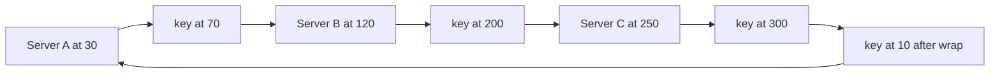
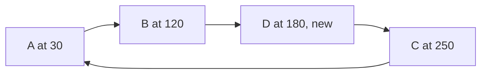

# Design consistent hashing I: the rehashing problem and the ring

## Before this lesson

You should know what sharding and a shard key are ([Scaling from zero II](#/lesson/system-design/scale-stateless-to-sharded)), what a cache tier is, and what a hash function does in general terms: it turns any input into a number that looks random but is always the same for the same input. You should be able to read Python lists and dictionaries.

## In plain words

When data or cache entries are spread over several servers, something has to decide which server holds which key. **Consistent hashing** is a way of making that decision so that when a server is added or removed, only a small share of the keys have to move.

Picture a round dinner table with a few waiters standing at fixed positions around it. Each guest is served by the first waiter found walking clockwise from the guest's seat. If one waiter goes home, only that waiter's guests are affected: they are now served by the next waiter round the table. Everyone else keeps their waiter. If a new waiter joins and stands somewhere, they take over only the guests between themselves and the previous waiter.

Compare that with the scheme "guest number divided by the number of waiters, take the remainder". Change the number of waiters and nearly every guest gets a different one.

Why this matters for a job: caches, databases such as Cassandra and DynamoDB, content delivery networks and load balancers all use consistent hashing so that the cluster can grow, shrink and survive failures without reshuffling everything. It is also a standalone interview question and a tool you will use inside half the other designs.

This module follows the track's usual design structure, adapted to a component: the problem and requirements, the basic mechanism, then in the next lesson the estimates, API, data model, use in a larger system, deep dives, failures, trade-offs, a sample dialogue and common mistakes.

## 1. The problem: hashing with modulo breaks when servers change

Suppose a cache tier of four servers numbered 0 to 3. The straightforward way to choose a server for a key is:

$$\text{server} = \text{hash}(\text{key}) \bmod N$$

where $N$ is the number of servers and $\bmod$ means "the remainder after division". A good hash function spreads keys evenly, so each server gets about a quarter of them. As long as $N$ stays the same, this works well.

Now server 1 crashes and $N$ becomes 3. The remainder of a number divided by 3 has little to do with its remainder divided by 4, so most keys now map to a different server.

```python-run
import hashlib

def h(key):
    """A stable hash: the same key always gives the same big integer."""
    return int(hashlib.md5(key.encode()).hexdigest(), 16)

keys = [f"user:{i}" for i in range(20_000)]

def moved_fraction(n_before, n_after):
    moved = sum(1 for k in keys if h(k) % n_before != h(k) % n_after)
    return moved / len(keys)

print("servers before -> after   keys that change server")
for before, after in [(4, 3), (4, 5), (10, 11), (100, 101)]:
    print(f"{before:>14} -> {after:<5}   {moved_fraction(before, after):.1%}")
```

Going from 4 servers to 3 moves about three quarters of the keys. Going from 100 to 101 moves about 99%. The more servers you have, the worse it gets, which is the opposite of what you want.

Why is that so bad?

- **For a cache**, a moved key means the cached value is on the old server and the new server has nothing: a miss. Losing one of four cache servers should cost a quarter of the cache. With modulo hashing it costs three quarters at the same moment, and the database behind the cache receives a flood of requests. A sudden rush of misses that overwhelms the database is called a **cache stampede**.
- **For a database**, a moved key means the data itself must be copied to another machine. Moving 99% of the data to add one machine is unworkable.

The requirement is therefore clear.

## 2. Requirements

1. **Minimal movement.** When the number of servers changes from $n$ to $n+1$ or $n-1$, about $1/n$ of the keys should move, the share that the changed server is responsible for, and no others.
2. **Even distribution.** Each server should hold roughly the same share of keys (or a share proportional to its capacity).
3. **Fast lookup.** Finding the server for a key should take far less than a millisecond.
4. **No central coordinator needed for a lookup.** Any client holding the list of servers should compute the same answer.
5. **Deterministic.** The same key and the same server list always give the same server.

Scope questions worth asking in an interview: how many servers, how often do they join and leave, do servers differ in capacity, and is this for a cache (where a moved key is a miss) or a store (where a moved key is a data copy)?

## 3. The hash space as a ring

A hash function produces numbers in a fixed range. To keep examples readable, imagine a hash that returns a number from 0 to 359, like degrees on a circle. A real one uses a much bigger range, such as 0 to $2^{32}-1$, but the idea is identical.

Bend that number line into a circle so that the largest value is followed by 0. This circle is the **hash ring**.

Two kinds of thing are placed on the ring using the same hash function:

- **Servers** (often called **nodes**), by hashing the server's name or address.
- **Keys**, by hashing the key.

The rule: **a key belongs to the first server found moving clockwise from the key's position.** If you pass the largest value without finding a server, wrap around to the start.



Read the diagram as a circle going clockwise. The key at 70 sits between A and B, so it belongs to B. The key at 200 belongs to C. The key at 300 is past C, the last server; it wraps past 359 to 0 and reaches A at 30. The key at 10 also belongs to A.

Another way to say it: each server owns the arc of the ring that starts immediately after the previous server and ends at itself.

| Server | Position | Owns the range | Arc length |
|---|---|---|---|
| A | 30 | 251 to 359 and 0 to 30 | 140 |
| B | 120 | 31 to 120 | 90 |
| C | 250 | 121 to 250 | 130 |

## 4. Looking up a key

To find a key's server we need "the first server position at or after this number". If the server positions are kept in a sorted list, that is a **binary search**: a method of finding a value in a sorted list by repeatedly halving the range, taking about $\log_2 n$ steps for $n$ entries. Python's `bisect` module does it.

```python-run
import bisect

RING_SIZE = 360
servers = {"A": 30, "B": 120, "C": 250}

positions = sorted(servers.values())                    # [30, 120, 250]
name_at = {pos: name for name, pos in servers.items()}  # 30 -> "A", ...

def lookup(key_position):
    """First server at or after the key, wrapping round to the start."""
    i = bisect.bisect_left(positions, key_position)      # index of first position >= key
    if i == len(positions):                              # ran off the end: wrap around
        i = 0
    return name_at[positions[i]]

for key_pos in (10, 30, 70, 120, 200, 251, 300, 359):
    print(f"key at {key_pos:>3} -> server {lookup(key_pos)}")
```

Line by line: `positions` is the sorted list of where the servers sit. `bisect_left` returns the index of the first position that is greater than or equal to the key's position. If the key is beyond the last server, the index equals the length of the list, and we wrap to index 0. A key exactly at a server's position (30 or 120) belongs to that server.

The lookup costs $O(\log n)$ for $n$ positions, a few dozen comparisons even for thousands of entries.

## 5. Adding a server

Add server D at position 180. It lands in the arc owned by C (121 to 250) and splits it: D takes 121 to 180, and C keeps 181 to 250.



Only keys that hashed into 121 to 180 move, and they all move from C to D. Keys on A and B are untouched. That is the "minimal movement" property.

## 6. Removing a server

Remove server B (position 120). Its arc, 31 to 120, has no owner, so by the clockwise rule those keys now reach the next server, which is C (or D, if D has been added). Again, only the departed server's keys move, and they all go to its clockwise neighbour.

The simulation checks both claims with real keys and a real hash function over a large ring.

```python-run
import bisect, hashlib

def h(text):
    return int(hashlib.md5(text.encode()).hexdigest(), 16) % 2**32

class Ring:
    def __init__(self, nodes=()):
        self.positions, self.owner = [], {}
        for n in nodes:
            self.add(n)

    def add(self, node):
        pos = h(node)
        bisect.insort(self.positions, pos)        # keep the list sorted
        self.owner[pos] = node

    def remove(self, node):
        pos = h(node)
        self.positions.remove(pos)
        del self.owner[pos]

    def lookup(self, key):
        i = bisect.bisect_left(self.positions, h(key))
        return self.owner[self.positions[i % len(self.positions)]]

keys = [f"user:{i}" for i in range(20_000)]

ring = Ring(["cache-a", "cache-b", "cache-c", "cache-d"])
before = {k: ring.lookup(k) for k in keys}

ring.add("cache-e")
after_add = {k: ring.lookup(k) for k in keys}
moved = [k for k in keys if before[k] != after_add[k]]
print(f"add cache-e   : {len(moved) / len(keys):.1%} of keys moved")
print("  they moved to:", {after_add[k] for k in moved})
print("  they came from:", {before[k] for k in moved})

ring.remove("cache-b")
after_remove = {k: ring.lookup(k) for k in keys}
moved = [k for k in keys if after_add[k] != after_remove[k]]
print(f"remove cache-b: {len(moved) / len(keys):.1%} of keys moved")
print("  they came from:", {after_add[k] for k in moved})
print("  they moved to:", {after_remove[k] for k in moved})
```

Two things to notice in the output. First, every moved key went to the new server when one was added, and every moved key came from the removed server when one was removed. No key moved between two servers that both stayed. Second, the percentage that moved is not close to the ideal 20% or 25%; it depends on where the servers happened to land. That unevenness is the weakness of this basic version.

Compare the cost with modulo hashing, on the same keys:

```python-run
import bisect, hashlib

def h(text):
    return int(hashlib.md5(text.encode()).hexdigest(), 16) % 2**32

def ring_lookup(positions, owner, key):
    i = bisect.bisect_left(positions, h(key))
    return owner[positions[i % len(positions)]]

def build(nodes):
    owner = {h(n): n for n in nodes}
    return sorted(owner), owner

keys = [f"user:{i}" for i in range(20_000)]
print("servers   modulo moved   ring moved   ideal")
for n in (4, 10, 50):
    nodes = [f"node-{i}" for i in range(n)]
    modulo = sum(1 for k in keys if h(k) % n != h(k) % (n + 1)) / len(keys)
    p1, o1 = build(nodes)
    p2, o2 = build(nodes + [f"node-{n}"])
    ring = sum(1 for k in keys if ring_lookup(p1, o1, k) != ring_lookup(p2, o2, k)) / len(keys)
    print(f"{n:>3} -> {n + 1:<3}   {modulo:>10.1%}   {ring:>9.1%}   {1 / (n + 1):>5.1%}")
```

Modulo hashing moves most keys every time. The ring moves a small share, though not exactly the ideal, because one server's arc can be much larger or smaller than average.

## 7. The two weaknesses of the basic ring

**Uneven arcs.** Server positions come from a hash, so they are effectively random points on a circle. Random points are not evenly spaced. With a handful of servers, one may own 40% of the ring and another 8%. The server with the big arc receives far more keys and far more traffic.

**Uneven takeover on failure.** When a server leaves, its entire arc goes to one neighbour. That neighbour's load can double in an instant, which may cause it to fail too, passing the combined load to the next one. A failure that causes another, which causes another, is called a **cascading failure**.

```python-run
import hashlib

def h(text):
    return int(hashlib.md5(text.encode()).hexdigest(), 16) % 2**32

nodes = [f"cache-{c}" for c in "abcdef"]
positions = sorted((h(n), n) for n in nodes)

print("server    share of the ring")
shares = {}
for i, (pos, name) in enumerate(positions):
    prev = positions[i - 1][0]                     # previous server, wrapping for i = 0
    arc = (pos - prev) % 2**32
    shares[name] = arc / 2**32
for name in sorted(shares):
    bar = "#" * round(shares[name] * 60)
    print(f"{name}   {shares[name]:6.1%}  {bar}")
print(f"\nideal share: {1 / len(nodes):.1%}; largest is {max(shares.values()) / min(shares.values()):.1f} times the smallest")
```

Six servers should each own about 16.7% of the ring. The output shows shares that differ several-fold. The requirement of even distribution is not met.

Both weaknesses have the same cure: place each server on the ring many times instead of once. Those extra positions are called **virtual nodes**, and they are the subject of the next lesson.

> [!INTERVIEW]
> Explain consistent hashing in this order: the modulo approach and why it moves nearly all keys when $N$ changes; the ring and the clockwise rule; what moves on add and on remove; then the uneven distribution of the basic ring, which motivates virtual nodes. Stopping after the ring leaves the best-known follow-up unanswered.

> [!TIP]
> The quickest way to state the benefit: with $n$ servers and $k$ keys, changing the server count moves about $k/n$ keys with consistent hashing, against nearly all $k$ with modulo hashing.

> [!WARNING]
> Use a hash function that is stable across machines and program runs. Python's built-in `hash()` for strings is randomised each time the interpreter starts, so two servers would disagree about where a key lives. Use a defined algorithm such as MD5, MurmurHash or xxHash. Cryptographic strength is not needed; even spread and stability are.

## Common mistakes

- **Saying consistent hashing moves no keys.** It moves about $1/n$ of them. That is the minimum possible, not zero.
- **Forgetting the wrap-around.** A key past the last server belongs to the first.
- **Hashing servers and keys with different functions or ranges.** They must share one ring.
- **Using a per-process randomised hash.** Every participant must compute identical positions.
- **Presenting the single-position ring as the final design.** It distributes load unevenly and hands a failed server's whole load to one neighbour.
- **Linear search for the next server.** Keep positions sorted and use binary search.

## Summary

- Choosing a server with `hash(key) mod N` spreads keys evenly but remaps almost every key when $N$ changes, causing mass cache misses or mass data movement.
- Consistent hashing places servers and keys on a circular hash space; a key belongs to the first server clockwise.
- Adding a server takes keys only from its clockwise successor; removing a server gives its keys only to its successor. About $1/n$ of keys move.
- Lookup is a binary search over sorted server positions, $O(\log n)$.
- A ring with one position per server has uneven arcs and concentrates a failed server's load on one neighbour; virtual nodes fix both.

## Glossary

- **Hash function**: a function mapping any input to a fixed-range number, the same every time for the same input.
- **Modulo**: the remainder after division.
- **Rehashing problem**: nearly all keys changing server when the server count changes under modulo hashing.
- **Cache stampede**: a rush of simultaneous cache misses that overloads the database.
- **Consistent hashing**: a key-to-server mapping in which a change in the server set moves only a small share of keys.
- **Hash ring**: the hash range drawn as a circle, with the end joined to the start.
- **Node**: a server participating in the ring.
- **Clockwise successor**: the first server at or after a position, wrapping around.
- **Arc / partition**: the section of the ring a server owns.
- **Binary search**: finding a value in a sorted list by repeated halving.
- **Cascading failure**: a failure that overloads a neighbour, which then fails as well.
- **Virtual node**: one of several ring positions belonging to the same physical server.

## Check yourself

```quiz
[
  {"q": "A cache cluster uses server = hash(key) mod N. N changes from 10 to 11. Roughly what share of keys map to a different server?",
   "options": ["About 9%", "About 10%", "About 50%", "About 91%"],
   "answer": 3,
   "explain": "A key keeps its server only if its hash has the same remainder for 10 and 11, which happens for about 1 in 11 keys. The rest, about 91%, move."},
  {"q": "On a ring with servers at positions 30, 120 and 250 (range 0 to 359), which server owns a key at position 300?",
   "options": ["The server at 250", "The server at 120", "The server at 30", "No server"],
   "answer": 2,
   "explain": "Moving clockwise from 300 there is no server before the end of the range, so the search wraps to 0 and reaches the server at 30."},
  {"q": "A server is added to a consistent hash ring. Which keys move?",
   "options": ["All keys", "Only keys in the arc between the new server and its predecessor, taken from its clockwise successor", "Half of every server's keys", "No keys"],
   "answer": 1,
   "explain": "The new server splits one existing arc. Only keys in the part it takes over move, and all of them come from one server."},
  {"q": "With 20 servers and consistent hashing, about what share of keys move when one server is removed?",
   "options": ["About 5%", "About 20%", "About 50%", "About 95%"],
   "answer": 0,
   "explain": "Only the removed server's keys move, and it held about one twentieth of them."},
  {"q": "Why must every client use the same stable hash function?",
   "options": ["Stable hashes are faster", "Otherwise different clients would place the same key on different servers", "Unstable hashes use more memory", "It is required by HTTP"],
   "answer": 1,
   "explain": "The scheme works without a coordinator only if everyone computes identical positions for servers and keys."},
  {"q": "What is the main weakness of a ring where each server has a single position?",
   "options": ["Lookups take linear time", "Arcs are uneven and a failed server's whole load falls on one neighbour", "Keys cannot be removed", "It needs a central coordinator"],
   "answer": 1,
   "explain": "Random positions give unequal arcs, and on failure the entire arc passes to the next server. Virtual nodes address both."},
  {"q": "How is the owning server found efficiently?",
   "options": ["Scan all keys", "Binary search over the sorted server positions, wrapping to the first if none is larger", "Ask every server", "Sort the keys on each lookup"],
   "answer": 1,
   "explain": "Positions are kept sorted, so the first position at or after the key's hash is found in logarithmic time."}
]
```

> **Source:** Xu, *System Design Interview: An Insider's Guide*, ch. 5 (the rehashing problem, hash space and hash ring, server lookup, adding and removing servers) as a topic guide; Karger et al., "Consistent Hashing and Random Trees" (1997), Proc. ACM STOC
