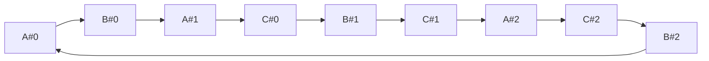
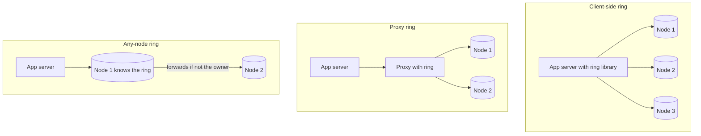
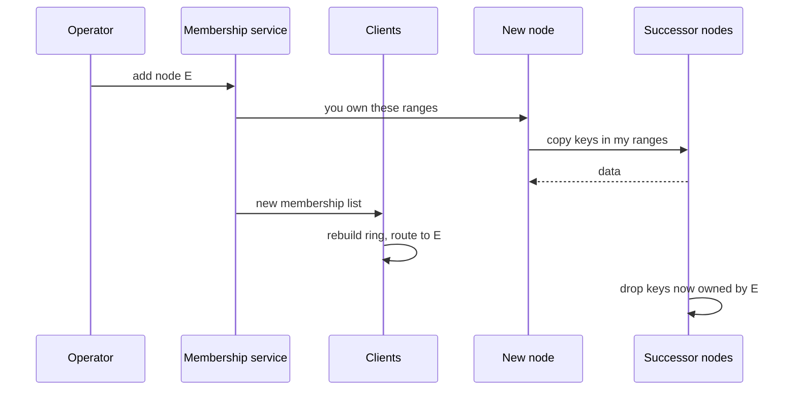

# Design consistent hashing II: virtual nodes, replication and alternatives

## Before this lesson

Read [Design consistent hashing I](#/lesson/system-design/consistent-hashing-ring). You should know the rehashing problem, the hash ring, the clockwise rule, and why a ring with one position per server gives uneven arcs. The code uses Python's `bisect` module, introduced in that lesson.

## In plain words

The basic ring has a fairness problem. Servers land at random places, so one may be responsible for a huge arc and another for a sliver. And when a server fails, its neighbour inherits everything.

The cure is to give each physical server many positions on the ring, called **virtual nodes**. Imagine dealing a pack of cards to four players. If each player received one card, the high card would be a matter of luck. Deal fifty cards each and everybody's hand is of similar strength. With many small arcs per server, the total owned by each server averages out to nearly the same, and when one server leaves, its many small arcs are inherited by many different neighbours instead of one.

This lesson completes the design: virtual nodes with numbers showing how well they work, weighting for unequal machines, replication on the ring, how the ring is used inside a real system, the alternatives (rendezvous hashing and jump hashing), failure handling, and how to present it in an interview.

## 1. Virtual nodes

A **virtual node** (or *vnode*) is one of several ring positions that all belong to the same physical server. To create them, hash the server's name together with an index: `cache-a#0`, `cache-a#1`, `cache-a#2`, and so on. Each hash is a separate point on the ring, and each point maps back to the physical server `cache-a`.



The lookup rule does not change: hash the key, find the first position clockwise, and return the physical server that owns that position.

```python-run
import bisect, hashlib, statistics

def h(text):
    return int(hashlib.md5(text.encode()).hexdigest(), 16) % 2**32

class Ring:
    def __init__(self, vnodes=100):
        self.vnodes = vnodes
        self.positions = []            # sorted ring positions
        self.owner = {}                # position -> physical server

    def add(self, server):
        for i in range(self.vnodes):
            pos = h(f"{server}#{i}")   # one position per virtual node
            bisect.insort(self.positions, pos)
            self.owner[pos] = server

    def remove(self, server):
        for i in range(self.vnodes):
            pos = h(f"{server}#{i}")
            self.positions.remove(pos)
            del self.owner[pos]

    def lookup(self, key):
        i = bisect.bisect_left(self.positions, h(key))
        return self.owner[self.positions[i % len(self.positions)]]

keys = [f"user:{i}" for i in range(30_000)]
servers = [f"cache-{c}" for c in "abcdefgh"]      # 8 servers, ideal share 12.5%

print("vnodes   smallest   largest   spread (std dev as % of the mean)")
for v in (1, 10, 50, 200, 500):
    ring = Ring(vnodes=v)
    for s in servers:
        ring.add(s)
    counts = {s: 0 for s in servers}
    for k in keys:
        counts[ring.lookup(k)] += 1
    shares = [c / len(keys) for c in counts.values()]
    spread = statistics.pstdev(shares) / statistics.mean(shares)
    print(f"{v:>6}   {min(shares):>7.1%}   {max(shares):>7.1%}   {spread:>6.1%}")
```

The table shows the effect directly. With one position per server, the smallest and largest shares differ enormously. With 200 virtual nodes each, every server holds close to the ideal 12.5%.

The **standard deviation** in the last column measures how far the shares typically stray from the average; smaller is more even. As a rule of thumb, the spread shrinks roughly in proportion to $1/\sqrt{v}$ for $v$ virtual nodes per server: about 10% of the mean with 100 virtual nodes and about 5% with a few hundred.

### The cost of virtual nodes

Nothing is free. With $n$ servers and $v$ virtual nodes each, the ring holds $n \times v$ positions.

- **Memory.** Each position is a number plus a reference to a server, perhaps 20 to 50 bytes. A thousand servers with 200 virtual nodes each is 200,000 positions, a few megabytes. Small.
- **Lookup time.** Binary search over 200,000 positions is about 18 comparisons. Negligible.
- **Membership changes.** Adding a server inserts $v$ positions and takes small slices from many servers, so data must be copied from many machines instead of one. That is good for load and slightly more complex to coordinate.

Typical values in practice are between 100 and 300 virtual nodes per server.

## 2. Failure behaviour with virtual nodes

The second weakness of the basic ring was that a departed server's whole load fell on one neighbour. With virtual nodes, the departed server's many small arcs are each inherited by whichever server happens to come next after each one, and those are spread across the whole cluster.

```python-run
import bisect, hashlib
from collections import Counter

def h(text):
    return int(hashlib.md5(text.encode()).hexdigest(), 16) % 2**32

def build(servers, vnodes):
    owner = {h(f"{s}#{i}"): s for s in servers for i in range(vnodes)}
    return sorted(owner), owner

def lookup(positions, owner, key):
    i = bisect.bisect_left(positions, h(key))
    return owner[positions[i % len(positions)]]

keys = [f"user:{i}" for i in range(30_000)]
servers = [f"cache-{c}" for c in "abcdefgh"]

for vnodes in (1, 200):
    p1, o1 = build(servers, vnodes)
    p2, o2 = build([s for s in servers if s != "cache-c"], vnodes)
    inherited = Counter(lookup(p2, o2, k) for k in keys if lookup(p1, o1, k) == "cache-c")
    total = sum(inherited.values())
    print(f"vnodes={vnodes}: cache-c held {total / len(keys):.1%} of keys; after it fails they go to:")
    for server, n in sorted(inherited.items()):
        print(f"    {server}: {n / total:5.1%}")
```

With one position, a single server inherits 100% of the failed server's keys. With 200 virtual nodes, the seven survivors each inherit roughly a seventh. Each survivor's load rises by about 14% instead of one server's load doubling, which removes the trigger for a cascading failure.

## 3. Servers of different sizes

Real clusters mix machine sizes. A server with twice the memory should hold twice the keys. With virtual nodes this needs no new mechanism: give each server a number of virtual nodes proportional to its capacity. A machine with **weight** 2 gets 400 virtual nodes where a machine of weight 1 gets 200, so it owns about twice as much of the ring.

This also allows a gentle introduction of a new server: start it with a few virtual nodes and increase the number step by step, so that it takes load gradually while its cache warms up.

## 4. Estimates

Suppose a cache cluster of 50 servers holding 500 GB in total, with 200 virtual nodes each.

| Quantity | Calculation | Result |
|---|---|---|
| Ring positions | $50 \times 200$ | 10,000 |
| Ring memory | $10{,}000 \times 40$ bytes | 400 KB |
| Comparisons per lookup | $\log_2 10{,}000$ | about 14 |
| Data moved when one server is added | $500\text{ GB} / 51$ | about 10 GB |
| Data moved with modulo hashing | $500\text{ GB} \times 50/51$ | about 490 GB |
| Extra load on each survivor when one fails | $1/49$ | about 2% |

The conclusion: the ring is tiny and fast, so every client can hold a full copy and look keys up locally, and membership changes move about 2% of the data instead of 98%.

## 5. API and data model

A consistent-hashing component is a small library. Its interface:

```
add_node(node_id, weight=1)        -> list of key ranges the node takes over, and from whom
remove_node(node_id)               -> list of key ranges handed to successors
get_node(key)                      -> node_id
get_nodes(key, n)                  -> the n distinct nodes responsible for key (for replication)
```

Its data:

```
positions : sorted array of integers                    (n x v entries)
owner     : map from position to node_id
nodes     : map from node_id to {address, weight, status}
```

The membership list (`nodes`) is the only part that must be agreed by all participants. Positions are derived from it by hashing, so two clients with the same membership list always build identical rings.

## 6. High-level design: where the ring sits in a system

There are three common arrangements for who holds the ring and performs the lookup.



- **Client-side.** Each application server has the membership list and computes the owner itself. One network hop, no extra component. All clients must be updated when membership changes, usually through a coordination service or a configuration push. Common for cache clusters.
- **Proxy.** A routing tier holds the ring. Clients stay simple, at the cost of an extra hop and another tier to keep available.
- **Any node.** Every storage node knows the ring; a client may contact any of them and the request is forwarded to the owner. Used by Dynamo-style databases, where nodes learn about each other by **gossip**: each node periodically exchanges its view of the membership with a few random peers until everyone agrees.

The key flow when membership changes:



For a cache the copy step is often skipped: the new node starts empty and fills through ordinary cache misses, about $1/n$ of the traffic for a short while.

## 7. Deep dive: replication on the ring

To survive the loss of a server, each key is stored on several servers. On a ring the convention is: a key's replicas are the first **N distinct physical servers** found walking clockwise from the key's position. This list is the key's **preference list**.

The word "distinct" matters. With virtual nodes, the next three positions clockwise may belong to the same physical machine. Putting three "replicas" on one machine protects against nothing, so the walk skips positions whose server has already been chosen. Production systems go further and skip servers in the same rack or data centre, so that replicas do not share a cause of failure.

```python-run
import bisect, hashlib

def h(text):
    return int(hashlib.md5(text.encode()).hexdigest(), 16) % 2**32

servers = ["node-a", "node-b", "node-c", "node-d", "node-e"]
owner = {h(f"{s}#{i}"): s for s in servers for i in range(50)}
positions = sorted(owner)

def preference_list(key, n):
    """The first n DISTINCT physical servers clockwise from the key."""
    start = bisect.bisect_left(positions, h(key))
    chosen = []
    for step in range(len(positions)):
        server = owner[positions[(start + step) % len(positions)]]
        if server not in chosen:
            chosen.append(server)
            if len(chosen) == n:
                break
    return chosen

for key in ("cart:1001", "cart:1002", "session:9", "user:55"):
    print(f"{key:12s} -> {preference_list(key, 3)}")

# How often would a naive 'next 3 positions' rule put two replicas on one machine?
bad = 0
trials = 5000
for i in range(trials):
    start = bisect.bisect_left(positions, h(f"k{i}"))
    three = [owner[positions[(start + s) % len(positions)]] for s in range(3)]
    bad += len(set(three)) < 3
print(f"\nnaive rule duplicates a machine for {bad / trials:.0%} of keys")
```

The first key in a preference list is the **coordinator**, which normally handles the request and forwards it to the other replicas. The key-value store module, starting with [Design a key-value store I](#/lesson/system-design/kv-store-cap-replication), builds on exactly this structure.

## 8. Bottlenecks and failure handling

**Hot keys.** Consistent hashing spreads *keys* evenly. It does nothing about one key that receives a huge share of *requests*, such as a celebrity's profile. Virtual nodes do not help, because one key maps to one place. Remedies: cache the hot key at a layer above, replicate it and spread reads across the replicas, or split it into several sub-keys (`profile:77#0` to `profile:77#9`) chosen at random on read.

**Uneven load despite even key counts.** Some keys are larger or more popular than others. An extension called **consistent hashing with bounded loads** sets a cap on each server, for example 125% of the average load. If the first server clockwise is at its cap, the key goes to the next one that is not. Google and Vimeo have published descriptions of using this for load balancing.

**Disagreement about membership.** If two clients have different server lists, they send the same key to different servers. For a cache this causes extra misses and stale entries. For a store it causes reads that miss recent writes. Membership must come from one agreed source, such as a coordination service (ZooKeeper, etcd) or a gossip protocol with versioned state, and changes should be rolled out so that the old and the new owner are both consulted during the transition.

**A flapping server.** A server that repeatedly drops out and returns causes repeated movement of the same keys. Add a delay before declaring a server gone and before re-admitting it.

**Stale data after a server returns (caches).** A cache server that was briefly removed still holds entries from before it left. If writes happened meanwhile and the server comes back, clients read old values from it. Clear a cache node before re-adding it, or rely on short TTLs.

## 9. Trade-offs and alternatives

**Rendezvous hashing**, also called **highest random weight (HRW)** hashing. For a key, compute a score `hash(key, server)` for every server and choose the server with the highest score. When a server is removed, only the keys for which it had the highest score change, and each moves to its second-highest server, so movement is minimal and spread across the survivors, with no ring and no virtual nodes. The cost is that each lookup computes one hash per server, $O(n)$, which is fine for tens or hundreds of servers and poor for many thousands.

```python-run
import hashlib

def score(key, server):
    return int(hashlib.md5(f"{key}|{server}".encode()).hexdigest(), 16)

def rendezvous(key, servers):
    return max(servers, key=lambda s: score(key, s))

servers = [f"node-{i}" for i in range(8)]
keys = [f"user:{i}" for i in range(20_000)]

before = {k: rendezvous(k, servers) for k in keys}
counts = {s: 0 for s in servers}
for s in before.values():
    counts[s] += 1
print("share per server:", ", ".join(f"{c / len(keys):.1%}" for c in counts.values()))

survivors = [s for s in servers if s != "node-3"]
after = {k: rendezvous(k, survivors) for k in keys}
moved = [k for k in keys if before[k] != after[k]]
print(f"after removing node-3: {len(moved) / len(keys):.1%} moved; "
      f"all of them were on node-3: {all(before[k] == 'node-3' for k in moved)}")
```

The distribution is even without any tuning, and exactly the removed server's keys move.

**Jump consistent hash.** A very compact algorithm that maps a key to a bucket number from 0 to $n-1$ with no memory at all and near-perfect balance. Its limitation is that buckets are numbered and can only be added or removed at the end, so it cannot handle the loss of an arbitrary server on its own. It suits fixed, numbered shards better than a cache cluster with failing nodes.

**A lookup directory.** Instead of computing the owner, store it: split the key space into a fixed, large number of slots (Redis Cluster uses 16,384) and keep a table from slot to server. Moving load means reassigning slots in the table. This gives precise, operator-controlled rebalancing at the cost of maintaining and distributing the table.

| Scheme | Lookup cost | Memory | Balance | Arbitrary node removal | Typical use |
|---|---|---|---|---|---|
| Modulo | O(1) | None | Good | Moves nearly everything | Fixed-size clusters only |
| Ring with virtual nodes | O(log(nv)) | n x v positions | Good with enough vnodes | Yes | Caches, Dynamo-style stores |
| Rendezvous | O(n) | None | Very good | Yes | Small to medium clusters |
| Jump hash | O(log n) | None | Excellent | Only the last bucket | Numbered shards |
| Slot directory | O(1) | Table of slots | Operator-controlled | Yes, by reassigning slots | Redis Cluster and similar |

## 10. What a strong answer sounds like

> **Interviewer:** We have a cache cluster of 20 nodes and want to add more without wiping out the cache. How would you route keys?
>
> **Candidate:** With `hash mod N`, going from 20 to 21 remaps about 95% of keys, so nearly every request would miss and the database would take the full load. I would use consistent hashing: nodes and keys are hashed onto a ring and a key goes to the first node clockwise. Adding a node then moves only about one twenty-first of the keys.
>
> **Interviewer:** Is the load even?
>
> **Candidate:** Not with one position per node; random positions give very unequal arcs. So each node gets around 200 virtual nodes, which brings the spread between nodes down to a few percent. It also means that when a node fails, its keys are shared among all the others instead of landing on a single neighbour, which avoids a cascading failure. For bigger machines I would assign proportionally more virtual nodes.
>
> **Interviewer:** Where does the ring live?
>
> **Candidate:** In the client library on each application server, built from a membership list held in a coordination service. That keeps lookups to one hop. When membership changes, clients are notified and rebuild the ring, which is about 4,000 positions here and takes microseconds to search.
>
> **Interviewer:** One key is extremely hot. Does this help?
>
> **Candidate:** No. Consistent hashing balances keys, not requests to one key. For that key I would add a small local cache in the application servers or spread reads across replicas.

## Common mistakes

- **Stopping at the basic ring** without virtual nodes.
- **Choosing replicas as "the next N positions"** instead of the next N distinct physical servers.
- **Claiming virtual nodes fix hot keys.** They even out key ownership, not per-key traffic.
- **Too few virtual nodes.** Ten per server still leaves large imbalances.
- **Ignoring membership agreement.** Two clients with different node lists route the same key differently.
- **Re-adding a cache node without clearing it**, serving stale entries.
- **Proposing rendezvous hashing for thousands of nodes** without noting its per-lookup cost.

## Summary

- Virtual nodes give each server many ring positions, so arcs average out; the spread shrinks roughly with the square root of the number of virtual nodes.
- With virtual nodes a failed server's keys are shared among all survivors, and unequal machines are handled by weighting the number of virtual nodes.
- The ring is small and fast enough for every client to hold; the membership list is the part that must be agreed.
- Replicas are the first N distinct physical servers clockwise, ideally in different racks or zones.
- Hot keys, membership disagreement, flapping nodes and stale cache nodes are the practical failure modes.
- Alternatives: rendezvous hashing (no ring, linear lookup), jump hash (no memory, numbered buckets only), a slot directory (operator-controlled), and bounded loads (a cap per server).

## Glossary

- **Virtual node (vnode)**: one of several ring positions that map to the same physical server.
- **Standard deviation**: a measure of how far values typically lie from their average.
- **Weight**: a server's relative capacity, expressed as its share of virtual nodes.
- **Membership list**: the agreed set of servers in the cluster.
- **Gossip protocol**: nodes periodically exchanging state with random peers until all agree.
- **Preference list**: the ordered list of servers responsible for a key.
- **Coordinator**: the node that handles a request for a key and forwards it to the other replicas.
- **Hot key**: one key receiving a very large share of requests.
- **Bounded loads**: consistent hashing with a cap on each server's load, overflowing to the next server.
- **Rendezvous (HRW) hashing**: choosing the server with the highest hash score for each key.
- **Jump consistent hash**: a memory-free algorithm mapping keys to numbered buckets.
- **Slot directory**: a stored table mapping fixed hash slots to servers.
- **Flapping**: a server repeatedly leaving and rejoining.

## Check yourself

```quiz
[
  {"q": "What problem do virtual nodes primarily solve?",
   "options": ["Slow hash functions", "Uneven arc sizes and the concentration of a failed server's load on one neighbour", "Hot keys", "The need for replication"],
   "answer": 1,
   "explain": "Many positions per server average out arc sizes and spread a departed server's ranges across many successors."},
  {"q": "A cluster has servers of weight 1 and weight 3. How is the difference expressed on the ring?",
   "options": ["The heavier server uses a different hash function", "The heavier server gets three times as many virtual nodes", "The heavier server is placed at position 0", "Weights cannot be expressed"],
   "answer": 1,
   "explain": "Ownership is proportional to the number of positions, so capacity is expressed through the count of virtual nodes."},
  {"q": "For replication factor 3, why must the replicas be the next three distinct physical servers and not the next three ring positions?",
   "options": ["Positions are slower to find", "Consecutive positions may belong to the same machine, giving no protection against its failure", "Distinct servers use less memory", "The hash would overflow"],
   "answer": 1,
   "explain": "With virtual nodes, neighbouring positions often belong to one server. Copies on the same machine are lost together."},
  {"q": "Which statement about hot keys is correct?",
   "options": ["Virtual nodes spread a hot key across servers", "Consistent hashing balances keys, so a single very popular key still lands on one server", "Hot keys cannot exist with a good hash", "Rendezvous hashing removes hot keys"],
   "answer": 1,
   "explain": "One key hashes to one place. Its traffic must be handled by caching above, replication with read spreading, or key splitting."},
  {"q": "In rendezvous hashing, how is the server for a key chosen?",
   "options": ["The first server clockwise on a ring", "The server with the highest hash score for that key and server pair", "hash(key) mod N", "A random server"],
   "answer": 1,
   "explain": "Each key scores every server and picks the top one. Removing a server only affects keys that ranked it first."},
  {"q": "What is the main cost of rendezvous hashing compared with a ring?",
   "options": ["It needs a large table in memory", "Each lookup computes a hash for every server, so cost grows linearly with cluster size", "It moves most keys on change", "It cannot be weighted"],
   "answer": 1,
   "explain": "There is no stored structure, but the per-lookup work is O(n), acceptable for hundreds of nodes and costly for many thousands."},
  {"q": "Two application servers hold different membership lists for the cache cluster. What happens?",
   "options": ["Nothing; the ring corrects itself", "They may route the same key to different nodes, causing extra misses and stale reads", "The cluster stops", "Keys are duplicated safely"],
   "answer": 1,
   "explain": "Identical rings require identical membership. Disagreement sends one key to two places until the lists converge."}
]
```

> **Source:** Xu, *System Design Interview: An Insider's Guide*, ch. 5 (two issues in the basic approach, virtual nodes, affected keys) as a topic guide; DeCandia et al., "Dynamo: Amazon's Highly Available Key-value Store" (SOSP 2007); Thaler and Ravishankar, "Using name-based mappings to increase hit rates" (rendezvous hashing, 1998); Lamping and Veach, "A Fast, Minimal Memory, Consistent Hash Algorithm" (2014), https://arxiv.org/abs/1406.2294 ; Mirrokni, Thorup and Zadimoghaddam, "Consistent Hashing with Bounded Loads" (2016), https://arxiv.org/abs/1608.01350
