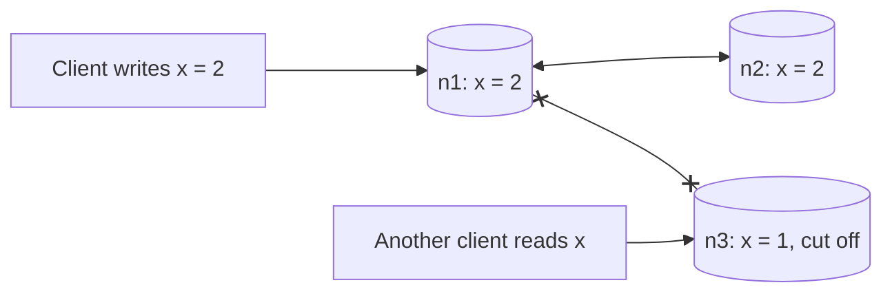
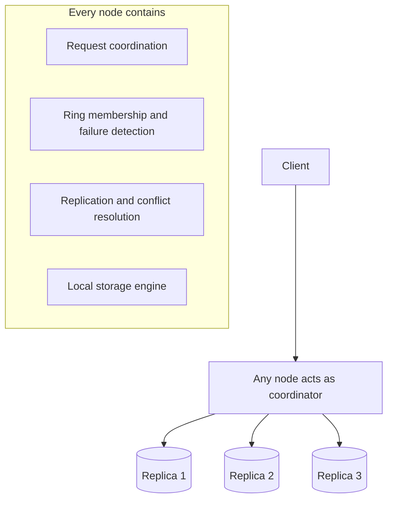
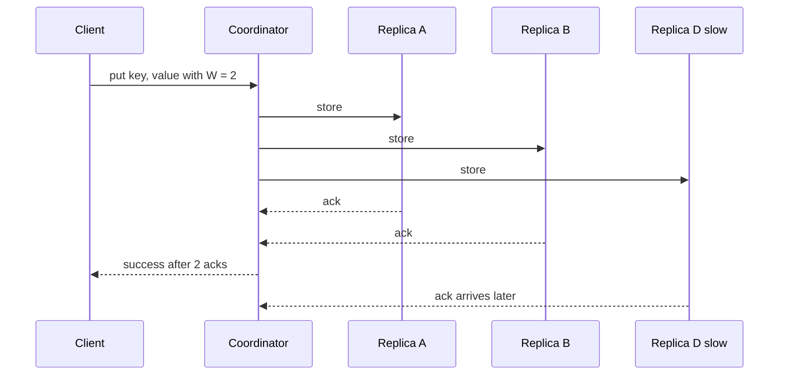

# Design a key-value store I: CAP, partitioning, replication and quorums

## Before this lesson

Read [Design consistent hashing II](#/lesson/system-design/consistent-hashing-virtual-nodes); this design is built on the hash ring and the preference list. You should also know replicas, replication lag and strong versus eventual consistency from [The vocabulary of scale](#/lesson/system-design/core-vocabulary).

## In plain words

A **key-value store** is the simplest kind of database: a giant dictionary. You hand it a **key** (a short unique name such as `cart:8841`) and a **value** (any blob of data), and later you ask for the value by its key. There are two operations, `put(key, value)` and `get(key)`. There are no tables, no joins and no queries over the contents.

A coat-check counter is a key-value store. You hand over a coat and receive a numbered ticket. Later you present the ticket and receive the coat. The attendant never needs to know what the coat looks like, only which hook the number refers to.

One coat check with one attendant is easy. The interesting problem is a chain of coat checks that must behave as one: any counter should be able to return your coat, the service must stay open when one counter floods, and no coat may be lost. That is a *distributed* key-value store, and designing one is the classic way to learn the central trade-off of distributed data: you cannot have perfect consistency and perfect availability when the network between machines breaks.

Products such as Amazon DynamoDB, Apache Cassandra and Riak follow the design in this module. On the job you will use them for sessions, shopping carts, user preferences and anything else that needs fast, always-on access by key.

This module follows the track's design structure. This lesson covers requirements, estimates, the API, the data model, the high-level design and the first deep dives (CAP, partitioning, replication, quorums). The next lesson covers conflict resolution, failure handling, the storage engine, trade-offs, a sample dialogue and common mistakes.

## 1. Requirements and the scope questions to ask

| Question | Why it matters | Assumed answer |
|---|---|---|
| How large is a key-value pair? | Decides whether values fit in memory and in one network message | Small: under 10 KB |
| How much data in total? | One machine or many | Far more than one machine holds |
| Read-heavy or write-heavy? | Storage engine choice | Both must be fast |
| Must reads always see the latest write? | The CAP choice | No; brief staleness is acceptable, and this should be tunable |
| How available? | Replication and failure handling | Always writable, even during failures |
| Does it need to grow and shrink without downtime? | Partitioning scheme | Yes, automatically |

**Functional requirements:** `put(key, value)`, `get(key)`, and deletion.

**Non-functional requirements:** high availability, including during machine and network failures; horizontal scalability by adding machines; automatic scaling as machines join and leave; tunable consistency; low latency (single-digit milliseconds at the p99).

## 2. Start with one server

On one machine, a key-value store is a hash table in memory. It is as fast as anything can be. Its limits appear quickly: memory is finite, and one machine is a single point of failure. Two tricks stretch a single server, compressing the values and keeping only hot data in memory with the rest on disk, but neither removes the ceiling. To go further the data must be spread over many machines, and at that moment a fundamental constraint appears.

## 3. The CAP theorem in plain words

The **CAP theorem** concerns three properties of a system that stores data on several machines.

- **Consistency (C):** every read returns the most recent write, whichever machine answers. All clients see the same data at the same time.
- **Availability (A):** every request to a working machine receives a response (not an error), even when other machines are down.
- **Partition tolerance (P):** the system keeps operating when the network splits, so that some machines cannot talk to others. Such a split is called a **network partition**.

The theorem says a distributed store can provide at most two of the three at once.

In practice the choice is narrower than "pick any two". Networks do fail, so partitions will happen whether you like it or not; a system that stops working when one occurs is not useful. Partition tolerance is therefore a given, and the real choice is what to do *during* a partition.

Picture three replicas, n1, n2 and n3. The link to n3 breaks. A write arrives at n1.



- **Choose consistency (a CP system).** To prevent anyone reading the stale value on n3, the system refuses writes (or n3 refuses reads) until the partition heals. Users see errors. A bank ledger makes this choice: an error is better than a wrong balance.
- **Choose availability (an AP system).** n1 and n2 accept the write; n3 keeps answering reads with the old value. Nobody sees an error, but some see stale data, and the replicas must be reconciled later. A shopping cart makes this choice: "add to cart" must never fail.

The store in this module is an AP design with a dial that lets each request lean towards consistency. The [Databases track](#/lesson/databases/linearizability) gives the precise definitions, and the lesson [CAP, queues and idempotency](#/lesson/system-design/bb-cap-queues-idempotency) covers the PACELC refinement.

> [!INTERVIEW]
> Avoid saying "I pick CA". With more than one machine, partitions cannot be ruled out, so the meaningful statement is "during a partition this system favours availability" or "favours consistency", followed by why that suits the data.

## 4. Estimates

Assume 500 billion key-value pairs averaging 2 KB, replicated three times, and 200,000 requests per second at peak, half reads and half writes.

```python-run
pairs, avg_bytes, replicas = 500e9, 2_000, 3
peak_qps = 200_000
disk_per_node = 4e12            # 4 TB usable per machine
fill = 0.6                      # keep disks at most 60% full, leaving room for compaction and growth
node_qps = 10_000               # mixed reads and writes one node handles comfortably

raw = pairs * avg_bytes
total = raw * replicas
by_storage = total / (disk_per_node * fill)
by_traffic = peak_qps * replicas / node_qps     # each write lands on all replicas

print(f"raw data          : {raw / 1e15:.1f} PB")
print(f"with {replicas} replicas   : {total / 1e15:.1f} PB")
print(f"nodes for storage : {by_storage:,.0f}")
print(f"nodes for traffic : {by_traffic:,.0f}")
print(f"cluster size      : about {max(by_storage, by_traffic):,.0f} nodes (storage decides)")
print(f"expected failures : with one failure per node every 3 years, "
      f"about {max(by_storage, by_traffic) / (3 * 365):.1f} nodes fail per day")
```

Three petabytes and over a thousand machines. The last line is the important one: at this size roughly one machine fails every day. Failure is not an exceptional event to be handled by an operator; it is the normal state, and the design must handle it automatically.

## 5. API

```
put(key, value, context?)  -> ok | error
get(key)                   -> {value(s), context} | not found
delete(key, context?)      -> ok
```

`context` is opaque version information that the store returns on a read and the client passes back on the next write. It is how the store knows which version a write was based on. The next lesson explains what is inside it (a vector clock). `get` can return more than one value when the store holds conflicting versions it cannot merge by itself.

Each call may also carry a **consistency level**, saying how many replicas must respond before the call returns.

## 6. Data model

- **Key:** a string or byte array, hashed to find its position on the ring.
- **Value:** an opaque byte array; the store does not interpret it.
- **Metadata per stored version:** version information, a timestamp, and a marker for deletions.

Deletion deserves a sentence now. In a replicated store you cannot erase a key and forget it, because a replica that missed the deletion would later "restore" the old value to the others. Instead a delete writes a special marker called a **tombstone**, which replicates like any value and is removed for good only after all replicas have had ample time to receive it.

## 7. High-level design

Every node runs the same software and has the same responsibilities; there is no special master. A design with no distinguished node is called **decentralised** or *peer-to-peer*, and its advantage is that there is no single point of failure.



| Goal | Technique | Covered in |
|---|---|---|
| Store more than one machine holds | Partitioning with consistent hashing | This lesson |
| Survive machine loss | Replication to N nodes | This lesson |
| Tunable consistency | Quorum reads and writes | This lesson |
| Conflicting concurrent writes | Versioning with vector clocks | Next lesson |
| Temporary failures | Sloppy quorum and hinted handoff | Next lesson |
| Permanent failures | Anti-entropy with Merkle trees | Next lesson |
| Knowing who is alive | Gossip protocol | Next lesson |
| Fast local reads and writes | Commit log, memtable, SSTables | Next lesson |

## 8. Deep dive: partitioning

The data is split with the consistent hash ring from the previous module. Each node holds many virtual nodes; a key belongs to the first node clockwise from its hash. The properties we rely on:

- **Automatic scaling.** A node that joins takes small ranges from many others; a node that leaves hands its ranges to many others. About $1/n$ of the data moves.
- **Heterogeneity.** Bigger machines are given more virtual nodes.

## 9. Deep dive: replication

Each key is stored on **N** nodes: the first N distinct physical servers clockwise from the key, its preference list. N is the **replication factor**; three is the common choice. For protection against the loss of a whole building, the replicas are placed in different data centres, connected by fast links.

Replication can be acknowledged in two ways. If the coordinator waits for every replica before answering, a write is as slow as the slowest replica and fails if any replica is down. If it waits for none, writes are fast but a confirmed write may exist on only one machine. Quorums are the dial between these extremes.

## 10. Deep dive: quorum consensus

Define three numbers.

- **N**: the number of replicas for each key.
- **W**: the **write quorum**, the number of replicas that must acknowledge a write before it counts as successful.
- **R**: the **read quorum**, the number of replicas that must respond to a read before a result is returned.

The coordinator always sends the request to all N replicas. W and R say how many answers it waits for.



The key rule:

$$W + R > N \;\Rightarrow\; \text{every read quorum overlaps every write quorum}$$

If the sets overlap, at least one of the R replicas a read contacts holds the latest successfully written value, and the reader can pick it out by its version. If $W + R \le N$, a read may contact only replicas that missed the latest write and return stale data.

| Setting (N = 3) | Behaviour |
|---|---|
| W = 1, R = 1 | Fastest; reads may be stale |
| W = 2, R = 2 | Overlap guaranteed; tolerates one replica down for reads and writes |
| W = 3, R = 1 | Fast reads that always see the latest write; a write fails if any replica is down |
| W = 1, R = 3 | Fast writes; a read fails if any replica is down |

The simulation tries every setting and counts how often a read returns a stale value when acknowledgements arrive in random order.

```python-run
import random
random.seed(42)

def trial(n, w, r):
    """One write followed immediately by one read. Returns True if the read is stale."""
    replicas = [1] * n                              # every replica starts with version 1
    wrote = random.sample(range(n), w)              # the W replicas that have applied version 2
    for i in wrote:                                 # (the others will get it later)
        replicas[i] = 2
    asked = random.sample(range(n), r)              # the R replicas that answer the read first
    return max(replicas[i] for i in asked) < 2      # the reader takes the highest version it sees

N = 3
print(" W  R   W+R>N   stale reads   survives how many replicas down (write / read)")
for w in range(1, N + 1):
    for r in range(1, N + 1):
        stale = sum(trial(N, w, r) for _ in range(20_000)) / 20_000
        print(f" {w}  {r}   {str(w + r > N):5s}   {stale:10.1%}   {N - w} / {N - r}")
```

Every row with $W + R > N$ shows zero stale reads. Every row without it shows some. The last column shows the price: a higher W or R tolerates fewer failed replicas for that operation, and each operation waits for more responses, so it is slower.

Two caveats keep this honest. First, the overlap guarantee assumes the write did reach W of the proper replicas; the "sloppy quorum" in the next lesson relaxes that for availability. Second, if two clients write the same key at the same time, the replicas can end up with different "latest" values. Quorums alone do not order concurrent writes; versioning does, and it comes next.

### Consistency models on offer

- **Strong consistency:** a read never returns stale data. Obtained with $W + R > N$ and no sloppy quorum, at a cost in availability.
- **Weak consistency:** a read may not see the most recent write.
- **Eventual consistency:** a form of weak consistency in which, given enough time without new writes, all replicas converge. This is the default for Dynamo-style stores, which let clients tune N, W and R per request.

> [!TIP]
> A compact way to remember the dial: W and R are the number of replicas you insist on hearing from. Insisting on more buys consistency and costs latency and availability. N = 3, W = 2, R = 2 is the balanced default.

> [!WARNING]
> The coordinator sends writes to all N replicas even when W is 1. W controls when the client is told "success", not how many copies will eventually exist. Saying "with W = 1 the data is stored on one node" is a common error.

## Common mistakes

- **Describing CAP as a free choice of any two.** Partition tolerance is not optional in a distributed system.
- **Treating W as the number of copies.** It is the number of acknowledgements awaited.
- **Stating that $W + R > N$ makes concurrent writes safe.** It guarantees a read sees the latest *completed* write; concurrent writers still need versioning.
- **Deleting by removing the entry.** Without tombstones a lagging replica resurrects deleted data.
- **A master node in an "always writable" design.** It reintroduces a single point of failure.
- **Sizing only by traffic.** Here storage, not QPS, determined the node count.

## Summary

- A key-value store offers `put` and `get` by key; on one machine it is a hash table, and at scale it must be distributed.
- CAP: when the network partitions, a replicated store must choose between rejecting requests (consistency) and serving possibly stale data (availability).
- Data is partitioned with a consistent hash ring with virtual nodes and each key is replicated on the first N distinct nodes clockwise.
- Quorums tune consistency: with $W + R > N$ every read overlaps the latest completed write; smaller values are faster and more available.
- Deletes are tombstones; all nodes are peers; at a thousand nodes, daily failures are normal.

## Glossary

- **Key-value store**: a database that stores and retrieves opaque values by unique keys.
- **CAP theorem**: a replicated store can provide at most two of consistency, availability and partition tolerance.
- **Network partition**: a network fault that leaves groups of machines unable to communicate.
- **CP / AP system**: one that favours consistency, or availability, during a partition.
- **Decentralised (peer-to-peer)**: having no special master node.
- **Replication factor (N)**: the number of nodes storing each key.
- **Write quorum (W) / read quorum (R)**: acknowledgements required for a write, or responses required for a read.
- **Coordinator**: the node that handles a client's request and contacts the replicas.
- **Consistency level**: a per-request choice of how many replicas must respond.
- **Tombstone**: a marker recording that a key was deleted.
- **Context**: version information returned by a read and supplied with the next write.
- **Eventual consistency**: replicas converge when writes stop.

## Check yourself

```quiz
[
  {"q": "With N = 3, which setting guarantees that a read sees the latest completed write?",
   "options": ["W = 1, R = 1", "W = 1, R = 2", "W = 2, R = 2", "W = 2, R = 1"],
   "answer": 2,
   "explain": "Only W + R > N guarantees overlap. 2 + 2 = 4 is greater than 3; the other settings sum to 3 or less."},
  {"q": "With N = 3 and W = 1, to how many replicas does the coordinator send a write?",
   "options": ["1", "2", "3", "It depends on R"],
   "answer": 2,
   "explain": "The write is always sent to all N replicas. W is only the number of acknowledgements awaited before reporting success."},
  {"q": "During a network partition, an AP store does what?",
   "options": ["Refuses all requests", "Keeps answering on both sides and reconciles differences later", "Deletes the minority side", "Becomes strongly consistent"],
   "answer": 1,
   "explain": "Favouring availability means every reachable node answers, accepting that replicas may temporarily disagree."},
  {"q": "Why does a replicated store use tombstones for deletes?",
   "options": ["They are faster than erasing", "So a replica that missed the delete cannot reintroduce the old value", "To save disk space", "Because keys cannot be removed from a hash ring"],
   "answer": 1,
   "explain": "A deletion must replicate like any write. Without a marker, an out-of-date replica would look as if it held data the others lack."},
  {"q": "With N = 3, W = 3, R = 1, what is the main drawback?",
   "options": ["Reads may be stale", "A write fails or stalls if any single replica is unavailable", "Reads are slow", "Data is stored on one node"],
   "answer": 1,
   "explain": "Requiring all three acknowledgements means no tolerance for a failed replica on the write path."},
  {"q": "Why is partition tolerance treated as mandatory?",
   "options": ["It is the cheapest property", "Network failures happen in any multi-machine system, so the design must decide how to behave during one", "It makes reads faster", "The theorem requires all three"],
   "answer": 1,
   "explain": "You cannot prevent partitions; you can only choose whether to stay consistent or stay available while one lasts."},
  {"q": "In the estimate, what determined the cluster size?",
   "options": ["Peak QPS", "Total storage including replicas", "The number of data centres", "The hash function"],
   "answer": 1,
   "explain": "Three petabytes at about 2.4 TB usable per node needs far more nodes than the request rate does."}
]
```

> **Source:** Xu, *System Design Interview: An Insider's Guide*, ch. 6 (single-server store, CAP theorem, data partition, data replication, consistency) as a topic guide; DeCandia et al., "Dynamo: Amazon's Highly Available Key-value Store" (SOSP 2007), https://www.allthingsdistributed.com/files/amazon-dynamo-sosp2007.pdf
