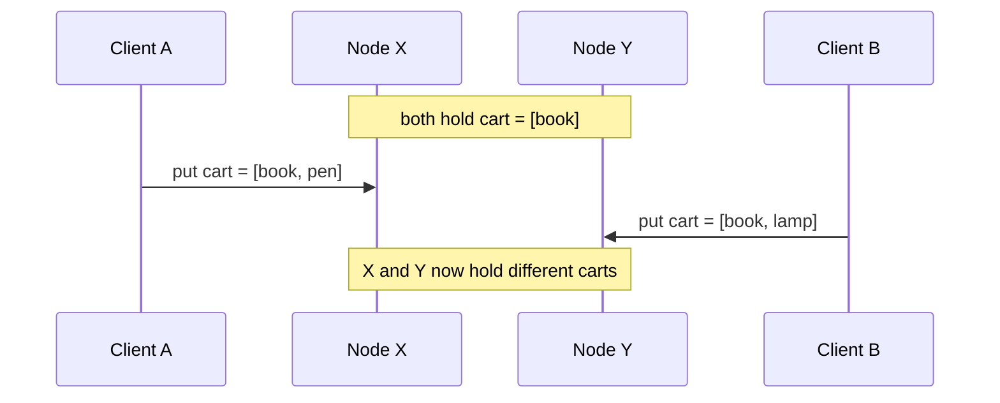
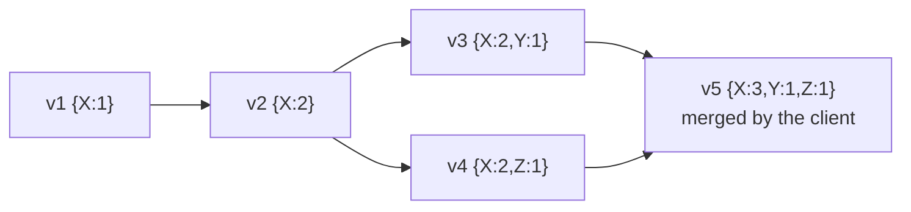
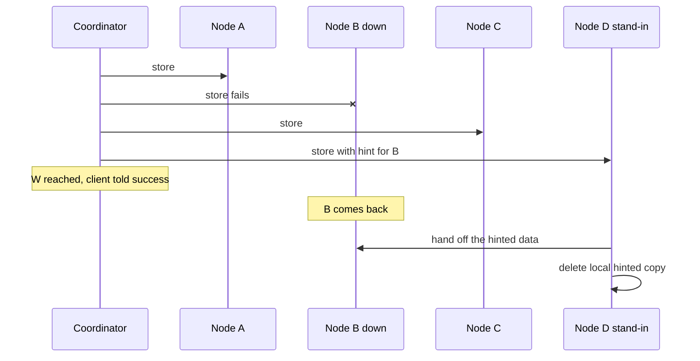
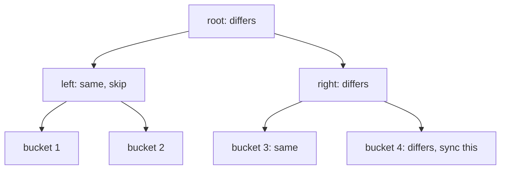
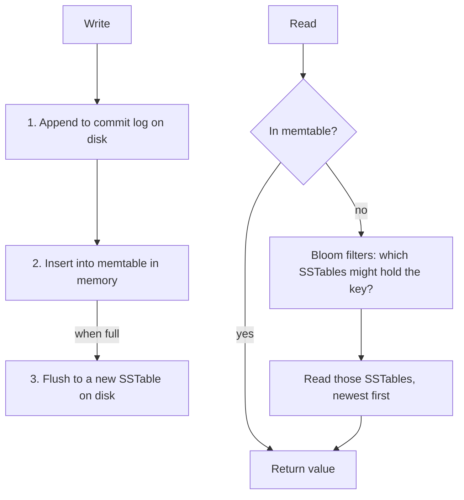

# Design a key-value store II: versioning, failure handling and the storage engine

## Before this lesson

Read [Design a key-value store I](#/lesson/system-design/kv-store-cap-replication). You should know the replication factor N, the quorums W and R, the preference list, the coordinator and what an AP system is.

## In plain words

The store from the previous lesson keeps accepting writes even when replicas cannot talk to each other. That choice has consequences, and this lesson deals with them.

Imagine two friends who each keep a paper copy of a shared shopping list and cannot phone each other for a day. One adds "milk". The other adds "eggs". When they meet, they hold two different lists. Neither is wrong, and neither is newer. They need a way to notice that the lists diverged and a way to merge them. That is **conflict detection and resolution**.

They also need routines for everyday trouble. If one friend is away for an hour, a neighbour takes notes for them and passes them on later (**hinted handoff**). If a friend loses their copy entirely, they compare lists section by section to find what is missing without reading every line (**Merkle trees**). And they keep track of who is reachable by asking around (**gossip**).

Finally, each node needs a way to write to disk quickly and read back quickly: the **storage engine**.

## 1. Deep dive: why replicas diverge

With N = 3 and W = 1 or 2, a write succeeds before all replicas have it. If two clients update the same key at the same moment through different coordinators, or during a partition, different replicas can hold different values, and neither value was derived from the other. Such writes are called **concurrent**. Note that "concurrent" here does not mean "at the same instant on the clock"; it means neither writer had seen the other's write.



The tempting fix is **last write wins (LWW)**: attach a timestamp to each write and keep the one with the larger timestamp. It is easy and it silently discards data: one of the two cart updates vanishes. It also trusts that machines' clocks agree, and they do not; clocks on different machines drift apart by milliseconds or more. LWW is acceptable when losing an overwritten value is harmless (a "last seen at" field) and wrong for a cart.

## 2. Deep dive: vector clocks

To keep both values when they conflict, the store must be able to tell "B replaced A" apart from "A and B are siblings". A **vector clock** does this. It is a small set of counters attached to each version of a value, one counter per node that has coordinated a write to it: `{X: 2, Y: 1}` means "node X has written this key twice and node Y once in this version's history".

Rules:

1. When a node coordinates a write, it takes the vector clock supplied by the client (the `context` from the client's last read), adds 1 to its own counter and stores the new version.
2. Version P **descends from** version Q if every counter in P is greater than or equal to the matching counter in Q (a missing counter counts as 0). Then P replaces Q.
3. If neither descends from the other, they are **concurrent**. The store keeps both, and they are called **siblings**.

```python-run
def compare(a, b):
    """Compare two vector clocks given as dicts, e.g. {'X': 2, 'Y': 1}."""
    nodes = set(a) | set(b)
    a_ge = all(a.get(n, 0) >= b.get(n, 0) for n in nodes)   # a has seen everything b has
    b_ge = all(b.get(n, 0) >= a.get(n, 0) for n in nodes)
    if a_ge and b_ge:
        return "equal"
    if a_ge:
        return "a descends from b (a is newer)"
    if b_ge:
        return "b descends from a (b is newer)"
    return "concurrent (conflict: keep both)"

v1 = {"X": 1}                       # first write, handled by node X
v2 = {"X": 2}                       # second write through X, based on v1
v3 = {"X": 2, "Y": 1}               # client read v2, wrote through Y
v4 = {"X": 2, "Z": 1}               # another client also read v2, wrote through Z
v5 = {"X": 3, "Y": 1, "Z": 1}       # a client read both siblings, merged them, wrote through X

for name, (a, b) in {"v2 vs v1": (v2, v1), "v3 vs v2": (v3, v2), "v3 vs v4": (v3, v4),
                     "v5 vs v3": (v5, v3), "v5 vs v4": (v5, v4)}.items():
    print(f"{name}: {compare(a, b)}")
```

Follow the story in the output. `v2` replaces `v1`. `v3` and `v4` were both written by clients that had seen `v2` but not each other, so they are concurrent, and the store keeps both. A later `get` returns both siblings. The client merges them (for a cart: take the union of the items) and writes the result with a context that covers both, producing `v5`, which descends from both and replaces them.



Costs of vector clocks:

- **Clients must merge.** Resolving siblings is application logic. A cart can be unioned; other data types need their own rule. A known flaw of the union: an item removed in one sibling reappears.
- **Clocks grow.** Each coordinating node adds an entry. Stores cap the size and drop the oldest entries, which can occasionally misjudge ancestry.

The alternatives are LWW (simple, loses data) and **CRDTs** (conflict-free replicated data types), which are data structures such as counters and sets designed so that any two replicas can always be merged automatically. The [Databases track](#/lesson/databases/concurrent-writes) treats all three.

> [!INTERVIEW]
> A crisp answer to "how do you handle conflicting writes?": "Each version carries a vector clock. If one clock dominates the other, the newer version wins automatically. If they are concurrent, the store keeps both and returns them on the next read for the application to merge. Where losing an overwritten value is acceptable, I would use last-write-wins for simplicity."

## 3. Deep dive: detecting failed nodes with gossip

In a decentralised system no single node may declare another dead; one node's opinion could be the result of its own bad network link. Membership and liveness are spread by a **gossip protocol**.

- Each node keeps a **membership table**: for every node, a **heartbeat counter** and the local time it last saw that counter increase.
- Every second or so, each node increases its own counter and sends its table to a few randomly chosen nodes.
- A receiver keeps, for each node, the higher of the counter it had and the counter it received.
- If a node's counter has not increased for longer than a threshold, it is marked as down, and that suspicion spreads the same way.

Information spreads like a rumour: the number of informed nodes roughly doubles each round, so news reaches everyone in a number of rounds proportional to the logarithm of the cluster size.

```python-run
import random
random.seed(3)

def rounds_to_spread(n, fanout=2):
    """One node learns a fact. Each round every informed node tells `fanout` random nodes."""
    informed = {0}
    rounds = 0
    while len(informed) < n:
        for node in list(informed):
            for peer in random.sample(range(n), fanout):
                informed.add(peer)
        rounds += 1
    return rounds

for n in (10, 100, 1000, 10000):
    avg = sum(rounds_to_spread(n) for _ in range(5)) / 5
    print(f"{n:>6} nodes: everyone knows after about {avg:.0f} rounds")
```

A thousand times more nodes needs only about three times as many rounds. That is why gossip scales.

## 4. Deep dive: temporary failures, sloppy quorum and hinted handoff

A strict quorum requires W of the key's N *designated* replicas. If two of three are briefly unreachable, a write with W = 2 fails. For an "always writable" store that is unacceptable.

A **sloppy quorum** relaxes the rule: the write goes to the first N *healthy* nodes found walking the ring, skipping the ones that are down. The stand-in node stores the data in a separate area together with a **hint** naming the node it was meant for. When the intended node returns, the stand-in sends it the data and deletes its copy. This is **hinted handoff**.



The price: a sloppy quorum breaks the overlap guarantee of $W + R > N$, because the write's acknowledgements may include a node outside the key's preference list, which a later read will not ask. Availability is bought with a wider window of possible staleness.

## 5. Deep dive: permanent failures and Merkle trees

Hints cover an outage of minutes. If a node is gone for days or its disk is replaced, its replacement must be brought back in line with the other replicas, a process called **anti-entropy**. Comparing every key between two nodes that each hold billions of keys would move far too much data. The store needs to find *which* keys differ while exchanging very little.

A **Merkle tree** (or hash tree) does this. Divide a node's key range into buckets. Compute a hash of each bucket's contents; these are the leaves. Hash each pair of leaves together to form a parent, and repeat upwards until there is a single **root** hash.

To compare two replicas: compare the roots. If they are equal, the whole range is identical and nothing more is sent. If they differ, compare the children, and descend only into the subtrees whose hashes differ, until the differing buckets are found. Only those buckets are synchronised.



```python-run
import hashlib

def digest(text):
    return hashlib.sha1(text.encode()).hexdigest()[:8]

def build(buckets):
    """buckets: list of dicts. Returns a list of levels, leaves first, root last."""
    level = [digest(repr(sorted(b.items()))) for b in buckets]
    levels = [level]
    while len(level) > 1:
        level = [digest(level[i] + level[i + 1]) for i in range(0, len(level), 2)]
        levels.append(level)
    return levels

def differing_buckets(t1, t2):
    """Walk down from the root, following only branches whose hashes differ."""
    comparisons, suspects = 0, [0]                  # start at the single root
    for depth in range(len(t1) - 1, -1, -1):
        next_suspects = []
        for i in suspects:
            comparisons += 1
            if t1[depth][i] != t2[depth][i]:
                if depth == 0:
                    next_suspects.append(i)
                else:
                    next_suspects += [2 * i, 2 * i + 1]
        suspects = next_suspects
    return suspects, comparisons

# 8 buckets of 1,000 keys each on two replicas.
replica_a = [{f"k{b}-{i}": "v1" for i in range(1000)} for b in range(8)]
replica_b = [dict(b) for b in replica_a]
replica_b[5]["k5-17"] = "v2"                       # one key is different on replica B

ta, tb = build(replica_a), build(replica_b)
diff, comparisons = differing_buckets(ta, tb)
print("roots:", ta[-1][0], "vs", tb[-1][0])
print("buckets that differ:", diff)
print(f"hash comparisons: {comparisons}, instead of comparing 8,000 keys")
```

One changed key out of 8,000 is located with seven hash comparisons, and only one bucket of 1,000 keys needs to be exchanged. With millions of buckets the saving is enormous: the work is proportional to the differences, not to the size of the data.

For the loss of a whole data centre, the answer is the placement rule from the previous lesson: replicas live in several data centres, so the others keep serving.

## 6. Deep dive: the storage engine on each node

Each node must make writes durable and fast. Disks are slow at random access and fast at appending, so the engine turns every write into an append. This design is called a **log-structured merge tree (LSM tree)**.

**Write path:**

1. Append the write to the **commit log**, a file on disk written sequentially. After a crash, the log is replayed to recover.
2. Insert it into the **memtable**, a sorted structure in memory.
3. When the memtable is full, write it to disk in one sequential pass as an **SSTable** (sorted string table), an immutable file of key-value pairs sorted by key. Start a fresh memtable.

**Read path:**

1. Look in the memtable. If the key is there, return it.
2. Otherwise the key may be in any of several SSTables. Checking each one would cost a disk read per file, so each SSTable has a **Bloom filter**: a compact bit array that answers "is this key possibly in this file?" It can say "definitely not" or "probably yes", never a false "no". Files that say "definitely not" are skipped.
3. Read the candidate SSTables, newest first, and return the first match.



Over time SSTables accumulate, and old versions and tombstones take up space. A background process called **compaction** merges SSTables, keeping only the newest version of each key and discarding expired tombstones. The [Databases track](#/lesson/databases/log-structured) covers LSM trees and the comparison with B-trees in detail.

**Read repair.** When a coordinator's read receives different versions from different replicas, it returns the newest to the client and sends that version to the replicas that were behind. Frequently read keys therefore heal themselves; Merkle-tree anti-entropy covers the keys nobody reads.

## 7. Bottlenecks and failure handling: the whole picture

| Failure | Detection | Response |
|---|---|---|
| Node down for minutes | Gossip heartbeats | Sloppy quorum and hinted handoff |
| Node replaced or long outage | Gossip, then operator or automation | Merkle-tree anti-entropy rebuilds its ranges |
| Replica missed a write | Version mismatch on read | Read repair |
| Concurrent writes | Vector clocks | Keep siblings; client merges |
| Data centre outage | Health checks | Replicas in other data centres serve; traffic rerouted |
| Hot key | Per-node load metrics | Client-side caching; read from all replicas |
| Disk full of old versions | Disk metrics | Compaction; more nodes |

## 8. Trade-offs and alternatives

| Decision | Chosen here | Alternative | When the alternative is better |
|---|---|---|---|
| Topology | Leaderless peers | One leader per partition with consensus (as in etcd, or DynamoDB's newer design) | When strong consistency and simple semantics matter more than write availability |
| Conflict handling | Vector clocks with siblings | Last write wins; CRDTs | LWW for throwaway data; CRDTs when merges can be defined by type |
| Quorum | Sloppy, tunable | Strict | When stale reads are unacceptable |
| Storage engine | LSM tree | B-tree | Read-heavy workloads with few writes |
| Membership | Gossip | Central coordination service | Smaller clusters that prefer one authoritative view |

The leaderless design is at its best for data that must always be writable and can be merged. For data that needs "exactly one winner", such as a username registration or a balance, a leader-based, consensus-backed store is the right tool.

## 9. What a strong answer sounds like

> **Interviewer:** Design a key-value store for shopping carts. It must accept writes even during failures.
>
> **Candidate:** Always writable means I favour availability during a partition, so reads may be stale and replicas may conflict. I would partition with consistent hashing and virtual nodes, store each key on three nodes in different zones, and use N = 3, W = 2, R = 2 by default so reads overlap the latest write in normal operation.
>
> **Interviewer:** Two devices update the same cart during a partition. What happens?
>
> **Candidate:** Both writes succeed on different replicas. Each version carries a vector clock; neither dominates, so the store keeps both as siblings. The next read returns both, the cart service merges them by taking the union of items, and writes back. The known cost is that a deleted item can reappear, which is preferable to losing an added item.
>
> **Interviewer:** A replica is down for a minute.
>
> **Candidate:** Gossip marks it unreachable. Writes use a sloppy quorum: the next healthy node on the ring accepts the write with a hint, and replays it when the replica returns. If the node were gone for days, I would rebuild it with Merkle-tree comparison so only differing ranges are copied.
>
> **Interviewer:** How does a node store data?
>
> **Candidate:** An LSM engine: append to a commit log, insert into a memtable, flush to immutable SSTables, compact in the background. Reads check the memtable, then use Bloom filters to skip SSTables that cannot contain the key.

## Common mistakes

- **Using timestamps to order concurrent writes** without acknowledging clock drift and lost updates.
- **Saying vector clocks resolve conflicts.** They *detect* conflicts; the application or a merge rule resolves them.
- **Confusing hinted handoff with anti-entropy.** Hints cover short outages; Merkle trees repair long ones.
- **Claiming a Bloom filter can miss a present key.** It gives false positives only.
- **Forgetting the commit log.** Without it the memtable's contents are lost in a crash.
- **Assuming a sloppy quorum keeps the $W + R > N$ guarantee.**
- **One node deciding another is dead.** Use gossip or a quorum of opinions.

## Summary

- An always-writable store lets replicas diverge; vector clocks distinguish "newer" from "concurrent" and siblings are merged by the client.
- Gossip spreads membership and failure suspicion in a logarithmic number of rounds.
- Sloppy quorum with hinted handoff keeps writes flowing through short outages, at the cost of the strict overlap guarantee.
- Merkle trees locate differences between replicas with work proportional to the differences; read repair fixes keys as they are read.
- Each node uses an LSM engine: commit log, memtable, SSTables, Bloom filters and compaction.
- For data that needs a single agreed winner, prefer a leader-based, consensus-backed store.

## Glossary

- **Concurrent writes**: writes made without knowledge of each other.
- **Last write wins (LWW)**: keeping the version with the latest timestamp and discarding the rest.
- **Vector clock**: per-node counters attached to a version, recording its history.
- **Sibling**: one of several concurrent versions kept for the same key.
- **CRDT**: a data type whose replicas can always be merged automatically.
- **Gossip protocol**: spreading state by periodic exchange with random peers.
- **Heartbeat counter**: a number a node keeps increasing to show it is alive.
- **Sloppy quorum**: accepting acknowledgements from healthy stand-in nodes.
- **Hinted handoff**: a stand-in holding a write for an unavailable node and delivering it later.
- **Anti-entropy**: background comparison and repair of replicas.
- **Merkle tree**: a tree of hashes used to find differences between data sets efficiently.
- **Read repair**: updating stale replicas when a read notices them.
- **LSM tree**: a storage engine that turns writes into sequential appends and merges files later.
- **Commit log**: an append-only file used to recover after a crash.
- **Memtable / SSTable**: the in-memory sorted buffer, and the immutable sorted file it is flushed to.
- **Bloom filter**: a compact structure that says "definitely absent" or "possibly present".
- **Compaction**: merging SSTables and discarding obsolete data.

## Check yourself

```quiz
[
  {"q": "Two versions have vector clocks {X: 2, Y: 1} and {X: 2, Z: 1}. What is their relationship?",
   "options": ["The first is newer", "The second is newer", "They are concurrent, so both are kept", "They are equal"],
   "answer": 2,
   "explain": "Each has a counter the other lacks (Y versus Z), so neither dominates. The store keeps both as siblings."},
  {"q": "What is the main objection to last-write-wins for a shopping cart?",
   "options": ["It is too slow", "It silently discards one of two concurrent updates and depends on machine clocks agreeing", "It needs vector clocks", "It prevents replication"],
   "answer": 1,
   "explain": "LWW picks a single winner by timestamp. The loser's change disappears, and clock drift can pick the wrong winner."},
  {"q": "A replica is unreachable for two minutes. Which mechanism keeps writes succeeding and later delivers them to that replica?",
   "options": ["Merkle trees", "Sloppy quorum with hinted handoff", "Compaction", "Bloom filters"],
   "answer": 1,
   "explain": "A healthy stand-in accepts the write with a hint and hands it over when the intended node returns."},
  {"q": "Why does comparing Merkle tree roots save work?",
   "options": ["Roots are sorted", "Equal roots prove the whole range is identical, and unequal ones let you descend only into differing subtrees", "Roots contain all the keys", "It avoids hashing"],
   "answer": 1,
   "explain": "Hashes summarise their subtrees. Matching hashes mean matching data, so only branches with differing hashes are explored."},
  {"q": "What can a Bloom filter tell you about a key and an SSTable?",
   "options": ["The exact position of the key", "That the key is definitely absent, or possibly present", "That the key is definitely present", "The key's value"],
   "answer": 1,
   "explain": "A Bloom filter never gives a false negative. A positive answer may be wrong, so the file must still be checked."},
  {"q": "Why is every write first appended to a commit log?",
   "options": ["To make reads faster", "So that data in the memtable can be recovered after a crash", "To sort the keys", "To replace SSTables"],
   "answer": 1,
   "explain": "The memtable lives in memory. The sequentially written log on disk makes the write durable and replayable."},
  {"q": "What does read repair do?",
   "options": ["Rebuilds a lost node from scratch", "Sends the newest version to replicas found to be stale during a read", "Deletes tombstones", "Resolves sibling conflicts automatically"],
   "answer": 1,
   "explain": "When a read sees mixed versions, the coordinator updates the lagging replicas, so frequently read keys converge quickly."}
]
```

> **Source:** Xu, *System Design Interview: An Insider's Guide*, ch. 6 (inconsistency resolution, handling failures, write path, read path) as a topic guide; DeCandia et al., "Dynamo: Amazon's Highly Available Key-value Store" (SOSP 2007), https://www.allthingsdistributed.com/files/amazon-dynamo-sosp2007.pdf ; Apache Cassandra documentation, "Storage engine", https://cassandra.apache.org/doc/latest/cassandra/architecture/storage-engine.html
