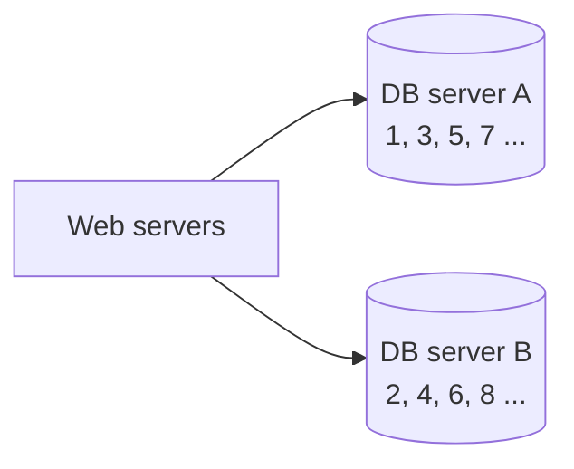
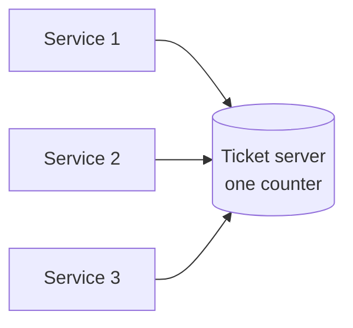
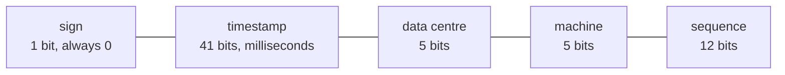
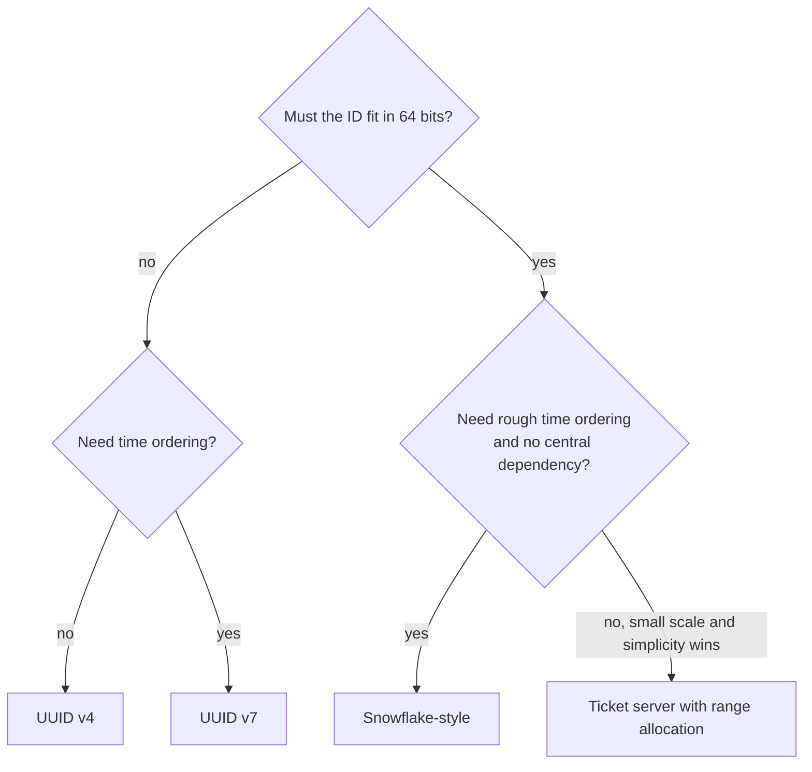

# Design a unique ID generator I: requirements and the four approaches

## Before this lesson

You should know what a primary key, a replica and sharding are ([Scaling from zero II](#/lesson/system-design/scale-stateless-to-sharded)), the powers of two from [Estimation I](#/lesson/system-design/estimation-numbers) (a 64-bit number has about $1.8 \times 10^{19}$ values), and the four-step framework.

## In plain words

Every row a system stores (a user, an order, a message) needs a name that no other row has. That name is its **identifier**, or **ID**. With a single database this is a solved problem: the database keeps a counter and gives each new row the next number. This feature is called **auto-increment**.

The problem appears when there are many databases or many servers creating rows at once. Think of a deli with one ticket dispenser: customers take numbers 41, 42, 43 and nobody shares a number. Now open ten branches, each with its own dispenser starting at 1. Ticket 42 exists ten times. If the branches later merge their order books, the numbers clash.

You could have every branch telephone head office for each ticket, but then head office is a bottleneck and, if its line is down, nobody can be served. The design question is: how can many independent machines each hand out IDs, quickly and without talking to each other, such that no two IDs are ever the same?

In interviews this problem is a favourite because it is small, has several reasonable answers with clear trade-offs, and its best-known solution, Twitter's Snowflake, rewards careful thinking about bits and clocks. On the job, the choice of ID format affects database performance, security and debugging for the entire life of a product.

This module follows the track's design structure. This lesson covers requirements, estimates, the API, the data model, the high-level options and their comparison. The next covers the deep dive into the Snowflake approach, failure handling, trade-offs, a sample dialogue and common mistakes.

## 1. Requirements and the scope questions to ask

| Question | Why it matters | Assumed answer |
|---|---|---|
| Must IDs be unique across the whole system? | The core requirement | Yes, globally |
| Numbers only, or may they contain letters? | Storage size and index efficiency | Numeric |
| How many bits? | Must fit a database integer column | 64 bits |
| Must they be sortable by creation time? | Many features need "newest first" | Yes, roughly: an ID created later is larger |
| Must they increase by exactly 1? | Strict sequences need central coordination | No |
| How many per second? | Sizing | At least 10,000 per second, with bursts far higher |
| May IDs reveal information? | Security and business secrecy | Acceptable to reveal approximate creation time |

**Functional requirements**

1. Generate IDs that are unique across all servers and data centres.
2. IDs are 64-bit numbers.
3. IDs are ordered by time: sorting by ID approximates sorting by creation time.

**Non-functional requirements**

1. **High throughput:** over 10,000 IDs per second per generator.
2. **Low latency:** generating an ID should take microseconds, ideally with no network call.
3. **High availability:** ID generation is on the path of every write; if it stops, everything stops.
4. **No coordination between generators** at the moment an ID is created.

Why "ordered by time" is so valuable deserves a moment. If IDs increase with time, then "the 20 newest messages in this chat" is a range scan on the primary key, with no separate index on a timestamp column. New rows are also inserted at the end of the database's index instead of at random positions, which is much kinder to the storage engine. An ID with this property is called **k-sorted** or *roughly time-ordered*: not perfectly ordered across machines, but ordered to within a small time window.

## 2. Estimates

Two questions: is 64 bits enough, and how long will it last?

```python-run
SECONDS_PER_YEAR = 365.25 * 24 * 3600

total_ids = 2 ** 63                        # keep the top bit 0 so the number is never negative
for rate in (10_000, 1_000_000, 100_000_000):
    years = total_ids / rate / SECONDS_PER_YEAR
    print(f"{rate:>11,} IDs per second: a 63-bit space lasts {years:,.0f} years")

print()
ms_bits = 41
print(f"41 bits of milliseconds cover {2 ** ms_bits / 1000 / SECONDS_PER_YEAR:.1f} years")
print(f"32 bits of seconds cover      {2 ** 32 / SECONDS_PER_YEAR:.1f} years")
```

A 63-bit space is practically inexhaustible as a plain counter. But the Snowflake approach will spend 41 of those bits on a timestamp, and the second half of the output shows why 41 was chosen: it covers about 69 years in milliseconds. That figure will set the lifetime of the scheme.

Storage: a 64-bit ID is 8 bytes. A 128-bit ID is 16 bytes. Across ten billion rows, each of which appears in several indexes, the difference is hundreds of gigabytes, which is one reason the requirement asks for 64 bits.

## 3. API and data model

The API is one call:

```
next_id() -> 64-bit integer
```

It is best delivered as a library inside each application process, so that the call is a local function with no network hop. A variant returns a batch (`next_ids(n)`) for bulk inserts.

The data model is the layout of the bits inside the ID, which is what the next lesson designs. The only stored state is tiny: each generator remembers the last timestamp it used and a small counter.

## 4. High-level design: four approaches

### Approach 1: auto-increment in several databases

Keep the database's auto-increment, but run $k$ database servers and have each one step by $k$ instead of by 1. With two servers, one issues 1, 3, 5, … and the other 2, 4, 6, …



**For:** numeric, small, uses a feature every database has.
**Against:**
- IDs from different servers do not follow time. Server A may be at 9,001 while server B is at 4,002, so a later row can have a smaller ID.
- Adding or removing a server means changing the step and offsets everywhere, which is error-prone while the system is live.
- It does not extend well across data centres.

### Approach 2: UUID

A **UUID** (universally unique identifier) is a 128-bit number, usually written as 32 hexadecimal digits in five groups, such as `3f2b8c1e-9d4a-4f6b-a1c7-5e0d92b8f431`. The most common kind, version 4, is 122 random bits plus a few fixed bits. Any machine can generate one alone.

How can random numbers be "unique"? Because the space is so large that a collision is absurdly unlikely. This is the **birthday problem**: in a room of 23 people there is about a 50% chance two share a birthday, since what matters is the number of *pairs*. For $n$ random values drawn from a space of size $d$, the chance of at least one collision is approximately

$$p \approx 1 - e^{-n^2 / (2d)}$$

```python-run
import math

def collision_probability(n, bits):
    d = 2 ** bits
    return -math.expm1(-n * n / (2 * d))          # 1 - e^(-n^2 / 2d), computed accurately

print("random bits   IDs generated      chance of any collision")
for bits, n in [(32, 100_000), (64, 1_000_000_000), (64, 10_000_000_000), (122, 10 ** 15), (122, 10 ** 18)]:
    print(f"{bits:>11}   {n:>16,}   {collision_probability(n, bits):.3e}")
```

Thirty-two random bits collide almost certainly after a hundred thousand IDs. Sixty-four random bits become risky around ten billion IDs. With the 122 random bits of a UUID, even a quadrillion IDs leave a negligible chance. So fully random IDs are safe only when they are long.

**For:** no coordination at all, trivially scalable, each server generates its own.
**Against:**
- 128 bits, twice the required size.
- Not ordered by time. Random IDs are inserted at random places in a database index, which scatters writes across the disk and slows large tables.
- Usually written with letters, so not numeric in the everyday sense.

A newer variant, **UUID version 7**, puts a 48-bit millisecond timestamp in the leading bits and random bits after it, so it sorts by time while keeping the "no coordination" property. It still takes 128 bits.

### Approach 3: a ticket server

Use one central database whose only job is to issue numbers from an auto-increment counter. Every service asks it for its next ID. Flickr described using this design.



**For:** numeric, compact, strictly increasing, very easy to build; works well at small and medium scale.
**Against:**
- A single point of failure: if the ticket server is down, no service can create anything.
- A network round trip for every ID.
- Running two ticket servers for availability returns you to approach 1 and its ordering problem.

A common improvement removes most of the round trips: the ticket server hands out a **range** of IDs at a time. A service asks once, receives "you own 5,000,001 to 5,001,000", and then issues those locally from memory. It contacts the ticket server again only when the block is used up. If the service crashes, the unused part of its block is lost, leaving a gap, which is harmless. This is called **range** or **segment allocation**.

```python-run
class TicketServer:
    """The central counter. It only hands out blocks."""
    def __init__(self, block_size):
        self.next_start, self.block_size, self.calls = 1, block_size, 0
    def allocate_block(self):
        self.calls += 1
        start = self.next_start
        self.next_start += self.block_size
        return start, start + self.block_size - 1

class LocalAllocator:
    """Lives inside one application server. Issues IDs from memory."""
    def __init__(self, server):
        self.server, self.current, self.end = server, 1, 0
    def next_id(self):
        if self.current > self.end:                      # block used up: fetch a new one
            self.current, self.end = self.server.allocate_block()
        value = self.current
        self.current += 1
        return value

ticket = TicketServer(block_size=1000)
app1, app2 = LocalAllocator(ticket), LocalAllocator(ticket)

ids = [app1.next_id() for _ in range(3)] + [app2.next_id() for _ in range(3)] + [app1.next_id()]
print("ids issued:", ids)
for _ in range(5000):
    app1.next_id()
print("5,007 IDs issued, calls to the ticket server:", ticket.calls)
```

Thousands of IDs cost a handful of calls. Notice also the ordering consequence in the first line: `app2` issued 1001 while `app1` was still at 3, so IDs are unique but not ordered by time across servers.

### Approach 4: Snowflake-style IDs

The idea, published by Twitter in 2010 under the name **Snowflake**, is to divide the 64 bits into fields and fill each from a source that needs no coordination at the moment of generation:



- The **timestamp** in the high bits makes IDs increase with time.
- The **data centre** and **machine** numbers make IDs from different machines different, even in the same millisecond.
- The **sequence** distinguishes IDs created by the same machine in the same millisecond.

Two IDs can only be equal if they were created on the same machine, in the same millisecond, with the same sequence number, and the generator's own logic prevents that. No machine talks to any other.

**For:** 64-bit, numeric, roughly time-ordered, generated locally in microseconds, no single point of failure.
**Against:** depends on each machine's clock being reasonably correct, and each machine needs a unique machine number assigned once.

## 5. Comparison

| Property | Multi-master auto-increment | UUID v4 | Ticket server with ranges | Snowflake |
|---|---|---|---|---|
| Size | 64 bits | 128 bits | 64 bits | 64 bits |
| Numeric | Yes | Not conventionally | Yes | Yes |
| Time-ordered | No | No (v7: yes) | Per server only | Yes, roughly |
| Coordination per ID | Database write | None | None within a block | None |
| Single point of failure | No, but hard to resize | No | The ticket server | No |
| Main weakness | Ordering; resizing | Size; index scatter | Central dependency | Clock dependence |
| Reveals | Row counts | Nothing | Row counts | Creation time, machine |



For the stated requirements (64-bit, numeric, time-ordered, 10,000 or more per second, highly available) the Snowflake approach is the fit, and the next lesson designs it in detail.

> [!INTERVIEW]
> Do not open with Snowflake. Walk the options briefly, give one decisive weakness for each against the stated requirements (UUID: 128 bits and unordered; ticket server: single point of failure; multi-master: not time-ordered), and then arrive at the bit-field design. The comparison is worth as much as the final answer.

> [!TIP]
> Sequential IDs leak business information. If order numbers increase by one, a competitor can place an order on Monday and another on Friday and read off your weekly volume. Even when a compact internal ID is used for storage, many systems expose a different, non-guessable identifier in URLs.

> [!WARNING]
> "UUIDs never collide" is true for properly generated version 4 values, but not for home-made short random IDs. The birthday calculation above shows that 32 random bits are useless and 64 are marginal at billions of rows. If you shorten a random ID, do the calculation.

## Common mistakes

- **Proposing auto-increment for a sharded database** without noticing that each shard has its own counter.
- **Choosing UUIDs when the requirements say 64 bits and time-ordered.**
- **A single ticket server with no answer for its failure.**
- **Requesting one ID per network call** when range allocation would remove almost all of them.
- **Assuming time-ordered means strictly ordered.** Across machines the order is only approximate.
- **Forgetting that IDs can reveal volume or creation time.**

## Summary

- A distributed ID generator must produce globally unique IDs from many machines without coordinating per ID.
- The stated requirements are 64-bit, numeric, roughly time-ordered, high throughput and high availability.
- Multi-master auto-increment is simple but unordered and hard to resize.
- UUIDs need no coordination but are 128 bits and, in version 4, unordered; the birthday bound explains why random IDs must be long.
- A ticket server is compact and simple but central; allocating ranges removes most round trips.
- Snowflake-style IDs pack a timestamp, a machine number and a sequence into 64 bits and satisfy all the requirements, in exchange for depending on clocks.

## Glossary

- **Identifier (ID)**: a value that names exactly one record.
- **Auto-increment**: a database feature that assigns each new row the next integer.
- **Globally unique**: unique across every machine and data centre in the system.
- **K-sorted (roughly time-ordered)**: ordered by time to within a small window.
- **UUID**: a 128-bit identifier designed to be generated without coordination.
- **Birthday problem**: the surprisingly high chance of a collision among random values, driven by the number of pairs.
- **Collision**: two records receiving the same ID.
- **Ticket server**: a central service that issues IDs from a counter.
- **Range (segment) allocation**: handing out blocks of IDs so clients can issue them locally.
- **Snowflake**: a 64-bit ID format made of a timestamp, machine identifiers and a sequence number.
- **Sequence number**: a counter that separates IDs created in the same millisecond on one machine.
- **Hexadecimal**: base-16 notation using digits 0 to 9 and letters a to f.

## Check yourself

```quiz
[
  {"q": "Why is plain auto-increment a problem when the data is spread over several database shards?",
   "options": ["Auto-increment is slow", "Each shard has its own counter, so the same ID is issued on different shards", "Shards cannot store integers", "Auto-increment needs 128 bits"],
   "answer": 1,
   "explain": "Each database counts independently from 1. Without a scheme to separate them, IDs repeat across shards."},
  {"q": "Which requirement does a version 4 UUID fail to meet in this design?",
   "options": ["Uniqueness", "Being generated without coordination", "Fitting in 64 bits and sorting by time", "High throughput"],
   "answer": 2,
   "explain": "UUID v4 is 128 bits of mostly random data: unique and coordination-free, but too large and unordered."},
  {"q": "What does range allocation add to a ticket server?",
   "options": ["Time ordering across servers", "Far fewer network calls, since each server issues a block of IDs locally", "128-bit IDs", "Removal of the central counter"],
   "answer": 1,
   "explain": "A server fetches a block once and serves many IDs from memory. The central counter remains, but is contacted rarely."},
  {"q": "Why do time-ordered IDs help a database?",
   "options": ["They compress better", "New rows append at the end of the primary-key index, and recent items can be fetched by ID range", "They avoid the need for replicas", "They are shorter"],
   "answer": 1,
   "explain": "Increasing keys insert in one place instead of scattering writes, and 'newest first' becomes a primary-key range scan."},
  {"q": "You generate 64-bit random IDs for 10 billion rows. What does the birthday bound suggest?",
   "options": ["Collisions are impossible", "A collision is quite likely, so 64 random bits are too few at this scale", "Exactly one collision will occur", "Random IDs cannot be 64 bits"],
   "answer": 1,
   "explain": "With n squared over twice the space size near 2.7, the collision probability is over 90%. Random IDs need many more bits."},
  {"q": "In a Snowflake-style ID, what prevents two machines from producing the same ID in the same millisecond?",
   "options": ["The sequence number", "The data centre and machine fields", "The sign bit", "A shared lock"],
   "answer": 1,
   "explain": "Each machine has a unique machine number embedded in every ID it creates. The sequence separates IDs within one machine."},
  {"q": "What is the main dependency a Snowflake-style generator introduces?",
   "options": ["A central database", "Reasonably accurate machine clocks and a unique number per machine", "A 128-bit column", "A message queue"],
   "answer": 1,
   "explain": "The timestamp comes from the local clock and uniqueness across machines from the assigned machine number."}
]
```

> **Source:** Xu, *System Design Interview: An Insider's Guide*, ch. 7 (multi-master replication, UUID, ticket server, Twitter snowflake approach) as a topic guide; RFC 9562, "Universally Unique IDentifiers (UUIDs)", https://www.rfc-editor.org/rfc/rfc9562 ; Flickr engineering blog, "Ticket Servers: Distributed Unique Primary Keys on the Cheap" (2010), https://code.flickr.net/2010/02/08/ticket-servers-distributed-unique-primary-keys-on-the-cheap/
