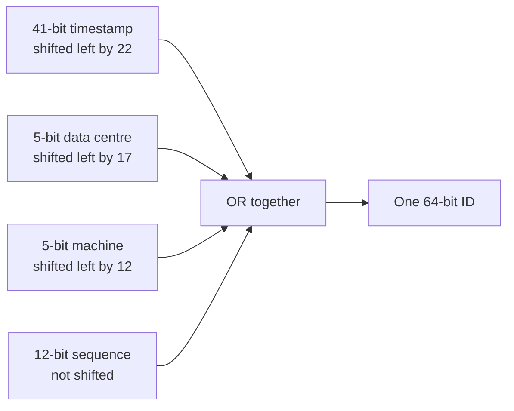
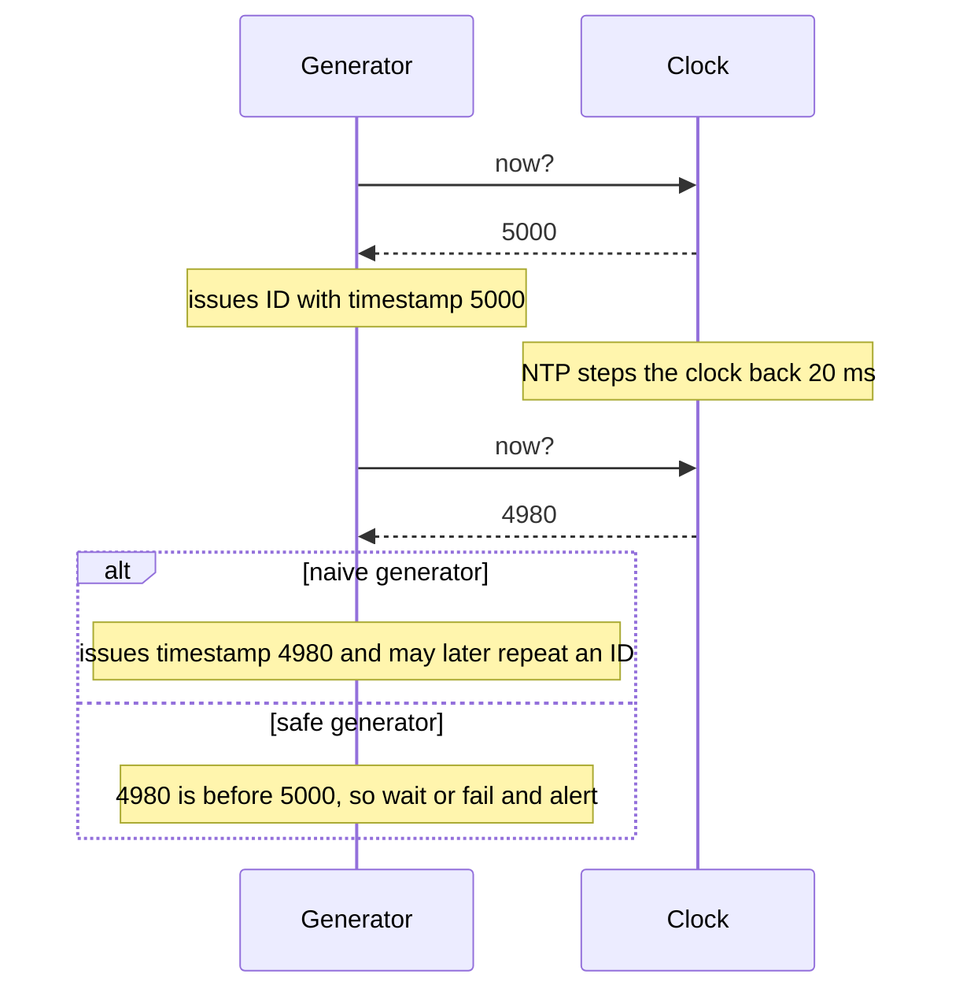
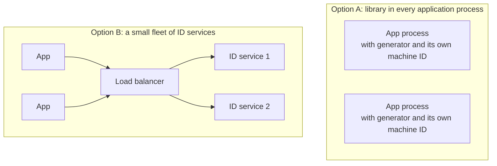

# Design a unique ID generator II: the Snowflake design in depth

## Before this lesson

Read [Design a unique ID generator I](#/lesson/system-design/unique-id-options). You should know the requirements (64-bit, numeric, roughly time-ordered, no coordination per ID) and why UUIDs, multi-master auto-increment and a ticket server each fall short. You need to know that a number is stored as bits; the bit operations used here are explained as they appear.

## In plain words

A Snowflake-style ID is a single 64-bit number built by gluing smaller numbers together, the way a car registration plate or a parcel tracking code packs several facts into one string: where it was issued, when, and a running number.

Imagine every post office stamps parcels with "date and time to the minute, then the branch number, then a counter that restarts each minute". Two parcels can never get the same stamp: different minutes differ in the first part, different branches differ in the second, and within one branch and minute the counter differs. No branch ever needs to phone another. And if you sort parcels by stamp, they come out in time order, because the time is written first.

Snowflake does this with milliseconds, a machine number and a per-millisecond counter. This lesson works through the bit layout, an implementation, and the three hard parts: clocks that go wrong, the counter overflowing, and giving every machine a unique number.

## 1. The bit layout

| Field | Bits | Range | Purpose |
|---|---|---|---|
| Sign | 1 | always 0 | Keeps the number positive in languages with signed 64-bit integers |
| Timestamp | 41 | 0 to about 2.2 trillion | Milliseconds since a chosen starting moment |
| Data centre ID | 5 | 0 to 31 | Which data centre |
| Machine ID | 5 | 0 to 31 | Which machine within it |
| Sequence | 12 | 0 to 4,095 | Counter within one millisecond on one machine |

$1 + 41 + 5 + 5 + 12 = 64$.

**The timestamp is counted from a custom epoch.** An **epoch** is the moment a clock counts from. The usual Unix epoch is 1 January 1970. Counting from 1970 would waste more than fifty years of the 41-bit range, so the generator subtracts a recent starting moment of its own, for example the day the service launched. 41 bits of milliseconds last $2^{41}$ ms, about 69.7 years from that custom epoch.

**The capacity.** 5 + 5 bits allow $32 \times 32 = 1{,}024$ machines. 12 bits of sequence allow 4,096 IDs per millisecond per machine, which is about 4 million per second per machine and over 4 billion per second across the fleet, far above the requirement.



**Gluing with bit operations.** Two operators do the work:

- `x << n` (**left shift**) moves the bits of `x` to the left by `n` places, which multiplies it by $2^n$ and leaves `n` zero bits on the right.
- `a | b` (**bitwise OR**) combines two numbers bit by bit. When the fields occupy different bit positions, OR behaves like addition and places each field in its slot.

The timestamp is shifted left by 22 (the total width of the three fields to its right: 5 + 5 + 12), the data centre by 17, the machine by 12, and the sequence stays in the lowest 12 bits.

To take an ID apart, shift right (`>>`) to drop the lower fields and use `&` (**bitwise AND**) with a **mask**, a number whose bits are 1 exactly where the field is, to keep only that field.

## 2. A working generator

The clock is passed in as a function so the behaviour can be demonstrated with a pretend clock.

```python-run
EPOCH_MS = 1_704_067_200_000            # custom epoch: 1 January 2024, 00:00 UTC, in milliseconds

DC_BITS, MACHINE_BITS, SEQ_BITS = 5, 5, 12
MAX_SEQ = (1 << SEQ_BITS) - 1           # 4095: twelve 1-bits
MACHINE_SHIFT = SEQ_BITS                # 12
DC_SHIFT = SEQ_BITS + MACHINE_BITS      # 17
TIME_SHIFT = SEQ_BITS + MACHINE_BITS + DC_BITS   # 22

class Snowflake:
    def __init__(self, datacenter, machine, clock):
        assert 0 <= datacenter < 32 and 0 <= machine < 32
        self.dc, self.machine, self.clock = datacenter, machine, clock
        self.last_ms = -1               # the millisecond of the previous ID
        self.seq = 0

    def next_id(self):
        now = self.clock()
        if now < self.last_ms:                          # the clock went backwards
            raise RuntimeError(f"clock moved back {self.last_ms - now} ms; refusing to issue IDs")
        if now == self.last_ms:                         # same millisecond as the previous ID
            self.seq = (self.seq + 1) & MAX_SEQ         # count up, wrapping to 0 after 4095
            if self.seq == 0:                           # 4096 IDs already issued this millisecond
                while now <= self.last_ms:              # wait for the next millisecond
                    now = self.clock()
        else:                                           # a new millisecond: restart the counter
            self.seq = 0
        self.last_ms = now
        return ((now - EPOCH_MS) << TIME_SHIFT) | (self.dc << DC_SHIFT) \
               | (self.machine << MACHINE_SHIFT) | self.seq

def decode(snowflake_id):
    return {
        "ms_since_epoch": snowflake_id >> TIME_SHIFT,
        "datacenter": (snowflake_id >> DC_SHIFT) & 0b11111,
        "machine": (snowflake_id >> MACHINE_SHIFT) & 0b11111,
        "sequence": snowflake_id & MAX_SEQ,
    }

# A pretend clock we can set by hand.
fake_now = [EPOCH_MS + 1000]
gen = Snowflake(datacenter=3, machine=17, clock=lambda: fake_now[0])

a = gen.next_id(); b = gen.next_id()        # two IDs in the same millisecond
fake_now[0] += 1
c = gen.next_id()                           # one in the next millisecond
for name, value in (("a", a), ("b", b), ("c", c)):
    print(name, value, decode(value))
print("sorted by ID is sorted by time:", a < b < c)
print("binary of a:", format(a, "064b"))
```

Reading the output: `a` and `b` share a timestamp and differ in the sequence (0 and 1). `c` has a later timestamp and its sequence has restarted at 0. The three numbers increase in the order they were created. In the binary form you can see the fields: a leading 0, then the timestamp, then `00011` for data centre 3, `10001` for machine 17, and twelve bits of sequence.

Line by line, the generator does four things: it reads the clock; if the clock has gone backwards it refuses; if the millisecond is the same as last time it increases the sequence, and if the sequence wraps round to zero it waits for the next millisecond; otherwise it resets the sequence. Then it assembles the fields.

In a real service several threads call `next_id` at once, so the method body must be protected by a lock (or use an atomic compare-and-swap), otherwise two threads could read the same `seq`.

## 3. Deep dive: sequence overflow

What if more than 4,096 IDs are requested from one machine within one millisecond? The counter cannot count higher without spilling into the machine field. The generator therefore blocks until the clock reaches the next millisecond, as in the `while` loop above. The caller waits at most one millisecond.

```python-run
SEQ_BITS = 12
per_ms = 1 << SEQ_BITS

for burst in (1_000, 4_096, 10_000, 50_000):
    ms_needed = -(-burst // per_ms)                 # ceiling division
    print(f"burst of {burst:>6,} IDs on one machine: spans {ms_needed:>2} ms, "
          f"last caller waits up to {ms_needed - 1} ms")

print()
print("different splits of the low 22 bits:")
for machine_bits, seq_bits in [(10, 12), (12, 10), (8, 14), (16, 6)]:
    print(f"  {machine_bits:>2} machine bits, {seq_bits:>2} sequence bits -> "
          f"{2 ** machine_bits:>6,} machines, {2 ** seq_bits * 1000:>10,} IDs per second each")
```

The second half shows that the split between machine bits and sequence bits is a design choice. A system with tens of thousands of small containers and modest write rates would take more machine bits and fewer sequence bits. A system with a few very busy generators would do the opposite. Asking the interviewer about the number of generator processes and the peak rate per process is how you choose.

## 4. Deep dive: clock problems

The timestamp is the most significant part of the ID, so the design leans on the machine's clock. Clocks misbehave in three ways.

**Clock drift.** A machine's quartz clock runs slightly fast or slow. Machines synchronise with reference servers using **NTP** (Network Time Protocol), which keeps them within a few milliseconds of each other. Consequence: across machines, IDs are ordered only to within that margin. An ID from machine A may be numerically smaller than one created a millisecond earlier on machine B. That is what "roughly" time-ordered means, and it is acceptable for feeds and logs. It is not a basis for deciding which of two events truly happened first.

**The clock jumps backwards.** When NTP finds the local clock is ahead, it may set it back. If the generator carried on, it would reuse timestamps it had already used, and with the sequence restarting from zero it could issue a duplicate ID. That would break the one guarantee that matters. The options:

1. **Refuse and wait.** If the clock is behind the last timestamp used, wait until it catches up. For a jump of a few milliseconds this is invisible. For a large jump, fail and raise an alarm; the load balancer routes requests to other generators.
2. **Keep issuing from the last timestamp.** Treat the logical time as `max(clock, last_ms)` and keep counting the sequence. Uniqueness is preserved; the embedded time is briefly wrong.
3. **Configure NTP to slew.** *Slewing* means the clock is slowed down slightly until it is correct, instead of being stepped back. Then time never runs backwards.

Production systems combine 3 with 1.

**The process restarts.** After a restart, `last_ms` is forgotten. If the clock was also set back during the restart, duplicates become possible. Mitigations: wait a short time at start-up (longer than any plausible clock step) before issuing IDs, or save the last used timestamp to disk periodically and refuse to start if the clock is earlier than the saved value.



> [!WARNING]
> Never use an ID's embedded timestamp to resolve which of two writes "really" came first for correctness purposes. Machine clocks disagree by milliseconds. The [Databases track](#/lesson/databases/clocks-pauses) explains the hazards of relying on wall-clock time.

## 5. Deep dive: assigning machine IDs

Everything rests on no two live generators sharing the same data centre and machine numbers. If two do, they will eventually produce the same ID. How does each process obtain its number?

| Method | How it works | Risk |
|---|---|---|
| Static configuration | The number is written in each machine's configuration file | Human error: two machines given the same number |
| Coordination service | At start-up the process asks a service such as ZooKeeper or etcd for an unused number, held by a **lease** that expires if the process dies | Start-up depends on that service; once started, no further calls |
| Derived from the address | Use some bits of the IP address or host name | Collisions when address ranges overlap or containers are recycled |
| Database row | Insert a row into a small table and use its auto-increment value modulo 1,024 | Wraps around; must check that the old holder is gone |

The coordination service is the usual production choice. Twitter's original Snowflake used ZooKeeper for exactly this. A **lease** is a claim that is valid for a limited time and must be renewed; if a process crashes, its lease expires and the number becomes available again. It is important that a process which loses contact with the coordination service stops issuing IDs before its lease runs out, otherwise a newcomer could be given the same number while the old process is still running.

The dependency is at start-up and renewal, not per ID, so the requirement "no coordination at the moment of generation" still holds.

## 6. Deployment: library or service?



- **Library.** No network call and no extra service to run. But every application process needs a unique machine ID, and with thousands of short-lived containers the 10 bits may be exhausted.
- **Service.** A handful of generators, each with a stable machine ID. Applications call them over the network, ideally fetching batches of IDs to hide the round trip. The fleet must be at least two for availability.

A hybrid is common: a small ID service hands out batches, and applications cache a batch locally.

## 7. Bottlenecks and failure handling

| Failure | Effect | Mitigation |
|---|---|---|
| A generator crashes | Its share of requests fails | Several generators behind a load balancer, or the library form |
| Clock stepped backwards | Risk of duplicates | Detect, wait or fail; NTP slewing; start-up delay |
| Duplicate machine ID | Duplicate IDs, silently | Leases from a coordination service; alert on duplicate-key errors |
| Coordination service down | New generators cannot start | Running generators continue; keep the last assignment cached while its lease is valid |
| Sequence exhausted | Callers wait up to 1 ms | Add generators or shift bits from machine to sequence |
| Timestamp field exhausted after 69 years | IDs overflow | Choose the epoch deliberately; plan a format change well before |

As a last line of defence, the database column that stores the ID should have a unique constraint. If a duplicate ever appears, the write fails loudly instead of overwriting another record.

## 8. Trade-offs and alternatives

**Changing the bit budget.** The 41/10/12 split is one choice. Sonyflake (from Sony) uses 39 bits of time in units of 10 ms (about 174 years), 16 bits of machine ID and 8 bits of sequence: a longer lifetime and far more machines, at a lower rate per machine. Instagram described IDs with 41 bits of time, 13 bits of logical shard ID and 10 bits of sequence, generated inside the database, so that the ID also tells you which shard holds the row.

**Embedding the shard.** If the ID contains the shard number, a lookup by ID needs no directory to find the right database. The cost is that moving a row to another shard would change its ID, so data is moved in whole logical shards.

**Privacy.** A Snowflake ID reveals when the record was created and roughly how busy the system was. If that is sensitive, keep the Snowflake ID internal and expose a random or encrypted identifier publicly.

**UUID version 7.** If 128 bits are acceptable, UUIDv7 gives time ordering with no machine-ID assignment at all, since the random bits replace it. This removes the hardest operational part of Snowflake.

**Strictly increasing IDs.** If the product requires IDs with no gaps and exact order (for example legally numbered invoices), no decentralised scheme works; you need one sequencer per series, usually a database sequence, and you accept its throughput limit.

## 9. What a strong answer sounds like

> **Interviewer:** Design an ID generator for a system with many database shards.
>
> **Candidate:** Do the IDs need to be numeric and fit in 64 bits, and do they need to sort by creation time?
>
> **Interviewer:** Yes to both. About 10,000 per second, with bursts.
>
> **Candidate:** Then UUIDs are too large and unordered, per-shard auto-increment is not time-ordered, and a single ticket server is a single point of failure. I would use a Snowflake-style layout: one sign bit, 41 bits of milliseconds since a custom epoch, which lasts about 69 years, 10 bits identifying the generator, and a 12-bit sequence, giving 4,096 IDs per millisecond per generator.
>
> **Interviewer:** What can go wrong?
>
> **Candidate:** Three things. If the clock steps backwards I could reuse a timestamp, so the generator remembers the last millisecond it used and waits or fails if the clock is behind it; I would also configure NTP to slew. If two generators share a machine ID they will collide, so IDs are leased from a coordination service at start-up. And if one generator gets more than 4,096 requests in a millisecond, it waits for the next millisecond.
>
> **Interviewer:** Are the IDs strictly ordered?
>
> **Candidate:** Within one generator, yes. Across generators only to within clock skew, a few milliseconds. That is fine for sorting feeds, and I would not use it to decide causality.

## Common mistakes

- **Counting the timestamp from 1970**, wasting most of the range.
- **Ignoring backwards clock steps**, the one path to duplicate IDs.
- **Not explaining how machine IDs are made unique.**
- **Claiming strict global ordering.** It is approximate across machines.
- **Forgetting the sign bit**, producing negative IDs in languages with signed integers.
- **No lock around the sequence** when several threads generate IDs.
- **Treating the bit split as fixed** instead of fitting it to the number of generators and the peak rate.

## Summary

- A Snowflake ID packs a sign bit, a 41-bit millisecond timestamp from a custom epoch, 10 bits of machine identity and a 12-bit sequence into 64 bits using shifts and ORs.
- It allows 1,024 generators at 4,096 IDs per millisecond each for about 69 years, with no coordination per ID.
- The sequence waits for the next millisecond when exhausted.
- The clock is the main risk: detect backward steps, prefer NTP slewing, and guard restarts.
- Machine IDs must be unique, typically leased from a coordination service at start-up.
- The bit budget can be reshaped, and a shard number can be embedded; UUIDv7 is the alternative when 128 bits are acceptable.

## Glossary

- **Epoch**: the moment from which a timestamp is counted.
- **Custom epoch**: a recent starting moment chosen so that timestamp bits are not wasted.
- **Left shift / right shift**: moving a number's bits left (multiplying by a power of two) or right.
- **Bitwise OR / AND**: combining numbers bit by bit; OR merges fields, AND with a mask extracts one.
- **Mask**: a number with 1-bits marking the field to keep.
- **Sequence overflow**: more IDs requested in one millisecond than the sequence field can count.
- **Clock drift**: a clock gradually running fast or slow.
- **Clock skew**: the difference between two machines' clocks at one moment.
- **NTP**: the protocol machines use to synchronise clocks.
- **Step / slew**: correcting a clock by jumping, or by gradually speeding up or slowing down.
- **Machine (worker) ID**: the number that identifies one generator.
- **Lease**: a time-limited claim that must be renewed.
- **Coordination service**: a small, consistent store used for agreement, such as ZooKeeper or etcd.

## Check yourself

```quiz
[
  {"q": "With a 12-bit sequence, how many IDs can one generator issue in a single millisecond?",
   "options": ["1,024", "2,048", "4,096", "65,536"],
   "answer": 2,
   "explain": "Twelve bits give 2 to the power 12 = 4,096 distinct sequence values per millisecond."},
  {"q": "Why does the timestamp count from a custom epoch instead of 1970?",
   "options": ["1970 is not a valid date", "To avoid spending decades of the 41-bit range on time before the system existed", "To make IDs random", "Because NTP requires it"],
   "answer": 1,
   "explain": "41 bits of milliseconds last about 69 years. Starting from a recent date gives the system the full span."},
  {"q": "The generator reads a clock value earlier than the last timestamp it used. What should a safe implementation do?",
   "options": ["Issue the ID anyway", "Reset the sequence to zero and continue", "Wait until the clock passes the last timestamp, or fail and alert", "Switch to a random ID"],
   "answer": 2,
   "explain": "Reusing an earlier timestamp with a restarted sequence risks duplicate IDs. Waiting or refusing preserves uniqueness."},
  {"q": "Two generator processes are accidentally given the same data centre and machine numbers. What is the consequence?",
   "options": ["Nothing; the sequence differs", "They can produce identical IDs in the same millisecond", "IDs become negative", "The timestamp overflows"],
   "answer": 1,
   "explain": "Uniqueness across machines rests entirely on the machine bits. Identical bits plus identical time and sequence give identical IDs."},
  {"q": "An ID from machine A is numerically smaller than an ID from machine B. What can you conclude?",
   "options": ["A's event certainly happened first", "A's event probably happened first, but clock skew of a few milliseconds makes it uncertain for close events", "B's event happened first", "Nothing about time at all"],
   "answer": 1,
   "explain": "Ordering across machines is only as good as clock synchronisation. Events far apart in time are ordered correctly; near-simultaneous ones may not be."},
  {"q": "A platform runs 20,000 small generator processes with low write rates. How should the low 22 bits be divided?",
   "options": ["10 machine bits and 12 sequence bits", "More machine bits and fewer sequence bits, such as 16 and 6", "No machine bits", "22 sequence bits"],
   "answer": 1,
   "explain": "Ten bits allow only 1,024 generators. Moving bits from the sequence to the machine field supports many more generators at a lower rate each."},
  {"q": "In the expression (timestamp << 22) | (dc << 17) | (machine << 12) | seq, what does the shift by 22 achieve?",
   "options": ["It encrypts the timestamp", "It places the timestamp above the 22 bits used by the other three fields", "It divides the timestamp by 22", "It removes the sign bit"],
   "answer": 1,
   "explain": "Shifting left by 22 leaves 22 zero bits on the right, which the data centre, machine and sequence fields fill through OR."}
]
```

> **Source:** Xu, *System Design Interview: An Insider's Guide*, ch. 7 (Twitter snowflake approach, timestamp, sequence number, clock synchronisation) as a topic guide; Twitter engineering blog, "Announcing Snowflake" (2010), https://blog.x.com/engineering/en_us/a/2010/announcing-snowflake ; Instagram engineering blog, "Sharding & IDs at Instagram" (2012), https://instagram-engineering.com/sharding-ids-at-instagram-1cf5a71e5a5c ; Sonyflake, https://github.com/sony/sonyflake
