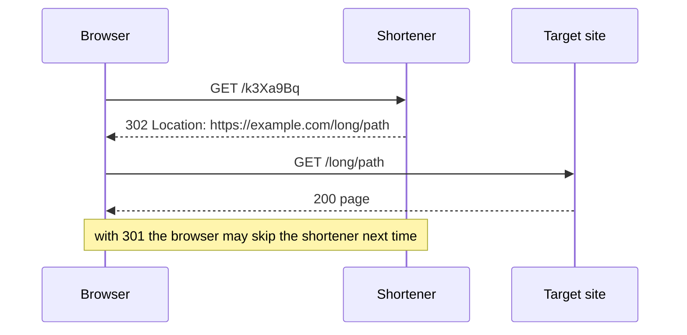
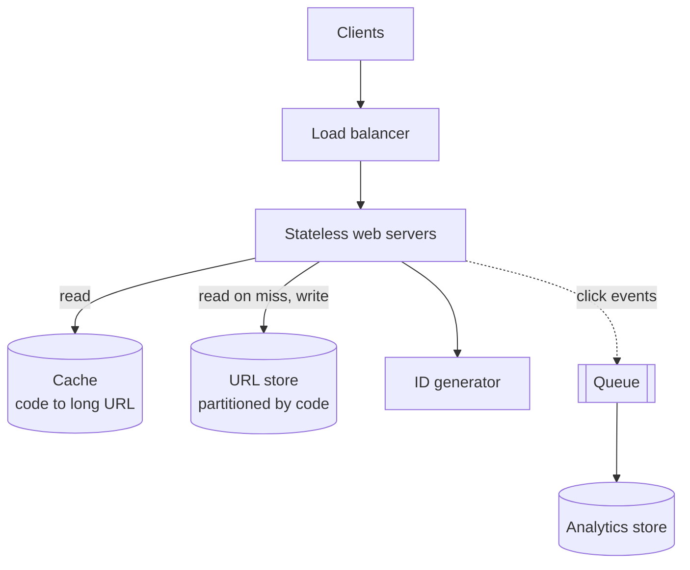

# Design a URL shortener I: requirements, API, data model and base 62

## Before this lesson

You should know HTTP methods and status codes ([Clients, servers and requests](#/lesson/system-design/clients-servers-requests)), caches and replicas ([Scaling from zero I](#/lesson/system-design/scale-single-to-replicated)), how to estimate QPS and storage ([Estimation II](#/lesson/system-design/estimation-worked)), and the unique ID generator from [the previous module](#/lesson/system-design/unique-id-snowflake).

## In plain words

A **URL** (uniform resource locator) is a web address. Some are very long. A **URL shortener** is a service that gives you a short address which, when someone visits it, sends them on to the long one. Typing `https://sho.rt/k3Xa9Bq` lands you on a page whose real address might be two hundred characters.

A cloakroom ticket is the same idea. You hand over something bulky and receive a small token. Anyone who presents the token is led to the original. The attendant's whole job is a table with two columns: token, and where the item is.

The service does two things:

1. **Shorten:** take a long URL, store it, return a short code.
2. **Redirect:** take a short code, look it up, send the visitor to the long URL.

Short links are used where space is limited (text messages, printed posters) and where the owner wants to count clicks. In an interview this is the standard "first design problem": the functionality is tiny, so there is time to show estimation, API design, a data model, an encoding scheme and a read-heavy scaling story. On the job, the same "generate a compact unique code and resolve it fast" pattern appears in invitation links, coupon codes, file-share links and order references.

This module follows the track's design structure. This lesson covers requirements, estimates, the API, the data model, the high-level design and base-62 encoding. The next covers the deep dives, failures, trade-offs, a sample dialogue and common mistakes.

## 1. Requirements and the scope questions to ask

| Question | Why it matters | Assumed answer |
|---|---|---|
| How many URLs are shortened per day? | Write rate and storage | 100 million per day |
| How short should the code be? | Size of the code space | As short as possible |
| Which characters are allowed? | Size of the alphabet | Digits and upper and lower case letters |
| Can links be edited or deleted? | Whether mappings are immutable | No, for simplicity |
| Do links expire? | Storage growth and cleanup | Kept for 10 years |
| May users choose a custom code? | Uniqueness handling | Optional extension |
| Are click statistics needed? | Affects the redirect type and adds a pipeline | Basic counts, as an extension |
| Should the same long URL always give the same code? | Whether deduplication is required | Not required |

**Functional requirements**

1. Given a long URL, return a much shorter URL.
2. Given a short URL, redirect to the original long URL.

**Non-functional requirements**

1. **High availability.** If redirects fail, every link ever handed out is broken.
2. **Low latency on redirects**, since they sit in front of every click.
3. **Scalability** to billions of stored links and a read-heavy load.
4. Codes should not be trivially guessable in sequence (a reasonable extra to raise yourself).

## 2. Estimates

Assumptions: 100 million new links per day, 10 redirects for every link created, kept for 10 years, an average long URL of 100 bytes.

```python-run
writes_per_day = 100_000_000
read_write_ratio = 10
years = 10
url_bytes, overhead_bytes = 100, 50          # the URL, plus code, timestamps and index overhead

write_qps = writes_per_day / 86_400
read_qps = write_qps * read_write_ratio
total_links = writes_per_day * 365 * years
storage = total_links * (url_bytes + overhead_bytes)

print(f"write QPS      : {write_qps:,.0f}")
print(f"read QPS       : {read_qps:,.0f}  (peak perhaps {read_qps * 2:,.0f})")
print(f"links in {years} yrs: {total_links:,.0f}  = {total_links / 1e9:.0f} billion")
print(f"storage        : {storage / 1e12:.1f} TB before replication")

print("\nhow long must the code be, with 62 possible characters?")
for length in range(5, 9):
    space = 62 ** length
    verdict = "enough" if space >= total_links else "too few"
    print(f"  length {length}: {space:>20,} codes  -> {verdict}")
```

Conclusions, said aloud:

- About 1,160 writes and 11,600 reads per second. Reads dominate by ten to one, so caching and read replicas will matter more than write scaling.
- 365 billion links over ten years.
- About 55 TB of mappings. That is too much for a single database machine, so the store must be partitioned, and since every lookup is by one key, a key-value store partitioned by the short code is a natural fit.
- With an alphabet of 62 characters, 6 characters give about 57 billion codes, which is too few. Seven give about 3.5 trillion, which covers 365 billion with room to spare. **The code length is 7.**

## 3. API

Two endpoints.

```
POST /api/v1/shorten
  body:    {"long_url": "https://example.com/some/very/long/path?with=parameters"}
  returns: 201 {"short_url": "https://sho.rt/k3Xa9Bq", "code": "k3Xa9Bq"}
           400 if the URL is not valid

GET /{code}
  returns: 301 or 302 with header  Location: <long URL>
           404 if the code is unknown
```

### 301 or 302?

Both tell the browser to go to the address in the `Location` header. They differ in what the browser remembers.

- **301 Moved Permanently.** The browser may cache the redirect. The next time this user visits the short link, the browser goes straight to the long URL without contacting the shortener. This reduces load on the service.
- **302 Found** (temporary). The browser asks the shortener every time. The service sees every click.



The choice follows from the requirements. If reducing server load is the priority, use 301. If click analytics matter, or links might later be edited or disabled, use 302, because cached 301 responses cannot be recalled. State the trade-off and choose; many commercial shorteners favour analytics.

## 4. Data model

One table is enough for the core.

```
urls
  code        CHAR(7)      primary key
  long_url    VARCHAR(2048)
  created_at  TIMESTAMP
  expires_at  TIMESTAMP    (optional)
  owner_id    BIGINT       (optional, if users have accounts)
```

The only access pattern on the redirect path is "get `long_url` by `code`". That is a key-value lookup, which is why a partitioned key-value or wide-column store works well, with `code` as the partition key. A relational database partitioned by `code` works too. No joins are needed.

If the product requires "the same long URL always returns the same code", a second lookup is needed from long URL to code, either a second table keyed by a hash of the long URL or a secondary index. That doubles the write-path work, so add it only if asked.

## 5. High-level design



**Shortening flow**

1. The client posts the long URL.
2. The web server validates it.
3. The server obtains a new unique code (how is the central design question).
4. The server stores `code -> long_url`.
5. The server returns the short URL.

**Redirect flow**

1. The browser requests `/k3Xa9Bq`.
2. The web server looks the code up in the cache.
3. On a miss it reads the store and fills the cache.
4. It answers with a redirect to the long URL, or 404.
5. Optionally it emits a click event to a queue for analytics, without making the user wait.

Web servers hold no state, so they scale horizontally behind the load balancer.

## 6. Turning a number into a short code: base 62

We count in **base 10**: ten digits, and each position is worth ten times the one to its right. **Base 62** uses 62 symbols: `0`-`9`, `a`-`z` and `A`-`Z`. Each position is worth 62 times the one to its right, so far fewer positions are needed for a large number.

Converting a number to base 62 uses repeated division: divide by 62, write down the remainder as a symbol, and repeat with the quotient until it reaches zero. The symbols come out last digit first, so reverse them at the end.

Worked by hand for the number 11,157:

| Step | Divide | Quotient | Remainder | Symbol |
|---|---|---|---|---|
| 1 | 11,157 / 62 | 179 | 59 | `X` |
| 2 | 179 / 62 | 2 | 55 | `T` |
| 3 | 2 / 62 | 0 | 2 | `2` |

Reading the symbols from the last step to the first gives `2TX`. Check: $2 \times 62^2 + 55 \times 62 + 59 = 7{,}688 + 3{,}410 + 59 = 11{,}157$.

```python-run
ALPHABET = "0123456789abcdefghijklmnopqrstuvwxyzABCDEFGHIJKLMNOPQRSTUVWXYZ"
BASE = len(ALPHABET)                        # 62
INDEX = {ch: i for i, ch in enumerate(ALPHABET)}

def encode(number):
    """Non-negative integer -> base-62 string."""
    if number == 0:
        return ALPHABET[0]
    digits = []
    while number > 0:
        number, remainder = divmod(number, BASE)   # quotient and remainder in one step
        digits.append(ALPHABET[remainder])
    return "".join(reversed(digits))               # remainders come out last digit first

def decode(text):
    """Base-62 string -> integer."""
    number = 0
    for ch in text:
        number = number * BASE + INDEX[ch]         # shift left one place, add this digit
    return number

for n in (0, 61, 62, 11_157, 2_009_215_674_938, 62 ** 7 - 1):
    code = encode(n)
    assert decode(code) == n
    print(f"{n:>16,} -> {code:>8}   (length {len(code)})")
```

The output confirms the hand calculation, and the last line shows that the largest 7-character code corresponds to $62^7 - 1$. A 13-digit number such as 2,009,215,674,938 fits in 7 characters.

So one complete design is already visible: take a unique number from an ID generator, encode it in base 62, and use the result as the code. Since every number is unique, every code is unique, and no collision check is needed. The next lesson compares this with the alternative of hashing the long URL, and deals with predictability, custom aliases, caching and failure.


> [!INTERVIEW]
> Derive the code length from your own estimate, as above: "365 billion links, 62 to the 7th is about 3.5 trillion, so 7 characters". Quoting "7 characters" without the arithmetic sounds memorised; showing the calculation takes ten seconds and demonstrates the method.

> [!TIP]
> Some alphabets drop look-alike characters (`0` and `O`, `1`, `l` and `I`) so that codes can be read aloud or typed from paper. That leaves about 56 or 58 symbols and may need one more character of length. Mention it if the links will be printed.

> [!WARNING]
> Base 62 is an *encoding*, not encryption. Anyone can decode `k3Xa9Bq` back to its number. If the numbers are sequential, so are the codes, and people can walk through every link in the system. The next lesson shows what to do about that.

## Common mistakes

- **Not deriving the code length** from the number of links to be stored.
- **Choosing 301 or 302 without saying why.**
- **Proposing a relational database with joins** for what is a pure key lookup at tens of terabytes.
- **Forgetting URL validation.** At minimum check the scheme and length; a public shortener must also consider malicious targets.
- **Confusing encoding with hashing.** Base 62 is reversible and collision-free; a hash is neither.
- **Treating reads and writes as one number.** The ten-to-one ratio is what justifies the cache.

## Summary

- A URL shortener stores a mapping from a short code to a long URL and answers lookups with an HTTP redirect.
- At 100 million new links a day for ten years: about 1,160 writes and 11,600 reads per second, 365 billion links and tens of terabytes.
- With 62 characters, a 7-character code gives about 3.5 trillion possibilities, enough for the estimate.
- The API is `POST /shorten` and `GET /{code}`; 301 saves load, 302 keeps every click visible.
- The data model is one key-value table partitioned by code.
- Base-62 encoding of a unique number yields a short, unique code by repeated division.

## Glossary

- **URL**: a web address.
- **Short code**: the few characters that identify a stored long URL.
- **Redirect**: a response telling the browser to go to another address.
- **301 / 302**: permanent and temporary redirect status codes.
- **Location header**: the response header carrying the address to go to.
- **Base 62**: a number system with 62 symbols (digits, lower-case and upper-case letters).
- **Encoding**: a reversible change of representation.
- **Alphabet**: the set of symbols allowed in a code.
- **Code space**: the total number of different codes of a given length.
- **Custom alias**: a short code chosen by the user.
- **Partition key**: the field that determines which machine stores a row.
- **Deduplication**: making identical inputs map to one stored record.

## Check yourself

```quiz
[
  {"q": "With an alphabet of 62 characters, how many distinct codes of length 7 exist, approximately?",
   "options": ["About 57 billion", "About 3.5 trillion", "About 218 trillion", "About 916 million"],
   "answer": 1,
   "explain": "62 to the power 7 is about 3.52 trillion. Length 6 gives about 57 billion and length 8 about 218 trillion."},
  {"q": "The product team wants accurate click counts for every link. Which redirect status should the service use?",
   "options": ["301, because it is permanent", "302, because the browser asks the shortener on every visit", "404", "200 with the long URL in the body"],
   "answer": 1,
   "explain": "A 301 may be cached by the browser, so later clicks never reach the service. A 302 keeps every click visible."},
  {"q": "What is the base-62 encoding of the number 62, using the alphabet 0-9, a-z, A-Z?",
   "options": ["Z", "10", "01", "a0"],
   "answer": 1,
   "explain": "62 divided by 62 is 1 remainder 0, so the digits are 1 then 0, written 10, as ten is written 10 in base 10."},
  {"q": "Why is a key-value store partitioned by code a good fit for the mapping table?",
   "options": ["It supports joins well", "The only hot access pattern is a lookup by code, and the data is too large for one machine", "It makes codes shorter", "It removes the need for a cache"],
   "answer": 1,
   "explain": "Redirects need one lookup by key. Tens of terabytes must be split across machines, and the code is the natural partition key."},
  {"q": "The read to write ratio is 10 to 1. What does that suggest for the design?",
   "options": ["Sharding the write path first", "Caching popular mappings and using read replicas", "Removing the load balancer", "Using 128-bit codes"],
   "answer": 1,
   "explain": "A read-heavy workload benefits most from a cache in front of the store and from replicas that share the reads."},
  {"q": "Why does encoding a unique number in base 62 need no collision check?",
   "options": ["Base 62 uses a cryptographic hash", "Each number has exactly one base-62 representation, so unique numbers give unique codes", "Collisions are retried automatically", "Codes are stored twice"],
   "answer": 1,
   "explain": "Base conversion is a one-to-one mapping between numbers and strings. Uniqueness of the input carries over to the output."},
  {"q": "What is a weakness of codes produced from a plain sequential counter?",
   "options": ["They are longer than random codes", "They are predictable, so every link can be enumerated", "They cannot be stored in a database", "They collide frequently"],
   "answer": 1,
   "explain": "Consecutive numbers give consecutive codes. Anyone can decode a code, add one and find the next link."}
]
```

> **Source:** Xu, *System Design Interview: An Insider's Guide*, ch. 8 (URL shortener: back-of-the-envelope estimation, API endpoints, URL redirecting, data model, base 62 conversion) as a topic guide; System Design Primer, https://github.com/donnemartin/system-design-primer ; MDN Web Docs, "Redirections in HTTP", https://developer.mozilla.org/en-US/docs/Web/HTTP/Redirections
