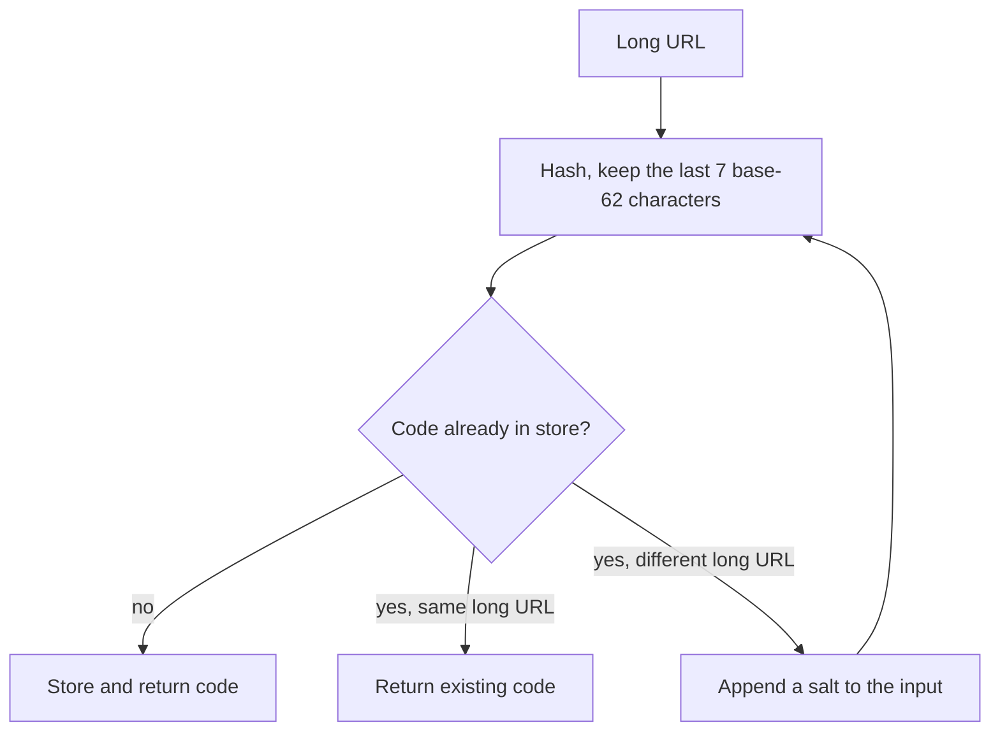
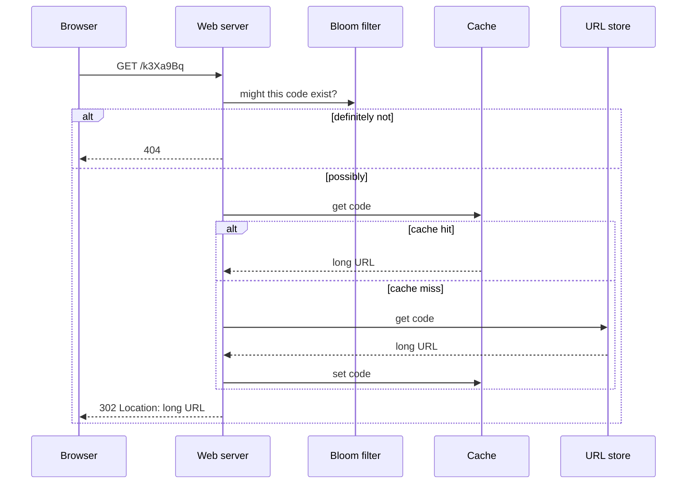

# Design a URL shortener II: code generation, collisions, caching and failure handling

## Before this lesson

Read [Design a URL shortener I](#/lesson/system-design/url-shortener-design). You should know the requirements, the estimate (about 1,160 writes and 11,600 reads per second, 365 billion links, 7-character codes), the two endpoints, the `urls` table and base-62 encoding. Bloom filters were introduced in [Design a key-value store II](#/lesson/system-design/kv-store-versioning-failures).

## In plain words

The previous lesson ended with a working outline. This lesson makes the hard choices inside it.

The central question is how the short code is produced. There are two families of answer, and they mirror two ways a cloakroom could issue tickets:

- **Numbered tickets from a roll.** Each ticket is the next number. No two can match, but anyone can guess that ticket 5,001 follows ticket 5,000.
- **A ticket derived from the coat itself**, say a label made from its colour, size and brand. Two identical coats get the same label, which is sometimes useful, but two different coats can also end up with the same label, and the attendant needs a procedure for that.

The first is "unique ID plus base 62". The second is "hash the URL and handle collisions". We compare them, then deal with making redirects fast, letting users choose their own codes, expiry, analytics, abuse, and what happens when parts fail.

## 1. Deep dive: approach A, hash the long URL

A **hash function** such as MD5 or SHA-256 turns any text into a fixed-length number that looks random. The same input always gives the same output. Hash the long URL, then keep only 7 characters of the result after converting it to base 62 (take the last 7: the leading character of a base-62 number is not evenly spread, the trailing ones are).

The trouble is in "keep only 7 characters". A full hash is long (MD5 is 128 bits) and collisions between different inputs are essentially impossible. Seven base-62 characters hold only about 42 bits. Two different URLs can share the same 7 characters. That is a **collision**, and the birthday calculation from the ID generator lesson says collisions become common long before the space is full.

```python-run
import math

space = 62 ** 7
print(f"code space: {space:,}\n")
print("links stored    chance a NEW link collides    expected collisions so far")
for stored in (1_000_000, 100_000_000, 10_000_000_000, 365_000_000_000):
    p_new = stored / space                         # chance the next code is already taken
    expected = stored * stored / (2 * space)       # birthday estimate of colliding pairs
    print(f"{stored:>15,}   {p_new:>12.4%}                {expected:>16,.0f}")
```

By ten billion stored links, each new link has a 0.3% chance of colliding and there have been millions of collisions in total. At the full 365 billion, about one new link in ten collides. Collisions are a routine event that the design must handle on every write.

**Collision handling.** On a write:

1. Compute the candidate code from the hash.
2. Check whether the code already exists.
3. If it exists with the *same* long URL, return the existing code (this approach deduplicates for free).
4. If it exists with a *different* long URL, change the input by appending a fixed string or a counter (often called a **salt**), hash again, and repeat from step 2.



Step 2 is a database read on every write. To avoid most of those reads, keep a **Bloom filter** of all existing codes in memory. Recall its property: it answers "definitely not present" or "possibly present". If it says a code is definitely not present, skip the database check. Only on "possibly present" is the database consulted.

```python-run
import hashlib

ALPHABET = "0123456789abcdefghijklmnopqrstuvwxyzABCDEFGHIJKLMNOPQRSTUVWXYZ"

def to_base62(n):
    out = []
    while n:
        n, r = divmod(n, 62)
        out.append(ALPHABET[r])
    return "".join(reversed(out)) or "0"

def hash_code(text, length):
    digest = int(hashlib.sha256(text.encode()).hexdigest(), 16)
    return to_base62(digest)[-length:]

class HashShortener:
    def __init__(self, length):
        self.length, self.store, self.retries = length, {}, 0

    def shorten(self, long_url):
        attempt, salt = long_url, 0
        while True:
            code = hash_code(attempt, self.length)
            existing = self.store.get(code)
            if existing is None:                    # free: take it
                self.store[code] = long_url
                return code
            if existing == long_url:                # same URL shortened before
                return code
            self.retries += 1                       # a different URL owns this code
            salt += 1
            attempt = f"{long_url}#{salt}"

# A tiny code space (3 characters = 238,328 codes) makes collisions visible.
s = HashShortener(length=3)
codes = [s.shorten(f"https://example.com/page/{i}") for i in range(60_000)]
print("links stored        :", len(s.store))
print("collisions retried  :", s.retries)
print("all codes distinct  :", len(set(codes)) == len(codes))
print("same URL, same code :", s.shorten("https://example.com/page/7") == codes[7])
```

With 60,000 links in a space of 238,328 codes, thousands of writes needed at least one retry, yet every link ended with a distinct code and repeating a URL returned its original code. The mechanism works; it costs extra lookups.

## 2. Deep dive: approach B, unique ID plus base 62

Obtain a unique number for each new link and write it in base 62. There is nothing to check, because the numbers are unique by construction.

Where does the number come from? Any of the generators from the previous module: a ticket server handing out ranges, or a Snowflake-style generator. There is a wrinkle with Snowflake: a 64-bit Snowflake ID encodes to 11 base-62 characters, not 7. To stay at 7 characters the number must be below $62^7 \approx 3.5 \times 10^{12}$, which is about 42 bits. A counter with range allocation fits: each web server takes a block of, say, 10,000 numbers from a central allocator and issues them locally.

**The predictability problem.** Sequential numbers produce sequential codes. Anyone can decode a code, add one, encode again and visit a stranger's link. Links that people treat as private (an unlisted document, a password-reset page) become discoverable, and competitors can count how many links you create per day.

**Fix: scramble the number with a reversible mapping.** Apply a **bijection** (a one-to-one mapping) from the range of numbers onto itself before encoding, so that consecutive inputs give scattered outputs but distinct inputs still give distinct outputs. A simple example multiplies by a large odd constant and reduces modulo a power of two, which is reversible; a stronger one is a small block cipher with a secret key.

```python-run
ALPHABET = "0123456789abcdefghijklmnopqrstuvwxyzABCDEFGHIJKLMNOPQRSTUVWXYZ"

def to_base62(n, width=7):
    out = []
    while n:
        n, r = divmod(n, 62)
        out.append(ALPHABET[r])
    return "".join(reversed(out)).rjust(width, "0")

BITS = 41                                   # 2^41 is about 2.2 trillion, below 62^7
MASK = (1 << BITS) - 1
MULTIPLIER = 1_580_030_168_999              # any odd number works: odd numbers are invertible mod 2^41
INVERSE = pow(MULTIPLIER, -1, 1 << BITS)    # the number that undoes the multiplication

def scramble(n):
    return (n * MULTIPLIER) & MASK

def unscramble(m):
    return (m * INVERSE) & MASK

print("counter   plain code   scrambled code")
for counter in range(1_000_000, 1_000_005):
    s = scramble(counter)
    assert unscramble(s) == counter                     # still reversible, so still unique
    print(f"{counter}   {to_base62(counter)}      {to_base62(s)}")

seen = {scramble(i) for i in range(200_000)}
print("\n200,000 consecutive counters give", len(seen), "distinct scrambled values")
```

The plain codes differ only in their last character. The scrambled codes look unrelated, and the last line confirms that no two inputs produced the same output. A multiply-and-mask scramble is not secure against a determined analyst; use a keyed cipher if unguessability is a real requirement. The design point is that uniqueness and unpredictability can be had together without collision checks.

### Comparison

| | A: hash and resolve collisions | B: unique ID and base 62 |
|---|---|---|
| Code length | Fixed | Fixed if the number range is bounded |
| Needs an ID generator | No | Yes |
| Collisions | Possible; checked on every write | Impossible |
| Same URL gives same code | Yes, naturally | No, unless a second lookup is added |
| Predictable next code | No | Yes, unless scrambled |
| Write cost | Hash, Bloom filter check, sometimes a read and a retry | One allocation, one write |

For the stated requirements (no deduplication needed, very high write volume), approach B with range-allocated counters and scrambling is the simpler and faster choice. If the interviewer requires deduplication, approach A, or approach B plus a lookup table keyed by a hash of the long URL, becomes attractive.

## 3. Deep dive: custom aliases

Users may ask for a specific code, such as `sho.rt/summer-sale`. This needs three rules:

1. **Validation:** allowed characters, minimum and maximum length, and a list of reserved words (`api`, `admin`, `login`, offensive terms).
2. **Uniqueness:** insert with a condition "only if this code does not exist". The store's uniqueness guarantee on the primary key decides races between two users asking for the same alias at once; one succeeds and the other gets `409 Conflict`.
3. **No clash with generated codes:** keep the two kinds apart, for example by making custom aliases a different length from 7 or by placing them under a different path prefix.

## 4. Deep dive: making redirects fast

The read path is ten times busier than the write path and sits in front of every click.

**Cache.** Mappings never change, which makes them ideal cache entries: there is no invalidation problem. Store `code -> long_url` in an in-memory cache with LRU eviction. Using the 80/20 rule, caching the hottest 20% of a day's lookups takes on the order of tens of gigabytes, a small cache cluster.

**Negative caching.** Requests for codes that do not exist (typos, scanners guessing codes) miss the cache and hit the store every time. Cache the "not found" result for a short period, or check a Bloom filter of existing codes first and return 404 without touching the store.

**Replicas and regions.** The store is partitioned by code and each partition has replicas that serve reads. Because mappings are immutable, replication lag has one visible effect only: a link created a moment ago may not yet be readable from a replica. Reading from the primary on a replica miss for very recent codes avoids that.

**The edge.** Redirect responses can be cached by a CDN when 301 is used, bringing the lookup close to the user.



## 5. Deep dive: expiry and analytics

**Expiry.** Each row carries `expires_at`. The redirect handler checks it on every read and answers 404 (or 410 Gone) for expired links, which is exact. A background job deletes expired rows in batches to reclaim storage. Never reuse an expired code quickly: old links are printed on posters and stored in emails, and pointing them at a new destination would be a security problem.

**Analytics.** Do not update a click counter in the main store during the redirect; that would turn each read into a write and slow the hot path. Instead, emit a small event (code, time, country, referrer) to a queue and return at once. A separate consumer aggregates events into counts per link per hour in an analytics store. If the queue is briefly unavailable, redirects still work and some counts are lost, which is an acceptable trade.

## 6. Bottlenecks and failure handling

| Failure or risk | Effect | Mitigation |
|---|---|---|
| Cache node lost | Its share of reads falls through to the store | Consistent hashing across cache nodes; store sized to survive a cold cache |
| A viral link | Huge read rate on one key | Served from cache; a local in-process cache on web servers for the hottest few |
| Store partition primary fails | Writes to that partition fail until failover | Replica promotion; ID blocks are per server, so other partitions are unaffected |
| ID allocator down | Servers cannot fetch new blocks | Each server holds a block in memory; run the allocator replicated; fetch the next block before the current one is exhausted |
| Server crashes mid-block | Unused numbers are lost | Harmless gaps |
| Scanners enumerating codes | Load and privacy leak | Scrambled codes; rate limiting per IP ([Design a rate limiter](#/lesson/system-design/rate-limiter-distributed)); Bloom filter rejects unknown codes cheaply |
| Malicious destinations | Short links hide phishing or malware | Check new URLs against blocklists; allow reports; an interstitial warning page; ability to disable a code |
| Redirect loops | A short link pointing at another short link of the same service | Reject long URLs on the shortener's own domain |
| Analytics queue down | Click counts lost | Redirects continue; alert on publish failures |

The ability to disable a link is one more reason to prefer 302: a 301 cached in browsers keeps sending users to a destination you have since blocked.

## 7. Trade-offs and alternatives

| Decision | Chosen | Alternative | When the alternative wins |
|---|---|---|---|
| Code generation | Counter ranges, scrambled, base 62 | Hash plus collision resolution | When identical URLs must share one code |
| Redirect status | 302 | 301 | When load reduction matters more than analytics and control |
| Store | Partitioned key-value | Relational with partitioning | Small scale; need for ad hoc queries |
| Click tracking | Asynchronous events | Counter update on the read path | Never at this scale |
| Unknown-code handling | Bloom filter and negative cache | Always query the store | Small scale |

A further alternative for code generation is to pre-generate random unique codes offline into a pool and hand them out, which gives unpredictability without scrambling, at the cost of managing the pool and marking codes as used atomically.

## 8. What a strong answer sounds like

> **Interviewer:** Design a URL shortener.
>
> **Candidate:** How many links per day, how long are they kept, and do we need click analytics or custom aliases?
>
> **Interviewer:** A hundred million a day, ten years, basic analytics. Skip custom aliases.
>
> **Candidate:** That is about 1,200 writes and, at ten reads per write, 12,000 reads per second, and 365 billion links. With 62 characters I need 7, since 62 to the 7th is 3.5 trillion. Storage is tens of terabytes, so a key-value store partitioned by code. Two endpoints: POST to shorten, GET to redirect with a 302 so that every click reaches us for analytics.
>
> **Interviewer:** How do you generate the code?
>
> **Candidate:** Two options. Hash the URL and truncate, which deduplicates but collides, so every write needs an existence check and sometimes a retry. Or take a unique number and base-62 encode it, which cannot collide. I prefer the second: each web server takes a block of counters from an allocator, so there is no round trip per link. Sequential codes are guessable, so I pass the number through a keyed one-to-one scramble before encoding.
>
> **Interviewer:** How do you keep redirects fast?
>
> **Candidate:** Mappings are immutable, so they cache perfectly: an LRU cache in front of the store, read replicas behind it, and a Bloom filter so that unknown codes return 404 without a store read. Click events go to a queue and are aggregated separately, so the redirect never waits on analytics.
>
> **Interviewer:** What about abuse?
>
> **Candidate:** Rate limit creation and lookups per IP, check destinations against blocklists, and keep the ability to disable a code, which is another reason for 302 over 301.

## Common mistakes

- **Truncating a hash and ignoring collisions.**
- **Incrementing a click counter in the main table on every redirect.**
- **Sequential codes with no mention of enumeration.**
- **Encoding a full 64-bit ID and expecting 7 characters.** It gives 11.
- **No plan for unknown codes**, letting scanners hammer the store.
- **Using 301 while promising analytics or the ability to disable links.**
- **Reusing expired codes.**
- **Ignoring malicious destinations** for a public service.

## Summary

- Hashing the URL and truncating gives deduplication but real collisions; each write needs an existence check (helped by a Bloom filter) and occasional retries with a salt.
- A unique number encoded in base 62 never collides; range allocation removes per-link coordination; a one-to-one scramble removes predictability.
- Custom aliases need validation, a conditional insert and separation from generated codes.
- Redirects are fast because mappings are immutable: cache them, serve from replicas, reject unknown codes with a Bloom filter or negative cache.
- Expiry is checked on read and cleaned up in the background; analytics flow through a queue.
- Plan for viral links, enumeration, malicious targets and allocator or cache failures.

## Glossary

- **Truncation**: keeping only part of a hash.
- **Collision**: two different long URLs producing the same code.
- **Salt**: extra text added to an input so that it hashes differently.
- **Bloom filter**: a compact structure answering "definitely absent" or "possibly present".
- **Bijection**: a one-to-one mapping in which every output comes from exactly one input.
- **Scramble**: a reversible transformation that hides the order of sequential numbers.
- **Range allocation**: giving each server a block of numbers to issue locally.
- **Custom alias**: a user-chosen code.
- **Conditional insert**: a write that succeeds only if the key does not already exist.
- **Negative caching**: caching the fact that something does not exist.
- **Enumeration**: discovering records by trying codes in sequence.
- **Interstitial page**: a warning page shown before continuing to a destination.
- **410 Gone**: the status for a resource that existed and has been removed.

## Check yourself

```quiz
[
  {"q": "Why can two different long URLs receive the same 7-character code when the code is a truncated hash?",
   "options": ["Hash functions are random each time", "Truncation keeps only about 42 bits, so distinct inputs can share those bits", "Base 62 loses information", "The database merges rows"],
   "answer": 1,
   "explain": "The full hash is collision-resistant, but 7 base-62 characters hold far fewer bits. With billions of links, shared prefixes are common."},
  {"q": "In the hash approach, what does a Bloom filter of existing codes save?",
   "options": ["The hash computation", "A database read whenever the filter says the code is definitely not present", "The need for retries", "Storage for long URLs"],
   "answer": 1,
   "explain": "A definite 'not present' means the code is free, so the existence check against the store can be skipped."},
  {"q": "A 64-bit Snowflake ID is encoded in base 62. Roughly how long is the result?",
   "options": ["7 characters", "8 characters", "11 characters", "22 characters"],
   "answer": 2,
   "explain": "62 to the 11th is about 5.2 x 10^19, the first power of 62 above 2^64. Seven characters hold only about 42 bits."},
  {"q": "How does a one-to-one scramble before base-62 encoding help?",
   "options": ["It shortens the code", "It makes consecutive IDs produce unrelated-looking codes while keeping them unique", "It removes the need for an ID generator", "It deduplicates URLs"],
   "answer": 1,
   "explain": "A bijection maps distinct inputs to distinct outputs, so there are still no collisions, but the next code can no longer be guessed by adding one."},
  {"q": "Why should click counting not be an update to the mapping row during the redirect?",
   "options": ["Counters cannot be stored", "It turns every read into a write on the hot path, adding latency and write load", "It breaks base 62", "Browsers forbid it"],
   "answer": 1,
   "explain": "Redirects must be fast and read-only. Emitting an event to a queue lets counting happen asynchronously."},
  {"q": "Why are code-to-URL mappings especially easy to cache?",
   "options": ["They are small", "They never change, so there is no invalidation problem", "They are stored in base 62", "They expire every second"],
   "answer": 1,
   "explain": "Immutable data cannot become stale. The only care needed is around expiry and disabled links."},
  {"q": "Two users request the same custom alias at the same instant. What ensures only one succeeds?",
   "options": ["The load balancer", "A conditional insert relying on the primary key's uniqueness", "The cache", "Sorting the requests by IP address"],
   "answer": 1,
   "explain": "The store accepts the first insert for that key and rejects the second, which is reported to the user as a conflict."}
]
```

> **Source:** Xu, *System Design Interview: An Insider's Guide*, ch. 8 (hash + collision resolution, base 62 conversion, URL shortening and redirecting deep dive) as a topic guide; System Design Primer, https://github.com/donnemartin/system-design-primer
