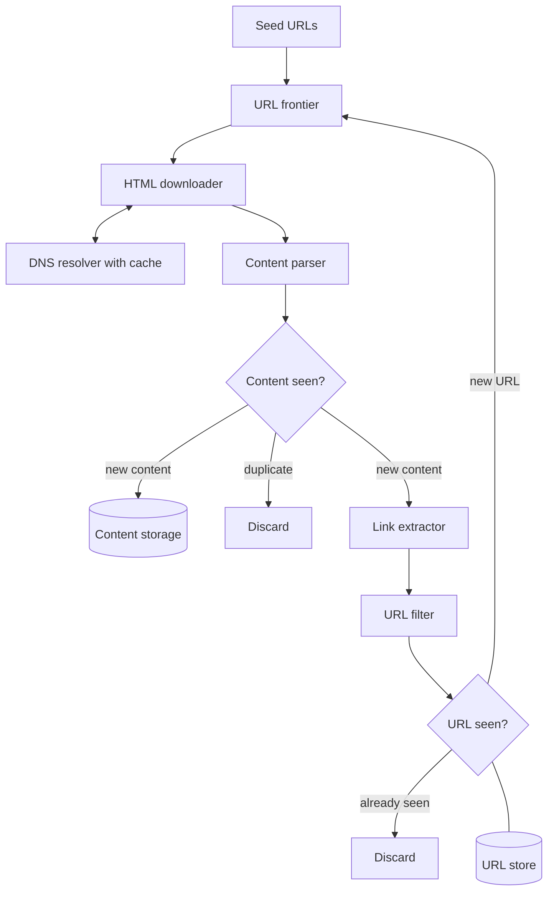
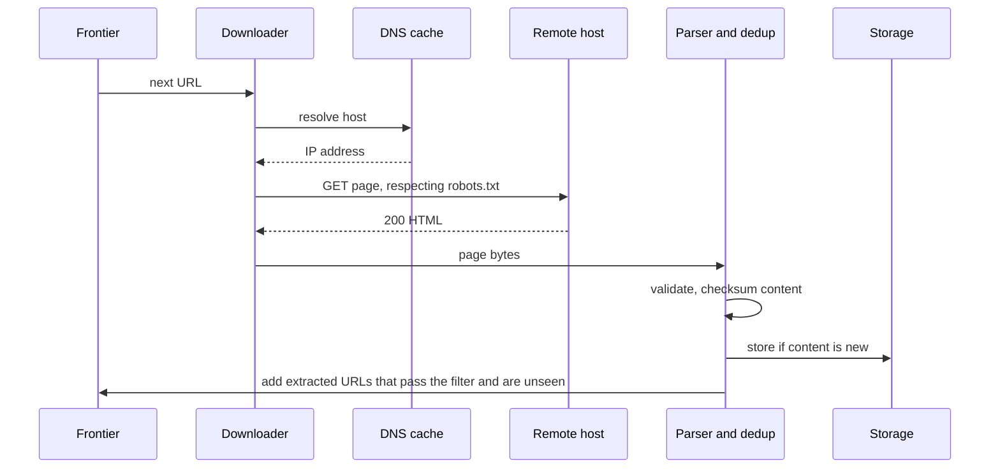

# Design a web crawler I: requirements, the crawl loop and the high-level design

## Before this lesson

You should know DNS, HTTP requests and status codes ([Clients, servers and requests](#/lesson/system-design/clients-servers-requests)), queues and workers ([The five building blocks](#/lesson/system-design/core-components)), estimation ([Estimation II](#/lesson/system-design/estimation-worked)), and Bloom filters, which were introduced in [Design a key-value store II](#/lesson/system-design/kv-store-versioning-failures). Familiarity with a queue data structure and with graphs helps; the [DSA track](#/track/dsa-foundations) covers both.

## In plain words

A **web crawler** (also called a *spider* or *bot*) is a program that visits web pages automatically. It downloads a page, reads it, collects the links it contains, and then visits those links, and so on, in the way a person might explore a city by walking down every street that leads off the one they are on.

A librarian cataloguing an enormous library with no index is a good picture. They pick up a book, record what it is about, and note every other book it refers to. Then they fetch those books and repeat. Two rules keep the job sane: do not catalogue the same book twice, and do not pull so many books from one shelf at once that the shelf collapses.

Crawlers are used for:

- **Search engine indexing:** collecting pages so they can be searched.
- **Web archiving:** preserving copies of the web over time.
- **Web mining:** extracting data, such as prices or news, for analysis.
- **Web monitoring:** detecting copyright or trademark infringement.

This is a popular interview problem because the basic algorithm fits in ten lines while the real system is full of traps: the web is enormous, full of duplicates and deliberately hostile pages, and every website you visit is someone else's server that you must not overload. On the job the same patterns appear in any large pipeline that pulls data from external sources.

This module follows the track's design structure. This lesson covers requirements, estimates, the interface and data model, the crawl algorithm and the high-level design. The next covers the deep dives (the URL frontier, politeness, freshness, duplicate detection, traps), failures, trade-offs, a sample dialogue and common mistakes.

## 1. Requirements and the scope questions to ask

| Question | Why it matters | Assumed answer |
|---|---|---|
| What is the crawler for? | Decides what is stored and how fresh it must be | Search engine indexing |
| How many pages per month? | Throughput and storage | 1 billion |
| Which content types? | Parsers needed | HTML only |
| Should it pick up new and changed pages? | Recrawling | Yes |
| Are downloaded pages stored, and for how long? | Storage | Yes, 5 years |
| How are duplicate pages treated? | Deduplication | Ignored |
| Must it obey robots.txt? | Politeness and legality | Yes |

**Functional requirements**

1. Given a set of starting URLs, download the pages they point to.
2. Extract links from downloaded pages and add new ones to the list of pages to download.
3. Store the downloaded content.

**Non-functional requirements**

1. **Scalability.** The web has billions of pages; crawling must run in parallel on many machines.
2. **Robustness.** The web contains broken HTML, unresponsive servers, endless link loops and malicious pages. The crawler must survive all of them.
3. **Politeness.** It must not send too many requests to one website in a short time.
4. **Extensibility.** Supporting a new content type, such as images or PDF files, should need a new module and not a redesign.

## 2. Estimates

```python-run
pages_per_month = 1_000_000_000
avg_page_bytes = 500_000                 # 500 KB of HTML on average
years = 5

qps = pages_per_month / (30 * 86_400)
storage_month = pages_per_month * avg_page_bytes
storage_total = storage_month * 12 * years
bandwidth = qps * avg_page_bytes * 8     # bits per second

print(f"average download rate : {qps:,.0f} pages per second (peak about {2 * qps:,.0f})")
print(f"storage per month     : {storage_month / 1e12:,.0f} TB")
print(f"storage for {years} years   : {storage_total / 1e15:,.0f} PB")
print(f"download bandwidth    : {bandwidth / 1e9:.1f} Gbit/s")

# How many fetcher threads, if one fetch takes about 1 second including waiting on the remote site?
seconds_per_fetch = 1.0
print(f"concurrent fetches    : about {qps * seconds_per_fetch:,.0f} in flight at any moment")

# URLs seen: perhaps 10 links per page, so far more URLs are checked than fetched.
urls_seen = pages_per_month * 12 * years
print(f"URLs to remember      : {urls_seen / 1e9:,.0f} billion; at 100 bytes each = {urls_seen * 100 / 1e12:,.0f} TB as plain text")
```

What the numbers say:

- About 400 pages per second on average. That is a modest request rate; the difficulty is not raw QPS.
- 500 TB per month and 30 PB over five years. Page content must go to blob storage, not a database.
- Fetching is dominated by waiting for remote servers, so the crawler needs hundreds of concurrent downloads, which calls for asynchronous input and output or many worker threads spread over several machines.
- Remembering which URLs have been seen is a significant data problem by itself: sixty billion URLs take terabytes as plain text, so the "seen" set needs a compact structure.

## 3. The crawl algorithm

At heart, crawling is a walk over a graph. A **graph** is a set of things (nodes) joined by connections (edges). Here the nodes are web pages and the edges are links.

There are two classic ways to walk a graph:

- **Depth-first search (DFS)** follows one path as far as it goes before backing up. On the web a path can be effectively endless, so the crawler could disappear down one site.
- **Breadth-first search (BFS)** visits all pages one link away from the start, then all pages two links away, and so on. It uses a **queue**, a first-in, first-out line. Crawlers use BFS as their basic shape.

```python-run
from collections import deque

# A miniature web: each page lists the pages it links to.
WEB = {
    "a.com/":        ["a.com/about", "a.com/news", "b.com/"],
    "a.com/about":   ["a.com/"],
    "a.com/news":    ["a.com/news/1", "a.com/news/2", "c.com/"],
    "a.com/news/1":  ["a.com/news"],
    "a.com/news/2":  ["a.com/news", "b.com/shop"],
    "b.com/":        ["b.com/shop", "a.com/"],
    "b.com/shop":    ["b.com/shop/item1"],
    "b.com/shop/item1": [],
    "c.com/":        ["c.com/"],                 # a page that links to itself
}

def crawl(seeds, max_pages=100):
    frontier = deque(seeds)          # URLs waiting to be downloaded
    seen = set(seeds)                # every URL ever added to the frontier
    order = []
    while frontier and len(order) < max_pages:
        url = frontier.popleft()     # take the oldest URL: breadth-first
        order.append(url)            # "download" the page
        for link in WEB.get(url, []):
            if link not in seen:     # never queue the same URL twice
                seen.add(link)
                frontier.append(link)
    return order

for i, url in enumerate(crawl(["a.com/"]), 1):
    print(f"{i}. {url}")
```

The crawl visits each of the nine pages exactly once, level by level. Two data structures do all the work, and they are the two central components of the real design:

- The **frontier**: the queue of URLs waiting to be downloaded.
- The **seen set**: the record of every URL already queued, which stops the crawler going round in circles. Without it, the loop between `a.com/` and `a.com/about` would never end.

Plain BFS has two faults that the real design must repair.

1. **It is impolite.** Most links on a page point to the same site. A BFS queue therefore contains long runs of URLs for one host, and a parallel crawler would hit that host with hundreds of requests at once. To the site's owner this is indistinguishable from an attack.
2. **It treats all pages as equally important.** A major news front page and an obscure forum post from 2009 wait in the same line. With finite resources, important and frequently changing pages should be fetched first and more often.

Both are solved by replacing the plain queue with a smarter frontier, which is the main topic of the next lesson.

## 4. Interface and data model

A crawler is not called by end users, so it has no public API. Its interfaces are internal.

```
Operator interface
  add_seeds(urls)
  set_policy(host_pattern, {max_rate, recrawl_interval, allowed})

Between components
  frontier.next()            -> URL to fetch (already polite and prioritised)
  frontier.add(url, priority)
  seen.check_and_add(url)    -> true if new
  content_store.put(page)    -> key
```

**Data stored:**

| Data | Shape | Store |
|---|---|---|
| Page content | Compressed HTML, keyed by a hash of the URL plus fetch time | Blob store |
| URL metadata | URL, host, last fetch time, status, content checksum, priority, next due time | Wide-column or key-value store, partitioned by host |
| Frontier | Queues of URLs, mostly on disk with buffers in memory | Purpose-built queues |
| Seen URLs | Bloom filter in memory backed by a persistent set | Memory plus disk |
| Content checksums | Hash of each page's content | Key-value store |
| robots.txt rules | Per host, cached with an expiry | Cache |

## 5. High-level design



What each component does:

**Seed URLs.** The starting points. Good seeds are pages that link widely: popular sites in each country and each topic (news, shopping, sport, education). The choice of seeds shapes which part of the web is reached first.

**URL frontier.** Holds URLs to be downloaded and decides the order, enforcing politeness and priority.

**HTML downloader.** Fetches pages over HTTP. It looks up each host's address through the DNS resolver and obeys the host's robots.txt.

**DNS resolver.** Translates host names to IP addresses. A lookup can take 10 to 200 ms and many resolver libraries allow only one at a time, so at hundreds of fetches per second DNS becomes a bottleneck unless results are cached and refreshed in the background.

**Content parser.** Checks that the downloaded bytes are well-formed enough to process. Broken or hostile HTML is rejected here. Parsing runs as a separate component so that a slow or crashing parser cannot stall downloading.

**Content seen?** Many pages have identical content under different URLs. This step computes a hash of the page content and checks whether that content is already stored.

**Content storage.** Keeps the page. Most content lives on disk because of its volume; popular pages may be kept in memory for the indexing pipeline.

**Link extractor.** Pulls the links out of the page and converts **relative links** (such as `/about`) to **absolute URLs** (`https://a.com/about`).

**URL filter.** Drops links the crawler should not follow: unwanted file types, blocked sites, error pages, over-long URLs.

**URL seen?** Checks whether the URL has been queued before, typically with a Bloom filter in front of a persistent store.

The life of one URL:



## 6. Being a good citizen: robots.txt

The **Robots Exclusion Protocol** is a convention by which a website tells crawlers which parts they may visit. The site publishes a plain text file at `/robots.txt`. For example:

```
User-agent: *
Disallow: /cart/
Disallow: /search
Crawl-delay: 5

User-agent: BadBot
Disallow: /
```

`User-agent` names the crawler the rules apply to (`*` means all), `Disallow` lists path prefixes that must not be fetched, and some sites add a `Crawl-delay` in seconds between requests. A crawler should fetch this file before anything else on a host, cache it (re-fetching it for every page would itself be impolite), and check every URL against it.

```python-run
def parse_robots(text, agent="*"):
    """Tiny parser: returns the disallowed prefixes and crawl delay for one user agent."""
    rules, delay, applies = [], 0, False
    for line in text.splitlines():
        line = line.split("#")[0].strip()
        if not line or ":" not in line:
            continue
        field, value = [part.strip() for part in line.split(":", 1)]
        field = field.lower()
        if field == "user-agent":
            applies = value in (agent, "*")
        elif applies and field == "disallow" and value:
            rules.append(value)
        elif applies and field == "crawl-delay":
            delay = float(value)
    return rules, delay

def allowed(path, rules):
    return not any(path.startswith(prefix) for prefix in rules)

robots = """
User-agent: *
Disallow: /cart/
Disallow: /search
Crawl-delay: 5
"""
rules, delay = parse_robots(robots)
print("disallowed prefixes:", rules, "| crawl delay:", delay, "seconds")
for path in ("/", "/products/kettle", "/cart/checkout", "/search?q=tea", "/searching-tips"):
    print(f"{path:22s} -> {'fetch' if allowed(path, rules) else 'skip'}")
```

Notice the last line: `/searching-tips` is skipped because the rule is a plain prefix match on `/search`. Real parsers follow the published standard, which also defines `Allow` rules, wildcards and precedence; use a maintained library in production.

A crawler should also identify itself honestly in the `User-Agent` request header, with a way for site owners to contact the operator.

> [!INTERVIEW]
> Lead with the two properties that make this problem different from a generic pipeline: politeness (you are a guest on other people's servers) and robustness (the input is the entire, uncontrolled web). An answer that covers throughput and storage and never mentions either will be marked as shallow.

> [!TIP]
> When you draw the diagram, separate downloading from parsing and from storing. They have different bottlenecks (network, CPU, disk), fail in different ways, and scale independently. Saying so explains why the picture has that many boxes.

> [!WARNING]
> Do not let the estimate mislead you. Four hundred pages per second sounds small next to other systems in this track. The scale that hurts is the number of distinct URLs to remember, the petabytes of content, and the hundreds of thousands of distinct hosts that each need individual rate control.

## Common mistakes

- **Proposing depth-first search.** It can sink into one site for ever.
- **A plain FIFO queue as the frontier**, which is neither polite nor prioritised.
- **No "seen" check**, so the crawler loops.
- **Ignoring robots.txt**, or fetching it for every page.
- **Resolving DNS synchronously for every request** without a cache.
- **Storing page content in a database.**
- **Treating identical content at different URLs as different pages.**

## Summary

- A crawler downloads pages, extracts links and repeats, walking the web graph breadth-first from seed URLs.
- For a billion pages a month: about 400 fetches per second, 500 TB per month, and tens of billions of URLs to remember.
- The two core structures are the frontier (what to fetch next) and the seen set (what has been queued already).
- The pipeline is: frontier, downloader with cached DNS, parser, content deduplication, storage, link extraction, URL filtering, URL deduplication, and back to the frontier.
- The crawler must be polite (limited rate per host, robots.txt respected) and robust against bad input.
- Plain BFS is impolite and unprioritised; the frontier design in the next lesson fixes both.

## Glossary

- **Web crawler (spider, bot)**: a program that downloads web pages and follows their links.
- **Seed URL**: a starting point for a crawl.
- **Graph / node / edge**: a set of items, each item, and each connection between items.
- **Breadth-first search (BFS)**: exploring level by level using a queue.
- **Depth-first search (DFS)**: following one path as deep as possible before backtracking.
- **URL frontier**: the structure holding URLs waiting to be downloaded.
- **Seen set**: the record of URLs already discovered.
- **Politeness**: limiting the request rate to any one website.
- **robots.txt**: a file in which a site states which paths crawlers may fetch.
- **User agent**: the name a client gives for itself in requests.
- **Relative / absolute URL**: a link given relative to the current page, or in full.
- **Checksum**: a short value computed from content, used to detect identical content.
- **Host**: the server name part of a URL, such as `a.com`.
- **Recrawl**: fetching a page again to pick up changes.

## Check yourself

```quiz
[
  {"q": "Why do crawlers use breadth-first instead of depth-first traversal as their basic shape?",
   "options": ["BFS uses less memory", "A depth-first path on the web can be effectively endless, trapping the crawler in one site", "DFS cannot follow links", "BFS needs no seen set"],
   "answer": 1,
   "explain": "Paths can go arbitrarily deep, including through generated pages. BFS keeps the crawl spread across the frontier level by level."},
  {"q": "What is the role of the seen set?",
   "options": ["It stores page content", "It prevents the same URL from being queued again, which avoids loops and wasted fetches", "It orders URLs by priority", "It resolves DNS names"],
   "answer": 1,
   "explain": "The web graph has cycles. Recording every URL ever queued ensures each is processed once."},
  {"q": "Why is a plain FIFO queue impolite as a frontier?",
   "options": ["It is too slow", "Links on a page mostly point to the same host, so parallel workers would hit that host with a burst of requests", "It loses URLs", "It ignores DNS"],
   "answer": 1,
   "explain": "Consecutive queue entries share a host. Without per-host control, many workers fetch from one site at once."},
  {"q": "A crawler fetches 1 billion pages a month at 500 KB each. About how much storage per month?",
   "options": ["500 GB", "5 TB", "500 TB", "500 PB"],
   "answer": 2,
   "explain": "10^9 pages x 5 x 10^5 bytes = 5 x 10^14 bytes, which is 500 TB."},
  {"q": "Why does the downloader use a DNS cache?",
   "options": ["DNS answers never change", "Lookups take tens of milliseconds and can be serialised, so uncached DNS throttles the whole crawler", "robots.txt requires it", "To hide the crawler's identity"],
   "answer": 1,
   "explain": "At hundreds of fetches per second a slow, repeated lookup per request becomes the bottleneck. Cached answers remove it."},
  {"q": "What does the 'content seen?' step detect that the 'URL seen?' step cannot?",
   "options": ["Broken links", "The same page content reachable under different URLs", "Slow hosts", "Disallowed paths"],
   "answer": 1,
   "explain": "Mirrors, tracking parameters and copies give distinct URLs for identical content. Comparing content hashes catches them."},
  {"q": "How should a crawler treat a host's robots.txt?",
   "options": ["Ignore it for speed", "Fetch it once per page", "Fetch and cache it per host, and check every URL against its rules", "Only read it when blocked"],
   "answer": 2,
   "explain": "The file states what may be fetched. Caching it avoids hammering the host for the rules themselves."}
]
```

> **Source:** Xu, *System Design Interview: An Insider's Guide*, ch. 9 (web crawler: scope, estimation, high-level components, DFS vs BFS) as a topic guide; RFC 9309, "Robots Exclusion Protocol", https://www.rfc-editor.org/rfc/rfc9309 ; Manning, Raghavan and Schütze, *Introduction to Information Retrieval*, ch. 20 "Web crawling and indexes", https://nlp.stanford.edu/IR-book/html/htmledition/web-crawling-and-indexes-1.html
