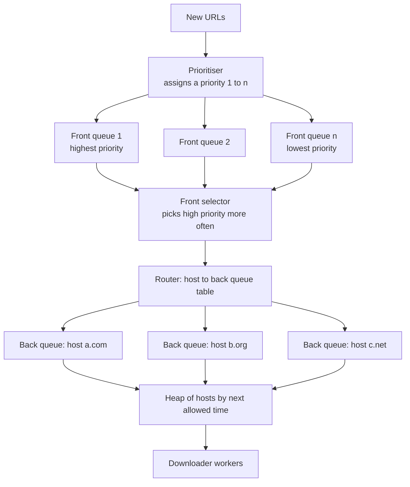
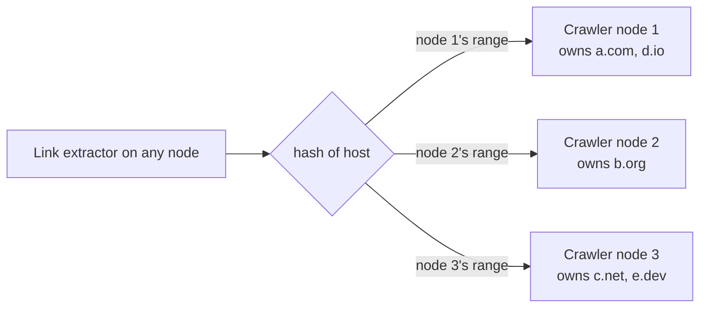

# Design a web crawler II: the URL frontier, deduplication, freshness and robustness

## Before this lesson

Read [Design a web crawler I](#/lesson/system-design/web-crawler-design). You should know the crawl loop (frontier, downloader, parser, content check, link extractor, URL check), why plain breadth-first search is impolite and unprioritised, and what robots.txt is. Bloom filters appeared in [Design a key-value store II](#/lesson/system-design/kv-store-versioning-failures) and consistent hashing in [its own module](#/lesson/system-design/consistent-hashing-virtual-nodes).

## In plain words

The previous lesson drew the pipeline. This one makes it behave well in the real world, where four things go wrong.

1. **You annoy website owners.** Too many requests to one site looks like an attack. The fix is a frontier that keeps a separate line for each website and lets only one request per site out at a time, with a pause in between. Picture a post office with one counter per town: however many letters are waiting for a town, only one clerk serves it, at a steady pace.
2. **You waste effort.** The same page appears under many addresses, and many pages have changed nothing since last visit. The fix is deduplication and a recrawl schedule.
3. **You get trapped.** Some sites generate endless pages, such as a calendar with a "next month" link for ever. The fix is limits and detection.
4. **Machines fail mid-crawl.** With billions of URLs in flight, the state must survive a crash.

## 1. Deep dive: the URL frontier

The frontier has two jobs that pull in different directions: decide what is most worth fetching (**priority**) and make sure no host is hit too often (**politeness**). The standard design, described in the Mercator crawler and in most textbooks, uses two layers of queues.



**Front queues: priority.** A **prioritiser** gives each URL a score from signals such as how many pages link to it, how much traffic the site gets, and how often the page has changed in the past. URLs go into one of several front queues by score. The selector takes from high-priority queues more often than from low ones, but not exclusively, so that low-priority URLs are not starved for ever.

**Back queues: politeness.** Each back queue holds URLs of exactly one host, and a table maps hosts to queues. A **min-heap** (a structure that always gives you the smallest item quickly) holds one entry per host, keyed by the earliest time that host may be contacted again. A worker:

1. takes the host with the smallest "next allowed time" from the heap, waiting if that time is in the future;
2. takes one URL from that host's back queue and fetches it;
3. puts the host back in the heap with `next allowed time = now + delay`.

When a back queue runs empty, it is refilled from the front queues, and that is the moment priority takes effect.

The delay per host can be a fixed number of seconds, the `Crawl-delay` from robots.txt, or adaptive: a common rule is to wait some multiple of how long the last download took, so that slow servers are automatically visited less often.

The simulation shows the politeness layer alone. Twelve URLs on three hosts are fetched by a pool of workers with a two-second delay per host.

```python-run
import heapq
from collections import deque

DELAY = 2.0          # seconds between two requests to the same host
FETCH_TIME = 0.3     # how long one download takes

urls = [f"a.com/{i}" for i in range(6)] + [f"b.org/{i}" for i in range(4)] + [f"c.net/{i}" for i in range(2)]

back = {}                                  # host -> queue of its URLs
for u in urls:
    back.setdefault(u.split("/")[0], deque()).append(u)

heap = [(0.0, host) for host in back]      # (next allowed time, host)
heapq.heapify(heap)

clock, log = 0.0, []
while heap:
    allowed_at, host = heapq.heappop(heap)
    clock = max(clock, allowed_at)         # wait until this host may be contacted
    url = back[host].popleft()
    log.append((round(clock, 1), url))
    clock += FETCH_TIME
    if back[host]:                         # host still has URLs: schedule its next turn
        heapq.heappush(heap, (clock + DELAY, host))

for t, u in log:
    print(f"t={t:5.1f}s  fetch {u}")

per_host = {}
for t, u in log:
    per_host.setdefault(u.split("/")[0], []).append(t)
for host, times in per_host.items():
    gaps = [round(b - a, 1) for a, b in zip(times, times[1:])]
    print(f"{host}: gaps between requests = {gaps}")
```

Read the output: the crawler interleaves the three hosts instead of draining `a.com` first, and the gaps printed at the end show that no host ever receives two requests less than about two seconds apart. Once the smaller hosts are exhausted, the crawler has to idle between requests to `a.com`. That is the right behaviour: with only one polite host left, throughput is limited by politeness, and the cure is more hosts in play, not shorter delays.

**Storage for the frontier.** With hundreds of millions of URLs waiting, the frontier cannot live in memory, and if it lived purely on disk every operation would be slow. The usual hybrid keeps most of each queue on disk and a buffer in memory for the entries about to be handed out and the ones recently added, flushing and refilling in batches.

## 2. Deep dive: freshness

Pages change. A search index built from month-old copies gives stale results. Recrawling everything at the same rate is wasteful, because most pages rarely change and a few change every minute.

Strategies:

- **Recrawl by observed change rate.** Record whether the content checksum changed on each visit, and estimate how often the page changes. Pages that changed on the last several visits are scheduled sooner; pages that never change are pushed back, up to a maximum interval.
- **Recrawl by importance.** Important pages get fresher copies even if they change rarely, because being wrong about them costs more.
- **Use hints from the site.** A **sitemap** is a file in which a site lists its URLs and when each last changed. HTTP also supports **conditional requests**: the crawler sends `If-Modified-Since` or an `ETag` validator, and the server answers `304 Not Modified` with no body if nothing changed, saving bandwidth on both sides.

```python-run
def next_interval(current_hours, changed, lo=1, hi=24 * 30):
    """Halve the wait when the page changed, grow it by half when it did not."""
    new = current_hours / 2 if changed else current_hours * 1.5
    return max(lo, min(hi, new))

for name, history in [("news front page", [True] * 8),
                      ("product page", [False, False, True, False, False, False, True, False]),
                      ("old blog post", [False] * 8)]:
    interval, trail = 24.0, []
    for changed in history:
        interval = next_interval(interval, changed)
        trail.append(round(interval, 1))
    print(f"{name:16s} recrawl interval in hours: {trail}")
```

Starting from a daily visit, the news page converges on the one-hour minimum, the old blog post drifts towards weekly and beyond, and the product page settles in between. Three lines of logic allocate the crawl budget to where change happens.

## 3. Deep dive: have we seen this URL?

Before a URL enters the frontier, the crawler must check whether it was seen before. With tens of billions of URLs, an exact in-memory set is impossible and a database lookup per link is too slow (a page has dozens of links, so this check runs thousands of times per second).

**Step 1: normalise.** Many different strings name the same page. **URL normalisation** converts each to one standard form before checking: lower-case the scheme and host, remove the default port and the fragment (the part after `#`), resolve `..` segments, sort query parameters, and drop known tracking parameters.

**Step 2: a Bloom filter in front of the store.** A **Bloom filter** is a bit array with several hash functions. Adding an item sets a few bits; testing an item checks whether all its bits are set. It never says "not seen" for something that was added. It occasionally says "possibly seen" for something that was not: a **false positive**.

For a crawler, a false positive means a new URL is wrongly skipped. A small rate of that is acceptable, because the web is large and the page is usually reachable some other way or picked up in a later crawl. In exchange, the "seen" structure shrinks enormously.

```python-run
import hashlib, math

class Bloom:
    def __init__(self, m, k):
        self.m, self.k, self.bits = m, k, bytearray(m)     # one byte per bit, for clarity
    def _positions(self, item):
        return [int(hashlib.md5(f"{i}:{item}".encode()).hexdigest(), 16) % self.m for i in range(self.k)]
    def add(self, item):
        for p in self._positions(item):
            self.bits[p] = 1
    def might_contain(self, item):
        return all(self.bits[p] for p in self._positions(item))

n = 5_000                                    # URLs we will add
for bits_per_item in (4, 8, 10, 16):
    m = n * bits_per_item
    k = max(1, round(bits_per_item * math.log(2)))          # the best number of hash functions
    bloom = Bloom(m, k)
    for i in range(n):
        bloom.add(f"https://site.example/page/{i}")
    false_pos = sum(bloom.might_contain(f"https://other.example/{i}") for i in range(5_000)) / 5_000
    print(f"{bits_per_item:>2} bits per URL, {k} hashes: false positive rate {false_pos:.2%}")

print(f"\n60 billion URLs at 10 bits each = {60e9 * 10 / 8 / 1e9:.0f} GB, "
      f"against about {60e9 * 100 / 1e12:.0f} TB as plain text")
```

About 10 bits per URL gives a false positive rate near 1%, whatever the length of the URLs. Sixty billion URLs fit in about 75 GB, which can be split across a few machines, instead of terabytes.

## 4. Deep dive: have we seen this content?

Different URLs often return identical pages: mirrors, `http` and `https` versions, session identifiers in the address. Estimates of duplicated content on the web are commonly around a third of all pages. Storing and indexing those again is waste.

**Exact duplicates.** Compute a hash of the page content, such as a 64-bit fingerprint, and look it up in a store of fingerprints already seen. Comparing two fingerprints is far cheaper than comparing two documents character by character.

**Near duplicates.** Two copies of an article that differ only in an advertisement or a timestamp have completely different hashes, because a good hash changes entirely when one character changes. Detecting near duplicates needs a **similarity hash** such as SimHash, which is designed so that similar documents produce fingerprints differing in only a few bits. This is an advanced extension; mention it and move on unless asked.

## 5. Deep dive: spider traps and bad content

A **spider trap** is a set of pages that creates an unlimited number of URLs: a calendar with an endless "next" link, a path that repeats (`/a/b/a/b/a/b/…`), or parameters that can be combined without limit. Some are accidental and some are built deliberately to waste crawlers' resources.

There is no complete automatic defence. Practical measures:

- A **maximum URL length** and a **maximum depth** from the seed.
- A **cap on pages per host** per crawl cycle, raised for hosts known to be large and valuable.
- Detection of repeating path segments and of query-parameter explosions.
- A list of excluded hosts and URL patterns maintained by people, since traps tend to be found by an operator noticing one host with an absurd number of pages.

Other hostile or useless input, and the guard for each:

| Input | Guard |
|---|---|
| A server that sends data extremely slowly | Timeouts on connect and on total download time |
| An enormous response | A maximum size; stop reading beyond it |
| Broken HTML | A tolerant parser, isolated so a crash does not stop the downloader |
| Spam and link farms | Quality signals in the prioritiser; excluded-host lists |
| Pages built by JavaScript in the browser | A rendering step with a headless browser for selected sites, since the raw HTML holds no links |

## 6. Deep dive: scaling out and surviving failures

**Distributing the crawl.** Hundreds of fetches per second with seconds of delay per host needs many workers on many machines. The rule that makes politeness possible is: **all URLs of one host are handled by one crawler node**, so that one node owns that host's delay timer. Hosts are assigned to nodes with consistent hashing on the host name, so that adding or losing a node reassigns only a small share of hosts.



**Placing crawlers near the sites.** Fetching European sites from crawlers in Europe cuts round-trip time, which raises throughput.

**DNS.** Each node keeps a cache from host name to IP address, refreshed in the background. Without it, DNS lookups serialise and dominate the fetch time.

**Checkpointing.** A crash must not lose the frontier or the seen set. Both are persisted: the frontier's queues are on disk by design, and the Bloom filter and progress counters are written out periodically as **checkpoints** (saved snapshots of state). After a restart, the node loads the last checkpoint and resumes. A few URLs may be fetched twice; none are lost.

**Idempotent stages.** Because a restart can repeat work, each stage must tolerate repetition: storing the same content twice is caught by the fingerprint check, and adding the same URL twice is caught by the seen check.

## 7. Bottlenecks and failure handling

| Failure or bottleneck | Effect | Mitigation |
|---|---|---|
| Crawler node dies | Its hosts stop being crawled | Consistent hashing reassigns its hosts; state restored from checkpoint |
| Frontier disk full | New URLs cannot be queued | Cap low-priority queues; drop the lowest priority first |
| DNS resolver slow | All fetches slow | Local cache, several resolvers, background refresh |
| A host is slow or timing out | Worker threads tied up | Timeouts; exponential backoff for that host; reduce its priority |
| A host returns 429 or 503 | We are being asked to slow down | Increase that host's delay; honour `Retry-After` |
| Content store unavailable | Pages cannot be saved | Buffer in a queue; pause fetching when the buffer is full (back-pressure) |
| Bloom filter saturates | False positive rate climbs, new URLs skipped | Size it for the planned count; monitor the fill ratio; rebuild larger |
| A trap floods the frontier | One host consumes the budget | Per-host caps and depth limits |

## 8. Trade-offs and alternatives

| Decision | Chosen | Alternative | When the alternative fits |
|---|---|---|---|
| Traversal | BFS with priority | Pure BFS or DFS | Small, focused crawls of one site |
| Seen-URL structure | Bloom filter plus persistent store | Exact set in a key-value store | When skipping a new URL is unacceptable and volume is modest |
| Host assignment | Consistent hashing by host | Central scheduler handing out URLs | Small clusters, where a central queue is simpler |
| Freshness | Adaptive recrawl by change rate | Fixed interval for everything | Archiving, where uniform snapshots are the goal |
| Rendering | Raw HTML, selective JavaScript rendering | Render every page in a browser | When most target sites are script-heavy and the budget allows a ten-fold cost |
| Pipeline | Asynchronous stages joined by queues | One process doing everything per URL | Prototypes |

Two different crawling goals lead to different tunings. A **broad crawl** for a search engine values coverage and politeness across millions of hosts. A **focused crawl** for monitoring a list of sites values freshness on a small set and can negotiate higher rates with those sites or use their feeds and APIs instead of crawling.

## 9. What a strong answer sounds like

> **Interviewer:** Your crawler does breadth-first search with a queue. What goes wrong at scale?
>
> **Candidate:** Two things. A page's links mostly point to its own site, so consecutive queue entries share a host and parallel workers would flood it. And every URL has equal weight. I would replace the queue with a two-layer frontier: front queues ordered by priority, and back queues with one host each. A heap keyed by each host's next allowed time decides which back queue a worker may take from, so a host gets one request at a time with a delay I take from robots.txt or from its response time.
>
> **Interviewer:** How do you avoid fetching the same thing twice?
>
> **Candidate:** Two checks. For URLs: normalise, then test a Bloom filter. At about 10 bits per URL I get roughly a 1% false positive rate, so sixty billion URLs take around 75 GB instead of terabytes. A false positive skips a new URL, which I accept for a broad crawl. For content: a fingerprint of the page body catches identical pages under different URLs.
>
> **Interviewer:** What about a site that generates infinite URLs?
>
> **Candidate:** I cap URL length, depth and pages per host per cycle, and detect repeating path patterns. Beyond that I keep an operator-maintained blocklist; there is no fully automatic answer.
>
> **Interviewer:** And a node crash?
>
> **Candidate:** Hosts map to nodes by consistent hashing, so the dead node's hosts move to its neighbours. The frontier is disk-backed and the seen filter is checkpointed, so the replacement resumes with at most a few repeated fetches, which the dedup checks absorb.

## Common mistakes

- **A politeness delay implemented by sleeping in a worker.** Workers should move on to another host; the heap of next-allowed times does the waiting.
- **Letting several nodes fetch the same host**, each with its own delay timer.
- **Forgetting URL normalisation** before the seen check.
- **Calling a Bloom filter exact.** State the false positive rate and why it is acceptable.
- **Hashing content with an ordinary hash and expecting near-duplicate detection.**
- **No timeouts or size limits** on downloads.
- **Recrawling everything at one fixed interval.**
- **Keeping the frontier only in memory.**

## Summary

- The frontier has front queues for priority and one back queue per host for politeness, with a heap of hosts ordered by next allowed fetch time.
- Freshness comes from adaptive recrawl intervals driven by observed change and importance, plus sitemaps and conditional requests.
- URL deduplication normalises URLs and tests a Bloom filter; about 10 bits per URL gives about 1% false positives.
- Content deduplication compares fingerprints; near duplicates need a similarity hash.
- Traps are contained with limits on length, depth and pages per host, and with human-maintained exclusions.
- The crawl is distributed by hashing hosts to nodes; state is disk-backed and checkpointed so a crash repeats a little work and loses none.

## Glossary

- **Front queue / back queue**: frontier queues ordered by priority, and per-host queues that enforce politeness.
- **Prioritiser**: the component that scores URLs for importance.
- **Min-heap**: a structure that returns its smallest element efficiently.
- **Crawl delay**: the pause between two requests to the same host.
- **Freshness**: how up to date the stored copy of a page is.
- **Sitemap**: a file listing a site's URLs and their last modification times.
- **Conditional request**: an HTTP request that asks for the content only if it changed.
- **304 Not Modified**: the response to a conditional request when nothing changed.
- **URL normalisation**: converting equivalent URLs to one standard form.
- **Bloom filter**: a compact set that can give false positives and never false negatives.
- **False positive**: reporting something as present when it is not.
- **Fingerprint**: a short hash that stands for a document's content.
- **SimHash**: a hash under which similar documents get similar fingerprints.
- **Spider trap**: pages that generate endless URLs.
- **Checkpoint**: a saved snapshot of state from which work can resume.
- **Back-pressure**: slowing an upstream stage when a downstream stage is full.
- **Headless browser**: a browser without a screen, used to run a page's scripts.

## Check yourself

```quiz
[
  {"q": "In the two-layer frontier, what does each back queue contain?",
   "options": ["URLs of one priority level", "URLs of exactly one host", "URLs already fetched", "DNS answers"],
   "answer": 1,
   "explain": "Back queues enforce politeness: one queue per host, with a heap deciding when each host may next be contacted."},
  {"q": "Why must all URLs of one host be handled by the same crawler node?",
   "options": ["To share cookies", "So a single delay timer governs that host and its rate limit is respected", "Because DNS requires it", "To reduce storage"],
   "answer": 1,
   "explain": "Two nodes with independent timers would together exceed the polite rate. One owner per host keeps the limit meaningful."},
  {"q": "A Bloom filter reports that a URL has possibly been seen. What does the crawler know?",
   "options": ["The URL was definitely fetched", "The URL was either seen before or is a false positive", "The URL was definitely never seen", "The page content is a duplicate"],
   "answer": 1,
   "explain": "Positive answers may be wrong at the configured false positive rate. Only negative answers are certain."},
  {"q": "Roughly how many bits per URL give a Bloom filter false positive rate of about 1%?",
   "options": ["1", "10", "100", "1,000"],
   "answer": 1,
   "explain": "About 9.6 bits per item with 7 hash functions gives 1%, independent of how long the URLs are."},
  {"q": "A page changed on each of the last six visits. What should the recrawl scheduler do?",
   "options": ["Visit it less often", "Shorten its recrawl interval, down to a minimum", "Remove it from the frontier", "Block the host"],
   "answer": 1,
   "explain": "Adaptive scheduling spends the crawl budget where change happens, bounded by a minimum interval for politeness."},
  {"q": "Which measure limits the damage of a calendar page with an endless next-month link?",
   "options": ["A larger Bloom filter", "A cap on depth and on pages per host", "A faster DNS cache", "More front queues"],
   "answer": 1,
   "explain": "Traps produce unlimited new URLs, so deduplication does not help. Depth and per-host limits bound the waste."},
  {"q": "Two pages differ only in an advertisement. Why does an ordinary content hash not flag them as near duplicates?",
   "options": ["Hashes ignore advertisements", "A good hash changes completely when any character changes", "The hash is too long", "Pages are compressed"],
   "answer": 1,
   "explain": "Ordinary hashes detect exact equality only. Similarity hashes such as SimHash are built so that similar inputs give similar outputs."},
  {"q": "A crawler node crashes. What lets its replacement resume with little loss?",
   "options": ["Restarting from the seed URLs", "A disk-backed frontier and periodic checkpoints of the seen filter", "A longer crawl delay", "A second DNS resolver"],
   "answer": 1,
   "explain": "Persisted state lets the node continue from the last checkpoint. A few URLs may repeat, and the dedup checks absorb that."}
]
```

> **Source:** Xu, *System Design Interview: An Insider's Guide*, ch. 9 (URL frontier, HTML downloader, robustness, extensibility, detecting problematic content) as a topic guide; Heydon and Najork, "Mercator: A scalable, extensible web crawler" (World Wide Web, 1999); Manning, Raghavan and Schütze, *Introduction to Information Retrieval*, ch. 20, https://nlp.stanford.edu/IR-book/html/htmledition/the-url-frontier-1.html ; RFC 9309, https://www.rfc-editor.org/rfc/rfc9309
