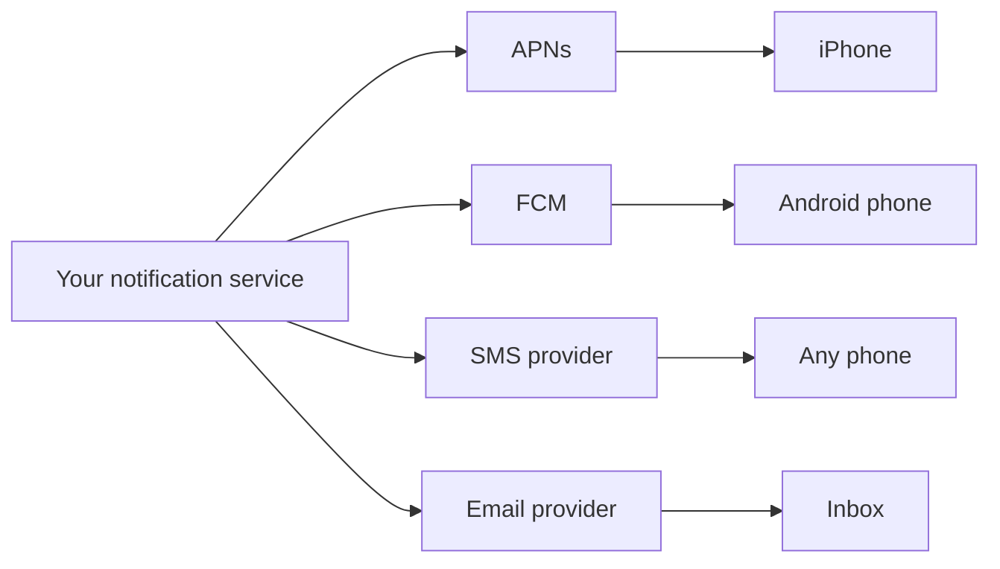
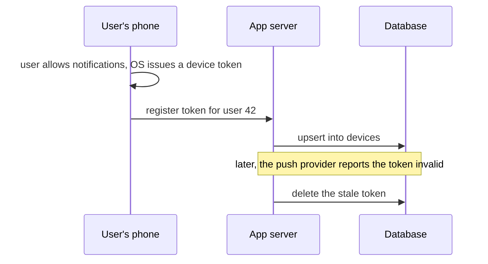
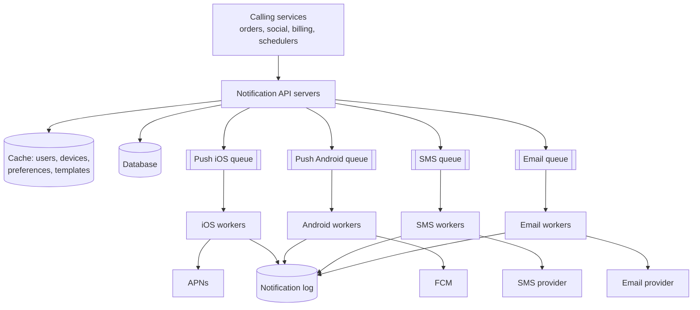
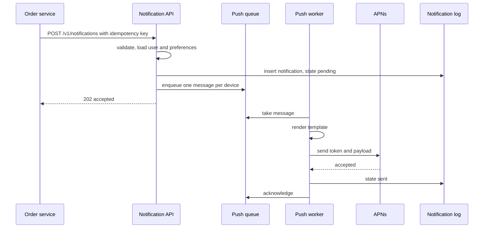

# Design a notification system I: channels, requirements and the high-level design

## Before this lesson

You should know message queues, workers and acknowledgements ([Scaling from zero II](#/lesson/system-design/scale-stateless-to-sharded)), caches and databases ([The five building blocks](#/lesson/system-design/core-components)), estimation ([Estimation II](#/lesson/system-design/estimation-worked)) and the four-step framework.

## In plain words

A **notification** is a short message a product sends to a person without the person asking at that moment: "your parcel has shipped", "Mina commented on your photo", "your one-time code is 493 027". A **notification system** is the shared service inside a company that every other team calls when it wants to tell a user something.

Think of the mail room of a large office. Departments hand it letters. The mail room does not write the letters; it works out how each one should travel (courier, post, internal mail), checks the address, respects "no junk mail" stickers, hands the letter to the right carrier, and chases it if the carrier fails. Departments do not need to know anything about carriers.

There are three main carriers, called **channels**:

- **Mobile push notification:** a message that appears on a phone's lock screen or notification tray.
- **SMS:** a text message to a phone number.
- **Email.**

The design is a favourite in interviews because it looks like "call an API" and turns out to be about queues, retries, duplicates, rate limits and depending on outside companies that you do not control. On the job, almost every product has one, and its failures are highly visible: a missing login code locks a user out, and a duplicated promotional message annoys millions.

This module follows the track's design structure. This lesson covers requirements, estimates, how each channel works, the API, the data model and the high-level design. The next covers reliability, deduplication, retries, rate limiting, failures, trade-offs, a sample dialogue and common mistakes.

## 1. Requirements and the scope questions to ask

| Question | Why it matters | Assumed answer |
|---|---|---|
| Which channels? | Each has its own provider and rules | Push (iOS and Android), SMS and email |
| Real time? | Queueing and latency targets | Soft real time: as soon as possible, a short delay is acceptable under load |
| Which devices? | Push providers differ per platform | iOS, Android, and desktop for email |
| What triggers a notification? | Sources of traffic | Other services calling an API, and scheduled jobs |
| Can users opt out? | Needs a preference store and a check on every send | Yes, per channel and per category |
| How many per day? | Sizing | 10 million push, 1 million SMS, 5 million email |
| Is losing a notification acceptable? | Delivery guarantee | No for transactional ones; never silently |
| Is a duplicate acceptable? | Deduplication effort | Rare duplicates are tolerable, and should be minimised |

**Functional requirements**

1. Accept a request to notify a user, or many users, through one or more channels.
2. Deliver through the right third-party provider for each channel.
3. Respect user preferences and opt-outs.
4. Support templates so that callers send data, not finished text.

**Non-functional requirements**

1. **Reliability:** an accepted notification is not lost. This is called **at-least-once delivery**.
2. **Scalability:** tens of millions per day, with large bursts.
3. **Isolation:** a problem in one channel or provider must not block the others.
4. **Low latency for urgent messages**, such as login codes.
5. **Observability:** every notification can be traced from request to provider response.

A useful distinction to raise yourself: **transactional** notifications are triggered by a user's own action and expected immediately (a code, a receipt). **Promotional** notifications are marketing and can be delayed, batched, limited and, in many countries, require explicit consent. They need different priorities.

## 2. Estimates

```python-run
per_day = {"push": 10_000_000, "sms": 1_000_000, "email": 5_000_000}
log_bytes = 1_000                     # one stored record per notification: ids, status, timestamps
retention_days = 90

total = sum(per_day.values())
print(f"total per day     : {total:,}")
for channel, n in per_day.items():
    print(f"  {channel:6s} average {n / 86_400:7.1f} per second")
print(f"average overall   : {total / 86_400:,.0f} per second")

# Campaigns arrive in bursts: suppose 5 million pushes are requested within 10 minutes.
burst = 5_000_000 / (10 * 60)
print(f"campaign burst    : {burst:,.0f} per second for 10 minutes")

storage = total * log_bytes * retention_days
print(f"log storage       : {storage / 1e12:.1f} TB for {retention_days} days")

# How long to drain that burst if push workers can send 2,000 per second in total?
print(f"drain time at 2,000/s: {5_000_000 / 2_000 / 60:.0f} minutes")
```

What this shows: the average rate, under 200 per second, is small. The burst is the real load, about forty times the average. A design sized for the average would fall over, and one sized for the peak would idle most of the day. That gap is the argument for putting queues between the request and the sending: the queue absorbs the burst and the workers drain it at the rate the providers allow. Storage for delivery logs is about 1.4 TB per quarter, modest.

## 3. How each channel works

In every case, you do not deliver the message yourself. You hand it to a **third-party provider**, a company that owns the last step to the device or inbox.

**Push on iOS.** The provider is the **Apple Push Notification service (APNs)**. You need a **device token**, a unique identifier that the phone's operating system gives your app when the user allows notifications, and a **payload**, a small JSON document with the title, body and options. Your server sends token and payload to APNs, and APNs delivers to the device.

**Push on Android.** The same pattern with **Firebase Cloud Messaging (FCM)**.

**SMS.** Sent through commercial services such as Twilio or Vonage, which connect to mobile carriers. SMS costs money per message, and delivery rules vary by country.

**Email.** Companies can run their own mail servers, but most use services such as SendGrid, Mailchimp or Amazon SES, which give better delivery rates and analytics.



Three facts about providers shape the whole design:

1. **They are outside your control.** They are sometimes slow, sometimes down, and they impose their own rate limits.
2. **They are not all available everywhere.** A provider may be blocked or unreliable in some countries, so the system must be able to add or swap providers easily.
3. **Delivery is best effort.** A provider accepting your request does not mean the user saw the message. A phone may be switched off, and notifications may be disabled.

### Collecting contact information

To notify someone you need their device tokens, phone number or email address. These are collected when the user installs the app or signs up, and stored against the user. One user can have several devices, so there are several tokens per user. Tokens also go stale: when a user uninstalls the app, the provider eventually reports the token as invalid, and the system must delete it.



## 4. API

Callers are other internal services. The API is internal and authenticated, so that only known services can send.

```
POST /v1/notifications
  headers: Authorization: <service credential>
           Idempotency-Key: order-8841-shipped
  body: {
    "user_id": 42,
    "category": "order_update",          // used for preferences and priority
    "template": "order_shipped",
    "data": {"order_id": 8841, "carrier": "ParcelCo"},
    "channels": ["push", "email"],       // optional; default from the category
    "priority": "high"
  }
  returns: 202 {"notification_id": "ntf_7c1e..."}     // accepted, not yet delivered

GET /v1/notifications/{notification_id}
  returns: {"status": [{"channel": "push", "state": "sent"}, {"channel": "email", "state": "delivered"}]}

PUT /v1/users/{user_id}/preferences
  body: {"category": "promotions", "channel": "sms", "opt_in": false}
```

Three choices to point out:

- The response is **202 Accepted**, not 200. The caller learns that the request was stored safely, not that it was delivered.
- The **idempotency key** lets a caller retry safely: a second request with the same key returns the first result and does not create a second notification.
- Callers send a **template name and data**, not finished text. Wording, language and formatting live in one place.

## 5. Data model

```
users(user_id PK, email, phone_number, country_code, locale, created_at)

devices(device_id PK, user_id, platform, device_token, last_seen_at)
    index on user_id                      -- one user, many devices

preferences(user_id, category, channel, opt_in)
    PK (user_id, category, channel)

templates(template_id, channel, locale, version, subject, body)

notifications(notification_id PK, idempotency_key UNIQUE, user_id, category,
              template, data, priority, created_at)

deliveries(notification_id, channel, device_id, state, attempts,
           provider, provider_message_id, updated_at)
    PK (notification_id, channel, device_id)
```

- User, device and preference data is read on every send and changes rarely, so it is cached.
- The `notifications` and `deliveries` tables are an append-heavy **notification log**. They grow fast and are queried by id or by user and time, which suits a store partitioned by user id or time, with old data moved to cheaper storage.
- The `state` of a delivery moves through `pending → sent → delivered` or `failed`, updated as the worker and then the provider report back.

## 6. High-level design

A first attempt puts everything in one server: receive the request, look up the user, render the template, call the provider. It has three problems: it is a single point of failure, one slow provider stalls every request, and it cannot absorb bursts. The improved design separates accepting from sending.



**Notification API servers** (stateless, behind a load balancer):

1. Authenticate the caller and validate the request.
2. Check the idempotency key.
3. Fetch the user's contact details, devices and preferences from the cache, falling back to the database.
4. Drop channels the user has opted out of.
5. Write the notification record, then put one message per channel (and per device for push) onto that channel's queue.
6. Return 202.

**One queue per channel.** This is the isolation requirement made concrete. If the SMS provider is down, the SMS queue grows while push and email flow normally. Each queue also has its own worker pool, scaled on its own queue depth, and its own sending rate matched to its provider's limits.

**Workers:**

1. Take a message from their queue.
2. Render the template with the data in the user's language.
3. Call the provider.
4. Record the outcome in the notification log.
5. Acknowledge the message on success, or arrange a retry on failure.

The flow of one notification:



## 7. A small working model

The code below is the skeleton of that pipeline: a preference check, per-channel queues and workers. It is deliberately tiny; the point is to see the stages as separate pieces.

```python-run
from collections import deque

USERS = {42: {"email": "mina@example.com", "phone": "+15550100", "devices": ["tok-ios-1", "tok-and-7"]}}
OPTED_OUT = {(42, "promotions", "sms")}                 # (user, category, channel)
TEMPLATES = {"order_shipped": "Order {order_id} is on its way with {carrier}.",
             "weekly_deals": "This week only: {offer}."}
DEFAULT_CHANNELS = {"order_update": ["push", "email"], "promotions": ["push", "sms", "email"]}

queues = {"push": deque(), "sms": deque(), "email": deque()}
log = []

def accept(user_id, category, template, data):
    """The API server's job: validate, apply preferences, enqueue, return at once."""
    user = USERS[user_id]
    for channel in DEFAULT_CHANNELS[category]:
        if (user_id, category, channel) in OPTED_OUT:
            log.append((channel, "skipped: user opted out"))
            continue
        targets = user["devices"] if channel == "push" else [user["phone"] if channel == "sms" else user["email"]]
        for target in targets:
            queues[channel].append({"to": target, "template": template, "data": data})
    return "202 accepted"

def run_worker(channel):
    """A worker's job: render and hand to the provider (here, a print)."""
    while queues[channel]:
        msg = queues[channel].popleft()
        text = TEMPLATES[msg["template"]].format(**msg["data"])
        log.append((channel, f"sent to {msg['to']}: {text}"))

print(accept(42, "order_update", "order_shipped", {"order_id": 8841, "carrier": "ParcelCo"}))
print(accept(42, "promotions", "weekly_deals", {"offer": "20% off kettles"}))
print("queue depths before workers run:", {c: len(q) for c, q in queues.items()})
for channel in queues:
    run_worker(channel)
for channel, event in log:
    print(f"[{channel:5s}] {event}")
```

The two `accept` calls return immediately, having only written to queues. The printed depths show push with four messages (two requests times two devices), email with two and SMS with none, because the user opted out of promotional SMS and order updates do not use SMS. The workers then drain each queue independently.

> [!INTERVIEW]
> When you draw the queues, say why there is one per channel: "so that an outage at the SMS provider only backs up the SMS queue". Then say why queues exist at all: "campaign bursts are forty times the average rate, and providers rate-limit us, so I need a buffer between accepting and sending".

> [!TIP]
> Putting the preference check in the API server and again in the worker costs little and protects users: a user who opts out while a million-message campaign is still queued should stop receiving it.

> [!WARNING]
> Do not treat "the provider returned success" as "the user was notified". Providers accept messages they later fail to deliver. Delivery receipts, where a provider offers them, arrive later through a callback, and the design must record them separately.

## Common mistakes

- **Calling providers synchronously inside the caller's request.** One slow provider slows every calling service.
- **One shared queue for all channels.** A provider outage then blocks everything.
- **Assuming one device per user.**
- **Ignoring opt-outs and consent**, which is a legal problem as well as a product one.
- **Returning 200 for an accepted request**, which implies delivery.
- **Sizing for the average rate** when bursts are the workload.
- **Hard-coding one provider per channel** with no way to add a second.

## Summary

- A notification system accepts requests from internal services and delivers through push, SMS and email providers that it does not control.
- Requirements: no accepted notification lost, isolation between channels, burst tolerance, preference handling and traceability.
- Average load is small; campaign bursts dominate, which justifies queues.
- The API is asynchronous (202), idempotent by key, and template-based.
- Data: users, devices (several per user, with stale tokens removed), preferences, templates, and a delivery log.
- API servers validate and enqueue; one queue and worker pool per channel isolate providers; workers render, send and log.

## Glossary

- **Notification**: a message sent to a user without an immediate request from them.
- **Channel**: a way of reaching a user: push, SMS or email.
- **Push notification**: a message delivered to a device by the platform's push service.
- **APNs / FCM**: the push services for Apple and Android devices.
- **Device token**: the identifier a platform issues so a specific app on a specific device can be reached.
- **Payload**: the data sent with a push notification.
- **Third-party provider**: an outside company that performs the final delivery.
- **Transactional / promotional**: triggered by the user's own action and expected immediately, or marketing.
- **Opt-out**: a user's choice not to receive a kind of notification.
- **Template**: message text with placeholders filled in from data.
- **202 Accepted**: the status meaning "received for later processing".
- **Idempotency key**: a caller-chosen identifier that makes retries safe.
- **Notification log**: the record of every notification and delivery attempt.
- **At-least-once delivery**: nothing accepted is lost; duplicates are possible.
- **Soft real time**: as fast as possible, with occasional short delays acceptable.

## Check yourself

```quiz
[
  {"q": "Why does the design use a separate queue for each channel?",
   "options": ["Queues can only hold one message type", "So that a slow or failing provider backs up only its own channel", "To make templates simpler", "Because push needs more memory"],
   "answer": 1,
   "explain": "Isolation: an SMS provider outage grows the SMS queue while push and email continue normally."},
  {"q": "What does a 202 response from the notification API tell the caller?",
   "options": ["The user has read the message", "The provider delivered the message", "The request was accepted and will be processed asynchronously", "The user opted out"],
   "answer": 2,
   "explain": "Accepting and delivering are separate steps. 202 means the request is safely stored for later sending."},
  {"q": "The average rate is 185 notifications per second, but a campaign requests 5 million pushes in 10 minutes. What does that imply?",
   "options": ["Size everything for 185 per second", "A buffer is needed: queues absorb the burst and workers drain it at the provider's pace", "Reject campaigns", "Send SMS instead"],
   "answer": 1,
   "explain": "The burst is about 8,300 per second, far above the average. Queues turn the spike into a short delay instead of an overload."},
  {"q": "A user has an iPhone and an Android tablet. How many push messages does one notification produce?",
   "options": ["One, to the newest device", "Two, one per registered device token", "None until the user chooses a device", "One per channel regardless of devices"],
   "answer": 1,
   "explain": "Device tokens are per app per device. A user with two devices has two tokens and should receive the push on both."},
  {"q": "The push provider reports that a device token is no longer valid. What should the system do?",
   "options": ["Retry for ever", "Delete the stale token so it is not used again", "Switch the user to SMS automatically", "Ignore the report"],
   "answer": 1,
   "explain": "Tokens go stale when apps are uninstalled. Keeping them wastes sends and can hurt the sender's standing with the provider."},
  {"q": "Why do callers send a template name and data instead of finished text?",
   "options": ["It makes requests larger", "Wording, language and formatting are managed in one place and stay consistent", "Providers require templates", "To avoid using queues"],
   "answer": 1,
   "explain": "Templates centralise content and localisation, so a wording fix or a new language does not require changing every calling service."},
  {"q": "Which statement about providers is true?",
   "options": ["A success response guarantees the user saw the message", "They may be slow, rate limited or unavailable, and delivery is best effort", "They are always available in every country", "They never return errors"],
   "answer": 1,
   "explain": "Providers are external dependencies. The design must expect delay, limits, outages and messages that are accepted but never shown."}
]
```

> **Source:** Xu, *System Design Interview: An Insider's Guide*, ch. 10 (notification types, contact info gathering, notification sending and receiving flow, high-level design) as a topic guide; Apple Developer documentation, "Sending notification requests to APNs", https://developer.apple.com/documentation/usernotifications/sending-notification-requests-to-apns ; Firebase documentation, "Firebase Cloud Messaging", https://firebase.google.com/docs/cloud-messaging
