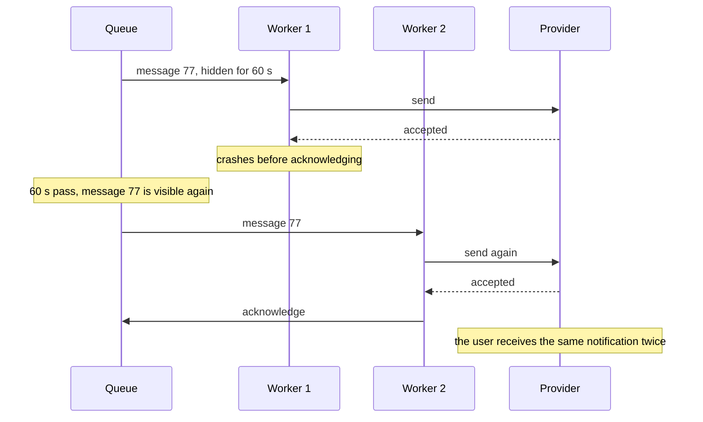
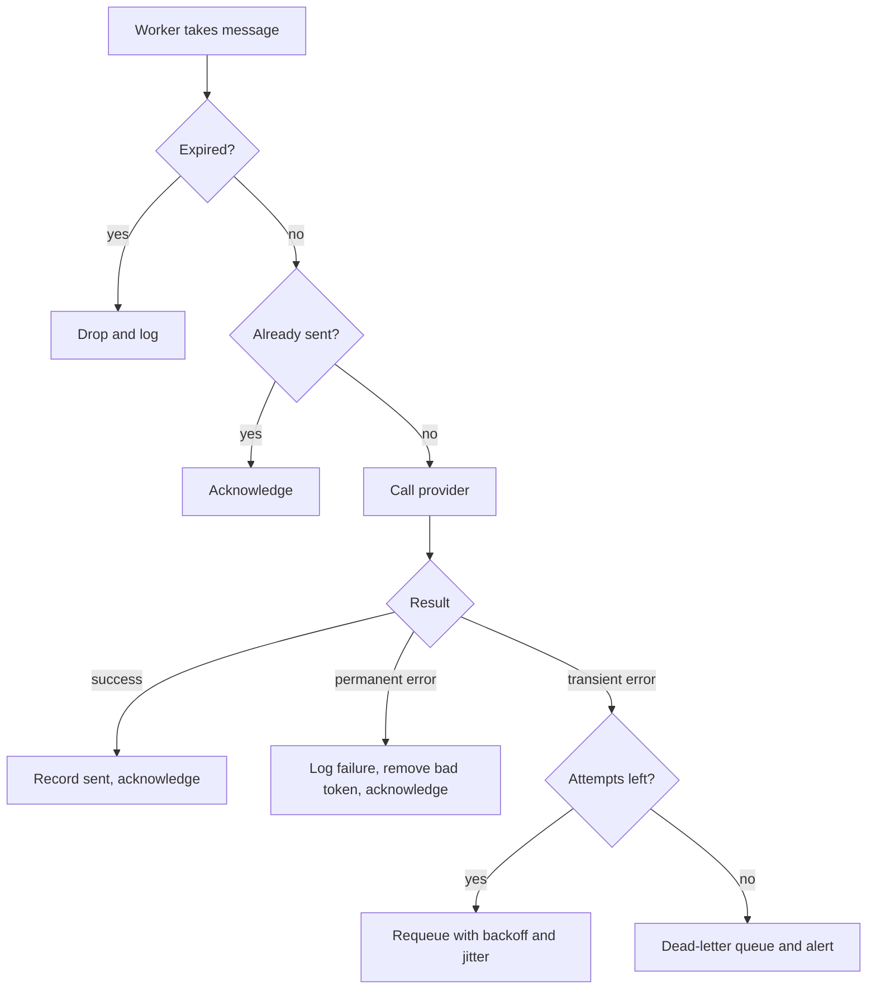
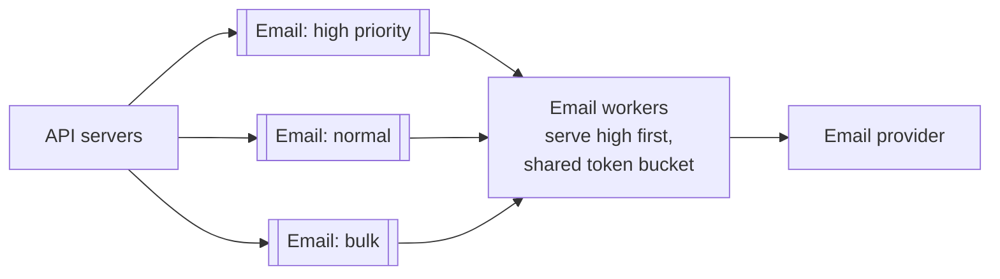
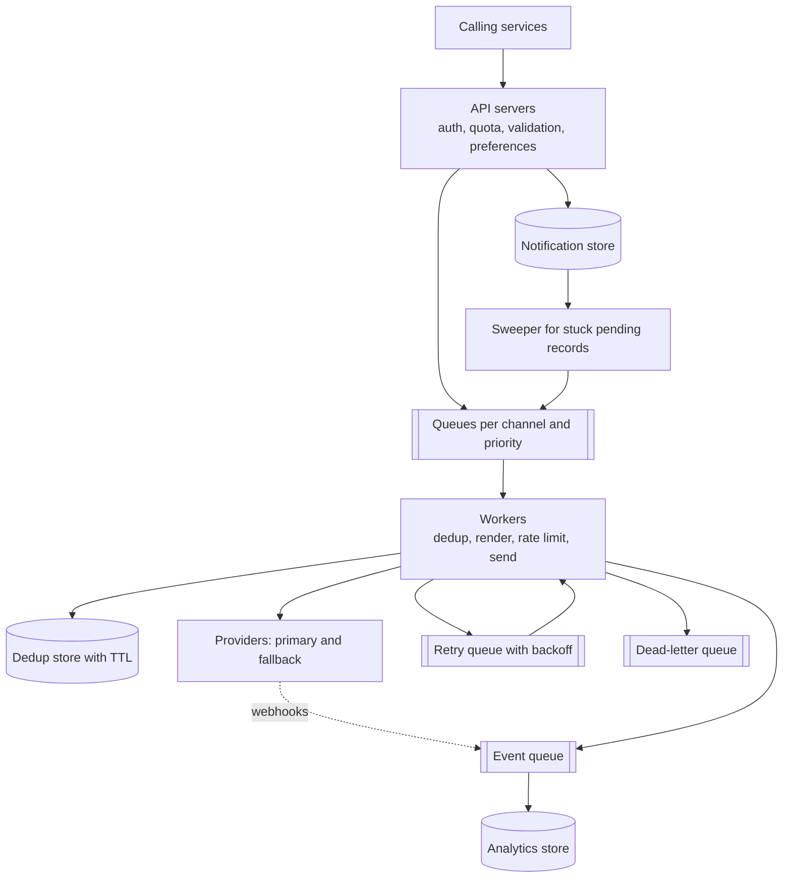

# Design a notification system II: reliability, deduplication, retries and limits

## Before this lesson

Read [Design a notification system I](#/lesson/system-design/notification-design). You should know the pipeline: API servers accept and enqueue, one queue per channel, workers render and call the provider, and a notification log records every attempt. Idempotency was introduced in [Clients, servers and requests](#/lesson/system-design/clients-servers-requests) and rate limiting in [its own module](#/lesson/system-design/rate-limiter-algorithms).

## In plain words

The pipeline from the previous lesson works on a good day. This lesson is about the bad days, and about two opposite ways to fail.

- **Losing a message.** A worker crashes with a login code in its hands. The user never receives it and cannot sign in.
- **Sending a message twice, or far too often.** A retry goes out although the first attempt had worked. Or a marketing team sends five campaigns in a day and users switch notifications off for good.

A courier company faces both. To avoid losing parcels, every parcel is scanned at every handover and re-sent if a scan is missing. To avoid delivering two of the same parcel, each has a tracking number and the driver checks whether that number was already delivered. And a sensible company limits how many leaflets it pushes through one letterbox.

The technical words for these are **at-least-once delivery** (never lose), **deduplication** (do not repeat), **retry with backoff** (try again, more and more patiently), **dead-letter queue** (set aside what keeps failing), and **rate limiting** (do not overwhelm a user or a provider).

## 1. Deep dive: never losing a notification

A notification can be lost at three points, and each needs its own protection.

**Before it is queued.** The API server must store the notification durably before answering 202. If it crashed after answering and before storing, the caller would believe the job was done. So the order is: write the record to the database, enqueue, then respond. If the enqueue fails after the database write, a background sweeper finds records that are still `pending` after a few minutes and enqueues them again.

**In the queue.** The queue itself must be durable and replicated, so that losing a queue machine does not lose its messages.

**In a worker.** A worker takes a message, and the queue hides it from other workers for a period called the **visibility timeout**. If the worker acknowledges within that time, the queue deletes the message. If the worker crashes, no acknowledgement arrives, the timeout passes, and the message becomes visible again for another worker.



The diagram shows the price. The mechanism that prevents loss creates duplicates. Delivery exactly once across a network to an outside provider is not achievable in general, because the worker cannot tell "the provider never got it" from "the provider got it and I crashed before recording that". The practical goal is: **at-least-once delivery, plus deduplication to make duplicates rare.**

## 2. Deep dive: deduplication

Give every notification a unique **event id** when it is first accepted (the caller's idempotency key, or an id the API server generates). Every message derived from it carries that id together with the channel and target device.

Before sending, a worker checks a fast store: "has this (event id, channel, device) already been sent?" If yes, it skips the send and acknowledges the message. If no, it sends and records it.

```python-run
import random
random.seed(11)

sent_keys = set()                 # stands in for a shared store such as Redis, with a TTL
provider_inbox = []

def worker_handle(message, dedup=True):
    key = (message["event_id"], message["channel"], message["device"])
    if dedup and key in sent_keys:
        return "skipped duplicate"
    provider_inbox.append(key)            # the call to the provider
    sent_keys.add(key)                    # remember that it went out
    return "sent"

# 1,000 notifications; the queue redelivers 5% of them because an acknowledgement was lost.
messages = [{"event_id": f"evt-{i}", "channel": "push", "device": "tok-1"} for i in range(1000)]
deliveries = messages + [m for m in messages if random.random() < 0.05]

for dedup in (False, True):
    sent_keys.clear(); provider_inbox.clear()
    for m in deliveries:
        worker_handle(m, dedup)
    duplicates = len(provider_inbox) - len(set(provider_inbox))
    print(f"dedup={dedup!s:5}: provider received {len(provider_inbox)} sends, {duplicates} duplicates")
```

Without the check, every redelivered message is a duplicate for the user. With it, there are none in this run.

It is not perfect, and you should say why. If a worker sends to the provider and crashes before recording the key, the retry finds no record and sends again. Recording the key *before* sending has the opposite flaw: a crash after recording and before sending loses the message. Since losing a login code is worse than a rare duplicate, record after sending. Some providers accept a deduplication identifier of their own (APNs has `apns-collapse-id`, and many email services accept an idempotency key), which closes most of the remaining gap by letting the provider discard the repeat.

Deduplication records need not live for ever. A TTL of a day or so covers every realistic retry.

## 3. Deep dive: retries, backoff and the dead-letter queue

Provider calls fail for two different kinds of reason.

| Kind | Examples | Right response |
|---|---|---|
| **Transient** | Timeout, connection reset, 429 too many requests, 5xx server error | Retry later |
| **Permanent** | Invalid device token, malformed phone number, rejected content | Do not retry; record the failure, and remove bad tokens |

Retrying a permanent failure wastes capacity and can get your sender account penalised. Classify first.

For transient failures, retrying immediately tends to hit the same problem and adds load to a provider that is already struggling. Use **exponential backoff**: wait longer after each failure, usually doubling. Add **jitter**, a random variation in the wait, so that thousands of messages that failed at the same moment do not all retry at the same moment. Without jitter, the retries arrive as synchronised waves, a pattern called the **thundering herd**.

```python-run
import random
random.seed(5)

def backoff_delay(attempt, base=2.0, cap=300.0, jitter=True):
    """Wait before retry number `attempt` (1, 2, 3, ...), in seconds."""
    delay = min(cap, base * 2 ** (attempt - 1))
    return random.uniform(0, delay) if jitter else delay       # 'full jitter'

print("attempt   without jitter   with jitter (three different messages)")
for attempt in range(1, 9):
    plain = backoff_delay(attempt, jitter=False)
    spread = [backoff_delay(attempt) for _ in range(3)]
    print(f"{attempt:>7}   {plain:>14.0f}   " + "  ".join(f"{d:6.1f}" for d in spread))

# 10,000 messages fail at t=0. When do their first retries land?
for jitter in (False, True):
    times = [backoff_delay(3, jitter=jitter) for _ in range(10_000)]
    busiest = max(sum(1 for t in times if int(t) == s) for s in range(9))
    print(f"jitter={jitter!s:5}: busiest second receives {busiest:,} retries")
```

Without jitter all ten thousand retries arrive in the same second. With jitter they are spread over the whole interval, and the busiest second receives roughly an eighth of them. The cap stops the delay growing without limit.

After a fixed number of attempts (five or so), stop. The message goes to a **dead-letter queue (DLQ)**: a separate queue for messages that could not be processed, kept so that engineers can inspect them, fix the cause and replay them. Without a DLQ, a message that always fails either blocks the queue or cycles for ever.

Retries and time sensitivity interact. A login code that arrives twenty minutes late is useless, and may be confusing. Each notification therefore carries an expiry; a worker that picks up an expired message drops it and records why.



## 4. Deep dive: rate limiting and priorities

Three different limits apply, for three different reasons.

**Per user (frequency capping).** People who receive too many notifications turn them off. Cap the number of promotional notifications per user per day and per channel, and enforce "quiet hours" in the user's time zone. Transactional notifications are exempt. This is a counter per user per window, as in the rate limiter module.

**Per provider.** Each provider allows only so many requests per second per sender account. Workers must send no faster than that, using a token bucket shared by all workers of a channel, and must slow down when the provider answers 429.

**Per caller.** One internal service with a bug must not flood the system. Give each calling service a quota.

**Priorities.** A password-reset code and a weekly newsletter should not wait in the same line. Use separate queues by priority within each channel, with workers serving the high-priority queue first, and reserve some worker capacity for high priority so that a large campaign cannot starve it.



## 5. Deep dive: templates, preferences, security and tracking

**Templates.** A template has placeholders, versions and one variant per language and channel. Rendering happens in the worker, as late as possible, so that a correction to a template applies to messages still queued. Validate at accept time that the data contains every placeholder the template needs.

**Preferences.** Stored per user, category and channel. Check at accept time and again in the worker. Promotional messages need recorded consent in many jurisdictions, and every promotional email and SMS needs a working way to unsubscribe.

**Security.** Only authenticated internal services may call the API, each with its own credentials (often called an app key and secret) and its own quota. Provider credentials are kept in a secrets manager. Push payloads should carry little sensitive data, because they appear on lock screens; send an identifier and let the app fetch the details.

**Tracking.** Product teams want to know how notifications perform. Record the events `accepted → sent → delivered → opened → clicked`, plus `unsubscribed`. Delivery and open events arrive later from providers through **webhooks** (HTTP calls that a provider makes to your server when something happens) and from the app itself. They flow through their own queue into an analytics store, never through the sending path.

## 6. The complete design



## 7. Bottlenecks and failure handling

| Failure | Effect | Mitigation |
|---|---|---|
| Provider outage | That channel's queue grows | Retry with backoff; a **circuit breaker** stops calls for a while; fail over to a second provider for the channel |
| Provider slow | Workers tied up | Short timeouts; bounded concurrency per provider |
| Provider returns 429 | Sends rejected | Lower the shared send rate; honour `Retry-After` |
| Worker crash | Message redelivered | Visibility timeout plus deduplication |
| Queue cluster failure | Nothing can be enqueued | Replicated queue; database record plus sweeper as a second path |
| Dedup store down | Cannot check for duplicates | Send anyway (prefer a possible duplicate to a lost message) for transactional; pause bulk |
| Poison message that always fails | Blocks or loops | Attempt limit, then dead-letter queue |
| Huge campaign | Starves urgent messages | Priority queues and reserved capacity |
| Stale device tokens | Wasted sends, provider penalties | Remove tokens on provider feedback |
| Cache cold or down | Database load on every send | Database sized for it; gradual warm-up |

**Monitoring.** The single most informative metric is **queue depth per channel and priority**, with the age of the oldest message. Growing depth means workers or providers cannot keep up. Add send success rate per provider, retry and DLQ counts, end-to-end latency from accept to provider acceptance (as percentiles), and deduplication hits.

## 8. Trade-offs and alternatives

| Decision | Chosen | Alternative | When the alternative fits |
|---|---|---|---|
| Delivery guarantee | At-least-once with dedup | At-most-once (no retries) | Low-value messages where a duplicate is worse than a miss |
| Record "sent" | After the provider call | Before the provider call | When duplicates are unacceptable and loss is tolerable |
| Fan-out for campaigns | Expand to per-user messages by a batch job feeding the bulk queue | Callers loop over users | Never; callers should not hold millions of requests |
| Providers | Two per channel with failover | One | Small products; cost-sensitive SMS routes |
| Retry | Separate delayed retry queue | Requeue at the tail immediately | Simple systems with few failures |
| Ordering | None guaranteed | Per-user ordered queues | Chat-like notifications where order matters |

On ordering: two notifications for the same user can arrive in either order, because they may be processed by different workers and retried independently. If order matters ("order shipped" before "order delivered"), include a timestamp or sequence in the payload and let the app decide what to display, or partition the queue by user so one user's messages are processed in sequence.

## 9. What a strong answer sounds like

> **Interviewer:** How do you make sure a notification is not lost?
>
> **Candidate:** Three places can lose it. Before queueing: I write the record to the database before returning 202, and a sweeper re-enqueues anything stuck in pending. In the queue: it is replicated and durable. In the worker: messages are acknowledged only after the provider accepts them; a crash means the visibility timeout expires and another worker picks the message up. That gives at-least-once delivery.
>
> **Interviewer:** Then users can get duplicates.
>
> **Candidate:** Yes, so each message carries an event id, and the worker checks a dedup store keyed by event, channel and device before sending and writes to it after. The remaining gap is a crash between sending and recording. I accept a rare duplicate there, because recording first would risk losing a login code, and where the provider supports it I pass the id through so it can discard repeats.
>
> **Interviewer:** The SMS provider starts failing.
>
> **Candidate:** I separate permanent from transient errors. Transient ones are retried with exponential backoff and jitter, up to about five attempts, then moved to a dead-letter queue with an alert. A circuit breaker stops us hammering the provider, and SMS fails over to a second provider. Because each channel has its own queues, push and email are unaffected. Messages have an expiry, so a one-time code is dropped instead of arriving twenty minutes late.
>
> **Interviewer:** Marketing wants to send to ten million users at once.
>
> **Candidate:** That goes to the bulk-priority queues, drained at the provider's rate limit, with per-user frequency caps and quiet hours applied. High-priority queues have reserved workers, so login codes are not delayed by the campaign.

## Common mistakes

- **Claiming exactly-once delivery.** Describe at-least-once with deduplication and name the remaining gap.
- **Retrying every error**, including invalid tokens.
- **Immediate retries with no backoff or jitter.**
- **Unlimited retries and no dead-letter queue.**
- **No expiry on time-sensitive messages.**
- **One priority level**, so campaigns delay login codes.
- **No per-user cap.** The system works and users uninstall the app.
- **Acknowledging the queue message before the provider call.**
- **Monitoring CPU and ignoring queue depth.**

## Summary

- Loss is prevented by storing before answering, a durable queue, and acknowledging only after the provider accepts; a sweeper catches records stuck before queueing.
- At-least-once delivery creates duplicates; an event id checked against a dedup store with a TTL removes most of them, and the remaining gap is a deliberate choice.
- Classify errors: retry transient ones with exponential backoff, jitter, a cap and an attempt limit; send the rest to a dead-letter queue; drop expired messages.
- Limit per user (frequency caps, quiet hours), per provider (shared token bucket) and per caller (quotas); separate priorities with reserved capacity.
- Render templates late, check preferences twice, authenticate callers, and track delivery events on a separate path.
- Watch queue depth and oldest-message age above everything else.

## Glossary

- **At-least-once delivery**: every accepted message is delivered one or more times.
- **At-most-once delivery**: a message is delivered once or not at all.
- **Visibility timeout**: the period a taken message is hidden from other workers.
- **Acknowledgement**: a worker's confirmation that a message has been handled.
- **Deduplication**: detecting and skipping repeats of the same event.
- **Event id**: the unique identifier of one notification event.
- **Transient / permanent failure**: one that may succeed on retry, or never will.
- **Exponential backoff**: increasing the wait between retries, usually doubling.
- **Jitter**: randomness added to a wait.
- **Thundering herd**: many clients retrying at the same instant.
- **Dead-letter queue (DLQ)**: a queue holding messages that repeatedly failed.
- **Poison message**: a message that fails every time it is processed.
- **Frequency capping**: limiting how many notifications one user receives.
- **Quiet hours**: a period in which non-urgent notifications are held back.
- **Circuit breaker**: a mechanism that stops calls to a failing dependency for a time.
- **Webhook**: an HTTP call a provider makes to your server to report an event.
- **Sweeper**: a background job that finds and repairs stuck records.

## Check yourself

```quiz
[
  {"q": "A worker sends a push to the provider and crashes before acknowledging the queue message. What happens next?",
   "options": ["The message is lost", "After the visibility timeout the queue gives the message to another worker, which may send it again", "The provider retries by itself", "The queue deletes the message"],
   "answer": 1,
   "explain": "No acknowledgement means the queue assumes failure and redelivers. That prevents loss and can cause a duplicate."},
  {"q": "Why does the worker record 'sent' in the dedup store after calling the provider and not before?",
   "options": ["It is faster", "A crash between recording and sending would lose the message, which is worse than a rare duplicate", "The provider requires it", "The store is read-only before sending"],
   "answer": 1,
   "explain": "Either order leaves a gap. Recording afterwards risks a duplicate; recording first risks a loss. For transactional messages a loss is the worse outcome."},
  {"q": "The push provider answers that a device token is invalid. What is the correct handling?",
   "options": ["Retry with exponential backoff", "Treat it as a permanent failure: log it, remove the token and do not retry", "Send it to the dead-letter queue after five attempts", "Switch to a different priority"],
   "answer": 1,
   "explain": "Retrying cannot succeed and can harm the sender's standing. Permanent errors are recorded and the bad token is deleted."},
  {"q": "Ten thousand messages fail at the same moment and all retry after exactly 8 seconds. What is this problem called and what fixes it?",
   "options": ["Split brain; a second provider", "Thundering herd; jitter on the retry delay", "Cache stampede; a longer TTL", "Poison message; a bigger queue"],
   "answer": 1,
   "explain": "Synchronised retries hit the provider as a wave. Random jitter spreads them across the interval."},
  {"q": "What is a dead-letter queue for?",
   "options": ["Storing notifications for users who opted out", "Holding messages that failed repeatedly so they can be inspected and replayed without blocking others", "Sending SMS when push fails", "Archiving delivered messages"],
   "answer": 1,
   "explain": "After the attempt limit a message is set aside. Engineers can find the cause and replay it, and the main queue keeps moving."},
  {"q": "A marketing campaign of ten million messages is delaying password-reset emails. Which change addresses this directly?",
   "options": ["A longer visibility timeout", "Priority queues with worker capacity reserved for high priority", "A larger dedup TTL", "Removing templates"],
   "answer": 1,
   "explain": "Separate queues by priority, and reserved workers, guarantee that urgent messages are not stuck behind bulk traffic."},
  {"q": "Which metric most directly shows that a channel cannot keep up?",
   "options": ["CPU use of the API servers", "Queue depth and the age of the oldest message for that channel", "Number of templates", "Size of the users table"],
   "answer": 1,
   "explain": "A growing backlog means producers outpace workers or the provider. It is the first signal to alert on."},
  {"q": "A one-time login code has been retried for 20 minutes. What should happen?",
   "options": ["Keep retrying until it succeeds", "Drop it as expired and record why, since a late code is useless", "Send it on every channel", "Move it to the bulk queue"],
   "answer": 1,
   "explain": "Time-sensitive notifications carry an expiry. Delivering them late confuses users and may be a security problem."}
]
```

> **Source:** Xu, *System Design Interview: An Insider's Guide*, ch. 10 (reliability, notification template, settings, rate limiting, retry mechanism, security, monitoring queued notifications, events tracking) as a topic guide; Stripe engineering blog, "Designing robust and predictable APIs with idempotency" (backoff and jitter), https://stripe.com/blog/idempotency ; AWS Architecture Blog, "Exponential Backoff And Jitter", https://aws.amazon.com/blogs/architecture/exponential-backoff-and-jitter/
