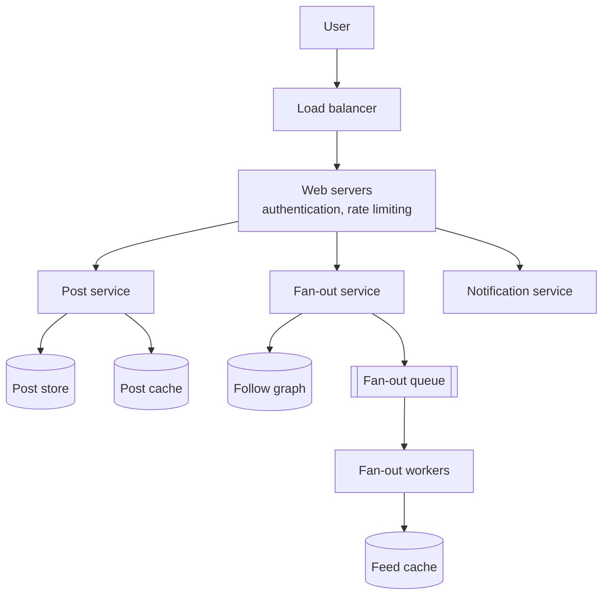
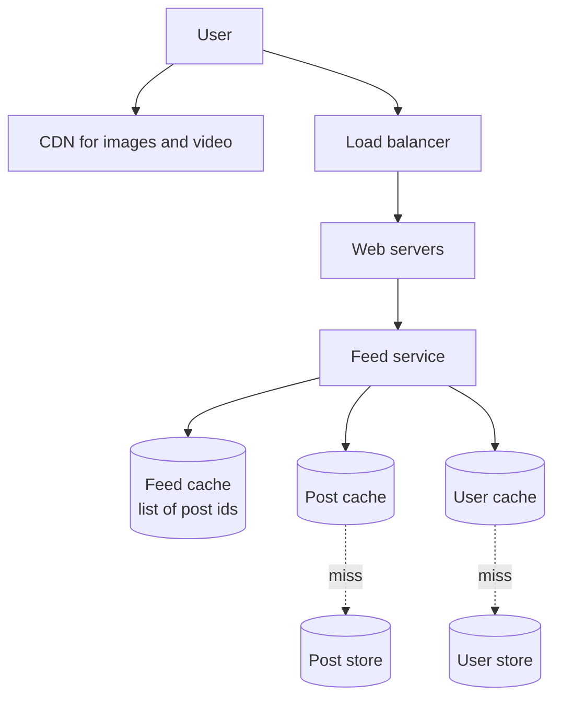
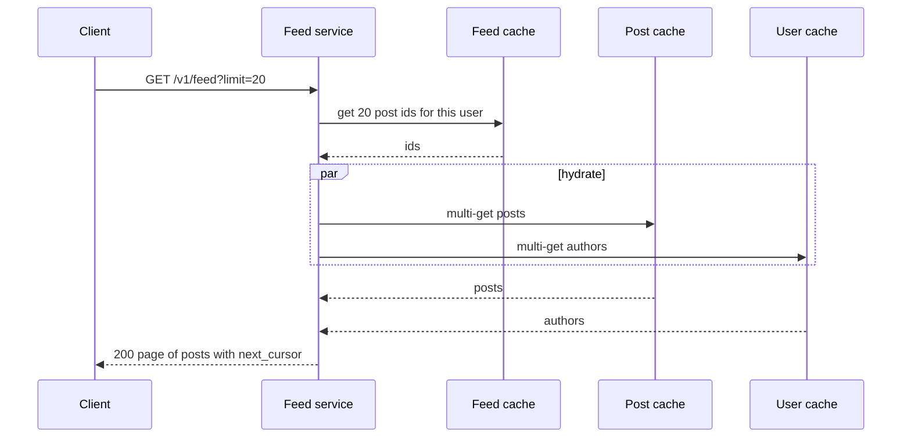

# Design a news feed I: requirements, API, data model and the two flows

## Before this lesson

You should know caches, replicas, queues and CDNs ([Scaling from zero](#/lesson/system-design/scale-single-to-replicated)), sharding and hot keys ([Scaling from zero II](#/lesson/system-design/scale-stateless-to-sharded)), estimation ([Estimation II](#/lesson/system-design/estimation-worked)) and the notification pipeline from [the previous module](#/lesson/system-design/notification-design), which this design reuses.

## In plain words

A **news feed** is the list you see when you open a social app: recent posts from the people and pages you follow, put together into one stream. (It is also called a *timeline* or *home feed*.)

Imagine a village noticeboard, with a twist: every villager has a personal board that shows only notes from the neighbours they chose to follow. There are two ways to keep those boards up to date.

- **Deliver.** Whenever someone writes a note, a runner copies it onto the board of every follower. Reading a board is instant because the work was done in advance. But when someone with a million followers writes a note, the runners are busy for a long time.
- **Collect.** Nobody copies anything. When you walk up to your board, a clerk runs round to the house of everyone you follow, fetches their latest notes and pins them up. Writing a note is free; reading is slow.

Those two approaches are called **fan-out on write** and **fan-out on read**, and choosing between them, or mixing them, is the heart of this problem.

It is one of the most frequently asked design questions because it has an unmistakable hard part (one post must reach a huge number of feeds) and forces a trade-off between read speed and write cost. On the job, the same shape appears in activity streams, notification inboxes and "recent updates" pages.

This module follows the track's design structure. This lesson covers requirements, estimates, the API, the data model and the high-level design of the two flows. The next covers the fan-out deep dive, caching, ranking, failures, trade-offs, a sample dialogue and common mistakes.

## 1. Requirements and the scope questions to ask

| Question | Why it matters | Assumed answer |
|---|---|---|
| Mobile, web or both? | Clients and payload sizes | Both |
| Core features? | Scope | Publish a post; view a feed of posts from people you follow |
| What order? | Sorting by time is a merge; ranking needs scoring | Reverse chronological (newest first) to begin with |
| How many friends or followees can a user have? | Bounds the fan-out | Up to 5,000; some accounts have millions of followers |
| How much traffic? | Sizing | 10 million daily active users |
| Can posts contain media? | Storage and CDN | Yes: images and video |
| How fresh must the feed be? | Consistency choice | A few seconds of delay is acceptable |

**Functional requirements**

1. **Feed publishing:** a user creates a post, which becomes visible to their followers.
2. **Feed retrieval:** a user fetches their feed, newest first, a page at a time.

**Non-functional requirements**

1. **Fast reads:** the feed loads with p99 under about 500 ms.
2. **High availability:** it is acceptable to show a slightly stale feed, never an error page.
3. **Eventual consistency:** a new post may take a few seconds to appear for all followers.
4. **Durability:** posts are never lost.

Two words that are easy to mix up. If Ann follows Bob, then Ann is Bob's **follower** and Bob is Ann's **followee**. When Bob posts, the work fans out over Bob's *followers*. When Ann reads, her feed is built from her *followees*.

## 2. Estimates

```python-run
dau = 10_000_000
posts_per_user_day = 0.5            # one post every two days on average
feed_views_per_user_day = 10
avg_followers = 200
post_bytes = 1_000                  # text plus metadata; media is stored separately
feed_entries_kept = 500             # post ids kept in each user's precomputed feed
id_bytes = 8

writes_qps = dau * posts_per_user_day / 86_400
reads_qps = dau * feed_views_per_user_day / 86_400
fanout_writes_qps = writes_qps * avg_followers

print(f"posts per second            : {writes_qps:,.0f}")
print(f"feed reads per second       : {reads_qps:,.0f}  (peak about {reads_qps * 3:,.0f})")
print(f"read to write ratio         : {reads_qps / writes_qps:.0f} to 1")
print(f"feed insertions per second  : {fanout_writes_qps:,.0f}  if every post is pushed to every follower")
print(f"post storage per year       : {dau * posts_per_user_day * post_bytes * 365 / 1e12:.1f} TB")
print(f"feed cache                  : {dau * feed_entries_kept * id_bytes / 1e9:.0f} GB "
      f"for {feed_entries_kept} post ids for each daily user")

celebrity_followers = 50_000_000
workers_rate = 100_000              # feed insertions per second the fan-out tier can sustain
print(f"one celebrity post          : {celebrity_followers:,} insertions, "
      f"{celebrity_followers / workers_rate / 60:.0f} minutes at {workers_rate:,} per second")
```

What the numbers say:

- Reads outnumber writes by twenty to one, so it is worth doing extra work at write time to make reads cheap.
- Pushing every post to every follower multiplies 58 posts per second into about 11,600 feed insertions per second. That is manageable.
- Storing 500 post ids per daily user takes about 40 GB. Storing ids, not whole posts, keeps the feed cache small.
- One post by an account with 50 million followers would take minutes to push and would swamp the system. The average case is easy; the tail is the design problem.

## 3. API

```
POST /v1/posts
  headers: Authorization: Bearer <token>
  body:    {"text": "...", "media_ids": ["m_91"]}
  returns: 201 {"post_id": "p_5501", "created_at": "..."}

GET /v1/feed?limit=20&cursor=<opaque>
  headers: Authorization: Bearer <token>
  returns: 200 {"posts": [ {post_id, author: {id, name, avatar_url}, text, media_urls, created_at, like_count}, ... ],
                "next_cursor": "<opaque>"}

POST /v1/follows       body: {"followee_id": 77}     -> 204
DELETE /v1/follows/77                                 -> 204
```

Two details to say aloud.

**Authentication.** The server derives the user from the token. The client never sends "give me the feed of user 42", which would let anyone read anyone's feed.

**Cursor pagination.** The feed is fetched a page at a time. The obvious method, "skip the first 40, give me 20" (an **offset**), goes wrong when new posts arrive between two requests: everything shifts down and the user sees repeats. A **cursor** is a marker for the last item the client saw, usually that item's id or timestamp. The next request says "give me 20 items older than this", which is stable however many new posts have arrived.

```python-run
feed = [f"post-{i}" for i in range(100, 90, -1)]          # newest first: post-100 ... post-91

def page_by_offset(items, offset, limit):
    return items[offset:offset + limit]

def page_by_cursor(items, before, limit):
    older = [p for p in items if before is None or int(p.split("-")[1]) < before]
    return older[:limit]

page1_offset = page_by_offset(feed, 0, 3)
page1_cursor = page_by_cursor(feed, None, 3)
print("page 1:", page1_offset)

# Two new posts arrive before the user scrolls.
feed = ["post-102", "post-101"] + feed

print("page 2 by offset :", page_by_offset(feed, 3, 3), " <- post-99 and post-98 are shown again")
last_seen = int(page1_cursor[-1].split("-")[1])
print("page 2 by cursor :", page_by_cursor(feed, last_seen, 3), " <- continues correctly")
```

With an offset, the second page repeats two posts the user has already seen. With a cursor, it continues from where the first page ended.

## 4. Data model

```
users(user_id PK, name, avatar_url, created_at)

posts(post_id PK, author_id, text, media_urls, created_at)
    index on (author_id, created_at DESC)         -- "latest posts by this author"

follows(follower_id, followee_id, created_at)
    PK (follower_id, followee_id)                 -- "whom do I follow?"
    index on (followee_id, follower_id)           -- "who follows me?" used by fan-out

feed cache:   key  feed:{user_id}
              value  a list of post_ids, newest first, capped at about 500
```

Choices:

- **Posts** are written once and read by id, in huge numbers. They suit a store partitioned by `post_id` (or by author), with a cache in front. If post ids are time-ordered, as with the [Snowflake design](#/lesson/system-design/unique-id-snowflake), sorting by id is sorting by time and no extra index on a timestamp is needed.
- **The follow graph** is read in both directions. A relational table with two indexes works at moderate scale; very large systems use a graph store or keep both directions as separate key-value lists.
- **The feed cache** holds only post ids. The post content, author profile and counters are fetched separately at read time, a step called **hydration**. This avoids copying a post's text into millions of feeds and means an edited post or a changed avatar shows up everywhere at once.
- **Media** goes to a blob store and is served through a CDN; the database holds only the URLs.

## 5. High-level design

The system splits naturally into two flows.

### Feed publishing



1. The web server authenticates the user and applies a rate limit, so that one account cannot flood the system.
2. The **post service** stores the post in the database and the post cache. From this moment the post is durable.
3. The **fan-out service** looks up the author's followers and puts work on a queue.
4. **Fan-out workers** add the post id to the feed of each follower.
5. The **notification service** tells interested followers, using the system from the previous module.

The user receives a response after step 2. Steps 3 to 5 happen in the background, which is why the feed is eventually consistent.

### Feed retrieval



1. The web server authenticates the user and forwards to the **feed service**.
2. The feed service reads the list of post ids from the feed cache.
3. It hydrates the ids: posts from the post cache, authors from the user cache, falling back to the databases on a miss.
4. It returns the assembled page as JSON. The client loads media from the CDN.



The two lookups in step 3 are done in parallel and in batches (one request for twenty posts, not twenty requests). Sequential, one-at-a-time lookups are the commonest reason a feed is slow; recall from the estimation lesson that each round trip costs about half a millisecond, and forty of them in sequence cost twenty.

## 6. Why two flows, and what is still open

Separating publishing from retrieval lets each be scaled and tuned for its own load: retrieval is twenty times busier and must be fast; publishing can take seconds in the background.

This high-level design quietly assumed fan-out on write: a precomputed list per user in the feed cache. That choice gives very fast reads. It leaves three questions for the next lesson:

1. What happens when an account with 50 million followers posts?
2. What about users who have not opened the app for months? Maintaining their feeds is wasted work.
3. What exactly is cached, in how many layers, and what happens when a cache is lost?

> [!INTERVIEW]
> Draw the two flows as two separate diagrams and name them. It gives the conversation a structure, and it sets up the fan-out discussion, which is where the interviewer will want to spend the time.

> [!TIP]
> Store ids in feeds and hydrate at read time. If asked why, give the three reasons: the feed cache stays small, edits and deletions take effect everywhere without touching millions of feeds, and popular posts are stored once in the post cache however many feeds contain them.

> [!WARNING]
> Do not forget deletions and privacy. A deleted post, or a post by someone who has blocked the reader, may still be listed in a precomputed feed. The read path must filter at hydration time: skip ids whose post is gone or whose author the reader may not see.

## Common mistakes

- **Building the feed with a database join on every read** ("select posts where author in my followees order by time") and calling it done. It works for a thousand users and collapses at scale.
- **Offset pagination** on a list that changes at the top.
- **Storing full posts in every follower's feed.**
- **Trusting a user id sent by the client** instead of the authenticated identity.
- **Hydrating one item at a time, in sequence.**
- **Confusing followers and followees**, which leads to fanning out in the wrong direction.
- **Returning to the user only after fan-out completes.**

## Summary

- A news feed has two flows: publishing a post and retrieving a feed; reads are about twenty times more frequent than writes.
- Requirements: fast reads, high availability, eventual consistency of a few seconds, durable posts.
- The API uses the authenticated identity and cursor pagination.
- Data: posts, a follow graph readable in both directions, and a per-user feed cache of post ids that is hydrated at read time.
- Publishing: store the post, then fan out to followers' feeds asynchronously through a queue.
- Retrieval: read ids from the feed cache, hydrate posts and authors in parallel batches, serve media from a CDN.
- The average fan-out is easy; accounts with millions of followers are the open problem.

## Glossary

- **News feed (timeline)**: the merged stream of posts from the accounts a user follows.
- **Follower / followee**: the one who follows, and the one being followed.
- **Fan-out**: delivering one post to many followers' feeds.
- **Fan-out on write (push)**: doing that work when the post is created.
- **Fan-out on read (pull)**: building the feed when it is requested.
- **Feed cache**: a per-user list of post ids, newest first.
- **Hydration**: turning a list of ids into full objects by fetching their details.
- **Cursor pagination**: fetching the next page relative to the last item seen.
- **Offset pagination**: fetching the next page by skipping a fixed number of items.
- **Multi-get**: one request that fetches many keys.
- **Follow graph**: the data set of who follows whom.
- **Reverse chronological**: newest first.
- **Eventual consistency**: all followers see the post after a short delay.

## Check yourself

```quiz
[
  {"q": "Ann follows Bob. Bob publishes a post. Over which set does the work fan out?",
   "options": ["Bob's followees", "Bob's followers", "Ann's followers", "All users"],
   "answer": 1,
   "explain": "A post is delivered to the people who follow its author. Ann is one of Bob's followers."},
  {"q": "Why does the feed cache store post ids instead of complete posts?",
   "options": ["Ids are easier to sort", "The cache stays small, edits and deletions apply everywhere at once, and each post is stored once", "Databases cannot store text", "It removes the need for a post cache"],
   "answer": 1,
   "explain": "Copying content into millions of feeds wastes memory and makes edits and deletions expensive. Ids are hydrated at read time."},
  {"q": "A user is on page 1 of the feed and two new posts arrive. With offset pagination, what does page 2 show?",
   "options": ["Exactly the next items", "Items the user has already seen, because everything shifted down", "Nothing", "Only the new posts"],
   "answer": 1,
   "explain": "Offsets count from the top, and the top moved. A cursor based on the last seen item avoids repeats."},
  {"q": "With 58 posts per second and an average of 200 followers, about how many feed insertions per second does fan-out on write produce?",
   "options": ["58", "258", "About 11,600", "About 1.2 million"],
   "answer": 2,
   "explain": "Each post is written to every follower's feed: 58 x 200 is about 11,600 insertions per second."},
  {"q": "When does the user who published a post receive the response?",
   "options": ["After every follower's feed has been updated", "After the post is durably stored; fan-out continues in the background", "After the notification is delivered", "After the CDN has the media"],
   "answer": 1,
   "explain": "Fan-out is asynchronous through a queue. Waiting for it would make posting slow, especially for accounts with many followers."},
  {"q": "Why should the feed service fetch posts and authors with batched, parallel lookups?",
   "options": ["Caches reject single-key requests", "Sequential one-by-one lookups add a network round trip each and dominate the latency", "It reduces storage", "It makes the feed strongly consistent"],
   "answer": 1,
   "explain": "Twenty posts and twenty authors fetched one at a time is forty round trips. Two batched calls in parallel cost about one."},
  {"q": "A post was deleted but its id is still in some precomputed feeds. How is this handled cheaply?",
   "options": ["Rebuild every feed immediately", "Filter at hydration time: skip ids whose post no longer exists", "Ignore it; show the deleted post", "Disable deletion"],
   "answer": 1,
   "explain": "Because feeds hold ids, a missing post is detected when the id is hydrated and can be skipped without rewriting feeds."}
]
```

> **Source:** Xu, *System Design Interview: An Insider's Guide*, ch. 11 (newsfeed APIs, feed publishing, newsfeed building) as a topic guide; System Design Primer, "Design the Twitter timeline and search" exercise as a topic reference, https://github.com/donnemartin/system-design-primer
