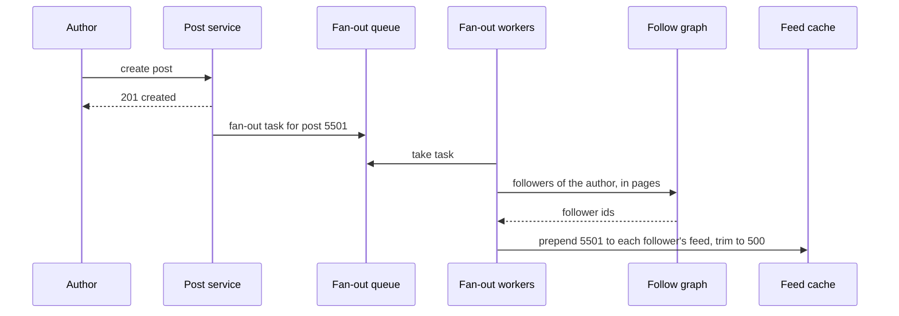
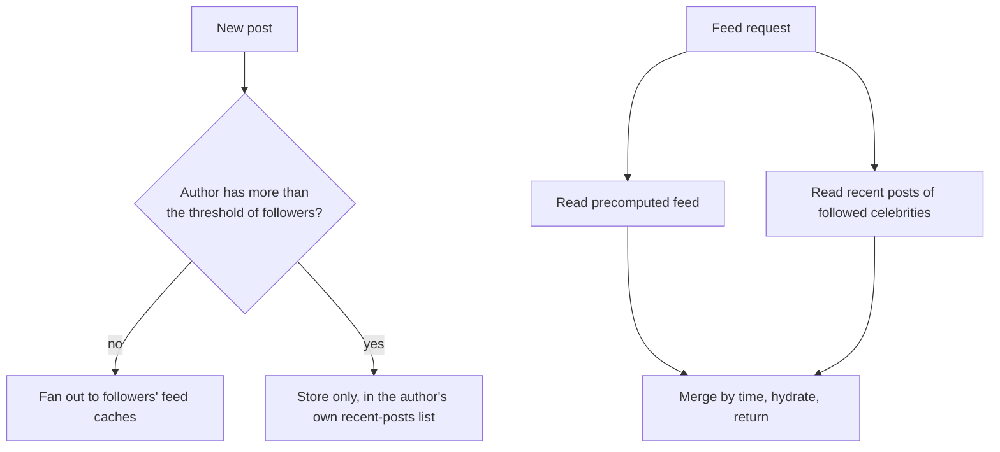
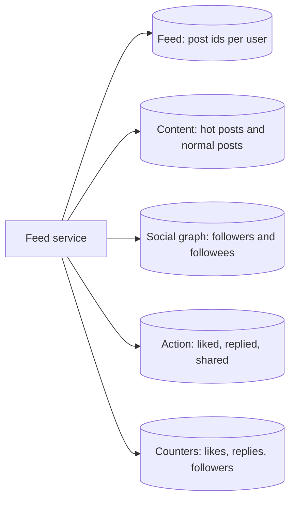

# Design a news feed II: fan-out strategies, caching and failure handling

## Before this lesson

Read [Design a news feed I](#/lesson/system-design/news-feed-design). You should know the two flows (publishing and retrieval), the feed cache of post ids, hydration, and the difference between a follower and a followee. Heaps appear in the pull model; the [DSA track](#/track/neet-heap-graphs) covers them.

## In plain words

One question decides the shape of a news feed system: **when is a user's feed put together?**

Go back to the village with personal noticeboards. *Deliver* (fan-out on write) means a runner copies each new note onto every follower's board as soon as it is written. *Collect* (fan-out on read) means nothing is copied until a villager looks at their board, and then a clerk gathers the notes on the spot.

Each breaks in a different place. Delivery breaks for the village celebrity: one note, a million boards. Collection breaks for the villager who follows two thousand people: one glance, two thousand houses to visit. The answer most large systems reach is a **hybrid**: deliver for ordinary writers, and collect only the notes of the few celebrities at reading time.

This lesson compares the three with numbers, then covers what is cached, how ranking fits in, and what happens when parts fail.

## 1. Deep dive: fan-out on write (push)

When a post is created, its id is inserted into the feed list of every follower.



**For:**

- Reading is a single cache lookup. The feed is ready before the user asks.
- Read latency is low and predictable, which is what a twenty-to-one read-heavy system wants.

**Against:**

- **The hot key problem.** An account with tens of millions of followers generates tens of millions of writes for one post. The queue backs up, and followers of everyone else see delays.
- **Wasted work.** Feeds are maintained for users who rarely or never open the app.
- Feed lists must be repaired when someone follows or unfollows.

## 2. Deep dive: fan-out on read (pull)

Nothing is precomputed. When a user requests their feed, the service fetches the most recent posts of each account they follow and merges them by time.

Merging $k$ lists that are each already sorted is a classic problem solved with a **heap**: keep the newest unread post of each list in a heap, repeatedly take the newest overall and replace it with the next post from the same list. This is called a **k-way merge**.

**For:**

- Publishing costs one write, whoever the author is. There is no hot key on the write side.
- No work is done for inactive users.
- The feed is always up to date at the moment it is read.

**Against:**

- Reading is slow and expensive: one lookup per followee, then a merge. A user following 2,000 accounts needs 2,000 lookups, or a scatter-gather query across many shards.
- That cost is paid on every read, on the path that needs to be fastest and is twenty times busier.

## 3. Comparing the costs with numbers

The simulation builds a small social graph in which most accounts have few followers and a handful have very many, then counts the storage operations each strategy performs for one day of activity.

```python-run
import random
random.seed(8)

N_USERS = 20_000
CELEBRITIES = 10                     # accounts followed by half of all users
CELEB_THRESHOLD = 2_000              # hybrid: accounts with more followers than this are pulled

followers = [0] * N_USERS
followees = []                        # for each user, the list of accounts they follow
for u in range(N_USERS):
    mine = set(random.sample(range(CELEBRITIES, N_USERS), 50))          # 50 ordinary accounts
    mine |= {c for c in range(CELEBRITIES) if random.random() < 0.5}    # about half of the celebrities
    mine.discard(u)
    followees.append(mine)
    for f in mine:
        followers[f] += 1

posts_today = [1] * N_USERS           # everyone posts once today
reads_today = [10] * N_USERS          # everyone opens the feed ten times

push_writes = sum(posts_today[u] * followers[u] for u in range(N_USERS))
push_reads = sum(reads_today)                                    # one cache lookup per read

pull_writes = sum(posts_today)                                   # one write per post
pull_reads = sum(reads_today[u] * len(followees[u]) for u in range(N_USERS))

is_celeb = [followers[u] > CELEB_THRESHOLD for u in range(N_USERS)]
hybrid_writes = sum(posts_today[u] * (1 if is_celeb[u] else followers[u]) for u in range(N_USERS))
hybrid_reads = sum(reads_today[u] * (1 + sum(1 for f in followees[u] if is_celeb[f])) for u in range(N_USERS))

print(f"{'strategy':8s} {'write ops':>12s} {'read ops':>12s} {'total':>12s}  worst single post")
worst = max(followers)
for name, w, r, big in [("push", push_writes, push_reads, worst),
                        ("pull", pull_writes, pull_reads, 1),
                        ("hybrid", hybrid_writes, hybrid_reads, max(f for f, c in zip(followers, is_celeb) if not c))]:
    print(f"{name:8s} {w:>12,} {r:>12,} {w + r:>12,}  {big:>8,} feed writes")
print(f"\naccounts treated as celebrities in the hybrid: {sum(is_celeb)}; largest follower count: {worst:,}")
```

Reading the table:

- **Push** has the cheapest reads (one operation each) and a write cost dominated by the celebrities: a single post causes about ten thousand feed writes in this small model, and tens of millions in a real one.
- **Pull** has the cheapest writes and by far the most expensive reads: every one of the 200,000 feed views touches about 55 lists.
- **Hybrid** keeps reads close to push (one cache lookup plus a few celebrity lists) and removes the giant write bursts: the worst single post now causes under a hundred feed writes.

## 4. Deep dive: the hybrid

**Rule:** push for the great majority of authors; pull for the few with enormous follower counts.

- When an ordinary user posts, fan out on write as before.
- When a celebrity posts, store the post and stop. No fan-out.
- When a user reads the feed, fetch their precomputed feed, fetch the recent posts of the (few) celebrities they follow, and merge the two by time.



The recent posts of a celebrity are requested by millions of readers and are identical for all of them, so they cache extremely well: one small, very hot cache entry per celebrity.

Refinements worth mentioning:

- **Skip inactive users.** Fan out only to followers who have been active recently (say, in the last 30 days). A user who returns after a long absence has their feed rebuilt on demand with the pull method, once.
- **Cap the feed length.** Keep the newest few hundred ids per user. Almost nobody scrolls further; those who do fall back to a slower pull-based path.
- **Chunk the fan-out.** A task "deliver post 5501 to 80,000 followers" is split into many tasks of a thousand followers each, so workers share it, progress is saved, and a failure retries one chunk.
- **Prioritise.** Deliver first to followers who are online now.

The threshold between "ordinary" and "celebrity" is a tuning parameter, usually in the tens or hundreds of thousands of followers. An account that crosses it is switched to pull for new posts.

### The merge at read time

```python-run
import heapq

def merge_feeds(lists, limit):
    """K-way merge. Each list holds (timestamp, post_id) pairs, newest first."""
    heap = []
    for index, items in enumerate(lists):
        if items:
            ts, post = items[0]
            heapq.heappush(heap, (-ts, post, index, 0))      # negate: heapq gives the smallest first
    result = []
    while heap and len(result) < limit:
        neg_ts, post, index, position = heapq.heappop(heap)
        result.append((-neg_ts, post))
        if position + 1 < len(lists[index]):                # advance in the list we took from
            ts, nxt = lists[index][position + 1]
            heapq.heappush(heap, (-ts, nxt, index, position + 1))
    return result

precomputed  = [(190, "ann: lunch"), (150, "bob: hello"), (90, "ann: morning")]
celebrity_x  = [(200, "X: tour dates"), (120, "X: new album")]
celebrity_y  = [(170, "Y: match report")]

for ts, post in merge_feeds([precomputed, celebrity_x, celebrity_y], limit=5):
    print(ts, post)
```

The heap never holds more than one entry per list, so merging $k$ lists to produce $n$ items costs about $n \log k$ steps. With a handful of celebrity lists this is microseconds.

## 5. Deep dive: what is cached

A feed system is mostly caches. A useful way to describe them is in five groups.

| Layer | Contents | Why it is separate |
|---|---|---|
| **News feed** | Per user: list of post ids | The precomputed result; small because it holds ids only |
| **Content** | Post bodies; a separate tier for very popular ("hot") posts | Hot posts are read by millions and deserve the fastest tier |
| **Social graph** | Follower and followee lists | Read by fan-out workers and by the pull path |
| **Action** | Whether this user liked, replied to or shared a post | Per user per post; needed to draw the buttons correctly |
| **Counters** | Likes, replies, shares, follower counts | Updated very often; approximate values are acceptable |



Counters deserve a remark. Updating a like count in the database on every like would turn a popular post into a write hot spot. Counts are kept in an in-memory store with atomic increments and written to durable storage periodically; a count that is briefly off by a few is acceptable.

Because the feed cache is derived data, it can always be rebuilt from the post store and the follow graph. That is what makes it safe to keep in memory: losing it costs time, not data.

## 6. Deep dive: ranking

The requirement was reverse chronological order. Most real feeds are **ranked**: each candidate post gets a score predicting how much this user will care, from signals such as how often the user interacts with the author, how recent the post is, and how others have reacted.

Ranking does not change the architecture much. The fan-out and pull paths become **candidate generation**: gather a few hundred recent post ids. A **ranking service** then scores and sorts them before hydration. Two consequences are worth stating: reads become more expensive (a model must score hundreds of candidates), so ranked results are cached for a short time; and cursors can no longer be plain timestamps, so the ranked list for a session is stored and paged through.

## 7. Bottlenecks and failure handling

| Failure or bottleneck | Effect | Mitigation |
|---|---|---|
| Fan-out workers fall behind | New posts appear late in feeds | Autoscale on queue depth; chunked tasks; alert on the age of the oldest task. Posts are already durable, so nothing is lost |
| A celebrity posts | Would flood the queue | Hybrid: no fan-out above the threshold |
| Feed cache node lost | Those users' feeds are missing | Replicated cache; rebuild on demand with the pull path; consistent hashing limits the affected share |
| Whole feed cache cold | Every read needs a rebuild | Rate-limit rebuilds; serve a short "recent from followees" fallback; warm active users first |
| Post or user cache miss storm | Database overload | Batched loads; request coalescing so one miss triggers one load |
| Follow graph store slow | Fan-out and pull both slow | Cache follower lists; page through large lists |
| Hot post | One key read by millions | Dedicated hot-content tier; replicate the key; local in-process cache |
| Fan-out task runs twice | Duplicate id in a feed | Make insertion idempotent: the feed is a set ordered by post id, or check before insert |
| Follow or unfollow | Feed out of date | On follow, merge the followee's recent posts in; on unfollow, filter at read time and clean lazily |
| Region outage | Users redirected | Feed caches are per region and rebuilt; posts and graph are replicated across regions |

The read path should **degrade gracefully**: if hydration of counters fails, show the feed without counts; if the celebrity lookup times out, show the precomputed part. An incomplete feed is far better than an error.

## 8. Trade-offs and alternatives

| Decision | Chosen | Alternative | When the alternative fits |
|---|---|---|---|
| Feed construction | Hybrid push and pull | Pure push | Small or medium products with no very large accounts |
| | | Pure pull | Low read volume, or feeds needing heavy per-request ranking |
| Feed contents | Ids, hydrated on read | Full posts stored in each feed | Small systems where simplicity outweighs memory |
| Consistency | Eventual, seconds | Synchronous fan-out before responding | Never at scale; possibly for a private group of a few members |
| Feed store | In-memory cache, rebuildable | Durable feed table | When rebuild cost is too high, or feeds must survive restarts |
| Ordering | Chronological | Ranked | When engagement matters more than predictability |
| Counters | Approximate, in memory | Exact, transactional | Billing-like counts |

A point about reading your own writes: after posting, the author expects to see the post at the top of their own feed at once, even though fan-out is asynchronous. The simplest fix is for the post service to insert the id into the author's own feed synchronously, or for the client to show the new post locally.

## 9. What a strong answer sounds like

> **Interviewer:** How is a user's feed generated?
>
> **Candidate:** There are two models. Fan-out on write pushes each new post id into every follower's precomputed feed, so reading is one cache lookup. Fan-out on read computes the feed when it is requested by merging the followees' recent posts. Reads are about twenty times more frequent than writes here, so I want reads to be cheap, which favours push.
>
> **Interviewer:** What about an account with 50 million followers?
>
> **Candidate:** That is where push fails: one post becomes 50 million cache writes and delays everyone's fan-out. So I would use a hybrid. Accounts under a threshold, say 100,000 followers, are pushed. Accounts above it are not fanned out at all; their recent posts sit in a small, heavily cached list. At read time I merge the user's precomputed feed with the lists of the few large accounts they follow, a k-way merge over a handful of sorted lists.
>
> **Interviewer:** What is stored in the feed cache?
>
> **Candidate:** Only post ids, capped at a few hundred per user, about 40 GB for ten million active users. Posts, authors, like state and counters come from their own caches at read time in parallel batches. Storing ids keeps the cache small and means edits and deletions apply everywhere at once.
>
> **Interviewer:** The fan-out queue is an hour behind. What do users see?
>
> **Candidate:** Posts are safe, because they are written to the post store before the queue. Feeds are stale. I scale workers on queue depth, tasks are chunked so they parallelise and retry in small pieces, and I skip inactive followers to cut the work. The author's own feed is updated synchronously so they always see their post.

## Common mistakes

- **Choosing push or pull without mentioning the other**, or without the celebrity case.
- **Fan-out inside the publish request.**
- **One giant fan-out task per post** instead of chunks.
- **Maintaining feeds for every registered user**, active or not.
- **Treating the feed cache as the source of truth.** It is derived and must be rebuildable.
- **Exact counters updated in the database on every like.**
- **No fallback when a cache layer is unavailable.**
- **Forgetting that the author must see their own post immediately.**

## Summary

- Push makes reads one lookup and makes writes proportional to follower count; pull makes writes constant and reads proportional to followee count.
- With reads dominating, push is the base; accounts above a follower threshold are pulled and merged at read time: the hybrid.
- Skip inactive users, cap feed length, chunk fan-out tasks and prioritise online followers.
- The read-time merge is a k-way merge with a heap over a few sorted lists.
- Caches come in layers: feed ids, content (with a hot tier), social graph, per-user actions and counters; the feed cache is derived and rebuildable.
- Ranking adds a scoring step after candidate generation and changes pagination.
- Failures should degrade the feed, not break it: late fan-out means stale feeds, never lost posts.

## Glossary

- **Fan-out on write (push)**: writing a new post into followers' feeds at publish time.
- **Fan-out on read (pull)**: assembling the feed from followees' posts at request time.
- **Hybrid fan-out**: push for most authors, pull for those with very many followers.
- **Celebrity (hot user) problem**: one account's post requiring an enormous number of feed writes.
- **K-way merge**: merging k sorted lists into one sorted list, usually with a heap.
- **Heap**: a structure that returns its smallest (or largest) item efficiently.
- **Candidate generation**: gathering the posts that might appear in a feed, before ranking.
- **Ranking**: ordering candidates by a predicted relevance score.
- **Derived data**: data that can be recomputed from other stored data.
- **Hot tier**: a cache reserved for the most requested items.
- **Request coalescing**: letting one in-flight load serve many identical requests.
- **Graceful degradation**: returning a reduced result instead of an error when a dependency fails.
- **Chunking**: splitting a large task into independent smaller ones.

## Check yourself

```quiz
[
  {"q": "In fan-out on write, what is the cost of publishing one post?",
   "options": ["One write", "One write per follower of the author", "One read per followee of the author", "Nothing"],
   "answer": 1,
   "explain": "The post id is inserted into every follower's feed, so the cost grows with the author's follower count."},
  {"q": "In fan-out on read, what is the cost of loading one feed?",
   "options": ["One cache lookup", "One lookup per account the reader follows, plus a merge", "One write per follower", "It depends on the number of posts in the system"],
   "answer": 1,
   "explain": "The feed is assembled on demand from each followee's recent posts, so the cost grows with how many accounts the reader follows."},
  {"q": "Why is the hybrid model preferred for a read-heavy product with a few very large accounts?",
   "options": ["It removes the need for caches", "It keeps reads nearly as cheap as push while avoiding enormous write bursts for large accounts", "It makes the feed strongly consistent", "It eliminates the follow graph"],
   "answer": 1,
   "explain": "Most posts are pushed, so most of a feed is precomputed. Only a handful of large accounts are merged in at read time."},
  {"q": "Why do the recent posts of a celebrity cache so well in the hybrid model?",
   "options": ["They are small", "The same list is requested by millions of readers, so one entry serves them all", "They never change", "They are stored in the feed cache of each follower"],
   "answer": 1,
   "explain": "The list is shared and identical for every reader, giving a very high hit rate from a single hot key."},
  {"q": "The feed cache for a group of users is lost. What is true?",
   "options": ["Those users' posts are gone", "The feeds can be rebuilt from the post store and the follow graph", "The follow graph must be re-entered by users", "Nothing can be shown until an operator intervenes"],
   "answer": 1,
   "explain": "The feed cache is derived data. Rebuilding costs time and load, and a fallback can serve meanwhile."},
  {"q": "Why split one large fan-out into chunks of about a thousand followers?",
   "options": ["Chunks use less memory in the post store", "Workers can share the work, progress is preserved, and a failure retries only one chunk", "Chunks make the feed ranked", "The queue cannot hold large messages"],
   "answer": 1,
   "explain": "Small independent tasks parallelise and fail independently, which bounds the cost of a retry."},
  {"q": "Fan-out is asynchronous, yet authors expect to see their own post at once. What is the usual fix?",
   "options": ["Make all fan-out synchronous", "Insert the post into the author's own feed synchronously, or show it locally in the client", "Disable caching for authors", "Use offset pagination"],
   "answer": 1,
   "explain": "Only the author's own view needs to be immediate. Handling that one feed synchronously gives read-your-own-writes cheaply."},
  {"q": "How should like counts on popular posts be maintained?",
   "options": ["A database transaction per like", "Atomic increments in an in-memory store, written to durable storage periodically", "Recounted from all likes on every read", "Stored in each follower's feed"],
   "answer": 1,
   "explain": "Popular posts receive many likes per second. In-memory counters absorb that, and small temporary inaccuracy is acceptable."}
]
```

> **Source:** Xu, *System Design Interview: An Insider's Guide*, ch. 11 (fanout service, fanout on write vs fanout on read, newsfeed retrieval, cache architecture) as a topic guide; Meta engineering, "Serving Facebook Multifeed: Efficiency, performance gains through redesign" (2015), https://engineering.fb.com/2015/03/10/production-engineering/serving-facebook-multifeed-efficiency-performance-gains-through-redesign/ ; System Design Primer, https://github.com/donnemartin/system-design-primer
