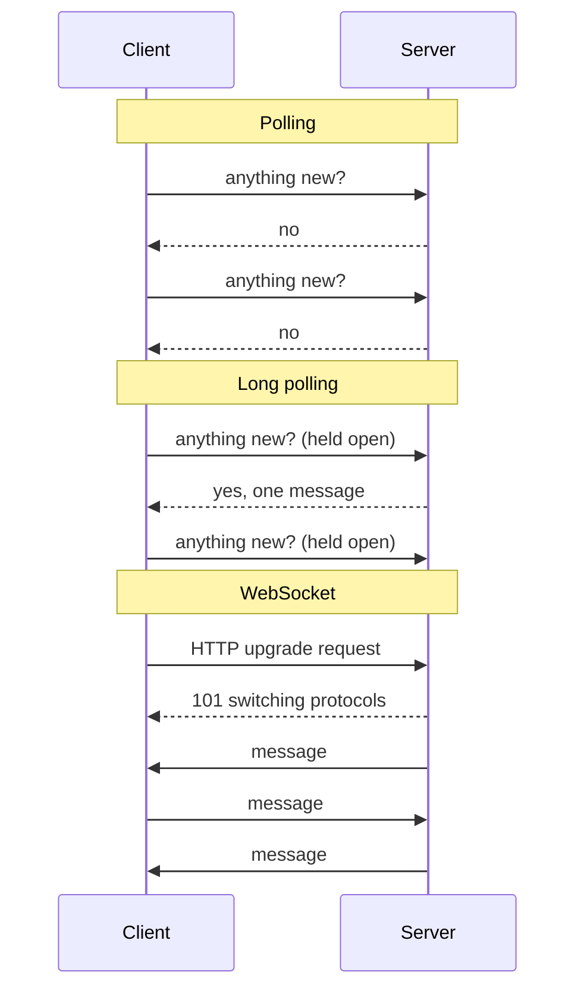
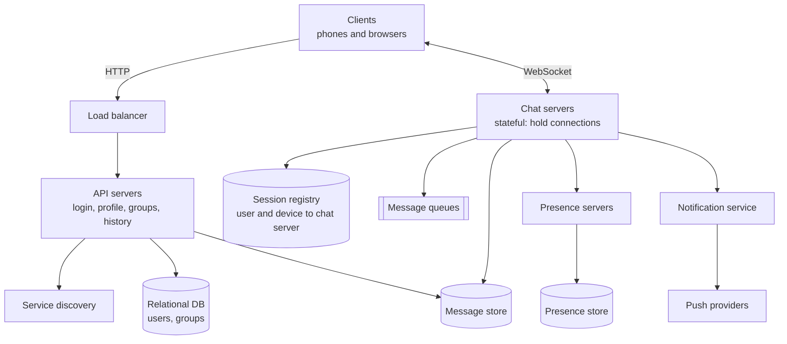
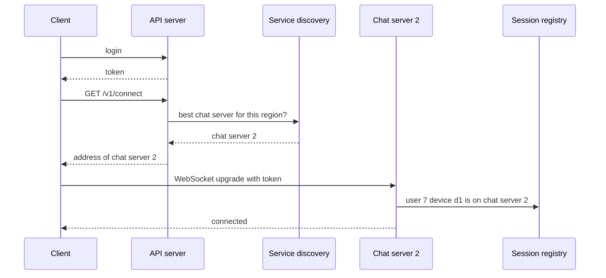

# Design a chat system I: connections, requirements and the high-level design

## Before this lesson

You should know HTTP requests and connections ([Clients, servers and requests](#/lesson/system-design/clients-servers-requests)), stateless versus stateful servers, key-value stores ([Design a key-value store I](#/lesson/system-design/kv-store-cap-replication)), unique IDs ([Snowflake](#/lesson/system-design/unique-id-snowflake)) and the notification system ([module 11](#/lesson/system-design/notification-design)). The [Networking track](#/lesson/networking/websocket-webrtc) explains WebSocket in detail.

## In plain words

A **chat system** lets people exchange short messages that arrive almost instantly: one-to-one conversations, group conversations, and a small indicator showing who is online.

Ordinary web traffic works like sending letters and waiting for replies: the client asks, the server answers, and the server can never speak first. Chat needs the opposite. When your friend sends you a message, the server must tell *you*, and you did not ask. It is the difference between checking your letterbox every few minutes and having a telephone line that stays open so the other side can speak whenever they like.

So the first design question is: how can a server send something to a client the moment it happens? The second is: when two people are connected to two different servers out of hundreds, how does a message find its way from one to the other? The third is: where do billions of messages live, and how does a phone that was switched off overnight catch up?

Chat is a staple of design interviews because it is the standard example of a system that needs long-lived connections and stateful servers, the things the rest of this track told you to avoid. On the job, the same techniques power live notifications, collaborative editing, multiplayer games, live dashboards and customer-support widgets.

This module follows the track's design structure. This lesson covers requirements, estimates, the connection techniques, the API, the data model and the high-level design. The next covers the message flows, ordering, multi-device sync, presence, failures, trade-offs, a sample dialogue and common mistakes.

## 1. Requirements and the scope questions to ask

| Question | Why it matters | Assumed answer |
|---|---|---|
| One-to-one, group, or both? | Group fan-out changes the design | Both |
| Maximum group size? | Small groups can be pushed per member; huge channels cannot | 100 members |
| Mobile, web, or both? Several devices per user? | Sync across devices | Both; yes |
| Scale? | Sizing | 50 million daily active users |
| Message types and size? | Storage and media handling | Text up to 100,000 characters; attachments as an extension |
| Online indicator? | Presence service | Yes |
| How long is history kept? | Storage | For ever |
| End-to-end encryption? | Server cannot read content; affects search and multi-device | Not required; discuss as an extension |
| Push notifications when offline? | Integration with the notification system | Yes |

**Functional requirements**

1. One-to-one chat with low delivery latency.
2. Group chat up to 100 members.
3. Online presence.
4. Multiple devices per account, all showing the same history.
5. Push notifications for offline users.

**Non-functional requirements**

1. **Low latency:** a message reaches an online recipient in well under a second.
2. **Reliability:** an accepted message is never lost.
3. **Ordering:** messages in a conversation appear in the same order for everyone.
4. **Availability:** users can always connect and send.
5. **Scalability:** tens of millions of simultaneous connections.

## 2. Estimates

```python-run
dau = 50_000_000
messages_per_user_day = 40
online_fraction_at_peak = 0.25
msg_bytes = 300                       # text plus ids, timestamps and index overhead
connections_per_server = 100_000      # idle-ish connections one machine can hold
memory_per_connection = 10_000        # bytes of server memory per open connection

msgs_day = dau * messages_per_user_day
qps = msgs_day / 86_400
concurrent = dau * online_fraction_at_peak

print(f"messages per day        : {msgs_day / 1e9:.1f} billion")
print(f"messages per second     : {qps:,.0f}  (peak about {qps * 3:,.0f})")
print(f"storage per year        : {msgs_day * msg_bytes * 365 / 1e12:,.0f} TB before replication")
print(f"concurrent connections  : {concurrent / 1e6:.1f} million")
print(f"chat servers needed     : {concurrent / connections_per_server:,.0f}")
print(f"memory for connections  : {concurrent * memory_per_connection / 1e9:,.0f} GB across the fleet")
```

Conclusions:

- About 23,000 messages per second on average: a write-heavy workload of small records. The read to write ratio is close to one to one, unlike the feed.
- About 220 TB of new messages per year, for ever. This must be a horizontally scalable store.
- The unusual number is **12.5 million simultaneous connections**. Requests per second is not the scarce resource here; open connections are. That alone requires over a hundred servers whose only job is to hold connections.

## 3. How does a server reach a client? Four techniques

HTTP is **client-initiated**: the server can respond but cannot start a conversation. For sending, that is fine: the sender's app posts the message. Receiving is the problem.

### Polling

The client asks "any new messages?" at a fixed interval, for example every two seconds.

**For:** trivial to build. **Against:** most answers are "no", so it wastes requests, battery and server capacity; and messages are delayed by up to the interval.

### Long polling

The client asks, and the server **holds the request open** until there is a message or a timeout (say 30 seconds). The client then immediately asks again.

**For:** messages arrive promptly; works everywhere HTTP works. **Against:** each message costs a new request with all its headers; the server holding your open request may not be the one that receives the message for you; the server cannot easily tell whether a client has gone away; an idle user still reconnects every timeout.

### WebSocket

A **WebSocket** starts as an ordinary HTTP request that asks to "upgrade". After the server agrees, the same connection stays open and becomes **bidirectional**: either side can send a message at any time, with only a few bytes of overhead each. It runs over the usual web ports (80 and 443), so it passes through firewalls that allow web traffic.

**For:** real-time delivery in both directions; low overhead per message; one connection serves sending and receiving. **Against:** the connection is persistent, so servers are stateful and connection management becomes a design problem.

### Server-Sent Events (SSE)

One long-lived HTTP response over which the server streams events to the client. It is one-directional (server to client), simpler than WebSocket, and reconnects automatically. It is a good fit for feeds and notifications, and less convenient for chat, where the client also sends frequently.



The simulation counts requests and delay for 20 messages arriving at random times over ten minutes.

```python-run
import random
random.seed(4)

DURATION = 600                                   # seconds observed
arrivals = sorted(random.uniform(0, DURATION) for _ in range(20))

def polling(interval):
    requests = int(DURATION / interval)
    delays = [interval - (t % interval) for t in arrivals]       # wait until the next poll
    return requests, sum(delays) / len(delays)

def long_polling(timeout):
    requests, t, i = 0, 0.0, 0
    while t < DURATION:
        requests += 1
        nxt = arrivals[i] if i < len(arrivals) else float("inf")
        if nxt <= t + timeout:                                    # a message arrives while we wait
            t, i = max(nxt, t), i + 1
        else:
            t += timeout                                          # timed out, ask again
    return requests, 0.05

def websocket():
    return 1, 0.05                                                # one connection, pushed at once

print(f"{'technique':24s} {'requests':>9s} {'average delay':>14s}")
for name, (reqs, delay) in [("polling every 2 s", polling(2)), ("polling every 10 s", polling(10)),
                            ("long polling, 30 s", long_polling(30)), ("WebSocket", websocket())]:
    print(f"{name:24s} {reqs:>9d} {delay:>12.2f} s")
```

Polling every two seconds makes 300 requests to deliver 20 messages and still delays each by about a second. Long polling delivers promptly with a few dozen requests. WebSocket uses one connection for everything.

**Choice:** WebSocket for both sending and receiving. Everything that is not real-time (login, signup, profile, group management, loading old history) stays on ordinary HTTP request and response, because that traffic is stateless and easy to scale.

## 4. API

**Over HTTP (stateless services):**

```
POST /v1/sessions                         -> login, returns a token
GET  /v1/channels                         -> the user's conversations with last message and unread count
POST /v1/channels          {member_ids}   -> create a group
GET  /v1/channels/{id}/messages?before=<message_id>&limit=50   -> older history, cursor-paginated
POST /v1/devices           {push_token}   -> register for push notifications
GET  /v1/connect                          -> service discovery: returns the chat server to connect to
```

**Over the WebSocket (messages are small JSON or binary frames):**

```
client -> server   {"type":"send",  "client_msg_id":"c-71f2", "channel_id":"ch_9", "text":"hi"}
server -> client   {"type":"ack",   "client_msg_id":"c-71f2", "message_id": 8812001, "created_at": ...}
server -> client   {"type":"message","message_id": 8812002, "channel_id":"ch_9", "sender_id": 7, "text":"hello"}
client -> server   {"type":"delivered", "channel_id":"ch_9", "up_to": 8812002}
client -> server   {"type":"heartbeat"}
server -> client   {"type":"presence", "user_id": 7, "status":"online"}
```

Two fields matter most. `client_msg_id` is chosen by the client, so that if the acknowledgement is lost and the client sends again, the server recognises the repeat and does not store the message twice. `message_id` is assigned by the server and defines the order.

## 5. Data model

**Which kind of store?** There are two kinds of data.

*Generic data* (users, settings, group membership, friend lists) is relational, modest in size and needs transactions. A relational database with replicas is the right home.

*Chat history* is different:

- The volume is enormous and grows for ever.
- Almost all reads are for **recent** messages in one conversation.
- Occasional random access is still needed: search, jump to a mention, scroll far back.
- Writes and reads are about equal.

This pattern (huge, append-mostly, read by key range) suits a **wide-column or key-value store** that scales horizontally with low latency, such as Cassandra or HBase. Discord and Facebook Messenger have both described building message storage on stores of this family. A relational table of this size would struggle as its indexes outgrow memory.

**Tables:**

```
messages                     -- one-to-one and group use the same shape
  channel_id     partition key        -- all messages of a conversation live together
  message_id     clustering key       -- sorted within the partition; newest are adjacent
  sender_id
  content
  created_at

channel_members(channel_id, user_id, joined_at)          PK (channel_id, user_id)
user_channels(user_id, channel_id, last_read_message_id) PK (user_id, channel_id)

device_cursor(user_id, device_id, channel_id, last_delivered_message_id)
```

A one-to-one conversation is a channel with two members, with the channel id derived from the two user ids (smaller id first) so both sides compute the same one.

**The message id** must satisfy two rules: unique, and **sortable by time within a channel**, so that "the newest 50 messages" is a range read on the key. Options:

- A global 64-bit generator such as Snowflake: simple, roughly time-ordered across the system.
- A **local sequence per channel**: a counter that only needs to be unique and increasing inside one conversation. It gives an exact order within the channel and is easier to make gap-free, at the cost of a small per-channel counter.

Using `created_at` alone is not safe: two messages can carry the same timestamp, and clocks on different servers disagree.

## 6. High-level design



Three groups of components:

**Stateless services** behind a load balancer handle everything request-shaped: authentication, profiles, group management, fetching history. They scale like any web tier.

**Stateful services.** **Chat servers** hold the WebSocket connections. A client stays connected to the same chat server for as long as that server is available. This is the part that cannot be treated as interchangeable machines behind a round-robin balancer, and it is what makes the design interesting. **Presence servers** track who is online.

**Third-party integration.** Push notifications reach users who have no open connection.

Two supporting pieces make the stateful tier workable:

- **Service discovery** chooses a chat server for a client at connection time, based on the client's region and the servers' current load, and keeps track of which chat servers are alive. A coordination service such as ZooKeeper or etcd holds the list.
- A **session registry** records, for every connected device, which chat server holds its connection. When a message must be delivered to user B, the system looks B up here to find the right server.

The connection flow:



> [!INTERVIEW]
> Say early which parts are stateless and which are stateful, and why the chat servers have to be stateful: "a WebSocket is a long-lived connection to one specific machine, so I need a registry of who is connected where and a plan for when that machine dies." That sentence frames the whole deep dive.

> [!TIP]
> Keep the split "WebSocket for real-time, HTTP for everything else". Loading two-year-old history, uploading an attachment and editing a profile do not need a persistent connection, and keeping them on stateless servers leaves the chat servers doing one job.

> [!WARNING]
> A load balancer in front of WebSocket servers must support long-lived connections and must not cut idle ones after a short timeout. Clients send periodic heartbeats partly to keep intermediate network equipment from closing a quiet connection.

## Common mistakes

- **Using polling for a real-time requirement** without acknowledging its cost and delay.
- **Treating chat servers as stateless** and placing them behind a plain round-robin balancer with no session registry.
- **Sizing by QPS and missing concurrent connections.**
- **A relational table for all message history** at hundreds of terabytes a year.
- **Ordering messages by client timestamps.**
- **Partitioning messages by message id**, which scatters one conversation across every partition.
- **Putting login, history and uploads on the WebSocket too.**

## Summary

- Chat needs the server to push to the client; polling wastes requests, long polling is workable, and WebSocket gives a persistent two-way connection with little overhead.
- The scarce resource is concurrent connections: 12.5 million at peak needs over a hundred connection-holding servers.
- Real-time traffic goes over WebSocket to stateful chat servers; everything else stays on stateless HTTP services.
- Message history goes in a horizontally scalable wide-column or key-value store, partitioned by channel and sorted by message id; generic data stays relational.
- Message ids must be unique and time-sortable within a channel; `client_msg_id` makes resends safe.
- Service discovery assigns clients to chat servers, and a session registry records who is connected where.

## Glossary

- **Polling**: asking the server repeatedly at a fixed interval.
- **Long polling**: a request the server holds open until it has something to return.
- **WebSocket**: a persistent, bidirectional connection begun with an HTTP upgrade.
- **Server-Sent Events (SSE)**: a one-way stream of events from server to client over HTTP.
- **Bidirectional**: able to carry messages in both directions.
- **Persistent connection**: a connection that stays open across many messages.
- **Chat server**: a stateful server that holds clients' WebSocket connections.
- **Service discovery**: finding which server a client should connect to, and which servers are alive.
- **Session registry**: a store mapping each connected user and device to its chat server.
- **Channel**: a conversation, one-to-one or group.
- **Partition key / clustering key**: the field that decides where a row lives, and the field rows are sorted by within that place.
- **Wide-column store**: a database of rows grouped by partition key and sorted by clustering key.
- **Presence**: a user's online or offline status.
- **Heartbeat**: a small periodic message showing a client is still connected.
- **Client message id**: an id the client assigns so the server can recognise a resend.

## Check yourself

```quiz
[
  {"q": "Why can plain HTTP request and response not deliver an incoming chat message promptly by itself?",
   "options": ["HTTP is too slow", "HTTP is client-initiated: the server cannot send anything unless the client has asked", "HTTP cannot carry text", "HTTP does not use TCP"],
   "answer": 1,
   "explain": "The server may only respond to a request. Push needs a held-open request or a persistent connection such as WebSocket."},
  {"q": "What is the main drawback of short polling for chat?",
   "options": ["It needs special ports", "Most requests return nothing, wasting resources, and messages wait until the next poll", "It cannot be authenticated", "It only works on mobile"],
   "answer": 1,
   "explain": "Frequent empty polls burn battery and server capacity, and delivery is delayed by up to the polling interval."},
  {"q": "In this design, which traffic uses WebSocket?",
   "options": ["Everything, including login and history", "Sending and receiving real-time messages and presence", "Only uploads", "Only push notifications"],
   "answer": 1,
   "explain": "Real-time traffic uses the persistent connection. Login, profiles, groups and old history stay on stateless HTTP services."},
  {"q": "With 50 million daily users and a quarter online at peak, which resource dominates capacity planning?",
   "options": ["CPU for encryption", "The number of concurrent open connections", "DNS lookups", "Image storage"],
   "answer": 1,
   "explain": "12.5 million simultaneous connections require over a hundred servers holding connections, regardless of message rate."},
  {"q": "Why is the messages table partitioned by channel_id and sorted by message_id?",
   "options": ["To make ids shorter", "So all messages of a conversation are stored together in order and the newest page is one range read", "To allow joins with users", "Because wide-column stores require two keys"],
   "answer": 1,
   "explain": "The dominant query is the recent messages of one conversation. Co-locating and sorting them makes that a single sequential read."},
  {"q": "Why not order messages by the timestamp from the sender's phone?",
   "options": ["Timestamps are too long", "Clocks differ between devices and two messages can share a timestamp, so the order would be unreliable", "Phones do not have clocks", "Timestamps cannot be indexed"],
   "answer": 1,
   "explain": "Ordering needs a server-assigned, unique, increasing id per conversation. Device clocks are neither accurate nor unique."},
  {"q": "What does the session registry store?",
   "options": ["Message contents", "Which chat server currently holds each connected user's device", "Passwords", "Group names"],
   "answer": 1,
   "explain": "To deliver to a user, the system must find the specific machine holding their connection. The registry is that lookup."}
]
```

> **Source:** Xu, *System Design Interview: An Insider's Guide*, ch. 12 (polling, long polling, WebSocket, stateless and stateful services, storage, data models, message ID) as a topic guide; RFC 6455, "The WebSocket Protocol", https://www.rfc-editor.org/rfc/rfc6455 ; Discord engineering blog, "How Discord Stores Billions of Messages", https://discord.com/blog/how-discord-stores-billions-of-messages
