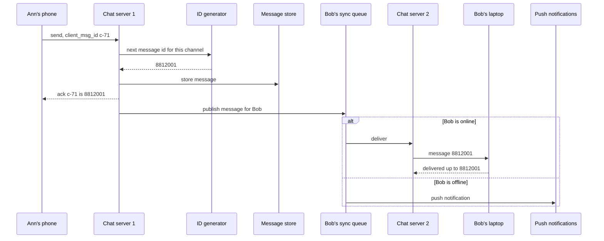
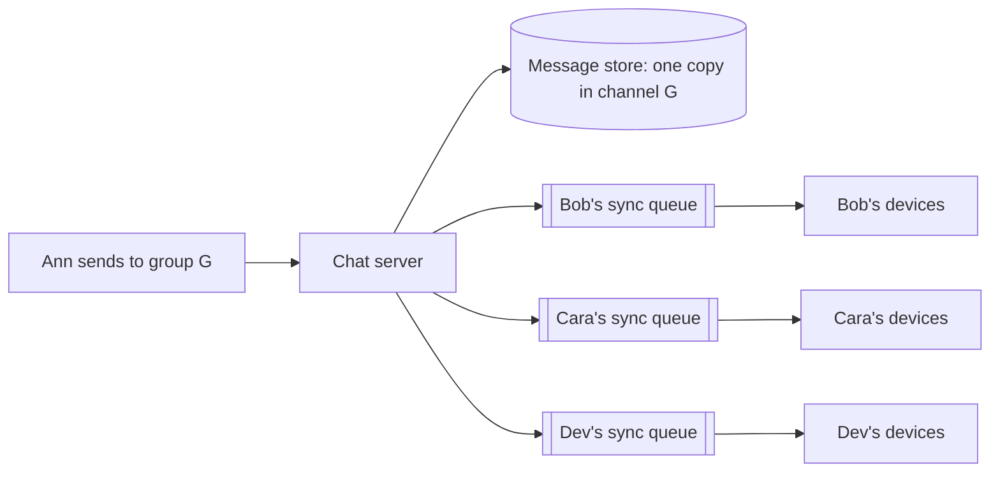
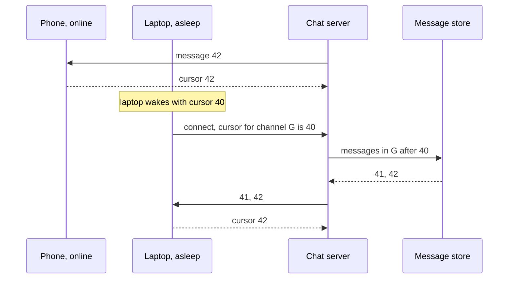

# Design a chat system II: message flow, ordering, sync and presence

## Before this lesson

Read [Design a chat system I](#/lesson/system-design/chat-design). You should know why WebSocket is used, that chat servers are stateful, what service discovery and the session registry do, and how the messages table is keyed (partitioned by channel, sorted by message id).

## In plain words

The previous lesson set up the telephone exchange: every user has an open line to one of many chat servers, and a registry records who is on which server. This lesson follows a message through that exchange and answers the questions that make chat hard.

- Ann is on server 1 and Bob on server 2. How does Ann's message cross over?
- Bob has a phone and a laptop. Both must show the message, and the laptop was asleep all night. How does it catch up?
- Two people send at the same moment. Everyone must see the two messages in the same order. Who decides?
- How does the little green "online" dot work, and why is it surprisingly expensive?
- A chat server holding a hundred thousand connections dies. What then?

A postal sorting office is a fair picture. A letter is first logged with a serial number (so nothing is lost and the order is fixed), then placed in the pigeonhole of each recipient, and whoever is present collects at once while the rest find their mail waiting when they return.

## 1. Deep dive: one-to-one message flow



Step by step:

1. Ann's client sends the message with a `client_msg_id` over its WebSocket to chat server 1.
2. The server obtains a `message_id` that is unique and increasing within the channel.
3. The server **stores the message durably**. Only now is it safe to tell Ann it was sent.
4. The server acknowledges to Ann, who sees a single tick.
5. The message is published to a **per-recipient queue** (often called a *sync queue* or inbox). One queue per user keeps each user's incoming messages in order and acts as a buffer.
6. If Bob has a live connection, the chat server holding it takes the message from Bob's queue and pushes it down the WebSocket. Bob's client acknowledges, and Ann sees a second tick.
7. If Bob is offline, the notification service sends a push notification, and the message waits in the store.

Two orderings in that list are deliberate. **Store before acknowledging** means an acknowledged message can never be lost. **Acknowledge before delivering** means Ann is not kept waiting on Bob's network.

**How does the message cross from server 1 to server 2?** Chat servers do not connect to each other directly; with hundreds of servers that would be a tangle. They communicate through the per-user queues (or a publish and subscribe system): server 1 publishes to "Bob's inbox", and whichever server holds Bob's connection is subscribed to it. The session registry tells the system which server that is.

## 2. Deep dive: group message flow

For a small group, the same idea is applied once per member: the message is stored once in the channel's partition, and a copy of its reference is placed in **each member's** sync queue.



Why one queue per recipient, when that means writing the message reference to every member's queue? Because it makes the receiving side trivial: each client has exactly one inbox to read, in order, however many groups it belongs to. This is fan-out on write, the same choice as in the news feed, and it works for the same reason and fails for the same reason. With a 100-member limit, a message costs at most 100 small queue writes. For a channel with a hundred thousand members it would be far too expensive, and such channels use the opposite approach: store once, and let each online member's server fetch new messages from the channel on a notification that "channel G has something new".

## 3. Deep dive: ordering

"Messages appear in the same order for everyone" needs one authority per conversation that assigns the order. That authority is the message id, issued by the server at the moment of storing. Clients sort by message id and never by their own clocks.

Assigning the id needs care when several chat servers handle the same channel at once. Two servers must not issue the same number. Options:

- A counter per channel held in a store with atomic increment (for example a Redis `INCR` on `seq:{channel_id}`).
- Routing all writes for a channel through one owner (a single writer per channel), so no coordination is needed.
- A Snowflake-style id, accepting that the order between two near-simultaneous messages follows clock skew of a few milliseconds.

The simulation shows a per-channel sequencer, a resend being recognised, and a client using a cursor to fetch only what it has not seen.

```python-run
class Channel:
    def __init__(self):
        self.log = []                    # [(seq, sender, text)] in order
        self.seen = {}                   # (sender, client_msg_id) -> seq

    def send(self, sender, client_msg_id, text):
        key = (sender, client_msg_id)
        if key in self.seen:             # a retry of a message we already stored
            return self.seen[key]
        seq = len(self.log) + 1          # the single authority for order in this channel
        self.log.append((seq, sender, text))
        self.seen[key] = seq
        return seq

    def fetch(self, after_seq, limit=50):
        return self.log[after_seq:after_seq + limit]

room = Channel()
print("ann  ->", room.send("ann", "a1", "anyone for lunch?"))
print("bob  ->", room.send("bob", "b1", "yes, 12:30"))
print("ann  ->", room.send("ann", "a1", "anyone for lunch?"), " (network retry, same id returned)")
print("cara ->", room.send("cara", "c1", "count me in"))

laptop_cursor = 1                        # the laptop last saw message 1 before going to sleep
print("\nlaptop wakes, cursor =", laptop_cursor)
for seq, sender, text in room.fetch(after_seq=laptop_cursor):
    print(f"  {seq}: {sender}: {text}")
    laptop_cursor = seq
print("laptop cursor is now", laptop_cursor)
```

The retry returned the original sequence number and stored nothing new, so Ann's message appears once. The laptop asked for "everything after 1" and received messages 2 and 3 in order.

Sequence numbers without gaps have a second benefit: a client can **detect a missing message**. If it holds 41 and receives 43, it knows 42 is missing and fetches it, instead of silently showing a hole.

## 4. Deep dive: synchronising several devices

Each device keeps a **cursor** per channel: the id of the latest message it has. The server keeps the same number for each device.

- A connected device receives new messages as they arrive and advances its cursor.
- A device that reconnects sends its cursors, and the server returns every message with a larger id, from the message store.
- "Read" state is separate: `last_read_message_id` per user per channel, shared across devices, so that reading on the phone clears the unread badge on the laptop.



Because catching up is "fetch after cursor", the message store, not the queue, is the source of truth. Sync queues can then be short-lived buffers: if one is lost, devices recover from the store by cursor. This also bounds the queues: a user who is offline for a month does not need a month of messages sitting in a queue.

## 5. Deep dive: presence

The online indicator looks trivial and is one of the costlier features, because status changes fan out to everyone who might be looking.

**Detecting status.** A status of "online" could be set when the WebSocket opens and "offline" when it closes. But mobile connections drop and return constantly, for example in a tunnel. Flipping the status on every blip would make indicators flicker and generate a storm of updates.

The remedy is a **heartbeat**: the client sends a small message every few seconds. The presence server records the time of the last one. A user is considered online if a heartbeat arrived within a timeout, for example 30 seconds. A brief disconnection shorter than the timeout changes nothing.

```python-run
HEARTBEAT_EVERY = 5      # seconds between heartbeats from a healthy client
TIMEOUT = 30             # no heartbeat for this long means offline

def presence_timeline(connected_periods, until):
    """connected_periods: list of (start, end) seconds when the client had a connection."""
    last_beat, events, online = None, [], False
    for t in range(0, until + 1):
        connected = any(start <= t < end for start, end in connected_periods)
        if connected and t % HEARTBEAT_EVERY == 0:
            last_beat = t
        now_online = last_beat is not None and t - last_beat <= TIMEOUT
        if now_online != online:
            online = now_online
            events.append((t, "online" if online else "offline"))
    return events

# Connected 0-100 s, a 12-second tunnel, connected again 112-200 s, then the app is closed.
print("with heartbeat timeout :", presence_timeline([(0, 100), (112, 200)], 260))

# Naive rule for comparison: status follows the connection directly.
naive = [(0, "online"), (100, "offline"), (112, "online"), (200, "offline")]
print("status follows socket  :", naive)
```

With the heartbeat rule there are two status changes: online at the start and offline about thirty seconds after the app closes. The tunnel is invisible. The naive rule produces four changes, and each would be broadcast to every friend.

**Publishing status.** When a user's status does change, who is told? In a publish and subscribe model, each pair of friends shares a channel; a status change is published to the user's channels and delivered to subscribed friends over their WebSockets. This is fine when contact lists are a few hundred. For a group of 100,000 members, pushing every status change to every member is absurd; there, presence is fetched on demand when someone opens the member list, or shown only for the people on screen.

Presence data is small, changes often and can be lost without harm, so it lives in an in-memory store with a TTL matching the heartbeat timeout.

## 6. Deep dive: when a chat server dies

A chat server holds perhaps 100,000 connections. When it fails:

1. Its clients notice the broken connection, or stop receiving heartbeat replies.
2. Each client asks service discovery for a new server and reconnects.
3. The new server updates the session registry and the client sends its cursors.
4. Missed messages are fetched from the store by cursor. Nothing is lost, because every acknowledged message was stored first.

The danger is the **reconnection storm**: 100,000 clients reconnecting in the same second can overload the remaining servers and the login path. Clients must reconnect with exponential backoff and jitter, and service discovery must spread them across servers. Chat servers should also be drained gracefully before planned maintenance: stop accepting new connections and ask existing clients to move in small batches.

Stale registry entries are the other hazard. If the registry still says Bob is on the dead server, messages for Bob would be sent nowhere. Registry entries therefore carry a TTL refreshed by the chat server, and delivery never depends on the registry alone: the message is already in the store and in Bob's queue.

## 7. Bottlenecks and failure handling

| Failure or bottleneck | Effect | Mitigation |
|---|---|---|
| Chat server crash | Connections dropped | Reconnect with backoff and jitter; catch up by cursor |
| Message store write fails | Message cannot be accepted | Do not acknowledge; client retries with the same `client_msg_id` |
| Acknowledgement lost | Client resends | Deduplicate on `client_msg_id` |
| Sync queue lost | Buffered deliveries gone | Devices recover from the store by cursor |
| Recipient offline | Cannot push over WebSocket | Push notification; delivery on next connect |
| Hot channel partition | One partition grows very large | Bucket the partition key by time, for example `(channel_id, month)` |
| Very large group | Per-member fan-out too costly | Store once; notify and let members pull |
| Presence storm | Flood of status updates | Heartbeat timeout; batch updates; fetch on demand for large groups |
| Region outage | Users in that region disconnected | Clients reconnect to another region; store replicated across regions |
| Slow consumer | A client on a bad network cannot keep up | Bounded per-connection buffer; drop the connection and let it resync by cursor |

## 8. Trade-offs and alternatives

| Decision | Chosen | Alternative | When the alternative fits |
|---|---|---|---|
| Transport | WebSocket | Long polling; SSE plus HTTP posts | Restrictive networks; simpler server-to-client streams |
| Group delivery | Per-recipient queues (push) | Per-channel log that members pull | Very large channels |
| Message id | Per-channel sequence | Snowflake-style global id | When gap detection is not needed and simplicity wins |
| History store | Wide-column, partitioned by channel | Relational, sharded by channel | Smaller scale, richer queries |
| Presence | Heartbeats with timeout, pushed to friends | Polled on demand | Large audiences |
| Delivery guarantee | At-least-once with client dedup by message id | Exactly-once | Not achievable end to end; dedup gives the same visible result |

**End-to-end encryption (E2EE).** If required, messages are encrypted on the sender's device and decrypted only on recipients' devices, so servers store and forward ciphertext they cannot read. The routing design is unchanged, but server-side search, content moderation and link previews become impossible on the server, each device needs its own keys, and adding a new device requires a secure way to share history. State these consequences if an interviewer adds the requirement.

**Media.** Attachments are uploaded over HTTP to a blob store (often directly, with a short-lived signed URL), and the chat message carries only a reference. Thumbnails are produced asynchronously.

## 9. What a strong answer sounds like

> **Interviewer:** Ann and Bob are connected to different chat servers. Walk me through one message.
>
> **Candidate:** Ann's client sends it over its WebSocket with a client-generated id. Her chat server gets a sequence number for the channel, writes the message to the store partitioned by channel, and only then acknowledges to Ann. It publishes the message to Bob's sync queue. The server holding Bob's connection, which we know from the session registry, consumes that queue and pushes the message to Bob's devices. If Bob has no connection, the notification service sends a push.
>
> **Interviewer:** How do you guarantee order?
>
> **Candidate:** The sequence number assigned at storage time is the order; clients sort by it and ignore their own clocks. I would use a per-channel counter with an atomic increment. Because the numbers have no gaps, a client that holds 41 and receives 43 knows to fetch 42.
>
> **Interviewer:** Bob's laptop was closed overnight.
>
> **Candidate:** Each device keeps a cursor per channel. On reconnect it sends its cursors and the server returns everything after them from the message store. The store is the source of truth, so the queues are only short-lived buffers.
>
> **Interviewer:** A chat server with 100,000 connections dies.
>
> **Candidate:** No messages are lost, since they were stored before being acknowledged. Clients reconnect through service discovery with backoff and jitter to avoid a reconnection storm, register with the new server and resync by cursor. Registry entries have a TTL so stale mappings disappear.
>
> **Interviewer:** And the online indicator?
>
> **Candidate:** Clients send a heartbeat every five seconds; a user is online if one arrived in the last thirty. That hides brief disconnections. Changes are published to friends; for large groups I would fetch presence on demand instead of pushing.

## Common mistakes

- **Acknowledging before storing**, which allows acknowledged messages to be lost.
- **Chat servers talking directly to each other** in a full mesh.
- **Relying on the queue as the only copy of undelivered messages.**
- **No client message id**, so a lost acknowledgement creates a duplicate.
- **Presence tied directly to the socket state**, causing flicker and update storms.
- **Pushing presence to every member of a huge group.**
- **Ignoring the reconnection storm** after a server failure.
- **Applying small-group fan-out to very large channels.**

## Summary

- A message is given a server-assigned id, stored, acknowledged to the sender, then published to each recipient's sync queue and pushed by the server holding their connection; offline recipients get a push notification.
- Chat servers communicate through per-user queues or publish and subscribe, located via the session registry.
- Order comes from the server-assigned, per-channel id; gap-free sequences let clients detect missing messages; `client_msg_id` makes resends harmless.
- Devices sync by cursor from the message store, which is the source of truth.
- Presence uses heartbeats with a timeout and is pushed to small audiences and pulled for large ones.
- A chat server failure costs connections, not messages; clients reconnect with backoff and resync.

## Glossary

- **Sync queue (inbox)**: a per-recipient queue of incoming messages.
- **Publish and subscribe**: a messaging pattern in which publishers send to a topic and all subscribers receive.
- **Sequence number**: an increasing number that fixes the order of messages in a channel.
- **Single writer**: routing all writes for a channel through one owner to avoid coordination.
- **Cursor**: the id of the latest message a device has received.
- **Delivered / read receipt**: confirmation that a message reached a device, or was seen by the user.
- **Heartbeat timeout**: the time without heartbeats after which a user is considered offline.
- **Reconnection storm**: a surge of simultaneous reconnects after a failure.
- **Graceful drain**: moving connections off a server gradually before taking it down.
- **Slow consumer**: a client that cannot receive as fast as messages arrive.
- **End-to-end encryption**: encryption where only the communicating devices hold the keys.
- **Signed URL**: a temporary link that grants permission to upload or download one object.
- **Source of truth**: the store whose contents are authoritative.

## Check yourself

```quiz
[
  {"q": "In the one-to-one flow, when is it safe for the server to acknowledge the sender?",
   "options": ["As soon as the message is received", "After the message has been durably stored", "After the recipient has read it", "After the push notification is sent"],
   "answer": 1,
   "explain": "Store first, then acknowledge. Otherwise a crash could lose a message the sender believes was sent."},
  {"q": "How do two chat servers exchange a message for users connected to each of them?",
   "options": ["Through a direct connection between every pair of servers", "Through per-user queues or publish and subscribe, using the session registry to locate the recipient's server", "By writing to the client's local storage", "Through DNS"],
   "answer": 1,
   "explain": "Indirect messaging avoids a full mesh between hundreds of servers. The server holding the recipient's connection consumes the recipient's queue."},
  {"q": "A client resends a message because the acknowledgement was lost. What prevents a duplicate?",
   "options": ["The message id assigned by the server", "The client_msg_id, which the server recognises and maps to the original message", "The heartbeat", "The session registry"],
   "answer": 1,
   "explain": "The client-chosen id is the same on the retry, so the server returns the earlier result instead of storing again."},
  {"q": "A device holds message 41 of a channel and next receives message 43. What should it do?",
   "options": ["Display 43 and ignore the gap", "Recognise that 42 is missing and fetch it from the server", "Disconnect permanently", "Renumber 43 as 42"],
   "answer": 1,
   "explain": "Gap-free per-channel sequence numbers let clients detect a missing message and request it."},
  {"q": "How does a laptop that was offline overnight catch up?",
   "options": ["The server replays the whole conversation", "It sends its per-channel cursor and receives every message with a larger id from the message store", "It asks the phone", "It waits for push notifications"],
   "answer": 1,
   "explain": "The cursor marks the last message the device has. Fetching after the cursor from the durable store is exact and cheap."},
  {"q": "Why is presence based on a heartbeat timeout instead of the connection's state?",
   "options": ["Heartbeats use less battery", "Brief disconnections would otherwise flip the status repeatedly and broadcast a flood of updates", "WebSockets cannot report closure", "It makes messages ordered"],
   "answer": 1,
   "explain": "Mobile connections drop often. A timeout longer than typical blips keeps the indicator stable and the update volume low."},
  {"q": "A chat server holding 100,000 connections fails. What is the main risk to manage?",
   "options": ["Loss of all stored messages", "A reconnection storm overloading the remaining servers", "Corruption of message order", "Loss of user accounts"],
   "answer": 1,
   "explain": "Messages are safe in the store. The hazard is everyone reconnecting at once, addressed with backoff, jitter and spreading clients across servers."},
  {"q": "Why does per-recipient fan-out not suit a channel with 100,000 members?",
   "options": ["Sequence numbers run out", "Each message would require 100,000 queue writes; storing once and letting members pull is cheaper", "WebSockets cannot serve groups", "The message store rejects large groups"],
   "answer": 1,
   "explain": "Push fan-out cost grows with membership. Large channels store the message once and notify members that there is something new."}
]
```

> **Source:** Xu, *System Design Interview: An Insider's Guide*, ch. 12 (service discovery, 1 on 1 chat flow, message synchronization across multiple devices, small group chat flow, online presence) as a topic guide; Discord engineering blog, "How Discord Stores Billions of Messages", https://discord.com/blog/how-discord-stores-billions-of-messages ; RFC 6455, https://www.rfc-editor.org/rfc/rfc6455
