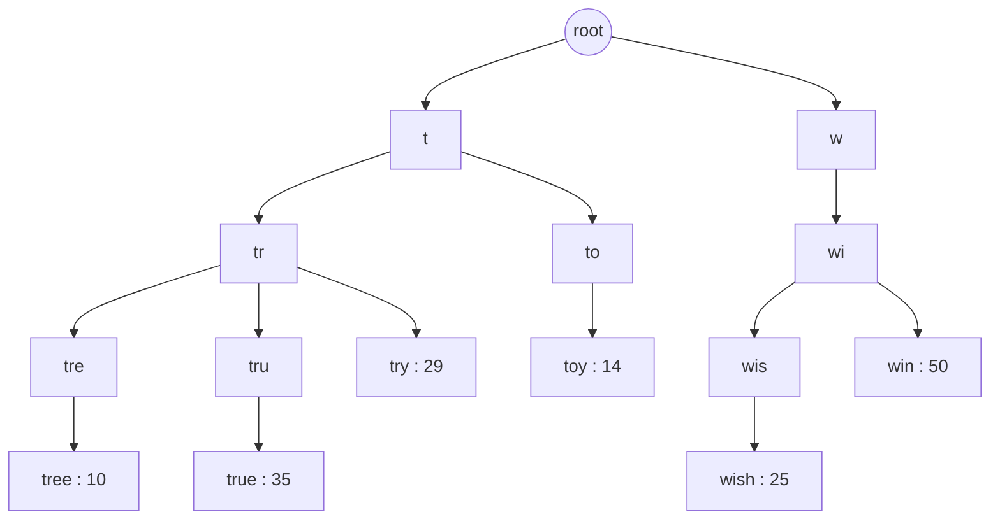
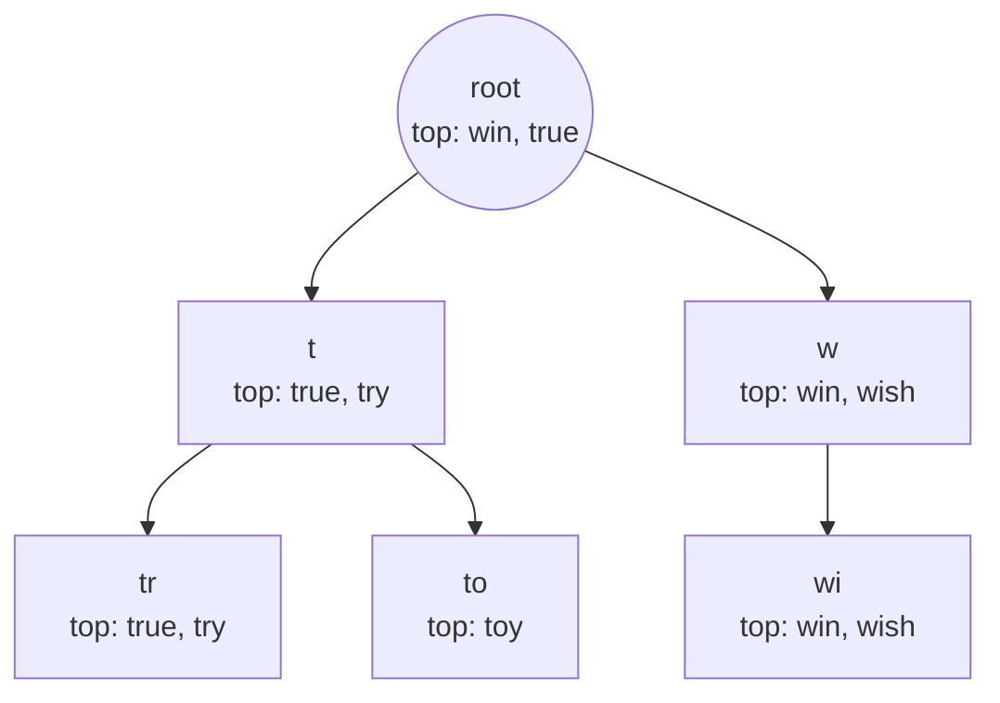

# Design search autocomplete I: requirements and the trie

## Before this lesson

You should know caches and CDNs ([The five building blocks](#/lesson/system-design/core-components)), estimation ([Estimation II](#/lesson/system-design/estimation-worked)), and Python dictionaries. Knowing what a tree is helps: a structure of nodes where each node has children. The [DSA track](#/track/neet-linked-trees) covers trees and tries.

## In plain words

**Search autocomplete** (also called *typeahead* or *search-as-you-type*) is the list of suggestions that appears under a search box while you are still typing. You type "din" and the box offers "dinner recipes", "dinosaur", "dining table".

A good librarian does the same. You begin "I am looking for something about din…" and before you finish they say "dinosaurs? We get asked for those all the time." They are not searching the shelves; they are recalling the most popular requests that begin the way yours does.

So the task is: given the few letters typed so far (the **prefix**), return the handful of most popular past searches that start with those letters, and do it faster than the person can type the next letter.

It is a favourite interview problem because it combines a specific data structure (the trie), a strict latency target, and a clean split between a fast online path that answers queries and a slow offline path that prepares the data. On the job, the same design appears in address fields, product search, command palettes, tag pickers and "@mention" lists.

This module follows the track's design structure. This lesson covers requirements, estimates, the API, the trie data structure and its optimisations, and the data model. The next covers the high-level design of the two paths, sharding, updates, failures, trade-offs, a sample dialogue and common mistakes.

## 1. Requirements and the scope questions to ask

| Question | Why it matters | Assumed answer |
|---|---|---|
| Match only at the start of the query, or anywhere? | A prefix match fits a trie; matching in the middle needs a different index | Start only |
| How many suggestions? | Size of the result and of what is stored | 5 |
| Ranked by what? | Decides what must be precomputed | Popularity: historical search frequency |
| Spell check or correction? | Much harder; a separate feature | No |
| Which languages and characters? | Alphabet size, and memory | English, lower-case letters, to begin with; discuss others later |
| How many users? | Sizing | 10 million daily active users |
| How fresh must suggestions be? | Real-time versus batch updates | Updated weekly is acceptable; discuss real-time later |

**Functional requirements**

1. As the user types, return up to 5 suggestions that begin with the typed prefix.
2. Suggestions are ordered by popularity.

**Non-functional requirements**

1. **Fast response.** Suggestions must appear within about 100 ms end to end, or they lag behind the typing and feel broken.
2. **Relevant** to the prefix.
3. **Sorted** by popularity or another ranking model.
4. **Scalable** to high traffic.
5. **Highly available**, degrading gracefully: if the service is down, the search box still works without suggestions.

## 2. Estimates

```python-run
dau = 10_000_000
searches_per_user_day = 10
chars_per_query = 20                  # average query: 4 words of 5 characters
bytes_per_query = 20                  # ASCII, one byte per character
new_query_fraction = 0.20             # share of daily queries never seen before

searches_day = dau * searches_per_user_day
# One request is sent for (almost) every character typed.
requests_day = searches_day * chars_per_query
qps = requests_day / 86_400

print(f"searches per day          : {searches_day:,}")
print(f"autocomplete requests/day : {requests_day:,}")
print(f"average QPS               : {qps:,.0f}")
print(f"peak QPS (x2)             : {qps * 2:,.0f}")
new_bytes_day = searches_day * bytes_per_query * new_query_fraction
print(f"new query text per day    : {new_bytes_day / 1e6:,.0f} MB, {new_bytes_day * 365 / 1e9:,.0f} GB per year")
```

Two conclusions:

- **The request rate is twenty times the search rate**, because every keystroke is a request: about 23,000 per second on average and 46,000 at peak. Autocomplete is usually the busiest endpoint a search product has. This is a read-only, very latency-sensitive load.
- **The data is small.** Around 400 MB of new query text per day. The set of distinct popular queries fits in memory on one machine, which is what allows an in-memory data structure.

Also note what a 100 ms budget means. A round trip from a phone to a data centre can take 50 ms or more by itself, so the server-side work must be a few milliseconds, and the design should try to avoid the round trip altogether when it can.

## 3. API

```
GET /v1/suggest?q=din&limit=5
  returns: 200 {"prefix": "din",
                "suggestions": ["dinner recipes", "dinosaur", "dining table", "dinner ideas", "dinosaur games"]}
  headers: Cache-Control: public, max-age=3600
```

Choices to point out:

- It is a **GET** with the prefix in the URL, so that browsers and CDNs can cache the response. The same prefix returns the same answer for every user for an hour or more.
- The response is tiny and contains only strings. Nothing else is needed to draw the list.
- There is no authentication in the basic design, because suggestions are not personal. That is what makes them cacheable for everyone.

## 4. The naive approach, and why it fails

Suppose past queries and their counts are in a relational table:

| query | frequency |
|---|---|
| dinner recipes | 9,100 |
| dinosaur | 8,700 |
| dining table | 6,400 |

Then suggestions are one query:

```sql
SELECT query FROM query_frequency
WHERE query LIKE 'din%'
ORDER BY frequency DESC
LIMIT 5;
```

This is correct, and reasonable for a small data set. At scale it is too slow: short prefixes match a huge number of rows (every query starting with "d"), all of which must be found and sorted by frequency, tens of thousands of times per second, each within a few milliseconds. The work per request must not depend on how many queries share the prefix.

## 5. The trie

A **trie** (pronounced "try", from re*trie*val; also called a *prefix tree*) is a tree that stores strings by their characters.

- The **root** stands for the empty string.
- Each node stands for one string: the characters on the path from the root to it.
- Each node has one child per possible next character.
- Nodes that complete a stored query are marked, and hold that query's frequency.

Here is a trie holding `tree` (10), `try` (29), `true` (35), `toy` (14), `wish` (25) and `win` (50). The number is the search frequency.



Every query that begins with "tr" is somewhere under the node `tr`. That is the property we need: **a prefix is a node, and its completions are that node's subtree.**

### The basic lookup

To answer a prefix:

1. **Find the prefix node.** Walk from the root one character at a time. Cost: $O(p)$ for a prefix of length $p$.
2. **Collect completions.** Visit every node in the subtree and gather the marked ones. Cost: $O(c)$ for a subtree of $c$ nodes.
3. **Rank.** Sort the collected queries by frequency and take the top $k$. Cost: $O(c \log c)$.

```python-run
class TrieNode:
    def __init__(self):
        self.children = {}        # character -> TrieNode
        self.frequency = 0        # greater than 0 only where a query ends

class BasicTrie:
    def __init__(self):
        self.root = TrieNode()

    def insert(self, query, frequency):
        node = self.root
        for ch in query:                              # walk down, creating nodes as needed
            node = node.children.setdefault(ch, TrieNode())
        node.frequency = frequency

    def top_k(self, prefix, k):
        node = self.root
        for ch in prefix:                             # step 1: find the prefix node
            if ch not in node.children:
                return [], 0
            node = node.children[ch]
        found, visited, stack = [], 0, [(node, prefix)]
        while stack:                                  # step 2: visit the whole subtree
            current, text = stack.pop()
            visited += 1
            if current.frequency:
                found.append((current.frequency, text))
            for ch, child in current.children.items():
                stack.append((child, text + ch))
        found.sort(key=lambda pair: (-pair[0], pair[1]))   # step 3: rank
        return [text for _, text in found[:k]], visited

trie = BasicTrie()
for query, freq in [("tree", 10), ("try", 29), ("true", 35), ("toy", 14), ("wish", 25), ("win", 50)]:
    trie.insert(query, freq)

for prefix in ("tr", "t", "w", "", "x"):
    suggestions, visited = trie.top_k(prefix, 2)
    print(f"prefix {prefix!r:5} -> {suggestions}   (visited {visited} nodes)")
```

The answers are right. But look at the last column. An empty or one-letter prefix visits most of the trie. In a trie holding hundreds of millions of queries, the prefix "a" has an enormous subtree, and the shortest prefixes are also the most frequently requested, because every search begins with one letter. The basic trie is slowest exactly where the traffic is heaviest.

## 6. Two optimisations that make it fast

### Limit the prefix length

People rarely type long queries before choosing a suggestion, and suggestions for a fifty-character prefix have little value. Capping the prefix length at a small constant such as 50 turns step 1 from $O(p)$ into $O(1)$.

### Cache the top k at every node

Instead of searching the subtree at query time, **store the answer in the node**. Each node keeps the list of the top $k$ queries in its subtree, computed when the trie is built.



Now a lookup is: walk to the prefix node, return its stored list. Nothing is searched and nothing is sorted.

| Step | Basic trie | With both optimisations |
|---|---|---|
| Find prefix node | $O(p)$ | $O(1)$ (bounded length) |
| Collect completions | $O(c)$ | none |
| Rank | $O(c \log c)$ | none (precomputed) |
| **Total** | $O(p + c \log c)$ | **$O(1)$** |

```python-run
class Node:
    __slots__ = ("children", "frequency", "top")
    def __init__(self):
        self.children, self.frequency, self.top = {}, 0, []

class TopKTrie:
    def __init__(self, k):
        self.k, self.root = k, Node()

    def build(self, frequencies):
        for query, freq in frequencies.items():
            node = self.root
            for ch in query:
                node = node.children.setdefault(ch, Node())
            node.frequency = freq
        self._fill(self.root, "")

    def _fill(self, node, text):
        """Post-order: compute the children's lists first, then merge them into this node's."""
        candidates = [(node.frequency, text)] if node.frequency else []
        for ch, child in node.children.items():
            self._fill(child, text + ch)
            candidates += child.top                      # each child offers at most k
        candidates.sort(key=lambda pair: (-pair[0], pair[1]))
        node.top = candidates[:self.k]

    def suggest(self, prefix):
        node = self.root
        for ch in prefix:
            node = node.children.get(ch)
            if node is None:
                return []
        return [text for _, text in node.top]            # no search, no sort

data = {"tree": 10, "try": 29, "true": 35, "toy": 14, "wish": 25, "win": 50,
        "be": 15, "bee": 20, "beer": 10, "best": 35, "bet": 29, "buy": 14}
trie = TopKTrie(k=2)
trie.build(data)
for prefix in ("", "t", "tr", "b", "be", "bee", "x"):
    print(f"{prefix!r:6} -> {trie.suggest(prefix)}")
```

The build step works from the leaves upwards. A node's top list is the best $k$ among its own query (if it is one) and its children's top lists. Each child contributes at most $k$ candidates, so filling a node is cheap.

**The price is memory and update cost.** Every node now stores up to $k$ strings (or references to them). And when a query's frequency changes, the lists of all its ancestors may change. That is acceptable only because of a decision still to come: the trie is not updated in place on each search but rebuilt periodically, offline.

## 7. Data model

Three forms of the same data, at three stages.

```
1. Raw query log (append-only, huge)
     query, timestamp, (anonymised) user or session, country

2. Aggregated frequency table (rebuilt weekly)
     query            frequency      week_starting
     "dinosaur"       8,700          2026-11-16

3. The trie
     in memory on the query servers for speed
     persisted in a trie store so servers can load it
```

There are two reasonable ways to persist the trie:

- **Serialised snapshots.** Write the whole trie to a file or a document store periodically; servers load the latest snapshot at start-up.
- **A key-value form.** Every prefix becomes a key and its top-$k$ list becomes the value: `"din" -> ["dinner recipes", "dinosaur", ...]`. This is the trie flattened into a hash table. Lookup is one key-value read, and any key-value store can hold it.

The key-value form makes a point worth saying in an interview: once the top $k$ are precomputed, the trie is only a compact way of storing a mapping from prefix to answer. The tree shape saves memory by sharing common prefixes; the serving path does not depend on it.

> [!INTERVIEW]
> Present the trie in three stages: the SQL `LIKE` query and why it does not scale; the basic trie and its $O(p + c \log c)$ lookup; then the cached top-$k$ lists that make lookup constant time, with the memory and update costs stated. The progression shows you understand why the optimisation exists.

> [!TIP]
> When the interviewer asks "how much memory?", reason per node: a few bytes for the character and child pointers, plus $k$ references for the top list. If each list stores references to query strings held once elsewhere, the lists cost $k \times 8$ bytes per node, not $k$ full strings.

> [!WARNING]
> Storing the top-$k$ strings in full at every node repeats popular queries many times: "dinosaur" appears in the lists of `d`, `di`, `din`, `dino` and so on. Store an index or pointer into a shared table of queries instead.

## Common mistakes

- **Scanning or sorting a subtree at query time** in the final design.
- **Forgetting that one search causes many requests**, one per keystroke.
- **Proposing a database `LIKE` query for millions of users.**
- **Updating the trie on every search**, which makes writes fight with reads.
- **Ignoring short prefixes**, which are both the most frequent and, in the basic trie, the most expensive.
- **Making responses personal by default**, which destroys cacheability.
- **Treating "match anywhere in the string" as a small variation.** It needs a different index.

## Summary

- Autocomplete returns the top few popular queries for a prefix within about 100 ms, on a read-only load of tens of thousands of requests per second.
- Every keystroke is a request, so the rate is about twenty times the search rate; the data set itself is small enough for memory.
- A SQL prefix query is correct and too slow at scale.
- A trie stores queries by character so that a prefix is a node and its completions are that node's subtree.
- Capping prefix length and caching the top $k$ at each node make lookup constant time, at the cost of memory and expensive updates.
- With precomputed answers the trie is equivalent to a key-value map from prefix to suggestion list.

## Glossary

- **Autocomplete (typeahead)**: suggestions shown while the user types.
- **Prefix**: the characters typed so far; the start of a string.
- **Trie (prefix tree)**: a tree in which each node represents a string formed by the path from the root.
- **Root**: the top node of a tree, here representing the empty string.
- **Subtree**: a node together with everything below it.
- **Leaf**: a node with no children.
- **Top k**: the k highest-ranked items.
- **Frequency**: how many times a query was searched in the period.
- **Post-order traversal**: visiting a node's children before the node itself.
- **Serialisation**: converting an in-memory structure into bytes for storage.
- **Snapshot**: a complete saved copy of a structure at one moment.
- **Query log**: the record of searches users have made.
- **Aggregation**: combining many records into summary counts.

## Check yourself

```quiz
[
  {"q": "Users make 100 million searches a day with an average of 20 characters each. Roughly how many autocomplete requests per day does that produce?",
   "options": ["100 million", "500 million", "2 billion", "20 billion"],
   "answer": 2,
   "explain": "About one request per character typed: 100 million x 20 = 2 billion requests a day, around 23,000 per second."},
  {"q": "In a trie, where are all stored queries that begin with the prefix 'tr'?",
   "options": ["In the root's top list", "In the subtree under the node for 'tr'", "In a separate hash table", "In nodes at depth 2 across the whole trie"],
   "answer": 1,
   "explain": "Each node represents the string spelled by the path to it. Every extension of that string lies below that node."},
  {"q": "Why is the basic trie lookup slow for a one-letter prefix?",
   "options": ["Finding the node takes a long time", "The node's subtree is huge and must be visited and sorted", "One-letter prefixes are not stored", "The trie must be rebuilt"],
   "answer": 1,
   "explain": "Reaching the node is one step, but collecting and ranking all completions beneath a short prefix touches a large part of the trie."},
  {"q": "What does caching the top k at every node change?",
   "options": ["It removes the need to store frequencies", "Lookup becomes: walk to the node and return its stored list, with no search or sort", "It makes inserts free", "It reduces memory"],
   "answer": 1,
   "explain": "The answer for every prefix is precomputed. The cost moves to build time and to memory."},
  {"q": "What is the main cost of storing top-k lists in every node?",
   "options": ["Slower lookups", "More memory, and updates that must touch every ancestor of a changed query", "Loss of ordering", "The trie can no longer be serialised"],
   "answer": 1,
   "explain": "Each node carries extra data, and a frequency change can alter the lists all the way up to the root."},
  {"q": "Why is the suggestion endpoint designed as an unauthenticated GET with the prefix in the URL?",
   "options": ["GET is more secure", "The response is identical for all users, so browsers and CDNs can cache it", "POST cannot return JSON", "To avoid using a trie"],
   "answer": 1,
   "explain": "Cacheable responses let many requests be answered at the edge or in the browser without reaching the servers."},
  {"q": "After the top k are precomputed, what simpler structure is the trie equivalent to for serving?",
   "options": ["A linked list", "A key-value map from each prefix to its suggestion list", "A relational join", "A message queue"],
   "answer": 1,
   "explain": "Serving needs only prefix to answer. The tree shape is a compact encoding of that mapping, which a key-value store can also hold."}
]
```

> **Source:** Xu, *System Design Interview: An Insider's Guide*, ch. 13 (search autocomplete: requirements, estimation, trie data structure, limiting prefix length, caching top queries at each node) as a topic guide; Meta engineering, "The Life of a Typeahead Query" (2010), https://engineering.fb.com/2010/05/17/web/the-life-of-a-typeahead-query/
