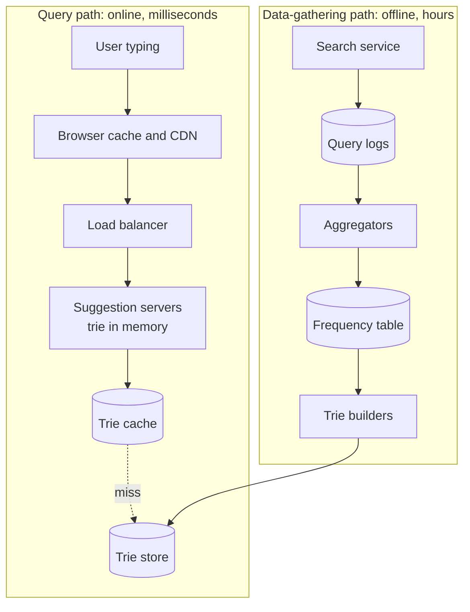
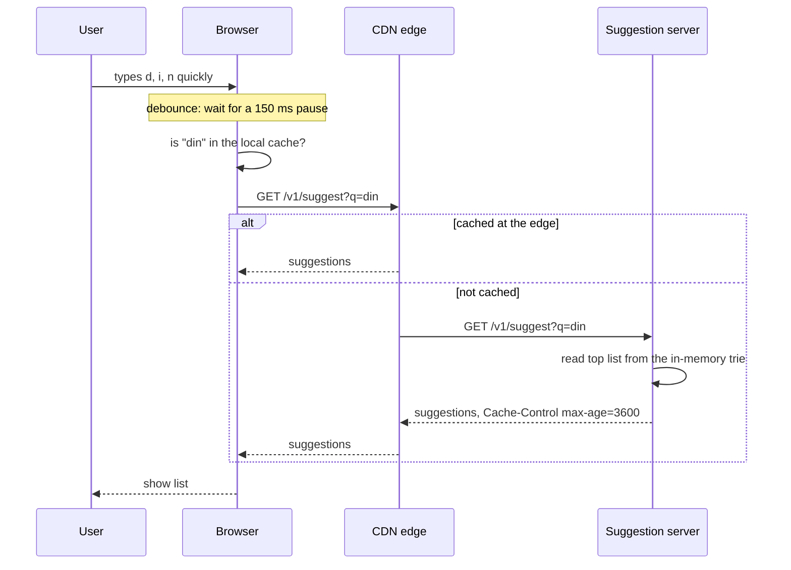
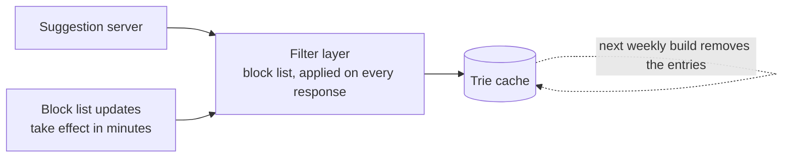

# Design search autocomplete II: building, serving, sharding and updating

## Before this lesson

Read [Design search autocomplete I](#/lesson/system-design/autocomplete-design). You should know the requirements (top 5 by popularity, under 100 ms, about 23,000 requests per second), what a trie is, and why the top $k$ suggestions are cached at every node. Sharding was introduced in [Scaling from zero II](#/lesson/system-design/scale-stateless-to-sharded) and queues versus streams are compared in [Building blocks III](#/lesson/system-design/bb-cap-queues-idempotency).

## In plain words

The trie from the previous lesson answers a prefix instantly because all the thinking was done beforehand. This lesson is about that "beforehand", and about serving the result to millions of people.

A restaurant offers a helpful comparison. During service, the kitchen assembles plates in seconds from ingredients that were chopped, portioned and simmered hours earlier. Nobody starts peeling onions when an order arrives. The work is split into **preparation** (slow, done in bulk, away from the customers) and **service** (fast, simple, in front of the customers).

Autocomplete has the same two halves:

- A **data-gathering path** that collects what people searched for, counts it, and builds a new trie. It runs offline and can take hours.
- A **query path** that receives a prefix and returns the stored answer. It must take milliseconds.

Keeping the two apart is the central design decision. The rest of the lesson covers each path, how the trie is updated and filtered, how it is split across machines when it outgrows one, and what to do about breaking news, where "updated weekly" is not good enough.

## 1. High-level design



## 2. Deep dive: the data-gathering path

**Why not update the trie on every search?** Two reasons. First, there are billions of searches a day, and each update to a trie with cached top-$k$ lists touches every ancestor node; doing that in real time would make the write load compete with the latency-critical reads. Second, the top suggestions for most prefixes barely change from hour to hour, so real-time updates would buy almost nothing. The trie is therefore **rebuilt periodically** from aggregated data.

The stages:

1. **Query logs.** The search service appends a record for every search: the query text, the time, and coarse attributes such as country. Logs are append-only and not indexed. Raw logs are large and are treated as privacy-sensitive.
2. **Aggregators.** A batch job reads a period of logs and counts how often each query occurred. For a weekly rebuild, the output is one row per query per week. This step also cleans the data: normalising case and spacing, discarding queries that occurred only a few times (too rare to be useful, and more likely to contain personal information), and applying the block list.
3. **Frequency table.** The aggregated counts.
4. **Trie builders.** Workers read the frequency table, build the trie with its top-$k$ lists, and write it to the trie store.
5. **Trie store and trie cache.** The store is the durable copy. The cache is the in-memory copy on the suggestion servers, loaded from the latest snapshot.

```python-run
from collections import Counter

raw_log = [
    "Weather today", "weather today ", "weather tomorrow", "WEATHER today", "web design",
    "weather today", "weather radar", "web design", "wedding ideas", "weather tomorrow",
    "weather today", "my secret password 1234", "web design", "weather radar", "weather today",
]
BLOCKED = {"some offensive phrase"}
MIN_COUNT = 2                                      # rarer queries are dropped

def normalise(q):
    return " ".join(q.lower().split())             # lower case, collapse spaces

# Stage 2: aggregate.
counts = Counter(normalise(q) for q in raw_log)
frequency_table = {q: c for q, c in counts.items() if c >= MIN_COUNT and q not in BLOCKED}
print("frequency table:", frequency_table)

# Stage 4: build the prefix -> top-k map (the trie in key-value form).
K = 3
prefix_map = {}
for query, freq in frequency_table.items():
    for end in range(1, len(query) + 1):
        prefix_map.setdefault(query[:end], []).append((freq, query))
for prefix in prefix_map:
    prefix_map[prefix] = [q for _, q in sorted(prefix_map[prefix], key=lambda p: (-p[0], p[1]))[:K]]

for prefix in ("w", "we", "wea", "web", "weather t"):
    print(f"{prefix!r:12} -> {prefix_map[prefix]}")
print("prefixes stored:", len(prefix_map))
```

Things to notice in the output. Normalisation merged four spellings of "weather today" into one count of five. The one-off query containing a password was dropped by the minimum count, which is a privacy protection as well as a quality filter. And the last line shows the storage cost of the key-value form: a handful of queries produced dozens of prefixes.

**Atomic swap.** A new trie must never be visible half built. The builders write a complete new snapshot under a new version, and suggestion servers switch to it in one step, keeping the old one until the new one is loaded and verified. If the new build is bad, switching back is immediate.

## 3. Deep dive: the query path

1. The request reaches a suggestion server through the load balancer.
2. The server looks up the prefix in its in-memory trie and returns the stored top-$k$ list.
3. If the prefix's part of the trie is not in memory (large tries are loaded on demand), it is fetched from the trie store and kept.

At 46,000 requests per second, every avoided request matters. Four techniques reduce load and perceived latency:

**Browser caching.** Suggestions for a prefix change slowly, so the response carries a `Cache-Control` header allowing the browser to reuse it for an hour or more. Typing the same prefix twice costs one request.

**CDN caching.** The same header lets a CDN answer from the edge. Short prefixes are requested by enormous numbers of users and return the same result, so their hit rate is very high, and the round trip to the user is short.

**Debouncing.** The client waits until the user has paused typing for a short time, such as 100 to 150 ms, before sending a request. A fast typist entering "dinosaur" then triggers two or three requests instead of eight.

**Prefetching.** The response for "di" can include the suggestions for its most likely next prefixes, so the following keystroke is answered locally.

```python-run
import random
random.seed(21)

def requests_sent(key_times, debounce_ms):
    """A request fires when no key has been pressed for debounce_ms milliseconds."""
    if debounce_ms == 0:
        return len(key_times)
    sent = 0
    for i, t in enumerate(key_times):
        next_key = key_times[i + 1] if i + 1 < len(key_times) else float("inf")
        if next_key - t >= debounce_ms:
            sent += 1
    return sent

def type_query(chars=20):
    """Keystroke times: mostly 60-180 ms apart, with a thinking pause now and then."""
    t, times = 0, []
    for _ in range(chars):
        t += random.choice([60, 80, 100, 120, 180]) if random.random() < 0.85 else random.randint(400, 900)
        times.append(t)
    return times

sessions = [type_query() for _ in range(2000)]
for debounce in (0, 100, 150, 250):
    total = sum(requests_sent(s, debounce) for s in sessions)
    print(f"debounce {debounce:>3} ms: {total / len(sessions):5.1f} requests per 20-character query")
```

A 150 ms debounce cuts requests per query by roughly two thirds in this model, with a delay small enough that most people do not notice. Too long a debounce and the suggestions feel sluggish, so it is tuned, not maximised.

A further trick for the logging side: at this volume there is no need to log every request. Recording, say, one in every hundred searches (**sampling**) and scaling the counts gives the same popularity ranking with a hundredth of the data.



## 4. Deep dive: trie operations

**Create.** Built by the workers from the frequency table, as above.

**Update.** Two options:

- *Rebuild weekly and replace.* Simple and safe; the default.
- *Update individual nodes in place.* Changing one query's frequency means revisiting the top-$k$ list of every ancestor up to the root. It is acceptable for a small trie and too slow for a large one under heavy read load.

**Delete.** Some suggestions must never appear: hateful, violent, sexually explicit or dangerous phrases, and anything removed for legal reasons. Waiting for the next weekly build is too slow. A **filter layer** sits in front of the trie cache and removes blocked entries from every response at once. The blocked queries are then physically removed from the data in the next build. Because filtering can leave fewer than five suggestions, nodes store a few more than $k$.



## 5. Deep dive: scaling the trie storage

When the trie no longer fits in one server's memory, it is split across servers (sharded).

**First idea: shard by first character.** With 26 letters, up to 26 shards: queries starting with `a` on one server, `b` on another. To go beyond 26, split on the first two characters (`aa`-`ag`, `ah`-`an`, …), and so on.

**The problem: the distribution is very uneven.** Far more queries begin with `s` or `c` than with `x` or `z`. Equal alphabetic ranges give very unequal shards.

**The fix: a shard map based on real data.** Analyse historical queries, and choose range boundaries so that each shard holds a similar amount of data. One shard might hold all of `u` through `z` together, while `s` alone is split over several. A **shard map manager** stores this lookup table, and suggestion servers consult it to find the shard for a prefix.

```python-run
# Rough share of queries by first letter (invented, but shaped like real text).
share = {"a": 6.5, "b": 5.9, "c": 8.5, "d": 4.8, "e": 3.4, "f": 4.6, "g": 3.7, "h": 4.9, "i": 3.6,
         "j": 1.3, "k": 1.6, "l": 3.9, "m": 5.9, "n": 2.9, "o": 2.6, "p": 6.9, "q": 0.5, "r": 3.7,
         "s": 10.6, "t": 6.2, "u": 1.4, "v": 1.5, "w": 4.5, "x": 0.2, "y": 0.5, "z": 0.3}
letters = sorted(share)
total = sum(share.values())
SHARDS = 5

# Plan A: equal alphabetic ranges.
size = -(-len(letters) // SHARDS)
plan_a = [letters[i:i + size] for i in range(0, len(letters), size)]

# Plan B: boundaries chosen so each shard holds about the same share of data.
plan_b, current, running, target = [], [], 0.0, total / SHARDS
for ch in letters:
    current.append(ch)
    running += share[ch]
    if running >= target and len(plan_b) < SHARDS - 1:
        plan_b.append(current)
        current, running = [], 0.0
plan_b.append(current)

for name, plan in (("equal letter ranges", plan_a), ("data-balanced ranges", plan_b)):
    loads = [sum(share[c] for c in group) / total for group in plan]
    print(name)
    for group, load in zip(plan, loads):
        print(f"   {group[0]}-{group[-1]}: {load:5.1%}")
    print(f"   largest shard is {max(loads) / min(loads):.1f} times the smallest\n")
```

With equal letter ranges the heaviest shard holds many times the load of the lightest. With boundaries chosen from the data, the shards are close to equal.

Because a prefix determines its shard, a request touches exactly one shard. There are no scatter-gather queries, which is one of the reasons range sharding on the prefix suits this problem better than hashing: a hash would scatter queries that share a prefix across all shards.

Each shard is replicated for availability and read capacity. Since the data is read-only between builds, replicas are trivially consistent.

## 6. Deep dive: trending and real-time suggestions

A weekly rebuild cannot show a query that became popular an hour ago, such as breaking news. Supporting this changes the data-gathering path:

- **Shorten the cycle for part of the data.** Keep the weekly trie as the base and add a small, frequently rebuilt "recent" structure (every few minutes) holding only queries whose rate has jumped. Merge the two at query time.
- **Use stream processing.** Instead of batch jobs over stored logs, searches flow continuously through a stream processor that maintains counts over **sliding windows** (for example the last 15 minutes) and detects spikes. Data arrives continuously, so tools built for streams (Kafka with a stream engine such as Flink or Spark Streaming) replace batch tools such as MapReduce.
- **Weight by recency.** Rank by a score in which recent searches count more than old ones, so new trends rise and stale ones fade.
- **Reduce the per-shard work**, since updates now happen often: smaller shards, and updating only affected nodes.

State the cost honestly: real-time trending is a second pipeline with its own failure modes, and it is far more exposed to manipulation (people can make a phrase trend deliberately), so it needs stronger filtering.

## 7. Bottlenecks and failure handling

| Failure or bottleneck | Effect | Mitigation |
|---|---|---|
| Suggestion server down | Fewer servers | Stateless serving from a read-only snapshot: the load balancer removes it; others carry on |
| Whole suggestion service down | No suggestions | The client hides the list; search itself still works. Autocomplete must never block search |
| Trie build fails or produces bad data | Stale or wrong suggestions | Keep serving the previous snapshot; validate a new build (size, sample queries) before swapping; one-step rollback |
| Trie store unavailable | New servers cannot load | Running servers keep their in-memory copy; several replicas of the snapshot |
| Hot shard | One shard overloaded | Data-driven shard map; split the hot range; more replicas for it |
| CDN outage | Full load reaches origin | Capacity headroom at origin; browser cache and debounce still help |
| Abusive or manipulated queries | Offensive suggestions appear | Filter layer with fast block-list updates; minimum counts per distinct user |
| Log pipeline lag | Next build delayed | Builds are periodic and tolerant of delay; alert on staleness |
| Slow request | Suggestions arrive after the user typed more | Client discards out-of-date responses; short server timeout |

The last row is a client-side detail interviewers like: responses can arrive out of order. If the reply for "din" arrives after the reply for "dino", the client must not overwrite the newer list with the older one. Tag each request with a sequence number and ignore stale replies.

## 8. Trade-offs and alternatives

| Decision | Chosen | Alternative | When the alternative fits |
|---|---|---|---|
| Update strategy | Periodic offline rebuild | In-place real-time updates | Small data sets; products where freshness dominates |
| Serving structure | In-memory trie, or prefix to top-k key-value map | Search index with prefix queries (for example edge n-grams) | When matching inside words, typo tolerance or rich ranking is needed |
| Sharding | Data-balanced prefix ranges | Hash of the prefix | When the store is a generic key-value cluster and each lookup is by exact prefix anyway |
| Ranking | Global popularity | Personalised or location-aware | Products where personal history matters more than cacheability |
| Logging | Sampled | Every request | Low volume, or exact counts needed |

**Extensions to mention briefly.**

- **Other languages.** Store Unicode characters in trie nodes instead of assuming 26 letters; node children become a map instead of a fixed array.
- **Per-country suggestions.** Popular queries differ by country. Build one trie per country and store them on CDNs near those users.
- **Personalisation.** Blend a small per-user list (their own recent searches, kept on the device or fetched once) with the global suggestions on the client. This keeps the global response cacheable.
- **Typo tolerance.** Requires approximate matching (edit distance), which a plain trie does not provide; it is a separate feature.

## 9. What a strong answer sounds like

> **Interviewer:** Design autocomplete for our search box.
>
> **Candidate:** Is it prefix matching only, how many suggestions, and how are they ranked?
>
> **Interviewer:** Prefix only, five suggestions, by popularity. Ten million daily users.
>
> **Candidate:** With about ten searches each and twenty characters per search, that is around two billion suggestion requests a day, roughly 23,000 per second, so this is a read-only, latency-critical path, and each answer has to come back within about 100 ms. I would split the system in two. Offline, a pipeline aggregates query logs into weekly frequencies and builds a trie in which every node stores its top five completions. Online, suggestion servers hold that trie in memory, so a lookup is walking to the prefix node and returning its list.
>
> **Interviewer:** Why not update the trie as searches happen?
>
> **Candidate:** Each update would have to refresh the cached lists of every ancestor node, billions of times a day, competing with reads, and the top five for most prefixes hardly changes within a week. So I rebuild and swap atomically, keeping the old snapshot for rollback.
>
> **Interviewer:** How do you keep it fast for users far away?
>
> **Candidate:** The response is the same for everyone, so it is a cacheable GET: the browser and a CDN serve repeats. The client debounces keystrokes so a fast typist sends a few requests, not one per character, and ignores replies that arrive out of order.
>
> **Interviewer:** The trie outgrows one machine.
>
> **Candidate:** I shard by prefix range, with boundaries chosen from the real distribution, since far more queries start with "s" than "x". A shard map tells servers where a prefix lives, and a prefix maps to exactly one shard, so there is no scatter-gather.
>
> **Interviewer:** An offensive suggestion is reported.
>
> **Candidate:** A filter layer in front of the trie applies a block list on every response, effective within minutes; the entry is removed from the data at the next build.

## Common mistakes

- **One path for both updating and serving.**
- **No plan for removing a bad suggestion quickly.**
- **Sharding by first letter and assuming an even spread.**
- **Hash sharding the trie**, scattering each prefix's completions.
- **Ignoring the client:** no debounce, no caching, no handling of out-of-order replies.
- **Letting an autocomplete outage break search.**
- **Promising real-time trending with the weekly batch design.**
- **Suggesting rare queries**, which can leak personal information.

## Summary

- Separate the offline data-gathering path (logs, aggregation, frequency table, trie build) from the online query path (in-memory lookup).
- Rebuild the trie periodically and swap it atomically; keep the previous snapshot for rollback.
- Reduce load with browser and CDN caching, debouncing, prefetching and sampled logging; make the client discard stale replies.
- Remove unwanted suggestions at once with a filter layer, and permanently at the next build.
- Shard by prefix range using boundaries derived from real data, tracked by a shard map manager; a prefix maps to one shard.
- Trending needs a second, streaming pipeline with recency-weighted counts, and stronger filtering.
- Autocomplete is an enhancement: when it fails, search must still work.

## Glossary

- **Data-gathering path**: the offline pipeline that turns query logs into a trie.
- **Query path**: the online path that answers a prefix.
- **Aggregator**: a job that combines raw log records into counts.
- **Normalisation**: converting variants of a query to one standard form.
- **Atomic swap**: replacing the old data with the new in one indivisible step.
- **Debouncing**: delaying a request until the user pauses typing.
- **Prefetching**: fetching likely next results in advance.
- **Sampling**: recording only a fraction of events and scaling the counts.
- **Filter layer**: a component that removes blocked suggestions from responses.
- **Block list**: the set of queries that must never be suggested.
- **Shard map manager**: the service holding the table from prefix ranges to shards.
- **Range sharding**: assigning contiguous key ranges to shards.
- **Stream processing**: computing over events continuously as they arrive.
- **Sliding window**: the most recent fixed span of time, moving forward continuously.
- **Batch processing**: computing over a stored set of data at intervals.

## Check yourself

```quiz
[
  {"q": "Why is the trie rebuilt periodically instead of updated on every search?",
   "options": ["Tries cannot be modified", "Each update must refresh every ancestor's cached list, and top suggestions change slowly, so real-time updates cost a lot for little gain", "Logs are not available in real time", "Weekly data is more accurate"],
   "answer": 1,
   "explain": "Cached top-k lists make updates expensive, and writes would compete with latency-critical reads. A periodic rebuild is simpler and sufficient."},
  {"q": "What does debouncing do?",
   "options": ["Caches responses at the CDN", "Waits for a short pause in typing before sending a request, reducing the number of requests", "Removes offensive suggestions", "Sorts suggestions by frequency"],
   "answer": 1,
   "explain": "Intermediate prefixes typed in quick succession never trigger requests, cutting load without noticeably delaying suggestions."},
  {"q": "An offensive phrase appears as a suggestion. What removes it fastest?",
   "options": ["Waiting for the weekly rebuild", "A filter layer applying an updated block list to every response", "Restarting the suggestion servers", "Re-sharding the trie"],
   "answer": 1,
   "explain": "The filter takes effect within minutes. The entry is then removed from the underlying data at the next build."},
  {"q": "Why is sharding the trie by equal alphabetic ranges a poor choice?",
   "options": ["Letters cannot be compared", "Queries are distributed very unevenly across first letters, so shards would be unbalanced", "It requires scatter-gather queries", "It prevents replication"],
   "answer": 1,
   "explain": "Many more queries start with 's' or 'c' than 'x' or 'z'. Boundaries should come from the measured distribution."},
  {"q": "Why does range sharding by prefix avoid scatter-gather queries?",
   "options": ["Ranges are smaller than hashes", "All completions of a prefix fall in one contiguous range, so one shard can answer", "Ranges are cached by the CDN", "The shard map stores the answers"],
   "answer": 1,
   "explain": "A prefix and everything that extends it sort together. Hashing would scatter them across shards."},
  {"q": "The reply for 'din' arrives after the reply for 'dino'. What should the client do?",
   "options": ["Show the 'din' suggestions, since they arrived last", "Ignore the stale 'din' reply by tracking request order", "Resend both requests", "Clear the search box"],
   "answer": 1,
   "explain": "Responses can arrive out of order. Tagging requests with a sequence and discarding older replies keeps the list matched to what is typed."},
  {"q": "What must change to support suggestions for breaking news within minutes?",
   "options": ["A larger weekly batch", "A streaming pipeline with short sliding windows and recency-weighted ranking alongside the base trie", "More CDN caching", "A longer debounce"],
   "answer": 1,
   "explain": "Weekly batches cannot reflect the last hour. A stream processor detects spikes and feeds a small, frequently refreshed structure."},
  {"q": "The suggestion service is completely down. What should the user experience be?",
   "options": ["The search box is disabled", "The search box works normally, without suggestions", "An error page", "Cached results for a different prefix"],
   "answer": 1,
   "explain": "Autocomplete is an enhancement. The client should fail silently so that searching is unaffected."}
]
```

> **Source:** Xu, *System Design Interview: An Insider's Guide*, ch. 13 (data gathering service, query service, trie operations, scale the storage, real-time search queries) as a topic guide; Meta engineering, "The Life of a Typeahead Query" (2010), https://engineering.fb.com/2010/05/17/web/the-life-of-a-typeahead-query/ ; MDN Web Docs, "Cache-Control", https://developer.mozilla.org/en-US/docs/Web/HTTP/Headers/Cache-Control
