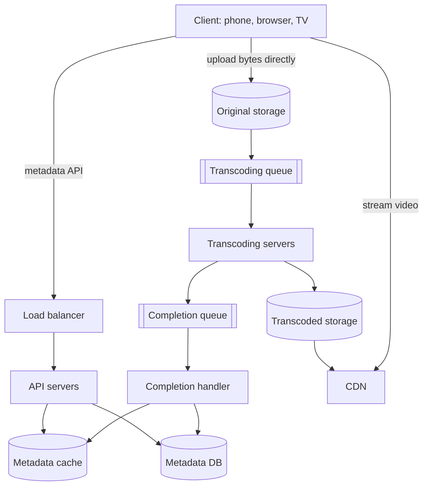
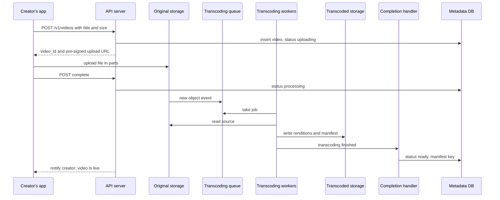
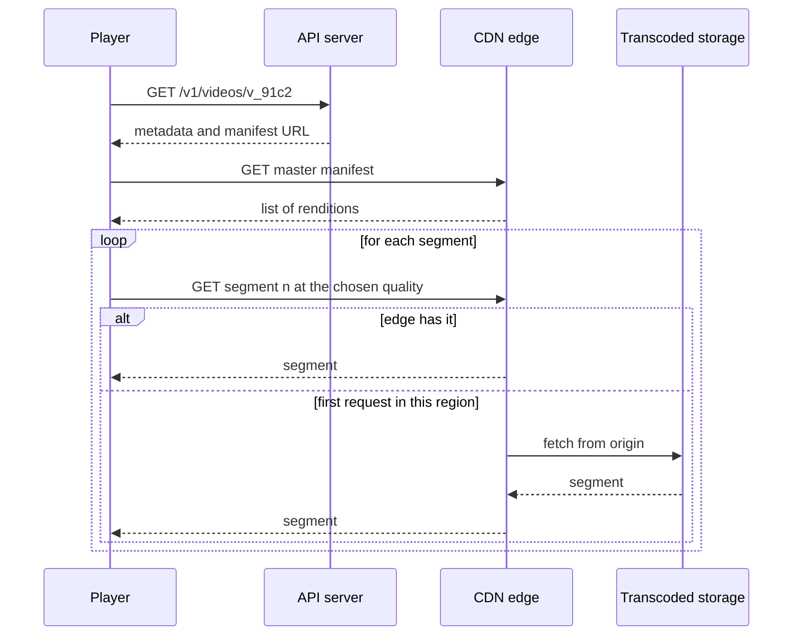

# Design a video platform I: requirements, upload and streaming flows

## Before this lesson

You should know CDNs and blob stores ([The five building blocks](#/lesson/system-design/core-components)), queues and workers ([Scaling from zero II](#/lesson/system-design/scale-stateless-to-sharded)), estimation including bandwidth ([Estimation II](#/lesson/system-design/estimation-worked)) and the four-step framework.

## In plain words

A **video platform** lets people upload videos and lets other people watch them on any device, anywhere, with as little waiting as possible. YouTube is the best-known example; the same design applies to course sites, short-clip apps and company training portals.

Think of a publisher and its bookshops. An author hands in one manuscript. The publisher does not ship that manuscript to readers. It typesets the text into several editions (hardback, paperback, large print, pocket size) and stocks them in bookshops all over the country. A reader walks into a nearby shop and picks the edition that suits them.

A video platform does the same with a different raw material:

- The **upload** is the manuscript: one large file in whatever format the creator's camera produced.
- **Transcoding** is the typesetting: converting it into many versions, at different picture sizes and qualities, in formats that phones, televisions and browsers can play.
- The **CDN** is the chain of bookshops: copies stored near viewers.
- **Streaming** is the reader choosing an edition: the player picks the version that fits the screen and the network at this moment.

This problem is popular in interviews because it is dominated by something the other designs barely touch: moving and transforming very large files, and the bandwidth bill that comes with it. On the job, any product that handles user-uploaded media meets the same pipeline.

This module follows the track's design structure. This lesson covers requirements, estimates, the API, the data model and the high-level design of the two flows. The next covers transcoding in depth, adaptive bitrate streaming, CDN cost, safety, failures, trade-offs, a sample dialogue and common mistakes.

## 1. Requirements and the scope questions to ask

| Question | Why it matters | Assumed answer |
|---|---|---|
| Which features? | The full product is enormous | Upload a video; watch a video |
| Which clients? | Formats and players | Mobile apps, web browsers, smart TVs |
| How many users? | Sizing | 5 million daily active users |
| How long do people watch? | Bandwidth | 30 minutes per day on average |
| International audience? | CDN and regions | Yes, a large share |
| Which resolutions and formats? | Transcoding ladder | Most common ones, up to 1080p; discuss 4K |
| Maximum file size? | Upload design | 1 GB for now |
| Is encryption required? | Storage and delivery | Yes, in transit and at rest |
| Can we use existing cloud services? | Build or buy | Yes: blob storage and a CDN |

**Functional requirements**

1. Upload videos quickly and reliably.
2. Stream videos smoothly, with the ability to change quality.

**Non-functional requirements**

1. **Smooth playback:** start quickly and rarely stall (stalling is called **buffering** or *rebuffering*).
2. **High availability** for watching; uploading may tolerate brief degradation.
3. **Scalability and reliability:** uploaded videos are never lost.
4. **Low infrastructure cost**, because storage and data transfer are expensive at this scale.

Out of scope, and worth naming so the interviewer can pull any of them in: comments, likes, subscriptions, recommendations, search, advertising and live streaming.

The last assumption in the table matters. Building a blob store or a global CDN is a multi-year project even for large companies. A sound answer says so and uses existing services, which is also what Netflix and many others do.

## 2. Estimates

```python-run
dau = 5_000_000
videos_watched_per_user = 5
upload_fraction = 0.10                 # share of daily users who upload one video
avg_video_bytes = 300 * 10**6          # 300 MB source file
watch_minutes_per_user = 30
avg_bitrate_bps = 2_500_000            # 2.5 Mbit/s average across devices and qualities
cdn_cost_per_gb = 0.02                 # dollars; large customers negotiate less

uploads_day = dau * upload_fraction
storage_day = uploads_day * avg_video_bytes
print(f"uploads per day            : {uploads_day:,.0f}")
print(f"raw upload storage per day : {storage_day / 1e12:,.0f} TB")
print(f"with transcoded versions (about 1.5x more): {storage_day * 2.5 / 1e12:,.0f} TB per day, "
      f"{storage_day * 2.5 * 365 / 1e15:,.0f} PB per year")

watch_seconds = dau * watch_minutes_per_user * 60
bytes_streamed = watch_seconds * avg_bitrate_bps / 8
print(f"\nvideo streamed per day     : {bytes_streamed / 1e15:,.2f} PB")
print(f"CDN cost per day           : ${bytes_streamed / 1e9 * cdn_cost_per_gb:,.0f}")
print(f"CDN cost per year          : ${bytes_streamed / 1e9 * cdn_cost_per_gb * 365 / 1e6:,.1f} million")

concurrent = dau * watch_minutes_per_user / (24 * 60) * 3      # peak about 3x the average
print(f"\npeak concurrent viewers    : {concurrent:,.0f}")
print(f"peak egress                : {concurrent * avg_bitrate_bps / 1e9:,.0f} Gbit/s")
print(f"metadata requests          : {dau * videos_watched_per_user / 86_400:,.0f} video-page loads per second")
```

What the numbers say:

- **Storage:** 150 TB of raw uploads per day, several hundred terabytes with transcoded versions, and over a hundred petabytes a year. Only blob storage can hold this.
- **Delivery:** nearly 3 PB streamed per day. At two cents per gigabyte that is tens of thousands of dollars a day and around twenty million dollars a year. **The CDN bill is the dominant cost**, so reducing bytes delivered is a first-class design goal, not an afterthought.
- **Egress:** hundreds of gigabits per second at peak. This cannot come from your own data centre; a CDN must serve the video bytes.
- **Metadata traffic** is small: a few hundred page loads per second. The API servers and database are the easy part.

The shape of this system is unusual: a small, ordinary web application sitting on top of an enormous media pipeline.

## 3. API

Video bytes do not travel through the API servers. The API handles metadata and hands out permission for the client to talk to storage and the CDN directly.

```
POST /v1/videos
  body:    {"title": "...", "description": "...", "file_size": 734003200, "content_type": "video/mp4"}
  returns: 201 {"video_id": "v_91c2", "upload_url": "<pre-signed URL>", "upload_id": "..."}

PUT <pre-signed URL>            (client sends the file bytes directly to blob storage, in parts)

POST /v1/videos/{video_id}/complete        -> 202 processing started

GET /v1/videos/{video_id}
  returns: 200 {"video_id": "v_91c2", "title": "...", "status": "ready",
                "manifest_url": "https://cdn.example.com/v_91c2/master.m3u8",
                "thumbnail_url": "...", "duration_seconds": 612}

PATCH /v1/videos/{video_id}     body: {"title": "..."}        -> update metadata
```

A **pre-signed URL** is a web address that includes a temporary, cryptographically signed permission to upload (or download) one specific object. The API server creates it; the client uses it to send the file straight to the blob store. Your servers never carry the gigabyte of video, so they stay small and cheap, and a slow upload does not tie up an application server for ten minutes.

The `manifest_url` returned by the read call points to a small text file that lists the available versions of the video. The player downloads it first; the next lesson explains what it contains.

## 4. Data model

```
videos(video_id PK, owner_id, title, description, status,          -- uploading | processing | ready | failed | blocked
       duration_seconds, source_object_key, manifest_object_key,
       thumbnail_object_key, created_at, published_at)
    index on (owner_id, created_at)

renditions(video_id, rendition, codec, width, height, bitrate_kbps, object_prefix, status)
    PK (video_id, rendition)

users(user_id PK, name, channel_name, ...)

video_stats(video_id PK, view_count, like_count)       -- counters kept apart; updated very often

Blob storage
  originals/      v_91c2/source.mp4                       -- the uploaded file
  transcoded/     v_91c2/720p/seg_00001.m4s ...           -- segments of each rendition
                  v_91c2/master.m3u8                      -- the manifest
  thumbnails/     v_91c2/thumb_1.jpg
```

Points to make:

- **Metadata is small and relational.** Hundreds of thousands of rows per day; a replicated relational database with a cache in front is ample, sharded by `video_id` when it grows.
- **Counters are separated** from the main row, because views change thousands of times a second on a popular video and should not cause contention with title edits.
- **`status` is the bridge between the two halves.** The upload and transcoding pipeline moves a video through its states, and the API shows the video only when it is `ready`.
- **Video bytes live only in blob storage**, addressed by keys stored in the metadata.

## 5. High-level design



Three parts: the client, the CDN (which serves all video bytes), and the API servers (which serve everything else: metadata, sign-up, generating upload URLs).

### Video uploading flow

Two things happen in parallel when a creator uploads.

**The video file:**

1. The client asks the API for an upload URL and receives a pre-signed URL.
2. The client uploads the file directly to **original storage** (a blob store).
3. When the upload completes, a message is placed on the **transcoding queue**.
4. **Transcoding servers** take the job, convert the video into several formats and resolutions, and write the output to **transcoded storage**.
5. A message on the **completion queue** tells **completion handlers** to update the metadata database and cache: the video's status becomes `ready` and its manifest location is recorded.
6. The CDN fetches the transcoded files from storage as viewers request them (or they are pushed there in advance for videos expected to be popular).

**The metadata:** while the file is uploading, the client sends the title, description and tags to the API servers, which write them to the metadata database and cache.



The creator gets control back as soon as the upload finishes. Transcoding takes minutes and happens in the background; the creator is notified when the video is live.

### Video streaming flow

**Downloading** a video means copying the whole file to the device before playing. **Streaming** means the device receives the video continuously and plays it as it arrives, holding only a few seconds or minutes ahead in a **buffer**. Streaming lets playback start almost at once and avoids fetching parts that are never watched.

A **streaming protocol** is the agreed way of delivering video in pieces. The common ones are **HLS** (HTTP Live Streaming, from Apple), **MPEG-DASH** (an international standard), and older or proprietary ones such as Microsoft Smooth Streaming and Adobe HDS. Different devices support different protocols, which is one reason a video is prepared in several packagings.

The flow:

1. The client asks the API for the video's metadata and receives the manifest URL.
2. The player downloads the manifest from the CDN.
3. The player requests video **segments** (a few seconds each) from the nearest CDN edge server, choosing the quality that suits the screen and the network, and plays them in order.



Because the video is delivered from an edge server near the viewer, there is little latency and your own servers carry none of the video traffic.

## 6. A first look at why the video is cut into pieces

One idea underlies both flows: the video is not handled as one file. It is cut into segments of a few seconds.

```python-run
video_seconds = 612
segment_seconds = 4
ladder_kbps = {"240p": 400, "480p": 1400, "720p": 2800, "1080p": 5000}

segments = -(-video_seconds // segment_seconds)            # ceiling division
print(f"a {video_seconds}-second video becomes {segments} segments of {segment_seconds} s per rendition")
total = 0
for name, kbps in ladder_kbps.items():
    size = video_seconds * kbps * 1000 / 8
    total += size
    print(f"  {name:>6}: {size / 1e6:7.1f} MB in total, about {size / segments / 1e3:6.0f} KB per segment")
print(f"all renditions together: {total / 1e6:,.0f} MB")

watched = 90                                                # a viewer leaves after 90 seconds at 720p
fetched = -(-(watched + 12) // segment_seconds)             # what was played plus a 12-second buffer
print(f"\nviewer who watches {watched} s at 720p downloads {fetched} segments "
      f"= {fetched * segment_seconds * 2800 * 1000 / 8 / 1e6:.0f} MB, not the whole "
      f"{video_seconds * 2800 * 1000 / 8 / 1e6:.0f} MB")
```

Segments are what make everything else possible: a viewer who leaves early downloads only what they watched plus a small buffer; the player can change quality at any segment boundary; a failed download repeats one small file; segments are ordinary files that a CDN can cache; and on the upload side, segments can be transcoded in parallel on many machines.

> [!INTERVIEW]
> Open with the cost observation: "the metadata side is a small web application; the interesting parts are the transcoding pipeline and the CDN bill, which at these numbers is tens of thousands of dollars a day." It shows you have identified what is distinctive about this problem before drawing anything.

> [!TIP]
> Say explicitly that large files bypass your application servers in both directions: uploads go straight to blob storage with a pre-signed URL, and playback comes straight from the CDN. Interviewers listen for this.

> [!WARNING]
> A video must not become visible the moment its upload finishes. It has to be transcoded, checked for policy violations and marked `ready` first. Explain the `status` field and which component flips it.

## Common mistakes

- **Routing video bytes through the API servers**, on upload or on playback.
- **Storing video in a database.**
- **Serving the original uploaded file to viewers.** It is in the wrong format for many devices and far too large for mobile networks.
- **Ignoring the cost of delivery** when it is the largest number in the estimate.
- **Proposing to build a CDN or a blob store** in a 45-minute design.
- **Making the creator wait for transcoding** before the upload request returns.
- **Treating the video as one file** instead of segments.

## Summary

- A video platform is a small metadata application on top of a large media pipeline; uploads are transcoded into many versions and delivered through a CDN.
- At 5 million daily users: hundreds of terabytes of new storage a day, about 3 PB streamed a day, and a CDN bill that dominates cost.
- The API handles metadata and issues pre-signed URLs; video bytes go directly to blob storage and come directly from the CDN.
- Upload flow: client to original storage, transcoding queue, transcoding workers, transcoded storage, completion handler, status `ready`.
- Streaming flow: metadata from the API, manifest from the CDN, then segments from the nearest edge at a quality the player chooses.
- Cutting video into segments enables partial downloads, quality switching, cheap retries, CDN caching and parallel transcoding.

## Glossary

- **Transcoding**: converting a video into other formats, resolutions and bitrates.
- **Resolution**: the picture size in pixels, such as 1280 by 720 ("720p").
- **Bitrate**: the amount of data per second of video; higher means better quality and more bandwidth.
- **Rendition**: one version of a video at a particular resolution and bitrate.
- **Streaming**: playing media as it arrives instead of after a full download.
- **Buffer**: the few seconds of video the player holds ahead of the playback position.
- **Buffering (rebuffering)**: a pause in playback while the player waits for data.
- **Streaming protocol**: the agreed method of delivering video in pieces, such as HLS or MPEG-DASH.
- **Segment**: a few seconds of video stored as its own file.
- **Manifest**: a small file listing a video's renditions and segments.
- **Pre-signed URL**: a temporary, signed address granting permission to upload or download one object.
- **Original storage / transcoded storage**: blob storage for uploaded source files, and for the processed outputs.
- **Completion handler**: a worker that updates metadata when processing finishes.
- **Egress**: data leaving your system towards users.

## Check yourself

```quiz
[
  {"q": "In this design, which component delivers video bytes to viewers?",
   "options": ["The API servers", "The metadata database", "The CDN", "The transcoding queue"],
   "answer": 2,
   "explain": "All video traffic is served from CDN edge servers. API servers handle metadata only."},
  {"q": "What does a pre-signed URL allow?",
   "options": ["It makes the video public for ever", "The client uploads directly to blob storage with temporary permission, bypassing application servers", "It transcodes the video", "It replaces authentication for the whole API"],
   "answer": 1,
   "explain": "The API grants a short-lived permission for one object. The large file then travels straight to storage."},
  {"q": "According to the estimate, what is the largest cost driver?",
   "options": ["API servers", "The metadata database", "Data transfer through the CDN", "Thumbnails"],
   "answer": 2,
   "explain": "Streaming nearly 3 PB a day costs tens of thousands of dollars daily, far more than the compute for metadata."},
  {"q": "Why is the original uploaded file not served to viewers directly?",
   "options": ["Blob storage cannot serve files", "Its format may not play on many devices and its size is unsuitable for slower networks", "It is encrypted", "It has no thumbnail"],
   "answer": 1,
   "explain": "Devices support different formats and networks differ widely. Transcoding produces versions that each device and connection can handle."},
  {"q": "When does the creator's upload request complete?",
   "options": ["After all renditions are transcoded", "When the file has been stored; transcoding continues asynchronously", "After the first viewer watches", "After the CDN has cached every segment"],
   "answer": 1,
   "explain": "Transcoding takes minutes and runs through a queue. The creator is notified later when the video is ready."},
  {"q": "What is one benefit of cutting a video into segments of a few seconds?",
   "options": ["Segments remove the need for a CDN", "The player can switch quality at segment boundaries and a viewer downloads only what is watched", "Segments are stored in the database", "Segments cannot be cached"],
   "answer": 1,
   "explain": "Small independent files enable adaptive quality, partial downloads, cheap retries, caching and parallel transcoding."},
  {"q": "Which part of the system updates a video's status to ready?",
   "options": ["The client", "The CDN", "The completion handler, after transcoding finishes", "The load balancer"],
   "answer": 2,
   "explain": "Completion handlers consume the completion queue and update the metadata database and cache."}
]
```

> **Source:** Xu, *System Design Interview: An Insider's Guide*, ch. 14 (video platform: scope, estimation, video uploading flow, video streaming flow) as a topic guide; Apple Developer documentation, "HTTP Live Streaming", https://developer.apple.com/streaming/ ; Amazon S3 documentation, "Sharing objects with presigned URLs", https://docs.aws.amazon.com/AmazonS3/latest/userguide/ShareObjectPreSignedURL.html
