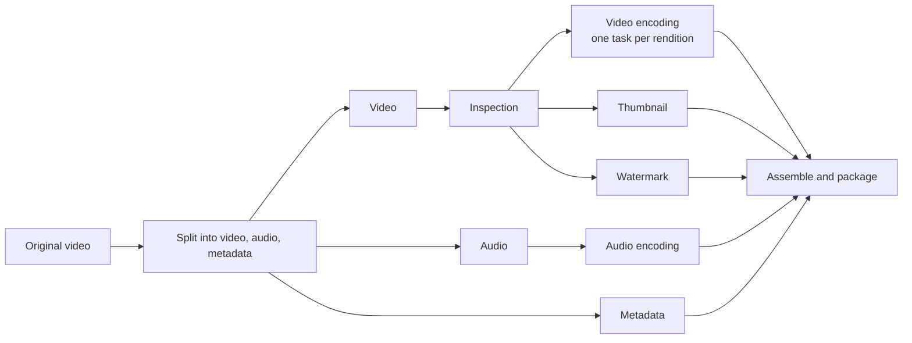
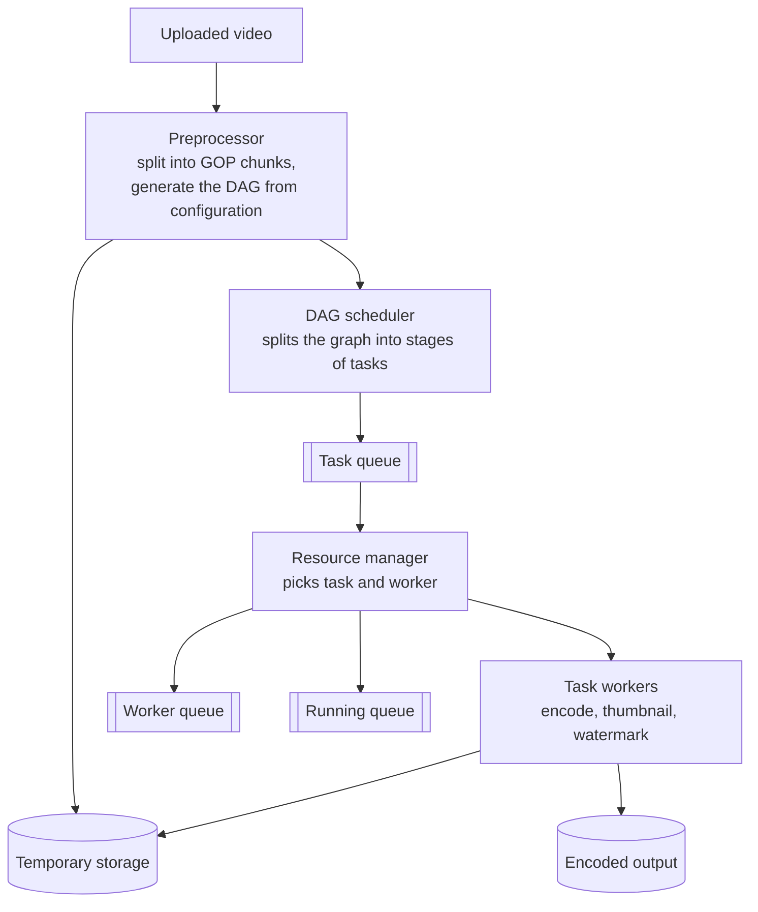

# Design a video platform II: transcoding, adaptive bitrate, CDN cost and failures

## Before this lesson

Read [Design a video platform I](#/lesson/system-design/video-design). You should know the two flows (upload and streaming), that video bytes bypass the API servers in both directions, what a rendition, a segment and a manifest are, and that the CDN bill dominates cost.

## In plain words

The previous lesson drew a box called "transcoding servers" and said the player "chooses a quality". Those two phrases hide most of the engineering.

**Transcoding** is a factory line. A raw video comes in; it is inspected, cut into pieces, and each piece is processed in several ways at once (shrunk to different sizes, compressed, a thumbnail taken, a watermark added) before the pieces are assembled into finished products. A factory line is planned as a chart of steps with arrows showing which step depends on which. Engineers call that chart a **DAG**.

**Adaptive bitrate streaming** is a careful driver. The player keeps an eye on the road ahead (how fast data is arriving and how much video is already buffered) and changes gear smoothly: lower quality when the connection weakens, higher when it recovers, so that the picture keeps moving.

**Cost control** is deciding what to keep in the expensive high-street shops. Bestsellers go everywhere. Rarely requested titles stay in one warehouse and are fetched on demand.

This lesson works through all three, then covers safety, failure handling and the usual interview follow-ups.

## 1. Deep dive: what transcoding is

A recorded video is very large. One second of uncompressed 1080p video at 30 frames per second is roughly 180 megabytes. Two things make it manageable:

- A **codec** (coder-decoder) is the compression algorithm that shrinks video, usually by storing only what changes from one frame to the next. Common ones are H.264 (supported nearly everywhere), H.265/HEVC, VP9 and AV1 (newer, smaller files, more computation to produce).
- A **container** is the file format that packages the compressed video, the audio and information about them. The file extension usually names the container: `.mp4`, `.mov`, `.webm`.

Transcoding converts the uploaded file into the combinations of codec, container, resolution and bitrate the platform serves. It is needed because:

- Raw and lightly compressed video takes too much space.
- Different devices and browsers support different codecs and containers.
- Viewers have different screens and networks: a phone on a weak mobile signal needs a small, low-bitrate version; a television on fibre can show 1080p or 4K.
- Network conditions change during playback, so the player needs several versions to switch between.

The set of versions is called the **bitrate ladder**, for example:

| Rendition | Resolution | Approximate bitrate |
|---|---|---|
| 240p | 426 x 240 | 400 kbit/s |
| 360p | 640 x 360 | 800 kbit/s |
| 480p | 854 x 480 | 1.4 Mbit/s |
| 720p | 1280 x 720 | 2.8 Mbit/s |
| 1080p | 1920 x 1080 | 5 Mbit/s |

Transcoding is by far the most computation-heavy part of the platform: producing one minute of output can take several minutes of processor time across the ladder.

## 2. Deep dive: the transcoding pipeline as a DAG

Different creators need different processing. One wants a watermark, another supplies their own thumbnail, some upload high-definition and some do not. Hard-coding one sequence of steps would be rigid, so the pipeline is described as a **directed acyclic graph (DAG)**: tasks are nodes, and an arrow from A to B means "B needs A's output". "Acyclic" means there are no loops, so there is always a valid order in which to run the tasks, and tasks that do not depend on each other can run in parallel.



Typical tasks:

- **Inspection:** check that the file is a valid, undamaged video.
- **Video encoding:** produce each rendition.
- **Thumbnail:** take one from the video, or use the creator's.
- **Watermark:** overlay an identifying image.

A scheduler runs tasks in dependency order. The code below finds that order and shows which tasks can run at the same time.

```python-run
from collections import defaultdict

# task -> the tasks it depends on
DEPENDS_ON = {
    "split": [],
    "inspect": ["split"],
    "encode_240p": ["inspect"], "encode_480p": ["inspect"], "encode_720p": ["inspect"], "encode_1080p": ["inspect"],
    "thumbnail": ["inspect"],
    "watermark": ["inspect"],
    "encode_audio": ["split"],
    "package": ["encode_240p", "encode_480p", "encode_720p", "encode_1080p", "encode_audio", "watermark", "thumbnail"],
}
DURATION = {"split": 5, "inspect": 3, "encode_240p": 20, "encode_480p": 40, "encode_720p": 80,
            "encode_1080p": 150, "thumbnail": 2, "watermark": 10, "encode_audio": 8, "package": 6}

def stages(depends_on):
    """Group tasks into stages: a task joins the first stage after all its dependencies."""
    remaining = {t: set(d) for t, d in depends_on.items()}
    done, result = set(), []
    while remaining:
        ready = sorted(t for t, deps in remaining.items() if deps <= done)
        if not ready:
            raise ValueError("cycle detected: this is not a DAG")
        result.append(ready)
        done |= set(ready)
        for t in ready:
            del remaining[t]
    return result

finish = {}
for stage in stages(DEPENDS_ON):
    for task in stage:
        start = max((finish[d] for d in DEPENDS_ON[task]), default=0)
        finish[task] = start + DURATION[task]
    print("run in parallel:", stage)

print(f"\none after another : {sum(DURATION.values())} seconds")
print(f"with parallelism  : {max(finish.values())} seconds (limited by the slowest chain)")
```

Run sequentially the tasks take over five minutes; run as a DAG they take about half that, limited by the 1080p encode. That remaining bottleneck is the reason for the next idea.

### Splitting the video itself

A long video is cut into chunks at **GOP** boundaries. A GOP (group of pictures) is a short run of frames that can be decoded independently of the rest, usually a few seconds long. Each chunk can be encoded on a different machine at the same time, and the results joined afterwards. A two-hour film is then processed in minutes instead of hours, and a failure costs one chunk, not the whole job.

### The architecture around the DAG



| Component | Job |
|---|---|
| **Preprocessor** | Splits the stream into GOP-aligned chunks; builds the DAG from a configuration file; stores chunks in temporary storage so a retry does not need the upload again |
| **DAG scheduler** | Breaks the graph into stages and puts their tasks on the task queue |
| **Resource manager** | Matches tasks to workers. It keeps a task queue ordered by priority, a queue of worker availability, and a record of what is running; a scheduler inside it picks the highest-priority task and the best free worker |
| **Task workers** | Run the tasks defined in the DAG. Different pools suit different work, for example machines with hardware video encoders |
| **Temporary storage** | Small metadata in memory, chunk data in blob storage; cleared when the job finishes |
| **Encoded output** | The final segments and manifests |

## 3. Deep dive: adaptive bitrate streaming

With several renditions cut into aligned segments, the player can pick a different rendition for each segment. This is **adaptive bitrate (ABR) streaming**.

The **manifest** tells the player what exists. In HLS it is a text file listing each rendition's bitrate and resolution and where to find its own list of segments:

```
#EXTM3U
#EXT-X-STREAM-INF:BANDWIDTH=400000,RESOLUTION=426x240
240p/playlist.m3u8
#EXT-X-STREAM-INF:BANDWIDTH=1400000,RESOLUTION=854x480
480p/playlist.m3u8
#EXT-X-STREAM-INF:BANDWIDTH=2800000,RESOLUTION=1280x720
720p/playlist.m3u8
#EXT-X-STREAM-INF:BANDWIDTH=5000000,RESOLUTION=1920x1080
1080p/playlist.m3u8
```

The decision logic lives in the player, not the server. Before each segment it estimates the network **throughput** (how fast recent segments downloaded) and checks its buffer. A simple and common rule: choose the highest bitrate comfortably below the measured throughput, and drop to the lowest immediately if the buffer is nearly empty. The server and CDN stay simple: they serve static files.

```python-run
LADDER = [("240p", 400), ("480p", 1400), ("720p", 2800), ("1080p", 5000)]      # kbit/s
SEGMENT_S = 4
# Network speed in kbit/s while each successive segment downloads: good, a bad patch, recovery.
network = [6000] * 6 + [1800] * 4 + [600] * 4 + [3500] * 5 + [8000] * 5

def play(strategy):
    buffer_s, stalls, history, estimate = 8.0, 0.0, [], network[0]
    for speed in network:
        if strategy == "adaptive":
            usable = estimate * 0.8                              # keep a safety margin
            name, kbps = max((r for r in LADDER if r[1] <= usable), default=LADDER[0], key=lambda r: r[1])
            if buffer_s < 4:
                name, kbps = LADDER[0]                           # nearly empty: play safe
        else:
            name, kbps = LADDER[-1]                              # always 1080p
        download_s = SEGMENT_S * kbps / speed                    # time to fetch this segment
        buffer_s -= download_s                                   # video plays while we download
        if buffer_s < 0:
            stalls += -buffer_s                                  # the screen froze for this long
            buffer_s = 0
        buffer_s += SEGMENT_S
        estimate = speed                                         # what we measured for this segment
        history.append(name)
    return history, stalls

for strategy in ("fixed 1080p", "adaptive"):
    history, stalls = play("adaptive" if strategy == "adaptive" else "fixed")
    print(f"{strategy:12s} stalled for {stalls:5.1f} s")
    print("   ", " ".join(h.rjust(5) for h in history))
```

The fixed-quality player freezes for more than two minutes in total during the bad patch. The adaptive player steps down to 480p and 240p, keeps playing, and climbs back when the network recovers. Viewers forgive a softer picture far more readily than a frozen one, which is why adaptive streaming is universal.

## 4. Deep dive: making uploads fast and reliable

**Parallel, resumable uploads.** Uploading a gigabyte as one request is fragile: a dropped connection at 95% means starting again. The client splits the file into parts aligned to GOPs, uploads several at once, and retries only the parts that failed. The blob store's multipart upload feature assembles them.

**Upload close to the user.** Use the cloud provider's edge locations or regional upload endpoints, so the first network hop is short.

**Loose coupling with queues.** If transcoding had to wait for the upload module, and encoding for the download step, a slow stage would idle the others. With a message queue between each pair of stages, every stage works from its own queue at its own pace and scales independently.


## 5. Deep dive: reducing the CDN bill

The estimate put delivery cost above everything else. Video popularity follows a **long-tail distribution**: a small number of videos receive most of the views, and a very large number receive almost none.

```python-run
N = 100_000                                   # videos in the catalogue
weights = [1 / (rank ** 1.0) for rank in range(1, N + 1)]       # a Zipf-like popularity curve
total = sum(weights)

running, marks = 0.0, {}
for rank, w in enumerate(weights, 1):
    running += w
    for share in (0.5, 0.8, 0.9):
        if share not in marks and running / total >= share:
            marks[share] = rank
for share, rank in marks.items():
    print(f"{share:.0%} of views come from the top {rank:>6,} videos ({rank / N:.1%} of the catalogue)")

CDN, ORIGIN = 0.020, 0.008                    # dollars per GB: CDN versus serving from our own storage tier
daily_gb = 2_800_000
for share, rank in marks.items():
    cost = daily_gb * (share * CDN + (1 - share) * ORIGIN)
    print(f"CDN for the top {rank / N:5.1%} only: ${cost:,.0f} per day (all on CDN: ${daily_gb * CDN:,.0f})")
```

A small slice of the catalogue accounts for most views. Strategies that follow from this:

1. **Serve only popular videos from the CDN.** The long tail is served from your own high-capacity storage servers, which is slower for a few viewers and much cheaper.
2. **Encode fewer renditions for unpopular content**, or encode on demand the first time a rendition is requested. Short videos can be encoded on request.
3. **Distribute regionally.** A video popular in one country need not be cached on every continent.
4. **Build your own CDN and partner with internet service providers** (ISPs). This is a huge project that only makes sense at the scale of the largest streaming companies; Netflix's Open Connect is the well-known example.
5. **Use better codecs.** A newer codec such as AV1 delivers the same quality in noticeably fewer bytes, at a higher encoding cost that pays off only for videos watched many times.

All of these depend on measuring viewing patterns, which is why analytics is part of the design and not an optional extra.

## 6. Deep dive: safety and rights

**Pre-signed upload URLs** ensure that only an authorised user can upload, and only to the location granted.

**Protecting copyrighted video.** Three levels:

- **Digital rights management (DRM):** systems such as Apple FairPlay, Google Widevine and Microsoft PlayReady, in which the player obtains a licence to decrypt.
- **AES encryption:** segments are encrypted, and only authorised players receive the key.
- **Visual watermarking:** an overlay identifying the owner or, for forensic watermarks, the viewer.

**Content moderation.** Every upload passes automated checks (known-illegal material by fingerprint, policy violations by classifier, copyright matches against a reference library) as tasks in the DAG, with human review for uncertain cases. A video becomes `ready` only after passing.

## 7. Bottlenecks and failure handling

Errors fall into two kinds. **Recoverable errors**, such as a failed encode of one chunk, are retried a few times; if they keep failing, the job is marked failed and the creator is told. **Non-recoverable errors**, such as a malformed file, stop the job at once with a clear error for the creator.

| Failure | Handling |
|---|---|
| Upload interrupted | Resume: retry only the missing parts |
| Split or transcode fails for a chunk | Retry that chunk; the source chunk is still in temporary storage |
| Malformed or unsupported video | Fail fast at inspection; return an error to the creator |
| Preprocessor fails | Regenerate the DAG from the stored source |
| DAG scheduler fails | Reschedule; task states are persisted |
| Resource manager queue lost | Use a replica of the queue |
| Task worker dies | The task times out and is given to another worker; tasks are idempotent because output keys are deterministic |
| API server dies | Stateless; the load balancer routes elsewhere |
| Metadata cache node dies | Read from a replica; rebuild from the database |
| Metadata primary dies | Promote a replica |
| CDN edge or region problem | The CDN routes to another edge; the player retries and may fall back to origin |
| Transcoding backlog during a surge | Queue absorbs it; autoscale workers on queue depth; prioritise short videos and paying creators |

Because a task may run twice after a timeout, tasks write to fixed output paths (`v_91c2/720p/seg_00017`) so a repeat overwrites identical content instead of creating duplicates.

## 8. Trade-offs and alternatives

| Decision | Chosen | Alternative | When the alternative fits |
|---|---|---|---|
| Transcoding timing | All standard renditions at upload | On-demand transcoding at the first request | Huge catalogues of rarely watched video |
| Segment length | About 4 seconds | 2 seconds or 10 seconds | Shorter adapts faster and suits low-latency live; longer compresses better with fewer requests |
| Protocols | HLS and DASH from one set of segments (CMAF) | Separate packaging per protocol | Older device support |
| Delivery | CDN for popular, origin for the tail | CDN for everything | Small catalogues, or when simplicity outweighs cost |
| Compute | Elastic pools, some on cheap interruptible machines | Fixed fleet | Steady, predictable upload volume |
| Build or buy | Cloud storage, CDN and optionally a managed transcoding service | Build in-house | Only at very large scale |

**Live streaming** is a frequent follow-up. It shares the ideas (segments, ladder, CDN) with tighter constraints: there is no time for a long pipeline, so segments are short and encoded in real time, the ladder is smaller, and the protocol is tuned for low delay. Errors must be handled within seconds because nothing can be redone later.

## 9. What a strong answer sounds like

> **Interviewer:** What happens after the file lands in storage?
>
> **Candidate:** It enters a transcoding pipeline modelled as a DAG. A preprocessor splits the video into GOP-aligned chunks and builds the task graph from the creator's settings: inspection, then encoding for each rung of the bitrate ladder, thumbnail, watermark and audio in parallel, then packaging into segments and manifests. A scheduler feeds tasks to a resource manager, which assigns them to worker pools. Chunks are encoded in parallel across machines, so a long video takes minutes.
>
> **Interviewer:** How does playback cope with a bad connection?
>
> **Candidate:** Adaptive bitrate. Every rendition is cut into aligned four-second segments and listed in a manifest. The player measures throughput and buffer level and chooses a rendition per segment: the highest one safely under the measured speed, dropping to the lowest if the buffer is nearly empty. The logic is in the player, so the CDN serves plain static files.
>
> **Interviewer:** Your CDN cost is twenty million dollars a year. Reduce it.
>
> **Candidate:** Views follow a long tail, so I would keep only the popular videos on the CDN and serve the rest from our own storage tier, encode fewer renditions for unpopular videos or do it on demand, cache regionally popular content only in its region, and adopt a more efficient codec for the most watched videos, where the extra encoding cost is repaid. All of that needs viewing analytics.
>
> **Interviewer:** A worker crashes mid-encode.
>
> **Candidate:** The task times out and is reassigned. The source chunk is in temporary storage and outputs go to deterministic keys, so the retry is idempotent. Unrecoverable errors, such as a corrupt file, fail at inspection with a clear message to the creator.

## Common mistakes

- **A single fixed sequence of transcoding steps** with no room for per-video configuration or parallelism.
- **Transcoding a long video as one task on one machine.**
- **Putting the quality decision on the server.** The player decides.
- **Segments of different renditions that are not aligned**, which makes switching visible.
- **Every video in every rendition on every CDN edge.**
- **No moderation or rights step before publishing.**
- **Retrying non-recoverable errors**, or failing the whole job for one bad chunk.
- **Non-idempotent tasks**, which produce duplicate or mixed output after a retry.

## Summary

- Transcoding converts an upload into a bitrate ladder of renditions using codecs and containers that devices can play; it is the most compute-intensive stage.
- The pipeline is a DAG so that steps are configurable and independent steps run in parallel; long videos are split at GOP boundaries and encoded chunk by chunk.
- A preprocessor, DAG scheduler, resource manager and task workers, joined by queues, run the pipeline.
- Adaptive bitrate streaming lets the player choose a rendition per segment from a manifest, trading picture quality for uninterrupted playback.
- Uploads are parallel and resumable; stages are decoupled by queues.
- Delivery cost is cut by exploiting the long tail, encoding less for unpopular content, regional caching and better codecs.
- Classify errors as recoverable or not, retry at the smallest unit, and keep tasks idempotent.

## Glossary

- **Codec**: an algorithm that compresses and decompresses video or audio.
- **Container**: a file format that packages video, audio and metadata.
- **Bitrate ladder**: the set of renditions offered for a video.
- **DAG (directed acyclic graph)**: tasks linked by dependencies with no loops.
- **GOP (group of pictures)**: a short, independently decodable run of frames.
- **Preprocessor**: the component that splits the video and generates the task graph.
- **DAG scheduler**: the component that turns the graph into stages of tasks.
- **Resource manager**: the component that assigns tasks to workers.
- **Adaptive bitrate (ABR) streaming**: choosing a rendition per segment according to network and buffer.
- **Throughput**: the measured rate at which data arrives.
- **Multipart upload**: uploading a file as independent parts that are assembled afterwards.
- **Long-tail distribution**: a few items are very popular and very many are rarely requested.
- **DRM**: digital rights management; licensed decryption of protected video.
- **Recoverable / non-recoverable error**: one worth retrying, or one that cannot succeed.
- **On-demand transcoding**: producing a rendition only when it is first requested.

## Check yourself

```quiz
[
  {"q": "Why is the transcoding pipeline modelled as a DAG?",
   "options": ["DAGs compress video better", "It expresses dependencies between tasks, allows per-video configuration and lets independent tasks run in parallel", "It removes the need for workers", "It encrypts the video"],
   "answer": 1,
   "explain": "Tasks such as the four encodes, the thumbnail and the watermark depend on inspection but not on each other, so they can run at the same time."},
  {"q": "What is gained by splitting a video at GOP boundaries before encoding?",
   "options": ["Smaller thumbnails", "Chunks can be encoded independently on many machines and a failure repeats only one chunk", "The manifest becomes unnecessary", "Audio is removed"],
   "answer": 1,
   "explain": "A GOP can be decoded without reference to other frames, so chunks are independent units of work."},
  {"q": "Where is the decision about which rendition to play made in adaptive bitrate streaming?",
   "options": ["In the CDN edge server", "In the API server", "In the player, per segment, from measured throughput and buffer level", "In the transcoding worker"],
   "answer": 2,
   "explain": "The player has the information needed and the servers only serve static files, which keeps delivery simple and cacheable."},
  {"q": "The player's buffer is nearly empty and throughput has dropped. What should it do?",
   "options": ["Keep the current quality", "Switch to a lower bitrate for the next segments", "Download the whole video", "Request the original upload"],
   "answer": 1,
   "explain": "Lower-bitrate segments download faster than they play, so the buffer refills and playback does not stall."},
  {"q": "Which measure directly exploits the long-tail distribution of views to cut cost?",
   "options": ["Longer segments", "Serving only popular videos from the CDN and the rest from cheaper origin storage", "More renditions for every video", "Disabling the manifest"],
   "answer": 1,
   "explain": "A small share of videos accounts for most views. The long tail gains little from edge caching and costs less to serve from origin."},
  {"q": "An uploaded file turns out to be corrupt. How should the pipeline react?",
   "options": ["Retry the encode five times", "Stop at inspection and return an error to the creator", "Publish it anyway", "Move it to the CDN"],
   "answer": 1,
   "explain": "A malformed file is a non-recoverable error. Retrying wastes compute; failing fast with a clear message is correct."},
  {"q": "Why should transcoding tasks write to deterministic output paths?",
   "options": ["Paths must be short", "A task retried after a timeout then overwrites the same objects instead of creating duplicates", "The CDN requires it", "It makes encoding faster"],
   "answer": 1,
   "explain": "Tasks may run more than once. Fixed output keys make the repeat idempotent."},
  {"q": "Why are uploads split into parts?",
   "options": ["Blob stores reject large files", "Parts upload in parallel and an interruption repeats only the missing parts", "To create renditions", "To avoid transcoding"],
   "answer": 1,
   "explain": "A resumable multipart upload is faster and tolerates network failures without restarting from zero."}
]
```

> **Source:** Xu, *System Design Interview: An Insider's Guide*, ch. 14 (video transcoding, DAG model, transcoding architecture, system optimizations, safety, cost-saving, error handling) as a topic guide; Apple Developer documentation, "HTTP Live Streaming", https://developer.apple.com/streaming/ ; Netflix, "Open Connect", https://openconnect.netflix.com/ ; Netflix Technology Blog, "High Quality Video Encoding at Scale", https://netflixtechblog.com/high-quality-video-encoding-at-scale-d159db052746
