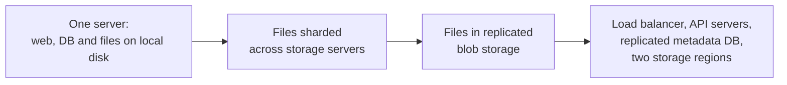
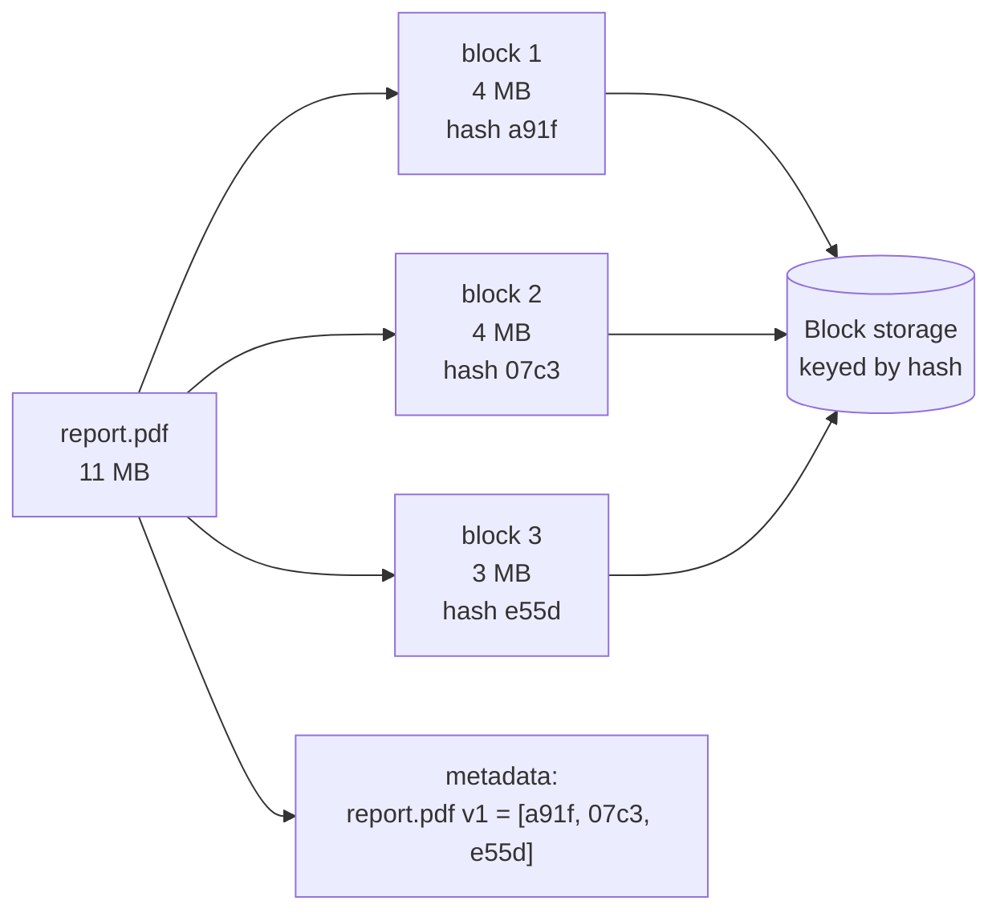
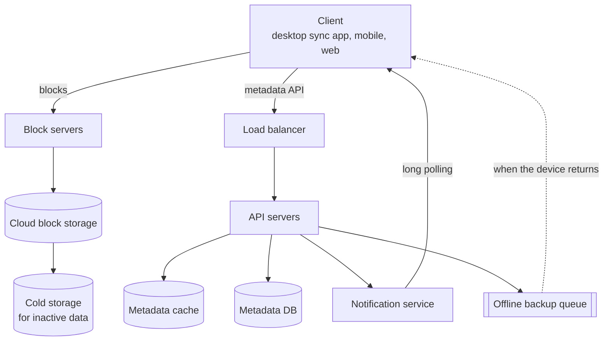
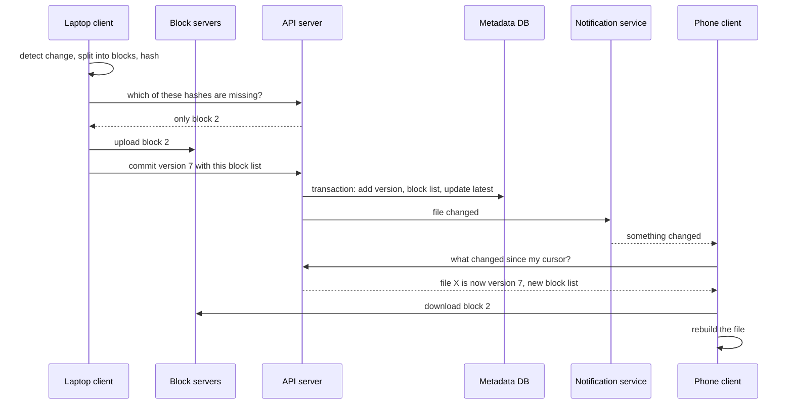

# Design file storage and sync I: requirements, blocks and the high-level design

## Before this lesson

You should know blob storage, queues and load balancers ([The five building blocks](#/lesson/system-design/core-components)), strong versus eventual consistency ([The vocabulary of scale](#/lesson/system-design/core-vocabulary)), long polling ([Design a chat system I](#/lesson/system-design/chat-design)) and pre-signed and resumable uploads ([Design a video platform](#/lesson/system-design/video-design)).

## In plain words

A **file storage and sync service** keeps your files on remote servers and keeps every one of your devices showing the same files. You save a document on your laptop and a moment later it is on your phone. Google Drive, Dropbox and OneDrive are the familiar examples.

Imagine keeping a ring binder at home and an identical one at the office, with an assistant whose only job is to keep the two the same. If you change one page at home, a good assistant does not photocopy the entire binder. They copy that one page, carry it across and swap it in. They also keep a logbook of every change, so that if you and a colleague edit the same page on the same afternoon, somebody notices instead of one version quietly vanishing.

That assistant has three jobs, and they are the three ideas of this design:

1. **Send only what changed.** Files are cut into pieces called **blocks**, and only changed blocks travel.
2. **Keep an accurate logbook.** Information about files (names, versions, which blocks make up each version) is **metadata**, and it must be exactly right.
3. **Tell the other binder promptly.** Other devices are **notified** that something changed and fetch it.

Interviewers like this problem because it is the opposite of a feed: correctness matters more than speed. Losing or corrupting someone's file is far worse than being slow. On the job, the same techniques (chunking, content hashing, delta transfer, conflict handling) appear in backup tools, package registries, container image stores and collaborative editors.

This module follows the track's design structure. This lesson covers requirements, estimates, the API, blocks and block storage, the data model and the high-level design. The next covers delta sync, consistency, the upload and download flows, notifications, conflicts, storage savings, failures, trade-offs, a sample dialogue and common mistakes.

## 1. Requirements and the scope questions to ask

| Question | Why it matters | Assumed answer |
|---|---|---|
| Most important features? | Scope | Upload, download, sync across devices, notifications |
| Mobile, web or both? | Sync client design | Both, plus desktop sync clients |
| Supported file types? | Processing | Any |
| Must files be encrypted? | Storage and key handling | Yes, in storage and in transit |
| File size limit? | Upload strategy | 10 GB |
| How many users? | Sizing | 50 million registered, 10 million daily active |
| Sharing and version history? | Data model | Yes to both |

**Functional requirements**

1. Add files (for example by dragging them into a folder).
2. Download files.
3. Sync files across a user's devices.
4. See the revision history of a file.
5. Share files with other people.
6. Be notified when a file is edited, deleted or shared.

**Non-functional requirements**

1. **Reliability.** Data loss is unacceptable. This is the top requirement.
2. **Fast sync.** If syncing takes too long, people stop using the product.
3. **Low bandwidth use**, especially on mobile data plans.
4. **Scalability** to very large volumes.
5. **High availability:** usable when some servers are offline, slow or cut off by network errors.

Notice how different the priorities are from the news feed. There, a stale read was harmless and we chose eventual consistency. Here, showing a file listing that does not match reality, or losing an edit, is a serious failure.

## 2. Estimates

```python-run
registered, dau = 50_000_000, 10_000_000
free_quota_gb = 10
uploads_per_user_day = 2
avg_file_bytes = 500_000                 # 500 KB
read_to_write = 1                        # roughly as many downloads as uploads

total_quota = registered * free_quota_gb * 10**9
uploads_day = dau * uploads_per_user_day
upload_qps = uploads_day / 86_400

print(f"storage if every quota is full : {total_quota / 1e15:,.0f} PB")
print(f"uploads per day                : {uploads_day:,}")
print(f"upload QPS                     : {upload_qps:,.0f}  (peak about {upload_qps * 2:,.0f})")
print(f"new data per day               : {uploads_day * avg_file_bytes / 1e12:,.0f} TB before deduplication")

block = 4 * 10**6
blocks_per_file = max(1, -(-avg_file_bytes // block))
print(f"metadata rows per day          : {uploads_day:,} file versions, {uploads_day * blocks_per_file:,} block references")

# What a single one-character edit to a large file costs, with and without blocks.
big_file = 2 * 10**9
print(f"\nedit one paragraph of a 2 GB file:")
print(f"   upload whole file : {big_file / 1e6:,.0f} MB")
print(f"   upload one block  : {block / 1e6:,.0f} MB  ({big_file / block:,.0f} times less)")
```

Conclusions:

- **Storage is in the hundreds of petabytes.** File contents go in blob storage, and any technique that avoids storing the same bytes twice is worth real money.
- **Request rates are modest:** a few hundred uploads per second. This is not a QPS problem.
- **Bandwidth is the problem that users feel.** The last lines show why: without block-level transfer, a tiny edit to a large file re-sends the whole file.

## 3. API

Three groups of operations.

**Upload.** Two kinds are supported: a simple upload for small files, and a **resumable upload** for large files or unreliable networks.

```
POST /v1/files/upload?uploadType=resumable
  body:    {"path": "/reports/q3.pdf", "size": 734003200, "parent_version": 6}
  returns: 200 {"upload_id": "up_55", "resumable_url": "..."}

PUT  <resumable_url>   headers: Content-Range: bytes 0-4194303/734003200    (repeat per chunk)
       -> 308 with the range received so far, or 201 when the last chunk arrives
```

A resumable upload has three steps: request a resumable URL, upload the data while watching progress, and if interrupted, ask how much arrived and continue from there.

**Download.**

```
GET /v1/files/download?path=/reports/q3.pdf           -> the latest version
GET /v1/files/download?path=/reports/q3.pdf&version=5 -> an older one
```

**Revisions.**

```
GET /v1/files/revisions?path=/reports/q3.pdf&limit=20
  returns: 200 {"revisions": [{"version": 7, "modified_at": "...", "modified_by": "...", "size": ...}, ...]}
```

In the real design the sync client does not send whole files to these endpoints. It talks in **blocks**, described next, through calls such as "which of these block hashes do you already have?" and "here is the new block list for this file". All calls require authentication and use HTTPS, so data is encrypted in transit.

## 4. From one server to a real design

It helps to start with the simplest version and see where it breaks.

**One server.** A web server receives uploads, a database stores metadata, and files sit in a directory on the server's disk, organised into one folder per user (a **namespace**). This works until the disk fills.

**More storage.** Shard the files across several storage servers by `user_id`. This relieves the disk, but each storage server is still a single copy. If one dies, those users lose their files, which violates the first requirement.

**Durable storage.** Move file contents to a managed blob store such as Amazon S3, which keeps redundant copies automatically, within a region and optionally across regions that are far apart. Durability targets for such stores are typically quoted as eleven nines.

**Everything else.** Then apply the standard steps from the scaling lessons: a load balancer in front of stateless API servers, a replicated and later sharded metadata database, and blob storage replicated across two regions.



That evolution fixes capacity and durability. It does not yet address the two distinctive problems: syncing efficiently, and syncing correctly when several clients edit the same file. Those need a different unit of storage.

## 5. Blocks: the central idea

Instead of treating a file as one object, split it into **blocks** (also called *chunks*) of a fixed maximum size; Dropbox has described using blocks of up to 4 MB. Each block is stored as its own object and identified by a **hash** of its contents, for example SHA-256: a function that turns the block's bytes into a fixed-length fingerprint, the same for identical bytes and different, for all practical purposes, for different bytes.

A file is then nothing more than **an ordered list of block hashes**.



Three benefits follow at once.

**Delta sync.** When a file is edited, only the blocks whose content changed have new hashes. Only those are uploaded, and other devices download only those.

**Deduplication.** Because a block's name is the hash of its contents, two identical blocks have the same name and are stored once, whether they come from two versions of one file, two files, or two different users. Storage named by content like this is called **content-addressed**.

**Resumability and parallelism.** Blocks upload independently, several at a time. An interrupted transfer repeats only the unfinished blocks.

```python-run
import hashlib

BLOCK = 8                                    # 8 characters per block, so the example is readable

def split(data):
    return [data[i:i + BLOCK] for i in range(0, len(data), BLOCK)]

def fingerprint(block):
    return hashlib.sha256(block.encode()).hexdigest()[:6]

block_store = {}                             # hash -> block content: the content-addressed store
uploaded = 0

def save(name, data):
    """Returns the file's block list; uploads only blocks the store does not already have."""
    global uploaded
    block_list = []
    for block in split(data):
        h = fingerprint(block)
        if h not in block_store:
            block_store[h] = block
            uploaded += len(block)
            print(f"     upload block {h} {block!r}")
        block_list.append(h)
    print(f"  {name}: {block_list}")
    return block_list

v1 = "The quick brown fox jumps over the lazy dog today."
v2 = "The quick brown cat jumps over the lazy dog today."      # one word changed
print("version 1")
list1 = save("notes.txt v1", v1)
print("version 2")
list2 = save("notes.txt v2", v2)
print("a copy made by another user")
list3 = save("copy.txt v1", v1)

changed = [i for i, (a, b) in enumerate(zip(list1, list2)) if a != b]
print(f"\nblocks that differ between v1 and v2: {changed}")
print(f"characters uploaded: {uploaded} for {len(v1) + len(v2) + len(v1)} characters saved in three files")
```

Version 1 uploads every block. Version 2 uploads one block, the only one whose content changed. The other user's copy uploads nothing at all, because every block already exists. Three files' worth of content cost little more than one.

Also notice what is *not* in the block store: file names, folders, owners and versions. Those live in the metadata. A file version is a small row pointing at block hashes, which is why keeping every version of a file is affordable: a new version stores only its changed blocks.

Before a block leaves the device it is **compressed** (with an algorithm suited to the file type) and **encrypted**. On download the steps are reversed.

## 6. Data model

```
users(user_id PK, name, email, quota_bytes, used_bytes)

devices(device_id PK, user_id, push_token, last_seen_at)

workspaces(workspace_id PK, owner_id, is_shared)          -- the root folder of a user or team

files(file_id PK, workspace_id, parent_folder_id, name, is_folder,
      latest_version, is_deleted, created_at)
    unique (workspace_id, parent_folder_id, name)

file_versions(file_id, version, size_bytes, checksum, modified_by_device, modified_at)
    PK (file_id, version)                                  -- rows are never changed after creation

version_blocks(file_id, version, block_order, block_hash)
    PK (file_id, version, block_order)

blocks(block_hash PK, size_bytes, storage_key, reference_count)

Block storage (blob store):  key = block_hash, value = compressed, encrypted bytes
```

Points to make:

- **`file_versions` rows are immutable.** A change creates a new version; history is preserved and a rollback is a pointer change.
- **`version_blocks` is the ordered list** that reconstructs a version.
- **`blocks.reference_count`** records how many versions use a block, so that a block is deleted only when nothing refers to it.
- **Metadata must be strongly consistent**, so it lives in a relational database with transactions. "Which blocks make up version 7?" must have one answer that everyone agrees on. The next lesson expands on this.

## 7. High-level design



| Component | Role |
|---|---|
| **Client** | Watches a local folder, splits files into blocks, computes hashes, uploads and downloads blocks, applies remote changes |
| **Block servers** | Receive blocks, verify, compress and encrypt as needed, and write to block storage |
| **Cloud block storage** | The blob store holding blocks, replicated within and across regions |
| **Cold storage** | Cheaper, slower storage for data that has not been touched for a long time |
| **Load balancer and API servers** | Everything except block transfer: authentication, profiles, file metadata, sharing |
| **Metadata database and cache** | Users, files, versions and block lists; the cache holds frequently read metadata |
| **Notification service** | Tells clients that something changed so they fetch the latest metadata |
| **Offline backup queue** | Holds change notices for devices that are offline, delivered when they return |

There are two separate channels from the client, and it is worth saying why. Block transfer is heavy, slow and bandwidth-bound; metadata calls are light, fast and must be transactional. Separating them lets each scale on its own measure, and a metadata change can be visible to the user the moment it commits, while large blocks are still moving.

The basic sequence for a changed file:



> [!INTERVIEW]
> State the priority order before anything else: "for this system, never losing or corrupting data comes first, then sync speed and bandwidth; raw request throughput is not the challenge." It tells the interviewer you have recognised that this problem is about correctness, and it justifies choosing strong consistency for metadata later.

> [!TIP]
> When you introduce blocks, list the three benefits together: delta sync, deduplication, and resumable parallel transfer. Then name the cost: the metadata becomes more complex, because a file is now a versioned list of block references that must be kept exactly right.

> [!WARNING]
> "Upload the whole file on every save" is the answer interviewers are waiting to challenge. If you say it, follow at once with the bandwidth cost for large files and the block-level alternative.

## Common mistakes

- **Storing files on application servers' local disks** in the final design.
- **Treating a file as a single object**, so every edit re-sends everything.
- **Mixing block traffic and metadata traffic through the same servers.**
- **Choosing eventual consistency for metadata** because "the other designs did".
- **Overwriting a version in place** instead of creating a new immutable one.
- **Forgetting encryption** in storage and in transit.
- **Sizing by QPS** when storage volume and bandwidth are the real constraints.

## Summary

- A sync service stores files remotely and keeps all of a user's devices identical; reliability comes first, then sync speed and bandwidth.
- Storage is in the hundreds of petabytes; request rates are modest; bandwidth per edit is what users feel.
- Files are split into blocks named by the hash of their contents; a file version is an ordered list of block hashes.
- Blocks give delta sync, deduplication across versions, files and users, and resumable parallel transfers.
- Metadata (users, files, immutable versions, block lists, reference counts) lives in a strongly consistent relational database; blocks live in replicated blob storage, compressed and encrypted.
- The client talks to block servers for data and to API servers for metadata; a notification service tells other devices to fetch changes.

## Glossary

- **Sync**: making the files on all of a user's devices identical.
- **Block (chunk)**: a piece of a file, stored separately.
- **Hash (fingerprint)**: a fixed-length value computed from data, identical for identical data.
- **Content-addressed storage**: storage in which an object's key is the hash of its content.
- **Delta sync**: transferring only the parts of a file that changed.
- **Deduplication**: storing identical data once.
- **Metadata**: information about files, such as names, versions and block lists.
- **Namespace / workspace**: the root folder belonging to a user or a team.
- **Revision (version)**: one saved state of a file.
- **Resumable upload**: an upload that can continue after an interruption.
- **Block server**: a server that receives and stores blocks.
- **Cold storage**: low-cost storage for rarely accessed data.
- **Reference count**: the number of file versions that use a block.
- **Immutable**: never changed after being written.
- **Durability**: the likelihood that stored data is not lost.

## Check yourself

```quiz
[
  {"q": "Which requirement has the highest priority in a file storage and sync service?",
   "options": ["Lowest possible read latency", "Reliability: no data loss", "Maximum requests per second", "Ranking files by popularity"],
   "answer": 1,
   "explain": "Losing or corrupting a user's file is the worst failure for this product. Speed and bandwidth come after correctness."},
  {"q": "In a block-based design, what is a file version?",
   "options": ["One large object in blob storage", "An ordered list of block hashes plus metadata", "A row containing the file bytes", "A queue message"],
   "answer": 1,
   "explain": "The bytes live in blocks keyed by hash. A version is the list that says which blocks, in which order, make up the file."},
  {"q": "A user changes one paragraph in a 2 GB file stored as 4 MB blocks. Roughly how much must be uploaded?",
   "options": ["2 GB", "About 4 MB", "500 blocks", "Nothing"],
   "answer": 1,
   "explain": "Only the block containing the change has a new hash. That one block is uploaded and the version's block list is updated."},
  {"q": "Why does naming a block by the hash of its content give deduplication?",
   "options": ["Hashes compress the data", "Identical content produces the same name, so the block is stored once however many files use it", "Hashes encrypt the data", "The database rejects duplicates by file name"],
   "answer": 1,
   "explain": "Content addressing makes equality visible: the same bytes always map to the same key."},
  {"q": "Why are block transfer and metadata handled by separate servers?",
   "options": ["Blob stores cannot hold metadata", "Block transfer is heavy and bandwidth-bound while metadata calls are light and transactional, so they scale differently", "Metadata is public", "To avoid authentication"],
   "answer": 1,
   "explain": "Separating the heavy data path from the light control path lets each be sized and tuned for its own workload."},
  {"q": "Why are file_versions rows immutable?",
   "options": ["To save disk space", "So history is preserved, rollback is cheap and concurrent readers never see a half-changed version", "Because relational databases cannot update rows", "To make hashing faster"],
   "answer": 1,
   "explain": "Each change creates a new version. Older versions remain intact for history and recovery."},
  {"q": "What is the purpose of a block's reference count?",
   "options": ["To order blocks within a file", "To know when no version uses the block any more, so it can be deleted safely", "To measure download speed", "To detect conflicts"],
   "answer": 1,
   "explain": "With deduplication a block may belong to many versions. It may be removed only when the count reaches zero."}
]
```

> **Source:** Xu, *System Design Interview: An Insider's Guide*, ch. 15 (file storage and sync: scope, estimation, APIs, moving away from a single server, high-level design) as a topic guide; Dropbox Tech Blog, "Streaming File Synchronization" (2014), https://dropbox.tech/infrastructure/streaming-file-synchronization ; Google Drive API documentation, "Upload file data", https://developers.google.com/drive/api/guides/manage-uploads
