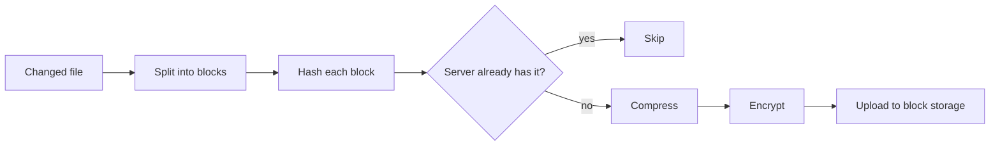
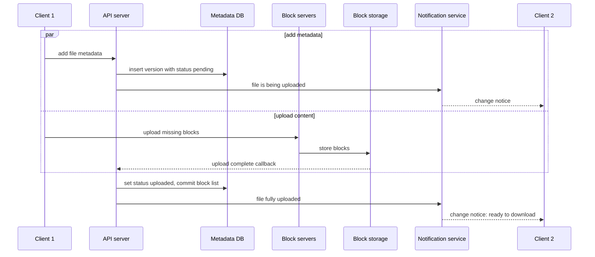
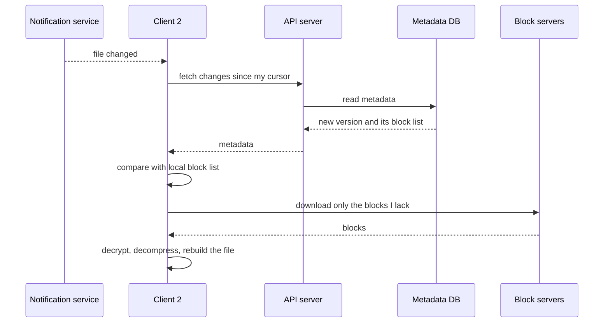

# Design file storage and sync II: delta sync, consistency, conflicts and failures

## Before this lesson

Read [Design file storage and sync I](#/lesson/system-design/file-sync-design). You should know that files are split into blocks named by the hash of their content, that a file version is an ordered list of block hashes, and that the client talks to block servers for data and to API servers for metadata. Transactions were introduced in [The five building blocks](#/lesson/system-design/core-components).

## In plain words

The previous lesson gave the assistant who keeps two ring binders identical a method: copy only the pages that changed, and keep a logbook. This lesson deals with the awkward situations that method runs into.

- **Someone inserts a sentence near the start of a long document.** Every later page now begins and ends in a different place. If "pages" are fixed lengths of text, all of them look changed, and the "copy only what changed" saving disappears.
- **Two people edit the same page while out of contact.** Whose version is kept?
- **The assistant is interrupted halfway through**, with new pages delivered but the logbook not yet updated.
- **The binders fill the building.** Storage costs money, and old versions pile up.

Each has a standard answer: content-defined chunking, version checks with conflict copies, a commit step that makes an upload all-or-nothing, and a combination of deduplication, version limits and cold storage.

## 1. Deep dive: block servers and delta sync

When a file changes, the client and the block servers do the following for the changed blocks only:

1. Split the file into blocks.
2. Compute each block's hash.
3. Ask the server which hashes it does not have.
4. Compress and encrypt the missing blocks, and upload them.



Compression depends on the content: text compresses very well with general algorithms such as gzip or zstd, while images and video are already compressed and gain nothing, so the client skips them.

### The shifting problem with fixed-size blocks

Fixed-size blocks work well when an edit *replaces* bytes. They work badly when an edit *inserts* or *deletes* bytes, because every block boundary after the edit moves.

```python-run
import hashlib

def fixed_blocks(data, size=16):
    return [data[i:i + size] for i in range(0, len(data), size)]

def content_defined_blocks(data, window=4, divisor=11, min_len=6, max_len=40):
    """Cut wherever a hash of the last `window` characters hits a chosen value.
    The cut points depend on the CONTENT nearby, not on the distance from the start."""
    blocks, start = [], 0
    for i in range(len(data)):
        length = i - start + 1
        tail = data[max(start, i - window + 1):i + 1]
        boundary = sum(ord(c) for c in tail) % divisor == 0
        if (boundary and length >= min_len) or length >= max_len:
            blocks.append(data[start:i + 1])
            start = i + 1
    if start < len(data):
        blocks.append(data[start:])
    return blocks

def new_blocks(old_blocks, new_blocks_list):
    have = {hashlib.sha256(b.encode()).hexdigest() for b in old_blocks}
    return [b for b in new_blocks_list if hashlib.sha256(b.encode()).hexdigest() not in have]

original = ("Sync services split files into blocks and upload only the blocks that changed. "
            "That keeps bandwidth low when a large file receives a small edit. "
            "The difficulty is deciding where one block ends and the next begins.")
edited = "NOTE: " + original                      # six characters inserted at the very start

for name, splitter in (("fixed-size", fixed_blocks), ("content-defined", content_defined_blocks)):
    before, after = splitter(original), splitter(edited)
    changed = new_blocks(before, after)
    print(f"{name:16s}: {len(after):>2} blocks, {len(changed):>2} must be uploaded "
          f"({sum(len(b) for b in changed)} of {len(edited)} characters)")
```

With fixed-size blocks, inserting six characters at the start changes every block: the whole file is uploaded again. With **content-defined chunking**, block boundaries are placed where the content itself has a certain pattern (found with a **rolling hash**, a hash that can be updated cheaply as a window slides along the data). After the first boundary, the cut points fall in the same places relative to the text as before, so only the first block or two are new.

Real systems use this for exactly that reason; the rsync algorithm and many backup tools are built on rolling hashes. Mention it as an optimisation after presenting fixed-size blocks, and name the trade-off: blocks have variable sizes, and the client does more computation.

## 2. Deep dive: strong consistency for metadata

Different devices must never disagree about what a file is. If the laptop believes version 7 has blocks `[a, b, c]` and the phone believes it has `[a, b, d]`, one of them will show a corrupt file. So metadata needs **strong consistency**: once a change is confirmed, every reader sees it.

Two places need care.

**The database.** A relational database with **ACID** transactions is the natural choice. ACID stands for atomicity (a transaction happens entirely or not at all), consistency (the data's rules always hold), isolation (concurrent transactions do not interfere) and durability (confirmed changes survive crashes). Committing a new version is one transaction: insert the version row, insert its block list, increase the blocks' reference counts and move the file's `latest_version` pointer. Either all four happen or none. A NoSQL store without transactions would force you to build these guarantees in application code, which is error-prone.

**The metadata cache.** A cache is eventually consistent unless you make it otherwise. Two rules keep it honest: on every write to the database, **invalidate** (delete) the matching cache entries in the same code path, and read from the primary when a read must reflect a write that only this moment happened. Cache replicas and the primary must agree before a cached value is served for correctness-critical reads.

For scale, the metadata database is sharded by workspace or user, so that everything involved in one transaction, a folder and its files and versions, lives on one shard.

## 3. Deep dive: the upload flow

Two requests go out in parallel when a client adds or changes a file.



**Request 1: metadata.** The API server records the new file version with status `pending` and tells the notification service, so other clients know an upload is in progress.

**Request 2: content.** The client sends the missing blocks to the block servers, which store them. When storage confirms, a completion callback reaches the API server, which changes the status to `uploaded` and notifies clients that the file is ready.

The status field is what makes the upload **all-or-nothing** from every other device's point of view. A version in `pending` is never offered for download. If the client disappears halfway, the pending version is abandoned and its orphaned blocks are cleaned up later by a background job. This is the same principle as in the framework lesson's worked example: order the steps so that a crash in the middle leaves something harmless.

Editing follows the same flow; only the changed blocks travel.

## 4. Deep dive: the download flow

A download starts when a client learns that a file changed elsewhere. There are two ways it learns:

- If the client is **online**, the notification service tells it.
- If the client is **offline**, the change is kept, and when the client reconnects it pulls everything it missed.



The client compares the new block list with the blocks it already holds locally and downloads only the difference. Each client keeps a **cursor**, a marker of the last change it has applied, so that "what changed since my cursor?" is cheap for the server and exact for the client.

## 5. Deep dive: the notification service

To keep files in step, a client must learn promptly that something changed. Two options from the chat module:

- **Long polling:** the client holds an HTTP request open; the server answers when there is a change or on timeout.
- **WebSocket:** a persistent two-way connection.

Either works. Long polling is the usual choice here, and Dropbox has described using it, for two reasons. Communication is **one-directional**: the server tells the client "something changed" and the client then fetches details over normal requests; there is nothing for the client to push on that channel. And notifications are **infrequent**, with no bursts of data, so the efficiency of a two-way socket is not needed.

The flow: each client opens a long poll to the notification service. When a file changes, the service closes that client's poll with "changes available". The client then asks the metadata service for the details and opens a new long poll. The notification carries no file data, which keeps the notification servers simple and holds no sensitive information on them.

Each notification server holds a very large number of mostly idle connections, so, as with chat servers, they are stateful, and losing one means its clients must reconnect to another, with backoff.

## 6. Deep dive: sync conflicts

Two clients may change the same file at nearly the same time, or one may edit offline for hours. Each change says which version it was based on (its **parent version**). The server accepts a change only if the parent is still the latest.

- The first change to arrive is accepted and becomes the new latest version.
- The second arrives with a parent that is no longer the latest. It is a **conflict**.

The server does not try to merge arbitrary files; it cannot know how to merge two spreadsheets or two photographs. Instead the system keeps both: the losing client is given the server's version as the main file and saves its own changes as a separate **conflicted copy** next to it, named so the user can see what happened. The user decides whether to merge by hand or discard one.

```python-run
class FileRecord:
    def __init__(self):
        self.latest, self.versions = 0, {0: ""}
        self.conflict_copies = []

    def commit(self, device, parent_version, content):
        """Accept only if the change was based on the current latest version."""
        if parent_version == self.latest:                 # check and update happen in one transaction
            self.latest += 1
            self.versions[self.latest] = content
            return f"{device}: accepted as version {self.latest}"
        name = f"notes (conflicted copy from {device}).txt"
        self.conflict_copies.append((name, content))
        return (f"{device}: REJECTED, based on v{parent_version} but latest is v{self.latest}; "
                f"saved as '{name}'")

f = FileRecord()
print(f.commit("laptop", 0, "shopping: milk"))
# Phone and tablet both start from version 1 while offline.
print(f.commit("phone", 1, "shopping: milk, eggs"))
print(f.commit("tablet", 1, "shopping: milk, bread"))
print("main file    :", f.versions[f.latest])
print("conflict copy:", f.conflict_copies)
```

The phone's change is accepted because version 1 was still the latest. The tablet's change was based on version 1 too, but by then the latest was version 2, so it is saved as a conflicted copy. Nothing is lost and nothing is silently overwritten.

This check-then-write must be atomic: it runs inside the metadata transaction, or as a conditional update ("set latest to 3 only if latest is 2"). Without that, two commits could both pass the check. The pattern is called **optimistic concurrency control**: proceed without locking, and detect the clash at commit time.

Real-time collaborative editors such as Google Docs go further and merge concurrent edits automatically using techniques such as operational transformation or CRDTs. That is a different product with a different design, and worth naming if asked.

## 7. Deep dive: saving storage space

Version history and cross-region copies multiply storage. Three techniques reduce it.

**Deduplication.** Identical blocks are stored once, account-wide or across all accounts, identified by hash.

**A smart version policy.** Keep a limited number of versions per file, dropping the oldest. Give more weight to recent versions: a document saved a thousand times in an afternoon does not need a thousand retained versions; keep a few recent ones and thin out the rest.

**Cold storage.** Data that has not been accessed for months moves to a cheaper storage class with slower retrieval.

```python-run
blocks_written = 1_000_000              # block writes per day across all users
block_mb = 4
dedup_ratio = 0.30                      # share of written blocks that already exist
versions_kept_fraction = 0.50           # share of old-version blocks retained after the version policy
cold_fraction = 0.60                    # share of stored data older than 90 days
hot_price, cold_price = 0.023, 0.004    # dollars per GB per month

naive_gb = blocks_written * block_mb / 1000 * 30                 # one month, nothing saved
after_dedup = naive_gb * (1 - dedup_ratio)
after_versions = after_dedup * versions_kept_fraction
cost_naive = naive_gb * hot_price
cost_final = after_versions * ((1 - cold_fraction) * hot_price + cold_fraction * cold_price)

print(f"one month of writes, stored as-is : {naive_gb / 1000:,.0f} TB, ${cost_naive:,.0f} per month")
print(f"after deduplication               : {after_dedup / 1000:,.0f} TB")
print(f"after the version policy          : {after_versions / 1000:,.0f} TB")
print(f"with 60% in cold storage          : ${cost_final:,.0f} per month "
      f"({1 - cost_final / cost_naive:.0%} lower)")
```

The three measures compound: fewer bytes are stored, and most of what remains is stored at a fraction of the price.

Deleting must be done with care because blocks are shared. Removing a file version decreases its blocks' reference counts; a **garbage collection** job deletes blocks whose count has reached zero, after a safety delay, so that a block is not removed while an in-flight upload is about to reference it.

## 8. Bottlenecks and failure handling

| Failure | Handling |
|---|---|
| Load balancer fails | A standby takes over; the two exchange heartbeats |
| Block server fails | Other block servers pick up unfinished or pending jobs; the client re-sends the blocks that were not confirmed |
| Block storage outage in a region | Blocks are replicated across regions; read from the other region |
| API server fails | Stateless; the load balancer routes around it |
| Metadata cache node fails | Read from a cache replica; bring up a replacement |
| Metadata primary fails | Promote a replica to primary and add a new replica |
| Metadata replica fails | Read from another replica; replace it |
| Notification server fails | Its long-poll clients reconnect to another server. With hundreds of thousands of connections per server, reconnection is slow, so clients use backoff and jitter |
| Offline backup queue fails | The queue is replicated; consumers re-subscribe to the backup |
| Client crashes mid-upload | The version stays `pending` and is never shown; orphaned blocks are garbage collected; the client resumes from its local journal |
| Corrupted block | Detected because its hash no longer matches; fetched from another replica |

That last row is a quiet advantage of content addressing: every block carries its own integrity check, since its name is the hash of what it should contain.

## 9. Trade-offs and alternatives

| Decision | Chosen | Alternative | When the alternative fits |
|---|---|---|---|
| Upload path | Through block servers | Client uploads directly to cloud storage with pre-signed URLs | Faster and cheaper, but chunking, compression and encryption logic must then be implemented on every client platform, and client-side code is harder to trust |
| Chunking | Fixed size, with content-defined as an optimisation | Whole-file upload | Small files only |
| Metadata store | Relational, ACID, sharded by workspace | NoSQL with application-level transactions | Very large scale with engineering capacity to build the guarantees |
| Notification | Long polling | WebSocket | Products that also push real-time collaborative edits |
| Conflicts | First writer wins, loser kept as a conflicted copy | Automatic merge | Structured documents with a merge algorithm |
| Presence tracking | Separate online/offline service | In the notification servers | Keeping it separate lets presence change independently |
| Encryption | Server-side keys | Client-side (end-to-end) | Privacy-first products; costs cross-user deduplication and server-side features |

Two of these deserve a sentence each. Uploading directly to cloud storage removes a hop, but puts security-sensitive code in clients that can be modified; many designs accept block servers for that reason. Client-side encryption means the server cannot see file contents, so identical files from different users no longer produce identical blocks, and cross-user deduplication is lost.

## 10. What a strong answer sounds like

> **Interviewer:** A user edits one paragraph in a 1 GB file. What is sent?
>
> **Candidate:** Files are split into blocks of about 4 MB, each named by the SHA-256 of its content. The client rehashes, asks the server which hashes are missing, and uploads only those, compressed and encrypted: here, one block. The new version is a new block list that shares all the other blocks.
>
> **Interviewer:** What if they insert a paragraph near the top?
>
> **Candidate:** With fixed-size blocks every later boundary shifts and all blocks look new. I would use content-defined chunking with a rolling hash, so boundaries follow the content and only the blocks around the insertion change.
>
> **Interviewer:** How do you make sure devices never see a half-uploaded file?
>
> **Candidate:** The version is created with status pending and only becomes visible when all blocks are stored and the block list is committed in one transaction. Metadata lives in a relational database for that reason, with cache entries invalidated on write. A crash mid-upload leaves a pending version and some orphaned blocks, which a cleanup job removes.
>
> **Interviewer:** Two devices edit the same file offline.
>
> **Candidate:** Each commit names its parent version. The first is accepted. The second fails a conditional update because its parent is no longer the latest, so that client keeps the server's version as the main file and saves its own as a conflicted copy. I do not try to merge arbitrary file types.
>
> **Interviewer:** And storage cost?
>
> **Candidate:** Block-level deduplication, a cap on retained versions weighted towards recent ones, and moving data untouched for months to cold storage. Deletion goes through reference counts and delayed garbage collection, because blocks are shared.

## Common mistakes

- **Presenting fixed-size blocks without the insertion problem.**
- **Making a version visible before its blocks are stored.**
- **Last write wins for conflicts**, silently destroying someone's work.
- **A non-atomic version check**, letting two commits both succeed.
- **Trying to merge arbitrary binary files automatically.**
- **Deleting a block when one file that used it is deleted.**
- **Carrying file data in notifications** instead of "something changed".
- **Forgetting offline clients**, which must catch up by cursor.

## Summary

- Delta sync uploads only blocks the server lacks; content-defined chunking keeps that saving when bytes are inserted or deleted.
- Metadata needs strong consistency: ACID transactions for commits, and cache invalidation on every write.
- Upload is two parallel requests joined by a status: `pending` until blocks are stored and the block list is committed, then `uploaded`.
- Downloads are triggered by a notification or by reconnecting, and fetch only missing blocks after comparing block lists, tracked by a per-client cursor.
- Notifications use long polling: one-directional, infrequent "something changed" signals.
- Conflicts are detected with a parent-version check in a transaction; the first writer wins and the other becomes a conflicted copy.
- Storage is reduced by deduplication, version limits and cold storage; shared blocks are deleted only through reference counts and garbage collection.

## Glossary

- **Rolling hash**: a hash over a sliding window that can be updated cheaply as the window moves.
- **Content-defined chunking**: choosing block boundaries from the content, so insertions shift few blocks.
- **ACID**: atomicity, consistency, isolation, durability; the guarantees of database transactions.
- **Cache invalidation**: removing a cached entry when the underlying data changes.
- **Pending / uploaded**: the states of a version before and after its content is fully stored.
- **Orphaned block**: a stored block that no file version refers to.
- **Cursor**: a client's marker of the last change it has applied.
- **Parent version**: the version an edit was based on.
- **Conflict**: two changes based on the same parent version.
- **Conflicted copy**: the losing change saved as a separate file.
- **Optimistic concurrency control**: proceeding without locks and detecting clashes at commit time.
- **Conditional update**: a write that succeeds only if a stated condition still holds.
- **Garbage collection**: background deletion of data nothing refers to.
- **Operational transformation / CRDT**: techniques for merging concurrent edits automatically.

## Check yourself

```quiz
[
  {"q": "A user inserts ten characters at the start of a large file stored in fixed-size blocks. What happens?",
   "options": ["Only the first block changes", "Every block boundary shifts, so nearly all blocks have new hashes", "No blocks change", "Only the last block changes"],
   "answer": 1,
   "explain": "Fixed boundaries are positions from the start of the file. An insertion moves all later content across those boundaries."},
  {"q": "How does content-defined chunking limit the effect of an insertion?",
   "options": ["It uses larger blocks", "Boundaries are chosen from the content with a rolling hash, so they fall in the same places relative to the text after the edit", "It stores the file twice", "It disables deduplication"],
   "answer": 1,
   "explain": "Because cut points depend on nearby bytes and not on position, chunks after the edit region are unchanged."},
  {"q": "Why does a new file version start with status pending?",
   "options": ["To make uploads slower", "So other devices never see or download a version whose blocks are not all stored", "To allow deduplication", "Because the cache requires it"],
   "answer": 1,
   "explain": "Visibility changes only after the content is complete and the block list is committed, making the upload all-or-nothing for readers."},
  {"q": "Why is a relational database with ACID transactions chosen for metadata?",
   "options": ["It is faster than a cache", "Committing a version touches several rows that must change together and be seen consistently by all devices", "It stores blocks more cheaply", "It supports long polling"],
   "answer": 1,
   "explain": "The version row, block list, reference counts and latest pointer must change atomically. Transactions provide that directly."},
  {"q": "Two devices commit changes based on version 4. What does the server do with the second commit?",
   "options": ["Overwrites the first", "Rejects it as a conflict; that client keeps the server version and saves its own as a conflicted copy", "Merges the bytes automatically", "Deletes both"],
   "answer": 1,
   "explain": "The parent-version check fails for the second commit. Keeping both versions avoids silent data loss."},
  {"q": "Why is long polling a reasonable choice for the notification service?",
   "options": ["It carries file data efficiently", "Notifications are infrequent, one-directional signals that something changed", "It is required by blob storage", "It needs no servers"],
   "answer": 1,
   "explain": "The client only needs to learn that a change exists and then fetches details by ordinary requests. Two-way, high-rate messaging is not needed."},
  {"q": "A file version is deleted. When may one of its blocks be removed from storage?",
   "options": ["Immediately", "When its reference count is zero, after a safety delay", "Never", "When the user logs out"],
   "answer": 1,
   "explain": "Blocks are shared across versions, files and users. Garbage collection removes only unreferenced blocks, with a delay to protect in-flight uploads."},
  {"q": "What does the system lose if files are encrypted on the client with keys the server never sees?",
   "options": ["Durability", "Cross-user deduplication and server-side features that need the content", "The ability to split into blocks", "Notifications"],
   "answer": 1,
   "explain": "Different users' identical files encrypt to different bytes, so their blocks no longer match, and the server cannot index or preview content."}
]
```

> **Source:** Xu, *System Design Interview: An Insider's Guide*, ch. 15 (block servers, high consistency requirement, metadata database, upload flow, download flow, notification service, save storage space, failure handling) as a topic guide; Dropbox Tech Blog, "Streaming File Synchronization" (2014), https://dropbox.tech/infrastructure/streaming-file-synchronization ; Tridgell and Mackerras, "The rsync algorithm" (1996), https://rsync.samba.org/tech_report/
